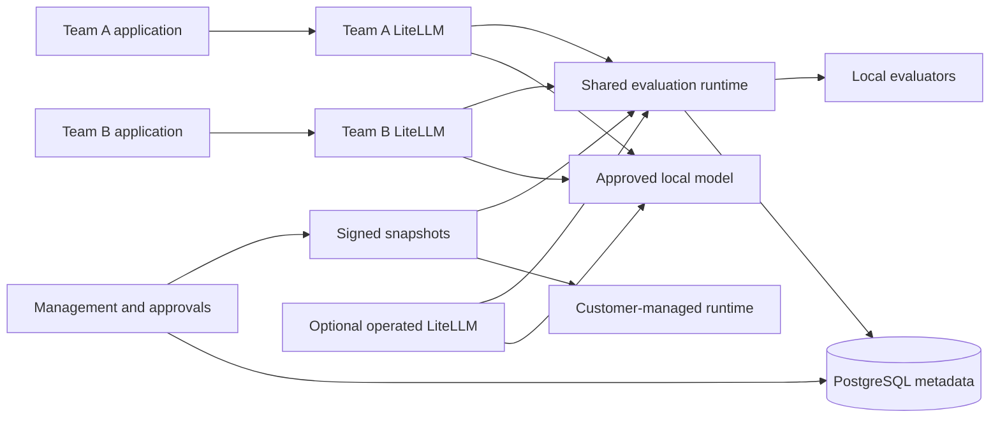

# Local Deployment Topology

## Trigger Condition

The user selected local shared-service delivery and Minikube if suitable. This document specifies the deployment and the claims its tests can support.

## Suitability Decision

Read-only inspection found 16 CPUs, approximately 23.5 GiB RAM with 11.2 GiB available, and 721 GiB free disk. Docker and kubectl were present; Minikube and Helm were absent. This supports choosing Minikube for development, subject to an actual preflight and measured resource gate. No cluster was installed during planning.

Minikube is intended for local development; its default network plugin does not enforce NetworkPolicy. Choose Calico from creation, then prove permitted and denied flows with running probes. Sources: [Minikube start](https://minikube.sigs.k8s.io/docs/start/), [network policy handbook](https://minikube.sigs.k8s.io/docs/handbook/network_policy/), [Docker driver](https://minikube.sigs.k8s.io/docs/drivers/docker/).

## Namespaces and Ownership

| Namespace / release | Owner | Contents | Content exposure |
|---|---|---|---|
| gr-platform | Guardrails provider | Management API, shared runtime replicas, PostgreSQL, signing service, local metrics, classifier and OCR workers | Evaluated raw content transiently reaches runtime and selected workers |
| gr-team-a | Team A | Independently configured LiteLLM and connector; A-only service credential | Its requests and model responses |
| gr-team-b | Team B | Independently configured LiteLLM and connector; B-only service credential | Its requests and model responses |
| gr-model | Local platform operator | Prepared Ollama and deterministic mock model | Inference content for registered local routes |
| gr-customer | Customer-mode operator | Runtime, signed tenant bundle, local cache/spool | Customer evaluations remain here except approved telemetry |
| gr-operated | Guardrails provider | Additional optional LiteLLM release and gateway-only provider credentials | Content for consumers selecting operated gateway |
| gr-recovery | Operator, temporary | Isolated restore drill | Metadata backup only |

A and B have separate tenant/workload identities, configurations and credentials; they share the same provider-hosted service contract. The harness may administer fixtures, but the product onboarding flow never requires their gateway administrator credential.

## Cluster and Resource Contract

Profile `guardrails-evolution`, Docker driver, Calico, 6 CPUs, 8192 MiB, 40 GiB requested disk; use the pinned versions from the artifact lock. Preflight requires ≥10 GiB available host memory, ≥30 GiB free disk, functioning Docker, no profile collision with a different owner marker and compatible host kernel. Do not change unrelated kube contexts. Every kubectl/Helm operation names the profile context and namespace explicitly.

Initial aggregate requests must fit ≤5 CPUs/6 GiB; limits ≤6 CPUs/8 GiB. Runtime uses two small replicas for rollout/isolation tests; PostgreSQL one replica and persistent volume; classifier/OCR/Ollama load sequentially for heavy profiles. Default text acceptance does not keep all heavy engines resident. A profile needing more resources must fail with measured requirements and permit an explicit operator-configured allocation; it must not OOM the host. Image/classifier readiness waits for local artifact load before traffic.

The first implementation spike must boot, resolve service DNS, complete TLS checks, exercise default-deny behavior and run both gateway text cases. Failure is a Phase 2 blocker. A different local orchestrator requires an explicit recorded plan revision rather than silently dropping network-policy gates.

## Network Flow Allowlist

Deny ingress/egress by default for workload namespaces. Explicitly allow namespace-local DNS only to kube-dns; gateway → runtime HTTPS; gateway → registered local inference; runtime → PostgreSQL, selected evaluators and management snapshot endpoint; management → PostgreSQL; internal metrics scraper → named metrics ports. Customer runtime → management only when sync enabled; telemetry only at the selected level and endpoint. No internet egress for default runtime profiles. Admission/RBAC prevents tenant service accounts from changing policies or relabeling namespaces.

Kubernetes NetworkPolicies are additive allow rules; they do not by themselves express application hostnames or precedence-based deny rules. Use Calico policy tiers for infrastructure deny requirements and application destination validation for registered HTTPS endpoints. Test alternate-IP, DNS-rebinding, redirect, direct-model and undeclared-port attempts. See [Kubernetes network policies](https://kubernetes.io/docs/concepts/services-networking/network-policies/).

Team-owned gateways remain cooperatively integrated: the shared service cannot force a team administrator to retain the connector or block access outside this controlled environment. Mandatory enforcement is claimed only for the operated gateway's tested routes and the controlled local network paths. Trusted host/cluster administrators can bypass local isolation.

## Preparation and Runtime Separation

`just evolution-prepare` obtains pinned binaries, images, wheels, classifier/model/OCR artifacts and local CA material; verifies checksums/licenses; builds images and writes lock metadata. It may use network before sensitive workloads run. `just evolution-up` loads prepared images and deploys without registry access. Image pulls use immutable digests and never implicit latest. Secrets are generated locally into ignored mode-0700 directories, mounted read-only; image layers and plan files contain none.

`just evolution-down` stops only this profile's workloads without removing durable data. `just evolution-reset` requires explicit operator intent and backs up metadata before deleting task-owned volumes. CI uses an ephemeral named profile, never an existing developer namespace. UI is exposed only via loopback TLS forwarding by default.

## Evidence Limits

Local network probes demonstrate tested connectivity restrictions, not physical residency, geo-attestation, hostile-tenant sandboxing, external service compliance or production availability. Record processing zones as declared local identifiers. External processing is disabled until an operator registers actual endpoints/regions and a different approver approves a candidate containing them.

## Cross-References

(see component-specs.md §LocalDeployment), (see tenancy-model.md), (see quality-gates.md).

## Model TLS Boundary

Ollama's native HTTP listener binds to pod loopback only. A Caddy sidecar terminates TLS using the prepared local CA certificate and proxies to that loopback listener; disable access/body logging. Only the HTTPS port is a Kubernetes Service port. The gateway and guardrails verify its CA/hostname. Plaintext exists only inside this declared model pod boundary, never on pod-to-pod or host-to-cluster content paths. Certificate expiry, wrong CA and direct native-port access are negative cases. This is a local transport adapter, not a new model gateway. Source: [Caddy reverse proxy](https://caddyserver.com/docs/caddyfile/directives/reverse_proxy).
