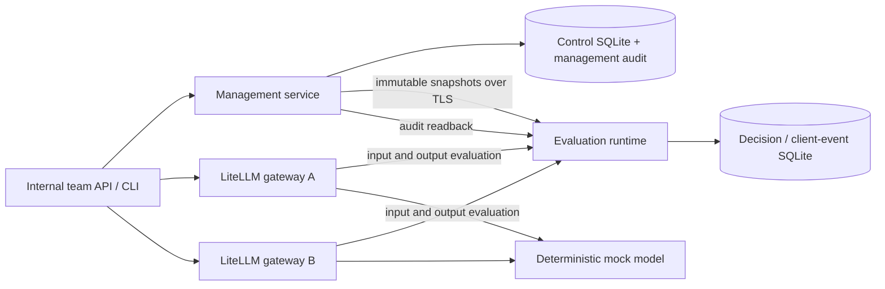

# Local technical proof architecture

## Authority and design status

This is an implementation design derived from [the accepted release](../../solution-docs/60-delivery/RELEASE-DEFINITION.md), AGR-022–030 and DEC-022–024. It is not evidence that the release is implemented. The user confirmed Python, FastAPI/Pydantic, SQLite and Docker Compose on 2026-10-08. Six core entities remain tenant, workload, policy, policy binding, evaluation and decision; supporting transport/storage models do not replace them.

L1 agreements and constraints, then the current release definition, govern this plan. Proposed ADRs are reference material: selected cache, bootstrap and audit mechanics below are explicit local engineering choices, not blanket ratification of those ADRs. Legacy cloud milestones and estimates do not govern this local delivery.

## End solution

A team registers two workloads, publishes one policy version, binds both in Observe, and sends chat requests to the independently configured gateways. The runtime detects real PII; the mock only supplies inference responses. Teams inspect metadata, explicitly promote state, publish another immutable version, update a binding and roll back. A single acceptance command exercises both interfaces and gateways, including failures, while external egress is blocked.

## Architectural decisions

| Decision | Reason and consequence |
| --- | --- |
| Separate management and evaluation processes, same owned Python image | Management outage is testable. Runtime requests never query management storage synchronously. No message broker or distributed database is needed. |
| One management-owned SQLite database and one runtime-owned SQLite database | Transactions protect publications, bindings and management audit. Decision audit cannot lock the control database. Each service has one process and one serialized writer; this is a local capacity choice. |
| Pure domain engine behind HTTP, persistence and evaluator adapters | Reuse the prototype's semantics while keeping FastAPI, LiteLLM and SQLite out of policy logic. |
| Complete immutable runtime snapshots with generation numbers | Poll every second, validate a complete candidate and swap atomically. Keep the last good snapshot if refresh fails; expose generation, age and degraded readiness. |
| Bounded stale-cache operation | Maximum age is 60 seconds by default, measured since last successful authenticated refresh/304. After expiry apply the workload's explicit management-unavailable action. Known cached identities remain authenticated when the snapshot is stale so that the configured failure action can run; unknown credentials always reject. Credential revocation may therefore be delayed for the duration of an outage, which is an explicit local cooperative-posture limitation. Cold start without a validated snapshot is not ready and refuses evaluations. |
| Per-turn policy consistency | Input evaluation creates a bounded opaque context that pins the effective policy, binding state, snapshot generation and client failure configuration. Output for that turn uses it even if a new binding arrives. New turns use the current snapshot. Contexts expire after 120 seconds; no prompt/response text is kept in them. |
| Policy versions are published once | Canonical representation and a hash, deep immutable domain objects, unique keys and database protection against updates/deletes. Updates create a new version; bindings record history. |
| Govern one effective policy | Organization and tenant floors validate a single policy/binding, including checks, stages, strength and parameters. Local minimum floor state is limited to Disabled/Observe so every new binding can start Observe; higher floor states require later staged onboarding. They do not compose policy packs. Floor updates that invalidate current bindings are rejected atomically. |
| Local credentials and TLS | Generated high-entropy bearer tokens, server-derived identities and tenant checks; private local CA and certificate verification on every service link. This substitutes for local identity only; it does not prove IAM/KMS. |
| Cooperative gateway enforcement | Only the documented text-chat route is a supported application surface. Teams must route through the connector; this proof does not prevent the owner of a gateway from removing it. |
| Explicit failure precedence | Normal findings are constrained by enforcement state; configured failure actions are handled separately. A failed audit write cannot weaken an already computed block or redaction. See variance-matrix.md. |

## Concurrency and limits

Use one ASGI worker per owned service. Run local detector jobs in a bounded pool of four worker processes, at most 32 queued jobs; enforce one monotonic 500 ms stage deadline with a 100 ms audit reserve. Queueing/evaluation stops by the 400 ms cutoff and an overrun worker is terminated/replaced asynchronously. Timeout tests must prove deadline enforcement, including a deliberately stalled worker. No unbounded background jobs or retries. SQLite busy timeout is 100 ms; audit time counts within the stage deadline; its actual timeout is the smaller of 100 ms and remaining stage time. Worker cleanup must not delay the response and cannot release admission capacity until the worker is reaped. Apply backpressure before retaining request bodies when the queue is full.

The proof defaults to at most 32 string messages and 1 MiB aggregate UTF-8 content per stage; the independent HTTP body cap is 8 MiB to accommodate worst-case JSON escaping and envelope overhead. Cap active turn contexts at 1,024 and expire them after 120 seconds. Client evaluation deadline is 1,500 ms per stage, connect timeout 250 ms; mock inference timeout is 10 seconds. These are visible engineering settings, not promised production limits. Readiness discloses saturation/degradation without exposing tokens or content.

## Update and rollback behavior

A mutation commits its immutable data, history, management audit and next desired generation in one transaction. API success means committed desired state. The CLI's default five-second wait separately checks runtime applied generation; timeout returns nonzero with the committed operation ID, never claims the write was undone. The API provides the same readback barrier. No availability or immediate-revocation guarantee is inferred during a management outage.

Rollback references a successful historical binding revision and creates a new revision after current governance checks. It never edits old policy bytes or bypasses a newer mandatory floor. An in-flight turn may finish on the older revision; subsequent input evaluations after the barrier must use the newly applied revision.

## Security and content exposure

The gateway, runtime and mock see relevant text in memory; input redaction happens before the mock receives it and output redaction before the caller receives it. Management receives policy and metadata, not evaluation bodies. TLS covers runtime, management, model and inspection paths. Host ports bind only to loopback. Service-to-service credentials have only snapshot, acknowledgement or audit-forwarding privileges as required.

Default persistent data contains no original prompt, response, matched substring or bearer token. Sanitize validation errors (including Pydantic input values), exception messages and LiteLLM logs. Mock request inspection is memory-only and enabled only in the proof profile. Explicit boolean content retention is an opt-in policy setting restricted to security administrators; content-bearing audit queries require that role and an explicit include-content flag. A local operator with filesystem access remains trusted; no KMS encryption, tamper-proof storage or production compliance claim is made.

## Scope Boundaries

Included: every row of the accepted ten-row matrix, full API/CLI lifecycle, two real gateways, mock inference, input/output PII, five states, immutable versions, governed updates/rollback, local identities/TLS, explicit failure handling and reproducible offline evidence.

Excluded from this release: AWS deployment or live Bedrock; hosted service launch; browser UI; streaming; tool/function calls; multimodal requests; agentic stages; multiple generated choices; policy-pack composition; comprehensive PII, injection or harmful-content detection; production SLAs, high availability and load targets; generic SDK product delivery; production promotion sign-off and live model quality. Existing deterministic/JSON/Bedrock prototype code may remain but is not advertised as proof-supported capabilities.

Supported chat input contains string content for system, developer, user and assistant roles, at least one user message, one non-streaming completion, and no tool/multipart shapes. Every message is evaluated. Unsupported shapes are rejected before inference. Caller-supplied policy selectors, guardrail overrides and arbitrary provider/model names are rejected. The exact boundary is in input-output-contract.md.
