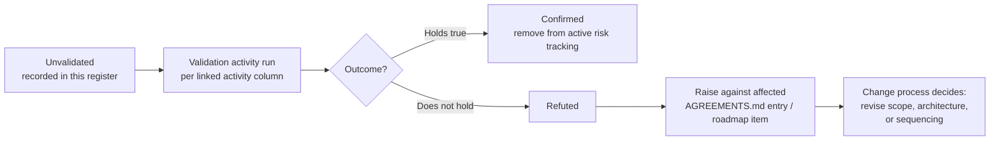

**AI Guardrails — Assumptions Register**

**Authority level:** L1
**Status:** Draft
**Date:** 2026-07-24
**Derived from:** AGREEMENTS.md

---

## Purpose

This register captures what the AI Guardrails program currently **believes to be true but has not yet validated**. Each entry is a load-bearing assumption: something the charter, the accepted [agreements](./AGREEMENTS.md), or the delivery sequencing depends on, but which has not been confirmed against real data, a real stakeholder commitment, or a real environment.

This document does not carry the same kind of authority as [`AGREEMENTS.md`](./AGREEMENTS.md). AGREEMENTS.md records decisions the organization has already accepted; this register records **beliefs that, if wrong, would require one or more of those agreements, the roadmap, or the architecture to be revisited.** Where an assumption underpins a specific agreement, the linked AGR ID is noted so that invalidating the assumption automatically flags the agreement for re-review.

No entry in this register may be read as contradicting `AGREEMENTS.md`. If a validation activity later confirms an assumption is false in a way that conflicts with an accepted agreement, the conflict must be raised through the same change process that governs the agreements register — this document only surfaces the risk, it does not resolve it.

Every assumption below is intentionally left without invented figures. Where a number would normally appear (expected volume, latency budget, availability target, cost), the source material does not yet supply one, and this register records that gap explicitly as "TBD" rather than fabricating a placeholder.

---

## How to read this register

| Field | Meaning |
| --- | --- |
| **ID** | Stable identifier, `ASM-NNN`, referenced by other documents and by validation activities. |
| **Assumption** | The belief currently being relied on. |
| **Owner** | The role accountable for validating or retiring the assumption (role names match those used in `AGREEMENTS.md`). |
| **Impact if false** | What breaks — architecturally, commercially, or in delivery sequencing — if the assumption does not hold. |
| **Validation needed / linked activity** | The concrete activity that would confirm or refute the assumption, and where its outcome should be recorded. |
| **Linked AGR / charter reference** | The accepted agreement(s) this assumption underpins, and the register entries it is derived from. |

All entries are currently **Unvalidated** unless a later revision of this document marks them otherwise.

---

## Table of contents

<!-- BEGIN GENERATED: toc -->
- [Purpose](#purpose)
- [How to read this register](#how-to-read-this-register)
- [A. Demand, adoption, and trust assumptions](#a-demand-adoption-and-trust-assumptions)
- [B. Technical and infrastructure feasibility](#b-technical-and-infrastructure-feasibility)
- [C. Performance and operational NFR assumptions](#c-performance-and-operational-nfr-assumptions)
- [D. Budget and delivery-sequencing assumptions](#d-budget-and-delivery-sequencing-assumptions)
- [E. Security, compliance, and policy-governance assumptions](#e-security-compliance-and-policy-governance-assumptions)
- [Validation lifecycle](#validation-lifecycle)
- [Relationship to other source-of-truth documents](#relationship-to-other-source-of-truth-documents)
<!-- END GENERATED: toc -->
---

## A. Demand, adoption, and trust assumptions

| ID | Assumption | Owner | Impact if false | Validation needed / linked activity |
| --- | --- | --- | --- | --- |
| **ASM-001** | Expected workload and tenant volume for the MVP and initial GA period is **not yet known** (TBD) within the organization. | Product lead | Infrastructure sized against a guessed volume risks throttling and latency degradation if actual demand is higher, or wasted spend if it is lower. A materially higher-than-expected volume could also trip the "production scale" trigger in [AGR-013](./AGREEMENTS.md#agr-013--aws-as-primary-cloud-minimal-mvp-account-model), invalidating the minimal two-account model earlier than planned. | Run a workload/tenant intake survey across candidate consuming teams before Phase 2 capacity planning; record actual counts in the workload registry. Linked: `20-product/PRODUCT-ROADMAP.md`, `50-architecture/DEPLOYMENT-ARCHITECTURE.md`. |
| **ASM-002** | Consuming teams targeted for Phase 1/2 onboarding **already own and operate LiteLLM, or an equivalent LLM gateway they control**. | Integration lead | Teams without an existing gateway cannot use Mode A (Remote Evaluation) at all. Without at least two such teams, the Phase 1–2 validation demonstration criteria ([`SUCCESS-CRITERIA.md`](../10-charter/SUCCESS-CRITERIA.md); [`60-delivery/VALIDATION-PLAN.md`](../60-delivery/VALIDATION-PLAN.md)) cannot be met, and adoption would depend on Guarded Gateway (Phase 3) sooner than sequenced. | Inventory the actual gateway footprint of intended Phase 1/2 pilot teams before sequencing is finalized; log any team that lacks a gateway as an exception. Linked: `60-delivery/IMPLEMENTATION-STRATEGY.md`, `20-product/USE-CASES.md`. |
| **ASM-003** | At least **two organizationally independent teams**, each operating a separate LiteLLM instance, are available and willing to participate in the Phase 1–2 validation demonstration. | Delivery lead | The falsifiable Phase 1–2 validation demonstration ([`SUCCESS-CRITERIA.md`](../10-charter/SUCCESS-CRITERIA.md); [`60-delivery/VALIDATION-PLAN.md`](../60-delivery/VALIDATION-PLAN.md); [DEC-008](./DECISIONS.md#dec-008--supersede-the-mvp-bounded-scope-define-and-estimate-the-full-feature-set-across-five-phases)) cannot be executed as specified, and "Phases 1–2 validated" would need to be redefined or delayed. | Secure named commitments from two candidate teams before Phase 1 exit; track in `60-delivery/VALIDATION-PLAN.md`. |
| **ASM-004** | Sufficient regulated, data-residency-sensitive, air-gapped, or high-volume workload demand exists in the organization to justify building and maintaining the **Customer-Managed Runtime** (Mode C / Phase 4). | Product lead | Investment in the runtime container, Helm chart, ECS template, and local policy cache/sync (Phase 4 deliverables) would go largely unused; roadmap sequencing under [AGR-020](./AGREEMENTS.md#agr-020--five-phase-delivery) would need reordering or descoping. | Run a demand-sizing exercise with security/compliance and platform teams to name candidate Mode C workloads before Phase 4 is resourced; re-check at each phase gate. Linked: `20-product/PRODUCT-ROADMAP.md`, `70-governance/RISK-REGISTER.md`. |
| **ASM-005** | Teams targeted for cooperative-integration onboarding (Phase 1/2) are **sufficiently trusted** that a removable, non-bypass-proof connector is an acceptable enforcement posture for them. | Security and governance lead | The connector-bypass risk ([`RISK-REGISTER.md`](../70-governance/RISK-REGISTER.md)) materializes faster or more broadly than expected, undermining confidence in reported adoption/enforcement metrics, and may force earlier investment in platform-managed or network/IAM-enforced posture ([AGR-018](AGREEMENTS.md#agr-018--trust-and-enforcement-model)) ahead of its planned sequencing. | Confirm a trust/risk classification per candidate workload at registration time; review with security/governance before any workload is promoted from cooperative to enforced posture. Linked: `50-architecture/SECURITY-ARCHITECTURE.md`, `70-governance/RISK-REGISTER.md`. |

---

## B. Technical and infrastructure feasibility

| ID | Assumption | Owner | Impact if false | Validation needed / linked activity |
| --- | --- | --- | --- | --- |
| **ASM-006** | The AWS accounts required for the MVP (one non-production, one production) can be **provisioned and access-configured** (IAM, network boundaries) within the delivery timeline. | Platform operations lead | Phase 1/2 delivery slips, or teams resort to sharing ad hoc accounts, weakening the explicit environment-boundary requirement in [AGR-013](./AGREEMENTS.md#agr-013--aws-as-primary-cloud-minimal-mvp-account-model). | Confirm the account-provisioning request is filed and approved with target dates before Phase 1 kickoff. Linked: `60-delivery/IMPLEMENTATION-STRATEGY.md`. |
| **ASM-007** | The delivery team has, or can readily acquire, the **AWS skills** required to build and operate the MVP architecture (ECS Fargate or EKS, API Gateway/ALB, DynamoDB, Bedrock Guardrails, IAM, KMS, SQS, CloudWatch, ECR). | Technical lead | Delivery timeline slips, or external hiring/contracting becomes necessary; the service choices in [`DEPLOYMENT-ARCHITECTURE.md`](../50-architecture/DEPLOYMENT-ARCHITECTURE.md) may need to be simplified toward tooling the team already knows. | Run a skills-gap assessment against the [`DEPLOYMENT-ARCHITECTURE.md`](../50-architecture/DEPLOYMENT-ARCHITECTURE.md) service list before Phase 1 planning is finalized; identify training or staffing gaps. Linked: `60-delivery/IMPLEMENTATION-STRATEGY.md`. |
| **ASM-008** | **Amazon Bedrock Guardrails is available**, at acceptable feature parity, in the AWS Region(s) the organization intends to deploy the MVP and initial pilot workloads into. | Architecture lead | The Bedrock Guardrails adapter ([AGR-004](./AGREEMENTS.md#agr-004--bedrock-guardrails-as-first-engine-vendor-independent-contract)) cannot be used in the target Region; the MVP would fall back to deterministic rules only, or would need to deploy into a Region that conflicts with a consuming team's data-residency preference. | Verify current Bedrock Guardrails regional availability against the organization's preferred deployment Region(s) before Phase 1 architecture sign-off; re-verify at each Region-expansion decision. Linked: `50-architecture/INTEGRATION-ARCHITECTURE.md`. |
| **ASM-009** | No external-customer, compliance, independent-security-ownership, immutable-audit, production-scale, or dedicated-tenant trigger will arise **during the MVP** that would force account separation beyond the minimal one-non-production / one-production model. | Platform operations lead | The minimal account model ([AGR-013](./AGREEMENTS.md#agr-013--aws-as-primary-cloud-minimal-mvp-account-model)) becomes insufficient mid-delivery, forcing unplanned account restructuring and IAM re-architecture. | Review the AGR-013 trigger list against known stakeholder commitments at each phase gate; escalate immediately if a trigger looks imminent. Linked: `50-architecture/DEPLOYMENT-ARCHITECTURE.md`. |
| **ASM-010** | DynamoDB (or versioned S3) for policy storage and the workload registry will **perform adequately** at actual MVP read/write volumes, even though those volumes are not yet known (see ASM-001). | Technical lead | Policy-resolution latency or storage cost could exceed expectations once real workload volume is known, forcing a storage redesign after Phase 1/2 rather than before. | Load-test policy resolution and workload-lookup paths against representative traffic assumptions once ASM-001 is validated; revisit storage choice if actual volume diverges materially. Linked: `50-architecture/DATA-ARCHITECTURE.md`. |

---

## C. Performance and operational NFR assumptions

| ID | Assumption | Owner | Impact if false | Validation needed / linked activity |
| --- | --- | --- | --- | --- |
| **ASM-011** | The added synchronous network and processing **latency budget** for remote input/output evaluation (Mode A and Mode B) is acceptable to the pilot workloads selected for Phase 1/2, even though no numeric latency budget has yet been set. | Technical lead | Pilot teams reject or bypass the connector because it feels slow, undermining adoption metrics and creating pressure to prioritize Customer-Managed Runtime (Mode C) ahead of Phase 4. | Measure P50/P95/P99 evaluation latency against pilot workloads' actual tolerance during Observe mode, before any workload is promoted to Enforce; define stage-specific timeouts as part of policy failure behavior. Linked: `50-architecture/OPERABILITY.md`, `60-delivery/RELEASE-CRITERIA.md`. |
| **ASM-012** | A hosted-runtime **availability objective**, though not yet numerically defined, can be set at a level pilot workloads will accept without requiring multi-region active-active availability (later-phase committed — [`CAP-036`](../20-product/CAPABILITIES.md), [DEC-019](DECISIONS.md#dec-019--multi-region-active-active-availability-committed-as-a-later-phase); not part of the MVP, but no longer an exclusion). | Architecture lead | Pilot teams demand higher availability guarantees than the MVP architecture provides, forcing scope creep into multi-region topology ahead of Phase 2/3. | Define and socialize a specific availability objective, timeout behavior, retry behavior, cached-policy behavior, and degraded mode with pilot teams before Phase 2 exit; capture as an explicit, written NFR rather than an implicit expectation. Linked: `50-architecture/OPERABILITY.md`. |
| **ASM-013** | The **local policy-cache staleness window** tolerated by Customer-Managed Runtime adopters (regulated/air-gapped workloads) during control-plane outages is compatible with an asynchronous, non-blocking policy-synchronization design. | Technical lead | Regulated customers require a shorter staleness tolerance than the asynchronous sync design can guarantee, forcing a redesign of policy distribution for Mode C. | Capture staleness-tolerance requirements from candidate Mode C adopters during Phase 4 discovery; define degraded-mode behavior for a stale cache as part of policy failure behavior. Linked: `50-architecture/DEPLOYMENT-ARCHITECTURE.md`, `50-architecture/COMPONENT-ARCHITECTURE.md`. |

---

## D. Budget and delivery-sequencing assumptions

| ID | Assumption | Owner | Impact if false | Validation needed / linked activity |
| --- | --- | --- | --- | --- |
| **ASM-014** | Budget allocated to the program is **sufficient to fund a two-account MVP** (one non-production, one production) — including runtime infrastructure, Bedrock Guardrails usage, and the delivery team — through Phase 1 and Phase 2. | Product lead | Delivery would need to be re-scoped, phases re-sequenced, or the timeline extended. The minimal account model itself ([AGR-013](./AGREEMENTS.md#agr-013--aws-as-primary-cloud-minimal-mvp-account-model)) is not in question — the pace of delivery against it is. | Confirm funding commitment covering Phase 1–2 deliverables before detailed planning is finalized; track actual spend against budget at each phase gate. Linked: `60-delivery/IMPLEMENTATION-STRATEGY.md`. |
| **ASM-015** | Stakeholders across the organization will **accept the five-phase delivery sequencing** and will not pressure the team to pull Phase 5 (advanced agent protection) or other later-phase items into Phases 1–2. | Delivery lead | The "product over-expansion" risk ([`RISK-REGISTER.md`](../70-governance/RISK-REGISTER.md)) materializes, and the phase-gated delivery discipline in [AGR-020](./AGREEMENTS.md#agr-020--five-phase-delivery) erodes under stakeholder pressure. | Communicate phase boundaries and rationale to stakeholders at program kickoff; require an explicit, documented scope-change decision (per the governance in [DEC-008](./DECISIONS.md#dec-008--supersede-the-mvp-bounded-scope-define-and-estimate-the-full-feature-set-across-five-phases) and `10-charter/SCOPE.md`) for any proposal to pull forward later-phase items. Linked: `20-product/PRODUCT-ROADMAP.md`, `60-delivery/MILESTONES.md`. |

---

## E. Security, compliance, and policy-governance assumptions

| ID | Assumption | Owner | Impact if false | Validation needed / linked activity |
| --- | --- | --- | --- | --- |
| **ASM-016** | Explicit content-exposure documentation (where prompts/responses are processed, what is transmitted, what is retained) will be **sufficient on its own** to satisfy security and compliance stakeholders for Mode A adoption, without those stakeholders instead requiring Mode C. | Security and governance lead | Security/compliance reviewers reject Mode A for workloads the product team expected to onboard cooperatively, shrinking the addressable Phase 1/2 population and increasing pressure to accelerate Mode C. | Pilot the content-exposure documentation with security/governance reviewers for at least one representative workload before broader Mode A rollout; capture any objection as a new risk or assumption. Linked: `50-architecture/SECURITY-ARCHITECTURE.md`, `70-governance/CLAIMS-REGISTER.md`. |
| **ASM-017** | Amazon Bedrock Guardrails combined with basic deterministic organizational rules will provide **adequate detection quality** for the MVP, without a proprietary prompt-injection or moderation model (explicitly excluded from MVP scope). | Technical lead | Pilot teams experience unacceptable false-positive or false-negative rates, undermining trust in the platform before the observe-to-enforce promotion described in [AGR-011](./AGREEMENTS.md#agr-011--observe-before-enforce-progression) can occur. | Evaluate Bedrock Guardrails and deterministic-rule detection quality against representative, risk-specific evaluation datasets during Phase 1/2 Observe mode, before any workload is promoted to Enforce. Linked: `60-delivery/VALIDATION-PLAN.md`, `70-governance/RISK-REGISTER.md`. |
| **ASM-018** | Limiting the categories of workload-specific policy overrides will **not materially block** pilot teams' willingness to adopt a shared policy. | Policy owner | Pilot teams request enough exceptions that the "policy fragmentation" risk ([`RISK-REGISTER.md`](../70-governance/RISK-REGISTER.md)) becomes real, or teams decline adoption because the shared policy does not fit their workload. | Track override requests during Phase 1/2 onboarding; review requested override categories against the "limit override categories, require ownership for exceptions" mitigation before Phase 2 exit. Linked: `70-governance/RISK-REGISTER.md`, `20-product/CAPABILITIES.md`. |

---

## Validation lifecycle

Every assumption in this register moves through the same lifecycle. An assumption is retired only when it is Confirmed or Refuted — "Unvalidated" is not a permanent resting state, and no assumption should still read "Unvalidated" once its linked phase gate ([AGR-020](AGREEMENTS.md#agr-020--five-phase-delivery)) has passed.

Ownership of moving an assumption through this lifecycle sits with the **Owner** named in its table row. Phase gates ([AGR-020](AGREEMENTS.md#agr-020--five-phase-delivery), `AGREEMENTS.md#agr-022`) are the natural checkpoints for reviewing which assumptions are still open.

---

## Relationship to other source-of-truth documents

| This document | Relationship |
| --- | --- |
| [`AGREEMENTS.md`](./AGREEMENTS.md) | Authoritative (L1). Every assumption here is either a precondition for one or more AGR entries, or a factor that could force an AGR entry to be re-reviewed if refuted. This register never overrides an agreement. |
| `../70-governance/RISK-REGISTER.md` | Assumptions in Category A and E largely mirror the risks in [`RISK-REGISTER.md`](../70-governance/RISK-REGISTER.md) (connector bypass, false confidence, hosted data exposure, policy fragmentation, product over-expansion); the risk register should track mitigations, this register tracks the underlying unvalidated beliefs. |
| `../60-delivery/VALIDATION-PLAN.md` | Owns the concrete validation activities referenced in the "Validation needed" column. |
| `../60-delivery/RELEASE-CRITERIA.md` | Phase-gate criteria should require that assumptions linked to a given phase are no longer "Unvalidated" before that phase is declared complete. |
| `../50-architecture/DEPLOYMENT-ARCHITECTURE.md` | Consumes ASM-001, ASM-006, ASM-009, ASM-010, and ASM-013 as sizing and topology inputs. |
| `just trace` | Generates the reverse index from each AGR to its implementing artifacts, so that a refuted assumption can be traced to every downstream document it affects. |

---

*This register should be revisited at every phase gate defined in [AGR-020](AGREEMENTS.md#agr-020--five-phase-delivery) and [AGR-020](./AGREEMENTS.md#agr-020--five-phase-delivery). New assumptions surfaced during Phase 1–5 delivery should be appended with the next sequential ID rather than renumbering existing entries.*
