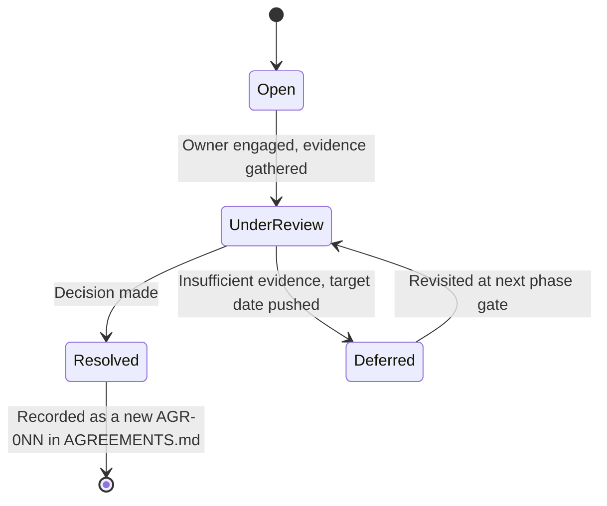
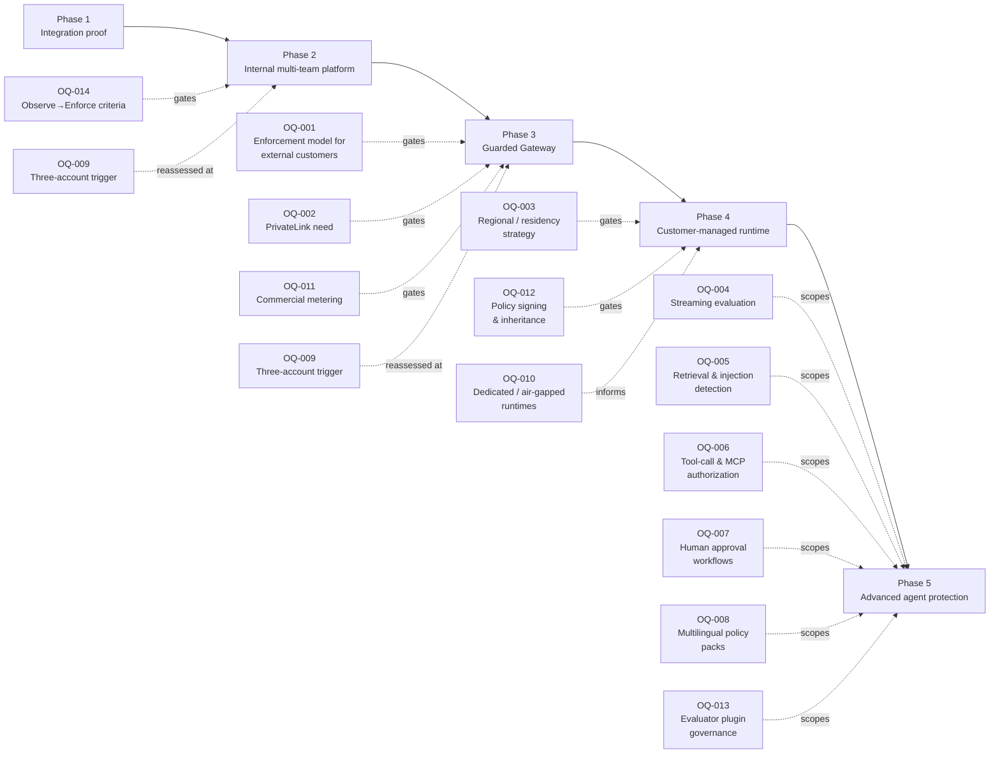

**AI Guardrails — Open Questions**

**Authority level:** L1
**Status:** Draft
**Date:** 2026-07-24
**Derived from:** seed.md + AGREEMENTS.md

---

## Purpose and how this register is used

This register is authoritative about **which decisions remain open** — it is not authoritative about their answers. Where [AGREEMENTS.md](AGREEMENTS.md) records what has been decided (AGR-001 through AGR-021), this document records what has **not** been decided but could materially change scope, feasibility, cost, or architecture if resolved differently than the current working assumption.

Rules for using this register:

* No derived document may treat an open question's "current working assumption" as a settled agreement. Assumptions are load-bearing enough to plan against, but they are provisional, not accepted.
* No derived document may contradict [AGREEMENTS.md](AGREEMENTS.md) while attempting to resolve an item listed here. If a proposed resolution would contradict an existing AGR, the AGR must be revisited explicitly, not silently overridden.
* When an item is resolved, the decision is recorded as a new entry in [AGREEMENTS.md](AGREEMENTS.md) (next available `AGR-0NN`), this entry is marked **Resolved** with a pointer to that AGR, and the corresponding row is removed from active tracking in [`00-source-of-truth/TRACEABILITY-MATRIX.md`](TRACEABILITY-MATRIX.md).
* This register is distinct from a risk register: seed §20 risks describe known negative outcomes with mitigations already assigned; the items below describe decisions not yet made. Several risks and open questions reference the same underlying uncertainty from different angles — cross-references are noted where relevant.

### Resolution lifecycle

---

## Table of contents

- [Summary table](#summary-table)
- [Phase-gate view](#phase-gate-view)
- [A. Enforcement and trust model](#a-enforcement-and-trust-model)
  - [OQ-001 — Enforcement model required for the first external customers](#oq-001--enforcement-model-required-for-the-first-external-customers)
- [B. Connectivity, regions, and data residency](#b-connectivity-regions-and-data-residency)
  - [OQ-002 — PrivateLink / private connectivity](#oq-002--privatelink--private-connectivity)
  - [OQ-003 — Regional deployment strategy and data residency](#oq-003--regional-deployment-strategy-and-data-residency)
- [C. Advanced evaluation and agent-protection roadmap](#c-advanced-evaluation-and-agent-protection-roadmap)
  - [OQ-004 — Streaming output evaluation timeline](#oq-004--streaming-output-evaluation-timeline)
  - [OQ-005 — Retrieval-content evaluation and indirect prompt-injection detection timeline](#oq-005--retrieval-content-evaluation-and-indirect-prompt-injection-detection-timeline)
  - [OQ-006 — Tool-call validation, tool-result evaluation, and MCP authorization scope](#oq-006--tool-call-validation-tool-result-evaluation-and-mcp-authorization-scope)
  - [OQ-007 — Human approval workflows: introduction timing and ownership](#oq-007--human-approval-workflows-introduction-timing-and-ownership)
  - [OQ-008 — Multilingual policy pack timeline](#oq-008--multilingual-policy-pack-timeline)
- [D. Infrastructure and deployment topology](#d-infrastructure-and-deployment-topology)
  - [OQ-009 — Trigger point for three-account AWS separation](#oq-009--trigger-point-for-three-account-aws-separation)
  - [OQ-010 — Dedicated tenant runtimes and air-gapped deployment timeline](#oq-010--dedicated-tenant-runtimes-and-air-gapped-deployment-timeline)
- [E. Commercial model](#e-commercial-model)
  - [OQ-011 — Commercial metering and policy marketplace](#oq-011--commercial-metering-and-policy-marketplace)
- [F. Policy governance and integrity](#f-policy-governance-and-integrity)
  - [OQ-012 — Policy signing and policy inheritance design](#oq-012--policy-signing-and-policy-inheritance-design)
  - [OQ-013 — Customer-specific evaluator plugin governance](#oq-013--customer-specific-evaluator-plugin-governance)
- [G. Promotion governance](#g-promotion-governance)
  - [OQ-014 — Go/no-go criteria to move a workload from observe to enforce](#oq-014--gono-go-criteria-to-move-a-workload-from-observe-to-enforce)
- [H. Compliance and availability posture](#h-compliance-and-availability-posture)
  - [OQ-015 — Full compliance certification target and scope](#oq-015--full-compliance-certification-target-and-scope)
  - [OQ-016 — Multi-region active-active availability need](#oq-016--multi-region-active-active-availability-need)
- [I. Guardrail-catalog growth and contract vocabulary](#i-guardrail-catalog-growth-and-contract-vocabulary)
  - [OQ-017 — Token and cost metadata in the evaluation contract](#oq-017--token-and-cost-metadata-in-the-evaluation-contract)
  - [OQ-018 — Evaluation-stage vocabulary expansion beyond the reserved seven](#oq-018--evaluation-stage-vocabulary-expansion-beyond-the-reserved-seven)
  - [OQ-019 — Reason-code taxonomy and guardrail category as an audit/metric dimension](#oq-019--reason-code-taxonomy-and-guardrail-category-as-an-auditmetric-dimension)
- [J. Policy authority](#j-policy-authority)
  - [OQ-020 — Mandatory-policy authority (who may pin a policy as mandatory)](#oq-020--mandatory-policy-authority-who-may-pin-a-policy-as-mandatory)

---

## Summary table

| ID | Question (condensed) | Owner | Target decision date | Resolution |
|---|---|---|---|---|
| [OQ-001](#oq-001--enforcement-model-required-for-the-first-external-customers) | Which enforcement posture (cooperative, platform-managed, or network/IAM-enforced) is required for the first external customers? | Security and governance lead, Product lead | TBD — before any external-customer commitment | Resolved by [DEC-010](DECISIONS.md#dec-010--serve-ai-guardrails-as-a-developer-service-with-mode-a-as-the-front-door) |
| [OQ-002](#oq-002--privatelink--private-connectivity) | Is PrivateLink / private connectivity required for Mode A or Mode B, and by when? | Architecture lead, Security and governance lead | TBD — revisit at Phase 3/4 planning | Resolved by [DEC-017](DECISIONS.md#dec-017--deployment-and-commercial-posture) |
| [OQ-003](#oq-003--regional-deployment-strategy-and-data-residency) | Which AWS Regions are supported at GA, and how are per-tenant residency commitments enforced? | Product lead, Architecture lead | TBD — before Guarded Gateway GA | Resolved by [DEC-018](DECISIONS.md#dec-018--multi-region-availability-at-ga) |
| [OQ-004](#oq-004--streaming-output-evaluation-timeline) | When does streaming output evaluation ship, and what applies to streaming workloads until then? | Technical lead | TBD — Phase 5 candidate, but the workload attribute exists now | Resolved by [DEC-016](DECISIONS.md#dec-016--phase-5-agentic-scope-timing) |
| [OQ-005](#oq-005--retrieval-content-evaluation-and-indirect-prompt-injection-detection-timeline) | When are retrieval-content evaluation and indirect prompt-injection detection introduced? | Technical lead, Security and governance lead | TBD — Phase 5 candidate | Resolved by [DEC-016](DECISIONS.md#dec-016--phase-5-agentic-scope-timing) |
| [OQ-006](#oq-006--tool-call-validation-tool-result-evaluation-and-mcp-authorization-scope) | What is the scope and timing of tool-call validation, tool-result evaluation, and MCP authorization? | Technical lead, Product lead | TBD — Phase 5, pending explicit scope approval | Resolved by [DEC-016](DECISIONS.md#dec-016--phase-5-agentic-scope-timing) |
| [OQ-007](#oq-007--human-approval-workflows-introduction-timing-and-ownership) | When are human approval workflows introduced, and who owns the approval UX? | Product lead | TBD — Phase 5 candidate | Resolved by [DEC-016](DECISIONS.md#dec-016--phase-5-agentic-scope-timing) |
| [OQ-008](#oq-008--multilingual-policy-pack-timeline) | When are multilingual policy packs introduced, and which languages first? | Product lead, Technical lead | TBD — no committed phase | Resolved by [DEC-017](DECISIONS.md#dec-017--deployment-and-commercial-posture) |
| [OQ-009](#oq-009--trigger-point-for-three-account-aws-separation) | What measurable trigger moves the MVP from two AWS accounts to three-or-more? | Platform operations lead, Security and governance lead | TBD — reassess at each phase gate, especially before Phase 3/4 | Resolved by [DEC-017](DECISIONS.md#dec-017--deployment-and-commercial-posture) |
| [OQ-010](#oq-010--dedicated-tenant-runtimes-and-air-gapped-deployment-timeline) | When (if ever) are dedicated tenant runtimes and air-gapped installation offered? | Technical lead, Platform operations lead | TBD — no committed phase | Resolved by [DEC-017](DECISIONS.md#dec-017--deployment-and-commercial-posture) |
| [OQ-011](#oq-011--commercial-metering-and-policy-marketplace) | Will commercial metering and a policy marketplace be pursued, and on what timeline? | Product lead, business/commercial stakeholder (TBD) | TBD — revisit after Phase 3 usage patterns are observed | Resolved by [DEC-017](DECISIONS.md#dec-017--deployment-and-commercial-posture) |
| [OQ-012](#oq-012--policy-signing-and-policy-inheritance-design) | How will policy signing and policy inheritance work once introduced? | Technical lead, Security and governance lead | TBD — evaluate at Phase 2→Phase 3 transition | Resolved by [DEC-011](DECISIONS.md#dec-011--policy-governance-classes-and-mandatory-policy-authority) (inheritance) and [DEC-015](DECISIONS.md#dec-015--evaluator-plugin-and-policy-signing-governance) (signing) |
| [OQ-013](#oq-013--customer-specific-evaluator-plugin-governance) | What is the security and compatibility review model for customer-specific evaluator plugins? | Technical lead, Security and governance lead | TBD — before this future-scope item is designed | Resolved by [DEC-015](DECISIONS.md#dec-015--evaluator-plugin-and-policy-signing-governance) |
| [OQ-014](#oq-014--gono-go-criteria-to-move-a-workload-from-observe-to-enforce) | What are the objective go/no-go criteria to promote a workload from observe to enforce? | Security and governance lead, workload owners | TBD — needed before Phase 2 onboarding scales past pilot workloads | Resolved by [DEC-012](DECISIONS.md#dec-012--observe-to-enforce-promotion-criteria) |
| [OQ-015](#oq-015--full-compliance-certification-target-and-scope) | Which compliance certifications (if any) are targeted, and for which phase? | Security and governance lead, Product lead | TBD — no committed phase | Resolved by [DEC-017](DECISIONS.md#dec-017--deployment-and-commercial-posture) |
| [OQ-016](#oq-016--multi-region-active-active-availability-need) | Is multi-region active-active availability ever required, independent of data residency? | Architecture lead, Platform operations lead | TBD — no committed phase | Resolved by [DEC-019](DECISIONS.md#dec-019--multi-region-active-active-availability-committed-as-a-later-phase) |
| [OQ-017](#oq-017--token-and-cost-metadata-in-the-evaluation-contract) | Do resource/cost guardrails (catalog GR-012) require extending the evaluation contract with token/cost metadata? | Technical lead, Architecture lead | TBD — before any GR-012 catalog entry is graduated | Resolved by [DEC-014](DECISIONS.md#dec-014--evaluation-contract-stability) |
| [OQ-018](#oq-018--evaluation-stage-vocabulary-expansion-beyond-the-reserved-seven) | Should the evaluation-stage vocabulary expand beyond the seven reserved stages (e.g. `retrieval_query`, `agent_plan`, `memory_read`, `tool_selection`)? | Technical lead, Architecture lead | TBD — at Phase 5 scoping | Resolved by [DEC-014](DECISIONS.md#dec-014--evaluation-contract-stability) |
| [OQ-019](#oq-019--reason-code-taxonomy-and-guardrail-category-as-an-auditmetric-dimension) | What is the canonical reason-code taxonomy, and does guardrail category become a first-class audit/metric dimension? | Technical lead, Security and governance lead | TBD — before Phase 2 onboarding scales | Resolved by [DEC-013](DECISIONS.md#dec-013--reason-code-taxonomy-and-guardrail-category-audit-dimension) |
| [OQ-020](#oq-020--mandatory-policy-authority-who-may-pin-a-policy-as-mandatory) | Who holds authority to mark a policy Mandatory, and can an app-team or tenant admin weaken or override a mandatory policy? | Security and governance lead, Product lead | Raised by the serving-model spec; resolved 2026-07-24 | Resolved by [DEC-011](DECISIONS.md#dec-011--policy-governance-classes-and-mandatory-policy-authority) |

---

## Phase-gate view

The five delivery phases in [AGREEMENTS.md § AGR-020](AGREEMENTS.md#agr-020--five-phase-delivery) are the natural checkpoints for revisiting most of these questions. This view is advisory — it does not commit any OQ to a hard deadline — but it shows which decisions should not be allowed to drift past a given phase boundary without an explicit choice.

OQ-015 (compliance certification) and OQ-016 (multi-region active-active) are cross-cutting and are not tied to a single phase; they are revisited whenever a prospect, deal, or regulatory requirement forces the question.

---

## A. Enforcement and trust model

### OQ-001 — Enforcement model required for the first external customers

**Status:** Resolved
**Resolution:** Resolved by [DEC-010](DECISIONS.md#dec-010--serve-ai-guardrails-as-a-developer-service-with-mode-a-as-the-front-door).
**Question:** Which of the three enforcement postures defined in seed §8 — cooperative integration, platform-managed enforcement, or network/IAM-enforced gateway — will the first external (non-internal) customers actually require, and at what point in the five-phase delivery plan does that requirement need to be satisfied?
**Owner:** Security and governance lead, Product lead
**Target decision date:** TBD — must be resolved before any external-customer commitment is made, and no later than Phase 3 (Guarded Gateway) scope commitment.
**Impact if unresolved:** Seed §8 and [AGR-018](AGREEMENTS.md#agr-018--trust-and-enforcement-model) are explicit that a cooperative connector must never be represented as a hard security boundary. Without this decision, the platform risks either (a) presenting a bypassable cooperative posture to a customer who actually needs bypass-proof enforcement, contradicting AGR-018 and creating compliance exposure, or (b) over-building network/IAM-enforced controls before any customer or compliance driver justifies the cost, contradicting the phase-gated delivery discipline in [AGR-020](AGREEMENTS.md#agr-020--five-phase-delivery). This directly affects the connector-bypass risk in seed §20.
**Current working assumption:** Cooperative integration remains the posture for Phase 1–2 internal teams. Platform-managed enforcement and the network/IAM-enforced gateway posture (seed §8, explicitly out of MVP scope per §17) are deferred until an external customer, compliance requirement, or specific bypass-prevention mandate is identified — mirroring the same trigger-based logic already accepted for AWS account separation in [AGR-013](AGREEMENTS.md#agr-013--aws-as-primary-cloud-minimal-mvp-account-model).
**Related:** seed §8, §6.3, §20 (connector bypass); [AGR-018](AGREEMENTS.md#agr-018--trust-and-enforcement-model); [`70-governance/RISK-REGISTER.md`](../70-governance/RISK-REGISTER.md); [`50-architecture/SECURITY-ARCHITECTURE.md`](../50-architecture/SECURITY-ARCHITECTURE.md).

---

## B. Connectivity, regions, and data residency

### OQ-002 — PrivateLink / private connectivity

**Status:** Resolved
**Resolution:** Resolved by [DEC-017](DECISIONS.md#dec-017--deployment-and-commercial-posture).
**Question:** Is AWS PrivateLink or another form of private connectivity required for Mode A (Remote Evaluation) or Mode B (Guarded Gateway), and if so, by which delivery phase must it be available?
**Owner:** Architecture lead, Security and governance lead
**Target decision date:** TBD — revisit during Phase 3 (Guarded Gateway) and Phase 4 (Customer-Managed Runtime) planning, or immediately if a specific prospect requires it sooner.
**Impact if unresolved:** Seed §17 explicitly places PrivateLink outside MVP non-goals, and seed §20 lists "private connectivity when justified" as a mitigation for hosted data exposure. Without a decision on when "justified" is reached, the platform cannot commit a timeline to customers with strict network-egress policies, and architecture work could either be deferred past the point a real deal needs it, or started speculatively with no confirmed demand.
**Current working assumption:** Not required for the MVP. Public, TLS-secured endpoints (per seed §14) are sufficient until a specific customer or compliance driver is identified; Customer-Managed Runtime (Mode C) remains the recommended path for any prospect whose requirement is actually "no tenant content leaves our network," since PrivateLink to a hosted service does not change the content-exposure model described in [AGR-009](AGREEMENTS.md#agr-009--remote-evaluation-is-not-a-private-data-or-data-local-model).
**Related:** seed §17, §20 (hosted data exposure); [AGR-009](AGREEMENTS.md#agr-009--remote-evaluation-is-not-a-private-data-or-data-local-model); [`50-architecture/DEPLOYMENT-ARCHITECTURE.md`](../50-architecture/DEPLOYMENT-ARCHITECTURE.md).

---

### OQ-003 — Regional deployment strategy and data residency

**Status:** Resolved
**Resolution:** Resolved by [DEC-018](DECISIONS.md#dec-018--multi-region-availability-at-ga).
**Question:** Which AWS Regions will the hosted runtime support at general availability, and by what mechanism are a tenant's "Allowed Regions" (part of the Tenant entity, seed §9) actually enforced rather than merely recorded?
**Owner:** Product lead, Architecture lead
**Target decision date:** TBD — before Guarded Gateway (Phase 3) general availability, and required before any residency-sensitive customer is onboarded to a hosted mode.
**Impact if unresolved:** The domain model already contains an "Allowed Regions" attribute (seed §9), and seed §20 lists "regional deployments" as a named mitigation for hosted data exposure, but no seed section defines which Regions are supported or how the attribute is enforced at runtime. Without resolution, the platform risks making an implicit residency claim (via the presence of the field) that the runtime cannot technically back — the same category of risk [AGR-009](AGREEMENTS.md#agr-009--remote-evaluation-is-not-a-private-data-or-data-local-model) already guards against for Mode A generally.
**Current working assumption:** A single AWS Region (specific Region TBD) is sufficient for the MVP. Multi-Region hosted deployment and per-tenant residency enforcement are deferred to a post-MVP phase, gated on demonstrated demand from a residency-sensitive tenant; until then, tenants with hard residency requirements are directed to Customer-Managed Runtime (Mode C), where residency is a natural consequence of the customer's own AWS account and Region choice.
**Related:** seed §9, §20; [`50-architecture/DEPLOYMENT-ARCHITECTURE.md`](../50-architecture/DEPLOYMENT-ARCHITECTURE.md); [`50-architecture/DATA-ARCHITECTURE.md`](../50-architecture/DATA-ARCHITECTURE.md). See also [OQ-016](#oq-016--multi-region-active-active-availability-need), which concerns availability topology rather than residency.

---

## C. Advanced evaluation and agent-protection roadmap

### OQ-004 — Streaming output evaluation timeline

**Status:** Resolved
**Resolution:** Resolved by [DEC-016](DECISIONS.md#dec-016--phase-5-agentic-scope-timing).
**Question:** When is streaming output evaluation introduced, and what is the defined behavior for workloads that declare a streaming requirement before that capability ships?
**Owner:** Technical lead
**Target decision date:** TBD — currently a Phase 5 candidate (seed §18), but the Workload entity already carries a "Streaming requirements" attribute (seed §9) that implies an earlier need to define at least an interim behavior.
**Impact if unresolved:** Seed §6.2 lists streaming output evaluation as permitted-but-not-required future scope, and seed §17 explicitly excludes "streaming guardrail enforcement" from the MVP. Without an interim behavior, a workload that registers as streaming has no documented evaluation path — creating exactly the kind of false confidence risk described in seed §20, where a team could assume output guardrails apply when they structurally cannot for a streamed response.
**Current working assumption:** Streaming workloads are evaluated only on buffered, non-streamed content (for example, a final aggregated response) until true streaming evaluation ships, or are run in observe/log-only mode with the limitation explicitly documented to the workload owner. The "Streaming requirements" attribute is captured now for planning and future-scoping purposes only, not as a signal that streaming is currently supported.
**Related:** seed §6.2, §9, §17, §20 (false confidence); [`20-product/PRODUCT-ROADMAP.md`](../20-product/PRODUCT-ROADMAP.md).

---

### OQ-005 — Retrieval-content evaluation and indirect prompt-injection detection timeline

**Status:** Resolved
**Resolution:** Resolved by [DEC-016](DECISIONS.md#dec-016--phase-5-agentic-scope-timing).
**Question:** When are the future evaluation stage `retrieval` (seed §9) and indirect prompt-injection detection (seed §6.2) introduced, and how do they interact with the connector-agnostic evaluation contract ([AGR-006](AGREEMENTS.md#agr-006--one-logical-evaluation-contract-across-all-modes))?
**Owner:** Technical lead, Security and governance lead
**Target decision date:** TBD — Phase 5 candidate per seed §18; no committed date.
**Impact if unresolved:** RAG-based and agentic workloads may onboard under the impression that retrieved documents are evaluated, when seed §13 currently limits MVP support to "user/model input and model output" only. Absent a stated timeline, application teams cannot plan around this gap, and security/compliance teams (seed §7) cannot assess residual risk for retrieval-heavy workloads.
**Current working assumption:** Retrieval-content evaluation and indirect prompt-injection detection are not part of the MVP and are not scheduled; workloads that retrieve external documents must treat those documents as unevaluated content until this item is resolved, and this limitation must be stated explicitly during onboarding rather than left implicit.
**Related:** seed §6.2, §9, §13; [AGR-006](AGREEMENTS.md#agr-006--one-logical-evaluation-contract-across-all-modes); [`20-product/CAPABILITIES.md`](../20-product/CAPABILITIES.md).

---

### OQ-006 — Tool-call validation, tool-result evaluation, and MCP authorization scope

**Status:** Resolved
**Resolution:** Resolved by [DEC-016](DECISIONS.md#dec-016--phase-5-agentic-scope-timing).
**Question:** What is the intended scope and delivery timing of tool-call validation, tool-result evaluation, and MCP authorization (seed §6.2, Phase 5 in §18), and how will the platform avoid being perceived as a "general MCP security platform," which seed §6.3 explicitly excludes?
**Owner:** Technical lead, Product lead
**Target decision date:** TBD — Phase 5, pending an explicit scope-approval decision; must not be scheduled inside Phases 1–2 per [AGR-020](AGREEMENTS.md#agr-020--five-phase-delivery).
**Impact if unresolved:** Seed §5.5 and [AGR-010](AGREEMENTS.md#agr-010--guardrails-are-not-authorization) are explicit that a guardrail decision that a tool call "appears safe" is not the same as authorization to execute it. Without a defined scope and timeline for tool-call validation, agentic-workload teams may conflate future guardrail capability with authorization the platform will never provide, recreating the false-confidence risk in seed §20 in its most consequential form (autonomous tool execution).
**Current working assumption:** Tool-call validation, tool-result evaluation, and MCP authorization remain future-scope-only (seed §6.2) and are not part of the MVP (seed §6.3, §17). No commitment exists yet on which subset ships first in Phase 5. Business authorization for tool calls remains, and will remain, the consuming application's responsibility regardless of what guardrail-side tool-call evaluation is eventually built.
**Related:** seed §5.5, §6.2, §6.3, §18 (Phase 5), §20; [AGR-010](AGREEMENTS.md#agr-010--guardrails-are-not-authorization); [`10-charter/SCOPE.md`](../10-charter/SCOPE.md).

---

### OQ-007 — Human approval workflows: introduction timing and ownership

**Status:** Resolved
**Resolution:** Resolved by [DEC-016](DECISIONS.md#dec-016--phase-5-agentic-scope-timing).
**Question:** When are human approval workflows introduced (seed §6.2, §18 Phase 5), and which team owns the approval UX, the `require_approval` decision action (seed §9), and its audit trail?
**Owner:** Product lead
**Target decision date:** TBD — Phase 5 candidate; no committed date.
**Impact if unresolved:** `require_approval` already appears in the domain model as a future decision action (seed §9), but no owner exists for the workflow, interface, or notification path that would make it usable. Without resolution, this remains an unimplementable placeholder that could be mistaken for a near-term capability.
**Current working assumption:** Human approval workflows are not part of the MVP and have no assigned owner yet; the `require_approval` action is reserved in the decision schema for forward compatibility only.
**Related:** seed §6.2, §9, §18; [`20-product/PRODUCT-ROADMAP.md`](../20-product/PRODUCT-ROADMAP.md).

---

### OQ-008 — Multilingual policy pack timeline

**Status:** Resolved
**Resolution:** Resolved by [DEC-017](DECISIONS.md#dec-017--deployment-and-commercial-posture).
**Question:** When are multilingual policy packs (seed §6.2) introduced, and which languages are prioritized first?
**Owner:** Product lead, Technical lead
**Target decision date:** TBD — no committed phase.
**Impact if unresolved:** Without a stated limitation, non-English workloads may be onboarded with an undocumented expectation gap in detection quality, which is itself a form of the false-confidence risk in seed §20.
**Current working assumption:** The MVP evaluators (Bedrock Guardrails and deterministic organization rules, seed §16) are assumed to be primarily English-language-effective; non-English workload owners must be informed of this limitation explicitly during onboarding until multilingual packs are scoped.
**Related:** seed §6.2, §20; [`20-product/CAPABILITIES.md`](../20-product/CAPABILITIES.md).

---

## D. Infrastructure and deployment topology

### OQ-009 — Trigger point for three-account AWS separation

**Status:** Resolved
**Resolution:** Resolved by [DEC-017](DECISIONS.md#dec-017--deployment-and-commercial-posture).
**Question:** Seed §11 and [AGR-013](AGREEMENTS.md#agr-013--aws-as-primary-cloud-minimal-mvp-account-model) list qualitative triggers for moving beyond the minimal two-account model (external customers, compliance requirements, independent security ownership, immutable audit requirements, production scale, dedicated tenant deployments) — but what measurable threshold or decision process determines that a given trigger has actually been reached?
**Owner:** Platform operations lead, Security and governance lead
**Target decision date:** TBD — reassessed at each phase gate, with mandatory reassessment before Phase 3 (Guarded Gateway) and before onboarding any external or regulated customer.
**Impact if unresolved:** Without an operational definition of "justified," account separation could be delayed past a point where a compliance or audit-integrity need has already materialized (creating security and evidentiary exposure), or could be triggered prematurely on subjective judgment, slowing delivery without a validated need — directly implicated in [AGR-013](AGREEMENTS.md#agr-013--aws-as-primary-cloud-minimal-mvp-account-model)'s own implication that "any request for additional account separation must be justified against the listed triggers before being implemented."
**Current working assumption:** The two-account model continues through Phase 2. A dedicated go/no-go review against the seed §11 trigger list occurs before Phase 3 commitment and again before any external or regulated customer is onboarded to a hosted mode.
**Related:** seed §11; [AGR-013](AGREEMENTS.md#agr-013--aws-as-primary-cloud-minimal-mvp-account-model); [`50-architecture/DEPLOYMENT-ARCHITECTURE.md`](../50-architecture/DEPLOYMENT-ARCHITECTURE.md); [`60-delivery/RELEASE-CRITERIA.md`](../60-delivery/RELEASE-CRITERIA.md).

---

### OQ-010 — Dedicated tenant runtimes and air-gapped deployment timeline

**Status:** Resolved
**Resolution:** Resolved by [DEC-017](DECISIONS.md#dec-017--deployment-and-commercial-posture).
**Question:** Seed §6.2 lists "dedicated hosted runtimes" and "air-gapped installation" as architecturally permitted future scope, while seed §17 explicitly excludes both from the MVP — on what timeline, if any, are they offered as supported deployment artifacts?
**Owner:** Technical lead, Platform operations lead
**Target decision date:** TBD — no committed phase; likely evaluated alongside Phase 4 (Customer-Managed Runtime) maturity.
**Impact if unresolved:** Regulated or air-gapped prospects (a named driver for Mode C in seed §3) cannot be given a credible delivery timeline, and Phase 4 scope (seed §18) risks silently expanding to include these items without an explicit scope-change decision, which the scope-change governance in [`10-charter/SCOPE.md`](../10-charter/SCOPE.md) and [DEC-008](DECISIONS.md#dec-008--supersede-the-mvp-bounded-scope-define-and-estimate-the-full-feature-set-across-five-phases) requires.
**Current working assumption:** Dedicated tenant runtimes and air-gapped installation are not scheduled. Phase 4 delivers a shared customer-managed runtime container, Helm chart, ECS template, and infrastructure module (seed §18) capable of asynchronous policy sync per [AGR-015](AGREEMENTS.md#agr-015--customer-managed-runtime-executes-without-a-synchronous-control-plane-connection), but not a fully air-gapped install path, until this question is resolved.
**Related:** seed §3, §6.2, §17, §18; [AGR-015](AGREEMENTS.md#agr-015--customer-managed-runtime-executes-without-a-synchronous-control-plane-connection); [`60-delivery/IMPLEMENTATION-STRATEGY.md`](../60-delivery/IMPLEMENTATION-STRATEGY.md).

---

## E. Commercial model

### OQ-011 — Commercial metering and policy marketplace

**Status:** Resolved
**Resolution:** Resolved by [DEC-017](DECISIONS.md#dec-017--deployment-and-commercial-posture).
**Question:** Will commercial metering and a policy/evaluator marketplace (seed §6.2) be pursued as product capabilities, and if so, on what timeline relative to the five delivery phases — particularly relative to Phase 3, whose deliverables already include "cost and rate controls" (seed §18)?
**Owner:** Product lead, business/commercial stakeholder (owner TBD)
**Target decision date:** TBD — revisit after Phase 3 (Guarded Gateway) usage patterns are observed; no committed date for a marketplace.
**Impact if unresolved:** Seed §17 excludes "a billing platform" from MVP non-goals, yet Phase 3's Guarded Gateway deliverables already require cost and rate controls (seed §18) and success metrics include "number of onboarded workloads" and adoption tracking (seed §19) that are commercially adjacent. Without a decision, it is unclear whether Phase 3 needs only internal operational usage tracking or a genuine commercial metering system — an ambiguity that could block Phase 3 estimation and staffing.
**Current working assumption:** Phase 3 includes internal cost/rate telemetry sufficient for operational control (quota enforcement, rate limiting) only. Formal commercial metering (customer-facing billing) and a policy marketplace are not scheduled in any phase and require a separate, explicitly approved business decision before design work begins.
**Related:** seed §6.2, §17, §18 (Phase 3), §19; [`20-product/PRODUCT-ROADMAP.md`](../20-product/PRODUCT-ROADMAP.md); [`60-delivery/IMPLEMENTATION-STRATEGY.md`](../60-delivery/IMPLEMENTATION-STRATEGY.md).

---

## F. Policy governance and integrity

### OQ-012 — Policy signing and policy inheritance design

**Status:** Resolved
**Resolution:** Resolved by [DEC-011](DECISIONS.md#dec-011--policy-governance-classes-and-mandatory-policy-authority) (inheritance) and [DEC-015](DECISIONS.md#dec-015--evaluator-plugin-and-policy-signing-governance) (signing).
**Question:** Seed §6.2 lists policy signing and policy inheritance as permitted future scope, and seed §17 excludes "a policy-signing infrastructure" and "complex policy inheritance" from the MVP — what design and governance model will apply to each when introduced, and on what timeline?
**Owner:** Technical lead, Security and governance lead
**Target decision date:** TBD — evaluate at the Phase 2 → Phase 3 transition, once workload-specific override usage in production can inform the design, and no later than Phase 4 (Customer-Managed Runtime) given that mode's distributed-policy delivery.
**Impact if unresolved:** Seed §20's "policy fragmentation" risk already warns that too many workload-specific overrides (permitted per binding under the domain model, seed §9) may weaken organizational consistency; without an inheritance model, that fragmentation has no structural containment beyond ad hoc discipline. Separately, seed §3 requires the Customer-Managed Runtime to execute policies without a synchronous control-plane connection ([AGR-015](AGREEMENTS.md#agr-015--customer-managed-runtime-executes-without-a-synchronous-control-plane-connection)); without policy signing, the integrity of a policy artifact distributed to and cached inside a customer's own AWS account cannot be cryptographically verified end to end.
**Current working assumption:** The MVP allows only a limited, explicitly tracked set of override categories per policy binding, with ownership required for each exception (per the seed §20 mitigation), but with no cryptographic signing. Policy integrity for the Customer-Managed Runtime currently relies on transport security (TLS) for the sync channel to the control plane rather than signed artifacts, until this question is resolved.
**Related:** seed §6.2, §9, §17, §20 (policy fragmentation); [AGR-015](AGREEMENTS.md#agr-015--customer-managed-runtime-executes-without-a-synchronous-control-plane-connection); [`50-architecture/COMPONENT-ARCHITECTURE.md`](../50-architecture/COMPONENT-ARCHITECTURE.md); [`70-governance/RISK-REGISTER.md`](../70-governance/RISK-REGISTER.md).

---

### OQ-013 — Customer-specific evaluator plugin governance

**Status:** Resolved
**Resolution:** Resolved by [DEC-015](DECISIONS.md#dec-015--evaluator-plugin-and-policy-signing-governance).
**Question:** Seed §6.2 lists "customer-specific evaluator plugins" as permitted future scope — what security review, sandboxing, and compatibility model applies before any third-party or customer-authored evaluator can run inside the guardrail runtime?
**Owner:** Technical lead, Security and governance lead
**Target decision date:** TBD — must be resolved before this future-scope item is designed or built, not concurrently with the first plugin request.
**Impact if unresolved:** Third-party evaluator code running inside the runtime (potentially with access to raw prompts and responses per the evaluator-adapter pattern in seed §10) could be onboarded without a defined trust boundary, directly conflicting with the least-privilege and dependency-scanning requirements in seed §14 and the no-raw-content-retention posture in [AGR-014](AGREEMENTS.md#agr-014--no-raw-promptresponse-retention-by-default).
**Current working assumption:** Customer-specific evaluator plugins are not supported in the MVP or in any currently committed phase; all evaluators today are first-party (Bedrock Guardrails adapter, deterministic rules) as scoped in seed §16.
**Related:** seed §6.2, §10, §14, §16; [AGR-014](AGREEMENTS.md#agr-014--no-raw-promptresponse-retention-by-default); [`50-architecture/SECURITY-ARCHITECTURE.md`](../50-architecture/SECURITY-ARCHITECTURE.md).

---

## G. Promotion governance

### OQ-014 — Go/no-go criteria to move a workload from observe to enforce

**Status:** Resolved
**Resolution:** Resolved by [DEC-012](DECISIONS.md#dec-012--observe-to-enforce-promotion-criteria).
**Question:** Beyond the general five-state progression (Disabled → Observe → Warn → Redact → Block, seed §5.6, [AGR-011](AGREEMENTS.md#agr-011--observe-before-enforce-progression)), what specific, objective criteria determine that a given workload is ready to promote from observe to enforce?
**Owner:** Security and governance lead, workload owners
**Target decision date:** TBD — needed before Phase 2 onboarding scales beyond a small pilot set of workloads.
**Impact if unresolved:** Seed §15 requires "controlled promotion," "compatibility validation," and "evaluation-result comparison between versions," and seed §19 tracks "percentage of policies promoted from observe to enforce" as a success metric, but no seed section defines a quantitative or procedural gate (for example, an acceptable false-positive ceiling or a minimum observation period). Without one, promotion decisions remain subjective, risking either premature enforcement that breaks production traffic, or indefinite observe-mode stagnation in which the guardrail platform never actually protects anything — the specific manifestation of the "false confidence" risk in seed §20 applied to the platform's own rollout process.
**Current working assumption:** Promotion is a manual decision made jointly by the workload owner and the security/governance function, informed by observe-mode metrics (false-positive rate, latency, decision distribution) already required by seed §15, but not yet gated by a codified numeric threshold. Each promotion's rationale is recorded in audit metadata (per seed §15) regardless.
**Related:** seed §5.6, §15, §19, §20; [AGR-011](AGREEMENTS.md#agr-011--observe-before-enforce-progression); [`60-delivery/RELEASE-CRITERIA.md`](../60-delivery/RELEASE-CRITERIA.md); [`50-architecture/OPERABILITY.md`](../50-architecture/OPERABILITY.md).

---

## H. Compliance and availability posture

### OQ-015 — Full compliance certification target and scope

**Status:** Resolved
**Resolution:** Resolved by [DEC-017](DECISIONS.md#dec-017--deployment-and-commercial-posture).
**Question:** Seed §6.3 explicitly excludes "full compliance certification" from the MVP without naming which certification(s) are ever intended — which frameworks (if any) are targeted, and for which delivery phase?
**Owner:** Security and governance lead, Product lead
**Target decision date:** TBD — no committed phase.
**Impact if unresolved:** Security and compliance stakeholders (seed §7) need "audit requirements" and "policy ownership" evidence today, but have no forward roadmap for formal certification to plan against, which can block enterprise sales cycles that require a named framework and target date rather than a general assurance of good practice.
**Current working assumption:** No specific compliance certification is targeted during the MVP or currently committed phases. The platform's audit metadata, retention controls, and least-privilege posture (seed §14, §15) are designed to be certification-ready in direction, but formal certification pursuit (framework, scope, and timeline) is undecided.
**Related:** seed §6.3, §7, §14, §15; [`70-governance/RISK-REGISTER.md`](../70-governance/RISK-REGISTER.md).

---

### OQ-016 — Multi-region active-active availability need

**Status:** Resolved
**Resolution:** Resolved by [DEC-019](DECISIONS.md#dec-019--multi-region-active-active-availability-committed-as-a-later-phase).
**Question:** Seed §6.3 excludes "multi-region active-active availability" from the MVP — is active-active availability across Regions ever required as an availability objective (seed §15), independent of the data-residency question in [OQ-003](#oq-003--regional-deployment-strategy-and-data-residency)?
**Owner:** Architecture lead, Platform operations lead
**Target decision date:** TBD — no committed phase.
**Impact if unresolved:** Seed §15 requires the runtime to "define an availability objective," but that objective cannot be finalized while the target topology (single-Region, multi-Region active-passive, or multi-Region active-active) remains undecided. Conflating this with the residency question in OQ-003 risks either under-building for a genuine high-availability requirement or over-building multi-Region infrastructure to solve a residency problem that a single well-chosen Region already satisfies.
**Current working assumption:** A single-Region deployment with a defined (but not yet numerically specified) availability objective is sufficient for the MVP and near-term phases; multi-Region active-active is not planned and would require its own justification independent of any residency driver.
**Related:** seed §6.3, §15; [OQ-003](#oq-003--regional-deployment-strategy-and-data-residency); [`50-architecture/OPERABILITY.md`](../50-architecture/OPERABILITY.md).

---

## I. Guardrail-catalog growth and contract vocabulary

### OQ-017 — Token and cost metadata in the evaluation contract

**Status:** Resolved
**Resolution:** Resolved by [DEC-014](DECISIONS.md#dec-014--evaluation-contract-stability).
**Question:** The guardrail-category catalog classifies resource, cost, and availability protection as category [GR-012](../20-product/GUARDRAIL-CATALOG.md#gr-012--resource-cost-and-availability-protection) with status Vision — uncommitted. Realizing platform-level cost/resource guardrails would require the evaluation contract to carry per-evaluation token counts, cost estimates, or quota context that it does not carry today. Is that contract extension warranted, or do cost and rate controls remain gateway-native (LiteLLM budgets, Phase 3 Guarded Gateway cost/rate controls per seed §18) with the platform limited to classification and observability?
**Owner:** Technical lead, Architecture lead
**Target decision date:** TBD — must be resolved before any GR-012 catalog entry is graduated into committed scope.
**Impact if unresolved:** GR-012 entries cannot graduate beyond Vision status, and any cost-control expectation attached to the guardrail platform would be false confidence (seed §20): today the platform observes evaluations, not model spend. Extending the contract affects all three deployment modes simultaneously ([AGR-006](AGREEMENTS.md#agr-006--one-logical-evaluation-contract-across-all-modes)) and must be versioned and backward compatible, so an unplanned late addition would be costly.
**Current working assumption:** Cost and rate controls remain gateway-native. Phase 3's Guarded Gateway deliverables (cost and rate controls, seed §18) satisfy Mode B operationally; Mode A/C teams use their own gateway's controls. The evaluation contract is not extended with token/cost metadata unless this question is resolved in favor of extension.
**Related:** seed §18, §20; [AGR-006](AGREEMENTS.md#agr-006--one-logical-evaluation-contract-across-all-modes), [AGR-021](AGREEMENTS.md#agr-021--guardrail-category-taxonomy-and-extension-model); [`20-product/GUARDRAIL-CATALOG.md`](../20-product/GUARDRAIL-CATALOG.md); [`50-architecture/EXTENSIBILITY-ARCHITECTURE.md`](../50-architecture/EXTENSIBILITY-ARCHITECTURE.md); [OQ-011](#oq-011--commercial-metering-and-policy-marketplace).

---

### OQ-018 — Evaluation-stage vocabulary expansion beyond the reserved seven

**Status:** Resolved
**Resolution:** Resolved by [DEC-014](DECISIONS.md#dec-014--evaluation-contract-stability).
**Question:** The domain model reserves seven evaluation stages — `input`, `output` (initial) and `retrieval`, `tool_call`, `tool_result`, `memory_write`, `final_response` (future) per seed §9. The guardrail-category catalog identifies candidate stages beyond these — for example `retrieval_query`, `agent_plan`, `memory_read`, and `tool_selection` — that some vision-classified guardrails would need. Should the reserved stage vocabulary be expanded, and if so, which candidates, in what order, and at which phase?
**Owner:** Technical lead, Architecture lead
**Target decision date:** TBD — evaluate at Phase 5 (Advanced agent protection) scoping, when the reserved agentic stages are themselves designed.
**Impact if unresolved:** Catalog items requiring unreserved stages stay Vision — uncommitted with no graduation path, and there is a standing risk that a future integration invents a parallel stage vocabulary rather than extending the reserved one, contradicting [AGR-017](AGREEMENTS.md#agr-017--core-domain-model)'s extend-don't-fork rule. Every accepted new stage also inherits the per-stage input-size and timeout constraints (CON-015, CON-016), so each addition carries runtime cost that must be justified.
**Current working assumption:** Only the seven seed §9 stages are reserved. Candidate stages named in the catalog are proposed, not reserved: they may be referenced by vision-classified catalog items but must not appear in policy schemas, contract definitions, or connector implementations until this question is resolved and the stage table in `50-architecture/INTEGRATION-ARCHITECTURE.md` §3.1 is formally extended.
**Related:** seed §9; [AGR-006](AGREEMENTS.md#agr-006--one-logical-evaluation-contract-across-all-modes), [AGR-017](AGREEMENTS.md#agr-017--core-domain-model), [AGR-021](AGREEMENTS.md#agr-021--guardrail-category-taxonomy-and-extension-model); CON-015/CON-016 in [`CONSTRAINTS.md`](CONSTRAINTS.md); [`50-architecture/EXTENSIBILITY-ARCHITECTURE.md`](../50-architecture/EXTENSIBILITY-ARCHITECTURE.md); [OQ-005](#oq-005--retrieval-content-evaluation-and-indirect-prompt-injection-detection-timeline), [OQ-006](#oq-006--tool-call-validation-tool-result-evaluation-and-mcp-authorization-scope).

---

### OQ-019 — Reason-code taxonomy and guardrail category as an audit/metric dimension

**Status:** Resolved
**Resolution:** Resolved by [DEC-013](DECISIONS.md#dec-013--reason-code-taxonomy-and-guardrail-category-audit-dimension).
**Question:** Every decision carries reason codes, but the canonical reason-code taxonomy (enumerated codes, namespace convention, governance) is TBD per `50-architecture/COMPONENT-ARCHITECTURE.md` §10. Should reason codes be namespaced by guardrail category (GR-001 through GR-018), making category a first-class, queryable dimension of decisions, audit records, and platform metrics — and if so, who governs the code registry?
**Owner:** Technical lead, Security and governance lead
**Target decision date:** TBD — needed before Phase 2 onboarding scales, since reason codes are part of the evaluation contract ([AGR-006](AGREEMENTS.md#agr-006--one-logical-evaluation-contract-across-all-modes)) and retrofitting a namespace over live codes would be a breaking change.
**Impact if unresolved:** Per-category decision counts, block rates, and catalog-to-decision traceability remain unimplementable; audit consumers cannot answer "which guardrail category fired" without evaluator-specific knowledge, weakening the vendor-independence that [AGR-004](AGREEMENTS.md#agr-004--bedrock-guardrails-as-first-engine-vendor-independent-contract) requires of everything downstream of the adapters.
**Current working assumption:** Reason codes remain evaluator-adapter-defined and stable but un-namespaced. The guardrail category of a decision is derivable only indirectly (via which evaluator and policy configuration produced it), and no per-category metric is committed until the taxonomy is resolved. The catalog's category IDs are the natural namespace candidates when this is designed.
**Related:** [AGR-004](AGREEMENTS.md#agr-004--bedrock-guardrails-as-first-engine-vendor-independent-contract), [AGR-006](AGREEMENTS.md#agr-006--one-logical-evaluation-contract-across-all-modes), [AGR-021](AGREEMENTS.md#agr-021--guardrail-category-taxonomy-and-extension-model); [`50-architecture/COMPONENT-ARCHITECTURE.md`](../50-architecture/COMPONENT-ARCHITECTURE.md) §6.2/§10; [`50-architecture/OPERABILITY.md`](../50-architecture/OPERABILITY.md); [`20-product/GUARDRAIL-CATALOG.md`](../20-product/GUARDRAIL-CATALOG.md).

---

## J. Policy authority

### OQ-020 — Mandatory-policy authority (who may pin a policy as mandatory)

**Status:** Resolved
**Resolution:** Resolved by [DEC-011](DECISIONS.md#dec-011--policy-governance-classes-and-mandatory-policy-authority).
**Question:** Curated policy packs ship with governance classes (Mandatory/pinned, Recommended/overridable, consumer-authored/Own), but who holds the authority to mark a policy Mandatory, and can an application/workload owner or a tenant admin weaken, unbind, or override a mandatory policy once pinned? This question was not originally enumerated in this register; it was raised during serving-model design (now published as [`SERVING-MODEL.md`](../20-product/SERVING-MODEL.md) §5) while specifying the policy-inheritance half of [OQ-012](#oq-012--policy-signing-and-policy-inheritance-design).
**Owner:** Security and governance lead, Product lead
**Target decision date:** Raised and resolved 2026-07-24, alongside the OQ-012 inheritance resolution.
**Impact if unresolved:** Without a named authority, mandatory-policy pins could be silently weakened by an application team or a tenant admin, defeating the purpose of a "mandatory" governance class and reopening the policy-fragmentation risk that OQ-012 already flags.
**Resolution summary:** Authority to mark a policy Mandatory rests with the security/governance role at org/tenant scope. Application/workload owners may strengthen a mandatory policy (earlier enforcement, tighter thresholds) but may never disable, unbind, downgrade below the pinned version floor, or weaken it; a tenant admin cannot override an org-mandatory policy. The effective policy for a workload is the mandatory base (locked) layered with consumer overrides/additions (inheritance v0). Cross-posture semantics are defined per enforcement posture (cooperative, platform-managed, network/IAM).
**Related:** [DEC-011](DECISIONS.md#dec-011--policy-governance-classes-and-mandatory-policy-authority); [OQ-012](#oq-012--policy-signing-and-policy-inheritance-design); [AGR-005](AGREEMENTS.md#agr-005--policy-portability), [AGR-011](AGREEMENTS.md#agr-011--observe-before-enforce-progression), [AGR-017](AGREEMENTS.md#agr-017--core-domain-model), [AGR-018](AGREEMENTS.md#agr-018--trust-and-enforcement-model), [AGR-019](AGREEMENTS.md#agr-019--meaning-of-import).

---

## Change control

Additions, removals, or resolutions of items in this register must be reflected consistently in:

* [`AGREEMENTS.md`](AGREEMENTS.md) — the destination for any resolved decision.
* [`00-source-of-truth/TRACEABILITY-MATRIX.md`](TRACEABILITY-MATRIX.md) — where open-question status is tracked against seed sections and affected documents.
* [`70-governance/RISK-REGISTER.md`](../70-governance/RISK-REGISTER.md) — where an unresolved question's downside is also expressed as a standing risk.

No document other than this one may introduce a new open question outside this register, and no document may mark an item here as resolved without a corresponding new entry in [`AGREEMENTS.md`](AGREEMENTS.md).
