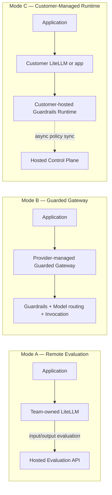

**AI Guardrails — Solution Charter**

**Authority level:** L2
**Status:** Draft
**Date:** 2026-07-24
**Derived from:** seed.md + AGREEMENTS.md

---

> This charter is a durable, boundary-setting reference. It states what the AI Guardrails solution is, why it exists, and where its edges are. It intentionally does not contain component diagrams, API shapes, or implementation instructions — those live in the architecture and delivery layers linked from [Section 17](#17-related-documents). Where this charter and [`AGREEMENTS.md`](../00-source-of-truth/AGREEMENTS.md) could be read as conflicting, `AGREEMENTS.md` is authoritative (L1) and wins.

---

## 1. Purpose

AI Guardrails provides a reusable policy, evaluation, and enforcement layer for applications that consume large language models or execute agentic workflows.

The solution enables multiple teams to apply consistent organizational safeguards without requiring them to use the same model provider, application framework, or LiteLLM deployment.

The platform is built and delivered as a **standalone policy and enforcement platform**, not as functionality embedded inside any single team's existing internal LiteLLM instance ([AGR-001](../00-source-of-truth/AGREEMENTS.md#agr-001--standalone-platform-not-embedded-in-the-internal-litellm)). It supports three operating models — Remote Evaluation, Guarded Gateway, and Customer-Managed Runtime — and maintains a common policy model, evaluation contract, and runtime behavior across all three ([AGR-002](../00-source-of-truth/AGREEMENTS.md#agr-002--three-deployment-modes), [AGR-006](../00-source-of-truth/AGREEMENTS.md#agr-006--one-logical-evaluation-contract-across-all-modes)).

---

## 2. Problem being addressed

Organizations that adopt LLM-powered applications and agentic workflows face a recurring gap: guardrail logic tends to be built once, coupled to a single team's gateway, model provider, or application framework, and is therefore difficult to reuse. This produces several concrete problems:

* Teams re-implement similar safety and compliance checks independently, with inconsistent quality and coverage.
* Guardrail logic embedded in one team's LiteLLM instance cannot be reused by teams with different gateways, providers, or deployment topologies.
* Organizations lack a single place to define a policy once and apply it consistently across heterogeneous workloads.
* Teams cannot easily measure the effect of a guardrail policy before it becomes blocking, which discourages adoption.
* Data-residency, operational-ownership, and trust requirements differ significantly across teams, but most guardrail approaches assume a single topology.
* Content evaluation and business authorization are frequently conflated, creating a false sense of security about what a guardrail decision actually certifies ([AGR-010](../00-source-of-truth/AGREEMENTS.md#agr-010--guardrails-are-not-authorization)).

AI Guardrails exists to solve the reuse and portability problem specifically — not to replace gateways, provide full AI governance, or take over business authorization.

---

## 3. Vision

Provide a model-independent and deployment-flexible guardrails platform that allows teams to adopt centrally governed AI safety policies while retaining the degree of operational ownership and data isolation appropriate to their workloads.

The solution should allow an organization to:

* Define guardrail policies once.
* Apply the same policies to multiple workloads.
* Support different LLM gateways and providers.
* Evaluate prompts and responses consistently.
* Operate guardrails as a hosted or self-managed capability.
* Measure effectiveness before policies become blocking.
* Evolve from cooperative integration to mandatory enforcement.
* Avoid coupling policy definitions to LiteLLM or Amazon Bedrock.

LiteLLM is adopted as the first supported connector — and may also serve as the substrate for the Guarded Gateway mode — but it does not define the boundary of the product ([AGR-003](../00-source-of-truth/AGREEMENTS.md#agr-003--litellm-as-first-connector-not-the-product-boundary)). Amazon Bedrock Guardrails is adopted as the first managed evaluation engine, while the public evaluation contract remains vendor-independent ([AGR-004](../00-source-of-truth/AGREEMENTS.md#agr-004--bedrock-guardrails-as-first-engine-vendor-independent-contract)).

---

## 4. Target users and stakeholders

| Stakeholder group | Primary needs |
| --- | --- |
| **Platform teams** | Central guardrail policy definitions; reusable connectors; deployment consistency; audit visibility; controlled policy rollouts; low operational overhead. |
| **Application teams** | Simple onboarding; minimal application changes; predictable latency; clear failure behavior; understandable violation reasons; a way to test policies before blocking users. |
| **Security and compliance teams** | Policy ownership; decision evidence; policy-version traceability; content-retention controls; exception tracking; evidence that policies are being applied. |
| **Product operators** | Tenant and workload registration; service-health visibility; usage metrics; runtime capacity management; policy rollout controls; deployment compatibility tracking. |

See [Section 11](#11-ownership-and-responsibilities) for how these stakeholder groups map to durable ownership boundaries.

---

## 5. Intended outcomes

The solution is intended to produce the following durable outcomes:

* A single guardrail policy can be applied consistently across multiple, independently operated workloads and gateways.
* Teams can adopt guardrails without transferring model-provider credentials or gateway administration access to the guardrail provider ([Section 8](#8-solution-boundaries); [AGR-019](../00-source-of-truth/AGREEMENTS.md#agr-019--meaning-of-import)).
* Teams can observe policy behavior — false positives, latency, business impact — before enabling blocking behavior ([AGR-011](../00-source-of-truth/AGREEMENTS.md#agr-011--observe-before-enforce-progression)).
* Operational ownership (who runs the infrastructure) and content exposure (where tenant data travels) are documented as distinct, independently answerable questions for every deployment mode ([AGR-008](../00-source-of-truth/AGREEMENTS.md#agr-008--explicit-content-exposure-model-ownership-vs-exposure-are-separate-concerns)).
* The organization can evolve from cooperative, trust-based guardrail adoption toward mandatory, bypass-resistant enforcement without redesigning the policy model ([Section 9](#9-guiding-principles); [AGR-018](../00-source-of-truth/AGREEMENTS.md#agr-018--trust-and-enforcement-model)).
* A reusable-policy hypothesis is proven concretely: two independent LiteLLM deployments consuming the same policy, with consistent normalized decisions — the Phase 1–2 validation demonstration (seed.md §16; [`60-delivery/VALIDATION-PLAN.md`](../60-delivery/VALIDATION-PLAN.md)) — before later phases proceed ([AGR-020](../00-source-of-truth/AGREEMENTS.md#agr-020--five-phase-delivery)).

Detailed, measurable success criteria are maintained separately in [`SUCCESS-CRITERIA.md`](SUCCESS-CRITERIA.md) rather than duplicated here.

---

## 6. In-scope capabilities

The solution is defined over the full feature set ([DEC-008](../00-source-of-truth/DECISIONS.md#dec-008--supersede-the-mvp-bounded-scope-define-and-estimate-the-full-feature-set-across-five-phases)). Its core scope, delivered in Phases 1–2, includes:

* Versioned guardrail policies.
* Workload registration.
* Policy-to-workload bindings.
* Input evaluation and output evaluation.
* LiteLLM integration.
* A generic HTTP Evaluation API.
* An Amazon Bedrock Guardrails integration.
* Deterministic organization rules.
* Basic sensitive-data handling.
* Normalized evaluation decisions.
* Observe and enforce modes.
* Evaluation latency metrics.
* Decision metadata auditing.
* Hosted runtime deployment.
* A path to customer-managed deployment.

This core list, together with the later-phase capabilities committed to Phases 3–5 and included in the full-solution estimation, is maintained at the level of detail needed for delivery planning in [`SCOPE.md`](SCOPE.md).

---

## 7. Out-of-scope capabilities

The solution will not attempt to provide:

* A general-purpose LLM gateway replacement.
* A complete AI governance platform.
* Model training or fine-tuning.
* A proprietary prompt-injection model.
* A proprietary moderation model.
* A complete DLP platform.
* End-user authentication.
* Application business authorization.
* Fully autonomous agent governance.
* Organization-wide AWS enforcement.
* Cross-cloud deployment.
* Multi-region active-active availability.
* Full compliance certification.
* A general MCP security platform.

These exclusions are binding for the solution per seed.md §6.3, reaffirmed by [DEC-008](../00-source-of-truth/DECISIONS.md#dec-008--supersede-the-mvp-bounded-scope-define-and-estimate-the-full-feature-set-across-five-phases) — they are not part of the full feature set. They may be introduced only after the core integration and policy model have been validated, and only through an explicit scope-change decision — never by silent inclusion. Full scope boundaries are maintained in [`SCOPE.md`](SCOPE.md).

---

## 8. Solution boundaries

### 8.1 What "import" means

"Import" means a consuming team adopting a versioned guardrail policy, a workload identity, an integration manifest, a connector configuration, and an enforcement mode. It does **not** mean importing, cloning, registering, or remotely controlling another team's LiteLLM instance ([AGR-019](../00-source-of-truth/AGREEMENTS.md#agr-019--meaning-of-import)).

The import process must not require:

* Copying the team's LiteLLM database.
* Transferring model-provider credentials.
* Exposing gateway administration endpoints.
* Replacing the team's model-routing configuration.
* Giving the guardrail provider administrative access to the team's gateway.

The canonical onboarding flow is:

```text
Register workload
    │
    ▼
Select policy
    │
    ▼
Generate integration manifest
    │
    ▼
Install connector
    │
    ▼
Run in observe mode
    │
    ▼
Review evaluation results
    │
    ▼
Enable enforcement
```

### 8.2 What guardrails are not

Guardrails are not authorization. A guardrail decision that content or a tool call appears safe does not determine whether the current user is permitted to execute that action against a particular resource ([AGR-010](../00-source-of-truth/AGREEMENTS.md#agr-010--guardrails-are-not-authorization)). The consuming application remains responsible for user authentication, business authorization, tenant isolation, resource ownership, transaction limits, and approval workflows. Tool and agent authorization may become a later product capability (Phase 5 at the earliest) but is outside the Phase 1–2 core scope.

### 8.3 What each deployment mode is not

Remote Evaluation must never be described as a private-data or data-local deployment model ([AGR-009](../00-source-of-truth/AGREEMENTS.md#agr-009--remote-evaluation-is-not-a-private-data-or-data-local-model)); prompts, responses, and any additional evaluated content reach the hosted Evaluation API in that mode. Cooperative connector installation must never be represented as a hard security boundary ([AGR-018](../00-source-of-truth/AGREEMENTS.md#agr-018--trust-and-enforcement-model)).

---

## 9. Guiding principles

These principles are durable constraints on how the solution is designed and evolved; the reasoning behind each is recorded in [`AGREEMENTS.md`](../00-source-of-truth/AGREEMENTS.md) and the full articulation is maintained in [`PRINCIPLES.md`](PRINCIPLES.md).

1. **Policy portability** — guardrail policies must not depend directly on LiteLLM configuration structures, Bedrock Guardrails response formats, a specific model provider, a specific programming language, or a specific application framework. Vendor-specific implementations must be placed behind adapters ([AGR-005](../00-source-of-truth/AGREEMENTS.md#agr-005--policy-portability)).
2. **One contract across deployment modes** — Remote Evaluation, Guarded Gateway, and Customer-Managed Runtime must implement the same logical evaluation contract: policy definitions, request structures, decision structures, reason codes, enforcement actions, audit metadata, and policy-version semantics ([AGR-006](../00-source-of-truth/AGREEMENTS.md#agr-006--one-logical-evaluation-contract-across-all-modes)).
3. **Policies are separate from connectors** — a policy defines what must be evaluated and how violations are handled; a connector defines how a specific gateway or application invokes and enforces that policy. This separation is mandatory ([AGR-007](../00-source-of-truth/AGREEMENTS.md#agr-007--policies-are-separate-from-connectors)).
4. **Explicit content-exposure model** — every deployment must document where prompts and responses are processed, whether retrieved documents or tool arguments are transmitted, whether content is persisted, which telemetry leaves the runtime, and which AWS accounts and Regions process the request. Operational ownership and data exposure are communicated as separate concerns ([AGR-008](../00-source-of-truth/AGREEMENTS.md#agr-008--explicit-content-exposure-model-ownership-vs-exposure-are-separate-concerns)).
5. **Guardrails are not authorization** — see [Section 8.2](#82-what-guardrails-are-not) ([AGR-010](../00-source-of-truth/AGREEMENTS.md#agr-010--guardrails-are-not-authorization)).
6. **Observable before enforceable** — every policy must support a non-blocking evaluation mode, with a recommended progression of Disabled → Observe → Warn → Redact → Block, so a team can measure false positives, latency, and business impact before enabling blocking behavior ([AGR-011](../00-source-of-truth/AGREEMENTS.md#agr-011--observe-before-enforce-progression)).
7. **Failure behavior is part of policy** — runtime failure behavior must be explicit for every workload, covering Evaluation API timeout, detector unavailability, unresolved policy, control-plane unavailability, audit-delivery failure, and inability to safely transform a response. There must be no undocumented fallback behavior ([AGR-012](../00-source-of-truth/AGREEMENTS.md#agr-012--failure-behavior-is-part-of-policy)).

---

## 10. Operating model

The product supports exactly three primary deployment modes at general availability ([AGR-002](../00-source-of-truth/AGREEMENTS.md#agr-002--three-deployment-modes)). Every architectural component must be evaluated against all three before being accepted.

| Mode | Who operates the gateway | Who operates the guardrail runtime | Best suited for |
| --- | --- | --- | --- |
| **A — Remote Evaluation** | Consuming team (owns its own LiteLLM or equivalent gateway) | AI Guardrails provider (hosted Evaluation API) | Teams that already operate a gateway and want to reduce operational ownership of guardrail execution. Not a data-local model — tenant content reaches the hosted service ([AGR-009](../00-source-of-truth/AGREEMENTS.md#agr-009--remote-evaluation-is-not-a-private-data-or-data-local-model)). |
| **B — Guarded Gateway** | AI Guardrails provider | AI Guardrails provider | Teams without their own gateway that want a fully managed, OpenAI-compatible inference and guardrail service. Provides the strongest centralized control, and the largest operational, security, and compliance scope for the provider. |
| **C — Customer-Managed Runtime** | Consuming team | Consuming team, inside its own AWS account | Regulated workloads, data-residency requirements, high-volume workloads, air-gapped environments, and teams that prohibit prompt or response content from leaving their account. Must execute policies without requiring a synchronous connection to the hosted control plane ([AGR-015](../00-source-of-truth/AGREEMENTS.md#agr-015--customer-managed-runtime-executes-without-a-synchronous-control-plane-connection)). |



Across all three modes, policy definitions, request/decision structures, reason codes, enforcement actions, audit metadata, and policy-version semantics must remain compatible ([Section 9](#9-guiding-principles), principle 2). Deployment-mode-specific implementation detail — component diagrams, AWS services, and integration mechanics — is intentionally out of scope for this charter and lives in [`DEPLOYMENT-ARCHITECTURE.md`](../50-architecture/DEPLOYMENT-ARCHITECTURE.md) and [`ARCHITECTURE-REPORT.md`](../50-architecture/ARCHITECTURE-REPORT.md).

---

## 11. Ownership and responsibilities

| Owner | Responsible for |
| --- | --- |
| **AI Guardrails team** | Product architecture; policy schemas; evaluation contract; guardrail runtime; LiteLLM connector; Bedrock integration; policy compatibility; runtime telemetry; documentation; supported deployment artifacts. |
| **Platform operations** | Hosted infrastructure; runtime deployment; service monitoring; capacity management; network configuration; production incident response. |
| **Security and governance** | Organization-level policy requirements; risk classifications; policy approval; exception criteria; retention requirements; audit requirements. |
| **Consuming teams** | Application behavior; correct connector installation in cooperative mode; workload registration accuracy; end-user authentication; business authorization; model selection where applicable; review of observe-mode findings; acceptance of enforcement behavior. |

Ownership shifts by deployment mode (for example, a Customer-Managed Runtime consuming team owns runtime infrastructure and availability that a Guarded Gateway consumer does not) — see the per-mode ownership breakdowns carried forward into [`SCOPE.md`](SCOPE.md) and [`DEPLOYMENT-ARCHITECTURE.md`](../50-architecture/DEPLOYMENT-ARCHITECTURE.md). The four ownership groups above remain the durable, mode-independent accountability structure.

---

## 12. Success criteria

The solution is successful when the full feature set — the Phase 1–2 core capabilities plus the later-phase capabilities committed to Phases 3–5 — is delivered across the five phases, each phase's completion criteria validated before the next phase's scope is committed ([AGR-020](../00-source-of-truth/AGREEMENTS.md#agr-020--five-phase-delivery); [DEC-008](../00-source-of-truth/DECISIONS.md#dec-008--supersede-the-mvp-bounded-scope-define-and-estimate-the-full-feature-set-across-five-phases)).

The first gate on that path is the **Phase 1–2 validation demonstration** (seed.md §16) — a delivery-plan milestone, detailed in [`60-delivery/VALIDATION-PLAN.md`](../60-delivery/VALIDATION-PLAN.md), not the definition of overall solution success. It is met only when all of the following hold simultaneously:

* Two separate LiteLLM instances consume the same policy.
* Neither instance shares model-provider credentials with the guardrail platform.
* Both receive consistent normalized decisions.
* One workload can run in observe mode.
* Another workload can run in enforce mode.
* A policy can be upgraded and rolled back.
* Raw content persistence can be disabled.
* Evaluation failures follow a configured failure policy.
* The runtime can later be packaged for customer-managed deployment without changing the connector contract.

Beyond the validation demonstration, the platform tracks success along four durable dimensions — adoption, reliability, effectiveness, and product portability. The full, measurable indicator set for each dimension is maintained in [`SUCCESS-CRITERIA.md`](SUCCESS-CRITERIA.md) rather than restated here, since specific targets are expected to evolve with each delivery phase (see [Section 16](#16-change-control-process)).

---

## 13. Constraints

* **Primary cloud:** Amazon Web Services. Cross-cloud deployment is excluded from the solution (seed.md §6.3; [AGR-013](../00-source-of-truth/AGREEMENTS.md#agr-013--aws-as-primary-cloud-minimal-mvp-account-model)).
* **Account topology:** Phases 1–2 use a minimal account model — one non-production account and one production account. Additional account separation is introduced only when justified by external customers, compliance requirements, independent security ownership, immutable audit requirements, production scale, or dedicated tenant deployments.
* **Initial integration target:** LiteLLM, as the first connector, not the product boundary ([AGR-003](../00-source-of-truth/AGREEMENTS.md#agr-003--litellm-as-first-connector-not-the-product-boundary)).
* **Initial evaluation engine:** Amazon Bedrock Guardrails, behind a vendor-independent contract ([AGR-004](../00-source-of-truth/AGREEMENTS.md#agr-004--bedrock-guardrails-as-first-engine-vendor-independent-contract)).
* **Data retention:** the hosted runtime does not persist raw prompts and responses by default; only decision metadata is persisted by default, with tenant-specific retention configuration available ([AGR-014](../00-source-of-truth/AGREEMENTS.md#agr-014--no-raw-promptresponse-retention-by-default)).
* **Customer-managed telemetry:** customer-managed runtimes must let the customer choose what the hosted control plane receives, down to no telemetry at all; raw content must never leave a customer-managed runtime unless explicitly configured ([AGR-016](../00-source-of-truth/AGREEMENTS.md#agr-016--customer-controlled-telemetry-for-the-customer-managed-runtime)).
* **Scope boundary:** the solution excludes the capabilities listed in [Section 7](#7-out-of-scope-capabilities); any proposed feature outside that boundary requires an explicit scope-change decision, not silent inclusion, and a capability enters a delivery phase only through the phase plan and recorded decisions ([DEC-008](../00-source-of-truth/DECISIONS.md#dec-008--supersede-the-mvp-bounded-scope-define-and-estimate-the-full-feature-set-across-five-phases); [AGR-020](../00-source-of-truth/AGREEMENTS.md#agr-020--five-phase-delivery)).
* **Domain model:** all architecture and implementation must be expressed in terms of the six core entities — tenant, workload, policy, policy binding, evaluation, and decision ([AGR-017](../00-source-of-truth/AGREEMENTS.md#agr-017--core-domain-model)).

Figures such as specific availability objectives, latency targets, and account counts beyond the minimal model above are not yet defined in the source material and are marked TBD where referenced elsewhere; they must not be invented ahead of a documented decision.

---

## 14. Major risks

| Risk | Description | Mitigation direction |
| --- | --- | --- |
| **Connector bypass** | A consumer may remove or misconfigure the LiteLLM connector. | Cooperative onboarding for trusted teams; configuration validation; managed gateway deployment; restricted model credentials; IAM and network enforcement for mandatory environments. |
| **False confidence** | Teams may interpret successful guardrail evaluation as complete AI security. | Clearly separate content evaluation, authorization, data isolation, and application security; document unsupported risk categories; maintain risk-specific evaluation datasets; avoid marketing guardrails as a complete security boundary. |
| **Latency** | Remote input and output evaluation adds synchronous network and processing latency. | Measure per-evaluator latency; apply only relevant evaluators; support local deterministic checks; use Customer-Managed Runtime for latency-sensitive workloads; define stage-specific timeouts. |
| **Hosted data exposure** | Remote evaluation transmits tenant content to the hosted runtime. | Explicit data-flow documentation; no raw-content retention by default; regional deployments; private connectivity when justified; Customer-Managed Runtime option. |
| **Policy fragmentation** | Too many workload-specific overrides may weaken organizational consistency. | Limit override categories; require ownership for exceptions; version policy packs; track effective policy per workload. |
| **Product over-expansion** | The solution may attempt to include gateway management, AI governance, authorization, agent orchestration, and compliance before validating the core integration. | Maintain strict scope boundaries; deliver later-phase capabilities only through their committed phases, each validated before the next proceeds; measure adoption and policy effectiveness before expanding scope. |

The authoritative, actively tracked risk register — including status and ownership per risk — is maintained in [`RISK-REGISTER.md`](../70-governance/RISK-REGISTER.md).

---

## 15. Decision rights

This charter does not introduce new decision-rights structures beyond the ownership boundaries in [Section 11](#11-ownership-and-responsibilities). Durable decision authority is as follows:

* **Product architecture, policy schemas, the evaluation contract, and supported deployment artifacts** are decided by the AI Guardrails team.
* **Organization-level policy requirements, risk classifications, policy approval, and exception criteria** are decided by Security and governance.
* **Hosted infrastructure, deployment, and production incident response** are decided by Platform operations.
* **Application behavior, model selection where applicable, and acceptance of enforcement behavior for a given workload** are decided by the consuming team that owns that workload.
* Scope changes against [Section 7](#7-out-of-scope-capabilities) require an explicit, recorded scope-change decision ([DEC-008](../00-source-of-truth/DECISIONS.md#dec-008--supersede-the-mvp-bounded-scope-define-and-estimate-the-full-feature-set-across-five-phases); [AGR-020](../00-source-of-truth/AGREEMENTS.md#agr-020--five-phase-delivery) phase gating); they are not made unilaterally by any single stakeholder group.
* Any conflict between a derived document and [`AGREEMENTS.md`](../00-source-of-truth/AGREEMENTS.md) is resolved in favor of `AGREEMENTS.md`; the derived document is corrected.

---

## 16. Change-control process

* [`AGREEMENTS.md`](../00-source-of-truth/AGREEMENTS.md) is the authoritative (L1) source of truth for the solution. This charter and all other derived documents (product materials, executive brief, sales deck, architecture report, delivery plan) must not contradict any agreement recorded there.
* When a conflict is discovered between this charter and an agreement in `AGREEMENTS.md`, `AGREEMENTS.md` wins, and this charter must be corrected.
* Changes to this charter that would alter an existing agreement's substance must first be proposed and accepted as a change to `AGREEMENTS.md`, then reflected here — not the reverse.
* Additive detail that does not contradict an agreement (for example, expanding a rationale, adding a cross-link) may be made directly to this charter.
* Delivery-phase-specific detail (milestones, release criteria, targets) is expected to evolve across the five delivery phases defined in [Section 18 of `seed.md`](../../seed.md) and tracked in [`IMPLEMENTATION-STRATEGY.md`](../60-delivery/IMPLEMENTATION-STRATEGY.md) and [`MILESTONES.md`](../60-delivery/MILESTONES.md); such evolution does not itself require a charter change unless it alters a durable boundary described here.
* This document's status is **Draft** until formally reviewed and accepted by the owners named in [Section 11](#11-ownership-and-responsibilities); status transitions should be recorded in the document header.

---

## 17. Related documents

| Document | Relationship |
| --- | --- |
| [`AGREEMENTS.md`](../00-source-of-truth/AGREEMENTS.md) | Authoritative (L1) source of truth this charter is derived from. |
| [`SCOPE.md`](SCOPE.md) | Full core-scope / later-phase / out-of-scope detail for the solution. |
| [`PRINCIPLES.md`](PRINCIPLES.md) | Full articulation of the guiding principles summarized in [Section 9](#9-guiding-principles). |
| [`SUCCESS-CRITERIA.md`](SUCCESS-CRITERIA.md) | Full, measurable success indicators across adoption, reliability, effectiveness, and portability. |
| [`PRODUCT-OVERVIEW.md`](../20-product/PRODUCT-OVERVIEW.md) | Product-level description built on this charter. |
| [`CAPABILITIES.md`](../20-product/CAPABILITIES.md) | Capability-level detail per deployment mode. |
| [`DEPLOYMENT-ARCHITECTURE.md`](../50-architecture/DEPLOYMENT-ARCHITECTURE.md) | Detailed architecture for each of the three deployment modes. |
| [`SECURITY-ARCHITECTURE.md`](../50-architecture/SECURITY-ARCHITECTURE.md) | Security requirements and the trust/enforcement model in implementation detail. |
| [`DATA-ARCHITECTURE.md`](../50-architecture/DATA-ARCHITECTURE.md) | Content-exposure and data-handling detail per mode. |
| [`RISK-REGISTER.md`](../70-governance/RISK-REGISTER.md) | Actively tracked risk register. |
| [`CLAIMS-REGISTER.md`](../70-governance/CLAIMS-REGISTER.md) | Approved external claims, including boundary statements such as AGR-009 and AGR-018. |
| [`GLOSSARY.md`](../70-governance/GLOSSARY.md) | Canonical definitions, including "import" and the core domain-model terms. |
| [`IMPLEMENTATION-STRATEGY.md`](../60-delivery/IMPLEMENTATION-STRATEGY.md) | Delivery-phase execution detail. |
| [`MILESTONES.md`](../60-delivery/MILESTONES.md) | Phase-by-phase delivery milestones. |
