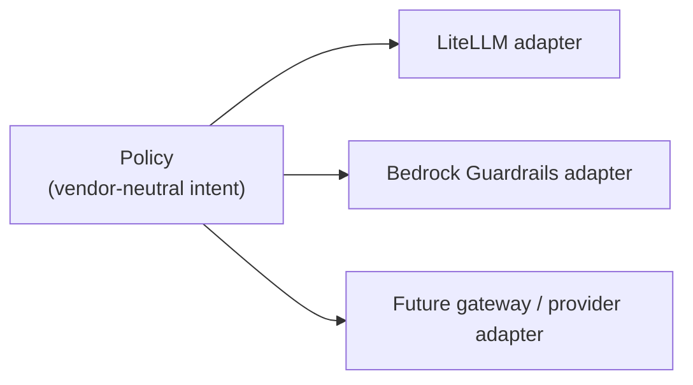
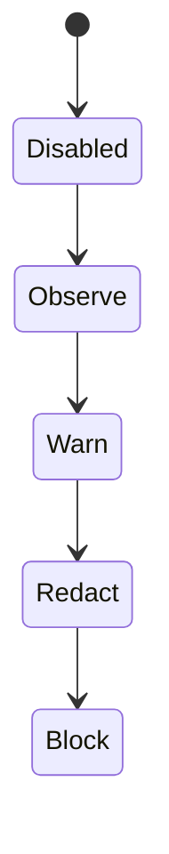

**AI Guardrails — Product Principles**

**Authority level:** L2
**Status:** Draft
**Date:** 2026-07-24
**Derived from:** AGREEMENTS.md

---

## Purpose

This document expands the seven product principles introduced in [original charter §5](../00-source-of-truth/PROVENANCE.md#3-section-by-section-map) into full statements of intent, rationale, and explicit prohibitions. These principles are the design law the AI Guardrails solution must be checked against whenever a new capability, connector, deployment mode, or policy feature is proposed.

This document is **L2**: it is derived directly from the authoritative [`AGREEMENTS.md`](../00-source-of-truth/AGREEMENTS.md) and [`CONSTRAINTS.md`](../00-source-of-truth/CONSTRAINTS.md) (both **L1**) and must never contradict them. Where this document and an L1 register appear to disagree, the L1 register wins and this document must be corrected.

---

## Note on the document authority model (L1–L5)

The solution-docs set uses a five-level authority model so that every document's precedence relative to every other document is unambiguous:

| Level | Directory | Contents | Role |
| --- | --- | --- | --- |
| **L1 — Authoritative** | `00-source-of-truth/` | [`AGREEMENTS.md`](../00-source-of-truth/AGREEMENTS.md), [`CONSTRAINTS.md`](../00-source-of-truth/CONSTRAINTS.md), plus the supporting `ASSUMPTIONS.md`, `DECISIONS.md`, `OPEN-QUESTIONS.md` | Negotiated decisions and non-negotiable boundaries. Nothing in any other level may contradict this level. |
| **L2 — Charter** | `10-charter/` | This document, `CHARTER.md`, `SCOPE.md` | Direct expansion of L1 into product-level principles, purpose, and scope. Binding on every layer below it, but itself derived rather than negotiated — a change here requires the corresponding L1 entry to be amended first. |
| **L3 — Product & architecture** | `20-product/`, `50-architecture/`, `60-delivery/` | Capabilities, component/integration/security/data architecture, delivery and implementation plans | Operationalizes L2 into buildable designs and plans. |
| **L4 — Audience collateral** | `30-executive/`, `40-sales-deck/`, `70-governance/` | Executive briefs, sales materials, claims register, risk register | Purpose-built narratives for specific external or internal audiences; the governance layer exists specifically to check L4 claims against L1–L3 before they are published. |
| **L5 — Working inputs & archive** | `80-agent-inputs/`, `90-archive/` | Agent prompts/inputs, superseded versions | Non-authoritative working material and history. Carries no independent authority over any other level. |

**Precedence rule:** a lower level number always wins. A document may illustrate or elaborate on a higher-numbered document, but it may never use one to justify deviating from a lower-numbered document. Any conflict discovered between levels must be resolved by correcting the higher-numbered (less authoritative) document — never by silently reinterpreting L1.

---

## How the principles are structured

Each principle below states:

* **Statement** — the rule itself.
* **Why it matters** — the product or organizational consequence of not following it.
* **What it forbids** — the concrete designs, claims, or shortcuts this principle rules out.

---

## 5.1 Policy portability

**Statement:** Guardrail policies must not depend directly on LiteLLM configuration structures, Bedrock Guardrails response formats, a specific model provider, a specific programming language, or a specific application framework. Vendor-specific implementations must be placed behind adapters.

**Why it matters:** Policy portability is the mechanism that lets one organizational policy be authored once and reused across every workload, gateway, and deployment mode the platform supports. If a policy's meaning changes depending on which gateway or model provider evaluates it, the product's core value proposition — "define guardrail policies once, apply them to multiple workloads" ([`CHARTER.md`](CHARTER.md)) — collapses, and every consuming team is back to maintaining its own guardrail logic.

**What it forbids:**
* Encoding LiteLLM's request/response shapes, or Bedrock Guardrails' response format, directly into a policy definition.
* Writing a policy feature that can only be expressed in one vendor's or one language's terms.
* Any policy field, threshold, or rule that requires a specific gateway or application framework to interpret correctly.
* Accepting a policy-authoring proposal that cannot be evaluated the same way across Mode A, Mode B, and Mode C.



Related: [`AGREEMENTS.md` AGR-005](../00-source-of-truth/AGREEMENTS.md#agr-005--policy-portability), [`CONSTRAINTS.md` CON-003, CON-004](../00-source-of-truth/CONSTRAINTS.md#product-contract-independence).

---

## 5.2 One contract across deployment modes

**Statement:** Remote Evaluation, Guarded Gateway, and Customer-Managed Runtime deployments must use the same logical evaluation contract. The deployment location may change, but policy definitions, request structures, decision structures, reason codes, enforcement actions, audit metadata, and policy-version semantics must remain compatible.

**Why it matters:** A reusable policy is only reusable in practice if the request a connector sends, and the decision it gets back, mean the same thing regardless of where the runtime happens to be deployed. Without a single contract, "one policy, three modes" becomes three parallel implementations that drift apart, and a workload migrating from Mode A to Mode C (a stated product goal — [AGR-002](../00-source-of-truth/AGREEMENTS.md#agr-002--three-deployment-modes), Mode C) would require re-integration rather than redeployment.

**What it forbids:**
* Mode-specific request or decision schemas, even as an optimization.
* Reason codes, enforcement actions, or audit fields that exist in one deployment mode but not another.
* Caching, telemetry, or performance optimizations that change what a connector or policy author can observe about a decision.
* Treating contract compatibility as a "nice to have" that can be deferred until after a mode ships.

Related: [`AGREEMENTS.md` AGR-006](../00-source-of-truth/AGREEMENTS.md#agr-006--one-logical-evaluation-contract-across-all-modes), [`CONSTRAINTS.md` CON-005](../00-source-of-truth/CONSTRAINTS.md#con-005--one-logical-evaluation-contract-across-all-modes).

---

## 5.3 Policies are separate from integrations

**Statement:** A policy defines what must be evaluated and how violations should be handled. A connector defines how a specific gateway or application invokes and enforces that policy. This separation is mandatory.

**Why it matters:** Conflating policy intent with integration mechanics recreates the exact coupling the platform exists to remove: if detection logic or thresholds live inside a connector, the policy can no longer be reused by a second connector, and "reusable policy" reduces back to "reusable code copied between gateways."

**What it forbids:**
* Embedding detection rules, thresholds, or enforcement logic inside a connector.
* Requiring a specific connector to test or validate a policy's behavior.
* Adding a new connector by modifying an existing policy rather than implementing the invocation contract only.
* Any connector-level "policy override" that is not itself expressed as a policy or binding-level construct.

```text
Policy:
    Detect prompt injection and block it.

Connector:
    Invoke the Evaluation API during LiteLLM pre-call execution.
```

Related: [`AGREEMENTS.md` AGR-007](../00-source-of-truth/AGREEMENTS.md#agr-007--policies-are-separate-from-connectors), [`CONSTRAINTS.md` CON-006](../00-source-of-truth/CONSTRAINTS.md#con-006--policies-separate-from-connectors).

---

## 5.4 Explicit content-exposure model

**Statement:** Every deployment must document where prompts are processed, where responses are processed, whether retrieved documents are transmitted, whether tool arguments are transmitted, whether content is persisted, which telemetry leaves the runtime, and which AWS accounts and Regions process the request. Operational ownership and data exposure must be communicated as separate concerns.

**Why it matters:** Stakeholders routinely conflate "who operates this component" with "where does my data go" — but a team can own its own gateway (Mode A) while still transmitting every prompt and response to a hosted service, and a team can hand over gateway operation entirely (Mode B) while data exposure is defined by the same provider boundary. Security and compliance sign-off requires both questions to be answered independently and correctly, every time.

**What it forbids:**
* Describing Mode A (Remote Evaluation) as a private-data or data-local model: prompts, responses, and any additional evaluated content are transmitted to the hosted Evaluation API regardless of who operates the gateway. Mode A must be described only as *"bring your own gateway while consuming a hosted guardrail runtime."*
* Any sales, executive, or product material that implies reduced operational ownership means reduced data exposure, or vice versa.
* Shipping a new deployment mode or connector without a dedicated, explicit content-exposure statement.
* Leaving telemetry content undocumented for any mode, including Customer-Managed Runtime.

Related: [`AGREEMENTS.md` AGR-008](../00-source-of-truth/AGREEMENTS.md#agr-008--explicit-content-exposure-model-ownership-vs-exposure-are-separate-concerns), [AGR-009](../00-source-of-truth/AGREEMENTS.md#agr-009--remote-evaluation-is-not-a-private-data-or-data-local-model), [`CONSTRAINTS.md` CON-007](../00-source-of-truth/CONSTRAINTS.md#con-007--explicit-content-exposure-documentation-per-deployment).

---

## 5.5 Guardrails are not authorization

**Statement:** Content evaluation must remain separate from business authorization. A guardrail may determine that a tool call appears safe. It does not determine whether the current user is permitted to execute that tool against a particular resource. The consuming application remains responsible for user authentication, business authorization, tenant isolation, resource ownership, transaction limits, and approval workflows.

**Why it matters:** Conflating "this content passed a safety check" with "this user is allowed to do this" creates a false sense of security. A team that treats a guardrail `allow` decision as an authorization decision may deploy an agent capable of executing actions no guardrail was ever designed to gate — the platform's own charter is explicit that tool and agent authorization is a distinct, later capability (Phase 5 at the earliest), not part of the Phase 1–2 core ([AGR-010](../00-source-of-truth/AGREEMENTS.md#agr-010--guardrails-are-not-authorization), [`SCOPE.md`](SCOPE.md)).

**What it forbids:**
* Describing a guardrail decision as an authorization decision, in documentation, sales material, or product UI.
* Treating a passing evaluation as sufficient grounds to skip the consuming application's own authentication, authorization, tenant-isolation, resource-ownership, transaction-limit, or approval-workflow checks.
* Building or marketing tool/agent authorization as part of the Phase 1–2 core platform — it may become a later product capability, but only as a separately scoped effort.
* Allowing a customer to configure guardrails as a substitute for application-level access control.

Related: [`AGREEMENTS.md` AGR-010](../00-source-of-truth/AGREEMENTS.md#agr-010--guardrails-are-not-authorization).

---

## 5.6 Observable before enforceable

**Statement:** Every policy must support a non-blocking evaluation mode. A team must be able to measure false positives, latency, and business impact before enabling blocking behavior. The recommended progression is:



**Why it matters:** Enforcing an unproven policy immediately risks breaking production traffic on day one and erodes trust in the platform before it has demonstrated value. A graduated path lets a team validate detection quality against real traffic while the policy can still do no harm, and it gives platform teams evidence — not assumptions — before a policy is allowed to block anything.

**What it forbids:**
* Onboarding a workload directly into Block mode by default; onboarding must default to Observe.
* A policy or runtime that cannot express or measure a non-blocking mode.
* Treating promotion between states (Disabled → Observe → Warn → Redact → Block) as an implicit side effect of another change rather than an explicit, auditable action.
* Shipping a policy schema or runtime that supports only "on" and "off," collapsing Warn and Redact into an undifferentiated middle state.

Related: [`AGREEMENTS.md` AGR-011](../00-source-of-truth/AGREEMENTS.md#agr-011--observe-before-enforce-progression).

---

## 5.7 Failure behavior is part of policy

**Statement:** Runtime failure behavior must be explicit. A workload must define what happens when the Evaluation API times out, a detector is unavailable, the policy cannot be resolved, the control plane is unavailable, audit delivery fails, or a response cannot be safely transformed. There must be no undocumented fallback behavior.

**Why it matters:** Silent or implicit failure handling can fail in either direction with equally bad consequences: failing open silently can defeat the guardrail's purpose exactly when it matters most, while failing closed silently can break production traffic without anyone having agreed to that trade-off. Making failure behavior part of the policy itself — not an operational afterthought — forces the trade-off to be a deliberate, reviewed decision for every workload.

**What it forbids:**
* A policy schema that omits a failure-behavior section for any of the defined failure modes (timeout, detector unavailability, unresolved policy, control-plane unavailability, audit-delivery failure, unsafe response transformation).
* A runtime that defaults silently to "allow" or "block" on failure without that behavior being explicitly configured and recorded.
* Treating input-size limits and per-stage timeouts as implementation details rather than policy-visible, documented boundaries (see [`CONSTRAINTS.md` CON-015, CON-016](../00-source-of-truth/CONSTRAINTS.md#resource-and-operational-limits)).
* Omitting from the audit record which failure-behavior path was taken when an evaluation could not complete normally.

Illustrative failure-behavior options (from [AGR-012](../00-source-of-truth/AGREEMENTS.md#agr-012--failure-behavior-is-part-of-policy) — not an exhaustive or ranked list):

| Failure condition | Example configured behaviors |
| --- | --- |
| Evaluation API timeout | Allow and log · Return a safe fallback · Block the request |
| Detector unavailable | Use a cached policy · Block the request · Allow and log |
| Policy cannot be resolved | Block the request · Require manual approval |
| Control plane unavailable | Use a cached policy (Customer-Managed Runtime) |
| Audit delivery fails | Allow and log · Block the request, depending on audit criticality |
| Response cannot be safely transformed | Return a safe fallback · Block the request |

Related: [`AGREEMENTS.md` AGR-012](../00-source-of-truth/AGREEMENTS.md#agr-012--failure-behavior-is-part-of-policy), [`CONSTRAINTS.md` CON-015, CON-016](../00-source-of-truth/CONSTRAINTS.md#resource-and-operational-limits).

---

## Related documents

- [`AGREEMENTS.md`](../00-source-of-truth/AGREEMENTS.md) — L1 authoritative agreement register these principles expand.
- [`CONSTRAINTS.md`](../00-source-of-truth/CONSTRAINTS.md) — L1 checkable boundary conditions that operationalize several of these principles.
- [`ASSUMPTIONS.md`](../00-source-of-truth/ASSUMPTIONS.md) — unvalidated beliefs the principles above depend on (for example, trust-level assumptions underlying 5.5 and 5.6).
- `10-charter/CHARTER.md` — the product charter narrative these principles support (L2).
- `10-charter/SCOPE.md` — the scope boundaries (core, later-phase, out-of-scope) these principles bound (L2).
- `50-architecture/COMPONENT-ARCHITECTURE.md` — where policy/connector separation (5.3) and failure-behavior handling (5.7) are implemented.
- `50-architecture/INTEGRATION-ARCHITECTURE.md` — where policy portability (5.1) and the one-contract rule (5.2) are implemented across connectors.
- `50-architecture/SECURITY-ARCHITECTURE.md` and `50-architecture/DATA-ARCHITECTURE.md` — where the content-exposure model (5.4) is implemented per deployment mode.
- `70-governance/CLAIMS-REGISTER.md` — must reject any external claim that contradicts 5.4, 5.5, or 5.6.
- `70-governance/RISK-REGISTER.md` — tracks the risks (false confidence, connector bypass) that 5.5 and 5.6 exist to mitigate.
