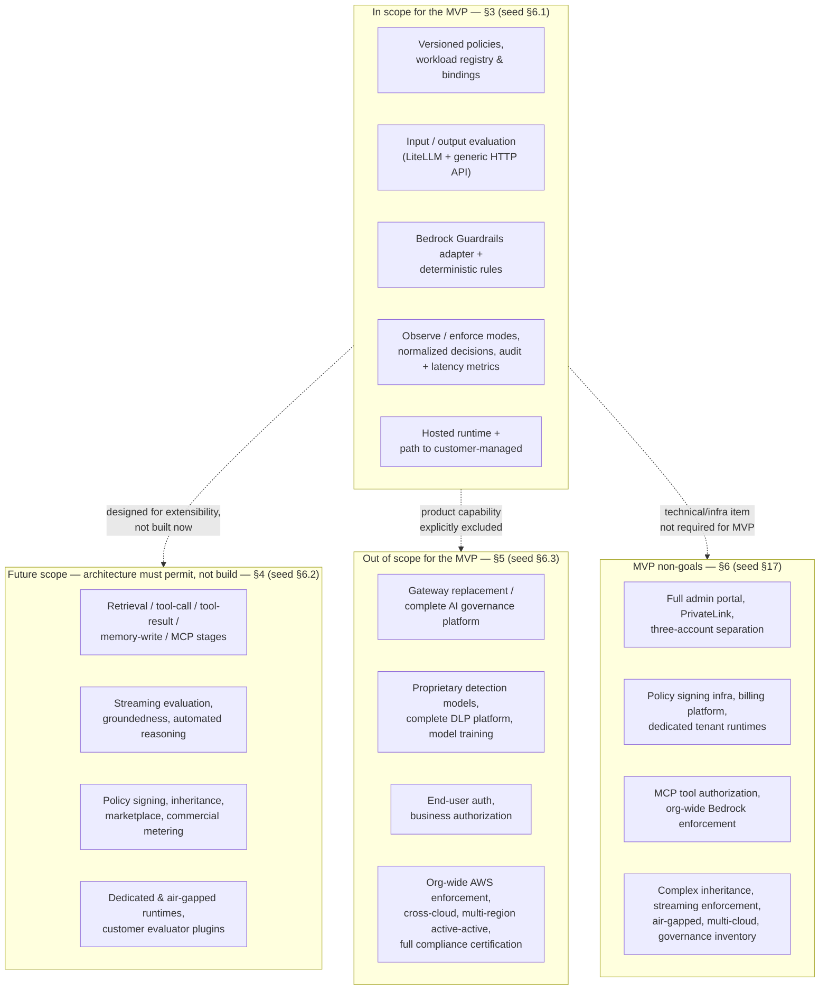

**AI Guardrails — Scope Boundaries**

**Authority level:** L2
**Status:** Draft
**Date:** 2026-07-24
**Derived from:** seed.md + AGREEMENTS.md

---

> This document expands [`CHARTER.md`](CHARTER.md) [Section 6](CHARTER.md#6-in-scope-capabilities) (in-scope capabilities) and [Section 7](CHARTER.md#7-out-of-scope-capabilities) (out-of-scope capabilities) into the full detail needed for delivery planning: what the MVP builds, what the architecture must merely permit, what the MVP explicitly will not attempt, and the specific technical/operational items the MVP does not require even where a related capability is in scope. Where this document and [`AGREEMENTS.md`](../00-source-of-truth/AGREEMENTS.md) or [`CONSTRAINTS.md`](../00-source-of-truth/CONSTRAINTS.md) could be read as conflicting, those L1 registers are authoritative and win; this document must be corrected.

---

## Table of contents

- [1. How to read this document](#1-how-to-read-this-document)
- [2. Scope boundary map](#2-scope-boundary-map)
- [3. In scope for the MVP](#3-in-scope-for-the-mvp)
- [4. Future scope](#4-future-scope)
- [5. Out of scope for the MVP](#5-out-of-scope-for-the-mvp)
- [6. MVP non-goals](#6-mvp-non-goals)
- [7. Why these boundaries matter to each stakeholder group](#7-why-these-boundaries-matter-to-each-stakeholder-group)
- [8. Scope-change governance rule](#8-scope-change-governance-rule)
- [9. Related documents](#9-related-documents)

---

## 1. How to read this document

This document uses four distinct categories, each answering a different question. They are not synonyms and must not be merged when scope is discussed:

| Category | Question it answers | Source |
| --- | --- | --- |
| **In scope for the MVP** ([Section 3](#3-in-scope-for-the-mvp)) | What is the AI Guardrails team building and delivering now? | seed.md §6.1 |
| **Future scope** ([Section 4](#4-future-scope)) | What must the architecture be *able to accommodate later* without being built or committed to a phase now? | seed.md §6.2 |
| **Out of scope for the MVP** ([Section 5](#5-out-of-scope-for-the-mvp)) | What product-level capability is the MVP explicitly *not attempting to provide at all*, even partially? | seed.md §6.3 |
| **MVP non-goals** ([Section 6](#6-mvp-non-goals)) | What specific technical, infrastructure, or operational item is *not required* to call the MVP complete, even where a related capability appears elsewhere in this document? | seed.md §17 |

The distinction between "out of scope" (§5) and "non-goals" (§6) matters: out-of-scope items describe whole product capabilities the MVP will not attempt (for example, a complete DLP platform); non-goals describe narrower technical or operational items that would otherwise be reasonable engineering asks (an admin portal, PrivateLink, a third AWS account) but are not required to satisfy the MVP demonstration in [AGR-020](../00-source-of-truth/AGREEMENTS.md#agr-020--mvp-success-demonstration). A minimal management API and version-controlled configuration are explicitly acceptable substitutes for the excluded items in [Section 6](#6-mvp-non-goals) during the MVP (seed.md §17).

Every row in every table below carries a traceability link to the accepted agreement(s) in [`AGREEMENTS.md`](../00-source-of-truth/AGREEMENTS.md) that bind it, and, where one exists, the open question in [`OPEN-QUESTIONS.md`](../00-source-of-truth/OPEN-QUESTIONS.md) tracking its future timing. Items with no open question listed have not yet had their future timing raised as a tracked decision.

---

## 2. Scope boundary map

The MVP core is the only column the AI Guardrails team commits to delivering now. Future scope, out-of-scope, and non-goal items may only enter a committed phase through the explicit scope-change decision described in [Section 8](#8-scope-change-governance-rule).

---

## 3. In scope for the MVP

Per seed.md §6.1 and [AGR-019](../00-source-of-truth/AGREEMENTS.md#agr-019--mvp-scope-boundaries), the following capabilities are in scope and are being built as part of the MVP:

| # | Capability | What it covers | Related agreement(s) |
| --- | --- | --- | --- |
| 1 | Versioned guardrail policies | Immutable policy versions expressed against the Policy entity in the [core domain model](CHARTER.md#9-guiding-principles) ([AGR-017](../00-source-of-truth/AGREEMENTS.md#agr-017--core-domain-model)). | AGR-017, AGR-019 |
| 2 | Workload registration | Registering an application, assistant, agent, gateway, or inference service as a Workload. | AGR-017, AGR-019, AGR-021 |
| 3 | Policy-to-workload bindings | Associating a workload with a specific policy version, including observe/enforce mode selection. | AGR-017, AGR-019 |
| 4 | Input evaluation | Evaluating content at the `input` stage before model invocation. | AGR-006, AGR-017, AGR-019 |
| 5 | Output evaluation | Evaluating content at the `output` stage after model invocation. | AGR-006, AGR-017, AGR-019 |
| 6 | LiteLLM integration | Pre-call and post-call connectors that invoke the Evaluation API and enforce decisions inside a team-owned or provider-managed LiteLLM instance. | AGR-003, AGR-007, AGR-019 |
| 7 | Generic HTTP Evaluation API | A gateway-agnostic evaluation endpoint that any application or connector can call directly, proving the contract is not LiteLLM-specific. | AGR-003, AGR-006, AGR-019 |
| 8 | Amazon Bedrock Guardrails integration | The first managed evaluation engine, normalized behind the platform's own decision structure. | AGR-004, AGR-019 |
| 9 | Deterministic organization rules | First-party, non-ML detection logic (for example pattern or rule-based checks) addable behind the same evaluator-adapter pattern as Bedrock Guardrails. | AGR-004, AGR-005, AGR-019 |
| 10 | Basic sensitive-data handling | Baseline handling of sensitive content encountered during evaluation, consistent with no-raw-retention-by-default. | AGR-014, AGR-019 |
| 11 | Normalized evaluation decisions | The vendor-independent Decision structure (`allow`, `block`, `redact`, `log_only`) that all engines and connectors resolve to. | AGR-004, AGR-006, AGR-017, AGR-019 |
| 12 | Observe and enforce modes | The two MVP-required states of the five-state progression (Disabled → Observe → Warn → Redact → Block). | AGR-011, AGR-019 |
| 13 | Evaluation latency metrics | P50/P95/P99 latency and timeout-rate measurement per evaluation. | AGR-019 |
| 14 | Decision metadata auditing | Persisted audit records (tenant, workload, policy version, stage, decision, reason codes, correlation ID, retention flag). | AGR-014, AGR-019 |
| 15 | Hosted runtime deployment | The Evaluation API and evaluator adapters running as provider-hosted infrastructure (serves Mode A and Mode B). | AGR-002, AGR-019 |
| 16 | A path to customer-managed deployment | The runtime is architected so it can later run inside a customer's AWS account (Mode C) without changing the connector contract — not a shipped Mode C artifact in the MVP itself. | AGR-002, AGR-015, AGR-020, AGR-019 |

These sixteen items, taken together with the observe/enforce and normalized-decision requirements, are also the basis for the [MVP success demonstration](CHARTER.md#12-success-criteria) in [AGR-020](../00-source-of-truth/AGREEMENTS.md#agr-020--mvp-success-demonstration). The MVP component list and its build sequence are tracked separately in [`60-delivery/IMPLEMENTATION-STRATEGY.md`](../60-delivery/IMPLEMENTATION-STRATEGY.md) and [DEC-005](../00-source-of-truth/DECISIONS.md#dec-005--bound-the-mvp-to-reusable-policy-import-inputoutput-evaluation-litellm-integration-observeenforce-and-normalized-audit-decisions); this table states the *boundary*, not the build order.

---

## 4. Future scope

Per seed.md §6.2, the product architecture should permit — but must not initially require or build — the following. Each of these is a candidate for **Phase 5 (Advanced agent protection)** or a later, separately approved expansion per [AGR-022](../00-source-of-truth/AGREEMENTS.md#agr-022--five-phase-delivery); none may be scheduled as an MVP prerequisite ([DEC-007](../00-source-of-truth/DECISIONS.md#dec-007--defer-advanced-isolation-distribution-security-agent-authorization-and-org-wide-enforcement)).

| # | Capability | Architectural expectation now | Tracked open question | Related agreement(s) |
| --- | --- | --- | --- | --- |
| 1 | Retrieval-content evaluation | The `retrieval` evaluation stage must be a natural extension of the domain model, not a redesign. | [OQ-005](../00-source-of-truth/OPEN-QUESTIONS.md#oq-005--retrieval-content-evaluation-and-indirect-prompt-injection-detection-timeline) | AGR-006, AGR-017, AGR-019, AGR-022 |
| 2 | Indirect prompt-injection detection | Must be addable as a new evaluator behind the existing adapter pattern. | [OQ-005](../00-source-of-truth/OPEN-QUESTIONS.md#oq-005--retrieval-content-evaluation-and-indirect-prompt-injection-detection-timeline) | AGR-004, AGR-005, AGR-019, AGR-022 |
| 3 | Streaming output evaluation | Streaming workloads must have a documented interim behavior (see OQ-004) even before true streaming evaluation ships. | [OQ-004](../00-source-of-truth/OPEN-QUESTIONS.md#oq-004--streaming-output-evaluation-timeline) | AGR-006, AGR-019, AGR-022 |
| 4 | Tool-call validation | The `tool_call` stage and its decision path must not require redesigning the evaluation contract. | [OQ-006](../00-source-of-truth/OPEN-QUESTIONS.md#oq-006--tool-call-validation-tool-result-evaluation-and-mcp-authorization-scope) | AGR-006, AGR-010, AGR-017, AGR-019, AGR-022 |
| 5 | MCP authorization | Must remain clearly distinguished from a general MCP security platform (explicitly out of scope, [Section 5](#5-out-of-scope-for-the-mvp)). | [OQ-006](../00-source-of-truth/OPEN-QUESTIONS.md#oq-006--tool-call-validation-tool-result-evaluation-and-mcp-authorization-scope) | AGR-010, AGR-019, AGR-022 |
| 6 | Memory-write validation | The `memory_write` evaluation stage must fit the same Evaluation/Decision entities as `input`/`output`. | No dedicated open question yet. | AGR-006, AGR-017, AGR-019, AGR-022 |
| 7 | Groundedness evaluation | Must be addable as an evaluator, not a contract change. | No dedicated open question yet. | AGR-005, AGR-019, AGR-022 |
| 8 | Automated reasoning | Must be addable as an evaluator, not a contract change. | No dedicated open question yet. | AGR-005, AGR-019, AGR-022 |
| 9 | Multilingual policy packs | MVP evaluators are assumed English-effective only; this must be an explicit, stated limitation, not silently implied full coverage. | [OQ-008](../00-source-of-truth/OPEN-QUESTIONS.md#oq-008--multilingual-policy-pack-timeline) | AGR-019, AGR-022 |
| 10 | Human approval workflows | The `require_approval` decision action is reserved in the schema now but has no owning workflow or UI in the MVP. | [OQ-007](../00-source-of-truth/OPEN-QUESTIONS.md#oq-007--human-approval-workflows-introduction-timing-and-ownership) | AGR-017, AGR-019, AGR-022 |
| 11 | Dedicated hosted runtimes | Per-tenant dedicated runtime deployments are architecturally conceivable but not scheduled. | [OQ-010](../00-source-of-truth/OPEN-QUESTIONS.md#oq-010--dedicated-tenant-runtimes-and-air-gapped-deployment-timeline) | AGR-002, AGR-019, AGR-022 |
| 12 | Air-gapped installation | Phase 4 delivers asynchronous, cache-tolerant customer-managed deployment ([AGR-015](../00-source-of-truth/AGREEMENTS.md#agr-015--customer-managed-runtime-executes-without-a-synchronous-control-plane-connection)) but not a fully air-gapped install path. | [OQ-010](../00-source-of-truth/OPEN-QUESTIONS.md#oq-010--dedicated-tenant-runtimes-and-air-gapped-deployment-timeline) | AGR-015, AGR-019, AGR-022 |
| 13 | Policy signing | Any future signing scheme must layer onto the existing versioned-policy model, not replace it. | [OQ-012](../00-source-of-truth/OPEN-QUESTIONS.md#oq-012--policy-signing-and-policy-inheritance-design) | AGR-017, AGR-019, AGR-022 |
| 14 | Policy inheritance | Must not be built until a governance model exists to contain the "policy fragmentation" risk (seed §20). | [OQ-012](../00-source-of-truth/OPEN-QUESTIONS.md#oq-012--policy-signing-and-policy-inheritance-design) | AGR-017, AGR-019, AGR-022 |
| 15 | Customer-specific evaluator plugins | No third-party or customer-authored evaluator runs inside the runtime until a security/compatibility review model exists. | [OQ-013](../00-source-of-truth/OPEN-QUESTIONS.md#oq-013--customer-specific-evaluator-plugin-governance) | AGR-004, AGR-005, AGR-019, AGR-022 |
| 16 | Commercial metering | Phase 3 needs only internal cost/rate telemetry for quota and rate-limit enforcement; customer-facing billing is a separate, unscheduled decision. | [OQ-011](../00-source-of-truth/OPEN-QUESTIONS.md#oq-011--commercial-metering-and-policy-marketplace) | AGR-019, AGR-022 |
| 17 | Policy marketplace capabilities | Not scheduled in any phase; requires a separate, explicitly approved business decision. | [OQ-011](../00-source-of-truth/OPEN-QUESTIONS.md#oq-011--commercial-metering-and-policy-marketplace) | AGR-019, AGR-022 |

Future-scope items map primarily onto **Phase 5 — Advanced agent protection** in the [five-phase delivery plan](CHARTER.md#12-success-criteria) ([AGR-022](../00-source-of-truth/AGREEMENTS.md#agr-022--five-phase-delivery)); items 13–17 above may instead surface as Phase 2–4 governance or commercial decisions, as tracked in the referenced open questions. None of these seventeen items may be built during the MVP.

---

## 5. Out of scope for the MVP

Per seed.md §6.3, the MVP will not attempt to provide any of the following product-level capabilities, in whole or in part. These are binding exclusions under [AGR-019](../00-source-of-truth/AGREEMENTS.md#agr-019--mvp-scope-boundaries) and may be introduced only after the core integration and policy model have been validated, and only through the scope-change process in [Section 8](#8-scope-change-governance-rule).

| # | Excluded capability | Why it is excluded | Related agreement(s) |
| --- | --- | --- | --- |
| 1 | A general-purpose LLM gateway replacement | LiteLLM is the first connector, not something the platform replaces; the platform does not compete with or substitute for gateway functionality. | AGR-001, AGR-003, AGR-019 |
| 2 | A complete AI governance platform | The MVP validates policy reuse and connector independence, not full organizational AI governance. | AGR-019, AGR-022 |
| 3 | Model training or fine-tuning | The platform evaluates and enforces; it does not train or fine-tune models. | AGR-019 |
| 4 | A proprietary prompt-injection model | Detection is delivered via the Bedrock Guardrails adapter and deterministic rules, not a proprietary model built by the platform team. | AGR-004, AGR-005, AGR-019 |
| 5 | A proprietary moderation model | Same rationale as above; vendor-independence is preserved by adapting existing engines, not building new ones. | AGR-004, AGR-005, AGR-019 |
| 6 | A complete DLP platform | Only basic sensitive-data handling is in scope ([Section 3](#3-in-scope-for-the-mvp), item 10); comprehensive data-loss-prevention is a distinct, larger product. | AGR-019 |
| 7 | End-user authentication | Remains the consuming application's responsibility; guardrails are not authorization. | AGR-010, AGR-019 |
| 8 | Application business authorization | Same rationale; a guardrail decision that content or a tool call "appears safe" does not authorize its execution. | AGR-010, AGR-019 |
| 9 | Fully autonomous agent governance | Advanced agent protection (retrieval, tool-call, memory-write, delegation) is Phase 5 future scope at most, not an MVP capability. | AGR-010, AGR-019, AGR-022 |
| 10 | Organization-wide AWS enforcement | The network/IAM-enforced gateway posture is the strongest enforcement model but is explicitly not required for the first cooperative MVP; see [OQ-001](../00-source-of-truth/OPEN-QUESTIONS.md#oq-001--enforcement-model-required-for-the-first-external-customers). | AGR-018, AGR-019 |
| 11 | Cross-cloud deployment | AWS is the primary and initial cloud platform for the MVP. | AGR-013, AGR-019 |
| 12 | Multi-region active-active availability | Not required to prove the core reusable-policy hypothesis; an availability objective is defined per workload, not as multi-region active-active. | AGR-019 |
| 13 | Full compliance certification | Certification is a distinct, larger undertaking than validating the core integration and policy model. | AGR-019 |
| 14 | A general MCP security platform | MCP-related future scope (item 5, [Section 4](#4-future-scope)) is narrowly scoped to authorization for the platform's own tool-call evaluation, not a general-purpose MCP security product. | AGR-010, AGR-019, AGR-022 |

---

## 6. MVP non-goals

Per seed.md §17, the MVP does not require the following specific technical, infrastructure, or operational items — even where a related, broader capability appears in [Section 3](#3-in-scope-for-the-mvp) or [Section 4](#4-future-scope) above. A minimal management API and version-controlled configuration are explicitly acceptable in place of the excluded items below during the MVP.

| # | Non-goal | Relationship to scope elsewhere in this document | Tracked open question | Related agreement(s) |
| --- | --- | --- | --- | --- |
| 1 | A full administration portal | A minimal management API is sufficient; a full portal is not required to satisfy the MVP demonstration. | — | AGR-019 |
| 2 | A policy-signing infrastructure | Also listed as future scope ([Section 4](#4-future-scope), item 13); not required now. | [OQ-012](../00-source-of-truth/OPEN-QUESTIONS.md#oq-012--policy-signing-and-policy-inheritance-design) | AGR-017, AGR-019 |
| 3 | PrivateLink | Public, TLS-secured endpoints (per CON-008) are sufficient for the MVP; Customer-Managed Runtime remains the recommended path for teams whose actual requirement is "no content leaves our network." | [OQ-002](../00-source-of-truth/OPEN-QUESTIONS.md#oq-002--privatelink--private-connectivity) | AGR-009, AGR-019 |
| 4 | Three-account AWS separation | The MVP account model is one non-production account and one production account. | [OQ-009](../00-source-of-truth/OPEN-QUESTIONS.md#oq-009--trigger-point-for-three-account-aws-separation) | AGR-013, AGR-019 |
| 5 | A billing platform | Related to future-scope "commercial metering" ([Section 4](#4-future-scope), item 16); Phase 3 needs only internal cost/rate telemetry for quota and rate-limit enforcement. | [OQ-011](../00-source-of-truth/OPEN-QUESTIONS.md#oq-011--commercial-metering-and-policy-marketplace) | AGR-019 |
| 6 | Dedicated tenant runtime deployments | Also listed as future scope ([Section 4](#4-future-scope), item 11). | [OQ-010](../00-source-of-truth/OPEN-QUESTIONS.md#oq-010--dedicated-tenant-runtimes-and-air-gapped-deployment-timeline) | AGR-002, AGR-019 |
| 7 | MCP tool authorization | Also listed as future scope and out of scope ([Section 4](#4-future-scope) item 5; [Section 5](#5-out-of-scope-for-the-mvp) item 14). | [OQ-006](../00-source-of-truth/OPEN-QUESTIONS.md#oq-006--tool-call-validation-tool-result-evaluation-and-mcp-authorization-scope) | AGR-010, AGR-019 |
| 8 | Organization-wide Bedrock enforcement | Related to out-of-scope item 10 ([Section 5](#5-out-of-scope-for-the-mvp)); the network/IAM-enforced gateway posture is deferred until an external customer or compliance driver is identified. | [OQ-001](../00-source-of-truth/OPEN-QUESTIONS.md#oq-001--enforcement-model-required-for-the-first-external-customers) | AGR-018, AGR-019 |
| 9 | Complex policy inheritance | Also listed as future scope ([Section 4](#4-future-scope), item 14). | [OQ-012](../00-source-of-truth/OPEN-QUESTIONS.md#oq-012--policy-signing-and-policy-inheritance-design) | AGR-017, AGR-019 |
| 10 | Streaming guardrail enforcement | Also listed as future scope ([Section 4](#4-future-scope), item 3); a documented interim behavior is required for workloads that declare streaming today. | [OQ-004](../00-source-of-truth/OPEN-QUESTIONS.md#oq-004--streaming-output-evaluation-timeline) | AGR-006, AGR-019 |
| 11 | Air-gapped deployment | Also listed as future scope ([Section 4](#4-future-scope), item 12). | [OQ-010](../00-source-of-truth/OPEN-QUESTIONS.md#oq-010--dedicated-tenant-runtimes-and-air-gapped-deployment-timeline) | AGR-015, AGR-019 |
| 12 | Multi-cloud support | Related to out-of-scope item 11 ([Section 5](#5-out-of-scope-for-the-mvp)); AWS is the primary and initial cloud platform. | — | AGR-013, AGR-019 |
| 13 | A general-purpose AI governance inventory | Related to out-of-scope item 2 ([Section 5](#5-out-of-scope-for-the-mvp)); the MVP tracks tenants, workloads, policies, and bindings only, not an org-wide governance inventory. | — | AGR-017, AGR-019 |

---

## 7. Why these boundaries matter to each stakeholder group

The scope discipline in this document is not an abstract exercise: it exists to give each of the four stakeholder groups defined in [`CHARTER.md` Section 4](CHARTER.md#4-target-users-and-stakeholders) a predictable, boundary-respecting product.

| Stakeholder group | What a crisp scope boundary gives them |
| --- | --- |
| **Platform teams** | Confidence that "reusable connectors" and "deployment consistency" mean a stable, bounded MVP contract — not a moving target that quietly absorbs future-scope items mid-delivery. |
| **Application teams** | A predictable onboarding experience: they can rely on the MVP's observe/enforce modes and input/output evaluation being fully supported today, while knowing exactly which capabilities (for example, retrieval or tool-call evaluation) are not yet available, per [Section 4](#4-future-scope). |
| **Security and compliance teams** | A clear list of what is *not* certified, built, or enforced yet (full compliance certification, organization-wide enforcement, a complete DLP platform — [Section 5](#5-out-of-scope-for-the-mvp)) so they do not extend false assurance to regulated workloads. |
| **Product operators** | A basis for "deployment compatibility tracking": operators can state precisely which capabilities a given workload can rely on without guessing whether a future-scope item has silently shipped. |

---

## 8. Scope-change governance rule

Any proposed feature outside the boundaries in [Section 3](#3-in-scope-for-the-mvp) through [Section 6](#6-mvp-non-goals) requires an explicit, recorded scope-change decision — never silent inclusion during implementation ([AGR-019](../00-source-of-truth/AGREEMENTS.md#agr-019--mvp-scope-boundaries)). Concretely:

* A future-scope item ([Section 4](#4-future-scope)) may only be pulled forward into a committed delivery phase once its tracked open question (where one exists) is resolved and recorded as a new agreement in [`AGREEMENTS.md`](../00-source-of-truth/AGREEMENTS.md).
* An out-of-scope item ([Section 5](#5-out-of-scope-for-the-mvp)) or a non-goal ([Section 6](#6-mvp-non-goals)) may only be introduced after the core integration and policy model have been validated (seed.md §6.3), through the same explicit-decision path — not as an incidental side effect of another change.
* Delivery milestones must be evaluated against the boundaries in this document before being marked complete ([AGR-019](../00-source-of-truth/AGREEMENTS.md#agr-019--mvp-scope-boundaries) implications).
* Any external claim (sales, executive, or marketing material) that implies an out-of-scope or non-goal item is already delivered must be rejected by [`70-governance/CLAIMS-REGISTER.md`](../70-governance/CLAIMS-REGISTER.md).

---

## 9. Related documents

| Document | Relationship |
| --- | --- |
| [`AGREEMENTS.md`](../00-source-of-truth/AGREEMENTS.md) | Authoritative (L1) agreements this document is bound by, especially AGR-019, AGR-020, and AGR-022. |
| [`CONSTRAINTS.md`](../00-source-of-truth/CONSTRAINTS.md) | Authoritative (L1) boundary conditions (account model, contract independence, content handling) that this scope document must not contradict. |
| [`OPEN-QUESTIONS.md`](../00-source-of-truth/OPEN-QUESTIONS.md) | Tracks unresolved timing and design questions for the future-scope and non-goal items listed here. |
| [`DECISIONS.md`](../00-source-of-truth/DECISIONS.md) | Chronological decision log; see DEC-005 and DEC-007 for the decisions that bound this document. |
| [`CHARTER.md`](CHARTER.md) | The durable charter this document expands (Sections 6 and 7). |
| [`PRINCIPLES.md`](PRINCIPLES.md) | Guiding principles that these scope boundaries operationalize. |
| [`SUCCESS-CRITERIA.md`](SUCCESS-CRITERIA.md) | Measurable success indicators, including the MVP demonstration this scope supports. |
| [`20-product/PRODUCT-ROADMAP.md`](../20-product/PRODUCT-ROADMAP.md) | Phase-by-phase roadmap showing when future-scope items may be revisited. |
| [`20-product/CAPABILITIES.md`](../20-product/CAPABILITIES.md) | Capability-level detail per deployment mode, built on the in-scope list in [Section 3](#3-in-scope-for-the-mvp). |
| [`60-delivery/IMPLEMENTATION-STRATEGY.md`](../60-delivery/IMPLEMENTATION-STRATEGY.md) | Build sequence and delivery approach for the in-scope MVP components. |
| [`60-delivery/RELEASE-CRITERIA.md`](../60-delivery/RELEASE-CRITERIA.md) | Gate criteria that must evaluate delivery against these scope boundaries before release. |
| [`70-governance/RISK-REGISTER.md`](../70-governance/RISK-REGISTER.md) | Tracks "product over-expansion" and related risks that this scope document exists to mitigate. |
| [`70-governance/CLAIMS-REGISTER.md`](../70-governance/CLAIMS-REGISTER.md) | Must reject any external claim contradicting the boundaries recorded here. |
