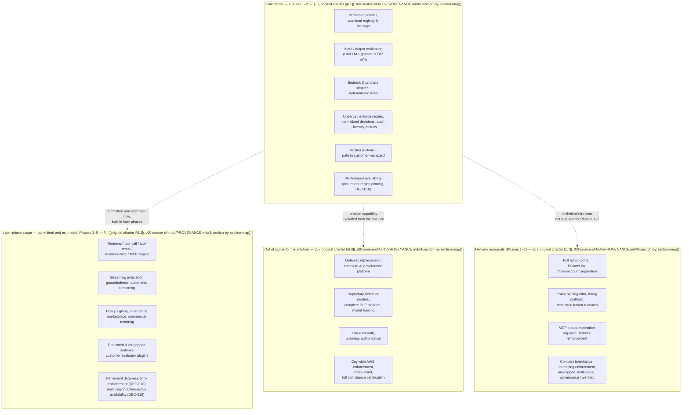

**AI Guardrails — Scope Boundaries**

**Authority level:** L2
**Status:** Draft
**Date:** 2026-07-24
**Derived from:** AGREEMENTS.md + DECISIONS.md (DEC-008)

---

> This document expands [`CHARTER.md`](CHARTER.md) [Section 6](CHARTER.md#6-in-scope-capabilities) (in-scope capabilities) and [Section 7](CHARTER.md#7-out-of-scope-capabilities) (out-of-scope capabilities) into the full detail needed for delivery planning: the core scope built in Phases 1–2, the later-phase scope committed and estimated for Phases 3–5, what the solution explicitly will not attempt, and the specific technical/operational items not required for core (Phase 1–2) delivery. Where this document and [`AGREEMENTS.md`](../00-source-of-truth/AGREEMENTS.md) or [`CONSTRAINTS.md`](../00-source-of-truth/CONSTRAINTS.md) could be read as conflicting, those L1 registers are authoritative and win; this document must be corrected.

---

## Table of contents

- [1. How to read this document](#1-how-to-read-this-document)
- [2. Scope boundary map](#2-scope-boundary-map)
- [3. Core scope — Phases 1–2](#3-core-scope--phases-12)
- [4. Later-phase scope — committed and estimated (Phases 3–5)](#4-later-phase-scope--committed-and-estimated-phases-35)
- [5. Out of scope for the solution](#5-out-of-scope-for-the-solution)
- [6. Delivery non-goals (Phases 1–2)](#6-delivery-non-goals-phases-12)
- [7. Why these boundaries matter to each stakeholder group](#7-why-these-boundaries-matter-to-each-stakeholder-group)
- [8. Scope-change governance rule](#8-scope-change-governance-rule)
- [9. Related documents](#9-related-documents)

---

## 1. How to read this document

Per [DEC-008](../00-source-of-truth/DECISIONS.md#dec-008--supersede-the-mvp-bounded-scope-define-and-estimate-the-full-feature-set-across-five-phases), scope is defined over the **full feature set** — the Phase 1–2 core capabilities (the former MVP list) plus the capabilities previously classified as future scope — so that delivery estimation is valid for the whole solution, not only its first slice. Delivery remains sequenced through five phases, each completed and validated before the next phase's scope is committed ([AGR-020](../00-source-of-truth/AGREEMENTS.md#agr-020--five-phase-delivery)).

This document uses four distinct categories, each answering a different question. They are not synonyms and must not be merged when scope is discussed:

| Category | Question it answers | Source |
| --- | --- | --- |
| **Core scope — Phases 1–2** ([Section 3](#3-core-scope--phases-12)) | What is the AI Guardrails team building and delivering in Phases 1–2 (the core platform)? | [original charter §6.1](../00-source-of-truth/PROVENANCE.md#3-section-by-section-map) |
| **Later-phase scope — committed and estimated** ([Section 4](#4-later-phase-scope--committed-and-estimated-phases-35)) | What is committed to later phases (mostly Phase 5), included in the full-solution estimation, but not built during Phases 1–2? | [original charter §6.2](../00-source-of-truth/PROVENANCE.md#3-section-by-section-map) |
| **Out of scope for the solution** ([Section 5](#5-out-of-scope-for-the-solution)) | What product-level capability is the solution explicitly *not attempting to provide at all*, even partially? | [original charter §6.3](../00-source-of-truth/PROVENANCE.md#3-section-by-section-map) |
| **Delivery non-goals (Phases 1–2)** ([Section 6](#6-delivery-non-goals-phases-12)) | What specific technical, infrastructure, or operational item is *not required* to complete core (Phase 1–2) delivery, even where a related capability appears elsewhere in this document? | [original charter §17](../00-source-of-truth/PROVENANCE.md#3-section-by-section-map) |

The distinction between "out of scope" (§5) and "non-goals" (§6) matters: out-of-scope items describe whole product capabilities the solution will not attempt (for example, a complete DLP platform); non-goals describe narrower technical or operational items that would otherwise be reasonable engineering asks (an admin portal, PrivateLink, a third AWS account) but are not required to satisfy the Phase 1–2 validation demonstration ([`SUCCESS-CRITERIA.md`](SUCCESS-CRITERIA.md); [`60-delivery/VALIDATION-PLAN.md`](../60-delivery/VALIDATION-PLAN.md)). A minimal management API and version-controlled configuration are explicitly acceptable substitutes for the excluded items in [Section 6](#6-delivery-non-goals-phases-12) during Phases 1–2 ([original charter §17](../00-source-of-truth/PROVENANCE.md#3-section-by-section-map)).

Every row in every table below carries a traceability link to the accepted agreement(s) in [`AGREEMENTS.md`](../00-source-of-truth/AGREEMENTS.md) that bind it — or, where the binding source is not an agreement, to the register entries or recorded decision ([DEC-008](../00-source-of-truth/DECISIONS.md#dec-008--supersede-the-mvp-bounded-scope-define-and-estimate-the-full-feature-set-across-five-phases)) that does — and, where one exists, the open question in [`OPEN-QUESTIONS.md`](../00-source-of-truth/OPEN-QUESTIONS.md) tracking its timing. Items with no open question listed have not yet had their timing raised as a tracked decision.

---

## 2. Scope boundary map

The core column is what the AI Guardrails team builds and delivers in Phases 1–2. Later-phase items are committed and estimated as part of the full solution ([DEC-008](../00-source-of-truth/DECISIONS.md#dec-008--supersede-the-mvp-bounded-scope-define-and-estimate-the-full-feature-set-across-five-phases)) but enter delivery only through their phase, per [AGR-020](../00-source-of-truth/AGREEMENTS.md#agr-020--five-phase-delivery) and the governance rule in [Section 8](#8-scope-change-governance-rule). Out-of-scope items are excluded from the solution entirely; non-goals are not required for core delivery.

---

## 3. Core scope — Phases 1–2

Per [original charter §6.1](../00-source-of-truth/PROVENANCE.md#3-section-by-section-map) and [DEC-008](../00-source-of-truth/DECISIONS.md#dec-008--supersede-the-mvp-bounded-scope-define-and-estimate-the-full-feature-set-across-five-phases), the following capabilities form the core of the solution, built and delivered in Phases 1–2 (Integration proof; Internal multi-team platform):

| # | Capability | What it covers | Related agreement(s) / decision(s) |
| --- | --- | --- | --- |
| 1 | Versioned guardrail policies | Immutable policy versions expressed against the Policy entity in the [core domain model](CHARTER.md#9-guiding-principles) ([AGR-017](../00-source-of-truth/AGREEMENTS.md#agr-017--core-domain-model)). | AGR-017, DEC-008 |
| 2 | Workload registration | Registering an application, assistant, agent, gateway, or inference service as a Workload. | AGR-017, AGR-019, DEC-008 |
| 3 | Policy-to-workload bindings | Associating a workload with a specific policy version, including observe/enforce mode selection. | AGR-017, DEC-008 |
| 4 | Input evaluation | Evaluating content at the `input` stage before model invocation. | AGR-006, AGR-017, DEC-008 |
| 5 | Output evaluation | Evaluating content at the `output` stage after model invocation. | AGR-006, AGR-017, DEC-008 |
| 6 | LiteLLM integration | Pre-call and post-call connectors that invoke the Evaluation API and enforce decisions inside a team-owned or provider-managed LiteLLM instance. | AGR-003, AGR-007, DEC-008 |
| 7 | Generic HTTP Evaluation API | A gateway-agnostic evaluation endpoint that any application or connector can call directly, proving the contract is not LiteLLM-specific. | AGR-003, AGR-006, DEC-008 |
| 8 | Amazon Bedrock Guardrails integration | The first managed evaluation engine, normalized behind the platform's own decision structure. | AGR-004, DEC-008 |
| 9 | Deterministic organization rules | First-party, non-ML detection logic (for example pattern or rule-based checks) addable behind the same evaluator-adapter pattern as Bedrock Guardrails. | AGR-004, AGR-005, DEC-008 |
| 10 | Basic sensitive-data handling | Baseline handling of sensitive content encountered during evaluation, consistent with no-raw-retention-by-default. | AGR-014, DEC-008 |
| 11 | Normalized evaluation decisions | The vendor-independent Decision structure (`allow`, `block`, `redact`, `log_only`) that all engines and connectors resolve to. | AGR-004, AGR-006, AGR-017, DEC-008 |
| 12 | Observe and enforce modes | The two states of the five-state progression (Disabled → Observe → Warn → Redact → Block) required in Phases 1–2. | AGR-011, DEC-008 |
| 13 | Evaluation latency metrics | P50/P95/P99 latency and timeout-rate measurement per evaluation. | DEC-008 |
| 14 | Decision metadata auditing | Persisted audit records (tenant, workload, policy version, stage, decision, reason codes, correlation ID, retention flag). | AGR-014, DEC-008 |
| 15 | Hosted runtime deployment | The Evaluation API and evaluator adapters running as provider-hosted infrastructure (serves Mode A and Mode B). | AGR-002, DEC-008 |
| 16 | A path to customer-managed deployment | The runtime is architected so it can later run inside a customer's AWS account (Mode C) without changing the connector contract — full Mode C delivery is Phase 4, not a Phase 1–2 artifact. | AGR-002, AGR-015, DEC-008 |
| 17 | Multi-region availability (per-tenant region pinning) | The hosted runtime offers multi-region availability from GA, with each tenant's evaluation traffic pinned to a single processing region — not active-active (see [Section 4](#4-later-phase-scope--committed-and-estimated-phases-35), item 19, and [Section 5](#5-out-of-scope-for-the-solution)). Per-tenant data-residency *enforcement* is a separate, later-phase item ([Section 4](#4-later-phase-scope--committed-and-estimated-phases-35), item 18). | AGR-008, AGR-013 (amended), [DEC-018](../00-source-of-truth/DECISIONS.md#dec-018--multi-region-availability-at-ga) |

These seventeen items, taken together with the observe/enforce and normalized-decision requirements, are also the basis for the **Phase 1–2 validation demonstration** ([`SUCCESS-CRITERIA.md`](SUCCESS-CRITERIA.md)) — a delivery-plan milestone specified in [`SUCCESS-CRITERIA.md`](SUCCESS-CRITERIA.md) and verified per [`60-delivery/VALIDATION-PLAN.md`](../60-delivery/VALIDATION-PLAN.md); it is not an L1 agreement and not the definition of overall solution success. The core component list and its build sequence are tracked separately in [`60-delivery/IMPLEMENTATION-STRATEGY.md`](../60-delivery/IMPLEMENTATION-STRATEGY.md) and [DEC-008](../00-source-of-truth/DECISIONS.md#dec-008--supersede-the-mvp-bounded-scope-define-and-estimate-the-full-feature-set-across-five-phases) (which supersedes DEC-005); this table states the *boundary*, not the build order.

---

## 4. Later-phase scope — committed and estimated (Phases 3–5)

Per [original charter §6.2](../00-source-of-truth/PROVENANCE.md#3-section-by-section-map) and [DEC-008](../00-source-of-truth/DECISIONS.md#dec-008--supersede-the-mvp-bounded-scope-define-and-estimate-the-full-feature-set-across-five-phases), the following capabilities are committed to later delivery phases — mostly **Phase 5 (Advanced agent protection)** — and are included in the full-solution estimation. None of them is built during Phases 1–2, and the architecture built in Phases 1–2 must permit each of them without redesign. Each item enters its delivery phase only through the five-phase plan ([AGR-020](../00-source-of-truth/AGREEMENTS.md#agr-020--five-phase-delivery)) and, where one exists, the resolution of its tracked open question; the deferrals recorded in [DEC-007](../00-source-of-truth/DECISIONS.md#dec-007--defer-advanced-isolation-distribution-security-agent-authorization-and-org-wide-enforcement) (advanced isolation, distribution security, agent authorization, organization-wide enforcement) remain in force.

| # | Capability | Architectural expectation now | Tracked open question | Related agreement(s) / decision(s) |
| --- | --- | --- | --- | --- |
| 1 | Retrieval-content evaluation | The `retrieval` evaluation stage must be a natural extension of the domain model, not a redesign. | [OQ-005](../00-source-of-truth/OPEN-QUESTIONS.md#oq-005--retrieval-content-evaluation-and-indirect-prompt-injection-detection-timeline) | AGR-006, AGR-017, AGR-020, DEC-008 |
| 2 | Indirect prompt-injection detection | Must be addable as a new evaluator behind the existing adapter pattern. | [OQ-005](../00-source-of-truth/OPEN-QUESTIONS.md#oq-005--retrieval-content-evaluation-and-indirect-prompt-injection-detection-timeline) | AGR-004, AGR-005, AGR-020, DEC-008 |
| 3 | Streaming output evaluation | Streaming workloads must have a documented interim behavior (see OQ-004) even before true streaming evaluation ships. | [OQ-004](../00-source-of-truth/OPEN-QUESTIONS.md#oq-004--streaming-output-evaluation-timeline) | AGR-006, AGR-020, DEC-008 |
| 4 | Tool-call validation | The `tool_call` stage and its decision path must not require redesigning the evaluation contract. | [OQ-006](../00-source-of-truth/OPEN-QUESTIONS.md#oq-006--tool-call-validation-tool-result-evaluation-and-mcp-authorization-scope) | AGR-006, AGR-010, AGR-017, AGR-020, DEC-008 |
| 5 | MCP authorization | Must remain clearly distinguished from a general MCP security platform (explicitly out of scope, [Section 5](#5-out-of-scope-for-the-solution)). | [OQ-006](../00-source-of-truth/OPEN-QUESTIONS.md#oq-006--tool-call-validation-tool-result-evaluation-and-mcp-authorization-scope) | AGR-010, AGR-020, DEC-008 |
| 6 | Memory-write validation | The `memory_write` evaluation stage must fit the same Evaluation/Decision entities as `input`/`output`. | No dedicated open question yet. | AGR-006, AGR-017, AGR-020, DEC-008 |
| 7 | Groundedness evaluation | Must be addable as an evaluator, not a contract change. | No dedicated open question yet. | AGR-005, AGR-020, DEC-008 |
| 8 | Automated reasoning | Must be addable as an evaluator, not a contract change. | No dedicated open question yet. | AGR-005, AGR-020, DEC-008 |
| 9 | Multilingual policy packs | Phase 1–2 evaluators are assumed English-effective only; this must be an explicit, stated limitation, not silently implied full coverage. | [OQ-008](../00-source-of-truth/OPEN-QUESTIONS.md#oq-008--multilingual-policy-pack-timeline) | AGR-020, DEC-008 |
| 10 | Human approval workflows | The `require_approval` decision action is reserved in the schema now but has no owning workflow or UI in Phases 1–2. | [OQ-007](../00-source-of-truth/OPEN-QUESTIONS.md#oq-007--human-approval-workflows-introduction-timing-and-ownership) | AGR-017, AGR-020, DEC-008 |
| 11 | Dedicated hosted runtimes | Per-tenant dedicated runtime deployments are architecturally conceivable but not scheduled. | [OQ-010](../00-source-of-truth/OPEN-QUESTIONS.md#oq-010--dedicated-tenant-runtimes-and-air-gapped-deployment-timeline) | AGR-002, AGR-020, DEC-008 |
| 12 | Air-gapped installation | Phase 4 delivers asynchronous, cache-tolerant customer-managed deployment ([AGR-015](../00-source-of-truth/AGREEMENTS.md#agr-015--customer-managed-runtime-executes-without-a-synchronous-control-plane-connection)) but not a fully air-gapped install path. | [OQ-010](../00-source-of-truth/OPEN-QUESTIONS.md#oq-010--dedicated-tenant-runtimes-and-air-gapped-deployment-timeline) | AGR-015, AGR-020, DEC-008 |
| 13 | Policy signing | Any future signing scheme must layer onto the existing versioned-policy model, not replace it. | [OQ-012](../00-source-of-truth/OPEN-QUESTIONS.md#oq-012--policy-signing-and-policy-inheritance-design) | AGR-017, AGR-020, DEC-008 |
| 14 | Policy inheritance | Must not be built until a governance model exists to contain the "policy fragmentation" risk ([`RISK-REGISTER.md`](../70-governance/RISK-REGISTER.md)). | [OQ-012](../00-source-of-truth/OPEN-QUESTIONS.md#oq-012--policy-signing-and-policy-inheritance-design) | AGR-017, AGR-020, DEC-008 |
| 15 | Customer-specific evaluator plugins | No third-party or customer-authored evaluator runs inside the runtime until a security/compatibility review model exists. | [OQ-013](../00-source-of-truth/OPEN-QUESTIONS.md#oq-013--customer-specific-evaluator-plugin-governance) | AGR-004, AGR-005, AGR-020, DEC-008 |
| 16 | Commercial metering | Phase 3 needs only internal cost/rate telemetry for quota and rate-limit enforcement; customer-facing billing is a separate, unscheduled decision. | [OQ-011](../00-source-of-truth/OPEN-QUESTIONS.md#oq-011--commercial-metering-and-policy-marketplace) | AGR-020, DEC-008 |
| 17 | Policy marketplace capabilities | Not scheduled in any phase; requires a separate, explicitly approved business decision. | [OQ-011](../00-source-of-truth/OPEN-QUESTIONS.md#oq-011--commercial-metering-and-policy-marketplace) | AGR-020, DEC-008 |
| 18 | Per-tenant data-residency enforcement | The Phase 1–2 multi-region deployment ([Section 3](#3-core-scope--phases-12), item 17) pins each tenant to a single processing region; enforcing that a tenant's content is processed and stored only within its assigned region — not merely recorded — is committed as a later-phase capability, not a Phase 1–2 artifact. | [OQ-003](../00-source-of-truth/OPEN-QUESTIONS.md#oq-003--regional-deployment-strategy-and-data-residency) (resolved by [DEC-018](../00-source-of-truth/DECISIONS.md#dec-018--multi-region-availability-at-ga)) | AGR-008, AGR-013 (amended), [DEC-018](../00-source-of-truth/DECISIONS.md#dec-018--multi-region-availability-at-ga) |
| 19 | Multi-region active-active availability | Live cross-region failover and replication, providing continuous availability beyond the single-region-per-tenant model of item 17. This explicitly supersedes its prior listing as an [original charter §6.3](../00-source-of-truth/PROVENANCE.md#3-section-by-section-map) exclusion (see [Section 5](#5-out-of-scope-for-the-solution)); the architecture must not require redesigning the Phase 1–2 regional model to add it later. | [OQ-016](../00-source-of-truth/OPEN-QUESTIONS.md#oq-016--multi-region-active-active-availability-need) (resolved by [DEC-019](../00-source-of-truth/DECISIONS.md#dec-019--multi-region-active-active-availability-committed-as-a-later-phase)) | AGR-002, AGR-006, [DEC-019](../00-source-of-truth/DECISIONS.md#dec-019--multi-region-active-active-availability-committed-as-a-later-phase) |

Later-phase items map primarily onto **Phase 5 — Advanced agent protection** in the [five-phase delivery plan](CHARTER.md#12-success-criteria) ([AGR-020](../00-source-of-truth/AGREEMENTS.md#agr-020--five-phase-delivery)); items 13–17 above may instead surface as Phase 2–4 governance or commercial decisions, as tracked in the referenced open questions. All nineteen items are part of the full feature set defined and estimated under [DEC-008](../00-source-of-truth/DECISIONS.md#dec-008--supersede-the-mvp-bounded-scope-define-and-estimate-the-full-feature-set-across-five-phases); none may be built during Phases 1–2, and where a row records a separate approval requirement (items 16–17), that approval remains a precondition for the item entering a committed phase. Items 18–19 were added to the full feature set by [DEC-018](../00-source-of-truth/DECISIONS.md#dec-018--multi-region-availability-at-ga) and [DEC-019](../00-source-of-truth/DECISIONS.md#dec-019--multi-region-active-active-availability-committed-as-a-later-phase) respectively (both Proposed, pending owner ratification).

---

## 5. Out of scope for the solution

Per [original charter §6.3](../00-source-of-truth/PROVENANCE.md#3-section-by-section-map), the solution will not attempt to provide any of the following product-level capabilities, in whole or in part. These are binding product-category exclusions, reaffirmed by [DEC-008](../00-source-of-truth/DECISIONS.md#dec-008--supersede-the-mvp-bounded-scope-define-and-estimate-the-full-feature-set-across-five-phases) — they are not part of the full feature set — and may be introduced only after the core integration and policy model have been validated, and only through the scope-change process in [Section 8](#8-scope-change-governance-rule).

| # | Excluded capability | Why it is excluded | Binding source(s) |
| --- | --- | --- | --- |
| 1 | A general-purpose LLM gateway replacement | LiteLLM is the first connector, not something the platform replaces; the platform does not compete with or substitute for gateway functionality. | AGR-001, AGR-003, [original charter §6.3](../00-source-of-truth/PROVENANCE.md#3-section-by-section-map) |
| 2 | A complete AI governance platform | Phases 1–2 validate policy reuse and connector independence; full organizational AI governance is not part of the feature set at any phase. | [original charter §6.3](../00-source-of-truth/PROVENANCE.md#3-section-by-section-map), AGR-020 |
| 3 | Model training or fine-tuning | The platform evaluates and enforces; it does not train or fine-tune models. | [original charter §6.3](../00-source-of-truth/PROVENANCE.md#3-section-by-section-map) |
| 4 | A proprietary prompt-injection model | Detection is delivered via the Bedrock Guardrails adapter and deterministic rules, not a proprietary model built by the platform team. | AGR-004, AGR-005, [original charter §6.3](../00-source-of-truth/PROVENANCE.md#3-section-by-section-map) |
| 5 | A proprietary moderation model | Same rationale as above; vendor-independence is preserved by adapting existing engines, not building new ones. | AGR-004, AGR-005, [original charter §6.3](../00-source-of-truth/PROVENANCE.md#3-section-by-section-map) |
| 6 | A complete DLP platform | Only basic sensitive-data handling is in scope ([Section 3](#3-core-scope--phases-12), item 10); comprehensive data-loss-prevention is a distinct, larger product. | [original charter §6.3](../00-source-of-truth/PROVENANCE.md#3-section-by-section-map) |
| 7 | End-user authentication | Remains the consuming application's responsibility; guardrails are not authorization. | AGR-010, [original charter §6.3](../00-source-of-truth/PROVENANCE.md#3-section-by-section-map) |
| 8 | Application business authorization | Same rationale; a guardrail decision that content or a tool call "appears safe" does not authorize its execution. | AGR-010, [original charter §6.3](../00-source-of-truth/PROVENANCE.md#3-section-by-section-map) |
| 9 | Fully autonomous agent governance | Advanced agent protection (retrieval, tool-call, memory-write, delegation) arrives as Phase 5 later-phase scope ([Section 4](#4-later-phase-scope--committed-and-estimated-phases-35)); *fully autonomous* agent governance is excluded at every phase. | AGR-010, [original charter §6.3](../00-source-of-truth/PROVENANCE.md#3-section-by-section-map), AGR-020 |
| 10 | Organization-wide AWS enforcement | The network/IAM-enforced gateway posture is the strongest enforcement model but is explicitly not required for the cooperative Phase 1–2 core; see [OQ-001](../00-source-of-truth/OPEN-QUESTIONS.md#oq-001--enforcement-model-required-for-the-first-external-customers). | AGR-018, [original charter §6.3](../00-source-of-truth/PROVENANCE.md#3-section-by-section-map) |
| 11 | Cross-cloud deployment | AWS is the primary and initial cloud platform for the solution. | AGR-013, [original charter §6.3](../00-source-of-truth/PROVENANCE.md#3-section-by-section-map) |
| 12 | Full compliance certification | Certification is a distinct, larger undertaking than validating the core integration and policy model. | [original charter §6.3](../00-source-of-truth/PROVENANCE.md#3-section-by-section-map) |
| 13 | A general MCP security platform | MCP-related later-phase scope (item 5, [Section 4](#4-later-phase-scope--committed-and-estimated-phases-35)) is narrowly scoped to authorization for the platform's own tool-call evaluation, not a general-purpose MCP security product. | AGR-010, [original charter §6.3](../00-source-of-truth/PROVENANCE.md#3-section-by-section-map), AGR-020 |

Multi-region active-active availability was previously listed here as item 12 ([original charter §6.3](../00-source-of-truth/PROVENANCE.md#3-section-by-section-map)). [DEC-019](../00-source-of-truth/DECISIONS.md#dec-019--multi-region-active-active-availability-committed-as-a-later-phase) explicitly supersedes that exclusion and commits it as later-phase scope ([Section 4](#4-later-phase-scope--committed-and-estimated-phases-35), item 19); the table above is renumbered accordingly.

---

## 6. Delivery non-goals (Phases 1–2)

Per [original charter §17](../00-source-of-truth/PROVENANCE.md#3-section-by-section-map), core (Phase 1–2) delivery does not require the following specific technical, infrastructure, or operational items — even where a related, broader capability appears in [Section 3](#3-core-scope--phases-12) or [Section 4](#4-later-phase-scope--committed-and-estimated-phases-35) above. A minimal management API and version-controlled configuration are explicitly acceptable in place of the excluded items below during Phases 1–2. Where an item maps to a later phase or a tracked open question, the mapping is noted.

| # | Non-goal | Relationship to scope elsewhere in this document | Tracked open question | Related source(s) |
| --- | --- | --- | --- | --- |
| 1 | A full administration portal | A minimal management API is sufficient; a full portal is not required to satisfy the Phase 1–2 validation demonstration. | — | [original charter §17](../00-source-of-truth/PROVENANCE.md#3-section-by-section-map) |
| 2 | A policy-signing infrastructure | Also listed as later-phase scope ([Section 4](#4-later-phase-scope--committed-and-estimated-phases-35), item 13); not required now. | [OQ-012](../00-source-of-truth/OPEN-QUESTIONS.md#oq-012--policy-signing-and-policy-inheritance-design) | AGR-017, [original charter §17](../00-source-of-truth/PROVENANCE.md#3-section-by-section-map) |
| 3 | PrivateLink | Public, TLS-secured endpoints (per CON-008) are sufficient for Phases 1–2; Customer-Managed Runtime remains the recommended path for teams whose actual requirement is "no content leaves our network." | [OQ-002](../00-source-of-truth/OPEN-QUESTIONS.md#oq-002--privatelink--private-connectivity) | AGR-009, [original charter §17](../00-source-of-truth/PROVENANCE.md#3-section-by-section-map) |
| 4 | Three-account AWS separation | The Phase 1–2 account model is one non-production account and one production account. | [OQ-009](../00-source-of-truth/OPEN-QUESTIONS.md#oq-009--trigger-point-for-three-account-aws-separation) | AGR-013, [original charter §17](../00-source-of-truth/PROVENANCE.md#3-section-by-section-map) |
| 5 | A billing platform | Related to later-phase "commercial metering" ([Section 4](#4-later-phase-scope--committed-and-estimated-phases-35), item 16); Phase 3 needs only internal cost/rate telemetry for quota and rate-limit enforcement. | [OQ-011](../00-source-of-truth/OPEN-QUESTIONS.md#oq-011--commercial-metering-and-policy-marketplace) | [original charter §17](../00-source-of-truth/PROVENANCE.md#3-section-by-section-map) |
| 6 | Dedicated tenant runtime deployments | Also listed as later-phase scope ([Section 4](#4-later-phase-scope--committed-and-estimated-phases-35), item 11). | [OQ-010](../00-source-of-truth/OPEN-QUESTIONS.md#oq-010--dedicated-tenant-runtimes-and-air-gapped-deployment-timeline) | AGR-002, [original charter §17](../00-source-of-truth/PROVENANCE.md#3-section-by-section-map) |
| 7 | MCP tool authorization | Also listed as later-phase scope and out of scope ([Section 4](#4-later-phase-scope--committed-and-estimated-phases-35) item 5; [Section 5](#5-out-of-scope-for-the-solution) item 13). | [OQ-006](../00-source-of-truth/OPEN-QUESTIONS.md#oq-006--tool-call-validation-tool-result-evaluation-and-mcp-authorization-scope) | AGR-010, [original charter §17](../00-source-of-truth/PROVENANCE.md#3-section-by-section-map) |
| 8 | Organization-wide Bedrock enforcement | Related to out-of-scope item 10 ([Section 5](#5-out-of-scope-for-the-solution)); the network/IAM-enforced gateway posture is deferred until an external customer or compliance driver is identified. | [OQ-001](../00-source-of-truth/OPEN-QUESTIONS.md#oq-001--enforcement-model-required-for-the-first-external-customers) | AGR-018, [original charter §17](../00-source-of-truth/PROVENANCE.md#3-section-by-section-map) |
| 9 | Complex policy inheritance | Also listed as later-phase scope ([Section 4](#4-later-phase-scope--committed-and-estimated-phases-35), item 14). | [OQ-012](../00-source-of-truth/OPEN-QUESTIONS.md#oq-012--policy-signing-and-policy-inheritance-design) | AGR-017, [original charter §17](../00-source-of-truth/PROVENANCE.md#3-section-by-section-map) |
| 10 | Streaming guardrail enforcement | Also listed as later-phase scope ([Section 4](#4-later-phase-scope--committed-and-estimated-phases-35), item 3); a documented interim behavior is required for workloads that declare streaming today. | [OQ-004](../00-source-of-truth/OPEN-QUESTIONS.md#oq-004--streaming-output-evaluation-timeline) | AGR-006, [original charter §17](../00-source-of-truth/PROVENANCE.md#3-section-by-section-map) |
| 11 | Air-gapped deployment | Also listed as later-phase scope ([Section 4](#4-later-phase-scope--committed-and-estimated-phases-35), item 12). | [OQ-010](../00-source-of-truth/OPEN-QUESTIONS.md#oq-010--dedicated-tenant-runtimes-and-air-gapped-deployment-timeline) | AGR-015, [original charter §17](../00-source-of-truth/PROVENANCE.md#3-section-by-section-map) |
| 12 | Multi-cloud support | Related to out-of-scope item 11 ([Section 5](#5-out-of-scope-for-the-solution)); AWS is the primary and initial cloud platform. | — | AGR-013, [original charter §17](../00-source-of-truth/PROVENANCE.md#3-section-by-section-map) |
| 13 | A general-purpose AI governance inventory | Related to out-of-scope item 2 ([Section 5](#5-out-of-scope-for-the-solution)); Phases 1–2 track tenants, workloads, policies, and bindings only, not an org-wide governance inventory. | — | AGR-017, [original charter §17](../00-source-of-truth/PROVENANCE.md#3-section-by-section-map) |

---

## 7. Why these boundaries matter to each stakeholder group

The scope discipline in this document is not an abstract exercise: it exists to give each of the four stakeholder groups defined in [`CHARTER.md` Section 4](CHARTER.md#4-target-users-and-stakeholders) a predictable, boundary-respecting product.

| Stakeholder group | What a crisp scope boundary gives them |
| --- | --- |
| **Platform teams** | Confidence that "reusable connectors" and "deployment consistency" mean a stable, bounded Phase 1–2 core contract — not a moving target that quietly absorbs later-phase items mid-delivery. |
| **Application teams** | A predictable onboarding experience: they can rely on the core platform's observe/enforce modes and input/output evaluation being fully supported today, while knowing exactly which capabilities (for example, retrieval or tool-call evaluation) arrive in later phases, per [Section 4](#4-later-phase-scope--committed-and-estimated-phases-35). |
| **Security and compliance teams** | A clear list of what is *not* certified, built, or enforced yet (full compliance certification, organization-wide enforcement, a complete DLP platform — [Section 5](#5-out-of-scope-for-the-solution)) so they do not extend false assurance to regulated workloads. |
| **Product operators** | A basis for "deployment compatibility tracking": operators can state precisely which capabilities a given workload can rely on without guessing whether a later-phase item has silently shipped ahead of its phase. |

---

## 8. Scope-change governance rule

Any proposed feature outside the boundaries in [Section 3](#3-core-scope--phases-12) through [Section 6](#6-delivery-non-goals-phases-12) requires an explicit, recorded scope-change decision — never silent inclusion during implementation ([DEC-008](../00-source-of-truth/DECISIONS.md#dec-008--supersede-the-mvp-bounded-scope-define-and-estimate-the-full-feature-set-across-five-phases); [AGR-020](../00-source-of-truth/AGREEMENTS.md#agr-020--five-phase-delivery) phase gating). Concretely:

* A capability enters a committed delivery phase only through the phase plan and recorded decisions: a later-phase item ([Section 4](#4-later-phase-scope--committed-and-estimated-phases-35)) is built in its phase — or pulled forward — only once its tracked open question (where one exists) is resolved and recorded as a new agreement in [`AGREEMENTS.md`](../00-source-of-truth/AGREEMENTS.md).
* An out-of-scope item ([Section 5](#5-out-of-scope-for-the-solution)) or a non-goal ([Section 6](#6-delivery-non-goals-phases-12)) may only be introduced after the core integration and policy model have been validated ([original charter §6.3](../00-source-of-truth/PROVENANCE.md#3-section-by-section-map)), through the same explicit-decision path — not as an incidental side effect of another change.
* Delivery milestones must be evaluated against the boundaries in this document before being marked complete; each phase's deliverables must be completed and validated before the next phase's scope is committed ([AGR-020](../00-source-of-truth/AGREEMENTS.md#agr-020--five-phase-delivery)).
* Any external claim (sales, executive, or marketing material) that implies an out-of-scope or non-goal item is already delivered must be rejected by [`70-governance/CLAIMS-REGISTER.md`](../70-governance/CLAIMS-REGISTER.md).

---

## 9. Related documents

| Document | Relationship |
| --- | --- |
| [`AGREEMENTS.md`](../00-source-of-truth/AGREEMENTS.md) | Authoritative (L1) agreements this document is bound by, especially AGR-019 (meaning of "import") and AGR-020 (five-phase delivery). |
| [`CONSTRAINTS.md`](../00-source-of-truth/CONSTRAINTS.md) | Authoritative (L1) boundary conditions (account model, contract independence, content handling) that this scope document must not contradict. |
| [`OPEN-QUESTIONS.md`](../00-source-of-truth/OPEN-QUESTIONS.md) | Tracks unresolved timing and design questions for the later-phase and non-goal items listed here. |
| [`DECISIONS.md`](../00-source-of-truth/DECISIONS.md) | Chronological decision log; see DEC-008 (which supersedes DEC-005) for the full-feature-set scope basis, and DEC-006/DEC-007 for phase sequencing and deferrals. |
| [`CHARTER.md`](CHARTER.md) | The durable charter this document expands (Sections 6 and 7). |
| [`PRINCIPLES.md`](PRINCIPLES.md) | Guiding principles that these scope boundaries operationalize. |
| [`SUCCESS-CRITERIA.md`](SUCCESS-CRITERIA.md) | Measurable success indicators, including the Phase 1–2 validation demonstration and the per-phase completion framing this scope supports. |
| [`20-product/PRODUCT-ROADMAP.md`](../20-product/PRODUCT-ROADMAP.md) | Phase-by-phase roadmap showing when later-phase items enter delivery. |
| [`20-product/CAPABILITIES.md`](../20-product/CAPABILITIES.md) | Capability-level detail per deployment mode, built on the core scope list in [Section 3](#3-core-scope--phases-12). |
| [`60-delivery/IMPLEMENTATION-STRATEGY.md`](../60-delivery/IMPLEMENTATION-STRATEGY.md) | Build sequence and delivery approach for the core (Phases 1–2) components and the later phases. |
| [`60-delivery/VALIDATION-PLAN.md`](../60-delivery/VALIDATION-PLAN.md) | Defines and verifies the Phase 1–2 validation demonstration this scope supports. |
| [`60-delivery/RELEASE-CRITERIA.md`](../60-delivery/RELEASE-CRITERIA.md) | Gate criteria that must evaluate delivery against these scope boundaries before release. |
| [`70-governance/RISK-REGISTER.md`](../70-governance/RISK-REGISTER.md) | Tracks "product over-expansion" and related risks that this scope document exists to mitigate. |
| [`70-governance/CLAIMS-REGISTER.md`](../70-governance/CLAIMS-REGISTER.md) | Must reject any external claim contradicting the boundaries recorded here. |
