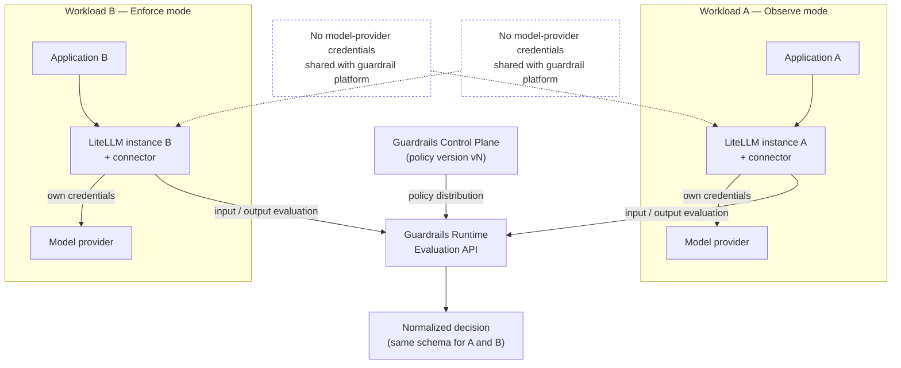

**AI Guardrails — Success Criteria**

**Authority level:** L2
**Status:** Draft
**Date:** 2026-07-24
**Derived from:** AGREEMENTS.md

---

> **Current local release (2026-10-08):** [DEC-022](../00-source-of-truth/DECISIONS.md#dec-022--define-a-separately-accepted-local-technical-proof), grounded in AGR-022 through AGR-024, defines a separately accepted local technical proof for internal application teams, operated through an API and CLI. AWS integration and service exposure to other teams are later milestones. This document retains its programme and hosted-phase obligations; cloud-specific requirements are not local-release exit gates, and local substitutes do not prove those controls. The current boundary and interview status are in [RELEASE-DEFINITION.md](../60-delivery/RELEASE-DEFINITION.md).

## Purpose and authority

This document defines what "success" measurably means for the AI Guardrails solution. Overall solution success is the delivery of the **full feature set** across the five delivery phases, each phase's completion criteria validated before the next phase's scope is committed ([`AGREEMENTS.md` AGR-020](../00-source-of-truth/AGREEMENTS.md#agr-020--five-phase-delivery); [DEC-008](../00-source-of-truth/DECISIONS.md#dec-008--supersede-the-mvp-bounded-scope-define-and-estimate-the-full-feature-set-across-five-phases)). Within that frame, this document covers two parts:

1. **Phase 1–2 validation demonstration criteria** — the specific, falsifiable conditions that must all be true for the Phase 1–2 validation demonstration to be declared complete ([original charter §16](../00-source-of-truth/PROVENANCE.md#3-section-by-section-map); verification detailed in [`60-delivery/VALIDATION-PLAN.md`](../60-delivery/VALIDATION-PLAN.md)). The demonstration is a delivery-plan milestone — not an L1 agreement and not the definition of overall solution success.
2. **Ongoing success metrics** — the indicators the platform must continue to measure after the Phase 1–2 core is delivered, grouped by Adoption, Reliability, Effectiveness, and Product portability ([original charter §19](../00-source-of-truth/PROVENANCE.md#3-section-by-section-map)).

This is an **L2** document: it operationalizes the L1-authoritative agreements and constraints in [`AGREEMENTS.md`](../00-source-of-truth/AGREEMENTS.md) and [`CONSTRAINTS.md`](../00-source-of-truth/CONSTRAINTS.md) into checkable criteria. It does not introduce new commitments — where `AGREEMENTS.md` and `CONSTRAINTS.md` do not supply a number, this document records **TBD** rather than inventing one. Numeric targets must be filled in by the accountable owner (noted per metric) before they are used to gate a release or report externally reportable results.

No claim in sales, executive, or governance materials may assert that a success criterion or metric has been met unless it is recorded as met here or in [`70-governance/CLAIMS-REGISTER.md`](../70-governance/CLAIMS-REGISTER.md).

---

## Table of contents

<!-- BEGIN GENERATED: toc -->
- [Purpose and authority](#purpose-and-authority)
- [1. Phase 1–2 validation demonstration criteria](#1-phase-12-validation-demonstration-criteria)
  - [1.1 Demonstration architecture](#11-demonstration-architecture)
  - [1.2 Criteria table](#12-criteria-table)
  - [1.3 Gating rule](#13-gating-rule)
- [2. Ongoing success metrics](#2-ongoing-success-metrics)
  - [2.1 Adoption](#21-adoption)
  - [2.2 Reliability](#22-reliability)
  - [2.3 Effectiveness](#23-effectiveness)
  - [2.4 Product portability](#24-product-portability)
- [3. Relationship between the validation demonstration and ongoing metrics](#3-relationship-between-the-validation-demonstration-and-ongoing-metrics)
- [4. Related documents](#4-related-documents)
<!-- END GENERATED: toc -->
---

## 1. Phase 1–2 validation demonstration criteria

Phases 1–2 exist to prove one hypothesis: **one reusable policy can be applied consistently to multiple independent LiteLLM deployments** ([original charter §16](../00-source-of-truth/PROVENANCE.md#3-section-by-section-map)). Every criterion below is a direct restatement of [original charter §16](../00-source-of-truth/PROVENANCE.md#3-section-by-section-map) and is gated as a delivery milestone in [`60-delivery/VALIDATION-PLAN.md`](../60-delivery/VALIDATION-PLAN.md): **all** of these conditions must hold simultaneously — not a subset, and not one deployment exercised twice in place of two genuinely independent ones. (Criterion IDs retain their historical `MVP-` prefix so existing cross-references stay valid; they name this Phase 1–2 validation demonstration.)

### 1.1 Demonstration architecture

The diagram below shows the minimum topology needed to exercise the demonstration: two independent LiteLLM deployments, owned by different (or simulated-independent) teams, each with its own model-provider credentials, both bound to the same versioned policy through the guardrail control plane.

Key properties the diagram is required to demonstrate:

* Workload A and Workload B are **separate LiteLLM instances**, not one instance queried twice.
* Each instance retains **its own** model-provider credentials; the guardrail platform never receives them (consistent with the connector's non-responsibilities in [AGR-003](../00-source-of-truth/AGREEMENTS.md#agr-003--litellm-as-first-connector-not-the-product-boundary) and [`CONSTRAINTS.md` CON-011](../00-source-of-truth/CONSTRAINTS.md#con-011--per-tenant-workload-identities)).
* Both instances are bound to the **same policy version**, distributed from one control plane.
* The two workloads run in **different enforcement modes** (observe vs. enforce) against that same policy.

### 1.2 Criteria table

| ID | Criterion ([original charter §16](../00-source-of-truth/PROVENANCE.md#3-section-by-section-map)) | What "met" looks like | Related agreement / constraint |
|---|---|---|---|
| MVP-01 | Two separate LiteLLM instances consume the same policy. | Two independently deployed LiteLLM instances are each bound to identical policy name and version via a policy binding; both are verified to resolve the same policy content. | [original charter §16](../00-source-of-truth/PROVENANCE.md#3-section-by-section-map), [AGR-017](../00-source-of-truth/AGREEMENTS.md#agr-017--core-domain-model) (policy binding) |
| MVP-02 | Neither instance shares model-provider credentials with the guardrail platform. | Audit of the guardrail platform's stored credentials/secrets shows no model-provider API keys or tokens for either workload; each LiteLLM instance retains sole custody of its own credentials. | [AGR-019](../00-source-of-truth/AGREEMENTS.md#agr-019--meaning-of-import), [CON-011](../00-source-of-truth/CONSTRAINTS.md#con-011--per-tenant-workload-identities), [CON-012](../00-source-of-truth/CONSTRAINTS.md#con-012--no-exclusive-reliance-on-weak-security-proxies) |
| MVP-03 | Both receive consistent normalized decisions. | For equivalent evaluated content, both workloads' evaluations return decisions using the same decision schema (action, allowed status, reason codes, policy name/version, evaluator metadata, correlation identifier) as defined in [AGR-017](../00-source-of-truth/AGREEMENTS.md#agr-017--core-domain-model) (Decision). | [AGR-006](../00-source-of-truth/AGREEMENTS.md#agr-006--one-logical-evaluation-contract-across-all-modes), [AGR-017](../00-source-of-truth/AGREEMENTS.md#agr-017--core-domain-model) |
| MVP-04 | One workload can run in observe mode. | Workload A's binding is set to `observe`; evaluations execute and produce decisions, but no enforcement action (block/redact) is applied to the request path. | [AGR-011](../00-source-of-truth/AGREEMENTS.md#agr-011--observe-before-enforce-progression) |
| MVP-05 | Another workload can run in enforce mode. | Workload B's binding is set to `enforce` (or a stricter state such as `block`); a violation triggers the corresponding enforcement action (e.g., block) on the request path. | [AGR-011](../00-source-of-truth/AGREEMENTS.md#agr-011--observe-before-enforce-progression) |
| MVP-06 | A policy can be upgraded and rolled back. | A new immutable policy version is published, bound to a workload, and produces different (documented) evaluation behavior; the binding is then reverted to the prior version and prior behavior is restored, with both transitions captured in audit metadata. | [`NON-FUNCTIONAL-REQUIREMENTS.md`](../50-architecture/NON-FUNCTIONAL-REQUIREMENTS.md) (Policy rollout: "Immutable versions... Immediate rollback") |
| MVP-07 | Raw content persistence can be disabled. | With the tenant's retention configuration set to disable raw-content persistence, evaluated prompts/responses are not found in any runtime store, cache, or log after evaluation completes; decision metadata is still persisted. | [AGR-014](../00-source-of-truth/AGREEMENTS.md#agr-014--no-raw-promptresponse-retention-by-default), [CON-014](../00-source-of-truth/CONSTRAINTS.md#con-014--no-raw-content-retention-by-default-in-the-hosted-runtime) |
| MVP-08 | Evaluation failures follow a configured failure policy. | With a detector or the Evaluation API forced into a failure condition (timeout, unavailability), the workload's configured failure behavior (e.g., allow-and-log, block, cached policy) executes exactly as configured, and the failure path is captured in the audit record. | [AGR-012](../00-source-of-truth/AGREEMENTS.md#agr-012--failure-behavior-is-part-of-policy) |
| MVP-09 | The runtime can later be packaged for customer-managed deployment without changing the connector contract. | The evaluation runtime is built and validated to run as a deployable artifact (e.g., container) suitable for a customer-managed environment, while the LiteLLM connector's invocation contract (request/response shapes to the Evaluation API) remains unchanged from the hosted-mode contract. This criterion validates packaging feasibility; full customer-managed deployment is delivered in Phase 4, not Phases 1–2. | [AGR-006](../00-source-of-truth/AGREEMENTS.md#agr-006--one-logical-evaluation-contract-across-all-modes), [AGR-015](../00-source-of-truth/AGREEMENTS.md#agr-015--customer-managed-runtime-executes-without-a-synchronous-control-plane-connection), [AGR-020](../00-source-of-truth/AGREEMENTS.md#agr-020--five-phase-delivery) (Phase 4 scope) |

### 1.3 Gating rule

The Phase 1–2 validation demonstration is met **only when all nine criteria (MVP-01 through MVP-09) are demonstrated together**, using two genuinely independent LiteLLM deployments ([original charter §16](../00-source-of-truth/PROVENANCE.md#3-section-by-section-map)). Passing it validates Phase 1–2 completion before Phase 3 scope is committed ([AGR-020](../00-source-of-truth/AGREEMENTS.md#agr-020--five-phase-delivery)). A subset of criteria passing, or the same deployment exercised twice under different labels, does not satisfy the demonstration. The demonstration result is the primary evidence cited in downstream executive and sales materials about product portability, and any such citation must reference this table, not a paraphrase of it.

Verification method, environment, and sign-off owner for each criterion are **TBD** and must be defined in [`60-delivery/VALIDATION-PLAN.md`](../60-delivery/VALIDATION-PLAN.md) and gated in [`60-delivery/RELEASE-CRITERIA.md`](../60-delivery/RELEASE-CRITERIA.md).

---

## 2. Ongoing success metrics

Once the Phase 1–2 validation demonstration (Section 1) has been satisfied, the platform must continue to measure its health and value along four dimensions, taken directly from [original charter §19](../00-source-of-truth/PROVENANCE.md#3-section-by-section-map). Seed.md does not supply numeric targets, baselines, or measurement cadences for any of these; every target below is recorded as **TBD** until an accountable owner sets it, consistent with the source-of-truth policy against inventing figures.

### 2.1 Adoption

| Metric | What it measures | Target | Notes |
|---|---|---|---|
| Number of onboarded workloads | Count of workloads registered and bound to a policy, across all tenants. | TBD | Baseline established once workload registration ([`SCOPE.md`](SCOPE.md), [AGR-017](../00-source-of-truth/AGREEMENTS.md#agr-017--core-domain-model)) is live. |
| Number of active tenants | Count of tenants with at least one workload actively consuming evaluations. | TBD | "Active" threshold (e.g., minimum evaluation volume or recency) is TBD. |
| Percentage of supported LiteLLM instances using the connector | Share of known/eligible LiteLLM deployments that have the connector installed and in use, out of the addressable population. | TBD | Denominator ("supported LiteLLM instances") must be defined operationally before this is reportable. |
| Time required to onboard a workload | Elapsed time from workload registration start to first successful evaluation in observe mode, following the onboarding flow in [AGR-019](../00-source-of-truth/AGREEMENTS.md#agr-019--meaning-of-import). | TBD | Should be tracked as a distribution (e.g., median and a tail percentile), not a single point estimate, once a target is set. |
| Percentage of workloads using a shared policy | Share of workloads bound to a policy also used by at least one other workload, versus workloads on a fully bespoke policy. | TBD | Directly evidences the core reusable-policy hypothesis validated by the Phase 1–2 validation demonstration (Section 1). |

### 2.2 Reliability

| Metric | What it measures | Target | Notes |
|---|---|---|---|
| Evaluation API availability | Uptime/success rate of the Evaluation API over a measurement window. | TBD | Availability objective must be defined per [`NON-FUNCTIONAL-REQUIREMENTS.md`](../50-architecture/NON-FUNCTIONAL-REQUIREMENTS.md) ("Availability objective") before this metric has a pass/fail threshold. |
| Evaluation timeout rate | Share of evaluation requests that exceed the configured stage timeout ([`NON-FUNCTIONAL-REQUIREMENTS.md`](../50-architecture/NON-FUNCTIONAL-REQUIREMENTS.md), [CON-016](../00-source-of-truth/CONSTRAINTS.md#con-016--timeout-limits)). | TBD | Timeout values themselves are also TBD per CON-016. |
| P95 evaluation latency | 95th-percentile end-to-end evaluation latency, per [`NON-FUNCTIONAL-REQUIREMENTS.md`](../50-architecture/NON-FUNCTIONAL-REQUIREMENTS.md) ("Performance"). | TBD | The L1 registers also call for P50 and P99 latency and detector-specific latency; those are tracked as supporting operational metrics, not repeated here since §19 names only P95 explicitly. |
| Policy-resolution failure rate | Share of evaluation requests where the applicable policy version could not be resolved. | TBD | Feeds directly into the failure-behavior requirement of [AGR-012](../00-source-of-truth/AGREEMENTS.md#agr-012--failure-behavior-is-part-of-policy). |
| Audit delivery success rate | Share of evaluations for which the corresponding audit record was successfully produced and delivered. | TBD | Directly supports the auditing requirements in [`NON-FUNCTIONAL-REQUIREMENTS.md`](../50-architecture/NON-FUNCTIONAL-REQUIREMENTS.md) and the evidentiary role auditing plays for security and compliance teams ([`TARGET-USERS.md`](../20-product/TARGET-USERS.md)). |

### 2.3 Effectiveness

| Metric | What it measures | Target | Notes |
|---|---|---|---|
| Number of policy interventions | Count of evaluations resulting in a non-`allow` decision (block, redact, log_only, etc.). | TBD | Should be broken down by policy, workload, and reason code once dashboards exist. |
| False-positive review rate | Share of interventions reviewed and confirmed to be incorrect (i.e., content was actually safe/compliant). | TBD | Requires a defined review workflow; not specified in the L1 registers and left TBD. |
| Confirmed harmful-input detection rate | Share of known/labeled harmful inputs correctly detected by the applicable policy. | TBD | Depends on a risk-specific evaluation dataset, called out as a mitigation in [`RISK-REGISTER.md`](../70-governance/RISK-REGISTER.md) ("False confidence") but not yet defined. |
| Confirmed sensitive-output prevention rate | Share of known/labeled sensitive-output cases correctly prevented or redacted. | TBD | Same dependency as above. |
| Percentage of policies promoted from observe to enforce | Share of policy bindings that have advanced from Observe to Enforce (or further along the Disabled → Observe → Warn → Redact → Block progression in [AGR-011](../00-source-of-truth/AGREEMENTS.md#agr-011--observe-before-enforce-progression)). | TBD | Direct evidence of the observe-before-enforce principle ([AGR-011](../00-source-of-truth/AGREEMENTS.md#agr-011--observe-before-enforce-progression)) working as intended. |
| Number of policy rollbacks caused by incorrect behavior | Count of policy version rollbacks attributable to the new version behaving incorrectly (as opposed to routine version management). | TBD | "Incorrect behavior" classification criteria are TBD. |

### 2.4 Product portability

| Metric | What it measures | Target | Notes |
|---|---|---|---|
| Percentage of policy definitions that are deployment-mode independent | Share of policy definitions that contain no LiteLLM-, Bedrock-, or provider-specific structures, per [CON-003](../00-source-of-truth/CONSTRAINTS.md#con-003--no-coupling-to-litellm-configuration-structures) and [CON-004](../00-source-of-truth/CONSTRAINTS.md#con-004--no-coupling-to-bedrock-guardrails-response-formats). | TBD | Directly evidences policy portability ([AGR-005](../00-source-of-truth/AGREEMENTS.md#agr-005--policy-portability)). |
| Number of supported connectors | Count of gateway/application connectors implementing the evaluation contract (LiteLLM, generic SDK, future gateways). | TBD | [`SCOPE.md`](SCOPE.md) names the LiteLLM connector and a generic HTTP Evaluation API as initial scope; count should track growth beyond these. |
| Percentage of runtime code shared across hosted and customer-managed modes | Share of the guardrails runtime codebase that is identical (not forked or mode-specific) between hosted (Modes A/B) and customer-managed (Mode C) deployments. | TBD | Evidences the "one contract across deployment modes" agreement ([AGR-006](../00-source-of-truth/AGREEMENTS.md#agr-006--one-logical-evaluation-contract-across-all-modes)) at the implementation level. |
| Time required to deploy a customer-managed runtime | Elapsed time from a customer starting Mode C deployment to first successful local evaluation. | TBD | Applicable once Phase 4 deliverables (runtime container, Helm chart, ECS template, infrastructure module — [AGR-020](../00-source-of-truth/AGREEMENTS.md#agr-020--five-phase-delivery) Phase 4) exist. |

---

## 3. Relationship between the validation demonstration and ongoing metrics

The Phase 1–2 validation demonstration criteria (Section 1) and the ongoing success metrics (Section 2) serve different purposes and must not be conflated:

* The **validation demonstration** is a one-time, binary, all-or-nothing gate (per the gating rule in [Section 1.3](#13-gating-rule)) that proves the core reusable-policy hypothesis is *architecturally* true. It answers: *can* one policy be applied consistently across independent gateways, with clean credential and content-persistence boundaries, and survive a version upgrade/rollback and a failure condition?
* The **ongoing metrics** are continuous, quantitative indicators that track whether the platform *continues* to deliver that value at scale, after the demonstration gate has already been passed. They answer: *is it actually being adopted, staying reliable, proving effective, and remaining portable over time?*

Several ongoing metrics are direct longitudinal extensions of MVP criteria — for example, "percentage of workloads using a shared policy" (§2.1) extends MVP-01, and "percentage of policies promoted from observe to enforce" (§2.3) extends MVP-04/MVP-05. Where such a relationship exists, the metric's baseline measurement should be taken at the moment the validation demonstration is completed, so that post-MVP trends are measured against a known starting point rather than an assumed one.

---

## 4. Related documents

- [`00-source-of-truth/AGREEMENTS.md`](../00-source-of-truth/AGREEMENTS.md) — authoritative agreements, in particular AGR-020 (five-phase delivery) and AGR-011 (observe-before-enforce).
- [`00-source-of-truth/DECISIONS.md`](../00-source-of-truth/DECISIONS.md) — DEC-008 records that the solution is defined and estimated over the full feature set across five phases, and that the demonstration in Section 1 is a delivery milestone rather than the register-level definition of solution success.
- [`00-source-of-truth/CONSTRAINTS.md`](../00-source-of-truth/CONSTRAINTS.md) — authoritative constraints referenced throughout Section 1 and Section 2.
- [`10-charter/CHARTER.md`](CHARTER.md) — the product charter narrative this document derives its scope from.
- [`10-charter/SCOPE.md`](SCOPE.md) — the core (Phases 1–2) scope boundaries that bound what the demonstration criteria may assume exists.
- [`10-charter/PRINCIPLES.md`](PRINCIPLES.md) — product principles (portability, one contract, observe-before-enforce, failure behavior) that Section 1's criteria operationalize.
- [`60-delivery/RELEASE-CRITERIA.md`](../60-delivery/RELEASE-CRITERIA.md) — must gate Phase 1–2 (core platform) release on all nine criteria in Section 1.2, not a subset.
- [`60-delivery/VALIDATION-PLAN.md`](../60-delivery/VALIDATION-PLAN.md) — must define concrete verification methods for each criterion in Section 1.2.
- [`60-delivery/MILESTONES.md`](../60-delivery/MILESTONES.md) — should sequence delivery of the two independent LiteLLM deployments needed for the demonstration.
- [`30-executive/EXPECTED-OUTCOMES.md`](../30-executive/EXPECTED-OUTCOMES.md) — may cite the validation demonstration result as evidence, but must not restate it in a way that contradicts Section 1.3's gating rule.
- [`70-governance/CLAIMS-REGISTER.md`](../70-governance/CLAIMS-REGISTER.md) — must reject any external claim that a criterion or metric has been met unless recorded here.
