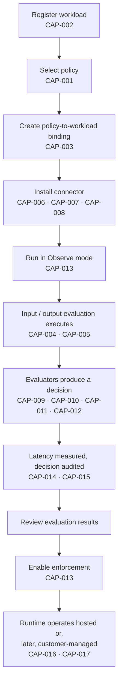

**AI Guardrails — Capability Catalog**

**Authority level:** L2
**Status:** Draft
**Date:** 2026-07-24
**Derived from:** seed.md + AGREEMENTS.md

---

## Purpose and authority

This document is the **capability catalog** for the AI Guardrails solution: the enumerated, traceable list of what the product does (or will do), organized by delivery status. It is a **derived (L2)** artifact. It must not contradict [`AGREEMENTS.md`](../00-source-of-truth/AGREEMENTS.md) or [`CONSTRAINTS.md`](../00-source-of-truth/CONSTRAINTS.md) (both L1 — authoritative). Where a conflict is found, those documents win and this catalog must be corrected.

Every capability below is derived from `seed.md` §6 ("Product scope"), §9 ("Core domain model"), §10 ("Logical architecture"), §12 ("LiteLLM integration"), and §16 ("MVP definition"). No metric, dollar figure, SLA, or performance number is asserted beyond what `seed.md` states; where a figure would normally appear and is not present in the seed, this catalog says **TBD** or describes the capability qualitatively.

Each capability is assigned a stable identifier (`CAP-001` …) so that later documents — the traceability matrix, release criteria, and architecture set — can reference it precisely.

---

## Table of contents

- [How to read this catalog](#how-to-read-this-catalog)
- [Capability lifecycle diagram](#capability-lifecycle-diagram)
- [MVP capabilities (in scope)](#mvp-capabilities-in-scope)
  - [Policy governance](#policy-governance)
  - [Workload and binding](#workload-and-binding)
  - [Evaluation](#evaluation)
  - [Connectors and APIs](#connectors-and-apis)
  - [Decisions, audit, and observability](#decisions-audit-and-observability)
  - [Deployment](#deployment)
- [Future capabilities (not in MVP)](#future-capabilities-not-in-mvp)
- [A third category: explicitly out of scope for the MVP](#a-third-category-explicitly-out-of-scope-for-the-mvp)
- [Capability count summary](#capability-count-summary)
- [Related documents](#related-documents)

---

## How to read this catalog

| Column | Meaning |
|---|---|
| **Capability** | A short, stable name for the capability, with its ID. |
| **Description** | What the capability does, stated qualitatively and derived only from `seed.md`. |
| **Status** | `MVP` — committed to the initial product scope (`seed.md` §6.1, §16). `Future` — architecturally permitted but explicitly **not** built during the MVP (`seed.md` §6.2). |
| **Related AGR** | The [`AGREEMENTS.md`](../00-source-of-truth/AGREEMENTS.md) entries this capability implements or is bounded by. |
| **Related architecture section** | The `50-architecture/` document expected to specify this capability's design. These architecture documents have not yet been authored as of this draft; the reference identifies where the design belongs, not that the section already exists. |

> **Explicit rule (per [AGR-019](../00-source-of-truth/AGREEMENTS.md#agr-019--mvp-scope-boundaries)):** a capability marked `Future` is **not** part of the MVP. It may be designed for extensibility, but it must not be scheduled, resourced, or silently included in MVP delivery. Any change to a capability's status is a scope-change decision, not an editorial one, and must be reflected first in `AGREEMENTS.md`.

---

## Capability lifecycle diagram

The diagram below places the MVP capabilities against the onboarding flow defined in `seed.md` §4, showing where each capability is exercised.

---

## MVP capabilities (in scope)

The MVP exists to prove that one reusable policy can be applied consistently to multiple independent LiteLLM deployments (`seed.md` §16). The capabilities below are drawn from `seed.md` §6.1 ("In scope") and §16 ("MVP components").

### Policy governance

| Capability | Description | Status | Related AGR | Related architecture section |
|---|---|---|---|---|
| **CAP-001 — Versioned guardrail policies** | A policy defines the checks and enforcement actions applied to evaluated content: name, immutable version, evaluation stages, evaluator configuration, thresholds, failure behavior, audit behavior, and compatibility metadata. Each version is independently addressable so it can be promoted, rolled back, or scoped to specific workloads without affecting other versions. | MVP | [AGR-005](../00-source-of-truth/AGREEMENTS.md#agr-005--policy-portability), [AGR-006](../00-source-of-truth/AGREEMENTS.md#agr-006--one-logical-evaluation-contract-across-all-modes), [AGR-017](../00-source-of-truth/AGREEMENTS.md#agr-017--core-domain-model) | `50-architecture/COMPONENT-ARCHITECTURE.md` (Policy model), `50-architecture/DATA-ARCHITECTURE.md` (Policy storage) |

### Workload and binding

| Capability | Description | Status | Related AGR | Related architecture section |
|---|---|---|---|---|
| **CAP-002 — Workload registration** | Registers an application, assistant, agent, gateway, or inference service as a workload with an identifier, tenant, owner, environment, risk classification, gateway type, deployment mode, expected throughput, streaming requirements, assigned policy, and enforcement mode. | MVP | [AGR-017](../00-source-of-truth/AGREEMENTS.md#agr-017--core-domain-model), [AGR-021](../00-source-of-truth/AGREEMENTS.md#agr-021--meaning-of-import) | `50-architecture/COMPONENT-ARCHITECTURE.md` (Workload registry) |
| **CAP-003 — Policy-to-workload binding** | Associates a workload with a specific policy version. A binding may also define observe/enforce mode, allowed workload-specific overrides, effective date, rollback version, and runtime compatibility requirements. | MVP | [AGR-017](../00-source-of-truth/AGREEMENTS.md#agr-017--core-domain-model), [AGR-011](../00-source-of-truth/AGREEMENTS.md#agr-011--observe-before-enforce-progression) | `50-architecture/COMPONENT-ARCHITECTURE.md` (Policy binding) |

### Evaluation

| Capability | Description | Status | Related AGR | Related architecture section |
|---|---|---|---|---|
| **CAP-004 — Input evaluation** | Evaluates prompt-stage content (user prompt, system prompt, conversation history) against the bound policy before model invocation, producing a normalized decision. The MVP limits evaluated content to user/model input and model output only. | MVP | [AGR-006](../00-source-of-truth/AGREEMENTS.md#agr-006--one-logical-evaluation-contract-across-all-modes), [AGR-019](../00-source-of-truth/AGREEMENTS.md#agr-019--mvp-scope-boundaries) | `50-architecture/COMPONENT-ARCHITECTURE.md` (Evaluation API), `50-architecture/INTEGRATION-ARCHITECTURE.md` |
| **CAP-005 — Output evaluation** | Evaluates model-response content against the bound policy after model invocation, producing a normalized decision before the response reaches the caller. | MVP | [AGR-006](../00-source-of-truth/AGREEMENTS.md#agr-006--one-logical-evaluation-contract-across-all-modes), [AGR-019](../00-source-of-truth/AGREEMENTS.md#agr-019--mvp-scope-boundaries) | `50-architecture/COMPONENT-ARCHITECTURE.md` (Evaluation API), `50-architecture/INTEGRATION-ARCHITECTURE.md` |

### Connectors and APIs

| Capability | Description | Status | Related AGR | Related architecture section |
|---|---|---|---|---|
| **CAP-006 — LiteLLM pre-call connector** | Maps a LiteLLM request into the evaluation contract, invokes input evaluation before model invocation, and enforces block/redact decisions; propagates correlation identifiers and handles evaluation timeouts. Does not define policy or implement detection logic. | MVP | [AGR-003](../00-source-of-truth/AGREEMENTS.md#agr-003--litellm-as-first-connector-not-the-product-boundary), [AGR-007](../00-source-of-truth/AGREEMENTS.md#agr-007--policies-are-separate-from-connectors) | `50-architecture/INTEGRATION-ARCHITECTURE.md` (LiteLLM connector — pre-call) |
| **CAP-007 — LiteLLM post-call connector** | Invokes output evaluation after model inference, applies safe output fallbacks, propagates correlation identifiers, and emits connector-health telemetry. Does not persist audit records or manage model credentials. | MVP | [AGR-003](../00-source-of-truth/AGREEMENTS.md#agr-003--litellm-as-first-connector-not-the-product-boundary), [AGR-007](../00-source-of-truth/AGREEMENTS.md#agr-007--policies-are-separate-from-connectors) | `50-architecture/INTEGRATION-ARCHITECTURE.md` (LiteLLM connector — post-call) |
| **CAP-008 — Generic HTTP Evaluation API** | A gateway-agnostic HTTP interface exposing the same evaluation contract used by the LiteLLM connector, so applications, SDKs, or non-LiteLLM gateways can invoke input/output evaluation directly without adopting LiteLLM. | MVP | [AGR-003](../00-source-of-truth/AGREEMENTS.md#agr-003--litellm-as-first-connector-not-the-product-boundary), [AGR-006](../00-source-of-truth/AGREEMENTS.md#agr-006--one-logical-evaluation-contract-across-all-modes) | `50-architecture/COMPONENT-ARCHITECTURE.md` (Evaluation API), `50-architecture/INTEGRATION-ARCHITECTURE.md` (Generic SDK) |
| **CAP-009 — Amazon Bedrock Guardrails adapter** | Normalizes Bedrock Guardrails' evaluation output into the platform's own decision structure so that policies, connectors, and audit records never depend on Bedrock's native response format. | MVP | [AGR-004](../00-source-of-truth/AGREEMENTS.md#agr-004--bedrock-guardrails-as-first-engine-vendor-independent-contract) | `50-architecture/COMPONENT-ARCHITECTURE.md` (Evaluator adapters), `50-architecture/INTEGRATION-ARCHITECTURE.md` |
| **CAP-010 — Deterministic organization rules** | A rules-based evaluator for organization-authored deterministic checks (including schema validation) that runs behind the same evaluator-adapter pattern as Bedrock Guardrails, without depending on a hosted ML detection engine. | MVP | [AGR-004](../00-source-of-truth/AGREEMENTS.md#agr-004--bedrock-guardrails-as-first-engine-vendor-independent-contract), [AGR-005](../00-source-of-truth/AGREEMENTS.md#agr-005--policy-portability) | `50-architecture/COMPONENT-ARCHITECTURE.md` (Evaluator adapters — deterministic rules) |
| **CAP-011 — Basic sensitive-data handling** | Initial-tier detection and handling of sensitive-data categories within evaluated content (a "PII evaluator" per the logical architecture). This is explicitly **not** a complete DLP platform — that remains out of scope for the MVP. | MVP | [AGR-014](../00-source-of-truth/AGREEMENTS.md#agr-014--no-raw-promptresponse-retention-by-default), [AGR-019](../00-source-of-truth/AGREEMENTS.md#agr-019--mvp-scope-boundaries) | `50-architecture/COMPONENT-ARCHITECTURE.md` (Evaluator adapters — PII evaluator), `50-architecture/DATA-ARCHITECTURE.md` |

### Decisions, audit, and observability

| Capability | Description | Status | Related AGR | Related architecture section |
|---|---|---|---|---|
| **CAP-012 — Normalized evaluation decisions** | Converts every evaluator's output (Bedrock Guardrails, deterministic rules, sensitive-data evaluator) into one decision structure: action (`allow`, `block`, `redact`, `log_only`), allowed status, reason codes, policy name and version, evaluator metadata, transformed content where applicable, correlation identifier, audit identifier, and evaluation latency. | MVP | [AGR-004](../00-source-of-truth/AGREEMENTS.md#agr-004--bedrock-guardrails-as-first-engine-vendor-independent-contract), [AGR-006](../00-source-of-truth/AGREEMENTS.md#agr-006--one-logical-evaluation-contract-across-all-modes), [AGR-017](../00-source-of-truth/AGREEMENTS.md#agr-017--core-domain-model) | `50-architecture/COMPONENT-ARCHITECTURE.md` (Decision engine) |
| **CAP-013 — Observe and enforce modes** | Each policy binding runs in Observe (non-blocking, findings recorded) or Enforce (blocking) mode per workload, so a team can measure false positives, latency, and business impact before enabling blocking behavior. New bindings default to Observe. | MVP | [AGR-011](../00-source-of-truth/AGREEMENTS.md#agr-011--observe-before-enforce-progression) | `50-architecture/OPERABILITY.md`, `50-architecture/COMPONENT-ARCHITECTURE.md` (Policy resolver) |
| **CAP-014 — Evaluation latency metrics** | Measures and records per-evaluation latency as a field on every decision, supporting P50/P95/P99 and detector-specific latency measurement. Specific SLA targets are **TBD**. | MVP | [AGR-006](../00-source-of-truth/AGREEMENTS.md#agr-006--one-logical-evaluation-contract-across-all-modes), [AGR-017](../00-source-of-truth/AGREEMENTS.md#agr-017--core-domain-model) | `50-architecture/OPERABILITY.md` |
| **CAP-015 — Decision metadata auditing** | Logs every evaluation decision with tenant, workload, policy version, evaluation stage, decision, reason codes, evaluator versions, timestamp, correlation identifier, and whether raw content was retained. | MVP | [AGR-012](../00-source-of-truth/AGREEMENTS.md#agr-012--failure-behavior-is-part-of-policy), [AGR-014](../00-source-of-truth/AGREEMENTS.md#agr-014--no-raw-promptresponse-retention-by-default), [AGR-017](../00-source-of-truth/AGREEMENTS.md#agr-017--core-domain-model) | `50-architecture/DATA-ARCHITECTURE.md`, `50-architecture/OPERABILITY.md` |

### Deployment

| Capability | Description | Status | Related AGR | Related architecture section |
|---|---|---|---|---|
| **CAP-016 — Hosted runtime deployment** | The Guardrails Runtime (Evaluation API, policy resolver, decision engine, evaluator adapters, audit producer) is deployed and operated by the AI Guardrails provider, supporting Remote Evaluation (Mode A) and Guarded Gateway (Mode B). | MVP | [AGR-002](../00-source-of-truth/AGREEMENTS.md#agr-002--three-deployment-modes), [AGR-013](../00-source-of-truth/AGREEMENTS.md#agr-013--aws-as-primary-cloud-minimal-mvp-account-model) | `50-architecture/DEPLOYMENT-ARCHITECTURE.md` |
| **CAP-017 — Path to customer-managed deployment** | The same runtime software is architected so it can later be packaged for deployment inside a consuming team's own AWS account (Mode C) without changing the connector contract, even though the MVP does not require completing that packaging. | MVP | [AGR-002](../00-source-of-truth/AGREEMENTS.md#agr-002--three-deployment-modes), [AGR-015](../00-source-of-truth/AGREEMENTS.md#agr-015--customer-managed-runtime-executes-without-a-synchronous-control-plane-connection), [AGR-020](../00-source-of-truth/AGREEMENTS.md#agr-020--mvp-success-demonstration) | `50-architecture/DEPLOYMENT-ARCHITECTURE.md` |

---

## Future capabilities (not in MVP)

`seed.md` §6.2 states the product architecture **should permit, but not initially require**, the following capabilities. Every row in this table carries `Status = Future`. **None of these capabilities are part of the MVP.** They may be designed for extensibility during MVP architecture work, but they must not be scheduled, resourced, or built as part of MVP delivery ([AGR-019](../00-source-of-truth/AGREEMENTS.md#agr-019--mvp-scope-boundaries)). Several correspond to Phase 5 ("Advanced agent protection"), which is itself treated as a separate product expansion, not an MVP prerequisite ([AGR-022](../00-source-of-truth/AGREEMENTS.md#agr-022--five-phase-delivery)).

### Extended evaluation scope

| Capability | Description | Status | Related AGR | Related architecture section |
|---|---|---|---|---|
| **CAP-018 — Retrieval-content evaluation** | Adds a `retrieval` evaluation stage that inspects retrieved documents before they are incorporated into a prompt. | **Future — not in MVP** | [AGR-019](../00-source-of-truth/AGREEMENTS.md#agr-019--mvp-scope-boundaries), [AGR-022](../00-source-of-truth/AGREEMENTS.md#agr-022--five-phase-delivery) | `50-architecture/COMPONENT-ARCHITECTURE.md` (planned, Phase 5) |
| **CAP-019 — Indirect prompt-injection detection** | Detects prompt-injection payloads embedded in retrieved or tool-sourced content rather than in the direct user prompt. | **Future — not in MVP** | [AGR-019](../00-source-of-truth/AGREEMENTS.md#agr-019--mvp-scope-boundaries) | `50-architecture/COMPONENT-ARCHITECTURE.md` (planned) |
| **CAP-020 — Streaming output evaluation** | Evaluates model output incrementally as tokens stream, rather than only once a complete response is available. | **Future — not in MVP** | [AGR-019](../00-source-of-truth/AGREEMENTS.md#agr-019--mvp-scope-boundaries) | `50-architecture/COMPONENT-ARCHITECTURE.md`, `50-architecture/INTEGRATION-ARCHITECTURE.md` (planned) |
| **CAP-021 — Tool-call validation** | Adds a `tool_call` evaluation stage that inspects tool name and arguments before an agent executes a tool call. | **Future — not in MVP** | [AGR-010](../00-source-of-truth/AGREEMENTS.md#agr-010--guardrails-are-not-authorization), [AGR-019](../00-source-of-truth/AGREEMENTS.md#agr-019--mvp-scope-boundaries), [AGR-022](../00-source-of-truth/AGREEMENTS.md#agr-022--five-phase-delivery) | `50-architecture/COMPONENT-ARCHITECTURE.md` (planned, Phase 5) |
| **CAP-022 — MCP authorization** | Authorization controls specific to Model Context Protocol tool invocation. Distinct from — and narrower than — "a general MCP security platform," which stays out of scope even beyond this future item. | **Future — not in MVP** | [AGR-010](../00-source-of-truth/AGREEMENTS.md#agr-010--guardrails-are-not-authorization), [AGR-019](../00-source-of-truth/AGREEMENTS.md#agr-019--mvp-scope-boundaries), [AGR-022](../00-source-of-truth/AGREEMENTS.md#agr-022--five-phase-delivery) | `50-architecture/SECURITY-ARCHITECTURE.md` (planned, Phase 5) |
| **CAP-023 — Memory-write validation** | Adds a `memory_write` evaluation stage that inspects content before it is persisted to agent or assistant memory. | **Future — not in MVP** | [AGR-019](../00-source-of-truth/AGREEMENTS.md#agr-019--mvp-scope-boundaries), [AGR-022](../00-source-of-truth/AGREEMENTS.md#agr-022--five-phase-delivery) | `50-architecture/COMPONENT-ARCHITECTURE.md` (planned, Phase 5) |
| **CAP-024 — Groundedness evaluation** | Assesses whether a model response is factually grounded in supplied context or retrieved content. | **Future — not in MVP** | [AGR-019](../00-source-of-truth/AGREEMENTS.md#agr-019--mvp-scope-boundaries) | `50-architecture/COMPONENT-ARCHITECTURE.md` (planned) |
| **CAP-025 — Automated reasoning** | Evaluation approaches based on formal or automated-reasoning techniques rather than statistical detection alone. | **Future — not in MVP** | [AGR-019](../00-source-of-truth/AGREEMENTS.md#agr-019--mvp-scope-boundaries) | `50-architecture/COMPONENT-ARCHITECTURE.md` (planned) |
| **CAP-026 — Multilingual policy packs** | Policy and evaluator configurations tuned for languages beyond the MVP's initial coverage. | **Future — not in MVP** | [AGR-019](../00-source-of-truth/AGREEMENTS.md#agr-019--mvp-scope-boundaries) | `50-architecture/COMPONENT-ARCHITECTURE.md` (planned) |

### Extended governance and workflow

| Capability | Description | Status | Related AGR | Related architecture section |
|---|---|---|---|---|
| **CAP-027 — Human approval workflows** | Adds a `require_approval` decision action and workflow that routes an evaluation result to a human reviewer before the guarded action proceeds. | **Future — not in MVP** | [AGR-019](../00-source-of-truth/AGREEMENTS.md#agr-019--mvp-scope-boundaries), [AGR-022](../00-source-of-truth/AGREEMENTS.md#agr-022--five-phase-delivery) | `50-architecture/COMPONENT-ARCHITECTURE.md`, `50-architecture/OPERABILITY.md` (planned, Phase 5) |
| **CAP-028 — Policy signing** | Cryptographic signing of policy artifacts to verify the authenticity and integrity of distributed policy versions. | **Future — not in MVP** | [AGR-019](../00-source-of-truth/AGREEMENTS.md#agr-019--mvp-scope-boundaries) | `50-architecture/SECURITY-ARCHITECTURE.md` (planned) |
| **CAP-029 — Policy inheritance** | Structured inheritance or composition relationships between policies — for example, an organization-wide base policy extended by workload-specific rules. | **Future — not in MVP** | [AGR-019](../00-source-of-truth/AGREEMENTS.md#agr-019--mvp-scope-boundaries) | `50-architecture/COMPONENT-ARCHITECTURE.md` (planned) |
| **CAP-030 — Customer-specific evaluator plugins** | A plugin mechanism allowing a customer to register a custom evaluator behind the standard evaluator-adapter contract. | **Future — not in MVP** | [AGR-004](../00-source-of-truth/AGREEMENTS.md#agr-004--bedrock-guardrails-as-first-engine-vendor-independent-contract), [AGR-019](../00-source-of-truth/AGREEMENTS.md#agr-019--mvp-scope-boundaries) | `50-architecture/COMPONENT-ARCHITECTURE.md` (planned) |
| **CAP-031 — Policy marketplace capabilities** | Discovery and distribution of policy packs across organizations or tenants in a marketplace model. | **Future — not in MVP** | [AGR-019](../00-source-of-truth/AGREEMENTS.md#agr-019--mvp-scope-boundaries) | `20-product/PRODUCT-ROADMAP.md` (planned) |

### Extended deployment and commercial

| Capability | Description | Status | Related AGR | Related architecture section |
|---|---|---|---|---|
| **CAP-032 — Dedicated hosted runtimes** | Per-tenant dedicated hosted runtime instances, as opposed to a shared multi-tenant hosted runtime. | **Future — not in MVP** | [AGR-002](../00-source-of-truth/AGREEMENTS.md#agr-002--three-deployment-modes), [AGR-019](../00-source-of-truth/AGREEMENTS.md#agr-019--mvp-scope-boundaries) | `50-architecture/DEPLOYMENT-ARCHITECTURE.md` (planned) |
| **CAP-033 — Air-gapped installation** | A runtime packaging and policy-distribution model that functions with no network connectivity to the hosted control plane at all — a stronger guarantee than the MVP's "no synchronous connection required" behavior for Customer-Managed Runtime. | **Future — not in MVP** | [AGR-015](../00-source-of-truth/AGREEMENTS.md#agr-015--customer-managed-runtime-executes-without-a-synchronous-control-plane-connection), [AGR-019](../00-source-of-truth/AGREEMENTS.md#agr-019--mvp-scope-boundaries) | `50-architecture/DEPLOYMENT-ARCHITECTURE.md` (planned) |
| **CAP-034 — Commercial metering** | Usage-based metering suitable for commercial billing of evaluation volume. | **Future — not in MVP** | [AGR-019](../00-source-of-truth/AGREEMENTS.md#agr-019--mvp-scope-boundaries) | `50-architecture/OPERABILITY.md` (planned) |

---

## A third category: explicitly out of scope for the MVP

`seed.md` §6.3 lists items the MVP **will not attempt to provide** at all. This is a different category from "Future capabilities" above — it is not a near-term roadmap, and none of these are implied to be planned unless separately re-scoped through a new agreement. They are listed here only so this catalog cannot be mistaken as a complete inventory of everything the product might someday do:

* A general-purpose LLM gateway replacement.
* A complete AI governance platform.
* Model training or fine-tuning.
* A proprietary prompt-injection model.
* A proprietary moderation model.
* A complete DLP platform.
* End-user authentication.
* Application business authorization.
* Fully autonomous agent governance.
* Organization-wide AWS enforcement.
* Cross-cloud deployment.
* Multi-region active-active availability.
* Full compliance certification.
* A general MCP security platform.

Per `seed.md` §6.3, these capabilities "may be introduced only after the core integration and policy model have been validated" — i.e., only via a new scope decision, never by implication from this catalog.

---

## Capability count summary

| Category | Count |
|---|---|
| MVP capabilities (`CAP-001`–`CAP-017`) | 17 |
| Future capabilities (`CAP-018`–`CAP-034`) | 17 |
| **Total cataloged capabilities** | **34** |
| Explicitly out-of-scope items (seed §6.3, not cataloged with an ID) | 14 |

---

## Related documents

- [`../00-source-of-truth/AGREEMENTS.md`](../00-source-of-truth/AGREEMENTS.md) — authoritative agreements this catalog implements.
- [`../00-source-of-truth/CONSTRAINTS.md`](../00-source-of-truth/CONSTRAINTS.md) — non-negotiable boundaries that bound how MVP capabilities may be implemented.
- [`../00-source-of-truth/DECISIONS.md`](../00-source-of-truth/DECISIONS.md) — the decision log recording why the MVP and future scope were bounded as they are (see DEC-005, DEC-006, DEC-007).
- `10-charter/CHARTER.md` — narrative product charter this catalog operationalizes into a checkable list (planned).
- `20-product/PRODUCT-ROADMAP.md` — phase-level roadmap showing when Future capabilities may be picked up (planned).
- `50-architecture/COMPONENT-ARCHITECTURE.md`, `50-architecture/INTEGRATION-ARCHITECTURE.md`, `50-architecture/DATA-ARCHITECTURE.md`, `50-architecture/SECURITY-ARCHITECTURE.md`, `50-architecture/DEPLOYMENT-ARCHITECTURE.md`, `50-architecture/OPERABILITY.md` — architecture documents that will specify the design behind each capability (planned).
- `60-delivery/RELEASE-CRITERIA.md` — must gate MVP release on all `MVP`-status capabilities in this catalog, and on none of the `Future`-status ones (planned).
- `00-source-of-truth/TRACEABILITY-MATRIX.md` — intended to cross-reference each `CAP-` ID to its implementing architecture and test artifacts once authored (planned).
