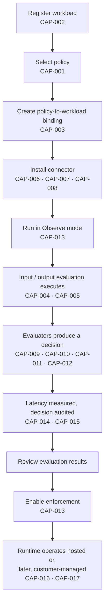

**AI Guardrails — Capability Catalog**

**Authority level:** L2
**Status:** Draft
**Date:** 2026-07-24
**Derived from:** AGREEMENTS.md

---

## Purpose and authority

This document is the **capability catalog** for the AI Guardrails solution: the enumerated, traceable list of what the product does (or will do), organized by delivery status. It is a **derived (L2)** artifact. It must not contradict [`AGREEMENTS.md`](../00-source-of-truth/AGREEMENTS.md) or [`CONSTRAINTS.md`](../00-source-of-truth/CONSTRAINTS.md) (both L1 — authoritative). Where a conflict is found, those documents win and this catalog must be corrected.

Every capability below is derived from [`SCOPE.md`](../10-charter/SCOPE.md) ("Product scope"), [AGR-017](../00-source-of-truth/AGREEMENTS.md#agr-017--core-domain-model) ("Core domain model"), [`CONTAINER-ARCHITECTURE.md`](../50-architecture/CONTAINER-ARCHITECTURE.md) ("Logical architecture"), [AGR-003](../00-source-of-truth/AGREEMENTS.md#agr-003--litellm-as-first-connector-not-the-product-boundary) ("LiteLLM integration"), and §16 ("MVP definition"). No metric, dollar figure, SLA, or performance number is asserted beyond what the L1 registers state; where a figure would normally appear and is not present in the original charter, this catalog says **TBD** or describes the capability qualitatively.

Each capability is assigned a stable identifier (`CAP-001` …) so that later documents — the traceability matrix, release criteria, and architecture set — can reference it precisely.

---

## Table of contents

<!-- BEGIN GENERATED: toc -->
- [Purpose and authority](#purpose-and-authority)
- [How to read this catalog](#how-to-read-this-catalog)
- [Capability lifecycle diagram](#capability-lifecycle-diagram)
- [Core capabilities — Phases 1–2](#core-capabilities--phases-12)
  - [Policy governance](#policy-governance)
  - [Workload and binding](#workload-and-binding)
  - [Evaluation](#evaluation)
  - [Connectors and APIs](#connectors-and-apis)
  - [Decisions, audit, and observability](#decisions-audit-and-observability)
  - [Deployment](#deployment)
- [Later-phase capabilities — committed and estimated (Phases 3–5)](#later-phase-capabilities--committed-and-estimated-phases-35)
  - [Extended evaluation scope](#extended-evaluation-scope)
  - [Extended governance and workflow](#extended-governance-and-workflow)
  - [Extended deployment and commercial](#extended-deployment-and-commercial)
- [A third category: explicitly excluded from the full feature set](#a-third-category-explicitly-excluded-from-the-full-feature-set)
- [Capability count summary](#capability-count-summary)
- [Guardrail-category cross-reference](#guardrail-category-cross-reference)
- [Related documents](#related-documents)
<!-- END GENERATED: toc -->
---

## How to read this catalog

| Column | Meaning |
|---|---|
| **Capability** | A short, stable name for the capability, with its ID. |
| **Description** | What the capability does, stated qualitatively and derived only from the L1 registers. |
| **Status** | `Core (Phases 1–2)` — delivered in Phases 1–2 of the five-phase plan ([`SCOPE.md`](../10-charter/SCOPE.md), [`SUCCESS-CRITERIA.md`](../10-charter/SUCCESS-CRITERIA.md)). `Later phase` — committed and estimated as part of the full solution ([DEC-008](../00-source-of-truth/DECISIONS.md#dec-008--supersede-the-mvp-bounded-scope-define-and-estimate-the-full-feature-set-across-five-phases)), delivered in Phases 3–5 (mostly Phase 5) and explicitly **not** built during Phases 1–2 ([`SCOPE.md`](../10-charter/SCOPE.md)). |
| **Related AGR** | The [`AGREEMENTS.md`](../00-source-of-truth/AGREEMENTS.md) entries this capability implements or is bounded by; where a capability's scope derives from the original charter rather than a register entry, the owning register entry and [`10-charter/SCOPE.md`](../10-charter/SCOPE.md) are cited instead. |
| **Related architecture section** | The `50-architecture/` document expected to specify this capability's design. These architecture documents exist as of this draft; the reference identifies where the design belongs within them, not that every capability-specific section has necessarily been elaborated in full. |

> **Explicit rule (per [`SCOPE.md`](../10-charter/SCOPE.md), [`10-charter/SCOPE.md`](../10-charter/SCOPE.md), and [DEC-008](../00-source-of-truth/DECISIONS.md#dec-008--supersede-the-mvp-bounded-scope-define-and-estimate-the-full-feature-set-across-five-phases)):** a capability marked `Later phase` is part of the defined-and-estimated full solution, but it is **not** built during Phases 1–2 and is **not available today**. It may be designed for extensibility during Phase 1–2 architecture work, but it must not be scheduled, resourced, or silently pulled forward into Phases 1–2. Any change to a capability's phase assignment is a scope-change decision, not an editorial one, and must be reflected first in the source-of-truth registers (`AGREEMENTS.md` / `DECISIONS.md`).

---

## Capability lifecycle diagram

The diagram below places the Phase 1–2 core capabilities against the onboarding flow defined in [AGR-019](../00-source-of-truth/AGREEMENTS.md#agr-019--meaning-of-import), showing where each capability is exercised.

---

## Core capabilities — Phases 1–2

Phases 1–2 deliver the core platform, whose purpose is to prove that one reusable policy can be applied consistently to multiple independent LiteLLM deployments ([`SUCCESS-CRITERIA.md`](../10-charter/SUCCESS-CRITERIA.md); validated per [`60-delivery/VALIDATION-PLAN.md`](../60-delivery/VALIDATION-PLAN.md)). The capabilities below are drawn from [`SCOPE.md`](../10-charter/SCOPE.md) ("In scope"), [`SUCCESS-CRITERIA.md`](../10-charter/SUCCESS-CRITERIA.md) ("MVP components").

### Policy governance

| Capability | Description | Status | Related AGR | Related architecture section |
|---|---|---|---|---|
| **CAP-001 — Versioned guardrail policies** | A policy defines the checks and enforcement actions applied to evaluated content: name, immutable version, evaluation stages, evaluator configuration, thresholds, failure behavior, audit behavior, and compatibility metadata. Each version is independently addressable so it can be promoted, rolled back, or scoped to specific workloads without affecting other versions. | Core (Phases 1–2) | [AGR-005](../00-source-of-truth/AGREEMENTS.md#agr-005--policy-portability), [AGR-006](../00-source-of-truth/AGREEMENTS.md#agr-006--one-logical-evaluation-contract-across-all-modes), [AGR-017](../00-source-of-truth/AGREEMENTS.md#agr-017--core-domain-model) | `50-architecture/COMPONENT-ARCHITECTURE.md` (Policy model), `50-architecture/DATA-ARCHITECTURE.md` (Policy storage) |

### Workload and binding

| Capability | Description | Status | Related AGR | Related architecture section |
|---|---|---|---|---|
| **CAP-002 — Workload registration** | Registers an application, assistant, agent, gateway, or inference service as a workload with an identifier, tenant, owner, environment, risk classification, gateway type, deployment mode, expected throughput, streaming requirements, assigned policy, and enforcement mode. | Core (Phases 1–2) | [AGR-017](../00-source-of-truth/AGREEMENTS.md#agr-017--core-domain-model), [AGR-019](../00-source-of-truth/AGREEMENTS.md#agr-019--meaning-of-import) | `50-architecture/COMPONENT-ARCHITECTURE.md` (Workload registry) |
| **CAP-003 — Policy-to-workload binding** | Associates a workload with a specific policy version. A binding may also define observe/enforce mode, allowed workload-specific overrides, effective date, rollback version, and runtime compatibility requirements. | Core (Phases 1–2) | [AGR-017](../00-source-of-truth/AGREEMENTS.md#agr-017--core-domain-model), [AGR-011](../00-source-of-truth/AGREEMENTS.md#agr-011--observe-before-enforce-progression) | `50-architecture/COMPONENT-ARCHITECTURE.md` (Policy binding) |
| **CAP-038 — Integration manifest generation** | Produces, from a policy binding, the shareable configuration artifact a consuming team installs alongside its connector: workload identity, bound policy name and version, enforcement mode, deployment mode and Evaluation API endpoint, connector type and supported version range, per-stage timeouts, client-side failure behavior, and required runtime capabilities. The artifact is a version-controllable file the team can commit, review, and hand to another team; it never carries model-provider credentials, gateway administration access, model-routing configuration, or any platform secret. This is the "generate integration manifest" step of the onboarding flow ([AGR-019](../00-source-of-truth/AGREEMENTS.md#agr-019--meaning-of-import)) made concrete. Generation is API-first, so a later policy-catalog surface is one consumer of it rather than the only way to obtain one. | Core (Phases 1–2) — depends on the workload registry and bindings (Phase 2) | [AGR-019](../00-source-of-truth/AGREEMENTS.md#agr-019--meaning-of-import), [AGR-002](../00-source-of-truth/AGREEMENTS.md#agr-002--three-deployment-modes), [AGR-011](../00-source-of-truth/AGREEMENTS.md#agr-011--observe-before-enforce-progression), [AGR-018](../00-source-of-truth/AGREEMENTS.md#agr-018--trust-and-enforcement-model), [ADR-0006](../50-architecture/adrs/ADR-0006-integration-manifest-format-and-contents.md) | `50-architecture/adrs/ADR-0006-integration-manifest-format-and-contents.md`, `50-architecture/SECURITY-ARCHITECTURE.md` (onboarding flow) |

### Evaluation

| Capability | Description | Status | Related AGR | Related architecture section |
|---|---|---|---|---|
| **CAP-004 — Input evaluation** | Evaluates prompt-stage content (user prompt, system prompt, conversation history) against the bound policy before model invocation, producing a normalized decision. Phases 1–2 limit evaluated content to user/model input and model output only. | Core (Phases 1–2) | [AGR-006](../00-source-of-truth/AGREEMENTS.md#agr-006--one-logical-evaluation-contract-across-all-modes), [`SCOPE.md`](../10-charter/SCOPE.md) | `50-architecture/COMPONENT-ARCHITECTURE.md` (Evaluation API), `50-architecture/INTEGRATION-ARCHITECTURE.md` |
| **CAP-005 — Output evaluation** | Evaluates model-response content against the bound policy after model invocation, producing a normalized decision before the response reaches the caller. | Core (Phases 1–2) | [AGR-006](../00-source-of-truth/AGREEMENTS.md#agr-006--one-logical-evaluation-contract-across-all-modes), [`SCOPE.md`](../10-charter/SCOPE.md) | `50-architecture/COMPONENT-ARCHITECTURE.md` (Evaluation API), `50-architecture/INTEGRATION-ARCHITECTURE.md` |

### Connectors and APIs

| Capability | Description | Status | Related AGR | Related architecture section |
|---|---|---|---|---|
| **CAP-006 — LiteLLM pre-call connector** | Maps a LiteLLM request into the evaluation contract, invokes input evaluation before model invocation, and enforces block/redact decisions; propagates correlation identifiers and handles evaluation timeouts. Does not define policy or implement detection logic. | Core (Phases 1–2) | [AGR-003](../00-source-of-truth/AGREEMENTS.md#agr-003--litellm-as-first-connector-not-the-product-boundary), [AGR-007](../00-source-of-truth/AGREEMENTS.md#agr-007--policies-are-separate-from-connectors) | `50-architecture/INTEGRATION-ARCHITECTURE.md` (LiteLLM connector — pre-call) |
| **CAP-007 — LiteLLM post-call connector** | Invokes output evaluation after model inference, applies safe output fallbacks, propagates correlation identifiers, and emits connector-health telemetry. Does not persist audit records or manage model credentials. | Core (Phases 1–2) | [AGR-003](../00-source-of-truth/AGREEMENTS.md#agr-003--litellm-as-first-connector-not-the-product-boundary), [AGR-007](../00-source-of-truth/AGREEMENTS.md#agr-007--policies-are-separate-from-connectors) | `50-architecture/INTEGRATION-ARCHITECTURE.md` (LiteLLM connector — post-call) |
| **CAP-008 — Generic HTTP Evaluation API** | A gateway-agnostic HTTP interface exposing the same evaluation contract used by the LiteLLM connector, so applications, SDKs, or non-LiteLLM gateways can invoke input/output evaluation directly without adopting LiteLLM. | Core (Phases 1–2) | [AGR-003](../00-source-of-truth/AGREEMENTS.md#agr-003--litellm-as-first-connector-not-the-product-boundary), [AGR-006](../00-source-of-truth/AGREEMENTS.md#agr-006--one-logical-evaluation-contract-across-all-modes) | `50-architecture/COMPONENT-ARCHITECTURE.md` (Evaluation API), `50-architecture/INTEGRATION-ARCHITECTURE.md` (Generic SDK) |
| **CAP-009 — Amazon Bedrock Guardrails adapter** | Normalizes Bedrock Guardrails' evaluation output into the platform's own decision structure so that policies, connectors, and audit records never depend on Bedrock's native response format. | Core (Phases 1–2) | [AGR-004](../00-source-of-truth/AGREEMENTS.md#agr-004--bedrock-guardrails-as-first-engine-vendor-independent-contract) | `50-architecture/COMPONENT-ARCHITECTURE.md` (Evaluator adapters), `50-architecture/INTEGRATION-ARCHITECTURE.md` |
| **CAP-010 — Deterministic organization rules** | A rules-based evaluator for organization-authored deterministic checks (including schema validation) that runs behind the same evaluator-adapter pattern as Bedrock Guardrails, without depending on a hosted ML detection engine. | Core (Phases 1–2) | [AGR-004](../00-source-of-truth/AGREEMENTS.md#agr-004--bedrock-guardrails-as-first-engine-vendor-independent-contract), [AGR-005](../00-source-of-truth/AGREEMENTS.md#agr-005--policy-portability) | `50-architecture/COMPONENT-ARCHITECTURE.md` (Evaluator adapters — deterministic rules) |
| **CAP-039 — Connector installation verification and liveness** | Confirms that a workload's client is actually installed and exercising every evaluation stage its policy declares before the workload is treated as onboarded, records which connector version is actually running, reports workloads whose bindings are active but which have stopped evaluating, and supports explicitly decommissioning a workload. The staleness signal reports only that no evaluations were observed; under the cooperative trust model it is never evidence of enforcement or proof of bypass ([AGR-018](../00-source-of-truth/AGREEMENTS.md#agr-018--trust-and-enforcement-model), [CON-012](../00-source-of-truth/CONSTRAINTS.md#con-012--no-exclusive-reliance-on-weak-security-proxies)). | Core (Phases 1–2) | [AGR-003](../00-source-of-truth/AGREEMENTS.md#agr-003--litellm-as-first-connector-not-the-product-boundary), [AGR-011](../00-source-of-truth/AGREEMENTS.md#agr-011--observe-before-enforce-progression), [AGR-018](../00-source-of-truth/AGREEMENTS.md#agr-018--trust-and-enforcement-model), [AGR-019](../00-source-of-truth/AGREEMENTS.md#agr-019--meaning-of-import), [ADR-0007](../50-architecture/adrs/ADR-0007-connector-identity-verification-and-liveness.md) | `50-architecture/adrs/ADR-0007-connector-identity-verification-and-liveness.md`, `50-architecture/OPERABILITY.md` |
| **CAP-040 — Published, verifiable client artifacts** | The LiteLLM connector and generic SDK are published to named, documented channels reachable by teams outside the provider's account, versioned independently of the contract and product, each release declaring which evaluation contract versions it speaks, with integrity verifiable before the artifact executes and its request-path privilege documented. A published client carries no policy content, no detection logic, and no embedded credential. | Core (Phases 1–2) | [AGR-003](../00-source-of-truth/AGREEMENTS.md#agr-003--litellm-as-first-connector-not-the-product-boundary), [AGR-007](../00-source-of-truth/AGREEMENTS.md#agr-007--policies-are-separate-from-connectors), [AGR-019](../00-source-of-truth/AGREEMENTS.md#agr-019--meaning-of-import), [ADR-0008](../50-architecture/adrs/ADR-0008-connector-distribution-and-integrity.md) | `50-architecture/adrs/ADR-0008-connector-distribution-and-integrity.md`, `50-architecture/SECURITY-ARCHITECTURE.md` |
|  **CAP-041 — Client conformance suite** | A published, supported test suite any client can be run against — including a consumer-operated custom gateway the provider does not build — proving it produces identical decisions and identical failure behavior to the supported clients. Mandatory cases include an unrecognized decision value, a never-configured client, concurrent interleaved requests, and a client-synthesized decision during runtime unavailability. This is what makes "one logical contract" enforceable across teams rather than asserted. | Core (Phases 1–2) | [AGR-003](../00-source-of-truth/AGREEMENTS.md#agr-003--litellm-as-first-connector-not-the-product-boundary), [AGR-006](../00-source-of-truth/AGREEMENTS.md#agr-006--one-logical-evaluation-contract-across-all-modes), [AGR-012](../00-source-of-truth/AGREEMENTS.md#agr-012--failure-behavior-is-part-of-policy) | `50-architecture/INTEGRATION-ARCHITECTURE.md`, `50-architecture/EXTENSIBILITY-ARCHITECTURE.md` |
| **CAP-011 — Basic sensitive-data handling** | Initial-tier detection and handling of sensitive-data categories within evaluated content (a "PII evaluator" per the logical architecture). This is explicitly **not** a complete DLP platform — that remains excluded from the solution's feature set ([`SCOPE.md`](../10-charter/SCOPE.md)). | Core (Phases 1–2) | [AGR-014](../00-source-of-truth/AGREEMENTS.md#agr-014--no-raw-promptresponse-retention-by-default), [`SCOPE.md`](../10-charter/SCOPE.md) | `50-architecture/COMPONENT-ARCHITECTURE.md` (Evaluator adapters — PII evaluator), `50-architecture/DATA-ARCHITECTURE.md` |

### Decisions, audit, and observability

| Capability | Description | Status | Related AGR | Related architecture section |
|---|---|---|---|---|
| **CAP-012 — Normalized evaluation decisions** | Converts every evaluator's output (Bedrock Guardrails, deterministic rules, sensitive-data evaluator) into one decision structure: action (`allow`, `block`, `redact`, `log_only`), allowed status, reason codes, policy name and version, evaluator metadata, transformed content where applicable, correlation identifier, audit identifier, and evaluation latency. | Core (Phases 1–2) | [AGR-004](../00-source-of-truth/AGREEMENTS.md#agr-004--bedrock-guardrails-as-first-engine-vendor-independent-contract), [AGR-006](../00-source-of-truth/AGREEMENTS.md#agr-006--one-logical-evaluation-contract-across-all-modes), [AGR-017](../00-source-of-truth/AGREEMENTS.md#agr-017--core-domain-model) | `50-architecture/COMPONENT-ARCHITECTURE.md` (Decision engine) |
| **CAP-013 — Observe and enforce modes** | Each policy binding runs in Observe (non-blocking, findings recorded) or Enforce (blocking) mode per workload, so a team can measure false positives, latency, and business impact before enabling blocking behavior. New bindings default to Observe. | Core (Phases 1–2) | [AGR-011](../00-source-of-truth/AGREEMENTS.md#agr-011--observe-before-enforce-progression) | `50-architecture/OPERABILITY.md`, `50-architecture/COMPONENT-ARCHITECTURE.md` (Policy resolver) |
| **CAP-014 — Evaluation latency metrics** | Measures and records per-evaluation latency as a field on every decision, supporting P50/P95/P99 and detector-specific latency measurement. Specific SLA targets are **TBD**. | Core (Phases 1–2) | [AGR-006](../00-source-of-truth/AGREEMENTS.md#agr-006--one-logical-evaluation-contract-across-all-modes), [AGR-017](../00-source-of-truth/AGREEMENTS.md#agr-017--core-domain-model) | `50-architecture/OPERABILITY.md` |
| **CAP-015 — Decision metadata auditing** | Logs every evaluation decision with tenant, workload, policy version, evaluation stage, decision, reason codes, evaluator versions, timestamp, correlation identifier, and whether raw content was retained. | Core (Phases 1–2) | [AGR-012](../00-source-of-truth/AGREEMENTS.md#agr-012--failure-behavior-is-part-of-policy), [AGR-014](../00-source-of-truth/AGREEMENTS.md#agr-014--no-raw-promptresponse-retention-by-default), [AGR-017](../00-source-of-truth/AGREEMENTS.md#agr-017--core-domain-model) | `50-architecture/DATA-ARCHITECTURE.md`, `50-architecture/OPERABILITY.md` |

### Deployment

| Capability | Description | Status | Related AGR | Related architecture section |
|---|---|---|---|---|
| **CAP-016 — Hosted runtime deployment** | The Guardrails Runtime (Evaluation API, policy resolver, decision engine, evaluator adapters, audit producer) is deployed and operated by the AI Guardrails provider, supporting Remote Evaluation (Mode A) and Guarded Gateway (Mode B). | Core (Phases 1–2) | [AGR-002](../00-source-of-truth/AGREEMENTS.md#agr-002--three-deployment-modes), [AGR-013](../00-source-of-truth/AGREEMENTS.md#agr-013--aws-as-primary-cloud-minimal-mvp-account-model) | `50-architecture/DEPLOYMENT-ARCHITECTURE.md` |
| **CAP-017 — Path to customer-managed deployment** | The same runtime software is architected so it can later be packaged for deployment inside a consuming team's own AWS account (Mode C) without changing the connector contract; completing that packaging is a Phase 4 deliverable, not part of Phases 1–2. | Core (Phases 1–2) | [AGR-002](../00-source-of-truth/AGREEMENTS.md#agr-002--three-deployment-modes), [AGR-015](../00-source-of-truth/AGREEMENTS.md#agr-015--customer-managed-runtime-executes-without-a-synchronous-control-plane-connection), [`SUCCESS-CRITERIA.md`](../10-charter/SUCCESS-CRITERIA.md), [`VALIDATION-PLAN.md`](../60-delivery/VALIDATION-PLAN.md) | `50-architecture/DEPLOYMENT-ARCHITECTURE.md` |

---

## Later-phase capabilities — committed and estimated (Phases 3–5)

[`SCOPE.md`](../10-charter/SCOPE.md) states the product architecture **should permit, but not initially require**, the following capabilities. Every row in this table carries `Status = Later phase`. Per [DEC-008](../00-source-of-truth/DECISIONS.md#dec-008--supersede-the-mvp-bounded-scope-define-and-estimate-the-full-feature-set-across-five-phases), these capabilities are part of the defined-and-estimated full solution: they are committed to later delivery phases (mostly Phase 5) and included in the full-solution estimation. **They are not built during Phases 1–2 and are not available today.** They may be designed for extensibility during Phase 1–2 architecture work, but each phase's deliverables are validated before the next phase proceeds ([AGR-020](../00-source-of-truth/AGREEMENTS.md#agr-020--five-phase-delivery)). Several correspond to Phase 5 ("Advanced agent protection"), which is sequenced last.

### Extended evaluation scope

| Capability | Description | Status | Related AGR | Related architecture section |
|---|---|---|---|---|
| **CAP-018 — Retrieval-content evaluation** | Adds a `retrieval` evaluation stage that inspects retrieved documents before they are incorporated into a prompt. | **Later phase — not available today** | [`SCOPE.md`](../10-charter/SCOPE.md), [AGR-020](../00-source-of-truth/AGREEMENTS.md#agr-020--five-phase-delivery) | `50-architecture/COMPONENT-ARCHITECTURE.md` (planned, Phase 5) |
| **CAP-019 — Indirect prompt-injection detection** | Detects prompt-injection payloads embedded in retrieved or tool-sourced content rather than in the direct user prompt. | **Later phase — not available today** | [`SCOPE.md`](../10-charter/SCOPE.md) | `50-architecture/COMPONENT-ARCHITECTURE.md` (planned) |
| **CAP-020 — Streaming output evaluation** | Evaluates model output incrementally as tokens stream, rather than only once a complete response is available. | **Later phase — not available today** | [`SCOPE.md`](../10-charter/SCOPE.md) | `50-architecture/COMPONENT-ARCHITECTURE.md`, `50-architecture/INTEGRATION-ARCHITECTURE.md` (planned) |
| **CAP-021 — Tool-call validation** | Adds a `tool_call` evaluation stage that inspects tool name and arguments before an agent executes a tool call. | **Later phase — not available today** | [AGR-010](../00-source-of-truth/AGREEMENTS.md#agr-010--guardrails-are-not-authorization), [`SCOPE.md`](../10-charter/SCOPE.md), [AGR-020](../00-source-of-truth/AGREEMENTS.md#agr-020--five-phase-delivery) | `50-architecture/COMPONENT-ARCHITECTURE.md` (planned, Phase 5) |
| **CAP-022 — MCP authorization** | Authorization controls specific to Model Context Protocol tool invocation. Distinct from — and narrower than — "a general MCP security platform," which stays out of scope even beyond this future item. | **Later phase — not available today** | [AGR-010](../00-source-of-truth/AGREEMENTS.md#agr-010--guardrails-are-not-authorization), [`SCOPE.md`](../10-charter/SCOPE.md), [AGR-020](../00-source-of-truth/AGREEMENTS.md#agr-020--five-phase-delivery) | `50-architecture/SECURITY-ARCHITECTURE.md` (planned, Phase 5) |
| **CAP-023 — Memory-write validation** | Adds a `memory_write` evaluation stage that inspects content before it is persisted to agent or assistant memory. | **Later phase — not available today** | [`SCOPE.md`](../10-charter/SCOPE.md), [AGR-020](../00-source-of-truth/AGREEMENTS.md#agr-020--five-phase-delivery) | `50-architecture/COMPONENT-ARCHITECTURE.md` (planned, Phase 5) |
| **CAP-024 — Groundedness evaluation** | Assesses whether a model response is factually grounded in supplied context or retrieved content. | **Later phase — not available today** | [`SCOPE.md`](../10-charter/SCOPE.md) | `50-architecture/COMPONENT-ARCHITECTURE.md` (planned) |
| **CAP-025 — Automated reasoning** | Evaluation approaches based on formal or automated-reasoning techniques rather than statistical detection alone. | **Later phase — not available today** | [`SCOPE.md`](../10-charter/SCOPE.md) | `50-architecture/COMPONENT-ARCHITECTURE.md` (planned) |
| **CAP-026 — Multilingual policy packs** | Policy and evaluator configurations tuned for languages beyond the initial coverage delivered in Phases 1–2. | **Later phase — not available today** | [`SCOPE.md`](../10-charter/SCOPE.md) | `50-architecture/COMPONENT-ARCHITECTURE.md` (planned) |

### Extended governance and workflow

| Capability | Description | Status | Related AGR | Related architecture section |
|---|---|---|---|---|
| **CAP-027 — Human approval workflows** | Adds a `require_approval` decision action and workflow that routes an evaluation result to a human reviewer before the guarded action proceeds. | **Later phase — not available today** | [`SCOPE.md`](../10-charter/SCOPE.md), [AGR-020](../00-source-of-truth/AGREEMENTS.md#agr-020--five-phase-delivery) | `50-architecture/COMPONENT-ARCHITECTURE.md`, `50-architecture/OPERABILITY.md` (planned, Phase 5) |
| **CAP-028 — Policy signing** | Cryptographic signing of policy artifacts to verify the authenticity and integrity of distributed policy versions. | **Later phase — not available today** | [`SCOPE.md`](../10-charter/SCOPE.md) | `50-architecture/SECURITY-ARCHITECTURE.md` (planned) |
| **CAP-029 — Policy inheritance** | Structured inheritance or composition relationships between policies — for example, an organization-wide base policy extended by workload-specific rules. | **Later phase — not available today** | [`SCOPE.md`](../10-charter/SCOPE.md) | `50-architecture/COMPONENT-ARCHITECTURE.md` (planned) |
| **CAP-030 — Customer-specific evaluator plugins** | A plugin mechanism allowing a customer to register a custom evaluator behind the standard evaluator-adapter contract. | **Later phase — not available today** | [AGR-004](../00-source-of-truth/AGREEMENTS.md#agr-004--bedrock-guardrails-as-first-engine-vendor-independent-contract), [`SCOPE.md`](../10-charter/SCOPE.md) | `50-architecture/COMPONENT-ARCHITECTURE.md` (planned) |
| **CAP-031 — Policy marketplace capabilities** | Discovery and distribution of policy packs across organizations or tenants in a marketplace model. | **Later phase — not available today** | [`SCOPE.md`](../10-charter/SCOPE.md) | `20-product/PRODUCT-ROADMAP.md` (planned) |

### Extended deployment and commercial

| Capability | Description | Status | Related AGR | Related architecture section |
|---|---|---|---|---|
| **CAP-032 — Dedicated hosted runtimes** | Per-tenant dedicated hosted runtime instances, as opposed to a shared multi-tenant hosted runtime. | **Later phase — not available today** | [AGR-002](../00-source-of-truth/AGREEMENTS.md#agr-002--three-deployment-modes), [`SCOPE.md`](../10-charter/SCOPE.md) | `50-architecture/DEPLOYMENT-ARCHITECTURE.md` (planned) |
| **CAP-033 — Air-gapped installation** | A runtime packaging and policy-distribution model that functions with no network connectivity to the hosted control plane at all — a stronger guarantee than the standard "no synchronous connection required" behavior of the Customer-Managed Runtime. | **Later phase — not available today** | [AGR-015](../00-source-of-truth/AGREEMENTS.md#agr-015--customer-managed-runtime-executes-without-a-synchronous-control-plane-connection), [`SCOPE.md`](../10-charter/SCOPE.md) | `50-architecture/DEPLOYMENT-ARCHITECTURE.md` (planned) |
| **CAP-034 — Commercial metering** | Usage-based metering suitable for commercial billing of evaluation volume. | **Later phase — not available today** | [`SCOPE.md`](../10-charter/SCOPE.md) | `50-architecture/OPERABILITY.md` (planned) |
| **CAP-035 — Multi-region availability & per-tenant residency enforcement** | The platform offers multi-region availability, with each tenant's evaluation traffic pinned to a single processing region (not active-active — see CAP-036). Per-tenant data-residency requirements are enforced so that a given tenant's content is processed and stored only within its assigned region. | Core (Phases 1–2) — availability; **Later phase — committed** — per-tenant residency enforcement | [AGR-008](../00-source-of-truth/AGREEMENTS.md#agr-008--explicit-content-exposure-model-ownership-vs-exposure-are-separate-concerns), [AGR-013](../00-source-of-truth/AGREEMENTS.md#agr-013--aws-as-primary-cloud-minimal-mvp-account-model) (amended), [DEC-018](../00-source-of-truth/DECISIONS.md#dec-018--multi-region-availability-at-ga) | `50-architecture/DEPLOYMENT-ARCHITECTURE.md` (regionality), `50-architecture/DATA-ARCHITECTURE.md` (residency enforcement, planned) |
| **CAP-036 — Multi-region active-active availability** | Live cross-region failover and replication providing continuous availability across regions, beyond the single-region-per-tenant model of CAP-035. | **Later phase — committed** | [AGR-002](../00-source-of-truth/AGREEMENTS.md#agr-002--three-deployment-modes), [AGR-006](../00-source-of-truth/AGREEMENTS.md#agr-006--one-logical-evaluation-contract-across-all-modes), [DEC-019](../00-source-of-truth/DECISIONS.md#dec-019--multi-region-active-active-availability-committed-as-a-later-phase) (supersedes [`SCOPE.md`](../10-charter/SCOPE.md) exclusion) | `50-architecture/DEPLOYMENT-ARCHITECTURE.md` (planned) |
| **CAP-037 — Per-category decision metrics** | Block/redact/allow rates and counts aggregated by guardrail category, enabled by the category-namespaced reason codes and `guardrail_category` decision field ([DEC-013](../00-source-of-truth/DECISIONS.md#dec-013--reason-code-taxonomy-and-guardrail-category-audit-dimension)/[ADR-0003](../50-architecture/adrs/ADR-0003-reason-code-taxonomy-and-category-audit-dimension.md)). | **Later phase — committed (DEC-020)** | [AGR-021](../00-source-of-truth/AGREEMENTS.md#agr-021--guardrail-category-taxonomy-and-extension-model), [AGR-006](../00-source-of-truth/AGREEMENTS.md#agr-006--one-logical-evaluation-contract-across-all-modes), [DEC-013](../00-source-of-truth/DECISIONS.md#dec-013--reason-code-taxonomy-and-guardrail-category-audit-dimension), [DEC-020](../00-source-of-truth/DECISIONS.md#dec-020--graduate-gr-017-per-category-decision-metrics-from-vision-to-committed-scope) | `50-architecture/OPERABILITY.md` (planned) |

---

## A third category: explicitly excluded from the full feature set

[`SCOPE.md`](../10-charter/SCOPE.md) lists items the solution **will not attempt to provide** at all. This is a different category from "Later-phase capabilities" above — these items are **not** part of the defined-and-estimated full feature set, and [DEC-008](../00-source-of-truth/DECISIONS.md#dec-008--supersede-the-mvp-bounded-scope-define-and-estimate-the-full-feature-set-across-five-phases) explicitly confirms they remain excluded. None of these are implied to be planned unless separately re-scoped through a new agreement. They are listed here only so this catalog cannot be mistaken as a complete inventory of everything the product might someday do:

* A general-purpose LLM gateway replacement.
* A complete AI governance platform.
* Model training or fine-tuning.
* A proprietary prompt-injection model.
* A proprietary moderation model.
* A complete DLP platform.
* End-user authentication.
* Application business authorization.
* Fully autonomous agent governance.
* Organization-wide AWS enforcement.
* Cross-cloud deployment.
* Full compliance certification.
* A general MCP security platform.

Per [`SCOPE.md`](../10-charter/SCOPE.md), these capabilities "may be introduced only after the core integration and policy model have been validated" — i.e., only via a new scope decision, never by implication from this catalog. Multi-region active-active availability was previously listed here; [DEC-019](../00-source-of-truth/DECISIONS.md#dec-019--multi-region-active-active-availability-committed-as-a-later-phase) explicitly supersedes that exclusion and commits it as CAP-036 above.

---

## Capability count summary

<!-- BEGIN GENERATED: cap-counts -->
| Category | Count |
|---|---|
| Core capabilities — Phases 1–2 (`CAP-001`–`CAP-017`, `CAP-038`–`CAP-041`) | 21 |
| Later-phase capabilities — committed and estimated, Phases 3–5 (`CAP-018`–`CAP-037`) | 20 |
| **Total cataloged capabilities — the defined-and-estimated full solution** | **41** |
| Explicitly excluded items ([`SCOPE.md`](../10-charter/SCOPE.md), not cataloged with an ID and not part of the full feature set) |  |
<!-- END GENERATED: cap-counts -->
---

## Guardrail-category cross-reference

The guardrail-category catalog ([`GUARDRAIL-CATALOG.md`](GUARDRAIL-CATALOG.md), `GR-001`–`GR-018`, per [AGR-021](../00-source-of-truth/AGREEMENTS.md#agr-021--guardrail-category-taxonomy-and-extension-model)/[DEC-009](../00-source-of-truth/DECISIONS.md#dec-009--adopt-the-guardrail-category-catalog-as-directional-vision)) **classifies**; this capability catalog **commits**. A GR category row below shows which cataloged capabilities serve it — it adds no capability, changes no status, and vision-classified catalog content has no CAP ID by design.

| GR category | Served by (Core, Phases 1–2) | Served by (Later phase) |
|---|---|---|
| [GR-001](GUARDRAIL-CATALOG.md#gr-001--prompt-and-instruction-security) Prompt and Instruction Security | CAP-009, CAP-010 | CAP-019, CAP-026 |
| [GR-002](GUARDRAIL-CATALOG.md#gr-002--harmful-content-and-acceptable-use) Harmful Content and Acceptable Use | CAP-009, CAP-010, CAP-012 | — |
| [GR-003](GUARDRAIL-CATALOG.md#gr-003--sensitive-data-and-privacy) Sensitive Data and Privacy | CAP-011, CAP-012, CAP-015 | — |
| [GR-004](GUARDRAIL-CATALOG.md#gr-004--system-prompt-and-configuration-protection) System Prompt and Configuration Protection | CAP-010 | CAP-028 |
| [GR-005](GUARDRAIL-CATALOG.md#gr-005--rag-and-knowledge-source-security) RAG and Knowledge-Source Security | — | CAP-018, CAP-019 |
| [GR-006](GUARDRAIL-CATALOG.md#gr-006--output-accuracy-grounding-and-information-integrity) Output Accuracy, Grounding and Information Integrity | — | CAP-024, CAP-025 |
| [GR-007](GUARDRAIL-CATALOG.md#gr-007--structured-output-and-generated-artifact-safety) Structured Output and Generated-Artifact Safety | CAP-010, CAP-012 | CAP-030 |
| [GR-008](GUARDRAIL-CATALOG.md#gr-008--model-and-provider-governance) Model and Provider Governance | CAP-002 (registration attributes only) | — (Phase 3 gateway deliverables; no dedicated CAP) |
| [GR-009](GUARDRAIL-CATALOG.md#gr-009--agent-tool-and-action-safety) Agent, Tool and Action Safety | — | CAP-021, CAP-022 |
| [GR-010](GUARDRAIL-CATALOG.md#gr-010--identity-authorization-and-tenant-isolation) Identity, Authorization and Tenant Isolation | — (out-of-boundary per AGR-010; deliberately no CAP) | — |
| [GR-011](GUARDRAIL-CATALOG.md#gr-011--memory-and-state-safety) Memory and State Safety | — | CAP-023 |
| [GR-012](GUARDRAIL-CATALOG.md#gr-012--resource-cost-and-availability-protection) Resource, Cost and Availability Protection | — (platform self-protection only) | CAP-034 (metering-adjacent) |
| [GR-013](GUARDRAIL-CATALOG.md#gr-013--human-oversight-and-user-interaction) Human Oversight and User Interaction | — | CAP-027 |
| [GR-014](GUARDRAIL-CATALOG.md#gr-014--data-lifecycle-audit-and-provenance) Data Lifecycle, Audit and Provenance | CAP-014, CAP-015 | CAP-028 |
| [GR-015](GUARDRAIL-CATALOG.md#gr-015--policy-lifecycle-and-governance) Policy Lifecycle and Governance | CAP-001, CAP-003, CAP-013 | CAP-028, CAP-029, CAP-031 |
| [GR-016](GUARDRAIL-CATALOG.md#gr-016--supply-chain-and-deployment-security) Supply-Chain and Deployment Security | — (platform property, no customer-facing CAP) | CAP-028, CAP-030 (review prerequisite) |
| [GR-017](GUARDRAIL-CATALOG.md#gr-017--monitoring-evaluation-and-incident-response) Monitoring, Evaluation and Incident Response | CAP-014, CAP-015 | CAP-037 |
| [GR-018](GUARDRAIL-CATALOG.md#gr-018--business-and-domain-specific-controls) Business and Domain-Specific Controls | CAP-010 | CAP-030 |

---

## Related documents

- [`../00-source-of-truth/AGREEMENTS.md`](../00-source-of-truth/AGREEMENTS.md) — authoritative agreements this catalog implements.
- [`../00-source-of-truth/CONSTRAINTS.md`](../00-source-of-truth/CONSTRAINTS.md) — non-negotiable boundaries that bound how these capabilities may be implemented.
- [`../00-source-of-truth/DECISIONS.md`](../00-source-of-truth/DECISIONS.md) — the decision log recording how the solution scope was set and phased (see DEC-006, DEC-007, DEC-008).
- [`../10-charter/CHARTER.md`](../10-charter/CHARTER.md) — narrative product charter this catalog operationalizes into a checkable list.
- [`PRODUCT-ROADMAP.md`](PRODUCT-ROADMAP.md) — phase-level roadmap showing when later-phase capabilities are delivered.
- [`GUARDRAIL-CATALOG.md`](GUARDRAIL-CATALOG.md) — the guardrail-category taxonomy (`GR-001`–`GR-018`) that classifies these capabilities; classification only, never commitment (AGR-021, DEC-009).
- [`../50-architecture/COMPONENT-ARCHITECTURE.md`](../50-architecture/COMPONENT-ARCHITECTURE.md), [`../50-architecture/INTEGRATION-ARCHITECTURE.md`](../50-architecture/INTEGRATION-ARCHITECTURE.md), [`../50-architecture/DATA-ARCHITECTURE.md`](../50-architecture/DATA-ARCHITECTURE.md), [`../50-architecture/SECURITY-ARCHITECTURE.md`](../50-architecture/SECURITY-ARCHITECTURE.md), [`../50-architecture/DEPLOYMENT-ARCHITECTURE.md`](../50-architecture/DEPLOYMENT-ARCHITECTURE.md), [`../50-architecture/OPERABILITY.md`](../50-architecture/OPERABILITY.md) — architecture documents that specify the design behind each capability.
- [`../60-delivery/RELEASE-CRITERIA.md`](../60-delivery/RELEASE-CRITERIA.md) — must gate the Phase 1–2 (core platform) release on all `Core`-status capabilities in this catalog, and on none of the `Later phase` ones.
- `just trace` — generates the reverse index from each agreement to the `CAP-` IDs, requirements, ADRs, and architecture documents that implement it, replacing the retired traceability matrix ([DEC-021](../00-source-of-truth/DECISIONS.md#dec-021--retire-the-traceability-matrix-in-favour-of-generated-traceability)). Formerly cross-referenced each `CAP-` ID to its implementing architecture and test artifacts.
