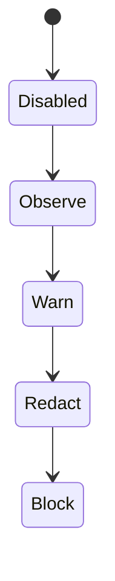

**AI Guardrails — Frequently Asked Questions**

**Authority level:** L4
**Status:** Draft
**Date:** 2026-07-24
**Derived from:** AGREEMENTS.md

---

## Purpose and authority

This FAQ answers the questions platform teams, application teams, and security reviewers most commonly ask when evaluating AI Guardrails. It is a **derived, L4** document: every answer traces back to the authoritative [`AGREEMENTS.md`](../00-source-of-truth/AGREEMENTS.md) (L1) and [`CONSTRAINTS.md`](../00-source-of-truth/CONSTRAINTS.md) (L1) registers. Where those sources do not state a figure, timeline, or dollar amount, this document says **TBD** rather than inventing one.

If an answer here ever appears to conflict with `AGREEMENTS.md` or `CONSTRAINTS.md`, those registers win and this document must be corrected.

---

## Table of contents

- [Data, privacy, and content exposure](#data-privacy-and-content-exposure)
  - [Does my prompt/response data get stored?](#does-my-promptresponse-data-get-stored)
  - [Is Remote Evaluation data-local?](#is-remote-evaluation-data-local)
- [Architecture and integration](#architecture-and-integration)
  - [Does this replace my LLM gateway?](#does-this-replace-my-llm-gateway)
  - [Which providers/models are supported?](#which-providersmodels-are-supported)
  - [What happens on evaluation timeout?](#what-happens-on-evaluation-timeout)
- [Deployment](#deployment)
  - [Can I run it in my own AWS account?](#can-i-run-it-in-my-own-aws-account)
- [Trust, enforcement, and rollout](#trust-enforcement-and-rollout)
  - [How do I start without blocking users?](#how-do-i-start-without-blocking-users)
  - [Is the connector a hard security boundary?](#is-the-connector-a-hard-security-boundary)
  - [Does it do user authorization?](#does-it-do-user-authorization)
- [Related documents](#related-documents)

---

## Data, privacy, and content exposure

### Does my prompt/response data get stored?

**No, not by default.** The hosted runtime — used in Remote Evaluation and Guarded Gateway — processes prompts and responses only for the purpose of evaluation. By default it:

* Does **not** persist raw prompts or responses.
* Persists **decision metadata** only (action, reason codes, policy version, evaluator metadata, latency, correlation identifier).
* Hashes user and conversation identifiers where possible.
* Strips secrets from telemetry.

Any retention of raw content requires **explicit, tenant-level configuration** — it is never a platform default. Every audit record states whether raw content was retained for that specific evaluation.

This behavior differs by deployment mode:

| Deployment mode | Where prompts/responses are processed | Raw content retention |
|---|---|---|
| **Remote Evaluation** (Mode A) | Hosted Evaluation API (provider-operated) | Not retained by default; tenant-configurable |
| **Guarded Gateway** (Mode B) | Provider-managed gateway and guardrail runtime | Not retained by default; tenant-configurable |
| **Customer-Managed Runtime** (Mode C) | Inside the customer's own AWS account | Stays entirely in the customer's account unless the customer explicitly configures otherwise |

This is the platform's **explicit content-exposure model**: operational ownership (who runs the component) and data exposure (where the data goes) are always documented as two separate questions, never conflated.

*Authoritative source: [AGREEMENTS.md — AGR-008](../00-source-of-truth/AGREEMENTS.md#agr-008--explicit-content-exposure-model-ownership-vs-exposure-are-separate-concerns), [AGR-014](../00-source-of-truth/AGREEMENTS.md#agr-014--no-raw-promptresponse-retention-by-default), [AGR-016](../00-source-of-truth/AGREEMENTS.md#agr-016--customer-controlled-telemetry-for-the-customer-managed-runtime); [CONSTRAINTS.md — CON-013](../00-source-of-truth/CONSTRAINTS.md#con-013--raw-content-must-not-leave-a-customer-managed-runtime-unless-explicitly-configured), [CON-014](../00-source-of-truth/CONSTRAINTS.md#con-014--no-raw-content-retention-by-default-in-the-hosted-runtime).*

---

### Is Remote Evaluation data-local?

**No.** Remote Evaluation (Mode A) must never be described as a private-data or data-local deployment model. Your team continues to operate its own LiteLLM (or equivalent gateway), but its input and output evaluation calls transmit prompts, responses, and any other content your policy evaluates to the **hosted** Guardrails Evaluation API.

Remote Evaluation should be understood as:

> "Bring your own gateway while consuming a hosted guardrail runtime."

Reduced operational ownership of the guardrail runtime does **not** mean reduced data exposure — the two are separate concerns (see above). Not persisting raw content by default at the hosted service reduces exposure, but it does not eliminate transmission. If your workload has a data-residency or "prompts/responses must never leave our account" requirement, Remote Evaluation is the wrong mode — see [Can I run it in my own AWS account?](#can-i-run-it-in-my-own-aws-account)

*Authoritative source: [AGREEMENTS.md — AGR-009](../00-source-of-truth/AGREEMENTS.md#agr-009--remote-evaluation-is-not-a-private-data-or-data-local-model); [AGR-002](../00-source-of-truth/AGREEMENTS.md#agr-002--three-deployment-modes) Mode A.*

---

## Architecture and integration

### Does this replace my LLM gateway?

**No.** In Remote Evaluation, your team keeps operating LiteLLM (or an equivalent gateway) exactly as before. AI Guardrails adds an **Evaluation API** that your gateway calls before and after model inference — it is a connector, not a replacement.

Your team continues to own:

* LiteLLM availability.
* Model-provider credentials.
* Model routing.
* Retry and fallback behavior.
* Gateway upgrades.
* Inference capacity.
* Model-provider costs.

The AI Guardrails provider owns only the evaluation side: Evaluation API availability, guardrail policy execution, detection engines, policy versions, decision normalization, guardrail audit metadata, and runtime scaling.

This division is deliberate: LiteLLM is the platform's **first supported connector**, not its product boundary. The public evaluation contract (policy schema, request/decision structures, reason codes) is defined independently of LiteLLM's internal request/response shapes, so the same policy can later be reused by other gateways or by a generic SDK without changing policy semantics.

(If instead you'd prefer a fully managed inference-and-guardrail path with no gateway of your own to operate, that is **Guarded Gateway**, Mode B — a different, opt-in operating model, not a replacement forced onto Remote Evaluation adopters.)

*Authoritative source: [AGREEMENTS.md — AGR-001](../00-source-of-truth/AGREEMENTS.md#agr-001--standalone-platform-not-embedded-in-the-internal-litellm), [AGR-003](../00-source-of-truth/AGREEMENTS.md#agr-003--litellm-as-first-connector-not-the-product-boundary); [AGR-002](../00-source-of-truth/AGREEMENTS.md#agr-002--three-deployment-modes) Mode A, §12 LiteLLM integration.*

---

### Which providers/models are supported?

The platform is built around a **provider-independent evaluation contract**. Policies, evaluation requests, and decision structures do not depend on any specific model provider, and vendor-specific response formats must sit behind an adapter rather than leaking into the public contract.

**Amazon Bedrock Guardrails is the first managed evaluation engine**, integrated via a dedicated adapter. Bedrock-specific response formats are normalized into the platform's own decision structure before reaching policies, connectors, or audit records. Alongside the Bedrock adapter, the Phase 1–2 core platform also includes a basic deterministic organization-rules evaluator and basic sensitive-data handling.

Product and technical documentation must never describe Bedrock Guardrails as the platform's permanent or exclusive detection engine — additional evaluation engines (further deterministic rules, PII evaluators, future third-party engines) are expected to be added behind the same adapter pattern over time. Model/provider choice on the **inference** side (which LLM your application actually calls) remains entirely up to your team in Remote Evaluation and Customer-Managed Runtime; in Guarded Gateway the provider manages the model routing as part of the managed offering.

*Authoritative source: [AGREEMENTS.md — AGR-004](../00-source-of-truth/AGREEMENTS.md#agr-004--bedrock-guardrails-as-first-engine-vendor-independent-contract), [AGR-005](../00-source-of-truth/AGREEMENTS.md#agr-005--policy-portability); [CONSTRAINTS.md — CON-004](../00-source-of-truth/CONSTRAINTS.md#con-004--no-coupling-to-bedrock-guardrails-response-formats); [AGR-005](../00-source-of-truth/AGREEMENTS.md#agr-005--policy-portability), [AGR-001](../00-source-of-truth/AGREEMENTS.md#agr-001--standalone-platform-not-embedded-in-the-internal-litellm).*

---

### What happens on evaluation timeout?

**Whatever your workload's policy says — and only that.** Failure behavior is a mandatory, explicit part of every policy, not an implicit runtime default. A workload's policy must define what happens when:

* The Evaluation API times out.
* A detector is unavailable.
* The policy cannot be resolved.
* The control plane is unavailable.
* Audit delivery fails.
* A response cannot be safely transformed.

Documented failure-behavior options include (this is not an exhaustive enumeration, just the examples the charter records): allow and log, return a safe fallback, block the request, use a cached policy, or require manual approval.

**There is no undocumented fallback behavior.** A policy that omits a failure-behavior definition for a given failure mode should be rejected or flagged by the runtime rather than silently defaulted. Audit records capture which failure-behavior path was actually taken whenever an evaluation could not complete normally.

Specific timeout durations (the number of milliseconds/seconds before a stage is considered timed out) are **TBD per evaluation stage and per detector** — the charter requires that every stage enforce an explicit timeout, but does not fix the values.

*Authoritative source: [AGREEMENTS.md — AGR-012](../00-source-of-truth/AGREEMENTS.md#agr-012--failure-behavior-is-part-of-policy); [CONSTRAINTS.md — CON-016](../00-source-of-truth/CONSTRAINTS.md#con-016--timeout-limits); [AGR-012](../00-source-of-truth/AGREEMENTS.md#agr-012--failure-behavior-is-part-of-policy), [`CONSTRAINTS.md`](../00-source-of-truth/CONSTRAINTS.md).*

---

## Deployment

### Can I run it in my own AWS account?

**Yes — this is Customer-Managed Runtime (Mode C).** The guardrail runtime (policy cache, Bedrock Guardrails adapter, custom evaluators, local audit integration) is deployed inside your own AWS account, alongside your own LiteLLM or application.

```text
Customer AWS account

Application
    │
    ▼
Customer LiteLLM or application
    │
    ├── Customer-hosted Guardrails Runtime
    │       ├── Policy cache
    │       ├── Bedrock Guardrails adapter
    │       ├── Custom evaluators
    │       └── Local audit integration
    │
    └── Model provider
```

In this mode, your team owns runtime infrastructure, runtime availability, networking, model credentials, gateway configuration, local audit storage, and runtime upgrades (unless you purchase managed support). The AI Guardrails provider owns the runtime software, policy schemas, supported deployment artifacts, policy compatibility, product updates, documentation, and optional hosted policy management / support services.

Critically, the customer-managed runtime **executes policies without requiring a synchronous connection to the hosted control plane** — it maintains a local policy cache and synchronizes asynchronously, so it keeps evaluating through control-plane outages. You also control what (if any) telemetry reaches the hosted control plane, down to a fully supported "no telemetry" configuration; raw content never leaves your account unless you explicitly configure that.

Mode C is intended for regulated workloads, data-residency requirements, high-volume workloads, air-gapped environments, teams that prohibit prompt/response content from leaving their account, and customers that require independent operational ownership. Per the delivery phasing, the customer-managed runtime container, Helm chart, ECS deployment template, and related artifacts land in **Phase 4** of the five-phase delivery plan (see the roadmap and implementation-strategy documents for phase detail).

*Authoritative source: [AGREEMENTS.md — AGR-002](../00-source-of-truth/AGREEMENTS.md#agr-002--three-deployment-modes), [AGR-015](../00-source-of-truth/AGREEMENTS.md#agr-015--customer-managed-runtime-executes-without-a-synchronous-control-plane-connection), [AGR-016](../00-source-of-truth/AGREEMENTS.md#agr-016--customer-controlled-telemetry-for-the-customer-managed-runtime), [AGR-020](../00-source-of-truth/AGREEMENTS.md#agr-020--five-phase-delivery); [AGR-002](../00-source-of-truth/AGREEMENTS.md#agr-002--three-deployment-modes) Mode C, §18 Phase 4.*

---

## Trust, enforcement, and rollout

### How do I start without blocking users?

**Run the policy in observe mode.** Every policy must support a non-blocking evaluation mode, and the recommended progression is:



New policy-to-workload bindings default to **Observe**, not Block. In Observe mode, the platform evaluates every request and records the decision it *would* have made, without changing application behavior. This lets your team measure false positives, latency impact, and business impact before any blocking behavior is turned on. Promotion between states (Observe → Warn → Redact → Block) is an explicit, auditable action — never an implicit side effect of another change.

The conceptual onboarding flow ends with exactly this sequence:

```text
Register workload → Select policy → Generate integration manifest
    → Install connector → Run in observe mode → Review evaluation results
    → Enable enforcement
```

*Authoritative source: [AGREEMENTS.md — AGR-011](../00-source-of-truth/AGREEMENTS.md#agr-011--observe-before-enforce-progression), [AGR-019](../00-source-of-truth/AGREEMENTS.md#agr-019--meaning-of-import), [AGR-011](../00-source-of-truth/AGREEMENTS.md#agr-011--observe-before-enforce-progression).*

---

### Is the connector a hard security boundary?

**Not in cooperative mode — and the product must not represent it as one.** The platform explicitly distinguishes three enforcement postures, and each workload's posture is recorded and visible rather than assumed:

| Posture | Who installs/manages the connector or gateway | Bypass resistance |
|---|---|---|
| **Cooperative integration** | The consuming team installs and maintains the connector | Low — the connector can be disabled, removed, or misconfigured by the team that owns it |
| **Platform-managed enforcement** | The platform team manages the LiteLLM configuration or gateway deployment | Medium — configuration is centrally controlled (e.g., read-only config, GitOps deployment, restricted IAM), but this is not full network/IAM enforcement |
| **Network and IAM-enforced gateway** | All supported model traffic is forced through a controlled gateway; applications hold no direct provider credentials | Highest — bypass prevention is a design goal, appropriate when teams are semi-trusted or compliance evidence is required |

Cooperative integration is appropriate for trusted teams where guardrails are an engineering standard and bypass prevention isn't a formal requirement — it is the model the initial cooperative rollout in Phases 1–2 targets. **A cooperative connector must not be represented as a hard security boundary**, and sales/executive materials must not claim bypass-proof enforcement for cooperative-mode deployments. The stronger, network/IAM-enforced posture is part of the trust model but is not required for the Phase 1–2 core platform.

*Authoritative source: [AGREEMENTS.md — AGR-018](../00-source-of-truth/AGREEMENTS.md#agr-018--trust-and-enforcement-model); [CONSTRAINTS.md — CON-012](../00-source-of-truth/CONSTRAINTS.md#con-012--no-exclusive-reliance-on-weak-security-proxies); [AGR-018](../00-source-of-truth/AGREEMENTS.md#agr-018--trust-and-enforcement-model), [`RISK-REGISTER.md`](../70-governance/RISK-REGISTER.md) (Connector bypass risk).*

---

### Does it do user authorization?

**No.** Content evaluation is deliberately kept distinct from business authorization. A guardrail can determine that a prompt, response, or tool call *appears safe* from a content-policy perspective — it does not determine whether the current, authenticated user is permitted to execute that action against a particular resource.

The consuming application remains fully responsible for:

* User authentication.
* Business authorization.
* Tenant isolation.
* Resource ownership.
* Transaction limits.
* Approval workflows.

Tool and agent authorization is a later-phase product capability (see Phase 5, "Advanced agent protection," in the roadmap — committed and estimated as part of the full solution, but **not built during Phases 1–2 and not available today**). End-user authentication and application business authorization remain excluded from the product entirely ([`SCOPE.md`](../10-charter/SCOPE.md)). Documentation and sales materials must never describe a guardrail decision as an authorization decision — doing so would create false confidence and leave applications unaware they still own these responsibilities.

*Authoritative source: [AGREEMENTS.md — AGR-010](../00-source-of-truth/AGREEMENTS.md#agr-010--guardrails-are-not-authorization); [AGR-010](../00-source-of-truth/AGREEMENTS.md#agr-010--guardrails-are-not-authorization), [`SCOPE.md`](../10-charter/SCOPE.md), [`RISK-REGISTER.md`](../70-governance/RISK-REGISTER.md) (False confidence risk).*

---

## Related documents

- [`../00-source-of-truth/AGREEMENTS.md`](../00-source-of-truth/AGREEMENTS.md) — L1 authoritative agreement register (AGR-001 … AGR-020) that every answer above is derived from.
- [`../00-source-of-truth/CONSTRAINTS.md`](../00-source-of-truth/CONSTRAINTS.md) — L1 authoritative constraint register (CON-001 … CON-016) operationalizing the same agreements as checkable boundaries.
- `PRODUCT-OVERVIEW.md` — narrative introduction to AI Guardrails and the three deployment modes (companion document in this directory).
- `CAPABILITIES.md` — detailed capability list per deployment mode.
- `USE-CASES.md` — worked onboarding scenarios, including the canonical meaning of "import."
- `../50-architecture/DATA-ARCHITECTURE.md` — implements the content-exposure and retention answers above.
- `../50-architecture/SECURITY-ARCHITECTURE.md` — implements the trust/enforcement-posture answers above.
- `../50-architecture/INTEGRATION-ARCHITECTURE.md` — implements the connector/contract-independence answers above.
- `../50-architecture/DEPLOYMENT-ARCHITECTURE.md` — implements the three-mode deployment answers above.
- `../70-governance/GLOSSARY.md` — canonical definitions, including "import," "policy," "connector," and "decision."
- `../70-governance/CLAIMS-REGISTER.md` — the register that must reject any external claim contradicting an answer above.
- `../70-governance/RISK-REGISTER.md` — connector bypass, false confidence, and hosted data-exposure risks referenced above.
