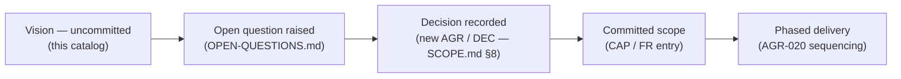

**AI Guardrails — Guardrail-Category Catalog**

**Authority level:** L2
**Status:** Draft
**Date:** 2026-07-24
**Derived from:** seed.md + AGREEMENTS.md (AGR-021) + DECISIONS.md (DEC-009)

---

## Purpose and authority

This catalog is the product's **directional vision taxonomy** for guardrail controls: eighteen change-controlled categories, `GR-001` through `GR-018`, sanctioned by [AGR-021](../00-source-of-truth/AGREEMENTS.md#agr-021--guardrail-category-taxonomy-and-extension-model) and adopted as vision by [DEC-009](../00-source-of-truth/DECISIONS.md#dec-009--adopt-the-guardrail-category-catalog-as-directional-vision).

Three sentences govern how every entry below must be read:

1. **The catalog is classification, not commitment.** It does not add anything to the defined-and-estimated full feature set (`CAP-001`–`CAP-034`, [DEC-008](../00-source-of-truth/DECISIONS.md#dec-008--supersede-the-mvp-bounded-scope-define-and-estimate-the-full-feature-set-across-five-phases)), and listing an item here does not schedule, resource, or promise it. Delivered and committed coverage is defined by [`CAPABILITIES.md`](CAPABILITIES.md) alone.
2. **The architecture permits — but does not yet deliver — extension into most categories.** That is the only approved forward-looking framing for this catalog (see [`70-governance/CLAIMS-REGISTER.md`](../70-governance/CLAIMS-REGISTER.md)); any wording implying delivered or complete coverage of these categories is not approved.
3. **Out-of-boundary entries are excluded, not deferred.** Where an entry's subject matter falls under a standing exclusion (seed.md §6.3) or under [AGR-010](../00-source-of-truth/AGREEMENTS.md#agr-010--guardrails-are-not-authorization), it is classified `Out-of-boundary` with a named external owner, and must never be phrased as future work.

This is a derived L2 document: it must not contradict [`AGREEMENTS.md`](../00-source-of-truth/AGREEMENTS.md) or [`CONSTRAINTS.md`](../00-source-of-truth/CONSTRAINTS.md); where a conflict is found, those registers win and this catalog is corrected. The mechanics by which a category or item grows into delivered capability are defined in [`50-architecture/EXTENSIBILITY-ARCHITECTURE.md`](../50-architecture/EXTENSIBILITY-ARCHITECTURE.md).

---

## Table of contents

- [How to read this catalog](#how-to-read-this-catalog)
- [Category status lifecycle](#category-status-lifecycle)
- [Category index](#category-index)
- [GR-001 — Prompt and Instruction Security](#gr-001--prompt-and-instruction-security)
- [GR-002 — Harmful Content and Acceptable Use](#gr-002--harmful-content-and-acceptable-use)
- [GR-003 — Sensitive Data and Privacy](#gr-003--sensitive-data-and-privacy)
- [GR-004 — System Prompt and Configuration Protection](#gr-004--system-prompt-and-configuration-protection)
- [GR-005 — RAG and Knowledge-Source Security](#gr-005--rag-and-knowledge-source-security)
- [GR-006 — Output Accuracy, Grounding and Information Integrity](#gr-006--output-accuracy-grounding-and-information-integrity)
- [GR-007 — Structured Output and Generated-Artifact Safety](#gr-007--structured-output-and-generated-artifact-safety)
- [GR-008 — Model and Provider Governance](#gr-008--model-and-provider-governance)
- [GR-009 — Agent, Tool and Action Safety](#gr-009--agent-tool-and-action-safety)
- [GR-010 — Identity, Authorization and Tenant Isolation](#gr-010--identity-authorization-and-tenant-isolation)
- [GR-011 — Memory and State Safety](#gr-011--memory-and-state-safety)
- [GR-012 — Resource, Cost and Availability Protection](#gr-012--resource-cost-and-availability-protection)
- [GR-013 — Human Oversight and User Interaction](#gr-013--human-oversight-and-user-interaction)
- [GR-014 — Data Lifecycle, Audit and Provenance](#gr-014--data-lifecycle-audit-and-provenance)
- [GR-015 — Policy Lifecycle and Governance](#gr-015--policy-lifecycle-and-governance)
- [GR-016 — Supply-Chain and Deployment Security](#gr-016--supply-chain-and-deployment-security)
- [GR-017 — Monitoring, Evaluation and Incident Response](#gr-017--monitoring-evaluation-and-incident-response)
- [GR-018 — Business and Domain-Specific Controls](#gr-018--business-and-domain-specific-controls)
- [Out-of-boundary and exclusion map](#out-of-boundary-and-exclusion-map)
- [Policy packs (vision)](#policy-packs-vision)
- [Category count summary](#category-count-summary)
- [Related documents](#related-documents)

---

## How to read this catalog

### Identifier discipline

- **Category IDs (`GR-001`–`GR-018`) are change-controlled.** Adding, removing, renaming, or reclassifying a category is a register-level change (Path A per [`70-governance/DOCUMENT-GOVERNANCE.md`](../70-governance/DOCUMENT-GOVERNANCE.md) §6) requiring an amendment to [AGR-021](../00-source-of-truth/AGREEMENTS.md#agr-021--guardrail-category-taxonomy-and-extension-model).
- **Item rows inside a category are illustrative and NOT change-controlled.** They may be added, reworded, split, or merged as ordinary derived-document edits (Path B), provided no edit contradicts an L1 register. An item receives a stable sub-identifier only if and when it graduates into committed scope.

### Phase status vocabulary

Every category (and, where statuses differ within a category, every item) carries exactly one of four statuses:

| Status | Meaning |
|---|---|
| **Core (Phases 1–2)** | Delivered by the Phase 1–2 core platform; maps to a `CAP-001`–`CAP-017` capability. Same semantics as in [`CAPABILITIES.md`](CAPABILITIES.md). |
| **Later phase — committed** | Part of the defined-and-estimated full solution (DEC-008), delivered in Phases 3–5; maps to a `CAP-018`–`CAP-034` capability or an `FR-078`–`FR-094` requirement. **Not available today.** |
| **Vision — uncommitted** | Direction only. Outside the DEC-008 estimated feature set; not scheduled, not resourced, not estimated. May enter committed scope only via the graduation process ([`EXTENSIBILITY-ARCHITECTURE.md`](../50-architecture/EXTENSIBILITY-ARCHITECTURE.md) §10). |
| **Out-of-boundary → \<owner\>** | Excluded per seed.md §6.3 or [AGR-010](../00-source-of-truth/AGREEMENTS.md#agr-010--guardrails-are-not-authorization). Owned by the named external party. **Never a future deliverable of this product.** |

### Enforcement layer vocabulary

| Layer | Meaning |
|---|---|
| **evaluator** | Realized as content evaluation at a stage, behind the evaluator-adapter pattern ([AGR-004](../00-source-of-truth/AGREEMENTS.md#agr-004--bedrock-guardrails-as-first-engine-vendor-independent-contract)); produces a normalized decision. |
| **connector-gateway** | Enforced by the gateway or connector layer (rate limits, routing, model selection), not by a per-content evaluation. |
| **control-plane** | Realized by control-plane machinery (registries, policy store, bindings, rollout, audit pipeline). |
| **out-of-boundary** | Not realized by this product in any layer; owned externally. |

### Control types

Descriptive metadata only — control types classify intent and do **not** introduce new runtime machinery or contract fields: **preventive**, **detective**, **corrective**, **directive**, **deterrent**, **recovery**, **governance**. One caution is normative: **directive** controls (for example, system-prompt instructions) are weaker than independently enforced preventive controls and must never be represented as security boundaries (consistent with [AGR-018](../00-source-of-truth/AGREEMENTS.md#agr-018--trust-and-enforcement-model)).

### External mappings

OWASP LLM-risk identifiers and NIST AI RMF functions appear per category **for orientation only** — they are conceptual anchors, not conformance or coverage claims (see [`70-governance/REFERENCES.md`](../70-governance/REFERENCES.md) §11).

### Stages

The `Stages used` field draws on the reserved stage vocabulary of seed.md §9 (`input`, `output` now; `retrieval`, `tool_call`, `tool_result`, `memory_write`, `final_response` reserved for later phases). A stage marked **(proposed, not reserved)** exists only as a catalog candidate gated on [OQ-018](../00-source-of-truth/OPEN-QUESTIONS.md#oq-018--evaluation-stage-vocabulary-expansion-beyond-the-reserved-seven) and must not appear in policy schemas or contracts.

### Reason codes

Per [DEC-013](../00-source-of-truth/DECISIONS.md#dec-013--reason-code-taxonomy-and-guardrail-category-audit-dimension) / [ADR-0003](../50-architecture/adrs/ADR-0003-reason-code-taxonomy-and-category-audit-dimension.md) (Proposed), every reason code is namespaced by category — `GR-0NN:<evaluator-family>:<code>` — making guardrail category a first-class audit/metric dimension of the decision record, not just a classification label on this catalog.

---

## Category status lifecycle

A vision entry becomes delivered capability only through this pipeline — each arrow is an explicit, recorded step, never a silent promotion:

The process detail — who raises what, which registers change, and how the four extension seams are exercised — is defined in [`50-architecture/EXTENSIBILITY-ARCHITECTURE.md`](../50-architecture/EXTENSIBILITY-ARCHITECTURE.md) §10.

---

## Category index

| ID | Category | Enforcement layer | Dominant status | External mapping (orientation only) |
|---|---|---|---|---|
| [GR-001](#gr-001--prompt-and-instruction-security) | Prompt and Instruction Security | evaluator | Core (mixed) | OWASP LLM01; NIST AI RMF Measure/Manage |
| [GR-002](#gr-002--harmful-content-and-acceptable-use) | Harmful Content and Acceptable Use | evaluator | Core | OWASP LLM05/LLM09 adjacent; NIST Manage |
| [GR-003](#gr-003--sensitive-data-and-privacy) | Sensitive Data and Privacy | evaluator | Core (mixed) | OWASP LLM02; NIST Map/Manage |
| [GR-004](#gr-004--system-prompt-and-configuration-protection) | System Prompt and Configuration Protection | evaluator + control-plane | Core/Later (mixed) | OWASP LLM07; NIST Manage |
| [GR-005](#gr-005--rag-and-knowledge-source-security) | RAG and Knowledge-Source Security | evaluator (`retrieval`) | Later phase — committed (Phase 5) | OWASP LLM08/LLM04; NIST Map/Measure |
| [GR-006](#gr-006--output-accuracy-grounding-and-information-integrity) | Output Accuracy, Grounding and Information Integrity | evaluator | Later/Vision (mixed) | OWASP LLM09; NIST Measure |
| [GR-007](#gr-007--structured-output-and-generated-artifact-safety) | Structured Output and Generated-Artifact Safety | evaluator | Core (mixed) | OWASP LLM05; NIST Manage |
| [GR-008](#gr-008--model-and-provider-governance) | Model and Provider Governance | control-plane | Vision — uncommitted | OWASP LLM03 adjacent; NIST Govern |
| [GR-009](#gr-009--agent-tool-and-action-safety) | Agent, Tool and Action Safety | evaluator (`tool_call`/`tool_result`) | Later phase — committed (Phase 5) | OWASP LLM06; NIST Manage |
| [GR-010](#gr-010--identity-authorization-and-tenant-isolation) | Identity, Authorization and Tenant Isolation | out-of-boundary | Out-of-boundary → consuming application / IdP | OWASP LLM06 adjacent; NIST Govern |
| [GR-011](#gr-011--memory-and-state-safety) | Memory and State Safety | evaluator (`memory_write`) | Later phase — committed (Phase 5) | OWASP LLM04 adjacent (memory poisoning); NIST Manage |
| [GR-012](#gr-012--resource-cost-and-availability-protection) | Resource, Cost and Availability Protection | connector-gateway / control-plane | Vision — uncommitted | OWASP LLM10; NIST Manage |
| [GR-013](#gr-013--human-oversight-and-user-interaction) | Human Oversight and User Interaction | control-plane + `require_approval` | Later phase — committed (Phase 5) | NIST Govern/Manage |
| [GR-014](#gr-014--data-lifecycle-audit-and-provenance) | Data Lifecycle, Audit and Provenance | control-plane | Core (mixed) | NIST Govern/Map |
| [GR-015](#gr-015--policy-lifecycle-and-governance) | Policy Lifecycle and Governance | control-plane | Core | NIST Govern |
| [GR-016](#gr-016--supply-chain-and-deployment-security) | Supply-Chain and Deployment Security | out-of-boundary / platform property | Out-of-boundary (mostly) | OWASP LLM03; NIST Govern/Map |
| [GR-017](#gr-017--monitoring-evaluation-and-incident-response) | Monitoring, Evaluation and Incident Response | control-plane | Core (mixed) | NIST Measure/Manage |
| [GR-018](#gr-018--business-and-domain-specific-controls) | Business and Domain-Specific Controls | evaluator | Core/Later (mixed) | NIST Govern/Manage |

---

## GR-001 — Prompt and Instruction Security

| Field | Value |
|---|---|
| Enforcement layer | evaluator |
| Control types | preventive, detective |
| Stages used | `input`; `retrieval`, `tool_result` (reserved, later phases) |
| Evaluator family | Bedrock Guardrails prompt-attack filters; deterministic rules ([`CONTAINER-ARCHITECTURE.md`](../50-architecture/CONTAINER-ARCHITECTURE.md) §5) |
| Deployment-mode support | A / B / C — identical contract ([AGR-006](../00-source-of-truth/AGREEMENTS.md#agr-006--one-logical-evaluation-contract-across-all-modes)) |
| Phase status | Core (Phases 1–2), mixed — see items |
| Related agreements | AGR-004, AGR-006 |
| Related capabilities / requirements | CAP-009, CAP-010, CAP-019 (indirect injection, later), FR-079 |
| External mapping (orientation only) | OWASP LLM01 Prompt Injection, LLM07 System Prompt Leakage; NIST AI RMF Measure/Manage |
| Related architecture | [`INTEGRATION-ARCHITECTURE.md`](../50-architecture/INTEGRATION-ARCHITECTURE.md) §3; [`COMPONENT-ARCHITECTURE.md`](../50-architecture/COMPONENT-ARCHITECTURE.md) RT-4 |

Controls that prevent untrusted content from overriding, extracting, or weakening trusted instructions. Detection-scoped: the platform detects and blocks attack patterns; it does not claim to block all prompt injection (that claim is Not approved — [`CLAIMS-REGISTER.md`](../70-governance/CLAIMS-REGISTER.md) §1), and it ships no proprietary injection model (seed.md §6.3).

### Items (illustrative, not change-controlled)

| Item | Description | Status |
|---|---|---|
| Direct prompt-injection detection | Detect explicit attempts to override system or developer instructions at the `input` stage. | Core (Phases 1–2) |
| Jailbreak detection | Detect bypass attempts via role-play, hypothetical framing, or instruction chaining. | Core (Phases 1–2) |
| Prompt-leakage request detection | Detect requests to disclose hidden prompts, policies, or internal configuration. | Core (Phases 1–2) |
| Known attack-signature matching | Deterministic rules matching versioned injection/jailbreak signatures. | Core (Phases 1–2) |
| Encoded-instruction detection | Detect suspicious Base64/hex/Unicode/fragmented instruction payloads via deterministic rules. | Vision — uncommitted |
| Homoglyph and obfuscation normalization | Normalize zero-width characters, visually similar glyphs, adversarial spacing before evaluation. | Vision — uncommitted |
| Multilingual injection detection | Detect attacks in languages beyond initial coverage; depends on multilingual packs (CAP-026). | Later phase — committed |
| Indirect prompt-injection detection | Detect injection payloads embedded in retrieved or tool-sourced content (`retrieval`/`tool_result` stages). | Later phase — committed (CAP-019, FR-079) |
| Context-stuffing detection | Detect oversized or repetitive instruction dilution; interacts with input-size limits (CON-015). | Vision — uncommitted |
| Prompt replay detection | Detect replay of previously rejected high-risk prompts; requires cross-request state. | Vision — uncommitted |
| Instruction-source separation / untrusted-content tagging | Marking application instructions, user content, retrieved data, and tool output as distinct trust zones is an application-side design pattern (directive), not an evaluation the platform performs. | Out-of-boundary → consuming application |

---

## GR-002 — Harmful Content and Acceptable Use

| Field | Value |
|---|---|
| Enforcement layer | evaluator |
| Control types | preventive, detective, corrective |
| Stages used | `input`, `output` |
| Evaluator family | Bedrock Guardrails content filters, denied topics, word filters — first engine, not permanent or exclusive ([AGR-004](../00-source-of-truth/AGREEMENTS.md#agr-004--bedrock-guardrails-as-first-engine-vendor-independent-contract)) |
| Deployment-mode support | A / B / C — identical contract |
| Phase status | Core (Phases 1–2) |
| Related agreements | AGR-004, AGR-005, AGR-006 |
| Related capabilities / requirements | CAP-009, CAP-010, CAP-012 |
| External mapping (orientation only) | OWASP LLM05/LLM09 adjacent; NIST AI RMF Manage |
| Related architecture | [`CONTAINER-ARCHITECTURE.md`](../50-architecture/CONTAINER-ARCHITECTURE.md) §5; [`INTEGRATION-ARCHITECTURE.md`](../50-architecture/INTEGRATION-ARCHITECTURE.md) §6 |

Prevent prohibited or inappropriate content from entering or leaving the system, using configurable harm categories, organization-specific denied topics, and word/phrase filters.

### Items (illustrative, not change-controlled)

| Item | Description | Status |
|---|---|---|
| Harm-category filtering | Configurable categories (hate, harassment, sexual content, violence, self-harm, misconduct) at `input`/`output`. | Core (Phases 1–2) |
| Illegal-activity and criminal-assistance detection | Detection of assistance with clearly illegal activity, fraud, or social engineering. | Core (Phases 1–2) |
| Organization-specific denied topics | Tenant-authored denied-topic configuration (e.g., regulated advice, competitor policy). | Core (Phases 1–2) |
| Custom word/phrase filters | Deterministic prohibited-term filtering, including profanity. | Core (Phases 1–2) |
| Regulated-advice restriction | Restriction of unapproved medical/legal/financial advice via denied topics + deterministic rules. | Core (Phases 1–2) |
| Jurisdiction/age-scoped content restrictions | Restrictions varying by geography or audience age; requires request context the contract does not carry today. | Vision — uncommitted |
| Image-content safety filtering | Multimodal (image) content evaluation; no multimodal stage or evaluator committed. | Vision — uncommitted |

---

## GR-003 — Sensitive Data and Privacy

| Field | Value |
|---|---|
| Enforcement layer | evaluator |
| Control types | preventive, detective, corrective |
| Stages used | `input`, `output` |
| Evaluator family | PII evaluator; deterministic rules (regex patterns) ([`CONTAINER-ARCHITECTURE.md`](../50-architecture/CONTAINER-ARCHITECTURE.md) §5) |
| Deployment-mode support | A / B / C; Mode C keeps raw content in the customer account (CON-013) |
| Phase status | Core (Phases 1–2), mixed — see items |
| Related agreements | AGR-014, AGR-016 |
| Related capabilities / requirements | CAP-011, CAP-012, CAP-015 |
| External mapping (orientation only) | OWASP LLM02 Sensitive Information Disclosure; NIST AI RMF Map/Manage |
| Related architecture | [`DATA-ARCHITECTURE.md`](../50-architecture/DATA-ARCHITECTURE.md) §3 |

Prevent unauthorized exposure of sensitive information in evaluated content — detection plus `redact` enforcement. Explicitly **not** a complete DLP platform (seed.md §6.3): enterprise-wide data-loss prevention across channels, endpoints, and storage remains external.

### Items (illustrative, not change-controlled)

| Item | Description | Status |
|---|---|---|
| PII detection and redaction | Detect and mask personal identifiers (names, emails, phone numbers, government IDs) at `input`/`output`. | Core (Phases 1–2) |
| Payment-card and bank-account detection | Predefined sensitive-entity types plus custom regex patterns. | Core (Phases 1–2) |
| Secret and credential detection | API keys, access tokens, private keys, passwords, connection strings via deterministic patterns. | Core (Phases 1–2) |
| Input/output redaction with transformed content | `redact` action returns transformed content in the decision (CAP-012). | Core (Phases 1–2) |
| No-raw-retention default + telemetry redaction | Raw prompts/responses not persisted by default; secrets stripped from telemetry. | Core (Phases 1–2) — AGR-014 |
| Customer-controlled telemetry (Mode C) | Customer selects what, if anything, reaches the control plane. | Core (Phases 1–2) — AGR-016 |
| PHI-specific detection tiers | Health-information-specific entity coverage beyond the initial tier. | Vision — uncommitted |
| Format-preserving masking / tokenization | Pseudonymization schemes preserving format for downstream systems. | Vision — uncommitted |
| Consent-state and purpose-of-processing validation | Requires per-request consent context the contract does not carry; application-owned data. | Vision — uncommitted |
| Enterprise DLP (channels, endpoints, storage) | Cross-channel data-loss prevention outside evaluated LLM content. | Out-of-boundary → enterprise DLP tooling (seed.md §6.3) |

### Boundary notes

"Complete DLP platform" is a standing exclusion (seed.md §6.3). This category covers sensitive-data handling **within evaluated content** only; items implying enterprise-wide DLP are classified out-of-boundary permanently, not deferred.

---

## GR-004 — System Prompt and Configuration Protection

| Field | Value |
|---|---|
| Enforcement layer | evaluator (leak detection) + control-plane (configuration protection) |
| Control types | preventive, detective, governance |
| Stages used | `input`, `output` |
| Evaluator family | Deterministic rules (leak patterns, canary values); Bedrock prompt-attack filters (leakage requests) |
| Deployment-mode support | A / B / C |
| Phase status | Core/Later (mixed) — see items |
| Related agreements | AGR-010 (authorization never lives in prompts), AGR-018 (directive controls are not boundaries) |
| Related capabilities / requirements | CAP-010; CAP-028 (policy signing, later) |
| External mapping (orientation only) | OWASP LLM07 System Prompt Leakage; NIST AI RMF Manage |
| Related architecture | [`SECURITY-ARCHITECTURE.md`](../50-architecture/SECURITY-ARCHITECTURE.md) §11 |

Protect internal instructions and configuration from becoming a source of compromise. Prompt confidentiality cannot be assumed: credentials, customer records, and authorization rules must never live in system prompts — those are application design obligations this category detects violations of, not substitutes for.

### Items (illustrative, not change-controlled)

| Item | Description | Status |
|---|---|---|
| System-prompt leakage detection | Output-stage patterns detecting verbatim or near-verbatim prompt disclosure. | Core (Phases 1–2) — deterministic rules |
| Canary-value detection | Detect planted canary tokens from protected prompts appearing in output. | Core (Phases 1–2) — deterministic rules |
| Prompt-leakage request detection | Input-stage detection of extraction attempts (shared with GR-001). | Core (Phases 1–2) |
| Credentials/customer-records-in-prompt detection | Detect secrets or records embedded in submitted system prompts (input evaluation covers system prompts, CAP-004). | Core (Phases 1–2), via GR-003 evaluators |
| Prompt versioning, approval, rollback | Managing prompt templates as governed artifacts. | Vision — uncommitted (control-plane) |
| Prompt checksum / unauthorized-change detection | Integrity verification of deployed prompt templates. | Vision — uncommitted |
| Suppression of internal configuration in error responses | Application error-handling hygiene. | Out-of-boundary → consuming application |

---

## GR-005 — RAG and Knowledge-Source Security

| Field | Value |
|---|---|
| Enforcement layer | evaluator (`retrieval` stage) |
| Control types | preventive, detective |
| Stages used | `retrieval` (reserved, Phase 5); `retrieval_query` (proposed, not reserved — [OQ-018](../00-source-of-truth/OPEN-QUESTIONS.md#oq-018--evaluation-stage-vocabulary-expansion-beyond-the-reserved-seven)) |
| Evaluator family | Retrieval-content evaluators (planned); indirect-injection detection (FR-079) |
| Deployment-mode support | A / B / C once the stage ships; identical contract |
| Phase status | Later phase — committed (Phase 5), mixed — see items |
| Related agreements | AGR-006, AGR-020 |
| Related capabilities / requirements | CAP-018, CAP-019; FR-078, FR-079 |
| External mapping (orientation only) | OWASP LLM08 Vector and Embedding Weaknesses, LLM04 Data and Model Poisoning; NIST AI RMF Map/Measure |
| Related architecture | [`COMPONENT-ARCHITECTURE.md`](../50-architecture/COMPONENT-ARCHITECTURE.md) (planned, Phase 5) |

Evaluate retrieved documents before they are incorporated into a prompt. The platform evaluates retrieval **content** passed to it; it does not operate, secure, or authorize the customer's retrieval infrastructure (vector stores, ingestion pipelines, document ACLs).

### Items (illustrative, not change-controlled)

| Item | Description | Status |
|---|---|---|
| Retrieval-content evaluation | Inspect retrieved documents at the `retrieval` stage before context assembly. | Later phase — committed (CAP-018) |
| Indirect prompt-injection scanning of retrieved content | Detect injection payloads embedded in documents. | Later phase — committed (CAP-019) |
| Sensitive-data scanning of retrieved content | Apply GR-003 evaluators at the `retrieval` stage. | Later phase — committed (stage-dependent) |
| Retrieved-content trust labeling | Decision metadata marking retrieved content as evaluated/unevaluated. | Vision — uncommitted |
| Maximum retrieved-context size / source-count limits | Deterministic limits on retrieval payloads at evaluation time. | Vision — uncommitted |
| Retrieval-query evaluation | Evaluating the outbound retrieval query itself; needs an unreserved stage. | Vision — uncommitted (OQ-018) |
| Retrieval authorization, tenant-scoped filters, document/chunk ACLs | Who may retrieve what — access control in the customer's RAG stack. | Out-of-boundary → consuming application / RAG platform (AGR-010) |
| Vector-store isolation, embedding namespaces, ingestion pipeline security | Infrastructure of the customer's knowledge stores. | Out-of-boundary → consuming application / RAG platform |

### Boundary notes

RAG **infrastructure** security (vector-store isolation, ingestion scanning, retrieval ACLs) belongs to whoever operates the RAG stack. The platform's role is stage-scoped content evaluation — consistent with AGR-010: evaluating retrieved content is not authorizing retrieval.

---

## GR-006 — Output Accuracy, Grounding and Information Integrity

| Field | Value |
|---|---|
| Enforcement layer | evaluator |
| Control types | detective, corrective |
| Stages used | `output`; `final_response` (reserved, later) |
| Evaluator family | Groundedness evaluator (FR-084); automated-reasoning evaluator (FR-085); deterministic rules for format-level consistency |
| Deployment-mode support | A / B / C once shipped; grounding requires source/query context in the request |
| Phase status | Later/Vision (mixed) — see items |
| Related agreements | AGR-004, AGR-006 |
| Related capabilities / requirements | CAP-024, CAP-025; FR-084, FR-085 |
| External mapping (orientation only) | OWASP LLM09 Misinformation; NIST AI RMF Measure |
| Related architecture | [`COMPONENT-ARCHITECTURE.md`](../50-architecture/COMPONENT-ARCHITECTURE.md) (planned) |

Reduce unsupported, inaccurate, or internally inconsistent responses. Grounding checks require correctly supplied source and query content and supplement — never replace — application-specific factual verification.

### Items (illustrative, not change-controlled)

| Item | Description | Status |
|---|---|---|
| Groundedness validation | Assess whether a response is grounded in supplied context or retrieved content. | Later phase — committed (CAP-024) |
| Query/context relevance validation | Assess whether the response addresses the query and uses the supplied context. | Later phase — committed (grouped with CAP-024) |
| Automated-reasoning validation | Formal/automated-reasoning evaluation beyond statistical detection. | Later phase — committed (CAP-025) |
| Unsupported-claim and citation-presence detection | Detect claims lacking support in supplied sources; verify citations exist. | Vision — uncommitted |
| Numerical/unit/date consistency validation | Deterministic post-processing consistency checks. | Vision — uncommitted |
| Abstention on insufficient evidence | `abstain` action (reserved, later phase) driven by grounding confidence. | Vision — uncommitted (action reserved) |
| Verifier-model review / multi-model consensus | Independent model(s) judging the primary response. | Vision — uncommitted |
| Business-rule and eligibility verification | Domain-rule checks against reference data — classified under GR-018. | See GR-018 |

---

## GR-007 — Structured Output and Generated-Artifact Safety

| Field | Value |
|---|---|
| Enforcement layer | evaluator |
| Control types | preventive, detective |
| Stages used | `output` |
| Evaluator family | Schema validator; deterministic rules ([`CONTAINER-ARCHITECTURE.md`](../50-architecture/CONTAINER-ARCHITECTURE.md) §5) |
| Deployment-mode support | A / B / C — identical contract |
| Phase status | Core (Phases 1–2), mixed — see items |
| Related agreements | AGR-004, AGR-006 |
| Related capabilities / requirements | CAP-010, CAP-012; FR-090 (customer plugins, later) |
| External mapping (orientation only) | OWASP LLM05 Improper Output Handling; NIST AI RMF Manage |
| Related architecture | [`COMPONENT-ARCHITECTURE.md`](../50-architecture/COMPONENT-ARCHITECTURE.md) RT-4 (schema validator) |

Validate outputs intended for software systems — schema conformance and deterministic safety patterns. Static analysis, dependency scanning, sandboxed execution, and infrastructure-policy validation are CI/CD-pipeline controls, not runtime content evaluations.

### Items (illustrative, not change-controlled)

| Item | Description | Status |
|---|---|---|
| JSON-schema validation of structured output | Validate structured payloads against an expected schema. | Core (Phases 1–2) |
| Required-field / type / enumeration / range validation | Schema-validator constraint checks. | Core (Phases 1–2) |
| Identifier, URI, and email format validation | Deterministic format rules. | Core (Phases 1–2) |
| Dangerous-pattern detection in generated text | Deterministic detection of destructive SQL, dangerous shell commands, path traversal in output. | Vision — uncommitted |
| Secret detection in generated code | GR-003 secret patterns applied to code-shaped output. | Core (Phases 1–2), via GR-003 evaluators |
| HTML/Markdown sanitization advice | Output-handling hygiene in the consuming application. | Out-of-boundary → consuming application |
| Static analysis, dependency scanning, vulnerability scanning of generated code | Software-pipeline tooling. | Out-of-boundary → consuming team CI/CD |
| Sandbox-only execution, resource-limited execution | Execution-environment controls where generated code runs. | Out-of-boundary → consuming application / execution platform |

---

## GR-008 — Model and Provider Governance

| Field | Value |
|---|---|
| Enforcement layer | control-plane (partial today via workload registration); connector-gateway (Mode B) |
| Control types | governance, preventive |
| Stages used | none — not content evaluation |
| Evaluator family | n/a |
| Deployment-mode support | Enforceable primarily in Mode B (provider operates the gateway); observational elsewhere |
| Phase status | Vision — uncommitted, mixed — see items |
| Related agreements | AGR-013, AGR-018 |
| Related capabilities / requirements | CAP-002 (workload attributes); Phase 3 Guarded Gateway deliverables (routing, cost/rate controls — seed.md §18) |
| External mapping (orientation only) | OWASP LLM03 adjacent; NIST AI RMF Govern |
| Related architecture | [`DEPLOYMENT-ARCHITECTURE.md`](../50-architecture/DEPLOYMENT-ARCHITECTURE.md) §3 (Mode B) |

Control which models may be used and under what conditions. In Modes A and C the consuming team owns model routing and credentials; the platform can record and observe model usage but cannot prevent it (AGR-018 — a cooperative connector is not a hard boundary).

### Items (illustrative, not change-controlled)

| Item | Description | Status |
|---|---|---|
| Workload gateway/model metadata registration | Gateway type and deployment mode recorded at registration (CAP-002). | Core (Phases 1–2) — registration only, not enforcement |
| Per-tenant model routing (Mode B) | Guarded Gateway routes to configured providers per tenant. | Later phase — committed (Phase 3, seed.md §18) |
| Approved-model allowlist / denylist enforcement | Platform-enforced model selection policy. | Vision — uncommitted |
| Model-version pinning and deprecation handling | Version governance across workloads. | Vision — uncommitted |
| Data-classification-to-model routing | Routing by data sensitivity; requires classification context. | Vision — uncommitted |
| Inference parameter limits (temperature, max tokens) | Parameter governance at the gateway. | Vision — uncommitted (gateway-native today) |
| Organization-wide AWS enforcement of guardrails (SCPs, AWS Organizations baselines) | Account-level mandatory enforcement across an organization. | Out-of-boundary → cloud platform team / AWS Organizations (seed.md §6.3) |

### Boundary notes

"Organization-wide AWS enforcement" is a standing exclusion (seed.md §6.3). Mechanisms such as AWS Organizations policies can mandate Bedrock Guardrails account-wide, but operating that baseline is the cloud platform team's control, not this product's.

---

## GR-009 — Agent, Tool and Action Safety

| Field | Value |
|---|---|
| Enforcement layer | evaluator (`tool_call`, `tool_result` stages) |
| Control types | preventive, detective |
| Stages used | `tool_call`, `tool_result` (reserved, Phase 5); `agent_plan`, `tool_selection` (proposed, not reserved — OQ-018) |
| Evaluator family | Tool-call validators (planned); schema validator for arguments; GR-001/GR-003 evaluators at `tool_result` |
| Deployment-mode support | A / B / C once the stages ship |
| Phase status | Later phase — committed (Phase 5), mixed — see items |
| Related agreements | AGR-010 (hard boundary), AGR-020 |
| Related capabilities / requirements | CAP-021, CAP-022; FR-081, FR-082 |
| External mapping (orientation only) | OWASP LLM06 Excessive Agency; agentic-risk guidance (tool misuse, memory poisoning); NIST AI RMF Manage |
| Related architecture | [`SECURITY-ARCHITECTURE.md`](../50-architecture/SECURITY-ARCHITECTURE.md) §11–§12 |

Evaluate proposed tool invocations and tool results as **content**. A favorable decision means the call's name and arguments passed policy checks — it never means the principal is authorized to execute it (AGR-010). The product is not, and will not become, a general MCP security platform (seed.md §6.3); CAP-022 covers MCP-specific authorization controls only, and even that is narrower than platform-wide MCP security.

### Items (illustrative, not change-controlled)

| Item | Description | Status |
|---|---|---|
| Tool-call validation | Inspect tool name and arguments at the `tool_call` stage before execution. | Later phase — committed (CAP-021) |
| Tool-argument schema validation | Schema validator applied to tool arguments. | Later phase — committed (with CAP-021) |
| Tool-result evaluation | Evaluate tool-returned content (injection, sensitive data) at `tool_result`. | Later phase — committed (FR-081 family) |
| MCP authorization controls | Authorization controls specific to MCP tool invocation. | Later phase — committed (CAP-022) |
| Policy-configured tool allowlists/denylists | Tool-name allow/deny as policy configuration at `tool_call`. | Vision — uncommitted |
| Transaction-value / batch-size argument limits | Semantic argument thresholds; likely deterministic rules per workload. | Vision — uncommitted |
| Agent step/duration/recursion limits, kill switch | Execution-loop controls inside the agent runtime. | Out-of-boundary → agent framework / consuming application |
| Least-privilege tool permissions, credential scoping | IAM and permission boundaries for tool execution. | Out-of-boundary → consuming application / IAM (AGR-010) |
| Inter-agent authentication and trust | Identity between cooperating agents. | Out-of-boundary → consuming application |

### Boundary notes

The platform judges the **proposed call**; the agent runtime must enforce the decision and everything about execution (permissions, limits, kill switches) stays with the consuming application. Fully autonomous agent governance is a standing exclusion (seed.md §6.3).

---

## GR-010 — Identity, Authorization and Tenant Isolation

| Field | Value |
|---|---|
| Enforcement layer | out-of-boundary |
| Control types | preventive, governance (externally owned) |
| Stages used | none |
| Evaluator family | n/a |
| Deployment-mode support | n/a |
| Phase status | Out-of-boundary → consuming application / identity provider |
| Related agreements | **AGR-010** (defining boundary); CON-010/CON-011/CON-012 (platform's own caller authentication) |
| Related capabilities / requirements | none — deliberately |
| External mapping (orientation only) | OWASP LLM06 adjacent; NIST AI RMF Govern |
| Related architecture | [`SECURITY-ARCHITECTURE.md`](../50-architecture/SECURITY-ARCHITECTURE.md) §5, §11 |

This category exists in the catalog **to name what the product will never own**. End-user authentication, business authorization, resource ownership, row/attribute-level access, transaction limits, delegation, and approval-authority decisions belong to the consuming application and its identity provider — permanently, per [AGR-010](../00-source-of-truth/AGREEMENTS.md#agr-010--guardrails-are-not-authorization) and seed.md §6.3.

Two narrow platform properties are related but are **not** guardrails in this category's sense:

- The platform authenticates **its own callers** — IAM-based authentication and per-tenant workload identities (CON-010, CON-011) — as a platform security property ([`SECURITY-ARCHITECTURE.md`](../50-architecture/SECURITY-ARCHITECTURE.md) §5).
- The platform's own multi-tenant isolation is an internal architecture obligation, not a customer-facing guardrail control.

### Items (illustrative, not change-controlled)

| Item | Description | Status |
|---|---|---|
| End-user authentication, session binding | Who the user is. | Out-of-boundary → consuming application / IdP |
| Business authorization (resource, row, attribute, relationship) | What the user may do. | Out-of-boundary → consuming application (AGR-010) |
| Tenant identity derivation from trusted identity | Application-side tenancy claims. | Out-of-boundary → consuming application |
| Delegation, privilege-escalation detection, separation of duties | Application/IdP access governance. | Out-of-boundary → consuming application / IdP |
| Platform caller authentication (IAM, workload identity) | The platform authenticating evaluation requests. | Core (Phases 1–2) — platform security property, not a guardrail |

### Boundary notes

This is the catalog's flagship out-of-boundary category: it is listed so that coverage conversations have an honest answer, never as a roadmap. Any phrasing that drifts toward "future guardrail authorization" contradicts AGR-010 and must be corrected.

---

## GR-011 — Memory and State Safety

| Field | Value |
|---|---|
| Enforcement layer | evaluator (`memory_write` stage) |
| Control types | preventive, detective |
| Stages used | `memory_write` (reserved, Phase 5); `memory_read` (proposed, not reserved — OQ-018) |
| Evaluator family | GR-001/GR-003 evaluators applied at `memory_write`; memory-specific validators (planned) |
| Deployment-mode support | A / B / C once the stage ships |
| Phase status | Later phase — committed (Phase 5), mixed — see items |
| Related agreements | AGR-006, AGR-020 |
| Related capabilities / requirements | CAP-023; FR-083 |
| External mapping (orientation only) | Agentic memory-poisoning risk; OWASP LLM04 adjacent; NIST AI RMF Manage |
| Related architecture | [`COMPONENT-ARCHITECTURE.md`](../50-architecture/COMPONENT-ARCHITECTURE.md) (planned, Phase 5) |

Evaluate content before it is persisted to agent or assistant memory, preventing poisoned or sensitive content from entering long-lived state.

### Items (illustrative, not change-controlled)

| Item | Description | Status |
|---|---|---|
| Memory-write validation | Inspect content at the `memory_write` stage before persistence. | Later phase — committed (CAP-023) |
| Prompt-injection scanning before memory write | GR-001 evaluators at `memory_write`. | Later phase — committed (stage-dependent) |
| Sensitive-data scanning before memory write | GR-003 evaluators at `memory_write`. | Later phase — committed (stage-dependent) |
| Memory-read evaluation | Evaluating recalled memory before use; needs an unreserved stage. | Vision — uncommitted (OQ-018) |
| Memory expiration, retention, size limits | Lifecycle policy of the memory store itself. | Out-of-boundary → agent framework / consuming application |
| Memory-read/write authorization, namespace isolation | Access control over memory stores. | Out-of-boundary → consuming application (AGR-010) |

---

## GR-012 — Resource, Cost and Availability Protection

| Field | Value |
|---|---|
| Enforcement layer | connector-gateway (workload traffic) + control-plane (platform's own protection) |
| Control types | preventive, recovery |
| Stages used | none — not content evaluation |
| Evaluator family | n/a |
| Deployment-mode support | Mode B natively (provider gateway); Modes A/C gateway-native (team-owned) |
| Phase status | Vision — uncommitted, mixed — see items; graduation gated on [OQ-017](../00-source-of-truth/OPEN-QUESTIONS.md#oq-017--token-and-cost-metadata-in-the-evaluation-contract) |
| Related agreements | AGR-006 (contract change control), AGR-012 |
| Related capabilities / requirements | Phase 3 cost/rate controls (seed.md §18); NFR-SCALE/NFR-PERF (platform's own limits) |
| External mapping (orientation only) | OWASP LLM10 Unbounded Consumption; NIST AI RMF Manage |
| Related architecture | [`OPERABILITY.md`](../50-architecture/OPERABILITY.md) §2; [`NON-FUNCTIONAL-REQUIREMENTS.md`](../50-architecture/NON-FUNCTIONAL-REQUIREMENTS.md) |

Prevent denial-of-wallet, runaway consumption, and availability exhaustion. Today the platform protects **itself** (input-size limits CON-015, per-stage timeouts CON-016, quotas from Phase 2); protecting a workload's **model spend** is gateway territory, because the evaluation contract carries no token/cost metadata — the contract question is tracked as OQ-017.

### Items (illustrative, not change-controlled)

| Item | Description | Status |
|---|---|---|
| Evaluation input-size limits and per-stage timeouts | Platform self-protection (CON-015/CON-016). | Core (Phases 1–2) — platform property |
| Per-tenant/per-workload evaluation quotas | Platform-side quota enforcement (Phase 2 deliverable, seed.md §18). | Core (Phases 1–2) |
| Gateway cost and rate controls (Mode B) | Guarded Gateway per-tenant cost/rate controls. | Later phase — committed (Phase 3, seed.md §18) |
| Token/cost budgets as guardrail policy | Policy-expressed spend limits requiring contract extension. | Vision — uncommitted (gated on OQ-017) |
| Cost-anomaly / denial-of-wallet detection | Detection over usage telemetry. | Vision — uncommitted |
| Model-invocation rate limiting (Modes A/C) | The team's own gateway enforces its limits (e.g., LiteLLM budgets). | Out-of-boundary → consuming team's gateway |

---

## GR-013 — Human Oversight and User Interaction

| Field | Value |
|---|---|
| Enforcement layer | control-plane (approval workflow) + the reserved `require_approval` action |
| Control types | directive, governance, corrective |
| Stages used | any stage whose decision can pause pending approval (Phase 5 design) |
| Evaluator family | n/a — workflow around decisions, not an evaluator |
| Deployment-mode support | Requires control-plane workflow; Mode C interaction TBD at design time |
| Phase status | Later phase — committed (Phase 5), mixed — see items |
| Related agreements | AGR-010 (approval authority is the application's), AGR-020 |
| Related capabilities / requirements | CAP-027; FR-087; `require_approval` reserved action |
| External mapping (orientation only) | NIST AI RMF Govern/Manage (human oversight) |
| Related architecture | [`COMPONENT-ARCHITECTURE.md`](../50-architecture/COMPONENT-ARCHITECTURE.md), [`OPERABILITY.md`](../50-architecture/OPERABILITY.md) (planned, Phase 5) |

Route selected evaluation results to a human reviewer before the guarded action proceeds. The platform provides the pause-and-route mechanism; **who is authorized to approve** remains the consuming application's decision (AGR-010).

### Items (illustrative, not change-controlled)

| Item | Description | Status |
|---|---|---|
| `require_approval` decision action + routing workflow | Pause a decision pending human review. | Later phase — committed (CAP-027, FR-087) |
| Approval audit trail | Approval provenance recorded with the decision's audit record. | Later phase — committed (with CAP-027) |
| Human-review sampling of decisions | Structured sampling of allow/block decisions for quality review. | Vision — uncommitted |
| Visible policy-intervention reasons | Reason codes surfaced to end users in friendly form. | Vision — uncommitted (depends on OQ-019 reason-code taxonomy) |
| AI-system disclosure, generated-content labeling | Product-experience obligations. | Out-of-boundary → consuming application |
| Appeal/correction mechanisms, escalation to human operator | Application UX and support workflows. | Out-of-boundary → consuming application |
| Approver authorization (who may approve) | Approval authority and separation of duties. | Out-of-boundary → consuming application (AGR-010) |

---

## GR-014 — Data Lifecycle, Audit and Provenance

| Field | Value |
|---|---|
| Enforcement layer | control-plane (audit pipeline, retention configuration) |
| Control types | deterrent, governance, detective |
| Stages used | all — every evaluation is audited |
| Evaluator family | n/a — audit producer (RT-5), not an evaluator |
| Deployment-mode support | A / B hosted pipeline; C local audit integration (AGR-016) |
| Phase status | Core (Phases 1–2), mixed — see items |
| Related agreements | AGR-012, AGR-014, AGR-016 |
| Related capabilities / requirements | CAP-014, CAP-015; CAP-028 (policy signing, later) |
| External mapping (orientation only) | NIST AI RMF Govern/Map |
| Related architecture | [`DATA-ARCHITECTURE.md`](../50-architecture/DATA-ARCHITECTURE.md) §2–§4; [`COMPONENT-ARCHITECTURE.md`](../50-architecture/COMPONENT-ARCHITECTURE.md) RT-5 |

Control how evaluation decisions and evidence are retained and traced: decision-metadata auditing, correlation, version capture, and tenant-controlled retention.

### Items (illustrative, not change-controlled)

| Item | Description | Status |
|---|---|---|
| Decision-metadata auditing | Every evaluation logged with tenant, workload, policy version, stage, decision, reason codes, evaluator versions, timestamp, correlation ID, raw-retention flag. | Core (Phases 1–2) — CAP-015 |
| Raw-content logging disabled by default | No raw prompt/response persistence unless tenant-configured. | Core (Phases 1–2) — AGR-014 |
| Request correlation across stages | One correlation ID across paired input/output evaluations and audit records. | Core (Phases 1–2) |
| Policy-version and evaluator-version capture | Exact immutable versions recorded per decision. | Core (Phases 1–2) |
| Tenant-specific retention configuration | Retention windows per tenant. | Core (Phases 1–2) |
| Encryption in transit and at rest | TLS + KMS (CON-009). | Core (Phases 1–2) — platform property |
| Decision-event signing, immutable audit storage | Cryptographic audit integrity. | Vision — uncommitted (relates to CAP-028 / OQ-012) |
| Legal hold, regulatory evidence export | Compliance-workflow tooling over audit data. | Vision — uncommitted |
| End-to-end data lineage, AI bill of materials | Enterprise lineage/AIBOM programs. | Out-of-boundary → consuming organization's governance tooling |

---

## GR-015 — Policy Lifecycle and Governance

| Field | Value |
|---|---|
| Enforcement layer | control-plane |
| Control types | governance, preventive, recovery |
| Stages used | n/a |
| Evaluator family | n/a |
| Deployment-mode support | Control plane always hosted; Mode C consumes distribution asynchronously (AGR-015) |
| Phase status | Core (Phases 1–2), mixed — see items |
| Related agreements | AGR-011, AGR-012, AGR-015 |
| Related capabilities / requirements | CAP-001, CAP-003, CAP-013; CAP-028/CAP-029 (later) |
| External mapping (orientation only) | NIST AI RMF Govern |
| Related architecture | [`COMPONENT-ARCHITECTURE.md`](../50-architecture/COMPONENT-ARCHITECTURE.md) CP-2/CP-3/CP-4; [`OPERABILITY.md`](../50-architecture/OPERABILITY.md) §4 |

Manage policies as versioned, reviewable, promotable artifacts — the platform's own governance machinery.

### Items (illustrative, not change-controlled)

| Item | Description | Status |
|---|---|---|
| Immutable policy versions | Any change produces a new version (CAP-001). | Core (Phases 1–2) |
| Observe-before-enforce progression | Disabled → Observe → Warn → Redact → Block per binding (AGR-011). | Core (Phases 1–2) — CAP-013 |
| Controlled promotion, workload-scoped rollout, immediate rollback | Rollout controller behavior (CP-4). | Core (Phases 1–2) |
| Mandatory failure-behavior section | Policies must declare behavior for the six failure modes (AGR-012). | Core (Phases 1–2) |
| Compatibility validation before promotion | Version compatibility checks (algorithm TBD). | Core (Phases 1–2) — mechanism; algorithm TBD |
| Policy signing | Cryptographic authenticity of distributed policy artifacts. | Later phase — committed (CAP-028; OQ-012) |
| Policy inheritance / composition | Base policy extended by workload-specific rules. | Later phase — committed (CAP-029; OQ-012) |
| Policy approval workflow, author/approver separation | Editorial workflow around policy publication. | Vision — uncommitted |
| Policy test suites (unit, adversarial, regression) | Testing discipline for policy artifacts. | Vision — uncommitted |
| Exception workflow with owners and expiration | Governed exceptions to organizational baselines. | Vision — uncommitted |

---

## GR-016 — Supply-Chain and Deployment Security

| Field | Value |
|---|---|
| Enforcement layer | out-of-boundary / platform property |
| Control types | preventive, governance (externally owned where out-of-boundary) |
| Stages used | none |
| Evaluator family | n/a |
| Deployment-mode support | n/a |
| Phase status | Out-of-boundary (mostly), mixed — see items |
| Related agreements | AGR-004 (evaluator onboarding discipline); CON-009 |
| Related capabilities / requirements | CAP-028 (policy signing, later); OQ-013 (plugin governance) |
| External mapping (orientation only) | OWASP LLM03 Supply Chain; NIST AI RMF Govern/Map |
| Related architecture | [`SECURITY-ARCHITECTURE.md`](../50-architecture/SECURITY-ARCHITECTURE.md) §8 |

Protect models, evaluators, connectors, dependencies, and deployment artifacts. The platform secures **its own** supply chain as an internal engineering obligation; the consuming application's supply chain (its models, dependencies, MCP servers, CI/CD) is externally owned.

### Items (illustrative, not change-controlled)

| Item | Description | Status |
|---|---|---|
| Platform dependency scanning, image scanning, secret scanning | The platform's own SDLC hygiene. | Core (Phases 1–2) — platform property, not a customer-facing guardrail |
| Policy-artifact provenance and signing | Verifiable integrity of distributed policies. | Later phase — committed (CAP-028; OQ-012) |
| Evaluator/connector update approval | Governance gate on evaluator and connector versions. | Vision — uncommitted (relates to OQ-013) |
| Customer-evaluator plugin review model | Security/compatibility review before third-party evaluator code runs. | Later phase — committed as a prerequisite of CAP-030 (OQ-013) |
| Customer model provenance, dataset poisoning assessment | Provenance of the customer's models and training data. | Out-of-boundary → consuming team / model provider |
| Customer CI/CD security (SBOM, image signing, IaC scanning) | The consuming team's delivery pipeline. | Out-of-boundary → consuming team's CI/CD |
| MCP server registry and third-party tool approval | Which MCP servers/tools an organization allows. | Out-of-boundary → consuming organization (seed.md §6.3 — no general MCP security platform) |

---

## GR-017 — Monitoring, Evaluation and Incident Response

| Field | Value |
|---|---|
| Enforcement layer | control-plane |
| Control types | detective, recovery, governance |
| Stages used | n/a — operates over decisions and telemetry |
| Evaluator family | n/a |
| Deployment-mode support | A / B hosted; C limited to customer-shared telemetry (AGR-016) |
| Phase status | Core (Phases 1–2), mixed — see items |
| Related agreements | AGR-011, AGR-016, AGR-018 |
| Related capabilities / requirements | CAP-014, CAP-015; connector-health telemetry (seed.md §12) |
| External mapping (orientation only) | NIST AI RMF Measure/Manage |
| Related architecture | [`OPERABILITY.md`](../50-architecture/OPERABILITY.md) §3, §6 |

Measure whether guardrails work and respond when they do not: latency and decision metrics, connector health, and the observe-mode measurement loop that gates enforcement.

### Items (illustrative, not change-controlled)

| Item | Description | Status |
|---|---|---|
| Evaluation latency metrics (P50/P95/P99) | Latency as a first-class decision field. | Core (Phases 1–2) — CAP-014 |
| Decision-distribution monitoring | Allow/block/redact/log_only rates per tenant, workload, policy version, stage. | Core (Phases 1–2) |
| Connector-health telemetry | Reachability, timeout rate, error rate — distinct from decisions; never proof of enforcement (AGR-018). | Core (Phases 1–2) |
| Observe-mode false-positive measurement | The measurement loop behind observe-before-enforce (AGR-011). | Core (Phases 1–2) |
| Per-category decision metrics | Block/redact rates by guardrail category. | Later phase — committed (proposed, DEC-020) |
| Detector-disagreement and threshold-drift monitoring | Comparing evaluator verdicts over time. | Vision — uncommitted |
| Adversarial regression suites, scheduled red-teaming | Ongoing attack-simulation programs against policies. | Vision — uncommitted |
| Gateway-bypass detection | Detecting traffic that never reached evaluation; posture-dependent (AGR-018). | Vision — uncommitted |
| Customer incident response for AI misuse | The consuming organization's IR process. | Out-of-boundary → consuming organization |

---

## GR-018 — Business and Domain-Specific Controls

| Field | Value |
|---|---|
| Enforcement layer | evaluator |
| Control types | preventive, detective, directive |
| Stages used | `input`, `output` |
| Evaluator family | Deterministic rules (CAP-010); customer-specific evaluator plugins (CAP-030, later) |
| Deployment-mode support | A / B / C — identical contract; Mode C runs custom evaluators locally |
| Phase status | Core/Later (mixed) — see items |
| Related agreements | AGR-005 (rules stay vendor-neutral), AGR-010 |
| Related capabilities / requirements | CAP-010; CAP-030; FR-090 |
| External mapping (orientation only) | NIST AI RMF Govern/Manage |
| Related architecture | [`CONTAINER-ARCHITECTURE.md`](../50-architecture/CONTAINER-ARCHITECTURE.md) §5 (deterministic rules) |

Apply rules unique to a product, industry, or business process — deterministic organization-authored checks today, customer evaluator plugins later. These controls typically need reference data or formal policy engines rather than probabilistic classifiers.

### Items (illustrative, not change-controlled)

| Item | Description | Status |
|---|---|---|
| Organization-authored deterministic rules | Custom prohibited terms, required disclaimers, approved-terminology checks. | Core (Phases 1–2) — CAP-010 |
| Domain vocabulary and template validation | Deterministic checks for approved templates and terminology. | Core (Phases 1–2) |
| Customer-specific evaluator plugins | Custom evaluators behind the standard adapter contract. | Later phase — committed (CAP-030, FR-090; gated on OQ-013) |
| Reference-data-backed validation (catalog, pricing, eligibility) | Checks against live business reference data; requires plugin mechanism plus data access. | Vision — uncommitted |
| Brand-tone and communication-standard validation | Style/tone conformance evaluation. | Vision — uncommitted |
| Business authorization (transaction approval, credit decisions, HR decisions) | Whether the business action may proceed. | Out-of-boundary → consuming application (AGR-010; seed.md §6.3) |

### Boundary notes

A deterministic rule can check that generated text respects a refund-policy phrasing; it cannot and must not decide whether a refund is authorized. The decision boundary of AGR-010 runs through the middle of this category — item wording must stay on the content side of it.

---

## Out-of-boundary and exclusion map

Standing exclusions (seed.md §6.3, reaffirmed by DEC-008) mapped to the categories they touch. Rows here are **excluded, not deferred** — each has a named external owner and none is a future deliverable of this product:

| Standing exclusion (seed.md §6.3) | Touches | External owner |
|---|---|---|
| End-user authentication | GR-010 | Consuming application / identity provider |
| Application business authorization | GR-010, GR-018, GR-009 | Consuming application |
| Complete DLP platform | GR-003 | Enterprise DLP tooling |
| Organization-wide AWS enforcement | GR-008 | Cloud platform team / AWS Organizations |
| General MCP security platform | GR-009, GR-016 | Consuming organization |
| Fully autonomous agent governance | GR-009 | Agent framework / consuming application |
| Complete AI governance platform | catalog-wide framing | Consuming organization's governance program |
| Proprietary prompt-injection / moderation models | GR-001, GR-002 (build-approach exclusion) | n/a — the platform integrates engines, it does not train models |
| General-purpose LLM gateway replacement | GR-008, GR-012 (gateway-native items) | Consuming team's gateway |

Also externally owned without being seed.md §6.3 items: application UX obligations (GR-013 disclosure/appeals), execution-environment controls (GR-007 sandboxing, GR-009 agent limits), the consuming team's CI/CD (GR-007, GR-016), and RAG infrastructure (GR-005).

---

## Policy packs (vision)

**Status: Vision — uncommitted.** A policy pack is a named, versioned policy template that pre-selects evaluators, thresholds, actions, and failure behavior for a workload archetype — assembled from the same policy machinery that exists today (portable per AGR-005, connector-independent per AGR-007). Packs are **not** policy inheritance: CAP-029 (structured inheritance/composition) is a separate later-phase capability, and nothing in this section implies inheritance mechanics exist. Composition mechanics, if pursued, are sketched in [`EXTENSIBILITY-ARCHITECTURE.md`](../50-architecture/EXTENSIBILITY-ARCHITECTURE.md) §11.

Candidate packs, expressed purely as category selections:

| Pack (vision) | Intended workload | Draws on categories |
|---|---|---|
| `enterprise-baseline` | Every workload | GR-001, GR-002, GR-003, GR-012 (platform limits), GR-014, GR-015 |
| `data-protection-strict` | Confidential data workloads | GR-003 (full tier), GR-014 (strict retention), Mode C guidance |
| `rag-secure` | RAG applications | GR-001 (indirect injection), GR-005, GR-006 |
| `coding-assistant` | Development assistants | GR-003 (secrets), GR-002, GR-007 |
| `agentic-standard` | Agents with tools | GR-001, GR-009, GR-011, GR-013 |
| `regulated-decision-support` | Financial/legal/medical decision support | GR-002 (regulated advice), GR-006, GR-013, GR-014, GR-018 |

A pack can only select from capabilities that exist at its release time; a pack description must never imply a Vision or Later-phase item is active.

---

## Category count summary

Counts derive from the category index above — dominant status per category:

| Dominant status | Categories |
|---|---|
| Core (Phases 1–2), wholly or predominantly | GR-002, GR-015 |
| Core (mixed with Later/Vision items) | GR-001, GR-003, GR-004, GR-007, GR-014, GR-017, GR-018 |
| Later phase — committed (Phase 5 predominantly) | GR-005, GR-006, GR-009, GR-011, GR-013 |
| Vision — uncommitted | GR-008, GR-012 |
| Out-of-boundary | GR-010, GR-016 (mostly) |
| **Total categories** | **18** |

Item-level statuses vary within nearly every category; the per-category item tables are authoritative over this summary.

---

## Related documents

- [`../00-source-of-truth/AGREEMENTS.md`](../00-source-of-truth/AGREEMENTS.md) — AGR-021 sanctions this catalog; AGR-010/AGR-017/AGR-020 bound it.
- [`../00-source-of-truth/DECISIONS.md`](../00-source-of-truth/DECISIONS.md) — DEC-009 (adoption as vision), DEC-008 (estimation basis this catalog must not alter).
- [`../00-source-of-truth/OPEN-QUESTIONS.md`](../00-source-of-truth/OPEN-QUESTIONS.md) — OQ-017/OQ-018/OQ-019 gate several graduations.
- [`../50-architecture/EXTENSIBILITY-ARCHITECTURE.md`](../50-architecture/EXTENSIBILITY-ARCHITECTURE.md) — the extension seams and graduation process behind this catalog.
- [`../50-architecture/adrs/ADR-0002-guardrail-category-catalog-and-extension-model.md`](../50-architecture/adrs/ADR-0002-guardrail-category-catalog-and-extension-model.md) — design record (Proposed).
- [`CAPABILITIES.md`](CAPABILITIES.md) — the committed capability catalog this document classifies but never overrides.
- [`../10-charter/SCOPE.md`](../10-charter/SCOPE.md) — scope categories and the §8 scope-change rule graduation must satisfy.
- [`../70-governance/CLAIMS-REGISTER.md`](../70-governance/CLAIMS-REGISTER.md) — approved and rejected external wording about this catalog.
- [`../70-governance/REFERENCES.md`](../70-governance/REFERENCES.md) — OWASP / NIST AI RMF orientation references.
- [`../70-governance/GLOSSARY.md`](../70-governance/GLOSSARY.md) — definitions of catalog vocabulary (guardrail category, enforcement layer, control type, graduation).
