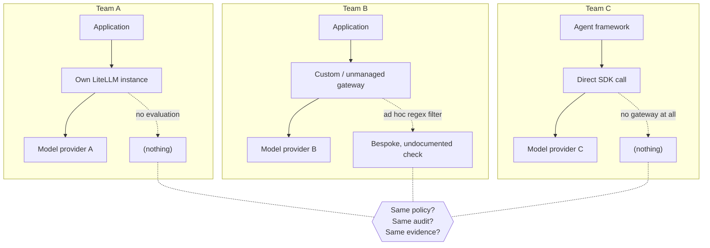

**AI Guardrails — Problem Statement**

**Authority level:** L4
**Status:** Draft
**Date:** 2026-07-24
**Derived from:** seed.md + AGREEMENTS.md

---

## Purpose of this document

This document exists to state, precisely and without solutioning, the problem that justifies building AI Guardrails. It answers one question: *what is broken today when organizations adopt LLMs and agentic workloads, and why does it matter enough to build a dedicated platform?*

It is a **product-tier (L4)** document. It derives from and must remain consistent with the authoritative material in [`../00-source-of-truth/AGREEMENTS.md`](../00-source-of-truth/AGREEMENTS.md) and [`../00-source-of-truth/CONSTRAINTS.md`](../00-source-of-truth/CONSTRAINTS.md); where this document and those registers appear to disagree, the registers win and this document must be corrected. This document does not describe the solution itself — see the forthcoming `10-charter/CHARTER.md` and `20-product/CAPABILITIES.md` for how AI Guardrails addresses the problem framed here.

---

## 1. The problem in one paragraph

Organizations adopting large language models and agentic workflows do so **team by team**, each choosing its own gateway, model provider, and application framework, with no shared mechanism to apply consistent safety and organizational policy across that heterogeneous landscape. Where guardrails exist at all, they are bespoke, undocumented, and coupled to whatever stack the team happens to run — which means they cannot be reused, audited consistently, or trusted as evidence of organization-wide safety posture. At the same time, the two concerns that most block teams from adopting a shared guardrail capability — *where does my content go* and *who operates this component* — are routinely conflated instead of being answered independently, and teams have no low-risk way to validate a policy's real-world impact before it can affect production traffic. The result is an organization that cannot answer, with evidence, "are our AI workloads governed consistently," while individual teams have every rational reason to resist adopting a guardrail capability that might expose their data, seize operational control of their gateway, or start blocking real users on day one.

---

## 2. Current-state pain

### 2.1 Fragmented, inconsistent, or absent guardrails

Seed §1–§2 frame the starting condition: teams consuming LLMs and agents today do so without a reusable policy, evaluation, and enforcement layer. In practice this produces three failure patterns simultaneously, often within the same organization:

| Pattern | What it looks like | Consequence |
| --- | --- | --- |
| **No guardrails** | A team calls a model provider directly or through an unmanaged gateway with no input/output evaluation at all. | Prompt injection, sensitive-data leakage, and policy violations are undetectable after the fact — there is nothing to audit. |
| **Bespoke guardrails** | A team writes its own regex filters, ad hoc moderation calls, or one-off Bedrock Guardrails wiring inside its own gateway or application code. | The logic is untested against other teams' traffic, undocumented outside that team, and disappears or drifts the moment the author moves on. |
| **Duplicated effort** | Multiple teams independently solve the same detection problem (PII in prompts, unsafe output) with different quality bars and different definitions of "safe." | The organization pays for the same problem multiple times and gets inconsistent answers to "is this workload safe" depending on which team built it. |

None of these patterns produce a policy that can be pointed to as **the** organizational safeguard. There is no single place to define "detect prompt injection and block it" once and have every workload obey the same definition.

### 2.2 Heterogeneous gateways, providers, and frameworks defeat centralization

Seed §1 and §2 are explicit that teams do not share a gateway, provider, or framework, and the vision is to apply consistent safeguards "without requiring them to use the same model provider, application framework, or LiteLLM deployment." This heterogeneity is not incidental — it is the actual current state an organization must design for:



Because each team's stack differs, any guardrail logic embedded directly in one team's gateway configuration or provider SDK does not transfer to another team's stack. An organization cannot point at a single control and say "this is enforced everywhere" — because nothing is structured to be reusable across the different gateways, providers, and frameworks in play. This is precisely the gap seed §2 identifies: the ability to "define guardrail policies once" and "apply the same policies to multiple workloads" does not exist today.

### 2.3 No mechanism to apply one policy across workloads

Even where an individual team's ad hoc checks are reasonably good, there is no organizational construct today that lets a policy owner define a check once — "detect prompt injection," "redact sensitive output" — and have it apply consistently to every workload, regardless of which team, gateway, or model provider that workload uses. Security and compliance stakeholders (seed §7) need "evidence that policies are being applied" and "policy-version traceability," and neither is obtainable when policy logic lives scattered inside individual teams' bespoke implementations. This is the central gap the platform vision (seed §2) is written against.

---

## 3. Why this matters

The absence of a reusable policy layer is not merely an engineering inefficiency — it has organizational consequences that compound over time:

* **No evidence of governance.** Security and compliance teams need policy ownership, decision evidence, and policy-version traceability (seed §7). Fragmented, bespoke guardrails cannot produce this evidence in a comparable form across workloads, because each team's implementation records different things, or nothing at all.
* **Inconsistent user and business exposure.** Two workloads with materially similar risk profiles can have wildly different actual protection, purely as an accident of which team built them and how much guardrail effort that team happened to invest.
* **Rework and duplicated cost.** Every team that builds its own detection logic pays a cost the organization has already paid elsewhere, without gaining any of the consistency that a shared policy would provide.
* **A widening gap as adoption grows.** As more teams adopt LLMs and agentic workflows, the number of independently governed (or ungoverned) surfaces grows linearly with adoption, while the organization's ability to reason about aggregate risk does not improve at all.

The seed material does not supply a quantified cost for this fragmentation (no dollar figures, incident counts, or adoption timelines are given), and this document does not invent one. The qualitative case — no reusable policy, no consistent evidence, no shared cost base — is what the MVP is designed to address (see [AGR-019](../00-source-of-truth/AGREEMENTS.md#agr-019--mvp-scope-boundaries) and [AGR-020](../00-source-of-truth/AGREEMENTS.md#agr-020--mvp-success-demonstration)).

---

## 4. Adoption blockers: data exposure and operational ownership

Even where an organization recognizes the fragmentation problem and wants to centralize guardrails, two distinct concerns routinely block teams from adopting a shared capability — and they are frequently, incorrectly, treated as one concern.

### 4.1 The two questions are not the same question

| Question | What it actually asks | Why conflating it with the other question causes harm |
| --- | --- | --- |
| **Operational ownership** | Who runs this component — who owns its uptime, its credentials, its scaling, its upgrades? | A team may be comfortable handing over *operations* of a gateway while still needing a hard guarantee about where its *content* goes — or vice versa. |
| **Data exposure** | Where does my content — prompts, responses, retrieved documents, tool arguments — actually travel, and is it retained? | A team that hears "you keep operating your own gateway" may wrongly assume its content also stays local, when in fact prompts and responses may still be transmitted to a hosted evaluation service. |

Seed §5.4 states this as a product principle: "operational ownership and data exposure must be communicated as separate concerns." [AGR-008](../00-source-of-truth/AGREEMENTS.md#agr-008--explicit-content-exposure-model-ownership-vs-exposure-are-separate-concerns) and [CON-007](../00-source-of-truth/CONSTRAINTS.md#con-007--explicit-content-exposure-documentation-per-deployment) make this mandatory: every deployment must independently document where prompts and responses are processed, what content categories are transmitted, whether anything is persisted, what telemetry leaves the runtime, and which AWS accounts and Regions are involved.

### 4.2 The specific trap: "I still run my own gateway, so my data must stay local"

Seed §3 (Mode A) and [AGR-009](../00-source-of-truth/AGREEMENTS.md#agr-009--remote-evaluation-is-not-a-private-data-or-data-local-model) call out the exact failure mode this problem statement warns about: a team that keeps operating its own LiteLLM gateway (retaining operational ownership) may still be sending every prompt and response to a hosted Evaluation API (full data exposure). If these two dimensions are not documented and communicated independently, a team can adopt a guardrail capability under a false belief about where its content travels — and discover the mismatch only during a security or compliance review, at which point trust in the platform (and the review process) is damaged.

This is why, until a workload's actual data-exposure and operational-ownership requirements are known, teams with genuine data-residency, regulatory, or air-gapped constraints cannot be safely offered a "bring your own gateway, hosted evaluation" arrangement as if it were data-local — it is not, and representing it as such is explicitly prohibited by AGR-009.

### 4.3 The result: adoption stalls without explicit answers

Absent explicit, per-deployment content-exposure documentation, application teams and security/compliance teams (seed §7) each have rational reasons to decline participation:

* Application teams cannot get "clear failure behavior" or "understandable violation reasons" if the exposure model itself is undocumented.
* Security and compliance teams cannot grant approval without "content-retention controls" and "evidence that policies are being applied," which depend on knowing exactly what is transmitted and retained.

Both stalls are adoption blockers rooted in the same unmet need: an explicit, per-deployment statement of where content goes and who operates what, treated as two separate questions with two separate, verifiable answers.

---

## 5. Adoption blocker: no way to measure impact before blocking users

A second, distinct adoption blocker is behavioral rather than architectural: teams will not turn on a control that can silently break production traffic without first being able to measure what it would have done.

### 5.1 The all-or-nothing guardrail trap

Where guardrails exist today in bespoke form (§2.1), they typically ship in one of two states: absent, or blocking. There is rarely a middle ground that lets a team see what a policy *would* flag without actually rejecting real user or agent traffic. This creates a lose-lose adoption dynamic:

* If a team enables an unproven check in blocking mode, a high false-positive rate can immediately degrade or break production behavior, and the team's response is to disable or bypass the check entirely — reinforcing the fragmentation problem in §2.
* If a team never enables the check because it fears exactly that outcome, the workload remains unguarded indefinitely, and the organization gains nothing.

### 5.2 What teams actually need first

Application teams (seed §7) explicitly need "a way to test policies before blocking users." Seed §5.6 names the missing capability directly: every policy must support a non-blocking evaluation mode, with a defined progression:

```text
Disabled
    → Observe
    → Warn
    → Redact
    → Block
```

[AGR-011](../00-source-of-truth/AGREEMENTS.md#agr-011--observe-before-enforce-progression) makes this mandatory at the policy-schema and runtime level: a team must be able to measure false positives, latency, and business impact *before* enabling blocking behavior, and promotion between states must be an explicit, auditable decision rather than an implicit side effect.

Without this graduated path, the organization cannot ask any team to adopt guardrails in good faith — it would be asking them to accept an unquantified risk of breaking their own production traffic, with no visibility into how often that would actually happen. This document does not assert a specific false-positive rate, latency budget, or timeline for observe-to-enforce promotion — the seed material does not supply these figures, and [`../00-source-of-truth/ASSUMPTIONS.md`](../00-source-of-truth/ASSUMPTIONS.md) (ASM-011, ASM-017) records both the latency-tolerance and detection-quality questions as currently unvalidated.

---

## 6. Stakeholder view of the problem

The pain described above lands differently on each group of stakeholders named in seed §7. This framing matters because a solution that only addresses one group's pain (for example, a working evaluation engine with no onboarding story) will not actually resolve the adoption problem.

| Stakeholder | Pain today | What "solved" would require |
| --- | --- | --- |
| **Platform teams** | No central place to define policy; no reusable connectors; no consistent audit visibility across teams' bespoke implementations; every workload's rollout is a one-off effort. | Central guardrail policy definitions, reusable connectors, deployment consistency, audit visibility, controlled policy rollouts, low operational overhead. |
| **Application teams** | Onboarding an untested capability is risky and unclear; no predictable latency expectation; no clear behavior when evaluation fails; violation reasons (if any exist) are opaque; no safe way to trial a policy. | A simple onboarding process, minimal application changes, predictable latency, clear failure behavior, understandable violation reasons, a way to test policies before blocking users. |
| **Security and compliance teams** | Cannot demonstrate policy ownership or decision evidence across a fragmented landscape; no policy-version traceability; no visibility into content retention; no exception tracking. | Policy ownership, decision evidence, policy-version traceability, content-retention controls, exception tracking, evidence that policies are being applied. |
| **Product operators** | No tenant/workload registry to know what exists; no service-health visibility across bespoke implementations; no usage metrics; no controlled rollout mechanism; deployment compatibility is untracked. | Tenant and workload registration, service-health visibility, usage metrics, runtime capacity management, policy rollout controls, deployment compatibility tracking. |

---

## 7. Risks that compound the problem if left unaddressed

Seed §20 identifies risks that are directly connected to the current-state pain described above — they describe how the problem could get worse, or how a poorly designed response could fail to actually fix it:

| Risk | Connection to this problem statement |
| --- | --- |
| **Connector bypass** | Because guardrails must initially be adopted cooperatively (a team installs and maintains its own connector), the same heterogeneity described in §2.2 that motivates centralization also makes it possible for a team to remove, misconfigure, or never install the connector — reproducing the "absent guardrails" pattern even after a shared policy exists. |
| **False confidence** | If teams conflate "guardrail evaluation passed" with "this AI workload is fully secure," the underlying authorization, tenant-isolation, and application-security gaps described nowhere in this document (see [AGR-010](../00-source-of-truth/AGREEMENTS.md#agr-010--guardrails-are-not-authorization)) remain unaddressed while stakeholders believe they are covered. |
| **Latency** | Centralizing evaluation into a remote call (Mode A or Mode B) reintroduces, in a new form, the "predictable latency" need from application teams (§6) — if unmanaged, this becomes a new adoption blocker layered on top of the ones already described. |
| **Hosted data exposure** | This is the architectural expression of the data-exposure concern in §4 — remote evaluation transmits tenant content to a hosted runtime, and without explicit documentation and no-retention-by-default behavior, it reproduces exactly the "conflated ownership vs. exposure" trap described there. |
| **Policy fragmentation** | If workload-specific overrides are not limited, the "one policy applied consistently" goal that this problem statement identifies as the missing capability (§2.3) could quietly re-fragment into per-workload variants — solving the adoption problem only to recreate the consistency problem. |
| **Product over-expansion** | Attempting to solve authorization, agent orchestration, and full compliance certification at the same time as the core reusable-policy problem risks never validating the actual problem stated here before scope grows unmanageably. |

These risks are not new problems; they are the specific ways the problem described in this document can persist or resurface if a proposed solution is not deliberately designed against them — which is why [AGR-019](../00-source-of-truth/AGREEMENTS.md#agr-019--mvp-scope-boundaries) bounds the MVP tightly around the reusable-policy hypothesis rather than these adjacent capabilities.

---

## 8. What the problem demands of a solution

This document does not specify the solution — that is the charter's and capability set's job — but the pain described above implies a small number of hard requirements any credible response must satisfy, each already reflected in the accepted agreements:

* A policy must be definable **once** and applied to multiple workloads regardless of gateway, provider, or framework (§2; [AGR-005](../00-source-of-truth/AGREEMENTS.md#agr-005--policy-portability), [AGR-007](../00-source-of-truth/AGREEMENTS.md#agr-007--policies-are-separate-from-connectors)).
* Every deployment must independently and explicitly answer both "who operates this" and "where does my content go" (§4; [AGR-008](../00-source-of-truth/AGREEMENTS.md#agr-008--explicit-content-exposure-model-ownership-vs-exposure-are-separate-concerns)).
* Teams must be able to observe a policy's real-world behavior before it can block anyone (§5; [AGR-011](../00-source-of-truth/AGREEMENTS.md#agr-011--observe-before-enforce-progression)).
* The response must not overreach into authorization, full governance, or agent orchestration before the core reusable-policy problem is validated (§7; [AGR-019](../00-source-of-truth/AGREEMENTS.md#agr-019--mvp-scope-boundaries)).

How these requirements are met is described in the forthcoming `10-charter/CHARTER.md`, `20-product/CAPABILITIES.md`, and `50-architecture/` documents.

---

## Related documents

- [`../00-source-of-truth/AGREEMENTS.md`](../00-source-of-truth/AGREEMENTS.md) — authoritative agreements this problem statement must not contradict, particularly AGR-005, AGR-007 through AGR-011, and AGR-019.
- [`../00-source-of-truth/CONSTRAINTS.md`](../00-source-of-truth/CONSTRAINTS.md) — non-negotiable boundaries derived from this same source material, particularly CON-003 through CON-007 (contract independence and content exposure).
- [`../00-source-of-truth/ASSUMPTIONS.md`](../00-source-of-truth/ASSUMPTIONS.md) — unvalidated beliefs underlying this framing, particularly ASM-002, ASM-003, ASM-005, ASM-011, ASM-016, ASM-017, and ASM-018.
- `10-charter/CHARTER.md` — the solution's response to the problem framed here (not yet written).
- `20-product/CAPABILITIES.md` — the capability set mapped against stakeholder needs in §6 (not yet written).
- `20-product/PRODUCT-OVERVIEW.md` — product-level narrative that builds on this problem statement (not yet written).
- `70-governance/RISK-REGISTER.md` — tracks the compounding risks summarized in §7 (not yet written).
