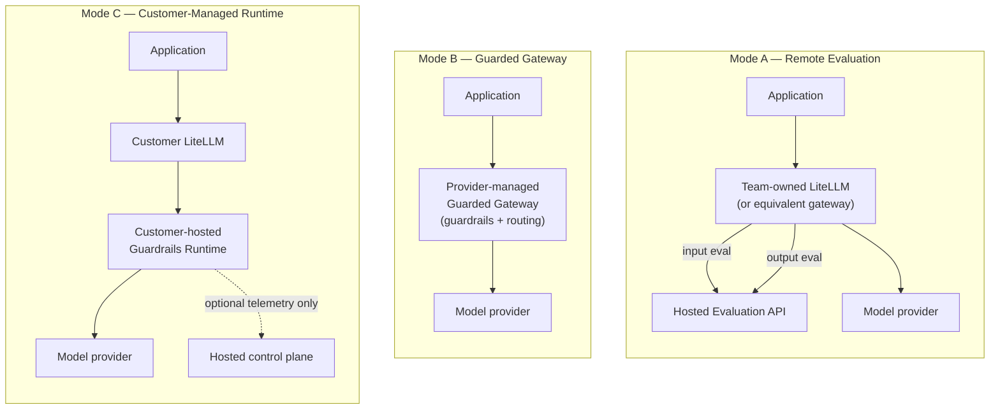

**AI Guardrails — Product Overview**

**Authority level:** L4
**Status:** Draft
**Date:** 2026-07-24
**Derived from:** seed.md + AGREEMENTS.md

---

## About this document

This is the start-here document for product managers, sales teams, solution engineers, and any reader who needs a working understanding of what AI Guardrails is before going deeper into architecture, sales, or delivery material. It is a derived view: it must not contradict [`AGREEMENTS.md`](../00-source-of-truth/AGREEMENTS.md) or [`CONSTRAINTS.md`](../00-source-of-truth/CONSTRAINTS.md), both of which are L1-authoritative. Where this document is silent on a detail, those registers govern.

For the full narrative charter this overview is drawn from, see `10-charter/CHARTER.md`. For a capability-by-capability breakdown, see `20-product/CAPABILITIES.md`. For scenario-level walkthroughs, see `20-product/USE-CASES.md`.

---

## 1. What AI Guardrails is

AI Guardrails is a **model-independent, deployment-flexible policy, evaluation, and enforcement layer** for applications and gateways that consume large language models or run agentic workflows.

It lets an organization define a guardrail policy once — what must be checked, and what should happen when a check fails — and apply that same policy consistently across multiple teams, applications, gateways, and model providers, regardless of how each team chooses to operate its own inference path.

AI Guardrails is built as a **standalone platform**, not as functionality embedded inside any single team's existing LiteLLM deployment. LiteLLM is the first supported gateway connector, and Amazon Bedrock Guardrails is the first supported evaluation engine — but neither defines the boundary of the product. The policy model, the evaluation contract, and the decision structures are designed to be portable across gateways, model providers, and deployment locations.

Three things stay constant no matter how a team chooses to adopt the platform:

* **A common policy model** — the same policy format and versioning semantics everywhere.
* **A common evaluation contract** — the same request structures, decision structures, reason codes, and enforcement actions everywhere.
* **A common runtime behavior** — the same observe/enforce progression and failure-handling discipline everywhere.

---

## 2. Product statement

> AI Guardrails is an AWS-based policy and enforcement platform that applies reusable safeguards to LLM applications and gateways. Teams may connect their existing LiteLLM instance to a hosted Evaluation API, consume a fully managed Guarded Gateway, or deploy the same guardrail runtime within their own AWS account. Policies remain portable across all three modes, while operational ownership and content exposure are explicitly defined for each deployment.

*(seed.md §23 — Product statement, quoted verbatim)*

---

## 3. Why it exists

Individual teams building LLM-powered applications tend to solve safety and compliance checks independently, per gateway, per framework, per model provider. That produces inconsistent coverage and makes organization-wide policy changes difficult to roll out or audit.

AI Guardrails exists so an organization can:

* Define guardrail policies once.
* Apply the same policies to multiple workloads.
* Support different LLM gateways and providers.
* Evaluate prompts and responses consistently.
* Operate guardrails as a hosted or self-managed capability.
* Measure effectiveness before policies become blocking.
* Evolve from cooperative integration to mandatory enforcement.
* Avoid coupling policy definitions to LiteLLM or Amazon Bedrock.

*(seed.md §2 — Product vision)*

---

## 4. The three operating models

AI Guardrails supports exactly **three primary deployment modes** at general availability ([`AGREEMENTS.md` AGR-002](../00-source-of-truth/AGREEMENTS.md#agr-002--three-deployment-modes)). A team selects the mode that matches how much operational ownership it wants to keep and how much data exposure it can accept — the two are independent decisions, never one implying the other ([`CONSTRAINTS.md` CON-007](../00-source-of-truth/CONSTRAINTS.md#con-007--explicit-content-exposure-documentation-per-deployment)).



| | Mode A — Remote Evaluation | Mode B — Guarded Gateway | Mode C — Customer-Managed Runtime |
|---|---|---|---|
| **Who runs the gateway** | The consuming team (LiteLLM or equivalent) | AI Guardrails provider | The consuming team |
| **Who runs the guardrail runtime** | AI Guardrails provider (hosted) | AI Guardrails provider (hosted) | The consuming team, inside its own AWS account |
| **Best fit for** | Teams that already operate a gateway and want to add guardrails with minimal new infrastructure | Teams without a gateway that want a fully managed, OpenAI-compatible inference + guardrail path | Regulated, data-residency-sensitive, high-volume, or air-gapped workloads that must keep prompt/response content inside their own account |
| **Content exposure** | Prompts, responses, and evaluated content reach the hosted Evaluation API. **This is not a private-data or data-local model.** | Prompts, responses, and model traffic all pass through the provider-operated gateway. | Raw content stays inside the customer's account by default; only customer-selected telemetry (or none) reaches the hosted control plane. |
| **Can run without the hosted control plane** | No — evaluation is a synchronous hosted call | No — the gateway and guardrails are hosted together | Yes — the runtime executes policies from a local cache without a synchronous control-plane dependency |

> **Important:** Mode A must always be described as *"bring your own gateway while consuming a hosted guardrail runtime,"* never as a private-data or data-local deployment model. Prompts, responses, and any other evaluated content are transmitted to the hosted Evaluation API regardless of who operates the gateway. Teams with data-residency requirements should be routed to Mode C. ([`AGREEMENTS.md` AGR-009](../00-source-of-truth/AGREEMENTS.md#agr-009--remote-evaluation-is-not-a-private-data-or-data-local-model))

For full ownership breakdowns (who owns availability, credentials, routing, retries, upgrades, etc. in each mode) see `50-architecture/DEPLOYMENT-ARCHITECTURE.md`.

---

## 5. Capabilities snapshot

The initial product scope is deliberately bounded so the platform can prove one core hypothesis first: that a single reusable policy can be applied consistently across independent gateways. The table below reflects what is **in scope today**.

| Area | Capability |
|---|---|
| Policy management | Versioned guardrail policies |
| Policy management | Workload registration |
| Policy management | Policy-to-workload bindings |
| Evaluation | Input evaluation |
| Evaluation | Output evaluation |
| Evaluation | Amazon Bedrock Guardrails integration |
| Evaluation | Deterministic organization rules |
| Evaluation | Basic sensitive-data handling |
| Decisions | Normalized evaluation decisions |
| Decisions | Observe and enforce modes |
| Integration | LiteLLM integration |
| Integration | Generic HTTP Evaluation API |
| Operations | Evaluation latency metrics |
| Operations | Decision metadata auditing |
| Deployment | Hosted runtime deployment |
| Deployment | A path to customer-managed deployment |

*(seed.md §6.1 — In scope)*

### Designed to extend, not yet required

The architecture is designed to permit — but the MVP does not require — capabilities such as retrieval-content evaluation, indirect prompt-injection detection, streaming output evaluation, tool-call validation, MCP authorization, memory-write validation, groundedness evaluation, multilingual policy packs, human approval workflows, and dedicated hosted or air-gapped runtimes. These are candidate future-scope items, not commitments. See `20-product/PRODUCT-ROADMAP.md` for phasing.

*(seed.md §6.2 — Future scope)*

### Explicitly out of scope for the MVP

AI Guardrails is not, and does not attempt in its MVP to be: a general-purpose LLM gateway replacement, a complete AI governance platform, a model training or fine-tuning system, a proprietary prompt-injection or moderation model, a complete DLP platform, an end-user authentication system, an application business-authorization system, a fully autonomous agent-governance system, organization-wide AWS enforcement, a cross-cloud deployment, a multi-region active-active service, a fully certified compliance product, or a general MCP security platform.

*(seed.md §6.3 — Out of scope for the MVP)*

---

## 6. Core vocabulary, briefly

The platform's domain model is shared across every mode and every connector so that policies, decisions, and audit records mean the same thing everywhere ([`AGREEMENTS.md` AGR-017](../00-source-of-truth/AGREEMENTS.md#agr-017--core-domain-model)).

| Concept | What it represents |
|---|---|
| **Tenant** | An organization, business unit, or consuming team |
| **Workload** | An application, assistant, agent, gateway, or inference service using guardrails |
| **Policy** | The checks and enforcement actions applied to evaluated content, at a specific version |
| **Policy binding** | The association between a workload and a policy version, including observe/enforce mode |
| **Evaluation** | A request to inspect content at a stage (`input` or `output` today) |
| **Decision** | The normalized result of an evaluation — `allow`, `block`, `redact`, or `log_only` today |

A full glossary lives in `70-governance/GLOSSARY.md`.

---

## 7. Who it is for

| Audience | What they need from AI Guardrails |
|---|---|
| **Platform teams** | Central guardrail policy definitions, reusable connectors, deployment consistency, audit visibility, controlled policy rollouts, low operational overhead |
| **Application teams** | A simple onboarding process, minimal application changes, predictable latency, clear failure behavior, understandable violation reasons, a way to test policies before blocking users |
| **Security and compliance teams** | Policy ownership, decision evidence, policy-version traceability, content-retention controls, exception tracking, evidence that policies are actually being applied |
| **Product operators** | Tenant and workload registration, service-health visibility, usage metrics, runtime capacity management, policy rollout controls, deployment compatibility tracking |

*(seed.md §7 — Initial users and stakeholders)*

---

## 8. From onboarding to enforcement

Adopting AI Guardrails for a workload — referred to in product materials as **importing** a policy — never means handing the guardrail provider control of a team's gateway. "Import" means adopting a versioned policy, a workload identity, an integration manifest, a connector configuration, and an enforcement mode. It never requires copying a team's LiteLLM database, transferring model-provider credentials, exposing gateway administration endpoints, or granting administrative access to the team's gateway. ([`AGREEMENTS.md` AGR-021](../00-source-of-truth/AGREEMENTS.md#agr-021--meaning-of-import))

```text
Register workload
    │
    ▼
Select policy
    │
    ▼
Generate integration manifest
    │
    ▼
Install connector
    │
    ▼
Run in observe mode
    │
    ▼
Review evaluation results
    │
    ▼
Enable enforcement
```

Every policy supports a graduated, non-blocking rollout so a team can measure false positives, latency, and business impact before anything can block production traffic:

```text
Disabled → Observe → Warn → Redact → Block
```

*(seed.md §5.6; [`AGREEMENTS.md` AGR-011](../00-source-of-truth/AGREEMENTS.md#agr-011--observe-before-enforce-progression))*

---

## 9. What AI Guardrails is not

Enterprise readers should carry these boundaries forward into any sales or executive conversation:

* **Not an authorization system.** A guardrail decision that content or a tool call appears safe is not a decision that the current user is permitted to take that action against a given resource. Authentication, business authorization, tenant isolation, resource ownership, transaction limits, and approval workflows remain the consuming application's responsibility. ([`AGREEMENTS.md` AGR-010](../00-source-of-truth/AGREEMENTS.md#agr-010--guardrails-are-not-authorization))
* **Not a guaranteed bypass-proof boundary in every mode.** A cooperatively installed connector can be disabled, removed, or misconfigured, and must never be represented as a hard security boundary. Bypass resistance increases as a workload moves from cooperative integration, to platform-managed enforcement, to a network/IAM-enforced gateway. ([`AGREEMENTS.md` AGR-018](../00-source-of-truth/AGREEMENTS.md#agr-018--trust-and-enforcement-model))
* **Not a private-data model in Remote Evaluation.** Mode A transmits tenant content to the hosted Evaluation API; it reduces operational ownership of the inference path, not data exposure. ([`AGREEMENTS.md` AGR-009](../00-source-of-truth/AGREEMENTS.md#agr-009--remote-evaluation-is-not-a-private-data-or-data-local-model))
* **Not a complete AI governance platform, DLP platform, or compliance certification.** See §5 above for the full out-of-scope list for the MVP.

For the canonical list of claims that are and are not safe to make externally, see `70-governance/CLAIMS-REGISTER.md`.

---

## 10. Where this fits in delivery

AI Guardrails is delivered in five phases, moving from a narrow integration proof toward the full three-mode platform. This overview describes the target product; current delivery status and phase gating live in `20-product/PRODUCT-ROADMAP.md` and `60-delivery/MILESTONES.md`.

| Phase | Objective |
|---|---|
| 1 — Integration proof | Prove that guardrail policy and evaluation can be separated from LiteLLM and reused across multiple gateways |
| 2 — Internal multi-team platform | Allow multiple internal teams to onboard and operate distinct workloads |
| 3 — Guarded gateway | Offer a fully hosted model and guardrail path for teams without their own gateway |
| 4 — Customer-managed runtime | Support workloads that require local evaluation and content isolation |
| 5 — Advanced agent protection | Extend guardrail coverage beyond prompt and response evaluation (a separate product expansion, not an MVP prerequisite) |

*(seed.md §18; [`AGREEMENTS.md` AGR-022](../00-source-of-truth/AGREEMENTS.md#agr-022--five-phase-delivery))*

---

## Related documents

- [`00-source-of-truth/AGREEMENTS.md`](../00-source-of-truth/AGREEMENTS.md) — authoritative agreement register (L1)
- [`00-source-of-truth/CONSTRAINTS.md`](../00-source-of-truth/CONSTRAINTS.md) — authoritative constraint register (L1)
- `10-charter/CHARTER.md` — full product charter narrative
- `20-product/CAPABILITIES.md` — detailed capability-by-capability breakdown
- `20-product/USE-CASES.md` — scenario-level walkthroughs
- `20-product/PRODUCT-ROADMAP.md` — phase-by-phase delivery plan
- `20-product/FAQ.md` — frequently asked questions, including the meaning of "import"
- `50-architecture/DEPLOYMENT-ARCHITECTURE.md` — full ownership and topology detail per mode
- `50-architecture/SECURITY-ARCHITECTURE.md` — security posture and enforcement model detail
- `70-governance/GLOSSARY.md` — full domain vocabulary
- `70-governance/CLAIMS-REGISTER.md` — approved and rejected external claims
