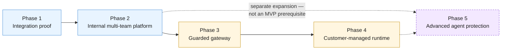

**AI Guardrails — Product Roadmap**

**Authority level:** L4
**Status:** Draft
**Date:** 2026-07-24
**Derived from:** seed.md + AGREEMENTS.md

---

## Purpose and authority

This document presents the AI Guardrails delivery roadmap as five sequential phases, each with an objective and headline deliverables. It is a **derived, product-facing view (L4)** of the phased delivery structure agreed at [`AGREEMENTS.md` AGR-022 — Five-phase delivery](../00-source-of-truth/AGREEMENTS.md#agr-022--five-phase-delivery) and recorded in [`DECISIONS.md` DEC-006](../00-source-of-truth/DECISIONS.md#dec-006--sequence-delivery-into-five-phases) and [DEC-007](../00-source-of-truth/DECISIONS.md#dec-007--defer-advanced-isolation-distribution-security-agent-authorization-and-org-wide-enforcement). It does not introduce new scope, and it must not be read as contradicting [`AGREEMENTS.md`](../00-source-of-truth/AGREEMENTS.md) or [`CONSTRAINTS.md`](../00-source-of-truth/CONSTRAINTS.md); where a conflict is ever found, those L1 documents win and this roadmap must be corrected.

This roadmap is **directional only**. No phase carries a committed date, quarter, or duration. Every timing reference in this document is **TBD / sequencing only** — the ordering of phases is fixed by agreement, but *when* each phase starts or ends is not yet decided and must not be inferred from this document.

---

## How to read this roadmap

* **Sequencing, not scheduling.** The five phases are ordered by dependency and risk, not by calendar. Each phase's deliverables must be completed and validated before the next phase's scope is committed (AGR-022).
* **MVP boundary.** The MVP (defined in seed.md §16 and [`AGREEMENTS.md` AGR-019](../00-source-of-truth/AGREEMENTS.md#agr-019--mvp-scope-boundaries) / [AGR-020](../00-source-of-truth/AGREEMENTS.md#agr-020--mvp-success-demonstration)) is proven out across **Phase 1** and the early part of **Phase 2** — Phase 1 delivers the core integration proof, and the MVP success demonstration additionally requires policy promotion and rollback, which is a Phase 2 deliverable. Phases 3 and 4 extend materially beyond the MVP boundary. Phase 5 is explicitly **not** an MVP prerequisite at all.
* **Phase 5 is a separate product expansion.** Per AGR-022 and seed.md §18, Phase 5 (Advanced agent protection) must not be scheduled or resourced as part of MVP delivery, and its deliverables are listed as *potential* rather than committed.
* **No invented figures.** Where seed.md and AGREEMENTS.md do not specify a metric, date, or headcount, this document says so explicitly rather than inventing one.

---

## Phase sequence at a glance

| Phase | Objective (one line) | Relative to MVP | Primary deployment mode(s) touched |
| --- | --- | --- | --- |
| [Phase 1 — Integration proof](#phase-1--integration-proof) | Prove guardrail policy and evaluation can be separated from LiteLLM and reused across gateways. | Core MVP delivery | Mode A (Remote Evaluation) |
| [Phase 2 — Internal multi-team platform](#phase-2--internal-multi-team-platform) | Let multiple internal teams onboard and operate distinct workloads. | Completes MVP demonstration (policy promotion/rollback) | Mode A |
| [Phase 3 — Guarded gateway](#phase-3--guarded-gateway) | Offer a fully hosted model and guardrail path for teams without their own gateway. | Beyond MVP | Mode B (Guarded Gateway) |
| [Phase 4 — Customer-managed runtime](#phase-4--customer-managed-runtime) | Support workloads that require local evaluation and content isolation. | Beyond MVP | Mode C (Customer-Managed Runtime) |
| [Phase 5 — Advanced agent protection](#phase-5--advanced-agent-protection) | Extend guardrail coverage beyond prompt and response evaluation. | **Separate product expansion — not an MVP prerequisite** | All modes (extension) |

*Deployment modes A/B/C are defined in seed.md §3 and [`AGREEMENTS.md` AGR-002](../00-source-of-truth/AGREEMENTS.md#agr-002--three-deployment-modes).*

---

## Phase 1 — Integration proof

**Objective** (seed.md §18):

> Prove that guardrail policy and evaluation can be separated from LiteLLM and reused across multiple gateways.

**Headline deliverables:**

* Evaluation contract (the shared request/decision structure referenced across all deployment modes — see [`AGREEMENTS.md` AGR-006](../00-source-of-truth/AGREEMENTS.md#agr-006--one-logical-evaluation-contract-across-all-modes)).
* Policy format (versioned policy definition, independent of any single gateway or vendor — see [`AGREEMENTS.md` AGR-005](../00-source-of-truth/AGREEMENTS.md#agr-005--policy-portability)).
* Amazon Bedrock Guardrails adapter (first evaluation engine, normalized behind the platform's own decision structure — [`AGREEMENTS.md` AGR-004](../00-source-of-truth/AGREEMENTS.md#agr-004--bedrock-guardrails-as-first-engine-vendor-independent-contract)).
* LiteLLM connector (pre-call and post-call invocation of the Evaluation API — [`AGREEMENTS.md` AGR-003](../00-source-of-truth/AGREEMENTS.md#agr-003--litellm-as-first-connector-not-the-product-boundary)).
* Observe mode (non-blocking evaluation — [`AGREEMENTS.md` AGR-011](../00-source-of-truth/AGREEMENTS.md#agr-011--observe-before-enforce-progression)).
* Basic auditing (decision metadata logging).
* Internal deployment (hosted, within the minimal MVP account model — [`CONSTRAINTS.md` CON-002](../00-source-of-truth/CONSTRAINTS.md#con-002--minimal-mvp-account-model)).

**Notes:** Phase 1 is where the core policy-reuse hypothesis is tested — the same policy evaluated consistently regardless of which LiteLLM instance calls it. It operates exclusively in Mode A (Remote Evaluation) and does not require tenant/workload registries, IAM authentication of external consumers, or policy promotion workflows; those arrive in Phase 2.

---

## Phase 2 — Internal multi-team platform

**Objective** (seed.md §18):

> Allow multiple internal teams to onboard and operate distinct workloads.

**Headline deliverables:**

* Tenant and workload registry (the [core domain model](../00-source-of-truth/AGREEMENTS.md#agr-017--core-domain-model) entities Tenant and Workload made concrete).
* Policy bindings (associating a workload with a policy version, per the Policy Binding domain entity).
* IAM authentication (per [`CONSTRAINTS.md` CON-010](../00-source-of-truth/CONSTRAINTS.md#con-010--iam-based-authentication-and-least-privilege-roles) and CON-011).
* Quotas.
* Policy promotion and rollback (immutable policy versions, controlled promotion, immediate rollback — required to satisfy the MVP success demonstration in [`AGREEMENTS.md` AGR-020](../00-source-of-truth/AGREEMENTS.md#agr-020--mvp-success-demonstration)).
* Service-level monitoring.
* Basic administration workflow.

**Notes:** Phase 2 is where the platform moves from a single proven integration to a genuinely multi-tenant, multi-workload system. It is also the phase that closes out the remaining MVP success criteria — specifically, "a policy can be upgraded and rolled back" — so the MVP is not considered fully demonstrated until Phase 2's policy promotion/rollback capability exists alongside Phase 1's integration proof.

---

## Phase 3 — Guarded gateway

**Objective** (seed.md §18):

> Offer a fully hosted model and guardrail path for teams without their own gateway.

**Headline deliverables:**

* Managed LiteLLM gateway (the provider now operates the gateway itself, per Mode B — [`AGREEMENTS.md` AGR-002](../00-source-of-truth/AGREEMENTS.md#agr-002--three-deployment-modes)).
* Model-provider configuration.
* Per-tenant routing.
* Cost and rate controls.
* Managed credentials (the provider, not the consuming team, holds provider credentials in this mode).
* Unified inference and guardrail availability objectives (a single availability posture spanning both model routing and guardrail evaluation).

**Notes:** Phase 3 introduces Mode B (Guarded Gateway), which creates the largest operational, security, and compliance scope for the provider, since the provider now participates in the complete inference path (seed.md §3, Mode B). This phase is explicitly beyond the MVP boundary — the MVP proves the policy-reuse hypothesis under Mode A only.

---

## Phase 4 — Customer-managed runtime

**Objective** (seed.md §18):

> Support workloads that require local evaluation and content isolation.

**Headline deliverables:**

* Runtime container.
* Helm chart.
* ECS deployment template.
* Infrastructure module.
* Local policy cache (enabling execution without a synchronous control-plane connection — [`AGREEMENTS.md` AGR-015](../00-source-of-truth/AGREEMENTS.md#agr-015--customer-managed-runtime-executes-without-a-synchronous-control-plane-connection)).
* Policy synchronization (asynchronous, non-blocking to the evaluation path).
* Customer-controlled telemetry (including a fully supported "no telemetry" configuration — [`AGREEMENTS.md` AGR-016](../00-source-of-truth/AGREEMENTS.md#agr-016--customer-controlled-telemetry-for-the-customer-managed-runtime)).
* Upgrade compatibility checks.

**Notes:** Phase 4 introduces Mode C (Customer-Managed Runtime) for regulated workloads, data-residency requirements, high-volume workloads, air-gapped environments, and teams that prohibit prompt or response content from leaving their account (seed.md §3, Mode C). Raw content must never leave a customer-managed runtime unless explicitly configured ([`CONSTRAINTS.md` CON-013](../00-source-of-truth/CONSTRAINTS.md#con-013--raw-content-must-not-leave-a-customer-managed-runtime-unless-explicitly-configured)). This phase is beyond the MVP boundary, though the MVP demonstration requires that the runtime built in Phases 1–2 *can later be packaged* for customer-managed deployment without changing the connector contract — Phase 4 is where that packaging is actually delivered.

---

## Phase 5 — Advanced agent protection

**Objective** (seed.md §18):

> Extend guardrail coverage beyond prompt and response evaluation.

**Potential deliverables** (seed.md §18 — listed as *potential*, not committed):

* Retrieval-content evaluation.
* Tool-call validation.
* Tool-result evaluation.
* Memory-write controls.
* Human approvals.
* Agent delegation restrictions.
* MCP integration.
* Advanced authorization integration.

> **This phase must be treated as a separate product expansion, not as an MVP prerequisite.** (seed.md §18; [`AGREEMENTS.md` AGR-022](../00-source-of-truth/AGREEMENTS.md#agr-022--five-phase-delivery))

**Notes:**

* Every Phase 5 deliverable corresponds to a **future-scope** item explicitly called out in seed.md §6.2 (retrieval-content evaluation, indirect prompt-injection detection, tool-call validation, MCP authorization, memory-write validation, human approval workflows) — the architecture should permit these but the MVP does not build them.
* Tool and agent authorization is explicitly excluded from the guardrail MVP by [`AGREEMENTS.md` AGR-010](../00-source-of-truth/AGREEMENTS.md#agr-010--guardrails-are-not-authorization); a guardrail decision that content or a tool call "appears safe" is never a business-authorization decision, and this remains true even after Phase 5 ships.
* A general-purpose MCP security platform and fully autonomous agent governance remain explicitly **out of scope for the MVP** (seed.md §6.3) and are not implied to be fully delivered by Phase 5 — Phase 5 extends coverage, it does not claim completeness.
* Phase 5 must not be scheduled or resourced as part of MVP delivery ([`DECISIONS.md` DEC-007](../00-source-of-truth/DECISIONS.md#dec-007--defer-advanced-isolation-distribution-security-agent-authorization-and-org-wide-enforcement)). It is shown here for directional completeness of the five-phase structure, not as a committed near-term investment.

---

## What this roadmap deliberately does not say

Per source-of-truth policy, this document does not state:

* Calendar dates, quarters, or durations for any phase — all timing is **TBD / sequencing only**.
* Headcount, budget, or dollar figures for any phase.
* A committed Phase 5 delivery date or resourcing decision — Phase 5 is directional and separately approved (seed.md §20, "Product over-expansion"; [`DECISIONS.md` DEC-007](../00-source-of-truth/DECISIONS.md#dec-007--defer-advanced-isolation-distribution-security-agent-authorization-and-org-wide-enforcement)).
* SLA numbers or performance targets — these are tracked qualitatively in seed.md §15 (Operational requirements) and are not yet populated with figures anywhere in the source-of-truth set.

---

## Related documents

- [`00-source-of-truth/AGREEMENTS.md`](../00-source-of-truth/AGREEMENTS.md) — AGR-019 (MVP scope boundaries), AGR-020 (MVP success demonstration), AGR-021 (meaning of "import"), AGR-022 (five-phase delivery), the authoritative agreements this roadmap derives from.
- [`00-source-of-truth/CONSTRAINTS.md`](../00-source-of-truth/CONSTRAINTS.md) — non-negotiable boundaries (account model, contract independence, content exposure) that every phase's deliverables must respect.
- [`00-source-of-truth/DECISIONS.md`](../00-source-of-truth/DECISIONS.md) — DEC-005 (MVP bound), DEC-006 (five-phase sequencing), DEC-007 (deferral of advanced capabilities).
- [`CAPABILITIES.md`](CAPABILITIES.md) — capability-level detail for what each deployment mode offers (companion product document).
- [`PRODUCT-OVERVIEW.md`](PRODUCT-OVERVIEW.md) — product narrative this roadmap supports.
- [`USE-CASES.md`](USE-CASES.md) — worked onboarding/import scenarios referenced by AGR-021.
- [`../10-charter/SCOPE.md`](../10-charter/SCOPE.md) — in-scope, future-scope, and MVP non-goals that bound every phase above.
- [`../60-delivery/MILESTONES.md`](../60-delivery/MILESTONES.md) — delivery-facing milestone tracking for these same five phases.
- [`../60-delivery/IMPLEMENTATION-STRATEGY.md`](../60-delivery/IMPLEMENTATION-STRATEGY.md) — implementation approach per phase.
- [`../30-executive/EXPECTED-OUTCOMES.md`](../30-executive/EXPECTED-OUTCOMES.md) — executive-facing framing of the phased outcomes.
