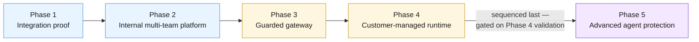

**AI Guardrails — Product Roadmap**

**Authority level:** L4
**Status:** Draft
**Date:** 2026-07-24
**Derived from:** seed.md + AGREEMENTS.md

---

## Purpose and authority

This document presents the AI Guardrails delivery roadmap as five sequential phases, each with an objective and headline deliverables. It is a **derived, product-facing view (L4)** of the phased delivery structure agreed at [`AGREEMENTS.md` AGR-020 — Five-phase delivery](../00-source-of-truth/AGREEMENTS.md#agr-020--five-phase-delivery) and recorded in [`DECISIONS.md` DEC-006](../00-source-of-truth/DECISIONS.md#dec-006--sequence-delivery-into-five-phases), [DEC-007](../00-source-of-truth/DECISIONS.md#dec-007--defer-advanced-isolation-distribution-security-agent-authorization-and-org-wide-enforcement), and [DEC-008](../00-source-of-truth/DECISIONS.md#dec-008--supersede-the-mvp-bounded-scope-define-and-estimate-the-full-feature-set-across-five-phases), which defines and estimates the solution over the full feature set presented across these phases. It does not introduce new scope, and it must not be read as contradicting [`AGREEMENTS.md`](../00-source-of-truth/AGREEMENTS.md) or [`CONSTRAINTS.md`](../00-source-of-truth/CONSTRAINTS.md); where a conflict is ever found, those L1 documents win and this roadmap must be corrected.

This roadmap is **directional only**. No phase carries a committed date, quarter, or duration. Every timing reference in this document is **TBD / sequencing only** — the ordering of phases is fixed by agreement, but *when* each phase starts or ends is not yet decided and must not be inferred from this document.

---

## How to read this roadmap

* **Sequencing, not scheduling.** The five phases are ordered by dependency and risk, not by calendar. Each phase's deliverables must be completed and validated before the next phase's scope proceeds (AGR-020) — every phase boundary is a validation gate.
* **Committed-and-estimated full scope.** Per [`DECISIONS.md` DEC-008](../00-source-of-truth/DECISIONS.md#dec-008--supersede-the-mvp-bounded-scope-define-and-estimate-the-full-feature-set-across-five-phases), this roadmap presents the full feature set — the Phase 1–2 core platform plus the later-phase capabilities — as committed and estimated scope. **Phases 1–2** deliver the core platform (seed.md §6.1, §16): Phase 1 delivers the core integration proof, and the Phase 1–2 validation demonstration ([`60-delivery/VALIDATION-PLAN.md`](../60-delivery/VALIDATION-PLAN.md)) additionally requires policy promotion and rollback, which is a Phase 2 deliverable. Phases 3 and 4 extend the platform to the Guarded Gateway and Customer-Managed Runtime modes.
* **Phase 5 is sequenced last.** Phase 5 (Advanced agent protection) is part of the committed-and-estimated full solution (DEC-008), and it remains a separate product expansion in delivery terms per AGR-020 and seed.md §18: its scope proceeds only after the preceding phases' deliverables are validated, it is not scheduled or resourced within the earlier phases, and none of its capabilities are available today.
* **No invented figures.** Where seed.md and AGREEMENTS.md do not specify a metric, date, or headcount, this document says so explicitly rather than inventing one.

---

## Phase sequence at a glance

| Phase | Objective (one line) | Scope status | Primary deployment mode(s) touched |
| --- | --- | --- | --- |
| [Phase 1 — Integration proof](#phase-1--integration-proof) | Prove guardrail policy and evaluation can be separated from LiteLLM and reused across gateways. | Core platform (Phases 1–2) | Mode A (Remote Evaluation) |
| [Phase 2 — Internal multi-team platform](#phase-2--internal-multi-team-platform) | Let multiple internal teams onboard and operate distinct workloads. | Core platform — completes the Phase 1–2 validation demonstration (policy promotion/rollback) | Mode A |
| [Phase 3 — Guarded gateway](#phase-3--guarded-gateway) | Offer a fully hosted model and guardrail path for teams without their own gateway. | Committed later phase | Mode B (Guarded Gateway) |
| [Phase 4 — Customer-managed runtime](#phase-4--customer-managed-runtime) | Support workloads that require local evaluation and content isolation. | Committed later phase | Mode C (Customer-Managed Runtime) |
| [Phase 5 — Advanced agent protection](#phase-5--advanced-agent-protection) | Extend guardrail coverage beyond prompt and response evaluation. | **Committed final phase — sequenced last, not available today** | All modes (extension) |

*Deployment modes A/B/C are defined in seed.md §3 and [`AGREEMENTS.md` AGR-002](../00-source-of-truth/AGREEMENTS.md#agr-002--three-deployment-modes).*

---

## Phase 1 — Integration proof

**Objective** (seed.md §18):

> Prove that guardrail policy and evaluation can be separated from LiteLLM and reused across multiple gateways.

**Headline deliverables:**

* Evaluation contract (the shared request/decision structure referenced across all deployment modes — see [`AGREEMENTS.md` AGR-006](../00-source-of-truth/AGREEMENTS.md#agr-006--one-logical-evaluation-contract-across-all-modes)).
* Policy format (versioned policy definition, independent of any single gateway or vendor — see [`AGREEMENTS.md` AGR-005](../00-source-of-truth/AGREEMENTS.md#agr-005--policy-portability)).
* Amazon Bedrock Guardrails adapter (first evaluation engine, normalized behind the platform's own decision structure — [`AGREEMENTS.md` AGR-004](../00-source-of-truth/AGREEMENTS.md#agr-004--bedrock-guardrails-as-first-engine-vendor-independent-contract)).
* LiteLLM connector (pre-call and post-call invocation of the Evaluation API — [`AGREEMENTS.md` AGR-003](../00-source-of-truth/AGREEMENTS.md#agr-003--litellm-as-first-connector-not-the-product-boundary)).
* Observe mode (non-blocking evaluation — [`AGREEMENTS.md` AGR-011](../00-source-of-truth/AGREEMENTS.md#agr-011--observe-before-enforce-progression)).
* Basic auditing (decision metadata logging).
* Internal deployment (hosted, within the minimal MVP account model — [`CONSTRAINTS.md` CON-002](../00-source-of-truth/CONSTRAINTS.md#con-002--minimal-mvp-account-model)).

**Notes:** Phase 1 is where the core policy-reuse hypothesis is tested — the same policy evaluated consistently regardless of which LiteLLM instance calls it. It operates exclusively in Mode A (Remote Evaluation) and does not require tenant/workload registries, IAM authentication of external consumers, or policy promotion workflows; those arrive in Phase 2.

---

## Phase 2 — Internal multi-team platform

**Objective** (seed.md §18):

> Allow multiple internal teams to onboard and operate distinct workloads.

**Headline deliverables:**

* Tenant and workload registry (the [core domain model](../00-source-of-truth/AGREEMENTS.md#agr-017--core-domain-model) entities Tenant and Workload made concrete).
* Policy bindings (associating a workload with a policy version, per the Policy Binding domain entity).
* IAM authentication (per [`CONSTRAINTS.md` CON-010](../00-source-of-truth/CONSTRAINTS.md#con-010--iam-based-authentication-and-least-privilege-roles) and CON-011).
* Quotas.
* Policy promotion and rollback (immutable policy versions, controlled promotion, immediate rollback — required to complete the Phase 1–2 validation demonstration in seed.md §16 and [`60-delivery/VALIDATION-PLAN.md`](../60-delivery/VALIDATION-PLAN.md)).
* Service-level monitoring.
* Basic administration workflow.

**Notes:** Phase 2 is where the platform moves from a single proven integration to a genuinely multi-tenant, multi-workload system. It is also the phase that closes out the remaining Phase 1–2 validation criteria — specifically, "a policy can be upgraded and rolled back" (seed.md §16) — so the Phase 1–2 validation demonstration is not complete until Phase 2's policy promotion/rollback capability exists alongside Phase 1's integration proof.

---

## Phase 3 — Guarded gateway

**Objective** (seed.md §18):

> Offer a fully hosted model and guardrail path for teams without their own gateway.

**Headline deliverables:**

* Managed LiteLLM gateway (the provider now operates the gateway itself, per Mode B — [`AGREEMENTS.md` AGR-002](../00-source-of-truth/AGREEMENTS.md#agr-002--three-deployment-modes)).
* Model-provider configuration.
* Per-tenant routing.
* Cost and rate controls.
* Managed credentials (the provider, not the consuming team, holds provider credentials in this mode).
* Unified inference and guardrail availability objectives (a single availability posture spanning both model routing and guardrail evaluation).

**Notes:** Phase 3 introduces Mode B (Guarded Gateway), which creates the largest operational, security, and compliance scope for the provider, since the provider now participates in the complete inference path (seed.md §3, Mode B). Phases 1–2 prove the policy-reuse hypothesis under Mode A only; Phase 3 extends the committed solution to Mode B once those phases are validated.

---

## Phase 4 — Customer-managed runtime

**Objective** (seed.md §18):

> Support workloads that require local evaluation and content isolation.

**Headline deliverables:**

* Runtime container.
* Helm chart.
* ECS deployment template.
* Infrastructure module.
* Local policy cache (enabling execution without a synchronous control-plane connection — [`AGREEMENTS.md` AGR-015](../00-source-of-truth/AGREEMENTS.md#agr-015--customer-managed-runtime-executes-without-a-synchronous-control-plane-connection)).
* Policy synchronization (asynchronous, non-blocking to the evaluation path).
* Customer-controlled telemetry (including a fully supported "no telemetry" configuration — [`AGREEMENTS.md` AGR-016](../00-source-of-truth/AGREEMENTS.md#agr-016--customer-controlled-telemetry-for-the-customer-managed-runtime)).
* Upgrade compatibility checks.

**Notes:** Phase 4 introduces Mode C (Customer-Managed Runtime) for regulated workloads, data-residency requirements, high-volume workloads, air-gapped environments, and teams that prohibit prompt or response content from leaving their account (seed.md §3, Mode C). Raw content must never leave a customer-managed runtime unless explicitly configured ([`CONSTRAINTS.md` CON-013](../00-source-of-truth/CONSTRAINTS.md#con-013--raw-content-must-not-leave-a-customer-managed-runtime-unless-explicitly-configured)). The Phase 1–2 core requires that the runtime built in Phases 1–2 *can later be packaged* for customer-managed deployment without changing the connector contract (seed.md §16) — Phase 4 is where that packaging is actually delivered.

---

## Phase 5 — Advanced agent protection

**Objective** (seed.md §18):

> Extend guardrail coverage beyond prompt and response evaluation.

**Headline deliverables** (seed.md §18; committed to the full solution and included in its estimation per [`DECISIONS.md` DEC-008](../00-source-of-truth/DECISIONS.md#dec-008--supersede-the-mvp-bounded-scope-define-and-estimate-the-full-feature-set-across-five-phases) — delivered only in this final phase):

* Retrieval-content evaluation.
* Tool-call validation.
* Tool-result evaluation.
* Memory-write controls.
* Human approvals.
* Agent delegation restrictions.
* MCP integration.
* Advanced authorization integration.

> **This phase is committed and estimated as part of the full solution, but it is sequenced last: it is a separate product expansion in delivery terms, its scope proceeds only after the preceding phases are validated, and none of its capabilities are available today.** (seed.md §18; [`AGREEMENTS.md` AGR-020](../00-source-of-truth/AGREEMENTS.md#agr-020--five-phase-delivery); [`DECISIONS.md` DEC-008](../00-source-of-truth/DECISIONS.md#dec-008--supersede-the-mvp-bounded-scope-define-and-estimate-the-full-feature-set-across-five-phases))

**Notes:**

* Every Phase 5 deliverable corresponds to a capability explicitly called out in seed.md §6.2 (retrieval-content evaluation, indirect prompt-injection detection, tool-call validation, MCP authorization, memory-write validation, human approval workflows). Per DEC-008 these are committed to Phase 5 and included in the full-solution estimation; the earlier phases design for them but do not build them, and they are not available today.
* Guardrail decisions are never authorization decisions ([`AGREEMENTS.md` AGR-010](../00-source-of-truth/AGREEMENTS.md#agr-010--guardrails-are-not-authorization)); a guardrail decision that content or a tool call "appears safe" is never a business-authorization decision, and this remains true even after Phase 5 ships.
* A general-purpose MCP security platform and fully autonomous agent governance remain explicitly **excluded from the full feature set** (seed.md §6.3; DEC-008) and are not implied to be delivered by Phase 5 — Phase 5 extends coverage, it does not claim completeness.
* Phase 5 must not be scheduled or resourced within the earlier phases ([`DECISIONS.md` DEC-007](../00-source-of-truth/DECISIONS.md#dec-007--defer-advanced-isolation-distribution-security-agent-authorization-and-org-wide-enforcement); AGR-020). It is committed and estimated as part of the full solution, with all timing TBD per this roadmap's no-dates rule.

---

## Guardrail-category coverage by phase

The guardrail-category catalog ([`GUARDRAIL-CATALOG.md`](GUARDRAIL-CATALOG.md), `GR-001`–`GR-018`) classifies guardrail controls; this view shows which categories each phase **activates or deepens**. It adds no scope: a category appearing in a phase row means the phase's already-listed deliverables serve that category. Categories whose dominant status is `Vision — uncommitted` or `Out-of-boundary` appear in **no** phase row — by design, per [DEC-009](../00-source-of-truth/DECISIONS.md#dec-009--adopt-the-guardrail-category-catalog-as-directional-vision).

| Phase | Categories activated or deepened |
| --- | --- |
| Phase 1 — Integration proof | GR-001, GR-002, GR-003, GR-007 (first evaluators); GR-014 (basic auditing) |
| Phase 2 — Internal multi-team platform | GR-015 (promotion/rollback), GR-014, GR-017 (service-level monitoring); deepens GR-001/002/003/007/018 via multi-team policy reuse |
| Phase 3 — Guarded gateway | Deepens enforcement posture (Mode B); gateway-side cost/rate controls relate to GR-012 and GR-008 without activating them as guardrail categories |
| Phase 4 — Customer-managed runtime | No new categories — extends existing coverage to Mode C (content isolation, customer-controlled telemetry: GR-003/GR-014 posture) |
| Phase 5 — Advanced agent protection | GR-005, GR-006, GR-009, GR-011, GR-013; deepens GR-001 (indirect injection) and GR-018 (evaluator plugins) |
| Never listed in a phase | GR-008, GR-012 (Vision — uncommitted; graduation per [`EXTENSIBILITY-ARCHITECTURE.md`](../50-architecture/EXTENSIBILITY-ARCHITECTURE.md) §10); GR-010, GR-016 (Out-of-boundary — externally owned, never deliverables) |

---

## What this roadmap deliberately does not say

Per source-of-truth policy, this document does not state:

* Calendar dates, quarters, or durations for any phase — all timing is **TBD / sequencing only**.
* Headcount, budget, or dollar figures for any phase.
* A committed delivery date or resourcing decision for any phase, including Phase 5 — Phase 5's scope is committed and estimated (DEC-008), but its start is gated on validation of the preceding phases and its timing remains TBD (seed.md §20, "Product over-expansion"; [`DECISIONS.md` DEC-007](../00-source-of-truth/DECISIONS.md#dec-007--defer-advanced-isolation-distribution-security-agent-authorization-and-org-wide-enforcement)).
* SLA numbers or performance targets — these are tracked qualitatively in seed.md §15 (Operational requirements) and are not yet populated with figures anywhere in the source-of-truth set.

---

## Related documents

- [`00-source-of-truth/AGREEMENTS.md`](../00-source-of-truth/AGREEMENTS.md) — AGR-019 (meaning of "import"), AGR-020 (five-phase delivery), the authoritative agreements this roadmap derives from.
- [`00-source-of-truth/CONSTRAINTS.md`](../00-source-of-truth/CONSTRAINTS.md) — non-negotiable boundaries (account model, contract independence, content exposure) that every phase's deliverables must respect.
- [`00-source-of-truth/DECISIONS.md`](../00-source-of-truth/DECISIONS.md) — DEC-006 (five-phase sequencing), DEC-007 (deferral of advanced capabilities), DEC-008 (full-feature-set definition and estimation).
- [`CAPABILITIES.md`](CAPABILITIES.md) — capability-level detail for what each deployment mode offers (companion product document).
- [`GUARDRAIL-CATALOG.md`](GUARDRAIL-CATALOG.md) — the guardrail-category taxonomy behind the coverage-by-phase view above (classification, not commitment — AGR-021, DEC-009).
- [`PRODUCT-OVERVIEW.md`](PRODUCT-OVERVIEW.md) — product narrative this roadmap supports.
- [`USE-CASES.md`](USE-CASES.md) — worked onboarding/import scenarios referenced by AGR-019.
- [`../10-charter/SCOPE.md`](../10-charter/SCOPE.md) — the in-scope, later-phase, and excluded items that bound every phase above.
- [`../60-delivery/MILESTONES.md`](../60-delivery/MILESTONES.md) — delivery-facing milestone tracking for these same five phases.
- [`../60-delivery/IMPLEMENTATION-STRATEGY.md`](../60-delivery/IMPLEMENTATION-STRATEGY.md) — implementation approach per phase.
- [`../30-executive/EXPECTED-OUTCOMES.md`](../30-executive/EXPECTED-OUTCOMES.md) — executive-facing framing of the phased outcomes.
