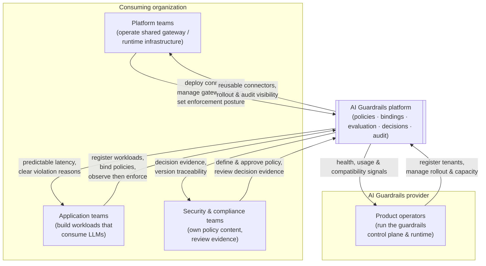

**AI Guardrails — Target Users and Stakeholders**

**Authority level:** L4
**Status:** Draft
**Date:** 2026-07-24
**Derived from:** AGREEMENTS.md

---

## Purpose of this document

This document describes the four stakeholder groups the AI Guardrails solution is built for, as defined in [original charter §7](../00-source-of-truth/PROVENANCE.md#3-section-by-section-map) ("Initial users and stakeholders"): **Platform teams**, **Application teams**, **Security and compliance teams**, and **Product operators**. For each group it records who they are, what they are trying to accomplish, what they need from the platform, and what the platform concretely gives them.

This is a **product-tier (L4)** view. It must not contradict any entry in [`AGREEMENTS.md`](../00-source-of-truth/AGREEMENTS.md) (L1) or [`CONSTRAINTS.md`](../00-source-of-truth/CONSTRAINTS.md) (L1). Where this document references a specific commitment — an enforcement posture, a retention default, an operating mode — it points back to the authoritative agreement or constraint rather than restating a number that does not appear in the source material. No adoption figures, SLAs, or dollar values are stated here; where the source material does not supply one, this document says so explicitly rather than inventing a placeholder.

**A note on terminology.** [original charter §7](../00-source-of-truth/PROVENANCE.md#3-section-by-section-map) (stakeholder *needs*) and [`TEAM-AND-OWNERSHIP.md`](../60-delivery/TEAM-AND-OWNERSHIP.md) (ownership *boundaries*) use closely related but not identical vocabulary. §21 defines four ownership groups — the *AI Guardrails team*, *Platform operations*, *Security and governance*, and *Consuming teams* — answering "who is responsible for doing the work." §7 defines four stakeholder groups answering "who benefits, and what do they need." The two lenses overlap but are not the same question, in the same spirit as [AGR-008](../00-source-of-truth/AGREEMENTS.md#agr-008--explicit-content-exposure-model-ownership-vs-exposure-are-separate-concerns) treats operational ownership and data exposure as separate concerns. Where useful, each section below cross-references the corresponding §21 ownership group.

In particular:

* **Platform teams** (§7) are the group named in [AGR-018](../00-source-of-truth/AGREEMENTS.md#agr-018--trust-and-enforcement-model) as operating "platform-managed enforcement" — an internal function inside a *consuming organization* that runs shared gateway or runtime infrastructure for multiple application teams. This is a different group from the AI Guardrails provider's own operations staff.
* **Product operators** (§7) are the people who operate the AI Guardrails platform itself — the control plane, hosted runtime, and rollout tooling. This group corresponds most closely to "Platform operations" and parts of the "AI Guardrails team" in the §21 ownership boundaries.

---

## 1. Stakeholder map

| Stakeholder | Sits in | Primary relationship to the platform |
|---|---|---|
| Platform teams | Consuming organization | Operates the gateway/runtime infrastructure that connectors run inside; sets enforcement posture for the teams it serves |
| Application teams | Consuming organization | Owns the workloads (applications, assistants, agents) that guardrail policies are bound to |
| Security and compliance teams | Consuming organization | Owns policy content and retention/exception rules; consumes decision and audit evidence |
| Product operators | AI Guardrails provider | Operates the shared control plane, hosted runtime, and rollout tooling that all tenants depend on |

---

## 2. Platform teams

### Who they are

Internal engineering groups inside a consuming organization that operate shared LLM gateway or runtime infrastructure on behalf of multiple application teams — for example, a team running a shared LiteLLM deployment, or a team that manages the "platform-managed enforcement" gateway described in [AGR-018](../00-source-of-truth/AGREEMENTS.md#agr-018--trust-and-enforcement-model). They are the ones who install and configure connectors, and who may centrally manage guardrail settings so that individual application teams cannot bypass them.

### Goals

Provide a consistent, low-overhead guardrail capability to every application team they serve, without taking on bespoke integration work per team, and without having their gateway coupled to a single model provider or a single guardrail vendor's response format.

### Needs

Per [original charter §7](../00-source-of-truth/PROVENANCE.md#3-section-by-section-map), platform teams need:

* Central guardrail policy definitions.
* Reusable connectors.
* Deployment consistency.
* Audit visibility.
* Controlled policy rollouts.
* Low operational overhead.

### What the product gives them

* **One policy, many workloads.** Policies are defined once and bound to any number of workloads ([AGR-005](../00-source-of-truth/AGREEMENTS.md#agr-005--policy-portability), [AGR-006](../00-source-of-truth/AGREEMENTS.md#agr-006--one-logical-evaluation-contract-across-all-modes)), so a platform team does not have to re-implement policy logic per application team.
* **A connector that does not embed policy.** Because policies and connectors are mandatorily separate ([AGR-007](../00-source-of-truth/AGREEMENTS.md#agr-007--policies-are-separate-from-connectors)), the platform team's LiteLLM connector installation is a mechanical, repeatable step, not a place where detection logic has to be re-authored.
* **A defined enforcement posture to choose from.** [AGR-018](../00-source-of-truth/AGREEMENTS.md#agr-018--trust-and-enforcement-model) gives platform teams three explicit postures — cooperative integration, platform-managed enforcement, and network/IAM-enforced gateway — so the team can pick the level of bypass resistance appropriate to how trusted its consumers are, without pretending a cooperative connector is a hard security boundary ([AGR-018](../00-source-of-truth/AGREEMENTS.md#agr-018--trust-and-enforcement-model)).
* **Controlled, reversible rollout.** Immutable policy versions, workload-scoped rollout, and immediate rollback ([`NON-FUNCTIONAL-REQUIREMENTS.md`](../50-architecture/NON-FUNCTIONAL-REQUIREMENTS.md), "Policy rollout") let a platform team promote or withdraw a policy change without an all-or-nothing switch.
* **Audit visibility across the workloads it operates for.** Decision metadata (tenant, workload, policy version, stage, decision, reason codes, evaluator versions, timestamp, correlation identifier — [`NON-FUNCTIONAL-REQUIREMENTS.md`](../50-architecture/NON-FUNCTIONAL-REQUIREMENTS.md)) gives the platform team a consistent evidentiary trail regardless of which application team's workload produced it.
* **Lower operational overhead through hosted or customer-managed deployment.** The platform team can consume the guardrail runtime as a hosted service (Mode A/B) or run it inside its own AWS account (Mode C) without changing the connector contract ([AGR-002](../00-source-of-truth/AGREEMENTS.md#agr-002--three-deployment-modes), [AGR-001](../00-source-of-truth/AGREEMENTS.md#agr-001--standalone-platform-not-embedded-in-the-internal-litellm)), matching whichever operating model minimizes its own operational burden.

---

## 3. Application teams

### Who they are

Engineering teams that build and own the applications, assistants, agents, or inference services that actually consume an LLM — the "workload" owners in the platform's domain model ([AGR-017](../00-source-of-truth/AGREEMENTS.md#agr-017--core-domain-model)). They may operate their own LiteLLM gateway (Mode A), consume a fully managed Guarded Gateway (Mode B), or run behind a platform-managed or customer-managed runtime, but in every case they are the team accountable for the workload's behavior.

### Goals

Ship an LLM-powered feature that meets organizational safety expectations, without absorbing a large integration burden, without unpredictable latency or opaque failures, and without guardrails silently breaking their users' experience before the team has had a chance to validate detection quality.

### Needs

Per [original charter §7](../00-source-of-truth/PROVENANCE.md#3-section-by-section-map), application teams need:

* A simple onboarding process.
* Minimal application changes.
* Predictable latency.
* Clear failure behavior.
* Understandable violation reasons.
* A way to test policies before blocking users.

### What the product gives them

* **A short, well-defined onboarding path.** The conceptual flow — register workload, select policy, generate integration manifest, install connector, run in observe mode, review evaluation results, enable enforcement ([AGR-019](../00-source-of-truth/AGREEMENTS.md#agr-019--meaning-of-import)) — is the same "import" flow for every application team, and it never requires handing over the team's own LiteLLM database, model-provider credentials, or gateway administration access ([AGR-019](../00-source-of-truth/AGREEMENTS.md#agr-019--meaning-of-import)).
* **Minimal application changes.** Adopting a policy means binding a workload identity to a versioned policy and installing a connector ([AGR-019](../00-source-of-truth/AGREEMENTS.md#agr-019--meaning-of-import)) — the application team is not asked to re-architect its own service to accommodate guardrails.
* **An explicit, observable latency and performance picture.** Evaluation latency (P50/P95/P99), timeout rate, and detector-specific latency are measured and reported per [`NON-FUNCTIONAL-REQUIREMENTS.md`](../50-architecture/NON-FUNCTIONAL-REQUIREMENTS.md), so an application team can see the actual cost of evaluation rather than guessing at it. (No specific latency target is fixed in the source material; per [`CONSTRAINTS.md`](../00-source-of-truth/CONSTRAINTS.md) CON-016 and [`ASSUMPTIONS.md`](../00-source-of-truth/ASSUMPTIONS.md) ASM-011, stage-specific timeout values remain **TBD** and must be agreed per workload as part of its failure behavior.)
* **Documented failure behavior, not silent fallback.** Every workload must define what happens when the Evaluation API times out, a detector is unavailable, the policy cannot be resolved, the control plane is unavailable, audit delivery fails, or a response cannot be safely transformed ([AGR-012](../00-source-of-truth/AGREEMENTS.md#agr-012--failure-behavior-is-part-of-policy)) — an application team is never left guessing what a guardrail failure will do to its traffic.
* **Understandable violation reasons.** Every decision carries normalized reason codes, the policy name and version, and evaluator metadata ([AGR-017](../00-source-of-truth/AGREEMENTS.md#agr-017--core-domain-model), "Decision") instead of an opaque pass/fail signal.
* **A safe path to try policies before they can hurt users.** The observe → warn → redact → block progression ([AGR-011](../00-source-of-truth/AGREEMENTS.md#agr-011--observe-before-enforce-progression)) lets an application team measure false positives and business impact in a non-blocking mode, and onboarding defaults every new binding to Observe rather than Block.

---

## 4. Security and compliance teams

### Who they are

The organizational function responsible for defining what "safe" and "compliant" mean for AI-consuming workloads, approving the policies that encode those requirements, and reviewing evidence that policies are actually being applied. This corresponds to the "Security and governance" ownership group in [`TEAM-AND-OWNERSHIP.md`](../60-delivery/TEAM-AND-OWNERSHIP.md).

### Goals

Ensure that guardrail policies reflect organizational risk requirements, obtain durable evidence that those policies are enforced (or, where not yet enforced, at least observed) across every workload they apply to, and keep content-retention and exception practices auditable.

### Needs

Per [original charter §7](../00-source-of-truth/PROVENANCE.md#3-section-by-section-map), security and compliance teams need:

* Policy ownership.
* Decision evidence.
* Policy-version traceability.
* Content-retention controls.
* Exception tracking.
* Evidence that policies are being applied.

### What the product gives them

* **Policy as an owned, versioned artifact.** Policies are immutable, versioned entities with their own compatibility metadata ([AGR-017](../00-source-of-truth/AGREEMENTS.md#agr-017--core-domain-model), "Policy"; §15, "Policy rollout"), so security and compliance teams can approve a specific version and know it cannot be silently altered underneath a workload.
* **Sole authority to pin a policy Mandatory.** The security/governance role — never an application team or a tenant admin — holds the authority to mark a policy Mandatory at org/tenant scope. Application teams may only strengthen a mandatory policy (earlier enforcement, tighter thresholds); they may never disable, unbind, downgrade below the pinned version floor, or otherwise weaken it, and a tenant admin cannot override an org-mandatory policy. This authority split — one role sets the floor, another may only raise it — is layered as a mandatory base (locked) plus consumer overrides (policy inheritance v0) ([`DECISIONS.md` DEC-011](../00-source-of-truth/DECISIONS.md#dec-011--policy-governance-classes-and-mandatory-policy-authority), Proposed).
* **Normalized decision evidence.** Every evaluation produces a decision with an action, allowed status, reason codes, policy name and version, evaluator metadata, correlation identifier, audit identifier, and evaluation latency ([AGR-017](../00-source-of-truth/AGREEMENTS.md#agr-017--core-domain-model), "Decision") — a consistent evidentiary record regardless of which connector, gateway, or deployment mode produced it ([AGR-006](../00-source-of-truth/AGREEMENTS.md#agr-006--one-logical-evaluation-contract-across-all-modes)).
* **Policy-version traceability across rollout and rollback.** Controlled promotion, workload-scoped rollout, immediate rollback, and evaluation-result comparison between versions ([`NON-FUNCTIONAL-REQUIREMENTS.md`](../50-architecture/NON-FUNCTIONAL-REQUIREMENTS.md), "Policy rollout") give security and compliance teams a record of exactly which policy version was effective for a given workload at a given time.
* **Explicit, tenant-configurable retention.** By default, the hosted runtime does not persist raw prompts and responses, persists decision metadata, hashes user and conversation identifiers where possible, and supports tenant-specific retention configuration ([AGR-014](../00-source-of-truth/AGREEMENTS.md#agr-014--no-raw-promptresponse-retention-by-default)); audit metadata explicitly records whether raw content was retained for a given evaluation ([`NON-FUNCTIONAL-REQUIREMENTS.md`](../50-architecture/NON-FUNCTIONAL-REQUIREMENTS.md)).
* **A place to track exceptions.** Because workload-specific policy overrides are an explicit, ownership-attributed category rather than an unbounded escape hatch ([`RISK-REGISTER.md`](../70-governance/RISK-REGISTER.md), "Policy fragmentation" mitigation: "Limit override categories. Require ownership for exceptions."), security and compliance teams have a bounded set of exception paths to review rather than untracked drift.
* **Evidence that policies are actually applied — with an honest limit stated alongside it.** Decision and audit records demonstrate that a policy was evaluated and what action it took. Consistent with [AGR-010](../00-source-of-truth/AGREEMENTS.md#agr-010--guardrails-are-not-authorization) and the "false confidence" risk ([`RISK-REGISTER.md`](../70-governance/RISK-REGISTER.md)), this evidence is scoped to content evaluation — it is not evidence of business authorization, tenant isolation, or a complete AI-security boundary, and security and compliance teams retain responsibility for those separate concerns.

---

## 5. Product operators

### Who they are

The team that operates the AI Guardrails platform itself — its control plane, hosted evaluation runtime, tenant/workload registry, and policy rollout tooling. This is a provider-side function, most closely aligned with the "Platform operations" and "AI Guardrails team" ownership groups in [`TEAM-AND-OWNERSHIP.md`](../60-delivery/TEAM-AND-OWNERSHIP.md), and is distinct from the "Platform teams" described in Section 2, who operate infrastructure inside a *consuming* organization.

### Goals

Keep the shared guardrails service healthy and correctly scaled across every onboarded tenant and workload, roll policies out and back safely, and maintain a clear picture of which deployment modes and policy versions each tenant is actually running so that compatibility is never assumed.

### Needs

Per [original charter §7](../00-source-of-truth/PROVENANCE.md#3-section-by-section-map), product operators need:

* Tenant and workload registration.
* Service-health visibility.
* Usage metrics.
* Runtime capacity management.
* Policy rollout controls.
* Deployment compatibility tracking.

### What the product gives them

* **A structured tenant and workload registry.** Tenants and workloads are first-class, attributed domain entities — tenant identifier, ownership, AWS account information, data classification, allowed Regions, retention configuration, deployment mode; workload identifier, owner, environment, risk classification, gateway type, deployment mode, throughput and streaming expectations, assigned policy, enforcement mode ([AGR-017](../00-source-of-truth/AGREEMENTS.md#agr-017--core-domain-model)) — giving operators a consistent registration model rather than ad hoc tracking ([AGR-017](../00-source-of-truth/AGREEMENTS.md#agr-017--core-domain-model)).
* **Service-health and reliability signals.** Availability objective, timeout behavior, retry behavior, cached-policy behavior, degraded operating mode, and circuit-breaker behavior are all defined operational concerns ([`NON-FUNCTIONAL-REQUIREMENTS.md`](../50-architecture/NON-FUNCTIONAL-REQUIREMENTS.md), "Availability"), giving operators the levers and visibility needed to run the shared service. (Specific availability targets are not yet fixed in the source material — see [`ASSUMPTIONS.md`](../00-source-of-truth/ASSUMPTIONS.md) ASM-012.)
* **Usage and effectiveness metrics.** Adoption metrics (onboarded workloads, active tenants, connector usage, onboarding time, shared-policy usage), reliability metrics (API availability, timeout rate, P95 latency, policy-resolution failure rate, audit delivery success rate), and effectiveness metrics (policy interventions, false-positive review rate, detection/prevention rates, observe-to-enforce promotion rate, rollback count) are all defined categories operators can track ([`SUCCESS-CRITERIA.md`](../10-charter/SUCCESS-CRITERIA.md)).
* **Runtime capacity management, backed by minimal but explicit account boundaries.** The minimal MVP account model — one non-production and one production AWS account ([`DEPLOYMENT-ARCHITECTURE.md`](../50-architecture/DEPLOYMENT-ARCHITECTURE.md), [AGR-013](../00-source-of-truth/AGREEMENTS.md#agr-013--aws-as-primary-cloud-minimal-mvp-account-model)) gives operators a bounded environment to manage capacity in, with clearly named triggers (external customers, compliance requirements, independent security ownership, immutable audit requirements, production scale, dedicated tenant deployments) for when additional account separation is justified.
* **Policy rollout controls.** Immutable versions, observe mode, controlled promotion, workload-scoped rollout, immediate rollback, and compatibility validation ([`NON-FUNCTIONAL-REQUIREMENTS.md`](../50-architecture/NON-FUNCTIONAL-REQUIREMENTS.md), "Policy rollout") are the operator-facing controls for managing how a policy change reaches tenants.
* **Deployment-compatibility tracking across modes.** Because Remote Evaluation, Guarded Gateway, and Customer-Managed Runtime must all honor one logical evaluation contract ([AGR-006](../00-source-of-truth/AGREEMENTS.md#agr-006--one-logical-evaluation-contract-across-all-modes)), and because the customer-managed runtime must keep working through upgrade compatibility checks ([AGR-020](../00-source-of-truth/AGREEMENTS.md#agr-020--five-phase-delivery), Phase 4 deliverables), operators have a defined basis for tracking which tenants are running which runtime/policy version combination, rather than inferring compatibility informally.

---

## 6. How the four groups interact

The four groups are not independent; each onboarding and enforcement action touches more than one of them.

| Interaction | Groups involved | Where it is defined |
|---|---|---|
| Registering a workload and binding a policy | Application teams, Product operators | [AGR-019](../00-source-of-truth/AGREEMENTS.md#agr-019--meaning-of-import) (onboarding flow), [AGR-017](../00-source-of-truth/AGREEMENTS.md#agr-017--core-domain-model) (Workload, Policy binding) |
| Choosing an enforcement posture for a gateway | Platform teams, Security and compliance teams | [AGR-018](../00-source-of-truth/AGREEMENTS.md#agr-018--trust-and-enforcement-model) (Trust and enforcement model) |
| Approving a policy version before it is offered for binding | Security and compliance teams, Product operators | [AGR-017](../00-source-of-truth/AGREEMENTS.md#agr-017--core-domain-model) (Policy), [`NON-FUNCTIONAL-REQUIREMENTS.md`](../50-architecture/NON-FUNCTIONAL-REQUIREMENTS.md) (Policy rollout) |
| Promoting a workload from observe to enforce | Application teams, Security and compliance teams | [AGR-011](../00-source-of-truth/AGREEMENTS.md#agr-011--observe-before-enforce-progression) |
| Selecting or changing deployment mode (A/B/C) | Application teams, Platform teams, Security and compliance teams | [AGR-002](../00-source-of-truth/AGREEMENTS.md#agr-002--three-deployment-modes) (deployment modes), [`DATA-ARCHITECTURE.md`](../50-architecture/DATA-ARCHITECTURE.md) (data handling) |
| Reviewing audit and decision evidence | Security and compliance teams, Product operators | [`NON-FUNCTIONAL-REQUIREMENTS.md`](../50-architecture/NON-FUNCTIONAL-REQUIREMENTS.md) (Auditing) |

---

## 7. Traceability to agreements and constraints

| Stakeholder | Primary related agreements | Primary related constraints |
|---|---|---|
| Platform teams | [AGR-003](../00-source-of-truth/AGREEMENTS.md#agr-003--litellm-as-first-connector-not-the-product-boundary), [AGR-007](../00-source-of-truth/AGREEMENTS.md#agr-007--policies-are-separate-from-connectors), [AGR-018](../00-source-of-truth/AGREEMENTS.md#agr-018--trust-and-enforcement-model) | [CON-003](../00-source-of-truth/CONSTRAINTS.md#con-003--no-coupling-to-litellm-configuration-structures), [CON-006](../00-source-of-truth/CONSTRAINTS.md#con-006--policies-separate-from-connectors), [CON-012](../00-source-of-truth/CONSTRAINTS.md#con-012--no-exclusive-reliance-on-weak-security-proxies) |
| Application teams | [AGR-011](../00-source-of-truth/AGREEMENTS.md#agr-011--observe-before-enforce-progression), [AGR-012](../00-source-of-truth/AGREEMENTS.md#agr-012--failure-behavior-is-part-of-policy), [AGR-019](../00-source-of-truth/AGREEMENTS.md#agr-019--meaning-of-import) | [CON-016](../00-source-of-truth/CONSTRAINTS.md#con-016--timeout-limits), [CON-015](../00-source-of-truth/CONSTRAINTS.md#con-015--input-size-limits) |
| Security and compliance teams | [AGR-008](../00-source-of-truth/AGREEMENTS.md#agr-008--explicit-content-exposure-model-ownership-vs-exposure-are-separate-concerns), [AGR-010](../00-source-of-truth/AGREEMENTS.md#agr-010--guardrails-are-not-authorization), [AGR-014](../00-source-of-truth/AGREEMENTS.md#agr-014--no-raw-promptresponse-retention-by-default), [AGR-016](../00-source-of-truth/AGREEMENTS.md#agr-016--customer-controlled-telemetry-for-the-customer-managed-runtime) | [CON-007](../00-source-of-truth/CONSTRAINTS.md#con-007--explicit-content-exposure-documentation-per-deployment), [CON-013](../00-source-of-truth/CONSTRAINTS.md#con-013--raw-content-must-not-leave-a-customer-managed-runtime-unless-explicitly-configured), [CON-014](../00-source-of-truth/CONSTRAINTS.md#con-014--no-raw-content-retention-by-default-in-the-hosted-runtime) |
| Product operators | [AGR-013](../00-source-of-truth/AGREEMENTS.md#agr-013--aws-as-primary-cloud-minimal-mvp-account-model), [AGR-017](../00-source-of-truth/AGREEMENTS.md#agr-017--core-domain-model), [AGR-020](../00-source-of-truth/AGREEMENTS.md#agr-020--five-phase-delivery) | [CON-001](../00-source-of-truth/CONSTRAINTS.md#con-001--aws-as-primary-cloud), [CON-002](../00-source-of-truth/CONSTRAINTS.md#con-002--minimal-mvp-account-model), [CON-010](../00-source-of-truth/CONSTRAINTS.md#con-010--iam-based-authentication-and-least-privilege-roles), [CON-011](../00-source-of-truth/CONSTRAINTS.md#con-011--per-tenant-workload-identities) |

---

## Related documents

- [`AGREEMENTS.md`](../00-source-of-truth/AGREEMENTS.md) — L1 authoritative agreements referenced throughout this document.
- [`CONSTRAINTS.md`](../00-source-of-truth/CONSTRAINTS.md) — L1 authoritative boundary conditions referenced throughout this document.
- [`ASSUMPTIONS.md`](../00-source-of-truth/ASSUMPTIONS.md) — unvalidated beliefs that bear directly on these stakeholder groups, notably ASM-002/003/005 (platform and application team trust and availability) and ASM-011/012 (latency and availability expectations).
- `10-charter/CHARTER.md` — narrative product charter these stakeholder groups are drawn from ([original charter §7](../00-source-of-truth/PROVENANCE.md#3-section-by-section-map)).
- `20-product/CAPABILITIES.md` — capability-level detail on what each stakeholder group's needs map to in the product.
- `20-product/USE-CASES.md` — worked onboarding and enforcement scenarios involving these stakeholder groups.
- `50-architecture/SECURITY-ARCHITECTURE.md` — implements the trust/enforcement postures referenced in Section 2.
- `70-governance/RISK-REGISTER.md` — tracks the connector-bypass, false-confidence, and policy-fragmentation risks referenced in Sections 2 and 4.
- `70-governance/GLOSSARY.md` — canonical definitions for domain-model terms (tenant, workload, policy, binding, evaluation, decision) used throughout this document.
