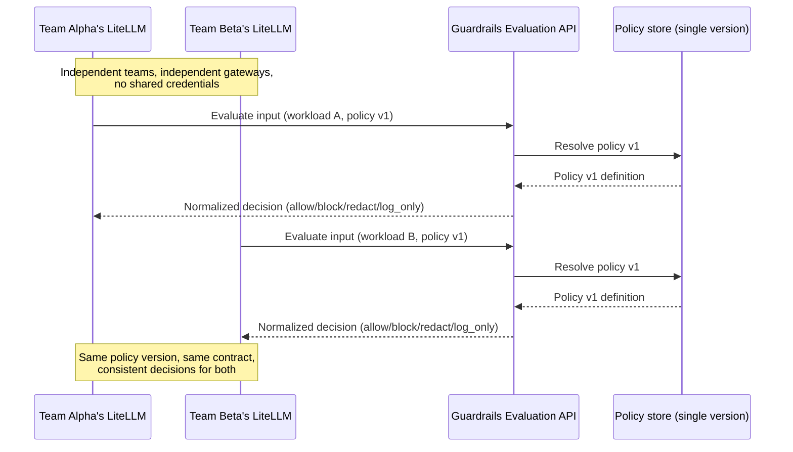
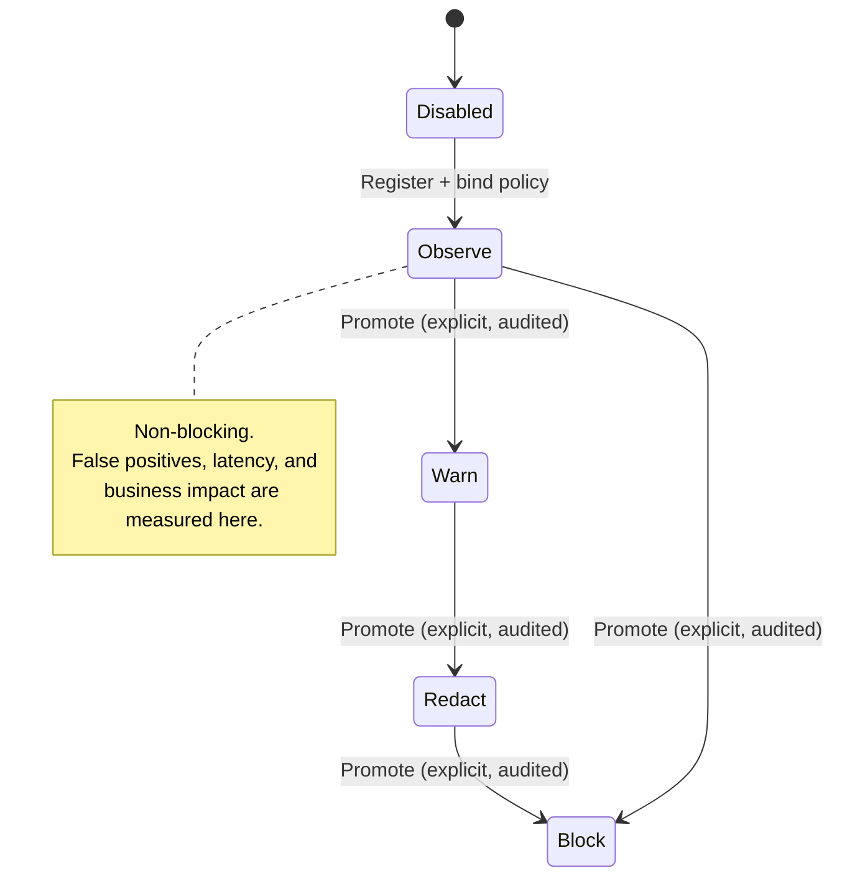
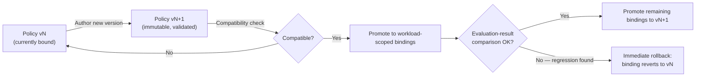
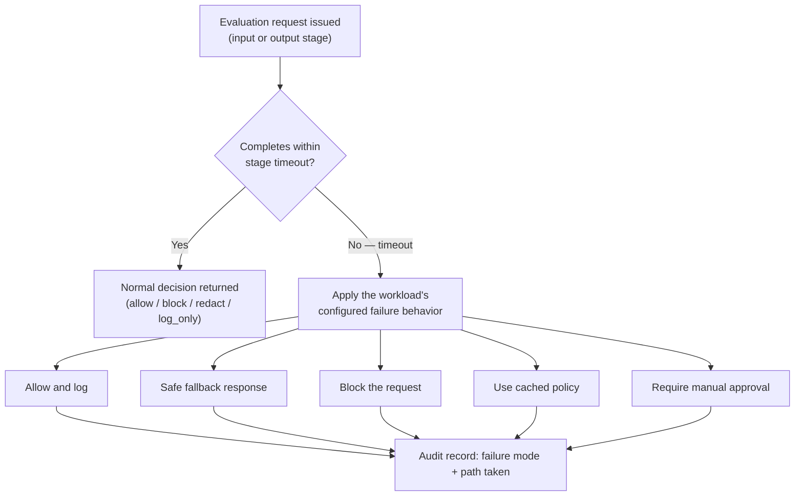

**AI Guardrails — Use Cases**

**Authority level:** L4
**Status:** Draft
**Date:** 2026-07-24
**Derived from:** seed.md + AGREEMENTS.md

---

## Purpose and scope

This document translates the AI Guardrails operating model — the three deployment modes, the trust and enforcement model, and the MVP demonstration criteria — into concrete, actor-driven use cases. It is a **communicative (L4)** document: it illustrates the accepted agreements in [`AGREEMENTS.md`](../00-source-of-truth/AGREEMENTS.md) and constraints in [`CONSTRAINTS.md`](../00-source-of-truth/CONSTRAINTS.md) for product, sales, and delivery audiences. It does not create new obligations, and it must never be read as contradicting either register.

Every use case below is derived from seed.md:

* **§3 — Core architectural decision** (Modes A, B, and C).
* **§8 — Trust and enforcement model** (cooperative integration, platform-managed enforcement, network/IAM-enforced gateway).
* **§16 — MVP definition and demonstration.**

Where a use case describes a capability that is part of the falsifiable MVP success demonstration ([AGR-020](../00-source-of-truth/AGREEMENTS.md#agr-020--mvp-success-demonstration)), that is stated explicitly. Where a use case describes the target operating model reached in a later delivery phase ([AGR-022](../00-source-of-truth/AGREEMENTS.md#agr-022--five-phase-delivery)), that is stated explicitly too. No use case should be read as already delivered; this document describes intended behavior, not a shipped feature list.

No metrics, dollar figures, customer names, or SLA numbers are invented here. Where a number would normally appear, this document writes **TBD** or describes the requirement qualitatively, consistent with [`ASSUMPTIONS.md`](../00-source-of-truth/ASSUMPTIONS.md).

---

## How to read a use case

Each use case follows a fixed shape:

| Field | Meaning |
| --- | --- |
| **Actor(s)** | The role(s) initiating or participating in the use case, drawn from the actor legend below. |
| **Context** | Why this scenario arises and which product principle or mode it exercises. |
| **Flow** | The sequence of steps that occur, in the vocabulary of the [core domain model](#core-domain-model-terms-used-below) (tenant, workload, policy, binding, evaluation, decision). |
| **Outcome** | The observable result and what it proves or protects. |
| **Traceability** | The seed.md section(s) and agreement(s) this use case derives from. |

### Actor legend

Actor names below match the roles defined in seed.md §7 (Initial users and stakeholders) and §21 (Ownership boundaries). No new roles are introduced.

| Actor | Owns / needs (seed §7, §21) |
| --- | --- |
| **AI Guardrails team** | Product architecture, policy schemas, evaluation contract, guardrail runtime, LiteLLM connector, Bedrock integration, policy compatibility, documentation, supported deployment artifacts. |
| **Platform operations** | Hosted infrastructure, runtime deployment, service monitoring, capacity management, network configuration, production incident response. |
| **Security and governance** | Organization-level policy requirements, risk classifications, policy approval, exception criteria, retention requirements, audit requirements. |
| **Consuming team** (application team / workload owner) | Application behavior, correct connector installation in cooperative mode, workload registration accuracy, end-user authentication, business authorization, model selection where applicable, review of observe-mode findings, acceptance of enforcement behavior. |
| **Product operators** | Tenant and workload registration, service-health visibility, usage metrics, runtime capacity management, policy rollout controls, deployment compatibility tracking. |

### Core domain model terms used below

Each flow step below uses these seed §9 domain terms precisely: **tenant** (an organization/team), **workload** (an application, assistant, agent, gateway, or inference service), **policy** (versioned checks and actions), **policy binding** (a workload-to-policy-version association, including mode and rollback version), **evaluation** (a request to inspect content at the `input` or `output` stage), and **decision** (the normalized result: `allow`, `block`, `redact`, or `log_only`).

---

## Use case index

| ID | Title | Primary mode / model | MVP scope status |
| --- | --- | --- | --- |
| [UC-001](#uc-001--two-independent-litellm-instances-share-one-central-policy) | Two independent LiteLLM instances share one central policy | Mode A — Remote Evaluation | **In MVP scope** — this is the core MVP demonstration (seed §16). |
| [UC-002](#uc-002--onboard-a-workload-in-observe-mode-then-promote-to-enforce) | Onboard a workload in observe mode, then promote to enforce | Cooperative integration (seed §8); mode-independent | **In MVP scope.** |
| [UC-003](#uc-003--a-regulated-workload-uses-the-customer-managed-runtime-so-content-never-leaves-the-account) | A regulated workload uses the Customer-Managed Runtime so content never leaves the account | Mode C — Customer-Managed Runtime | **Target state — Phase 4.** The MVP proves only that the runtime can later be packaged this way without changing the connector contract (seed §16, §18 Phase 4). |
| [UC-004](#uc-004--a-team-without-a-gateway-uses-the-guarded-gateway) | A team without a gateway uses the Guarded Gateway | Mode B — Guarded Gateway | **Target state — Phase 3** (seed §18 Phase 3). |
| [UC-005](#uc-005--central-policy-upgrade-and-immediate-rollback) | Central policy upgrade and immediate rollback | Mode-independent (policy rollout, seed §15) | **In MVP scope** — required by the MVP demonstration (seed §16). |
| [UC-006](#uc-006--disable-raw-content-persistence-for-a-sensitive-workload) | Disable raw-content persistence for a sensitive workload | Mode-independent (data handling, seed §13) | **In MVP scope** — required by the MVP demonstration (seed §16). |
| [UC-007](#uc-007--configured-failure-behavior-on-evaluation-timeout) | Configured failure behavior on evaluation timeout | Mode-independent (failure behavior, seed §5.7) | **In MVP scope** — required by the MVP demonstration (seed §16). |

---

## UC-001 — Two independent LiteLLM instances share one central policy

**Actor(s):** AI Guardrails team (policy owner); two unrelated Consuming teams — Team Alpha and Team Beta — each operating its own LiteLLM instance; Product operators (workload registration).

**Context:** This is the product's central hypothesis: one reusable guardrail policy, defined once, can be applied consistently to multiple independent LiteLLM deployments without requiring those teams to share infrastructure, credentials, or a gateway (seed §16, §22; [AGR-020](../00-source-of-truth/AGREEMENTS.md#agr-020--mvp-success-demonstration)). Team Alpha and Team Beta are organizationally independent: different teams, different LiteLLM instances, different model-provider credentials.

**Flow:**

1. The AI Guardrails team defines and versions a single guardrail policy (for example: detect and act on prompt injection and sensitive-data exposure) in policy storage.
2. Team Alpha registers its workload, selects the policy, and receives an integration manifest; it installs the LiteLLM pre-call and post-call connector against its own LiteLLM instance.
3. Team Beta independently registers a second, unrelated workload, selects the **same policy version**, and installs the connector against its own, separate LiteLLM instance.
4. Neither team transfers model-provider credentials, LiteLLM configuration, or gateway administration access to the AI Guardrails team — the import binds a policy, a workload identity, an integration manifest, a connector configuration, and an enforcement mode only (seed §4; [AGR-021](../00-source-of-truth/AGREEMENTS.md#agr-021--meaning-of-import)).
5. Each LiteLLM instance's connector independently invokes input evaluation before inference and output evaluation after inference against the same Evaluation API.
6. The Evaluation API resolves the same policy version for both workloads, executes the same evaluators, and returns normalized decisions using the same decision structure, reason codes, and policy-version semantics to both instances (seed §5.2; [AGR-006](../00-source-of-truth/AGREEMENTS.md#agr-006--one-logical-evaluation-contract-across-all-modes)).



**Outcome:** Two organizationally independent LiteLLM deployments consume the identical policy version and receive consistent, normalized decisions, while neither shares model-provider credentials with the guardrail platform. This is the specific, falsifiable condition that proves policy reuse and connector independence ([AGR-020](../00-source-of-truth/AGREEMENTS.md#agr-020--mvp-success-demonstration)).

**Traceability:** seed §16 (MVP demonstration), §22 (decision summary); [AGR-020](../00-source-of-truth/AGREEMENTS.md#agr-020--mvp-success-demonstration), [AGR-006](../00-source-of-truth/AGREEMENTS.md#agr-006--one-logical-evaluation-contract-across-all-modes), [AGR-021](../00-source-of-truth/AGREEMENTS.md#agr-021--meaning-of-import).

---

## UC-002 — Onboard a workload in observe mode, then promote to enforce

**Actor(s):** Consuming team (workload owner); AI Guardrails team (policy owner); Security and governance (review of observe-mode findings for promotion sign-off, where required).

**Context:** Every policy must support a non-blocking evaluation mode, and a team must be able to measure false positives, latency, and business impact before enabling blocking behavior (seed §5.6; [AGR-011](../00-source-of-truth/AGREEMENTS.md#agr-011--observe-before-enforce-progression)). This use case is the canonical onboarding flow referenced by the definition of "import" (seed §4; [AGR-021](../00-source-of-truth/AGREEMENTS.md#agr-021--meaning-of-import)).

**Flow:**

1. Register workload — the consuming team registers a new workload (identifier, owner, environment, risk classification, gateway type, expected throughput).
2. Select policy — the team binds the workload to an existing versioned policy (or the platform default).
3. Generate integration manifest — the platform produces the connector configuration for that binding.
4. Install connector — the team installs the LiteLLM pre-call/post-call connector (or generic SDK) against its own gateway; no gateway administration access is granted to the platform.
5. Run in observe mode — the binding starts in **Observe**: evaluations run, decisions are logged, but no traffic is blocked or transformed.
6. Review evaluation results — the consuming team (and Security and governance, where the workload's risk classification requires it) reviews false-positive rate, evaluation latency, and business impact from the observe-mode evidence.
7. Enable enforcement — the team explicitly promotes the binding to a blocking state. Promotion is an explicit, auditable action on the binding — never an implicit side effect of another change ([AGR-011](../00-source-of-truth/AGREEMENTS.md#agr-011--observe-before-enforce-progression)).



**Outcome:** The workload moves from a fully non-blocking state to a blocking (enforce) state only after the consuming team has reviewed real evaluation evidence, and only via an explicit, auditable promotion. This satisfies the recommended progression Disabled → Observe → Warn → Redact → Block (seed §5.6) and gives application teams "a way to test policies before blocking users" (seed §7).

> **Note on two distinct axes:** "Enforce mode" here refers to the *policy's blocking behavior* on a given binding. It is a separate concern from the workload's *enforcement posture* — cooperative integration, platform-managed enforcement, or network/IAM-enforced gateway (seed §8; [AGR-018](../00-source-of-truth/AGREEMENTS.md#agr-018--trust-and-enforcement-model)), which governs whether the connector itself can be bypassed, disabled, or misconfigured. A workload can run in Enforce mode under a cooperative posture; that combination measures policy effectiveness but does not, by itself, guarantee the connector cannot be removed. A cooperative connector must never be represented as a hard security boundary.

**Traceability:** seed §4 (import/onboarding flow), §5.6 (observable before enforceable), §8 (trust and enforcement model); [AGR-011](../00-source-of-truth/AGREEMENTS.md#agr-011--observe-before-enforce-progression), [AGR-021](../00-source-of-truth/AGREEMENTS.md#agr-021--meaning-of-import), [AGR-018](../00-source-of-truth/AGREEMENTS.md#agr-018--trust-and-enforcement-model).

---

## UC-003 — A regulated workload uses the Customer-Managed Runtime so content never leaves the account

**Actor(s):** Consuming team operating a regulated workload; Security and governance (retention and residency sign-off); AI Guardrails team (runtime software, policy schemas, deployment artifacts); Platform operations of the customer (runtime infrastructure, availability, networking).

**Context:** Mode C exists specifically for regulated workloads, data-residency requirements, high-volume workloads, air-gapped environments, and teams that prohibit prompt or response content from leaving their account (seed §3, Mode C). Unlike Mode A, which transmits content to the hosted Evaluation API, Mode C keeps raw content inside the consuming team's own AWS account.

**Flow:**

1. The consuming team deploys the guardrail runtime container (via the supported Helm chart, ECS deployment template, or infrastructure module) inside its own AWS account.
2. The runtime maintains a local policy cache, synchronized asynchronously from the hosted control plane; the runtime does not require a synchronous connection to the control plane to execute policies (seed §3, §15; [AGR-015](../00-source-of-truth/AGREEMENTS.md#agr-015--customer-managed-runtime-executes-without-a-synchronous-control-plane-connection)).
3. The application (via its own LiteLLM instance or direct SDK integration) sends input and output content to the **customer-hosted** guardrail runtime, not to the hosted Evaluation API.
4. The runtime evaluates content locally using the Bedrock Guardrails adapter, deterministic organization rules, and any custom evaluators — all running inside the customer's account.
5. The runtime records audit records via local audit integration, entirely within the customer's environment.
6. The customer separately configures what — if anything — the hosted control plane receives: health status, product version, policy version, aggregated evaluation counts, reason-code totals, latency metrics, sanitized decision metadata, or **no telemetry at all** (seed §13; [AGR-016](../00-source-of-truth/AGREEMENTS.md#agr-016--customer-controlled-telemetry-for-the-customer-managed-runtime)). Raw prompt and response content is never included in this channel unless the customer explicitly configures that transmission.

```text
Customer AWS account
┌──────────────────────────────────────────────────────────────┐
│ Application → Customer LiteLLM (or SDK)                       │
│        │                                                       │
│        ▼                                                       │
│ Customer-hosted Guardrails Runtime                              │
│   ├── Policy cache (async-synced, works offline)                │
│   ├── Bedrock Guardrails adapter                                 │
│   ├── Custom evaluators                                          │
│   └── Local audit integration (stays in-account)                 │
└───────────────────────┬────────────────────────────────────────┘
                         │ Only the customer-selected telemetry
                         │ categories cross this line — or none
                         ▼
              Hosted control plane (policy sync, optional telemetry)
```

**Outcome:** Prompts, responses, and any additional evaluated content never leave the customer's AWS account unless the customer explicitly configures that transmission (seed §13; [CON-013](../00-source-of-truth/CONSTRAINTS.md#con-013--raw-content-must-not-leave-a-customer-managed-runtime-unless-explicitly-configured)). The regulated workload gets the same policy model, evaluation contract, and decision structure as Modes A and B (seed §5.2), satisfying data-residency and content-isolation requirements without forking the product's logical contract.

**Traceability:** seed §3 (Mode C), §13 (customer-managed telemetry), §15 (availability without synchronous control-plane dependency); [AGR-015](../00-source-of-truth/AGREEMENTS.md#agr-015--customer-managed-runtime-executes-without-a-synchronous-control-plane-connection), [AGR-016](../00-source-of-truth/AGREEMENTS.md#agr-016--customer-controlled-telemetry-for-the-customer-managed-runtime), [CON-013](../00-source-of-truth/CONSTRAINTS.md#con-013--raw-content-must-not-leave-a-customer-managed-runtime-unless-explicitly-configured). Delivered in Phase 4 (seed §18); the MVP's contribution is proving the runtime can later be packaged this way without changing the connector contract (seed §16).

---

## UC-004 — A team without a gateway uses the Guarded Gateway

**Actor(s):** Consuming team with no existing LLM gateway; AI Guardrails provider acting as Platform operations (gateway availability, model-provider credentials, routing, rate limits, audit/usage reporting).

**Context:** Mode B is intended for teams that do not operate LiteLLM, want a managed OpenAI-compatible endpoint, require centrally managed model access, or prefer consolidated model and guardrail operations, and that accept the provider participating in the complete inference path (seed §3, Mode B).

**Flow:**

1. The consuming team registers a workload and selects a policy (or accepts a default), the same as in any other mode.
2. Instead of installing a connector against its own gateway, the team points its application directly at the provider-managed Guarded Gateway endpoint.
3. The Guarded Gateway performs, in a single provider-operated path: input guardrails, model routing, model invocation, output guardrails, and audit/usage reporting (seed §3, Mode B).
4. The provider owns gateway availability, provider credentials or delegated AWS access, model routing, model-provider integrations, inference retries and fallbacks, guardrail execution, rate limits, usage quotas, and audit/operational telemetry.
5. The consuming team retains ownership of application behavior, workload-specific configuration, policy selection where permitted, end-user authorization, and business-level approval flows — none of which the guardrail evaluation itself performs (seed §5.5; [AGR-010](../00-source-of-truth/AGREEMENTS.md#agr-010--guardrails-are-not-authorization)).

```text
Application
    │
    ▼
Provider-managed Guarded Gateway
    │
    ├── Input guardrails
    ├── Model routing
    ├── Model invocation
    ├── Output guardrails
    └── Audit and usage reporting
```

**Outcome:** The team obtains guardrail-protected inference without operating any gateway infrastructure of its own. This is the mode with the strongest centralized control, and also the largest operational, security, and compliance scope taken on by the provider (seed §3, Mode B) — the provider is now part of the complete inference path, which must be represented accurately rather than understated.

**Traceability:** seed §3 (Mode B), §5.5 (guardrails are not authorization); [AGR-002](../00-source-of-truth/AGREEMENTS.md#agr-002--three-deployment-modes), [AGR-010](../00-source-of-truth/AGREEMENTS.md#agr-010--guardrails-are-not-authorization). Delivered in Phase 3 (seed §18); not part of the MVP demonstration, which exercises Mode A only (seed §16).

---

## UC-005 — Central policy upgrade and immediate rollback

**Actor(s):** AI Guardrails team / policy owner (creates and promotes policy versions); Product operators (rollout controls); Consuming team (workload bound to the policy).

**Context:** Policies must support immutable versions, controlled promotion, workload-scoped rollout, immediate rollback, compatibility validation, and evaluation-result comparison between versions (seed §15, Policy rollout). The MVP demonstration explicitly requires that "a policy can be upgraded and rolled back" (seed §16; [AGR-020](../00-source-of-truth/AGREEMENTS.md#agr-020--mvp-success-demonstration)).

**Flow:**

1. The policy owner authors a new, immutable policy version (`vN+1`) alongside the currently bound version (`vN`). Each binding already records a rollback version as part of its definition (seed §9, Policy binding).
2. The platform validates `vN+1` for compatibility with the runtime versions and workloads currently bound to `vN`.
3. `vN+1` is promoted to one or more workload-scoped bindings — a controlled rollout, not an organization-wide flip.
4. Evaluation results are compared between `vN` and `vN` for a period, using the same evaluation-result comparison capability required for policy rollout (seed §15).
5. If `vN+1` is confirmed correct, remaining bound workloads are promoted.
6. If `vN+1` exhibits incorrect behavior (unexpected block rate, false positives, latency regression), the affected binding is reverted to its recorded rollback version **immediately** — a binding-level operation, not a connector reinstall or application redeploy.



**Outcome:** A policy owner can move bound workloads to a new immutable version and, on detecting a regression, revert affected bindings to the prior version immediately, without requiring the consuming team to change connector code or redeploy their application. Rollback is recorded as an auditable binding-level action, and the number of policy rollbacks caused by incorrect behavior is tracked as a product-portability and effectiveness metric (seed §19).

**Traceability:** seed §9 (Policy binding — rollback version), §15 (policy rollout), §16 (MVP demonstration), §19 (effectiveness metrics); [AGR-020](../00-source-of-truth/AGREEMENTS.md#agr-020--mvp-success-demonstration).

---

## UC-006 — Disable raw-content persistence for a sensitive workload

**Actor(s):** Consuming team operating a sensitive workload; Security and governance (retention requirements and audit sign-off); AI Guardrails team (runtime default behavior and retention configuration).

**Context:** The hosted runtime's default behavior is to process content only for evaluation and to avoid persisting raw prompts and responses; it persists decision metadata, hashes user and conversation identifiers where possible, and strips secrets from telemetry (seed §13; [AGR-014](../00-source-of-truth/AGREEMENTS.md#agr-014--no-raw-promptresponse-retention-by-default)). Any retention of raw content requires explicit, tenant-level configuration — never a platform default. This use case exercises the inverse: a workload that explicitly confirms and relies on non-retention. The MVP demonstration requires that "raw content persistence can be disabled" (seed §16).

**Flow:**

1. The consuming team registers a sensitive workload and, together with Security and governance, sets its tenant-level retention configuration to disable raw-content persistence (or confirms the platform default, which already excludes raw-content retention).
2. At evaluation time, the Evaluation API processes the submitted prompt or response content only in memory, for the purpose of the evaluation itself.
3. On completion, the runtime persists **decision metadata only**: action, allowed status, reason codes, policy name and version, evaluator metadata, correlation identifier, audit identifier, and evaluation latency (seed §9, Decision) — not the raw content itself.
4. User and conversation identifiers are hashed where possible before persistence, and secrets are stripped from telemetry (seed §13).
5. The audit record for each evaluation explicitly captures **whether raw content was retained** for that evaluation (seed §15, Auditing) — for this workload, that field is always `false`.

**Outcome:** The sensitive workload's prompts and responses are never written to any platform-managed store; only normalized decision metadata and a hashed correlation trail persist. Security and governance can point to the audit record's "raw content retained: false" field as evidence that the retention control is active for every evaluation on this workload, satisfying the audit and evidence requirements in seed §7 and §15 without inventing a specific retention SLA (retention period specifics remain **TBD** per tenant configuration).

**Traceability:** seed §13 (default behavior, content categories), §15 (auditing — "whether raw content was retained"), §16 (MVP demonstration); [AGR-014](../00-source-of-truth/AGREEMENTS.md#agr-014--no-raw-promptresponse-retention-by-default), [CON-014](../00-source-of-truth/CONSTRAINTS.md#con-014--no-raw-content-retention-by-default-in-the-hosted-runtime).

---

## UC-007 — Configured failure behavior on evaluation timeout

**Actor(s):** Consuming team / workload owner (defines acceptable failure behavior for their risk classification); AI Guardrails team (implements the failure-behavior contract in the runtime and connector); Security and governance (approves failure behavior for higher-risk workloads).

**Context:** Runtime failure behavior must be explicit, and a workload must define what happens when the Evaluation API times out — among other failure modes (seed §5.7; [AGR-012](../00-source-of-truth/AGREEMENTS.md#agr-012--failure-behavior-is-part-of-policy)). There must be no undocumented fallback behavior. The MVP demonstration requires that "evaluation failures follow a configured failure policy" (seed §16).

**Flow:**

1. At policy-authoring time, the policy owner and the workload owner define the failure behavior for an Evaluation API timeout as part of the policy's mandatory failure-behavior section — for example: allow and log, return a safe fallback, block the request, use a cached policy, or require manual approval (seed §5.7).
2. The chosen behavior is recorded on the policy (and, where the workload requires an override, on the binding), not left to an implicit runtime default.
3. At runtime, an evaluation request exceeds the timeout limit enforced for that stage ([CON-016](../00-source-of-truth/CONSTRAINTS.md#con-016--timeout-limits)).
4. The connector applies the pre-configured failure action instead of hanging indefinitely or silently defaulting to an undocumented behavior.
5. The audit record for that evaluation captures the failure mode encountered (Evaluation API timeout) and which failure-behavior path was taken (seed §15, Auditing).
6. The timeout event contributes to the platform's timeout-rate reliability metric (seed §19), which Security and governance and Product operators use to judge whether the configured behavior remains appropriate.



**Outcome:** A timeout never produces undefined behavior. It produces exactly the outcome the workload owner and policy owner agreed to in advance, and that outcome — plus the fact that a timeout occurred — is captured in the audit trail. This directly supports the product principle that "failure behavior is part of policy" (seed §5.7) and gives application teams "clear failure behavior" as a stated need (seed §7).

**Traceability:** seed §5.7 (failure behavior is part of policy), §14 (timeout limits), §15 (auditing, availability), §16 (MVP demonstration), §19 (timeout-rate metric); [AGR-012](../00-source-of-truth/AGREEMENTS.md#agr-012--failure-behavior-is-part-of-policy), [CON-016](../00-source-of-truth/CONSTRAINTS.md#con-016--timeout-limits).

---

## Cross-cutting observations

* **UC-001, UC-005, UC-006, and UC-007 together constitute the MVP demonstration** (seed §16; [AGR-020](../00-source-of-truth/AGREEMENTS.md#agr-020--mvp-success-demonstration)). A delivery milestone that claims MVP completion should be checked against all four, not a subset, per [AGR-020](../00-source-of-truth/AGREEMENTS.md#agr-020--mvp-success-demonstration).
* **UC-003 and UC-004 describe target-state modes (Phase 4 and Phase 3 respectively)**, not MVP deliverables. They are included here because they are essential to explaining the product's full operating model to product, sales, and delivery audiences — but they must not be presented as already validated by the MVP demonstration (seed §17, §19; [AGR-019](../00-source-of-truth/AGREEMENTS.md#agr-019--mvp-scope-boundaries)).
* **UC-002's enforcement-mode progression is orthogonal to enforcement posture** (seed §8). A workload can be in Enforce mode under a cooperative connector, under a platform-managed gateway, or under a network/IAM-enforced gateway; each combination carries different bypass-resistance guarantees, and only the last is a hard security boundary ([AGR-018](../00-source-of-truth/AGREEMENTS.md#agr-018--trust-and-enforcement-model)).
* **None of these use cases substitute for business authorization.** Even where a decision is `allow`, the consuming application remains solely responsible for authentication, authorization, tenant isolation, resource ownership, and approval workflows (seed §5.5; [AGR-010](../00-source-of-truth/AGREEMENTS.md#agr-010--guardrails-are-not-authorization)).

---

## Traceability summary

| Use case | seed.md section(s) | Agreement(s) | Constraint(s) |
| --- | --- | --- | --- |
| UC-001 | §16, §22 | [AGR-020](../00-source-of-truth/AGREEMENTS.md#agr-020--mvp-success-demonstration), [AGR-006](../00-source-of-truth/AGREEMENTS.md#agr-006--one-logical-evaluation-contract-across-all-modes), [AGR-021](../00-source-of-truth/AGREEMENTS.md#agr-021--meaning-of-import) | [CON-005](../00-source-of-truth/CONSTRAINTS.md#con-005--one-logical-evaluation-contract-across-all-modes) |
| UC-002 | §4, §5.6, §8 | [AGR-011](../00-source-of-truth/AGREEMENTS.md#agr-011--observe-before-enforce-progression), [AGR-021](../00-source-of-truth/AGREEMENTS.md#agr-021--meaning-of-import), [AGR-018](../00-source-of-truth/AGREEMENTS.md#agr-018--trust-and-enforcement-model) | — |
| UC-003 | §3 (Mode C), §13, §15 | [AGR-015](../00-source-of-truth/AGREEMENTS.md#agr-015--customer-managed-runtime-executes-without-a-synchronous-control-plane-connection), [AGR-016](../00-source-of-truth/AGREEMENTS.md#agr-016--customer-controlled-telemetry-for-the-customer-managed-runtime) | [CON-013](../00-source-of-truth/CONSTRAINTS.md#con-013--raw-content-must-not-leave-a-customer-managed-runtime-unless-explicitly-configured) |
| UC-004 | §3 (Mode B), §5.5 | [AGR-002](../00-source-of-truth/AGREEMENTS.md#agr-002--three-deployment-modes), [AGR-010](../00-source-of-truth/AGREEMENTS.md#agr-010--guardrails-are-not-authorization) | — |
| UC-005 | §9, §15, §16, §19 | [AGR-020](../00-source-of-truth/AGREEMENTS.md#agr-020--mvp-success-demonstration) | — |
| UC-006 | §13, §15, §16 | [AGR-014](../00-source-of-truth/AGREEMENTS.md#agr-014--no-raw-promptresponse-retention-by-default) | [CON-014](../00-source-of-truth/CONSTRAINTS.md#con-014--no-raw-content-retention-by-default-in-the-hosted-runtime) |
| UC-007 | §5.7, §14, §15, §16, §19 | [AGR-012](../00-source-of-truth/AGREEMENTS.md#agr-012--failure-behavior-is-part-of-policy) | [CON-016](../00-source-of-truth/CONSTRAINTS.md#con-016--timeout-limits) |

---

## Related documents

* [`../00-source-of-truth/AGREEMENTS.md`](../00-source-of-truth/AGREEMENTS.md) — authoritative agreements this document illustrates.
* [`../00-source-of-truth/CONSTRAINTS.md`](../00-source-of-truth/CONSTRAINTS.md) — authoritative boundary conditions referenced throughout.
* [`../00-source-of-truth/ASSUMPTIONS.md`](../00-source-of-truth/ASSUMPTIONS.md) — unvalidated beliefs underlying several use cases (notably ASM-002, ASM-003 for UC-001; ASM-004, ASM-013 for UC-003; ASM-011, ASM-012 for UC-007).
* [`../00-source-of-truth/DECISIONS.md`](../00-source-of-truth/DECISIONS.md) — decision log entries DEC-004 and DEC-005 correspond to the mode and MVP-boundary framing used here.
* `PRODUCT-OVERVIEW.md` — product-level narrative these use cases support.
* `CAPABILITIES.md` — the capability list each use case exercises.
* `PRODUCT-ROADMAP.md` — phase sequencing referenced for UC-003 and UC-004.
* `FAQ.md` — audience-facing questions, including the meaning of "import" (see [AGR-021](../00-source-of-truth/AGREEMENTS.md#agr-021--meaning-of-import)).
* [`../50-architecture/DEPLOYMENT-ARCHITECTURE.md`](../50-architecture/DEPLOYMENT-ARCHITECTURE.md) — the three-mode deployment topology behind UC-001, UC-003, and UC-004.
* [`../50-architecture/INTEGRATION-ARCHITECTURE.md`](../50-architecture/INTEGRATION-ARCHITECTURE.md) — the LiteLLM connector contract behind UC-001 and UC-002.
* [`../50-architecture/SECURITY-ARCHITECTURE.md`](../50-architecture/SECURITY-ARCHITECTURE.md) — the enforcement-posture model behind UC-002.
* [`../50-architecture/DATA-ARCHITECTURE.md`](../50-architecture/DATA-ARCHITECTURE.md) — the retention and telemetry design behind UC-003 and UC-006.
* [`../60-delivery/VALIDATION-PLAN.md`](../60-delivery/VALIDATION-PLAN.md) — how the MVP-scoped use cases (UC-001, UC-005, UC-006, UC-007) will be validated.
* [`../70-governance/GLOSSARY.md`](../70-governance/GLOSSARY.md) — canonical definitions for tenant, workload, policy, binding, evaluation, and decision.
* [`../70-governance/RISK-REGISTER.md`](../70-governance/RISK-REGISTER.md) — connector-bypass, false-confidence, and latency risks that these use cases are designed to surface and mitigate.
