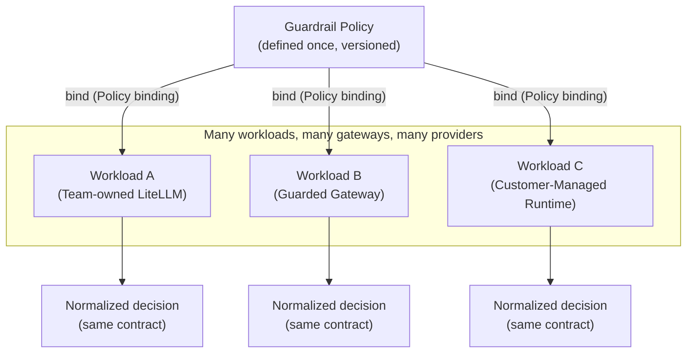

**AI Guardrails — Value Proposition**

**Authority level:** L4
**Status:** Draft
**Date:** 2026-07-24
**Derived from:** AGREEMENTS.md

---

## Purpose and scope

This document states the value proposition of AI Guardrails for each of its primary audiences: platform teams, application teams, security and compliance teams, and product operators. It translates the accepted agreements in [`AGREEMENTS.md`](../00-source-of-truth/AGREEMENTS.md) and the constraints in [`CONSTRAINTS.md`](../00-source-of-truth/CONSTRAINTS.md) into audience-facing statements of benefit, without introducing any claim, metric, or figure that those documents do not support.

This is an **L4** document: a derived product artifact. It must not contradict [`AGREEMENTS.md`](../00-source-of-truth/AGREEMENTS.md) or [`CONSTRAINTS.md`](../00-source-of-truth/CONSTRAINTS.md) (both L1), and it must use the same "designed to / supports" language discipline expected of [`70-governance/CLAIMS-REGISTER.md`](../70-governance/CLAIMS-REGISTER.md) rather than proven-performance language. Where the source material does not supply a number — expected latency, availability, adoption figures, cost — this document says so explicitly (**TBD**) rather than inventing one.

---

## The core value proposition

AI Guardrails is a policy, evaluation, and enforcement layer for applications and agentic workflows that consume large language models. It is designed to let an organization:

* **Define a guardrail policy once** and apply it across many workloads, teams, and gateways.
* **Stay provider- and framework-independent**, so a policy is never rewritten because a team changes model provider, application framework, or LiteLLM version.
* **Choose the deployment mode that fits each workload's data-isolation and ownership needs** — from a fully hosted service to a runtime the team operates entirely inside its own AWS account.
* **Measure guardrail effectiveness in observe mode before any policy becomes blocking**, so teams adopt enforcement deliberately rather than by default.
* **Evolve enforcement posture over time** — from a cooperative, opt-in connector toward platform-managed or network/IAM-enforced controls — as trust, compliance, and adoption requirements mature.

This is the same intent recorded in the product statement ([`CLAIMS-REGISTER.md`](../70-governance/CLAIMS-REGISTER.md)) and formalized in [AGR-001 through AGR-021](../00-source-of-truth/AGREEMENTS.md). Nothing below expands on that intent; it maps it to what each audience specifically gains.

---

## The five value pillars

| Pillar | What it means in practice | Source of authority |
| --- | --- | --- |
| **Define once, apply broadly** | A policy is a versioned artifact independent of any single workload. Multiple workloads bind to the same policy version rather than each team re-implementing detection and enforcement logic. | [`CHARTER.md`](../10-charter/CHARTER.md), [AGR-017](../00-source-of-truth/AGREEMENTS.md#agr-017--core-domain-model) (Policy, Policy binding) |
| **Provider- and framework-independence** | Policies do not depend on LiteLLM configuration structures, Bedrock Guardrails response formats, a specific model provider, programming language, or application framework. Vendor-specific logic is isolated behind connectors and evaluator adapters. | [AGR-005](../00-source-of-truth/AGREEMENTS.md#agr-005--policy-portability); [AGR-003](../00-source-of-truth/AGREEMENTS.md#agr-003--litellm-as-first-connector-not-the-product-boundary), [AGR-004](../00-source-of-truth/AGREEMENTS.md#agr-004--bedrock-guardrails-as-first-engine-vendor-independent-contract), [AGR-005](../00-source-of-truth/AGREEMENTS.md#agr-005--policy-portability); [CON-003](../00-source-of-truth/CONSTRAINTS.md#con-003--no-coupling-to-litellm-configuration-structures), [CON-004](../00-source-of-truth/CONSTRAINTS.md#con-004--no-coupling-to-bedrock-guardrails-response-formats) |
| **Deployment mode chosen to fit data-isolation and ownership needs** | Three modes — Remote Evaluation, Guarded Gateway, Customer-Managed Runtime — trade operational ownership against data exposure differently. A team selects the mode that matches its regulatory, residency, and operating posture, not a one-size-fits-all topology. | [`CHARTER.md`](../10-charter/CHARTER.md), [AGR-002](../00-source-of-truth/AGREEMENTS.md#agr-002--three-deployment-modes), [AGR-008](../00-source-of-truth/AGREEMENTS.md#agr-008--explicit-content-exposure-model-ownership-vs-exposure-are-separate-concerns) |
| **Observable before enforceable** | Every policy supports a non-blocking evaluation mode and a graduated progression (Disabled → Observe → Warn → Redact → Block), so a team can measure false positives, latency, and business impact before enabling blocking behavior. | [AGR-011](../00-source-of-truth/AGREEMENTS.md#agr-011--observe-before-enforce-progression) |
| **Cooperative integration evolving toward mandatory enforcement** | Adoption starts with a removable, opt-in connector for trusted teams and can progress to platform-managed or network/IAM-enforced controls as bypass-prevention and compliance requirements grow — without changing the underlying policy or evaluation contract. | [`CHARTER.md`](../10-charter/CHARTER.md), [AGR-018](../00-source-of-truth/AGREEMENTS.md#agr-018--trust-and-enforcement-model) |

These five pillars hold across all three deployment modes because of the one logical evaluation contract ([AGR-006](../00-source-of-truth/AGREEMENTS.md#agr-006--one-logical-evaluation-contract-across-all-modes)): the same policy definitions, request structures, decision structures, reason codes, enforcement actions, and audit metadata apply regardless of where the runtime is deployed.

---

## Value by audience

### Platform teams

Platform teams need central policy definitions, reusable connectors, deployment consistency, audit visibility, controlled policy rollouts, and low operational overhead ([`TARGET-USERS.md`](TARGET-USERS.md)).

| Need | How AI Guardrails is designed to address it |
| --- | --- |
| Central guardrail policy definitions | A single versioned policy format, decoupled from any one gateway or provider, that the platform team owns and evolves independently of individual application teams ([AGR-005](../00-source-of-truth/AGREEMENTS.md#agr-005--policy-portability)). |
| Reusable connectors | Connectors (LiteLLM, generic HTTP/SDK, future gateways) implement only invocation and enforcement mechanics; they never embed policy logic, so one connector serves every workload bound to any policy ([AGR-007](../00-source-of-truth/AGREEMENTS.md#agr-007--policies-are-separate-from-connectors)). |
| Deployment consistency | The same logical evaluation contract applies whether a workload runs under Remote Evaluation, Guarded Gateway, or Customer-Managed Runtime, so platform teams do not maintain divergent policy semantics per mode ([AGR-006](../00-source-of-truth/AGREEMENTS.md#agr-006--one-logical-evaluation-contract-across-all-modes)). |
| Audit visibility | Decision metadata — tenant, workload, policy version, evaluation stage, decision, reason codes, evaluator versions, timestamp, correlation identifier, and whether raw content was retained — is captured for every evaluation ([`NON-FUNCTIONAL-REQUIREMENTS.md`](../50-architecture/NON-FUNCTIONAL-REQUIREMENTS.md)). |
| Controlled policy rollouts | Policies are immutable per version, support observe mode, controlled promotion, workload-scoped rollout, and immediate rollback ([`NON-FUNCTIONAL-REQUIREMENTS.md`](../50-architecture/NON-FUNCTIONAL-REQUIREMENTS.md)). |
| Low operational overhead | Policy authoring and evaluation are centralized; individual application teams are not asked to re-implement detection logic per workload. |

### Application teams

Application teams need a simple onboarding process, minimal application changes, predictable latency, clear failure behavior, understandable violation reasons, and a way to test policies before they affect users ([`TARGET-USERS.md`](TARGET-USERS.md)).

| Need | How AI Guardrails is designed to address it |
| --- | --- |
| Simple onboarding | The onboarding flow — register workload, select policy, generate integration manifest, install connector, run in observe mode, review evaluation results, enable enforcement — is the same regardless of gateway or provider ([AGR-019](../00-source-of-truth/AGREEMENTS.md#agr-019--meaning-of-import)). Onboarding ("import") never requires transferring model-provider credentials or exposing the team's gateway administration endpoints to the guardrail provider. |
| Minimal application changes | A connector is installed at the gateway or SDK layer; the policy itself requires no application-code changes to evaluate content. |
| Predictable latency | Evaluation latency (P50, P95, P99) and timeout behavior are measured per stage and per detector, and every evaluation stage enforces an explicit, documented timeout ([`NON-FUNCTIONAL-REQUIREMENTS.md`](../50-architecture/NON-FUNCTIONAL-REQUIREMENTS.md); [CON-016](../00-source-of-truth/CONSTRAINTS.md#con-016--timeout-limits)). Specific latency and timeout figures are workload- and policy-dependent and are recorded as **TBD** until set for a given deployment. |
| Clear failure behavior | Failure behavior (Evaluation API timeout, detector unavailability, unresolved policy, control-plane unavailability, audit-delivery failure, unsafe response transformation) is an explicit, documented part of every policy — there is no undocumented fallback ([AGR-012](../00-source-of-truth/AGREEMENTS.md#agr-012--failure-behavior-is-part-of-policy)). |
| Understandable violation reasons | Every decision carries structured reason codes and policy-version identification, not an opaque pass/fail result ([AGR-017](../00-source-of-truth/AGREEMENTS.md#agr-017--core-domain-model), Decision). |
| A way to test before blocking | Observe mode lets a workload run a policy non-blocking, so a team measures false positives, latency, and business impact before promoting to enforce ([AGR-011](../00-source-of-truth/AGREEMENTS.md#agr-011--observe-before-enforce-progression)). |

### Security and compliance teams

Security and compliance teams need policy ownership, decision evidence, policy-version traceability, content-retention controls, exception tracking, and evidence that policies are actually being applied ([`TARGET-USERS.md`](TARGET-USERS.md)).

| Need | How AI Guardrails is designed to address it |
| --- | --- |
| Policy ownership | Policy definition, thresholds, and enforcement actions are centrally owned artifacts, separate from any connector or workload configuration ([AGR-007](../00-source-of-truth/AGREEMENTS.md#agr-007--policies-are-separate-from-connectors)). |
| Decision evidence | Every evaluation produces auditable decision metadata, including whether raw content was retained for that evaluation ([`NON-FUNCTIONAL-REQUIREMENTS.md`](../50-architecture/NON-FUNCTIONAL-REQUIREMENTS.md)). |
| Policy-version traceability | Policies are versioned and immutable; audit records capture policy name and version alongside every decision. |
| Content-retention controls | The hosted runtime does not persist raw prompts and responses by default; retention requires explicit, tenant-level configuration, and audit metadata records whether raw content was retained ([AGR-014](../00-source-of-truth/AGREEMENTS.md#agr-014--no-raw-promptresponse-retention-by-default)). Customer-Managed Runtime lets a customer choose what telemetry — if any — reaches the hosted control plane, and raw content never leaves that runtime unless explicitly configured ([AGR-016](../00-source-of-truth/AGREEMENTS.md#agr-016--customer-controlled-telemetry-for-the-customer-managed-runtime)). |
| Exception tracking | Workload-specific policy overrides are a bounded, ownership-attributed category rather than an open-ended mechanism, to limit policy fragmentation ([`RISK-REGISTER.md`](../70-governance/RISK-REGISTER.md), "Policy fragmentation"). |
| Evidence policies are applied | Deployment-mode documentation states explicitly where prompts and responses are processed, whether retrieved documents or tool arguments are transmitted, whether content is persisted, what telemetry leaves the runtime, and which AWS accounts and Regions process the request — for every deployment, not just some ([AGR-008](../00-source-of-truth/AGREEMENTS.md#agr-008--explicit-content-exposure-model-ownership-vs-exposure-are-separate-concerns)). |

This audience should also read the explicit non-claims in [Claims discipline](#claims-discipline-and-language-guardrails) below — in particular that guardrail evaluation is not authorization, and that cooperative-mode connectors are not a hard security boundary.

### Product operators

Product operators need tenant and workload registration, service-health visibility, usage metrics, runtime capacity management, policy rollout controls, and deployment compatibility tracking ([`TARGET-USERS.md`](TARGET-USERS.md)).

| Need | How AI Guardrails is designed to address it |
| --- | --- |
| Tenant and workload registration | Tenant and Workload are first-class domain entities with identifiers, ownership, environment, risk classification, and assigned policy captured at registration ([AGR-017](../00-source-of-truth/AGREEMENTS.md#agr-017--core-domain-model)). |
| Service-health visibility | Operational metrics include evaluation-API availability, timeout rate, and detector-specific latency, tracked per the runtime's defined availability objective ([`NON-FUNCTIONAL-REQUIREMENTS.md`](../50-architecture/NON-FUNCTIONAL-REQUIREMENTS.md)). |
| Usage metrics | Evaluation throughput, decision distribution, and policy-cache hit rate are measured as part of the platform's operational requirements ([`NON-FUNCTIONAL-REQUIREMENTS.md`](../50-architecture/NON-FUNCTIONAL-REQUIREMENTS.md)). |
| Runtime capacity management | The runtime is designed for hosted deployment on managed compute (ECS Fargate or EKS) with defined scaling behavior, and for later packaging into a customer-managed runtime without changing the connector contract ([`DEPLOYMENT-ARCHITECTURE.md`](../50-architecture/DEPLOYMENT-ARCHITECTURE.md), [`SUCCESS-CRITERIA.md`](../10-charter/SUCCESS-CRITERIA.md)). |
| Policy rollout controls | Immutable policy versions, controlled promotion, workload-scoped rollout, and immediate rollback are supported as core rollout mechanics ([`NON-FUNCTIONAL-REQUIREMENTS.md`](../50-architecture/NON-FUNCTIONAL-REQUIREMENTS.md)). |
| Deployment compatibility tracking | Policy-version and runtime-compatibility metadata are tracked explicitly so operators can verify which policy versions a given runtime or connector version supports ([AGR-017](../00-source-of-truth/AGREEMENTS.md#agr-017--core-domain-model), Policy; §15, Policy rollout). |

---

## Value by deployment mode

Each mode delivers the five pillars, but trades operational ownership against data exposure differently. Per [AGR-008](../00-source-of-truth/AGREEMENTS.md#agr-008--explicit-content-exposure-model-ownership-vs-exposure-are-separate-concerns), these are two independent axes — reduced operational ownership is never implied to mean reduced data exposure, or vice versa.

| Mode | Who operates what | Where tenant content goes | Best fit when |
| --- | --- | --- | --- |
| **A — Remote Evaluation** | The consuming team keeps operating its own LiteLLM (or equivalent) gateway, model routing, and provider credentials. The provider operates the Evaluation API, policy execution, and detection engines ([AGR-002](../00-source-of-truth/AGREEMENTS.md#agr-002--three-deployment-modes), Mode A). | Prompts, responses, and any additional evaluated content are transmitted to the hosted Evaluation API. This mode must never be described as private-data or data-local ([AGR-009](../00-source-of-truth/AGREEMENTS.md#agr-009--remote-evaluation-is-not-a-private-data-or-data-local-model)). | A team already owns a gateway and wants reduced operational ownership of the guardrail path, and hosted content processing is acceptable. |
| **B — Guarded Gateway** | The provider operates both the gateway and the guardrail runtime as a fully managed service ([AGR-002](../00-source-of-truth/AGREEMENTS.md#agr-002--three-deployment-modes), Mode B). | Content passes through a provider-operated inference and guardrail path end to end — this is the mode with the broadest provider participation in the request path. | A team has no gateway of its own, wants a managed OpenAI-compatible endpoint, and accepts that the provider participates in the complete inference path. |
| **C — Customer-Managed Runtime** | The consuming team operates the runtime, its infrastructure, networking, and model credentials, inside its own AWS account; the provider supplies runtime software, policy schemas, and supported deployment artifacts ([AGR-002](../00-source-of-truth/AGREEMENTS.md#agr-002--three-deployment-modes), Mode C). | Raw content stays inside the customer's AWS account by default; only customer-selected telemetry categories (or none) reach the hosted control plane, and the runtime executes policy without requiring a synchronous control-plane connection ([AGR-015](../00-source-of-truth/AGREEMENTS.md#agr-015--customer-managed-runtime-executes-without-a-synchronous-control-plane-connection), [AGR-016](../00-source-of-truth/AGREEMENTS.md#agr-016--customer-controlled-telemetry-for-the-customer-managed-runtime)). | Regulated workloads, data-residency requirements, high-volume workloads, air-gapped environments, or teams that prohibit prompt/response content from leaving their account ([AGR-002](../00-source-of-truth/AGREEMENTS.md#agr-002--three-deployment-modes), Mode C). |

All three modes implement the same policy definitions, evaluation contract, decision structure, and audit metadata ([AGR-006](../00-source-of-truth/AGREEMENTS.md#agr-006--one-logical-evaluation-contract-across-all-modes)) — the value pillars above do not vary by mode, only the ownership and exposure trade-off does.

---

## Claims discipline and language guardrails

This document, and any material derived from it, must use "designed to / supports / is intended to" language rather than proven-performance language, consistent with the discipline expected of [`70-governance/CLAIMS-REGISTER.md`](../70-governance/CLAIMS-REGISTER.md). No statement above should be read, quoted, or restated as a guaranteed outcome, a measured result, or a percentage improvement — the source material and agreements register do not supply those figures, and none have been invented here.

This document explicitly does **not** claim:

* That Remote Evaluation (Mode A) keeps tenant content local or private — it does not; content reaches the hosted Evaluation API ([AGR-009](../00-source-of-truth/AGREEMENTS.md#agr-009--remote-evaluation-is-not-a-private-data-or-data-local-model)).
* That a guardrail decision constitutes business authorization — content evaluation and authorization are distinct, and the consuming application remains responsible for authentication, business authorization, tenant isolation, resource ownership, transaction limits, and approval workflows ([AGR-010](../00-source-of-truth/AGREEMENTS.md#agr-010--guardrails-are-not-authorization)). Tool and agent authorization arrive only with Phase 5 of the delivery plan and are not available today.
* That a cooperative-mode connector is a hard, bypass-proof security boundary — it can be disabled, removed, or misconfigured by the consuming team, and only platform-managed or network/IAM-enforced postures raise bypass resistance ([AGR-018](../00-source-of-truth/AGREEMENTS.md#agr-018--trust-and-enforcement-model)).
* Any specific latency, availability, adoption, or cost figure. Where the source material does not supply one, this document and its downstream derivatives must record **TBD** rather than an invented value (per source-of-truth policy in [`CONSTRAINTS.md`](../00-source-of-truth/CONSTRAINTS.md) and [`ASSUMPTIONS.md`](../00-source-of-truth/ASSUMPTIONS.md)).
* That guardrail evaluation constitutes a complete AI-security or governance solution — it is one layer, and the platform explicitly separates content evaluation, authorization, data isolation, and application security as distinct concerns ([`RISK-REGISTER.md`](../70-governance/RISK-REGISTER.md), "False confidence").

---

## Related documents

* [`AGREEMENTS.md`](../00-source-of-truth/AGREEMENTS.md) — the authoritative agreements this value proposition derives from.
* [`CONSTRAINTS.md`](../00-source-of-truth/CONSTRAINTS.md) — non-negotiable boundaries referenced throughout this document.
* [`ASSUMPTIONS.md`](../00-source-of-truth/ASSUMPTIONS.md) — unvalidated beliefs (adoption, latency tolerance, override demand) that this value proposition depends on but has not yet confirmed.
* `../10-charter/CHARTER.md` — the product charter narrative this value proposition is derived from.
* `../10-charter/PRINCIPLES.md` — the product principles (policy portability, one contract, observe-before-enforce, and others) underlying the five value pillars.
* `CAPABILITIES.md` — the capability-level detail behind each audience's needs.
* `USE-CASES.md` — worked onboarding and adoption scenarios per audience.
* `PRODUCT-ROADMAP.md` — how these value pillars mature across the five delivery phases.
* `FAQ.md` — common questions about the meaning of "import" and mode selection.
* `../70-governance/CLAIMS-REGISTER.md` — the authoritative register of approved external-facing claims language.
* `../70-governance/RISK-REGISTER.md` — risks (false confidence, connector bypass, hosted data exposure, policy fragmentation) that qualify the value statements above.
* `../50-architecture/DEPLOYMENT-ARCHITECTURE.md` — the architectural detail behind the mode comparison table.
* `../50-architecture/SECURITY-ARCHITECTURE.md` — the security model behind the enforcement-posture claims.
