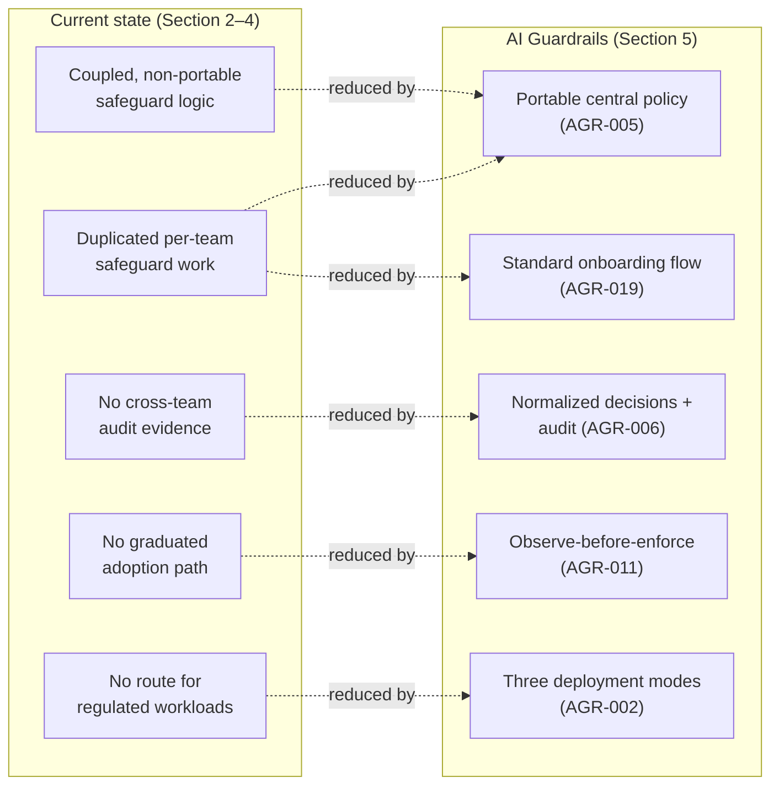

**AI Guardrails — Business Case**

**Authority level:** L3
**Status:** Draft
**Date:** 2026-07-24
**Derived from:** AGREEMENTS.md

---

> This document is the **analytical justification** behind the decision framed in [`30-executive/EXECUTIVE-BRIEF.md`](EXECUTIVE-BRIEF.md). The brief asks leadership to approve a specific next step; this document explains *why* that step is worth taking — the current-state costs of not standardizing, the risk exposure the organization carries today, the benefits reusable guardrails are expected to unlock, and the investment logic behind them. It carries **L3** authority: it operationalizes [`AGREEMENTS.md`](../00-source-of-truth/AGREEMENTS.md) and [`CONSTRAINTS.md`](../00-source-of-truth/CONSTRAINTS.md) (both L1) into business reasoning, and it must not be read as loosening or reinterpreting either. Where this document and an L1 or L2 source-of-truth document appear to disagree, the source-of-truth document wins and this one must be corrected.
>
> **Every figure in this document that would normally be a number — cost, dollar value, percentage, incident count, headcount, duration — is marked TBD or described qualitatively**, because the L1 registers do not supply one. This is a deliberate consequence of source-of-truth policy, not an omission: inventing a number here would create a false sense of analytical precision that the underlying charter cannot support. See [`00-source-of-truth/ASSUMPTIONS.md`](../00-source-of-truth/ASSUMPTIONS.md) for the specific unvalidated beliefs this case depends on, and [`00-source-of-truth/OPEN-QUESTIONS.md`](../00-source-of-truth/OPEN-QUESTIONS.md) for decisions that could still change its shape.

---

## Table of contents

<!-- BEGIN GENERATED: toc -->
- [1. Purpose of this document](#1-purpose-of-this-document)
- [2. Current-state costs and inefficiencies](#2-current-state-costs-and-inefficiencies)
- [3. Risk exposure under the current state](#3-risk-exposure-under-the-current-state)
- [4. Opportunity cost of not standardizing](#4-opportunity-cost-of-not-standardizing)
- [5. Expected benefits](#5-expected-benefits)
- [6. Cost-avoidance and enablement logic](#6-cost-avoidance-and-enablement-logic)
- [7. Investment range](#7-investment-range)
- [8. Adoption assumptions this case depends on](#8-adoption-assumptions-this-case-depends-on)
- [9. What would change this case](#9-what-would-change-this-case)
- [10. Summary position](#10-summary-position)
- [Related documents](#related-documents)
<!-- END GENERATED: toc -->
---

## 1. Purpose of this document

The [`EXECUTIVE-BRIEF.md`](EXECUTIVE-BRIEF.md) answers *what is being proposed and what decision is being asked for*. This document answers a narrower, more analytical question: **is building AI Guardrails, as scoped, a better use of organizational effort than the current state of independent, per-team guardrail work?**

The reasoning here proceeds in five parts, each grounded directly in the accepted agreements and constraints:

1. What the current state already costs the organization, even though that cost is not currently measured (Section 2).
2. What risk the organization already carries because guardrails are inconsistent (Section 3).
3. What continuing without a shared platform forecloses (Section 4).
4. What a standardized platform is expected to deliver instead (Section 5).
5. How those benefits and the investment they require relate to each other (Sections 6–7).

Nothing in this document should be read as a committed forecast. It is a structured argument for *why* the investment is directionally justified, built entirely from what `AGREEMENTS.md` and `CONSTRAINTS.md` already establish — not from external benchmarks or invented figures.

---

## 2. Current-state costs and inefficiencies

the L1 registers do not describe the organization's current guardrail approach as a single system — it describes an absence: "the solution enables multiple teams to apply consistent organizational safeguards **without requiring them to use the same model provider, application framework, or LiteLLM deployment**" ([`CHARTER.md`](../10-charter/CHARTER.md)), which only makes sense as a design goal if today's alternative is that each team currently *does* apply its own, inconsistent safeguards, or none at all.

The [Executive Brief §2](EXECUTIVE-BRIEF.md#2-current-problem) names this directly: "Where safeguard logic exists, it tends to be embedded directly in a specific LiteLLM configuration or tied to a single model provider's response format" ([AGR-005](../00-source-of-truth/AGREEMENTS.md#agr-005--policy-portability), [AGR-001](../00-source-of-truth/AGREEMENTS.md#agr-001--standalone-platform-not-embedded-in-the-internal-litellm)). Reasoning forward from that starting point, the current state carries at least four categories of standing inefficiency:

| Inefficiency | What drives it in the current state | Seed reference |
| --- | --- | --- |
| **Duplicated detection and enforcement work** | Every team that wants prompt/response safeguards must independently decide how to detect and act on violations, rather than reusing one policy definition. There is no shared evaluation contract, decision format, or audit trail across teams. | [`CHARTER.md`](../10-charter/CHARTER.md) |
| **Coupling that blocks reuse** | Where guardrail logic already exists informally, it is commonly embedded in one team's LiteLLM configuration or tied to one model provider's response shape — meaning it cannot be lifted and reused by another team without rework. | [AGR-005](../00-source-of-truth/AGREEMENTS.md#agr-005--policy-portability), [AGR-001](../00-source-of-truth/AGREEMENTS.md#agr-001--standalone-platform-not-embedded-in-the-internal-litellm) |
| **No graduated adoption path** | Without an observe-before-enforce mechanism, a team introducing any safeguard today faces a binary choice: ship without it, or risk breaking production traffic with an unproven check. Both outcomes carry cost — one in unmanaged risk, the other in delivery risk. | [AGR-011](../00-source-of-truth/AGREEMENTS.md#agr-011--observe-before-enforce-progression) |
| **No consistent evidence trail** | Security and compliance teams today lack policy-version traceability, decision evidence, and confirmation that any given safeguard is actually being applied consistently ([`TARGET-USERS.md`](../20-product/TARGET-USERS.md), "Security and compliance teams need... Evidence that policies are being applied"). Every governance review currently starts from a weaker evidentiary position than a shared audit model would provide. | [`TARGET-USERS.md`](../20-product/TARGET-USERS.md), [`NON-FUNCTIONAL-REQUIREMENTS.md`](../50-architecture/NON-FUNCTIONAL-REQUIREMENTS.md) |

None of these costs are quantified in the L1 registers — there is no engineering-hours figure, no incident count, and no dollar estimate of duplicated effort. This case does not attempt to supply one. What can be stated with confidence, directly from the charter, is the qualitative shape of the cost: **it recurs per team, per gateway, and per model provider, and it does not decrease on its own as more teams adopt LLMs — it compounds.** Standardization is the only lever the L1 registers identify that changes that trajectory ([`CHARTER.md`](../10-charter/CHARTER.md)).

---

## 3. Risk exposure under the current state

Beyond inefficiency, the current state carries risk exposure that a shared guardrail platform is specifically designed to reduce. Four categories are explicit in the source material:

### 3.1 Unsafe outputs and unsafe inputs

Without a common evaluation layer, there is no consistent mechanism to detect prompt injection, unsafe prompts, or unsafe model responses across teams ([`CHARTER.md`](../10-charter/CHARTER.md), [`SCOPE.md`](../10-charter/SCOPE.md)). Each team's ad hoc handling — where it exists at all — is unlikely to share detection quality, coverage, or failure behavior with any other team's. [AGR-003](../00-source-of-truth/AGREEMENTS.md#agr-003--litellm-as-first-connector-not-the-product-boundary), [AGR-012](../00-source-of-truth/AGREEMENTS.md#agr-012--failure-behavior-is-part-of-policy) make explicit that **failure behavior is itself part of policy** — in the current state, without a shared policy model, failure behavior for a stalled or unavailable detector is whatever each team happened to implement, which by definition is undocumented at the organizational level.

### 3.2 Sensitive-data leakage

[`DATA-ARCHITECTURE.md`](../50-architecture/DATA-ARCHITECTURE.md) sets an explicit expectation that a governed runtime should "avoid persisting raw prompts and responses by default," "hash user and conversation identifiers where possible," and "remove secrets from telemetry." In the current state, without a common data-handling contract, there is no organization-wide assurance that any of these practices are followed by any given team's ad hoc integration. This is precisely the gap [AGR-014](../00-source-of-truth/AGREEMENTS.md#agr-014--no-raw-promptresponse-retention-by-default) and [`CONSTRAINTS.md` CON-014](../00-source-of-truth/CONSTRAINTS.md#con-014--no-raw-content-retention-by-default-in-the-hosted-runtime) are designed to close for workloads that adopt the platform — but they close it only for adopters, which is the core argument for standardizing rather than leaving each team to self-govern.

### 3.3 False confidence

[`RISK-REGISTER.md`](../70-governance/RISK-REGISTER.md) names "false confidence" as a named risk in its own right: "Teams may interpret successful guardrail evaluation as complete AI security." In the current state this risk is arguably worse, not better, because informal or partial safeguards that *look* like protection but have never been evaluated for false-positive/false-negative rates, and have no documented scope, are more likely to be over-trusted than a platform that is explicit about what it evaluates and what it does not ([AGR-010](../00-source-of-truth/AGREEMENTS.md#agr-010--guardrails-are-not-authorization), [`SCOPE.md`](../10-charter/SCOPE.md); [AGR-010](../00-source-of-truth/AGREEMENTS.md#agr-010--guardrails-are-not-authorization)). A cooperative connector that can be silently removed or misconfigured is also not a hard security boundary ([AGR-018](../00-source-of-truth/AGREEMENTS.md#agr-018--trust-and-enforcement-model)) — a property the platform is explicit about, but which ad hoc integrations typically are not.

### 3.4 Audit gaps

[`NON-FUNCTIONAL-REQUIREMENTS.md`](../50-architecture/NON-FUNCTIONAL-REQUIREMENTS.md) requires that audit metadata capture tenant, workload, policy version, evaluation stage, decision, reason codes, evaluator versions, timestamp, correlation identifier, and whether raw content was retained. In the current state, without a shared decision and audit schema, none of this is guaranteed to exist in a comparable form across teams — meaning a security or compliance review today cannot reliably answer "was this policy applied, and with what result" across the organization. This is exactly the evidentiary gap the [Executive Brief §3](EXECUTIVE-BRIEF.md#3-business-impact) calls out for security and compliance teams.

**None of these four risk categories carries a quantified likelihood or dollar-loss figure in the source material.** This case treats them as directional risk exposure — real, named in the charter, and structurally reduced (not eliminated) by a shared platform — rather than as a modeled loss expectancy.

---

## 4. Opportunity cost of not standardizing

Beyond the costs and risks already carried today, continuing without a shared platform forecloses specific capabilities the L1 registers identify as otherwise reachable:

* **No path from cooperative adoption to mandatory enforcement.** [`CHARTER.md`](../10-charter/CHARTER.md), [AGR-018](../00-source-of-truth/AGREEMENTS.md#agr-018--trust-and-enforcement-model) describe an explicit progression from trusted, cooperative integration toward platform-managed and, eventually, network/IAM-enforced control. Without a shared policy and connector model, there is no common substrate to progress along — each team's ad hoc safeguard has no defined escalation path at all.
* **No reuse across deployment postures.** [AGR-002](../00-source-of-truth/AGREEMENTS.md#agr-002--three-deployment-modes) defines three deployment modes precisely so that teams with different operational-ownership and data-residency needs can adopt the *same* policy. Without standardization, a team with regulated or residency-sensitive workloads today has no organization-provided path to adopt governed safeguards without either accepting a hosted dependency it cannot use, or building its own local evaluation stack from nothing.
* **No comparability of policy effectiveness across teams.** The success metrics in [`SUCCESS-CRITERIA.md`](../10-charter/SUCCESS-CRITERIA.md) — false-positive review rate, confirmed harmful-input detection rate, confirmed sensitive-output prevention rate — are only measurable at all once evaluations are normalized against a shared decision schema ([AGR-017](../00-source-of-truth/AGREEMENTS.md#agr-017--core-domain-model)). In the current state, "how well are our safeguards actually working" is not an organization-level question that can be answered, because there is nothing to aggregate across.
* **Deferred, not avoided, cost.** The "product over-expansion" risk ([`RISK-REGISTER.md`](../70-governance/RISK-REGISTER.md)) cuts the other way here: the longer standardization is deferred, the more entrenched team-specific, non-portable safeguards become, and the higher the eventual cost of retrofitting them into a shared model. the L1 registers do not quantify this compounding effect, but the five-phase sequencing itself ([AGR-020](../00-source-of-truth/AGREEMENTS.md#agr-020--five-phase-delivery)) is structured on the premise that validating reuse *early*, before scope grows, is cheaper than validating it late.

The opportunity cost, in short, is not a missed feature — it is a **widening gap between what the organization could measure and control about its AI safety posture, and what it currently can.**

---

## 5. Expected benefits

Set against Sections 2–4, the accepted agreements and constraints point to four categories of benefit a standardized platform is expected to deliver. Each is stated qualitatively; none carries a numeric target in the source material.

### 5.1 Portable central policy

A guardrail policy defined once can be applied to multiple workloads across multiple gateways and providers without being rewritten per team ([`CHARTER.md`](../10-charter/CHARTER.md), [AGR-005](../00-source-of-truth/AGREEMENTS.md#agr-005--policy-portability)). This directly reverses the duplication cost in Section 2.1: detection and enforcement logic is authored once, not per team.

### 5.2 Faster onboarding

Application teams need "a simple onboarding process" and "minimal application changes" ([`TARGET-USERS.md`](../20-product/TARGET-USERS.md)). The defined onboarding flow — register workload → select policy → generate integration manifest → install connector → observe → review → enable enforcement ([AGR-019](../00-source-of-truth/AGREEMENTS.md#agr-019--meaning-of-import)) — replaces each team independently designing its own safeguard integration from scratch. "Time required to onboard a workload" is named as an adoption metric in [`SUCCESS-CRITERIA.md`](../10-charter/SUCCESS-CRITERIA.md), though no numeric target exists yet (tracked as TBD in [`10-charter/SUCCESS-CRITERIA.md`](../10-charter/SUCCESS-CRITERIA.md)).

### 5.3 Measurable effectiveness

Because evaluations and decisions are normalized to a common schema ([AGR-017](../00-source-of-truth/AGREEMENTS.md#agr-017--core-domain-model); [AGR-006](../00-source-of-truth/AGREEMENTS.md#agr-006--one-logical-evaluation-contract-across-all-modes)), the platform makes it possible — for the first time at an organizational level — to measure false-positive rates, confirmed detection rates, and promotion-from-observe-to-enforce rates across teams ([`SUCCESS-CRITERIA.md`](../10-charter/SUCCESS-CRITERIA.md)). This closes the audit gap identified in Section 3.4: security and compliance teams gain policy-version traceability and decision evidence they do not have today ([`TARGET-USERS.md`](../20-product/TARGET-USERS.md)).

### 5.4 Deployment flexibility for regulated workloads

The three-mode model ([AGR-002](../00-source-of-truth/AGREEMENTS.md#agr-002--three-deployment-modes)) lets a single policy be adopted under three different data-exposure postures — hosted (Mode A/B) or fully customer-managed (Mode C) — so that regulated, data-residency-sensitive, high-volume, or air-gapped workloads ([AGR-002](../00-source-of-truth/AGREEMENTS.md#agr-002--three-deployment-modes), Mode C) have a governed path to adoption instead of being excluded from centralized policy altogether. This directly answers the opportunity cost named in Section 4: today, those workloads have no organization-provided route to shared guardrails at all.

### 5.5 Summary of benefit logic

---

## 6. Cost-avoidance and enablement logic

The case for investing in AI Guardrails rests on two distinct logics, and both must be understood as **directional**, not modeled:

**Cost-avoidance logic.** Every category of duplicated effort and audit gap in Section 2–3 recurs per team, per gateway. A shared policy and evaluation contract converts *N* independent implementations of "detect and act on unsafe content" into one implementation reused *N* times ([`CHARTER.md`](../10-charter/CHARTER.md): "Define guardrail policies once... Apply the same policies to multiple workloads"). The avoided cost is proportional to how many teams and workloads would otherwise have built their own safeguards — a number this case does not know (see [ASM-001](../00-source-of-truth/ASSUMPTIONS.md) in Section 8) and therefore cannot size.

**Enablement logic.** Some benefits in Section 5 are not cost avoidance at all, but capability the organization does not have today regardless of effort spent — specifically, organization-wide measurement of guardrail effectiveness (Section 5.3) and a governed path for regulated workloads (Section 5.4). These are new capabilities, not cheaper versions of existing ones; no amount of per-team effort under the current state produces them, because they require a shared schema and a shared control plane to exist at all.

The two logics compound differently over time. Cost avoidance scales with the number of teams onboarded — it is realized incrementally, phase by phase, as [`20-product/PRODUCT-ROADMAP.md`](../20-product/PRODUCT-ROADMAP.md) sequences onboarding from Phase 1 through Phase 4. Enablement is realized in a step change: it did not exist before Phase 1's evaluation contract and decision schema exist, and it exists in initial form once they do, regardless of how many workloads have onboarded yet.

Both logics justify investment. Neither is quantified in the L1 registers, and this case does not convert either into a dollar figure.

---

## 7. Investment range

The L1 registers do not state a budget figure, headcount number, or delivery-cost estimate anywhere. Per [DEC-008](../00-source-of-truth/DECISIONS.md#dec-008--supersede-the-mvp-bounded-scope-define-and-estimate-the-full-feature-set-across-five-phases), the investment case is built on the **full feature set across all five delivery phases** — a valid delivery estimation requires the full scope to be defined and estimated, not the Phase 1–2 core alone. Consistent with source-of-truth policy, this case records that investment shape qualitatively until figures are supplied by the delivery and product leads, anchored to two things the registers *do* specify: the AWS services the initial phases are expected to use ([`DEPLOYMENT-ARCHITECTURE.md`](../50-architecture/DEPLOYMENT-ARCHITECTURE.md)), and the phase structure investment is expected to follow ([AGR-020](../00-source-of-truth/AGREEMENTS.md#agr-020--five-phase-delivery)).

### 7.1 What is knowable: the AWS service footprint

| Capability | Initial AWS service ([`DEPLOYMENT-ARCHITECTURE.md`](../50-architecture/DEPLOYMENT-ARCHITECTURE.md)) |
| --- | --- |
| Evaluation runtime | ECS Fargate or EKS |
| Public or internal API | API Gateway or Application Load Balancer |
| Policy storage | DynamoDB or versioned S3 |
| Workload registry | DynamoDB |
| Guardrail evaluation | Amazon Bedrock Guardrails |
| Runtime credentials | IAM roles |
| Secrets | AWS Secrets Manager |
| Encryption | AWS KMS |
| Operational metrics | CloudWatch |
| Audit event buffering | Amazon SQS |
| Audit archive | Amazon S3 |
| Container registry | Amazon ECR |

This is a **managed-services footprint**, not novel infrastructure — every listed capability maps to an existing AWS managed service rather than a custom-built equivalent ([`DEPLOYMENT-ARCHITECTURE.md`](../50-architecture/DEPLOYMENT-ARCHITECTURE.md)). Combined with the minimal MVP account model — one non-production account and one production account ([AGR-013](../00-source-of-truth/AGREEMENTS.md#agr-013--aws-as-primary-cloud-minimal-mvp-account-model); [`CONSTRAINTS.md` CON-002](../00-source-of-truth/CONSTRAINTS.md#con-002--minimal-mvp-account-model)) — this points toward a comparatively low infrastructure-spend starting point relative to a bespoke platform build, though the L1 registers supply no dollar figure to attach to that claim, and actual AWS consumption cost is **TBD** pending real workload volume ([ASM-001](../00-source-of-truth/ASSUMPTIONS.md)).

### 7.2 What is knowable: phase-shaped staffing effort

Investment is expected to scale with the five-phase structure ([AGR-020](../00-source-of-truth/AGREEMENTS.md#agr-020--five-phase-delivery); [`20-product/PRODUCT-ROADMAP.md`](../20-product/PRODUCT-ROADMAP.md)), with all five phases inside the estimated scope:

| Phase | Scope that drives effort ([AGR-020](../00-source-of-truth/AGREEMENTS.md#agr-020--five-phase-delivery)) | Relative investment scope |
| --- | --- | --- |
| Phase 1 — Integration proof | Evaluation contract, policy format, Bedrock adapter, LiteLLM connector, observe mode, basic auditing, internal deployment. | Smallest delivery increment; where execution begins. |
| Phase 2 — Internal multi-team platform | Tenant/workload registry, policy bindings, IAM authentication, quotas, promotion/rollback, monitoring, administration workflow. | Completes the Phase 1–2 validation demonstration ([`60-delivery/VALIDATION-PLAN.md`](../60-delivery/VALIDATION-PLAN.md)); proceeds once Phase 1 is validated. |
| Phase 3 — Guarded gateway | Managed LiteLLM gateway, model-provider configuration, per-tenant routing, cost/rate controls, managed credentials. | Materially larger scope — the provider now operates the full inference path ([AGR-002](../00-source-of-truth/AGREEMENTS.md#agr-002--three-deployment-modes), Mode B). Proceeds once Phase 2 is validated. |
| Phase 4 — Customer-managed runtime | Runtime container, Helm chart, ECS template, infrastructure module, local policy cache/sync, customer-controlled telemetry. | Materially larger scope — packaging and supporting a customer-operated runtime. Proceeds once Phase 3 is validated. |
| Phase 5 — Advanced agent protection | Retrieval evaluation, tool-call validation, MCP integration, and other capabilities formerly classified as future scope ([`SCOPE.md`](../10-charter/SCOPE.md), [AGR-020](../00-source-of-truth/AGREEMENTS.md#agr-020--five-phase-delivery)). | Part of the full feature set this case is defined and estimated over ([DEC-008](../00-source-of-truth/DECISIONS.md#dec-008--supersede-the-mvp-bounded-scope-define-and-estimate-the-full-feature-set-across-five-phases)); delivered last, after Phase 4 validates ([AGR-020](../00-source-of-truth/AGREEMENTS.md#agr-020--five-phase-delivery)). |

Actual headcount, role mix, and duration per phase are **TBD** — [ASM-006](../00-source-of-truth/ASSUMPTIONS.md), [ASM-007](../00-source-of-truth/ASSUMPTIONS.md), and [ASM-014](../00-source-of-truth/ASSUMPTIONS.md) name the account-provisioning timeline, the AWS skills gap, and Phase 1–2 funding sufficiency as open, unvalidated inputs to that estimate. This case does not attempt to supply figures those assumptions have not yet validated.

### 7.3 How to read the investment range

The investment logic this case supports is: **estimate over the full five-phase scope, execute and spend in sequence**. Per [DEC-008](../00-source-of-truth/DECISIONS.md#dec-008--supersede-the-mvp-bounded-scope-define-and-estimate-the-full-feature-set-across-five-phases), a valid delivery estimation requires the full feature set to be defined and estimated — bounding the estimate to a narrower core left the larger share of the platform unestimated and made any investment figure unreliable. Execution remains sequenced: each phase is validated before the next proceeds ([AGR-020](../00-source-of-truth/AGREEMENTS.md#agr-020--five-phase-delivery)), and funding releases may follow those gates. Phase 1 is the smallest, most bounded unit of spend and produces the first evidence (the validation demonstration criteria in [`10-charter/SUCCESS-CRITERIA.md`](../10-charter/SUCCESS-CRITERIA.md)) before Phase 3's gateway-hosting scope or Phase 4's customer-managed-runtime scope is executed. This sequencing is itself a risk-mitigation device against the "product over-expansion" risk named in [`RISK-REGISTER.md`](../70-governance/RISK-REGISTER.md).

---

## 8. Adoption assumptions this case depends on

This business case is only as strong as the adoption assumptions underneath it. The following entries from [`00-source-of-truth/ASSUMPTIONS.md`](../00-source-of-truth/ASSUMPTIONS.md) are load-bearing for the reasoning in Sections 2–7, and none of them is yet validated:

| Assumption | Why this case depends on it |
| --- | --- |
| [ASM-001](../00-source-of-truth/ASSUMPTIONS.md) — Expected workload/tenant volume is not yet known | The cost-avoidance logic in Section 6 scales with the number of teams that would otherwise duplicate safeguard work; without a volume estimate, the avoided-cost magnitude cannot be sized, only described directionally. |
| [ASM-002](../00-source-of-truth/ASSUMPTIONS.md) — Phase 1/2 target teams already operate LiteLLM | If untrue, the fastest available proof of the reuse hypothesis (Mode A) is unavailable to those teams, weakening the near-term evidence this case can point to. |
| [ASM-003](../00-source-of-truth/ASSUMPTIONS.md) — Two independent teams are willing to participate in the validation demonstration | Without this, the Phase 1–2 validation demonstration itself ([`SUCCESS-CRITERIA.md`](../10-charter/SUCCESS-CRITERIA.md); [`60-delivery/VALIDATION-PLAN.md`](../60-delivery/VALIDATION-PLAN.md)) cannot run, and this case has no falsifiable evidence to point to at all. |
| [ASM-004](../00-source-of-truth/ASSUMPTIONS.md) — Sufficient regulated/residency-sensitive demand exists to justify Mode C | The Section 5.4 benefit (deployment flexibility for regulated workloads) only pays off if such workloads actually exist in meaningful number; otherwise Phase 4 investment goes largely unused. |
| [ASM-005](../00-source-of-truth/ASSUMPTIONS.md) — Phase 1/2 teams accept a non-bypass-proof, cooperative connector | The near-term benefit case assumes cooperative adoption is acceptable; if trust levels are lower than assumed, faster investment in platform-managed or network/IAM-enforced posture ([AGR-018](../00-source-of-truth/AGREEMENTS.md#agr-018--trust-and-enforcement-model)) would be required earlier than sequenced, changing the investment range in Section 7. |
| [ASM-014](../00-source-of-truth/ASSUMPTIONS.md) — Budget is sufficient to fund a two-account MVP through Phase 1–2 | Directly gates whether the Section 7 investment range as sequenced is even fundable at the pace this case assumes. |
| [ASM-016](../00-source-of-truth/ASSUMPTIONS.md) — Content-exposure documentation alone satisfies security/compliance reviewers for Mode A | If untrue, more workloads than expected would require Mode C sooner, shifting investment from Phase 2/3 toward Phase 4 earlier than sequenced. |
| [ASM-017](../00-source-of-truth/ASSUMPTIONS.md) — Bedrock Guardrails plus deterministic rules provide adequate MVP detection quality | The Section 5.3 "measurable effectiveness" benefit assumes the underlying detectors are good enough to be worth measuring; if not, promotion from observe to enforce stalls and the effectiveness benefit is delayed. |

If any of these assumptions is refuted, the affected section of this case — not the underlying `AGREEMENTS.md` or `CONSTRAINTS.md` — must be revisited, per the change process described in `ASSUMPTIONS.md`.

---

## 9. What would change this case

Consistent with the disclaimers already stated in [`EXECUTIVE-BRIEF.md` §10](EXECUTIVE-BRIEF.md#10-decision-required), this business case does **not** assert:

* A specific dollar figure for current-state cost, avoided cost, or required investment — none exists in the source material.
* A specific return-on-investment ratio, payback period, or breakeven point — none can be computed without the volume, cost, and effectiveness figures named as TBD throughout this document.
* That any of the four risk categories in Section 3 is fully eliminated by the platform — [AGR-010](../00-source-of-truth/AGREEMENTS.md#agr-010--guardrails-are-not-authorization), [`RISK-REGISTER.md`](../70-governance/RISK-REGISTER.md) are explicit that guardrails are not authorization, and a cooperative connector is not a hard security boundary; risk is reduced and made visible, not removed.
* That the benefits in Section 5 are guaranteed — each depends on at least one adoption assumption in Section 8 holding true.

The single largest factor that would strengthen or weaken this case is the resolution of the open questions tracked in [`00-source-of-truth/OPEN-QUESTIONS.md`](../00-source-of-truth/OPEN-QUESTIONS.md), particularly any that bear on expected workload volume, funding commitment, and the trust level of candidate Phase 1/2 teams — the same items named in Section 8.

---

## 10. Summary position

The current state carries recurring, compounding costs (Section 2) and named risk exposure (Section 3) that the L1 registers document qualitatively but do not quantify. Continuing without a shared platform forecloses specific capabilities — a graduated enforcement path, deployment flexibility for regulated workloads, and organization-level effectiveness measurement — that no amount of additional per-team effort can otherwise produce (Section 4). A standardized platform is expected to convert duplicated, non-portable safeguard work into a reusable policy and evaluation contract (Section 5), at an investment shape that is estimated over the full five-phase feature set ([DEC-008](../00-source-of-truth/DECISIONS.md#dec-008--supersede-the-mvp-bounded-scope-define-and-estimate-the-full-feature-set-across-five-phases)), built on managed AWS services rather than novel infrastructure, and executed in validated sequence starting from the smallest delivery increment (Phase 1) (Section 7).

This case does not assert a dollar-denominated return. It asserts that the qualitative shape of the trade-off — recurring, compounding current-state cost and risk, against a phase-gated, evidence-based path to a shared, portable, auditable guardrail layer — favors approving the **full five-phase solution scope**, with execution beginning at **Phase 1 — Integration Proof**, on the same terms already recommended in [`EXECUTIVE-BRIEF.md` §9](EXECUTIVE-BRIEF.md#9-recommended-next-step): conditional on confirming the adoption assumptions in Section 8, and with each phase validated before the next proceeds ([AGR-020](../00-source-of-truth/AGREEMENTS.md#agr-020--five-phase-delivery)).

---

## Related documents

- [`30-executive/EXECUTIVE-BRIEF.md`](EXECUTIVE-BRIEF.md) — the decision-facing companion to this analytical case.
- [`00-source-of-truth/AGREEMENTS.md`](../00-source-of-truth/AGREEMENTS.md) — authoritative agreement register (L1) this case must not contradict.
- [`00-source-of-truth/CONSTRAINTS.md`](../00-source-of-truth/CONSTRAINTS.md) — non-negotiable technical and security boundaries (L1) referenced throughout Sections 3 and 7.
- [`00-source-of-truth/ASSUMPTIONS.md`](../00-source-of-truth/ASSUMPTIONS.md) — the unvalidated beliefs enumerated in Section 8.
- [`00-source-of-truth/OPEN-QUESTIONS.md`](../00-source-of-truth/OPEN-QUESTIONS.md) — unresolved decisions that could change scope or cost, referenced in Section 9.
- [`10-charter/CHARTER.md`](../10-charter/CHARTER.md) — the full product charter this case's reasoning is drawn from.
- [`00-source-of-truth/DECISIONS.md`](../00-source-of-truth/DECISIONS.md) — DEC-008, the decision that set the full-feature-set estimation basis this case is built on.
- [`10-charter/SUCCESS-CRITERIA.md`](../10-charter/SUCCESS-CRITERIA.md) — validation demonstration criteria and ongoing metrics referenced in Sections 5 and 7.
- [`60-delivery/VALIDATION-PLAN.md`](../60-delivery/VALIDATION-PLAN.md) — the Phase 1–2 validation demonstration referenced in Sections 7 and 8.
- [`20-product/PRODUCT-ROADMAP.md`](../20-product/PRODUCT-ROADMAP.md) — the five-phase delivery structure the investment range in Section 7 is anchored to.
- [`70-governance/RISK-REGISTER.md`](../70-governance/RISK-REGISTER.md) — fuller treatment of the risk categories introduced in Section 3.
- [`70-governance/CLAIMS-REGISTER.md`](../70-governance/CLAIMS-REGISTER.md) — must reject any external claim derived from this case that asserts a figure not recorded here or in `AGREEMENTS.md`.
