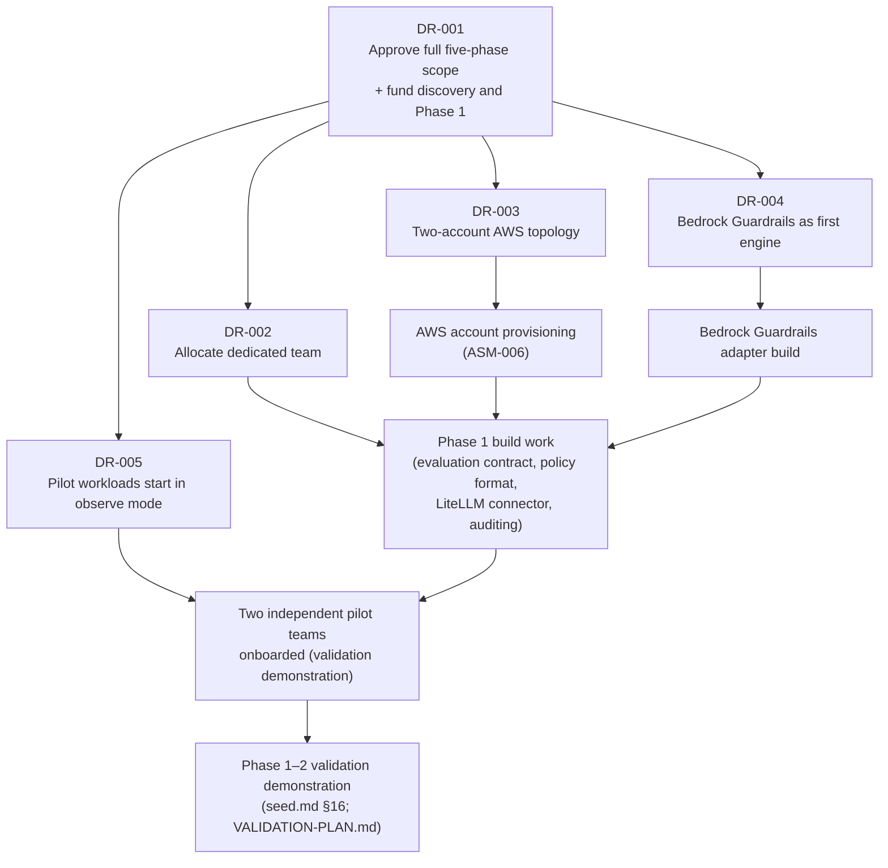

**AI Guardrails — Decision Request**

**Authority level:** L4
**Status:** Draft
**Date:** 2026-07-24
**Derived from:** seed.md + AGREEMENTS.md

---

> This is a decision-request memo, not a narrative brief. It exists to isolate the specific, actionable approvals leadership must grant for AI Guardrails delivery to proceed, separately from the fuller context in the [Executive Brief](EXECUTIVE-BRIEF.md). Every ask below traces to the authoritative [AGREEMENTS.md](../00-source-of-truth/AGREEMENTS.md) register or to [seed.md](../../seed.md) directly. Where a figure (budget, headcount, date) is not established in the source material, it is marked **TBD** rather than estimated, per source-of-truth policy — see [ASSUMPTIONS.md](../00-source-of-truth/ASSUMPTIONS.md) and [OPEN-QUESTIONS.md](../00-source-of-truth/OPEN-QUESTIONS.md).

---

## 1. Purpose of this document

The [Executive Brief](EXECUTIVE-BRIEF.md) explains *why* AI Guardrails should be built and what problem it solves. This document exists for a narrower purpose: to state, as a discrete checklist, **exactly what executives are being asked to approve right now**, who owns each decision, and what each approval unblocks. It is written so that a decision on each item can be recorded independently — approved, deferred, or declined — without requiring agreement on every other item first.

Nothing in this document introduces a new commitment beyond what [AGREEMENTS.md](../00-source-of-truth/AGREEMENTS.md) already records at the working-team level. What this document adds is the **executive funding, staffing, and operating-posture ratification** needed to act on those working-team agreements.

---

## 2. What is already decided (not being re-asked here)

The following are recorded as **Accepted** in [AGREEMENTS.md](../00-source-of-truth/AGREEMENTS.md), agreed by the product, technical, and architecture leads named in that register. They are the premises this decision request builds on, not new asks:

| Already accepted | Reference |
| --- | --- |
| AI Guardrails is built as a standalone policy and enforcement platform, not embedded in the internal LiteLLM instance. | [AGR-001](../00-source-of-truth/AGREEMENTS.md#agr-001--standalone-platform-not-embedded-in-the-internal-litellm) |
| The product supports exactly three deployment modes (Remote Evaluation, Guarded Gateway, Customer-Managed Runtime) under one logical evaluation contract. | [AGR-002](../00-source-of-truth/AGREEMENTS.md#agr-002--three-deployment-modes), [AGR-006](../00-source-of-truth/AGREEMENTS.md#agr-006--one-logical-evaluation-contract-across-all-modes) |
| LiteLLM is the first connector, not the product boundary; policies and connectors are mandatorily separate. | [AGR-003](../00-source-of-truth/AGREEMENTS.md#agr-003--litellm-as-first-connector-not-the-product-boundary), [AGR-007](../00-source-of-truth/AGREEMENTS.md#agr-007--policies-are-separate-from-connectors) |
| Delivery proceeds through five sequenced phases, each validated before the next proceeds; the full feature set across those phases is the defined and estimated solution scope. | [AGR-020](../00-source-of-truth/AGREEMENTS.md#agr-020--five-phase-delivery); [DEC-008](../00-source-of-truth/DECISIONS.md#dec-008--supersede-the-mvp-bounded-scope-define-and-estimate-the-full-feature-set-across-five-phases) |

What is **missing** from the above is an executive decision to fund, staff, and operate against these agreements. That is the entire subject of Sections 3–4 below. If leadership does not consider itself bound by AGREEMENTS.md at all, the [Executive Brief](EXECUTIVE-BRIEF.md) is the correct starting document instead of this one.

---

## 3. Decisions requested now — summary

| ID | Ask (one line) | Decision owner (role) | Gates |
| --- | --- | --- | --- |
| [DR-001](#dr-001--approve-and-fund-the-full-five-phase-solution-scope) | Approve and fund the full five-phase solution scope (execution starts with discovery and Phase 1) | Executive sponsor / budget owner (name TBD) | All delivery work |
| [DR-002](#dr-002--allocate-a-small-dedicated-delivery-team) | Allocate a small, dedicated delivery team to Phase 1 | Engineering resourcing owner (name TBD) | DR-001 execution |
| [DR-003](#dr-003--approve-a-two-account-aws-mvp-topology) | Approve a two-account AWS MVP topology (one non-production, one production) | Platform operations lead (name TBD) | AWS account provisioning |
| [DR-004](#dr-004--approve-amazon-bedrock-guardrails-as-the-first-managed-evaluation-engine) | Approve Amazon Bedrock Guardrails as the first managed evaluation engine | Technical / Architecture lead (name TBD) | Evaluation-engine build |
| [DR-005](#dr-005--approve-running-pilot-workloads-in-observe-mode) | Approve running pilot workloads in **observe mode**, not enforce, at onboarding | Security and governance lead (name TBD) | Pilot-team onboarding |

Each ask is independent and separately approvable, but DR-002 through DR-005 depend on DR-001 being approved to have any resourcing behind them. See [Section 5](#5-dependency-and-sequencing-view) for the full dependency picture.

---

## 4. Decision requests in detail

### DR-001 — Approve and fund the full five-phase solution scope

**Ask:** Approve building AI Guardrails over the **full solution scope — all five delivery phases** — on the basis of an estimation built over the full feature set ([DEC-008](../00-source-of-truth/DECISIONS.md#dec-008--supersede-the-mvp-bounded-scope-define-and-estimate-the-full-feature-set-across-five-phases)), and approve funding to run a discovery activity and begin execution with **Phase 1 — Integration Proof**, whose objective is to prove that guardrail policy and evaluation can be separated from LiteLLM and reused across multiple gateways (seed.md §18). Execution remains sequenced: each phase is validated before the next proceeds ([AGR-020](../00-source-of-truth/AGREEMENTS.md#agr-020--five-phase-delivery)), and funding releases may follow those gates. Phase 1 deliverables are: the evaluation contract, the policy format, the Bedrock Guardrails adapter, the LiteLLM connector, observe mode, basic auditing, and an internal deployment.

**Discovery scope, specifically:** securing named commitments from **at least two organizationally independent teams**, each already operating its own LiteLLM instance, willing to participate in the Phase 1–2 validation demonstration — without this, the demonstration defined in seed.md §16 and [`60-delivery/VALIDATION-PLAN.md`](../60-delivery/VALIDATION-PLAN.md) cannot be executed as specified (see ASM-002, ASM-003 in [ASSUMPTIONS.md](../00-source-of-truth/ASSUMPTIONS.md)).

**Decision owner:** Executive sponsor / budget owner (name TBD), informed by the Product lead and Delivery lead.

**What this unblocks:** Phase 1 engineering kickoff; formal outreach to candidate pilot teams; the AWS account-provisioning request that DR-003 depends on.

**Budget:** No dollar figure, headcount cost, or timeline duration exists in the source material. This ask approves the **full five-phase scope as the basis for estimation** — per [DEC-008](../00-source-of-truth/DECISIONS.md#dec-008--supersede-the-mvp-bounded-scope-define-and-estimate-the-full-feature-set-across-five-phases), a valid delivery estimation requires the full feature set — not a specific spend amount; the amount is tracked as **TBD** pending a delivery estimate over that full scope from the technical lead (ASM-014 in [ASSUMPTIONS.md](../00-source-of-truth/ASSUMPTIONS.md)).

**Does not ask leadership to:** Commit a specific budget figure, headcount, or calendar dates — all **TBD**. Execution sequencing is unchanged: each phase must be validated before the next proceeds, per [AGR-020](../00-source-of-truth/AGREEMENTS.md#agr-020--five-phase-delivery), and funding releases may follow those validation gates.

---

### DR-002 — Allocate a small, dedicated delivery team

**Ask:** Approve allocating a **small, dedicated** cross-functional delivery team to Phase 1 — not a part-time or shared allocation — with the AWS and integration skills needed to build the seed §11 architecture (ECS Fargate or EKS, API Gateway/ALB, DynamoDB or versioned S3, Amazon Bedrock Guardrails, IAM, KMS, SQS, CloudWatch, ECR).

**Decision owner:** Engineering resourcing owner (name TBD), informed by the Technical lead.

**What this unblocks:** Actual build work against the Phase 1 deliverables in DR-001. Without dedicated, named headcount, the Phase 1 timeline cannot be estimated or committed to.

**Team size:** Not specified anywhere in the source material. The charter and agreements describe the required *skills and responsibilities* (seed.md §21; [AGR-001](../00-source-of-truth/AGREEMENTS.md#agr-001--standalone-platform-not-embedded-in-the-internal-litellm)) but no headcount number — this is recorded as **TBD**, described only qualitatively as "small" and "dedicated."

**Related risk to flag:** ASM-007 in [ASSUMPTIONS.md](../00-source-of-truth/ASSUMPTIONS.md) — whether the delivery team already has, or can readily acquire, the required AWS skills is itself unvalidated and should be assessed as part of standing this team up.

**Does not ask leadership to:** Commit a specific team size or duration — both **TBD**; approve staffing for a dedicated tenant-runtime team (a Phase 4 concept, staffed only when Phase 4 execution begins).

---

### DR-003 — Approve a two-account AWS MVP topology

**Ask:** Approve building the MVP on a **minimal two-account AWS topology** — one non-production account and one production account — rather than a three-or-more-account structure, with IAM, storage, and environment boundaries kept explicit within that model.

**Decision owner:** Platform operations lead (name TBD), with concurrence from the Security and governance lead.

**Basis:** seed.md §11 ("The MVP does not require separate management, production, and audit AWS accounts... A single non-production account and one production account are sufficient initially"), §17 (MVP non-goal: "Three-account AWS separation"); [AGR-013](../00-source-of-truth/AGREEMENTS.md#agr-013--aws-as-primary-cloud-minimal-mvp-account-model); [CON-002](../00-source-of-truth/CONSTRAINTS.md#con-002--minimal-mvp-account-model).

**What this unblocks:** The AWS account-provisioning request (ASM-006 in [ASSUMPTIONS.md](../00-source-of-truth/ASSUMPTIONS.md)) can be filed; IAM role design and network-boundary design can begin against a known target topology.

**Does not ask leadership to:** Rule out account separation permanently. Additional account separation is explicitly permitted — and expected — once justified by external customers, compliance requirements, independent security ownership, immutable audit requirements, production scale, or dedicated tenant deployments (seed.md §11; [AGR-013](../00-source-of-truth/AGREEMENTS.md#agr-013--aws-as-primary-cloud-minimal-mvp-account-model)). The measurable trigger point for that move is an open question ([OQ-009](../00-source-of-truth/OPEN-QUESTIONS.md#oq-009--trigger-point-for-three-account-aws-separation)) to be reassessed at each phase gate, not resolved by this approval. This ask also does not approve PrivateLink/private connectivity ([OQ-002](../00-source-of-truth/OPEN-QUESTIONS.md#oq-002--privatelink--private-connectivity)) or a multi-Region strategy ([OQ-003](../00-source-of-truth/OPEN-QUESTIONS.md#oq-003--regional-deployment-strategy-and-data-residency)), both of which remain open.

---

### DR-004 — Approve Amazon Bedrock Guardrails as the first managed evaluation engine

**Ask:** Approve adopting **Amazon Bedrock Guardrails** as the initial managed evaluation engine for Phase 1, behind a public evaluation contract that remains vendor-independent.

**Decision owner:** Technical lead / Architecture lead (name TBD), with the Product lead confirming this creates no long-term single-vendor commitment claim.

**Basis:** seed.md §10, §11 (AWS implementation direction — "Guardrail evaluation: Amazon Bedrock Guardrails"), §22; [AGR-004](../00-source-of-truth/AGREEMENTS.md#agr-004--bedrock-guardrails-as-first-engine-vendor-independent-contract).

**What this unblocks:** Build of the Bedrock Guardrails adapter, a named Phase 1 deliverable and a dependency on the critical path for the Phase 1–2 validation demonstration (both the observe-mode and enforce-mode pilot workloads require a working evaluation engine).

**Condition to verify before or during Phase 1 architecture sign-off:** ASM-008 in [ASSUMPTIONS.md](../00-source-of-truth/ASSUMPTIONS.md) — Bedrock Guardrails' availability and feature parity in the AWS Region(s) the organization intends to deploy into has **not yet been verified**. This approval should not be read as confirming regional availability; that verification is a near-term follow-up, not a precondition already met.

**Does not ask leadership to:** Commit to Bedrock Guardrails as the platform's **permanent or exclusive** detection engine. [AGR-004](../00-source-of-truth/AGREEMENTS.md#agr-004--bedrock-guardrails-as-first-engine-vendor-independent-contract) explicitly forbids describing it that way in product or marketing materials. Additional evaluation engines (deterministic rules, PII evaluators, future third-party engines) must remain addable behind the same adapter pattern without requiring this decision to be revisited.

---

### DR-005 — Approve running pilot workloads in observe mode

**Ask:** Approve that the first pilot workloads onboarded during Phase 1/2 run in **Observe mode** (non-blocking evaluation) as the default and required starting posture — not Enforce — following the progression Disabled → Observe → Warn → Redact → Block.

**Decision owner:** Security and governance lead (name TBD), with concurrence from the pilot workloads' owners.

**Basis:** seed.md §5.6 ("A team must be able to measure false positives, latency, and business impact before enabling blocking behavior"), §16 (validation demonstration: "One workload can run in observe mode... Another workload can run in enforce mode"); [AGR-011](../00-source-of-truth/AGREEMENTS.md#agr-011--observe-before-enforce-progression).

**What this unblocks:** Onboarding of the two independent pilot LiteLLM teams secured under DR-001 can proceed without exposing their production traffic to blocking risk while the policy's real-world false-positive rate, latency impact, and business impact are still unproven.

**Important nuance:** the Phase 1–2 validation demonstration (seed.md §16; [`60-delivery/VALIDATION-PLAN.md`](../60-delivery/VALIDATION-PLAN.md)) requires that **one** pilot workload run in observe mode while **another** runs in enforce mode — this ask approves observe mode as the mandatory *starting* posture for onboarding, not a ban on ever reaching enforce mode during Phase 1.

**Does not ask leadership to:** Approve the go/no-go criteria for promoting any workload from observe to enforce. That is a separately tracked open question ([OQ-014](../00-source-of-truth/OPEN-QUESTIONS.md#oq-014--gono-go-criteria-to-move-a-workload-from-observe-to-enforce)) that should be resolved before onboarding scales past this initial pilot set.

---

## 5. Dependency and sequencing view

If DR-001 is not approved, none of DR-002 through DR-005 have any resourcing to act on — they remain approved-in-principle only. If DR-003 or DR-004 are deferred pending more information, Phase 1 planning can proceed but the architecture cannot be finalized until both resolve, since the account topology and the evaluation engine are both named Phase 1 deliverables (seed.md §11, §18).

---

## 6. What approval of this document does not commit leadership to

Approving DR-001 through DR-005 does **not** constitute approval of:

* A specific budget figure, headcount number, or delivery date — all remain **TBD**, to be supplied by the delivery and product leads once the full-scope delivery estimate is prepared.
* Anything in the seed.md §6.3 product-category exclusions — general-purpose gateway replacement, complete AI governance platform, complete DLP platform, business authorization, cross-cloud deployment, among others — see [`10-charter/SCOPE.md`](../10-charter/SCOPE.md).
* A three-or-more-account AWS topology, PrivateLink/private connectivity, a multi-Region or data-residency strategy, compliance certification, or a commercial/metering model — all of which remain open questions tracked in [OPEN-QUESTIONS.md](../00-source-of-truth/OPEN-QUESTIONS.md).
* Any enforcement posture beyond cooperative integration for the initial pilot onboarding (the trust model appropriate for trusted, internal pilot teams) — platform-managed enforcement and network/IAM-enforced gateway postures arrive with later phases and remain governed by the trust model (seed.md §8; [AGR-018](../00-source-of-truth/AGREEMENTS.md#agr-018--trust-and-enforcement-model)): a cooperative connector is never a hard security boundary.
* A claim that Bedrock Guardrails is, or will remain, the product's only or permanent evaluation engine ([AGR-004](../00-source-of-truth/AGREEMENTS.md#agr-004--bedrock-guardrails-as-first-engine-vendor-independent-contract)).

---

## 7. If an ask is declined or deferred

This register does not prescribe an outcome for a declined or deferred ask; it only records the consequence so that the decision owner can weigh it explicitly.

| If declined or deferred | Consequence |
| --- | --- |
| DR-001 (scope and funding) | Delivery cannot begin; discovery work to secure the two required pilot teams (ASM-002, ASM-003) does not start, and no full-scope delivery estimate is commissioned. |
| DR-002 (team) | Even if funded, Phase 1 has no committed engineering capacity and cannot produce a delivery estimate. |
| DR-003 (two-account topology) | AWS provisioning is blocked pending a topology decision; a three-account request would require its own justification against the triggers in [AGR-013](../00-source-of-truth/AGREEMENTS.md#agr-013--aws-as-primary-cloud-minimal-mvp-account-model) before being considered. |
| DR-004 (Bedrock Guardrails) | The Phase 1 evaluation engine is undecided; Phase 1 could proceed only with deterministic rules, which seed.md §16 treats as a basic evaluator alongside, not a replacement for, the managed engine. |
| DR-005 (observe mode for pilots) | Onboarding either has no defined starting enforcement posture, or risks defaulting to a blocking posture for an unproven policy — the exact outcome [AGR-011](../00-source-of-truth/AGREEMENTS.md#agr-011--observe-before-enforce-progression) exists to prevent. |

---

## 8. Sign-off

| Ask | Decision | Decision owner (name) | Date |
| --- | --- | --- | --- |
| DR-001 — Approve and fund the full five-phase solution scope | ☐ Approved ☐ Deferred ☐ Declined | | |
| DR-002 — Allocate dedicated team | ☐ Approved ☐ Deferred ☐ Declined | | |
| DR-003 — Two-account AWS topology | ☐ Approved ☐ Deferred ☐ Declined | | |
| DR-004 — Bedrock Guardrails as first engine | ☐ Approved ☐ Deferred ☐ Declined | | |
| DR-005 — Pilot workloads start in observe mode | ☐ Approved ☐ Deferred ☐ Declined | | |

Names, titles, and dates are intentionally left blank — no individual is named in the source material as the accountable executive for any of these asks. This table should be completed and retained as the record of decision once leadership responds.

---

## Related documents

* [`30-executive/EXECUTIVE-BRIEF.md`](EXECUTIVE-BRIEF.md) — full context, problem statement, and rationale behind this request.
* [`00-source-of-truth/AGREEMENTS.md`](../00-source-of-truth/AGREEMENTS.md) — authoritative agreement register (L1) each ask traces to.
* [`00-source-of-truth/CONSTRAINTS.md`](../00-source-of-truth/CONSTRAINTS.md) — non-negotiable technical and security boundaries (see CON-001, CON-002 for the account-topology constraint underlying DR-003).
* [`00-source-of-truth/ASSUMPTIONS.md`](../00-source-of-truth/ASSUMPTIONS.md) — unvalidated beliefs (ASM-002, ASM-003, ASM-006, ASM-007, ASM-008, ASM-014) this request depends on.
* [`00-source-of-truth/OPEN-QUESTIONS.md`](../00-source-of-truth/OPEN-QUESTIONS.md) — decisions explicitly out of scope for this request (OQ-002, OQ-003, OQ-009, OQ-014).
* [`00-source-of-truth/DECISIONS.md`](../00-source-of-truth/DECISIONS.md) — chronological log of the working-team decisions (DEC-001 through DEC-008) this request builds on.
* [`10-charter/CHARTER.md`](../10-charter/CHARTER.md) — full product charter narrative.
* [`60-delivery/MILESTONES.md`](../60-delivery/MILESTONES.md) — phase-level delivery milestones for Phase 1 and beyond.
