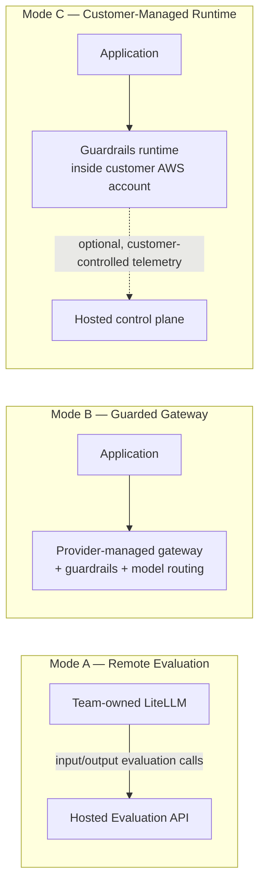

**AI Guardrails — Executive Brief**

**Authority level:** L4
**Status:** Draft
**Date:** 2026-07-24
**Derived from:** seed.md + AGREEMENTS.md

---

> This brief is a derived document produced for executive decision-making. It must not be read as a source of new commitments: every claim here traces to the authoritative [AGREEMENTS.md](../00-source-of-truth/AGREEMENTS.md) register or to the underlying [solution charter](../../seed.md). Where a figure (cost, date, SLA, volume) is not yet established, it is marked **TBD** rather than estimated, per source-of-truth policy — see [ASSUMPTIONS.md](../00-source-of-truth/ASSUMPTIONS.md) and [OPEN-QUESTIONS.md](../00-source-of-truth/OPEN-QUESTIONS.md) for what remains unresolved.

---

## 1. Executive summary

Teams across the organization are building applications and agentic workflows on top of large language models, each independently responsible for applying safety, policy, and compliance safeguards. There is no reusable, centrally governed layer that lets these teams adopt consistent guardrails without being forced onto the same model provider, application framework, or gateway.

**AI Guardrails** is proposed as a standalone, AWS-based policy and enforcement platform that separates *what must be evaluated* (organizational policy) from *how a specific application or gateway invokes it* (a connector). Teams can adopt the same guardrail policy whether they operate their own LiteLLM gateway, consume a fully managed inference-and-guardrail service, or run the guardrail runtime inside their own AWS account under their own data-isolation requirements.

The solution is defined — and its delivery estimated — over the **full feature set**, organized across five sequenced delivery phases (per [DEC-008](../00-source-of-truth/DECISIONS.md#dec-008--supersede-the-mvp-bounded-scope-define-and-estimate-the-full-feature-set-across-five-phases) and [AGR-020](../00-source-of-truth/AGREEMENTS.md#agr-020--five-phase-delivery)). Its first proof point remains narrow and falsifiable: that **a single reusable policy can be applied consistently to multiple independent LiteLLM deployments**, with normalized decisions, an observe-before-enforce rollout path, and no undocumented failure behavior — demonstrated during Phases 1–2 and validated before later phases proceed. Product-category exclusions — general-purpose gateway replacement, complete AI governance platform, business authorization, cross-cloud deployment, compliance certification, among others — remain out of scope per seed.md §6.3.

This brief asks leadership to approve building AI Guardrails as a standalone platform over the **full solution scope — all five delivery phases** — on the basis of an estimation built over the full feature set, with execution sequenced so that each phase is validated before the next proceeds.

---

## 2. Current problem

* **No shared safeguard layer.** Application and platform teams that consume LLMs today must each independently decide how to detect and act on unsafe prompts, unsafe responses, and policy violations. There is no common policy definition, decision format, or audit trail across teams (seed.md §1–§2).
* **Safeguards are coupled to specific gateways and providers.** Where guardrail logic exists, it tends to be embedded directly in a specific LiteLLM configuration or tied to a single model provider's response format, which prevents reuse across teams that use different gateways or providers (seed.md §5.1, §22).
* **No graduated path from adoption to enforcement.** Without a way to observe a policy's real-world behavior — false positives, latency impact — before it can block production traffic, teams have no safe way to introduce guardrails without risking outages or broken user experiences (seed.md §5.6).
* **Inconsistent data-exposure posture.** Different teams have different tolerances for where prompts and responses may be processed — some can accept a hosted service, others require content to remain inside their own AWS account for regulatory or residency reasons — and today there is no single product that serves both needs under one policy model (seed.md §5.4, §3).
* **Enforcement strength is not distinguished from cooperative adoption.** Where lightweight, voluntary integrations exist, they are sometimes implicitly treated as guaranteed security controls, when in fact a cooperative connector can be removed or misconfigured (seed.md §8).

---

## 3. Business impact

| Dimension | Impact of the current gap |
| --- | --- |
| Governance consistency | Security and compliance teams (seed.md §7) lack policy-version traceability, decision evidence, and evidence that policies are actually being applied across teams. |
| Engineering duplication | Each application or platform team that wants LLM safeguards must build or integrate its own detection and enforcement logic, rather than reusing a shared policy. |
| Adoption risk | Without an observe-before-enforce path, teams are exposed to the choice of either shipping without safeguards or risking broken production traffic from an unproven policy. |
| Compliance and residency | Teams with regulated, high-volume, or data-residency-sensitive workloads currently have no defined way to adopt central guardrails without their prompts and responses leaving their own AWS environment (seed.md §3, Mode C). |
| False assurance | Where informal safeguards already exist, there is a risk that stakeholders mistake a removable, cooperative integration for a hard security boundary (seed.md §20, "False confidence"). |

Specific quantified figures for cost of the current gap (incident cost, engineering hours duplicated, compliance exposure in dollar terms) are **not present in the source material** and are recorded as **TBD** rather than estimated.

---

## 4. Proposed solution

AI Guardrails is a **standalone policy and enforcement platform** — not a feature embedded inside any single team's LiteLLM instance (per [AGR-001](../00-source-of-truth/AGREEMENTS.md#agr-001--standalone-platform-not-embedded-in-the-internal-litellm)) — built around a stable domain model of **tenant, workload, policy, policy binding, evaluation, and decision** (per [AGR-017](../00-source-of-truth/AGREEMENTS.md#agr-017--core-domain-model)).

It supports three deployment modes, chosen by each consuming team according to its own operational-ownership and data-residency needs, all governed by one logical evaluation contract (per [AGR-002](../00-source-of-truth/AGREEMENTS.md#agr-002--three-deployment-modes) and [AGR-006](../00-source-of-truth/AGREEMENTS.md#agr-006--one-logical-evaluation-contract-across-all-modes)):

| Mode | Who operates the gateway | Who operates the guardrail runtime | Best fit |
| --- | --- | --- | --- |
| A — Remote Evaluation | Consuming team | AI Guardrails (hosted) | Teams that already run LiteLLM and want reduced operational ownership of guardrail logic. Tenant content still reaches the hosted service — this is **not** a data-local model (per [AGR-009](../00-source-of-truth/AGREEMENTS.md#agr-009--remote-evaluation-is-not-a-private-data-or-data-local-model)). |
| B — Guarded Gateway | AI Guardrails | AI Guardrails (hosted) | Teams without their own gateway that want a fully managed, OpenAI-compatible inference-and-guardrail path. |
| C — Customer-Managed Runtime | Consuming team | Consuming team (in their own AWS account) | Regulated, data-residency-sensitive, or high-volume workloads that must keep prompt/response processing inside their own environment; runs without requiring a synchronous connection to the hosted control plane (per [AGR-015](../00-source-of-truth/AGREEMENTS.md#agr-015--customer-managed-runtime-executes-without-a-synchronous-control-plane-connection)). |

Guardrail policies define *what* to evaluate and *how* to act on violations; connectors define *how* a specific gateway invokes and enforces that policy — this separation is mandatory (per [AGR-007](../00-source-of-truth/AGREEMENTS.md#agr-007--policies-are-separate-from-connectors)). LiteLLM is the first supported connector, and Amazon Bedrock Guardrails is the first evaluation engine, but neither defines the product's boundary or public contract (per [AGR-003](../00-source-of-truth/AGREEMENTS.md#agr-003--litellm-as-first-connector-not-the-product-boundary) and [AGR-004](../00-source-of-truth/AGREEMENTS.md#agr-004--bedrock-guardrails-as-first-engine-vendor-independent-contract)).

Every policy supports a graduated rollout — Disabled → Observe → Warn → Redact → Block — so a team can measure false positives, latency, and business impact before enabling blocking behavior (per [AGR-011](../00-source-of-truth/AGREEMENTS.md#agr-011--observe-before-enforce-progression)). AI Guardrails evaluates content safety; it explicitly does not perform business authorization, which remains the consuming application's responsibility (per [AGR-010](../00-source-of-truth/AGREEMENTS.md#agr-010--guardrails-are-not-authorization)).

For the fuller technical and product picture, see [`10-charter/CHARTER.md`](../10-charter/CHARTER.md) and [`20-product/CAPABILITIES.md`](../20-product/CAPABILITIES.md).

---

## 5. Expected outcomes

The first proof point is the **Phase 1–2 validation demonstration** — a delivery-plan milestone defined in seed.md §16 and [`60-delivery/VALIDATION-PLAN.md`](../60-delivery/VALIDATION-PLAN.md), not the definition of overall solution success ([DEC-008](../00-source-of-truth/DECISIONS.md#dec-008--supersede-the-mvp-bounded-scope-define-and-estimate-the-full-feature-set-across-five-phases)). It proves a single, falsifiable hypothesis before later phases proceed, and passes when:

* Two organizationally independent LiteLLM instances consume the **same** versioned policy.
* Neither instance shares model-provider credentials with the guardrail platform.
* Both instances receive consistent, normalized decisions from the platform.
* One workload runs in **observe** mode while another runs in **enforce** mode.
* A policy version can be upgraded and rolled back.
* Raw prompt/response persistence can be disabled.
* Evaluation failures follow an explicitly configured failure policy (no undocumented fallback behavior).
* The runtime can later be packaged for customer-managed deployment without changing the connector contract.

Beyond that demonstration, the solution's outcomes span the full five-phase scope: an internal multi-team platform with tenant administration and promotion/rollback (Phase 2), a fully managed Guarded Gateway for teams without their own gateway (Phase 3), a Customer-Managed Runtime for regulated and data-residency-sensitive workloads (Phase 4), and advanced agent protection — retrieval evaluation, tool-call validation, MCP integration (Phase 5). Across all phases, success is tracked against four categories of metrics defined in the charter (seed.md §19): **adoption** (onboarded workloads, active tenants, time to onboard), **reliability** (evaluation availability, timeout rate, latency), **effectiveness** (confirmed detections, false-positive review rate, observe-to-enforce promotion rate), and **product portability** (deployment-mode-independent policy coverage, number of supported connectors). Specific numeric targets for these metrics are not yet defined in the source material and are recorded as **TBD** in [`ASSUMPTIONS.md`](../00-source-of-truth/ASSUMPTIONS.md). See [`EXPECTED-OUTCOMES.md`](EXPECTED-OUTCOMES.md) for the full outcome view.

No dollar-value ROI, adoption percentage, or SLA figure is asserted in this brief; none currently exists in the authoritative source material.

---

## 6. Strategic alignment

* **Reusability over duplication.** A single policy applied across heterogeneous gateways and providers directly addresses the engineering-duplication and governance-consistency gaps in Section 3.
* **Graduated trust, not a false security guarantee.** The product explicitly distinguishes cooperative integration, platform-managed enforcement, and network/IAM-enforced gateway postures, and will never represent a cooperative connector as a hard security boundary (per [AGR-018](../00-source-of-truth/AGREEMENTS.md#agr-018--trust-and-enforcement-model)).
* **Deliberate, sequenced scope.** Delivery proceeds through five phases — Integration Proof, Internal Multi-Team Platform, Guarded Gateway, Customer-Managed Runtime, and Advanced Agent Protection — each validated before the next proceeds (per [AGR-020](../00-source-of-truth/AGREEMENTS.md#agr-020--five-phase-delivery)). This directly guards against the "product over-expansion" risk identified in seed.md §20.
* **Minimal initial infrastructure footprint.** Phases 1–2 run on a single primary cloud (AWS) and a minimal two-account model (one non-production, one production), with additional account separation introduced only when a specific, named trigger is met (per [AGR-013](../00-source-of-truth/AGREEMENTS.md#agr-013--aws-as-primary-cloud-minimal-mvp-account-model)).
* **Explicit, separated concerns.** Operational ownership (who runs the infrastructure) and data exposure (where content is processed) are always documented as two distinct questions, never conflated (per [AGR-008](../00-source-of-truth/AGREEMENTS.md#agr-008--explicit-content-exposure-model-ownership-vs-exposure-are-separate-concerns)).

See [`60-delivery/MILESTONES.md`](../60-delivery/MILESTONES.md) and [`20-product/PRODUCT-ROADMAP.md`](../20-product/PRODUCT-ROADMAP.md) for the phase-level delivery view.

---

## 7. Investment and organizational impact

**Investment.** The estimation now spans the **full five-phase scope** (per [DEC-008](../00-source-of-truth/DECISIONS.md#dec-008--supersede-the-mvp-bounded-scope-define-and-estimate-the-full-feature-set-across-five-phases) — a valid delivery estimation requires the full feature set to be defined and estimated). Specific budget figures, headcount, and timeline durations are not present in the source material and must be provided by the delivery and product leads before a funding decision is finalized; they are tracked as open items in [`ASSUMPTIONS.md`](../00-source-of-truth/ASSUMPTIONS.md) (ASM-006, ASM-007, ASM-014). What can be stated qualitatively:

* The initial delivery phases run on a **minimal AWS footprint** — one non-production and one production account, using managed AWS services (ECS Fargate or EKS, API Gateway/ALB, DynamoDB, Amazon Bedrock Guardrails, IAM, KMS, SQS, CloudWatch, ECR) rather than novel infrastructure (seed.md §11).
* Delivery is **estimated over the full five-phase scope but executed in sequence** (per [AGR-020](../00-source-of-truth/AGREEMENTS.md#agr-020--five-phase-delivery)): each phase is validated before the next proceeds, and funding releases may follow those gates. Phases 3 (Guarded Gateway) and 4 (Customer-Managed Runtime) represent materially larger operational and security scope, which the per-phase validation gates exist to control.

**Organizational impact.**

| Group | Role under AI Guardrails |
| --- | --- |
| AI Guardrails team | Owns product architecture, policy schemas, the evaluation contract, the guardrail runtime, the LiteLLM connector, Bedrock integration, and documentation. |
| Platform operations | Owns hosted infrastructure, deployment, monitoring, capacity, and production incident response. |
| Security and governance | Owns organization-level policy requirements, risk classifications, policy approval, and audit requirements. |
| Consuming (application) teams | Own application behavior, correct connector installation in cooperative mode, workload registration accuracy, and review of observe-mode findings before accepting enforcement. |

Full ownership boundaries are documented in seed.md §21 and reflected across the architecture set; see [`50-architecture/SECURITY-ARCHITECTURE.md`](../50-architecture/SECURITY-ARCHITECTURE.md) and [`70-governance/RISK-REGISTER.md`](../70-governance/RISK-REGISTER.md).

The Phase 1–2 validation demonstration (Section 5) requires **at least two organizationally independent teams**, each operating a separate LiteLLM instance, willing to participate — this is a named, currently unvalidated assumption ([ASSUMPTIONS.md](../00-source-of-truth/ASSUMPTIONS.md) ASM-002, ASM-003) that must be confirmed as part of starting Phase 1.

---

## 8. Principal risks

| Risk | Description | Mitigation |
| --- | --- | --- |
| **Connector bypass** | A consuming team may remove or misconfigure the LiteLLM connector, since a cooperative connector is not a hard security boundary. | Cooperative onboarding limited to trusted teams initially; configuration validation; managed-gateway and network/IAM-enforced postures available for teams that need bypass prevention (seed.md §20; [AGR-018](../00-source-of-truth/AGREEMENTS.md#agr-018--trust-and-enforcement-model)). |
| **False confidence** | Teams may mistake successful guardrail evaluation for complete AI security, or mistake a safety decision for business authorization. | Explicit separation of content evaluation from authorization; documented unsupported risk categories; guardrails are never marketed as a complete security boundary (seed.md §20; [AGR-010](../00-source-of-truth/AGREEMENTS.md#agr-010--guardrails-are-not-authorization)). |
| **Latency** | Remote input/output evaluation adds synchronous network and processing latency to every request. | Per-evaluator latency measurement; only relevant evaluators applied; customer-managed runtime available for latency-sensitive workloads; stage-specific timeouts defined as policy (seed.md §20). |
| **Hosted data exposure** | Remote Evaluation and Guarded Gateway modes transmit tenant content to the hosted runtime; this must never be described as data-local. | Explicit data-flow documentation per deployment; no raw-content retention by default; Customer-Managed Runtime available where content must stay in-account (seed.md §20; [AGR-009](../00-source-of-truth/AGREEMENTS.md#agr-009--remote-evaluation-is-not-a-private-data-or-data-local-model), [AGR-014](../00-source-of-truth/AGREEMENTS.md#agr-014--no-raw-promptresponse-retention-by-default)). |
| **Policy fragmentation** | Excessive workload-specific policy overrides could weaken organizational consistency. | Override categories limited; ownership required for each exception; policy versions tracked (seed.md §20). |
| **Product over-expansion** | The platform could attempt to absorb gateway management, full AI governance, agent authorization, and compliance certification before the core hypothesis is validated. | Five-phase sequencing with per-phase validation maintained; the seed.md §6.3 product-category exclusions remain excluded; adoption and effectiveness measured before each phase's scope proceeds (seed.md §20, §6.3; [AGR-020](../00-source-of-truth/AGREEMENTS.md#agr-020--five-phase-delivery); [`10-charter/SCOPE.md`](../10-charter/SCOPE.md)). |

A fuller risk register, including status and owners, is maintained at [`70-governance/RISK-REGISTER.md`](../70-governance/RISK-REGISTER.md). Unresolved decisions that could materially change scope or cost — enforcement posture for external customers, regional/residency strategy, three-account trigger point, and others — are tracked in [`00-source-of-truth/OPEN-QUESTIONS.md`](../00-source-of-truth/OPEN-QUESTIONS.md).

---

## 9. Recommended next step

Approve AI Guardrails as a standalone platform initiative over the **full solution scope — all five delivery phases** (seed.md §18; [AGR-020](../00-source-of-truth/AGREEMENTS.md#agr-020--five-phase-delivery)) — on the basis of an estimation built over the full feature set ([DEC-008](../00-source-of-truth/DECISIONS.md#dec-008--supersede-the-mvp-bounded-scope-define-and-estimate-the-full-feature-set-across-five-phases)). Execution begins with **Phase 1 — Integration Proof**, whose objective is to prove that guardrail policy and evaluation can be separated from LiteLLM and reused across multiple gateways. Phase 1 deliverables are: the evaluation contract, the policy format, the Bedrock Guardrails adapter, the LiteLLM connector, observe mode, basic auditing, and an internal deployment.

In parallel, resolve the two assumptions that most directly gate Phase 1 success:

1. Confirm named commitments from **at least two organizationally independent teams**, each operating a separate LiteLLM instance, willing to participate in the Phase 1–2 validation demonstration (ASM-002, ASM-003 in [ASSUMPTIONS.md](../00-source-of-truth/ASSUMPTIONS.md)).
2. Confirm funding sufficient to cover the two-account MVP — runtime infrastructure, Bedrock Guardrails usage, and the delivery team — through Phase 1 and Phase 2 (ASM-014 in [ASSUMPTIONS.md](../00-source-of-truth/ASSUMPTIONS.md)).

Execution beyond Phase 1 proceeds in sequence — each phase validated before the next (per [AGR-020](../00-source-of-truth/AGREEMENTS.md#agr-020--five-phase-delivery)) — and funding releases may follow those gates; the scope being approved and estimated, however, is the full five-phase solution, not Phase 1 alone.

---

## 10. Decision required

Leadership is asked to decide:

> **Approve building AI Guardrails as a standalone policy and enforcement platform (not embedded in the existing internal LiteLLM instance) over the full solution scope — all five delivery phases — on the basis of an estimation built over the full feature set, with execution sequenced so that each phase is validated before the next proceeds.**

This decision does **not** ask leadership to commit to:

* A specific budget figure, headcount, or delivery date (TBD — to be supplied by delivery and product leads before final sign-off).
* Any compliance certification, multi-region availability commitment, or commercial/metering model — all of which remain open questions (see [`00-source-of-truth/OPEN-QUESTIONS.md`](../00-source-of-truth/OPEN-QUESTIONS.md)).
* Any capability in the seed.md §6.3 product-category exclusions — general-purpose gateway replacement, complete AI governance platform, complete DLP platform, business authorization, cross-cloud deployment, among others — see [`10-charter/SCOPE.md`](../10-charter/SCOPE.md).

---

## Related documents

* [`00-source-of-truth/AGREEMENTS.md`](../00-source-of-truth/AGREEMENTS.md) — authoritative agreement register (L1).
* [`00-source-of-truth/DECISIONS.md`](../00-source-of-truth/DECISIONS.md) — chronological decision log underlying this brief.
* [`00-source-of-truth/CONSTRAINTS.md`](../00-source-of-truth/CONSTRAINTS.md) — non-negotiable technical and security boundaries.
* [`00-source-of-truth/ASSUMPTIONS.md`](../00-source-of-truth/ASSUMPTIONS.md) — unvalidated beliefs this decision depends on.
* [`00-source-of-truth/OPEN-QUESTIONS.md`](../00-source-of-truth/OPEN-QUESTIONS.md) — decisions not yet made that could change scope or cost.
* [`10-charter/CHARTER.md`](../10-charter/CHARTER.md) — full product charter narrative.
* [`20-product/CAPABILITIES.md`](../20-product/CAPABILITIES.md) — product capability detail.
* [`60-delivery/MILESTONES.md`](../60-delivery/MILESTONES.md) — phase-level delivery milestones.
* [`60-delivery/VALIDATION-PLAN.md`](../60-delivery/VALIDATION-PLAN.md) — the Phase 1–2 validation demonstration referenced in Section 5.
* [`70-governance/RISK-REGISTER.md`](../70-governance/RISK-REGISTER.md) — full risk register.
