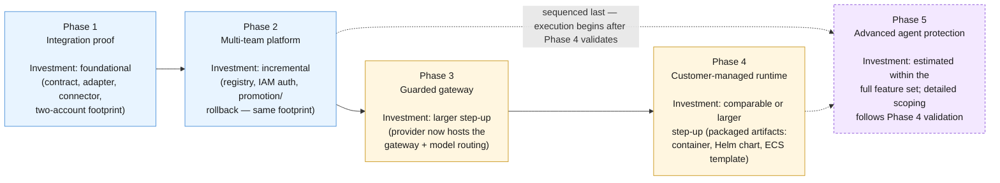

**AI Guardrails — Investment Summary**

**Authority level:** L3
**Status:** Draft
**Date:** 2026-07-24
**Derived from:** seed.md + AGREEMENTS.md

---

> This document translates the accepted [agreements](../00-source-of-truth/AGREEMENTS.md) and the AWS implementation direction in seed.md §11 and §18 into an executive-facing view of **what investment is required, at what granularity, and in what sequence**. It is a derived document (L3): it introduces no new commitments and must not be read as contradicting [AGREEMENTS.md](../00-source-of-truth/AGREEMENTS.md) or [CONSTRAINTS.md](../00-source-of-truth/CONSTRAINTS.md). Where a specific figure — budget, headcount count, timeline duration — is not present in the source material, it is marked **TBD** rather than estimated, consistent with the treatment already applied in [`EXECUTIVE-BRIEF.md`](EXECUTIVE-BRIEF.md) §7 and tracked in [`ASSUMPTIONS.md`](../00-source-of-truth/ASSUMPTIONS.md) (ASM-006, ASM-007, ASM-014).

---

## 1. Purpose and how to read this document

This summary answers three executive questions about the AI Guardrails investment, at a level of granularity appropriate for a funding decision rather than a delivery plan:

1. **What kinds of people does this need?** — team roles required, and how their engagement changes phase to phase.
2. **What does it run on, and how much of it?** — the AWS infrastructure footprint required for the MVP, and confirmation that a minimal, two-account model is sufficient to start.
3. **How does the investment grow over time?** — the relative, qualitative step-up in scope from one delivery phase to the next. The investment case is defined and estimated over the **full five-phase feature set** ([DEC-008](../00-source-of-truth/DECISIONS.md#dec-008--supersede-the-mvp-bounded-scope-define-and-estimate-the-full-feature-set-across-five-phases)); execution — and any funding releases tied to it — remains sequenced through per-phase validation ([AGR-020](../00-source-of-truth/AGREEMENTS.md#agr-020--five-phase-delivery)).

Consistent with source-of-truth policy, this document does **not** state a dollar budget, a headcount number, or a delivery date. Those figures are not present in seed.md or in [AGREEMENTS.md](../00-source-of-truth/AGREEMENTS.md), and inventing them here would create a false precision that the underlying charter does not support. Instead, investment is expressed as **relative effort and qualitative scope** — which roles are needed, which AWS services are required, and how the scope of each grows from phase to phase — so that a specific budget and staffing plan can be built on top of this shape once those figures are supplied by delivery and product leads.

This document complements, and must be read alongside:

* [`EXECUTIVE-BRIEF.md`](EXECUTIVE-BRIEF.md) §7 ("Investment and organizational impact") — the top-line executive framing this document expands on.
* [`20-product/PRODUCT-ROADMAP.md`](../20-product/PRODUCT-ROADMAP.md) — the phase-by-phase **deliverable** view (what gets built); this document is the phase-by-phase **investment** view (what it takes to build it).
* [`00-source-of-truth/CONSTRAINTS.md`](../00-source-of-truth/CONSTRAINTS.md) CON-001 and CON-002 — the account-model and cloud-placement boundaries this document's infrastructure section operationalizes.

---

## 2. Investment principles

Three principles from the accepted agreements shape how this investment should be read and approved:

| Principle | Agreement | What it means for investment |
| --- | --- | --- |
| **Full-scope estimation, sequenced execution** | [AGR-020](../00-source-of-truth/AGREEMENTS.md#agr-020--five-phase-delivery); [DEC-008](../00-source-of-truth/DECISIONS.md#dec-008--supersede-the-mvp-bounded-scope-define-and-estimate-the-full-feature-set-across-five-phases) | The investment case is estimated over the full five-phase feature set — per DEC-008, a valid delivery estimation needs the full scope. Execution remains sequenced: each phase is validated before the next proceeds, and funding releases may follow those gates. |
| **Minimal MVP footprint** | [AGR-013](../00-source-of-truth/AGREEMENTS.md#agr-013--aws-as-primary-cloud-minimal-mvp-account-model) | The MVP is scoped to run on a small, managed-service AWS footprint and a two-account model — not a bespoke or over-provisioned platform. |
| **No invented figures** | Source-of-truth policy | Where seed.md and AGREEMENTS.md do not supply a number, this document says so explicitly (Section 8) rather than fabricating one. |

The natural consequence of these three principles together is that **the ask is approved and estimated over the full five-phase scope, with Phases 1–2 as the initial execution increment**, while Phase 3 (Guarded Gateway) and Phase 4 (Customer-Managed Runtime) represent materially larger operational and security scope whose execution proceeds only once Phases 1–2 validate — the same framing already used in [`EXECUTIVE-BRIEF.md`](EXECUTIVE-BRIEF.md) §7.

---

## 3. Team roles required

Seed.md describes both the initial stakeholder groups (§7) and the ownership boundaries once the platform is operating (§21). Read together, they define four categories of role the program needs to resource, plus a fifth group whose participation is required but which is not a headcount line item of the program itself.

| Role category | Core responsibility (seed.md §7, §21) | Accountable for |
| --- | --- | --- |
| **Product leadership** | Product architecture, policy schemas, roadmap sequencing, stakeholder alignment. | Scope discipline against the defined solution scope and its exclusions (seed.md §6; [`10-charter/SCOPE.md`](../10-charter/SCOPE.md)); onboarding experience; success-metric tracking (seed.md §19). |
| **Platform / runtime engineering** | The evaluation contract, the guardrail runtime, evaluator adapters (Bedrock Guardrails, deterministic rules), the LiteLLM connector, decision normalization. | Everything the "AI Guardrails team" owns under seed.md §21 — architecture, contract, runtime, connector, documentation. |
| **Security and governance** | Organization-level policy requirements, risk classifications, policy approval, exception criteria, retention and audit requirements. | Policy sign-off; content-exposure review per deployment mode ([AGR-008](../00-source-of-truth/AGREEMENTS.md#agr-008--explicit-content-exposure-model-ownership-vs-exposure-are-separate-concerns)); enforcement-posture classification ([AGR-018](../00-source-of-truth/AGREEMENTS.md#agr-018--trust-and-enforcement-model)). |
| **Cloud / platform operations** | Hosted infrastructure, runtime deployment, service monitoring, capacity management, network configuration, production incident response. | Everything "Platform operations" owns under seed.md §21; the AWS footprint in Section 5 below is what this role provisions and runs. |
| **Consuming (application) teams** *(participants, not program headcount)* | Application behavior, connector installation in cooperative mode, workload registration accuracy, reviewing observe-mode findings. | Not funded by this program, but their **participation is a hard precondition**: the Phase 1–2 validation demonstration requires at least two organizationally independent teams operating separate LiteLLM instances (seed.md §16; [`60-delivery/VALIDATION-PLAN.md`](../60-delivery/VALIDATION-PLAN.md); tracked as ASM-002/ASM-003 in [`ASSUMPTIONS.md`](../00-source-of-truth/ASSUMPTIONS.md)). |

No specific headcount, seniority mix, or full-time-equivalent count is supplied in seed.md for any of these categories; those figures are **TBD** and are tracked as open items (ASM-006, ASM-007) rather than estimated here.

### 3.1 Relative role engagement by phase

The following matrix expresses, qualitatively, how much each role category is engaged at each delivery phase — not as a staffing plan, but as a guide to where investment concentrates as the program advances through [AGR-020](../00-source-of-truth/AGREEMENTS.md#agr-020--five-phase-delivery)'s five phases.

| Role category | Phase 1 — Integration proof | Phase 2 — Multi-team platform | Phase 3 — Guarded gateway | Phase 4 — Customer-managed runtime | Phase 5 — Advanced agent protection |
| --- | --- | --- | --- | --- | --- |
| Product leadership | Core — defines contract and policy format | Core — registry, bindings, admin workflow | Core — commercial/routing scope | Core — packaging and compatibility scope | Sequenced last — engagement begins after Phase 4 validates |
| Platform / runtime engineering | Core — the majority of Phase 1 investment | Core — registry, IAM auth, promotion/rollback | Core, larger scope — gateway hosting, routing, credentials | Core, larger scope — container, Helm chart, ECS template, sync | Sequenced last — engagement begins after Phase 4 validates |
| Security and governance | Engaged — policy approval, audit design | Engaged, growing — quotas, promotion sign-off | Engaged, growing significantly — provider now sits in the full inference path (seed.md §3, Mode B) | Engaged, growing significantly — regulated/residency workloads are the primary Mode C driver (seed.md §3) | Sequenced last — engagement begins after Phase 4 validates |
| Cloud / platform operations | Core — provisions and runs the Section 5 footprint | Core — capacity, monitoring, quotas | Core, larger scope — operates the managed gateway itself | Moderate on the hosted side; enables customer-side deployment via shipped artifacts | Sequenced last — engagement begins after Phase 4 validates |
| Consuming (application) teams | Required — at least one pilot workload | Required — at least two independent LiteLLM instances (validation demonstration) | Not required to participate in build | Required for validation once Mode C is offered | Required for Phase 5 validation once it begins |

Phase 5 is part of the full feature set this program is defined and estimated over ([DEC-008](../00-source-of-truth/DECISIONS.md#dec-008--supersede-the-mvp-bounded-scope-define-and-estimate-the-full-feature-set-across-five-phases)) but is sequenced last; per [AGR-020](../00-source-of-truth/AGREEMENTS.md#agr-020--five-phase-delivery) and [`DECISIONS.md` DEC-007](../00-source-of-truth/DECISIONS.md#dec-007--defer-advanced-isolation-distribution-security-agent-authorization-and-org-wide-enforcement), its execution must not be scheduled ahead of the preceding phases' validation, and no role engagement should be committed against it until Phase 4 validates.

---

## 4. AWS infrastructure footprint for the MVP

Seed.md §11 defines the minimum AWS architecture required to validate the product. This is the infrastructure the **cloud / platform operations** role (Section 3) provisions and operates for the hosted runtime.

| Capability | Initial AWS service | MVP role |
| --- | --- | --- |
| Evaluation runtime | ECS Fargate or EKS | Runs the Evaluation API and decision engine — the core compute line item. |
| Public or internal API | API Gateway or Application Load Balancer | Entry point for the LiteLLM connector and any generic SDK/HTTP caller. |
| Policy storage | DynamoDB or versioned S3 | Stores immutable, versioned policy definitions. |
| Workload registry | DynamoDB | Stores tenant/workload records and policy bindings (formalized in Phase 2). |
| Guardrail evaluation | Amazon Bedrock Guardrails | First managed evaluation engine, normalized behind the platform's own decision structure ([AGR-004](../00-source-of-truth/AGREEMENTS.md#agr-004--bedrock-guardrails-as-first-engine-vendor-independent-contract)). |
| Runtime credentials | IAM roles | Least-privilege, short-lived runtime identity (CON-010). |
| Secrets | AWS Secrets Manager | Model-provider and integration secrets, kept out of application code and LiteLLM configuration. |
| Encryption | AWS KMS | Encryption at rest and in transit for policy storage, registry, and audit data (CON-009). |
| Operational metrics | CloudWatch | Evaluation latency (P50/P95/P99), timeout rate, and other operational signals (seed.md §15). |
| Audit event buffering | Amazon SQS | Decouples audit-event production from durable archival. |
| Audit archive | Amazon S3 | Durable store for decision metadata and audit records. |
| Container registry | Amazon ECR | Distribution point for the runtime and connector container images. |

This list is deliberately a **managed-service footprint**: every entry is an existing AWS managed service, not custom infrastructure the program must build from scratch. No dollar cost figures for this footprint are present in seed.md; usage-based cost (compute hours, request volume, storage, Bedrock Guardrails invocations) will scale with actual workload volume, which is itself not yet known (tracked as ASM-001 in [`ASSUMPTIONS.md`](../00-source-of-truth/ASSUMPTIONS.md)).

```text
┌──────────────────────────────────────────────────────────────┐
│                  Guardrails Runtime (per account)             │
│                                                                │
│  ECS Fargate / EKS ──► Evaluation API + Decision engine        │
│         ▲                                                     │
│  API Gateway / ALB                                            │
│                                                                │
│  DynamoDB / versioned S3 ──► Policy storage                   │
│  DynamoDB ─────────────────► Workload registry                │
│  Amazon Bedrock Guardrails ─► Guardrail evaluation engine      │
│                                                                │
│  IAM roles + Secrets Manager + KMS ──► Identity & encryption   │
│  CloudWatch ──► Operational metrics                            │
│  SQS ──► Audit event buffer ──► S3 ──► Audit archive           │
│  ECR ──► Container images for runtime + connector              │
└──────────────────────────────────────────────────────────────┘
```

---

## 5. The two-account model is sufficient for the MVP

Per [CONSTRAINTS.md CON-002](../00-source-of-truth/CONSTRAINTS.md#con-002--minimal-mvp-account-model) and [AGREEMENTS.md AGR-013](../00-source-of-truth/AGREEMENTS.md#agr-013--aws-as-primary-cloud-minimal-mvp-account-model), **the MVP does not require separate management, production, and audit AWS accounts.** A single non-production account and a single production account are sufficient, provided IAM, storage, and environment boundaries remain explicit within that two-account model. This is a deliberate investment constraint, not an oversight: it keeps the infrastructure footprint in Section 4 bounded to two instances of the same architecture rather than three or more.

```text
┌───────────────────────────────┐      ┌───────────────────────────────┐
│   Non-production AWS account   │      │    Production AWS account     │
│                                │      │                                │
│  Full Section-4 footprint,     │      │  Full Section-4 footprint,     │
│  used for integration proof,   │      │  used for real workload        │
│  connector development, and    │      │  onboarding once a workload     │
│  observe-mode validation.      │      │  is promoted past observe mode. │
└───────────────────────────────┘      └───────────────────────────────┘
```

Additional account separation is an **investment that should only be made when a specific trigger is met**, not provisioned speculatively. The named triggers (seed.md §11; AGR-013) are:

* External customers.
* Compliance requirements.
* Independent security ownership.
* Immutable audit requirements.
* Production scale.
* Dedicated tenant deployments.

The measurable threshold for "reached" against each trigger is itself not yet defined — this is tracked as [`OPEN-QUESTIONS.md` OQ-009](../00-source-of-truth/OPEN-QUESTIONS.md#oq-009--trigger-point-for-three-account-aws-separation), with mandatory reassessment before Phase 3 and before onboarding any external or regulated customer. Until one of these triggers is confirmed, **no incremental account-separation investment should be budgeted**.

---

## 6. Phase-by-phase incremental investment

Investment grows incrementally across the five delivery phases defined in [AGR-020](../00-source-of-truth/AGREEMENTS.md#agr-020--five-phase-delivery), with each phase gated on the previous phase's validation (see [`20-product/PRODUCT-ROADMAP.md`](../20-product/PRODUCT-ROADMAP.md) for the full deliverable-level view). All five phases sit inside the estimated solution scope ([DEC-008](../00-source-of-truth/DECISIONS.md#dec-008--supersede-the-mvp-bounded-scope-define-and-estimate-the-full-feature-set-across-five-phases)). This section frames the same five phases through an investment lens: what is added to team engagement and infrastructure scope at each step, and how that step compares in relative size to the one before it.



| Phase | Incremental team investment | Incremental infrastructure investment | Relative scale |
| --- | --- | --- | --- |
| **1 — Integration proof** | Platform/runtime engineering is the dominant cost; security/governance and cloud operations are engaged but not yet at full scale; at least one pilot consuming team is required. | Stands up the full Section 4 footprint in the non-production account; internal deployment only. | **Foundational.** This is the base investment the rest of the program builds on. |
| **2 — Internal multi-team platform** | Adds IAM-authentication and administration-workflow work for platform/runtime engineering; security/governance engagement grows (quotas, promotion sign-off); a second, organizationally independent consuming team is required to satisfy the Phase 1–2 validation demonstration (seed.md §16; [`60-delivery/VALIDATION-PLAN.md`](../60-delivery/VALIDATION-PLAN.md)). | Same Section-4 footprint, extended into the production account; no new AWS services introduced. | **Incremental.** Extends and formalizes Phase 1's footprint rather than adding new infrastructure categories. |
| **3 — Guarded gateway** | The provider now operates the LLM gateway itself (Mode B), materially expanding platform/runtime engineering and cloud-operations scope; security/governance engagement grows because the provider now participates in the complete inference path (seed.md §3, Mode B). | Adds managed-gateway hosting, model-provider configuration, per-tenant routing, and cost/rate-control infrastructure on top of the Section 4 footprint. | **Larger step-up.** This is the point at which — per [`EXECUTIVE-BRIEF.md`](EXECUTIVE-BRIEF.md) §7 — investment should be resourced as a separate decision, gated on Phases 1–2 succeeding. |
| **4 — Customer-managed runtime** | Platform/runtime engineering shifts toward building portable, packaged artifacts (runtime container, Helm chart, ECS deployment template, infrastructure module, local policy cache and sync); security/governance engagement grows further because regulated and residency-sensitive workloads are the named driver for this mode (seed.md §3, Mode C). | The provider's own hosted footprint changes little; the new investment is in producing deployment artifacts that **run inside the customer's AWS account**, not additional hosted infrastructure. | **Comparable or larger step-up** to Phase 3, and — per [`EXECUTIVE-BRIEF.md`](EXECUTIVE-BRIEF.md) §7 — likewise a separate, later-gated funding decision. |
| **5 — Advanced agent protection** | Included in the full-feature-set definition and estimation basis ([DEC-008](../00-source-of-truth/DECISIONS.md#dec-008--supersede-the-mvp-bounded-scope-define-and-estimate-the-full-feature-set-across-five-phases)): retrieval evaluation, tool-call validation, MCP integration (seed.md §6.2, §18). Specific team figures **TBD**. | Detailed infrastructure scoping follows Phase 4 validation. | **Sequenced last** — per [AGR-020](../00-source-of-truth/AGREEMENTS.md#agr-020--five-phase-delivery), execution must not be scheduled ahead of the preceding phases' validation. |

The relative-scale labels above ("foundational," "incremental," "larger step-up") are qualitative characterizations grounded in the deliverable scope described in seed.md §18, not numeric estimates. No specific multiplier, percentage, or dollar comparison between phases is asserted, because none exists in the source material.

---

## 7. What this investment ask does — and does not — cover

**Covered by this investment ask** — the full five-phase solution scope, estimated over the full feature set ([DEC-008](../00-source-of-truth/DECISIONS.md#dec-008--supersede-the-mvp-bounded-scope-define-and-estimate-the-full-feature-set-across-five-phases)), with execution sequenced through per-phase validation ([AGR-020](../00-source-of-truth/AGREEMENTS.md#agr-020--five-phase-delivery)):

* Near-term execution (Phases 1–2): the full Section 4 AWS footprint in a two-account model (Section 5); platform/runtime engineering, product leadership, and security/governance engagement as described in Section 3; participation from at least two organizationally independent consuming teams, which is a precondition rather than a funded line item.
* Later-phase execution, proceeding as each preceding phase validates: Guarded Gateway hosting and operation (Phase 3) — provider-operated model routing, per-tenant routing, and cost/rate controls; Customer-Managed Runtime packaging and support (Phase 4) — container, Helm chart, ECS template, infrastructure module; advanced agent protection (Phase 5) — retrieval evaluation, tool-call validation, MCP integration.

**Not covered by this ask:**

* A specific budget figure, headcount number, or calendar dates — all **TBD** until supplied by the delivery and product leads (Section 8).
* Any AWS account separation beyond the two-account model (Section 5), until a named trigger is confirmed.
* Compliance certification and any commercial/metering model — open questions ([`OPEN-QUESTIONS.md`](../00-source-of-truth/OPEN-QUESTIONS.md)).
* Anything in the seed.md §6.3 product-category exclusions (see [`10-charter/SCOPE.md`](../10-charter/SCOPE.md)).

---

## 8. What this document deliberately does not say

Per source-of-truth policy, this document does not state:

* A specific budget figure, in any currency, for any phase.
* A specific headcount or full-time-equivalent count for any role category in Section 3.
* A calendar date, quarter, or duration for any phase — sequencing is fixed by [AGR-020](../00-source-of-truth/AGREEMENTS.md#agr-020--five-phase-delivery); timing is not (see [`PRODUCT-ROADMAP.md`](../20-product/PRODUCT-ROADMAP.md)).
* An AWS usage-cost estimate (compute hours, request volume, storage, Bedrock Guardrails invocations) for the Section 4 footprint, since expected workload and tenant volume is not yet known (ASM-001 in [`ASSUMPTIONS.md`](../00-source-of-truth/ASSUMPTIONS.md)).
* A committed trigger threshold for moving beyond the two-account model — that threshold is an open question ([`OPEN-QUESTIONS.md` OQ-009](../00-source-of-truth/OPEN-QUESTIONS.md#oq-009--trigger-point-for-three-account-aws-separation)), not a settled figure.

Where these figures are eventually supplied, they should be added to [`ASSUMPTIONS.md`](../00-source-of-truth/ASSUMPTIONS.md) or [`AGREEMENTS.md`](../00-source-of-truth/AGREEMENTS.md) as appropriate, and this document should be updated to reference them rather than restate them independently.

---

## Related documents

* [`00-source-of-truth/AGREEMENTS.md`](../00-source-of-truth/AGREEMENTS.md) — authoritative agreement register (L1), particularly AGR-013 (account model) and AGR-020 (five-phase delivery).
* [`00-source-of-truth/DECISIONS.md`](../00-source-of-truth/DECISIONS.md) — DEC-008, the decision that set the full-feature-set estimation basis this summary follows.
* [`00-source-of-truth/CONSTRAINTS.md`](../00-source-of-truth/CONSTRAINTS.md) — CON-001 and CON-002, the non-negotiable cloud-placement and account-model boundaries this document operationalizes.
* [`00-source-of-truth/ASSUMPTIONS.md`](../00-source-of-truth/ASSUMPTIONS.md) — ASM-001 (workload volume), ASM-006 (account provisioning), ASM-007 (AWS skills), ASM-014 (MVP budget sufficiency).
* [`00-source-of-truth/OPEN-QUESTIONS.md`](../00-source-of-truth/OPEN-QUESTIONS.md) — OQ-009 (three-account trigger threshold) and OQ-011 (commercial metering, relevant to Phase 3 cost/rate controls).
* [`30-executive/EXECUTIVE-BRIEF.md`](EXECUTIVE-BRIEF.md) — the top-line executive ask this document expands into an investment-specific view.
* [`20-product/PRODUCT-ROADMAP.md`](../20-product/PRODUCT-ROADMAP.md) — phase-by-phase deliverable detail corresponding to the investment view in Section 6.
* [`10-charter/CHARTER.md`](../10-charter/CHARTER.md) — full product charter narrative.
