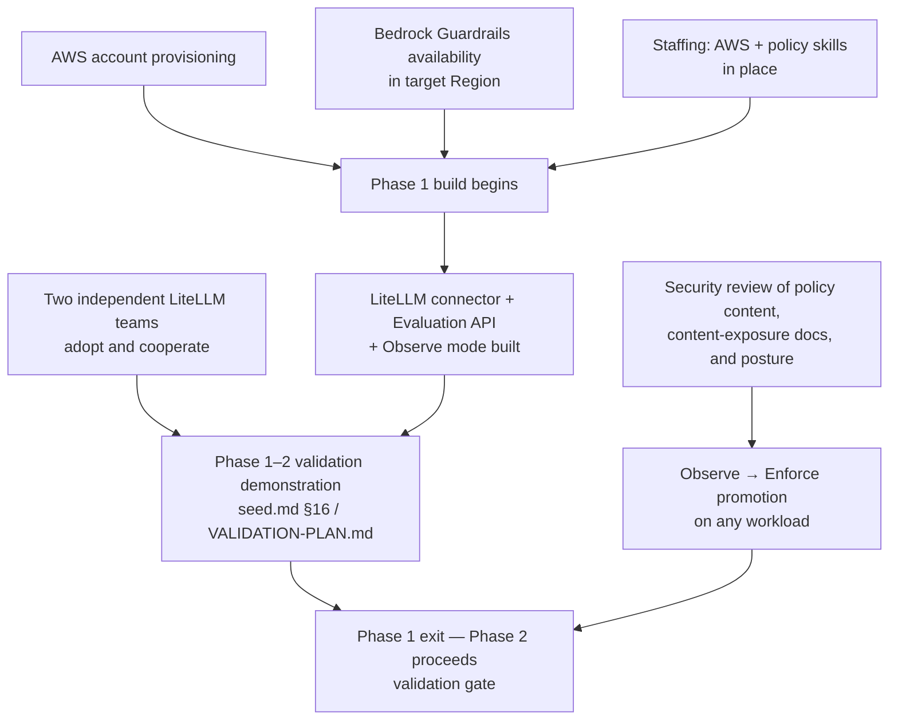

**AI Guardrails — Risks and Dependencies**

**Authority level:** L3
**Status:** Draft
**Date:** 2026-07-24
**Derived from:** seed.md + AGREEMENTS.md

---

> This document gives leadership a single, decision-relevant view of the principal risks and external dependencies for the AI Guardrails program. It is a derived view (L3): it must not contradict [`AGREEMENTS.md`](../00-source-of-truth/AGREEMENTS.md) or [`CONSTRAINTS.md`](../00-source-of-truth/CONSTRAINTS.md) (both L1), and it summarizes — rather than replaces — the fuller [`EXECUTIVE-BRIEF.md`](EXECUTIVE-BRIEF.md) (§8, "Principal risks") and the underlying [solution charter](../../seed.md) (§20, "Key risks"). Where a figure (probability, dollar impact, date) is not established in the source material, it is marked **TBD**; nothing here is estimated or invented. Unvalidated beliefs that a risk or dependency depends on are tracked in full in [`ASSUMPTIONS.md`](../00-source-of-truth/ASSUMPTIONS.md) and cited by ID (`ASM-NNN`) below.

---

## 1. How to read this document

* **Section 2** lists the six risks named in the charter (seed.md §20), each with a one-line mitigation and the role accountable for that mitigation.
* **Section 3** shows which deployment mode or delivery phase each risk is most acute in — useful for deciding *when* a mitigation needs to be in place, not just *that* it exists.
* **Section 4** lists the external and cross-team dependencies the program's delivery timeline currently relies on, with a plain status (confirmed / unconfirmed / TBD) and the assumption register entry that tracks it.
* **Section 5** shows how these dependencies sit on the critical path to the Phase 1–2 validation demonstration.
* This document does not restate probability or dollar-impact figures — none exist yet in the source material (see [`ASSUMPTIONS.md`](../00-source-of-truth/ASSUMPTIONS.md)).

---

## 2. Principal risks

Six risks are named in the charter (seed.md §20). Each has a full mitigation list in the charter; this table compresses each to the single most load-bearing mitigation for an executive audience.

| Risk | What can go wrong | One-line mitigation | Accountable role |
|---|---|---|---|
| **Connector bypass** | A consuming team removes, disables, or misconfigures its LiteLLM connector, since a cooperative connector is not a hard security boundary. | Match enforcement posture to trust level: cooperative onboarding for trusted teams today, with platform-managed or network/IAM-enforced gateway available once bypass prevention is actually required. | Security and governance lead |
| **False confidence** | Teams mistake a successful guardrail evaluation for complete AI security, or mistake a safety decision for authorization to act. | Keep content evaluation, business authorization, data isolation, and application security explicitly separate in every product and sales statement. | Product lead / Security and governance lead |
| **Latency** | Synchronous input/output evaluation calls add network and processing delay to every request. | Measure per-evaluator latency, apply only relevant evaluators, and route latency-sensitive workloads to the Customer-Managed Runtime. | Technical lead / Architecture lead |
| **Hosted data exposure** | Remote Evaluation and Guarded Gateway modes transmit tenant prompts and responses to the hosted runtime. | Document data flow explicitly per deployment, retain no raw content by default, and offer Customer-Managed Runtime for content that must stay in-account. | Security and governance lead / Architecture lead |
| **Policy fragmentation** | Excessive workload-specific policy overrides erode organizational consistency. | Limit override categories, require named ownership for every exception, and track effective policy per workload. | Policy owner / Security and governance lead |
| **Product over-expansion** | The platform tries to absorb gateway management, full AI governance, authorization, and compliance certification before the core hypothesis is proven. | Hold the five-phase sequencing — each phase validated before the next proceeds (AGR-020) — and the seed.md §6.3 product-category exclusions. | Product lead / Delivery lead |

A fuller risk register — with status tracking and detailed mitigation history — is planned at [`70-governance/RISK-REGISTER.md`](../70-governance/RISK-REGISTER.md).

---

## 3. Where each risk bites hardest

Risk exposure is not uniform across the three deployment modes or the five delivery phases. This view is qualitative and intended to guide *when* each mitigation must be operational, not to rank risks by severity.

| Risk | Most acute in | Why |
|---|---|---|
| Connector bypass | Mode A (Remote Evaluation), cooperative posture, Phases 1–2 | Cooperative integration is the only posture in scope before an external-customer or compliance trigger is identified ([AGR-018](../00-source-of-truth/AGREEMENTS.md#agr-018--trust-and-enforcement-model)). |
| False confidence | All modes; sharpens with agentic/tool-call use cases | Seed.md §5.5 and §6.3 exclude tool/agent authorization from guardrail scope entirely, so the gap between "evaluated" and "authorized" is widest exactly where agentic workloads are most tempted to assume coverage. |
| Latency | Mode A and Mode B (any hosted, synchronous evaluation path) | Mode C avoids the network hop to a hosted service by design; Modes A and B do not. |
| Hosted data exposure | Mode A and Mode B | Both modes transmit tenant content to a provider-operated boundary by construction ([AGR-009](../00-source-of-truth/AGREEMENTS.md#agr-009--remote-evaluation-is-not-a-private-data-or-data-local-model)); only Mode C keeps content local by default. |
| Policy fragmentation | Phase 2 onward, as onboarded-workload count grows | Risk scales with the number of workload-specific bindings and overrides in active use, not with any single mode. |
| Product over-expansion | Phase 3–5 scope decisions | Risk is highest at each phase boundary, where Phase 5 (advanced agent protection) or other later-phase items could be pulled forward ahead of validation under stakeholder pressure ([AGR-020](../00-source-of-truth/AGREEMENTS.md#agr-020--five-phase-delivery)). |

---

## 4. Principal dependencies

The program's delivery timeline depends on the following being in place. Status reflects the corresponding entry in [`ASSUMPTIONS.md`](../00-source-of-truth/ASSUMPTIONS.md); none of these is yet formally confirmed.

| Dependency | Why the program depends on it | Impact if it slips or fails | Status |
|---|---|---|---|
| **Amazon Bedrock Guardrails availability** | Bedrock Guardrails is the first managed evaluation engine (seed.md §11, §22; [AGR-004](../00-source-of-truth/AGREEMENTS.md#agr-004--bedrock-guardrails-as-first-engine-vendor-independent-contract)), required at acceptable feature parity in the target AWS Region(s). | The Bedrock adapter cannot be used in the intended Region; Phase 1 would fall back to deterministic rules only, weakening detection quality. | Unconfirmed — see [ASM-008](../00-source-of-truth/ASSUMPTIONS.md#b-technical-and-infrastructure-feasibility) |
| **AWS account provisioning** | The MVP requires one non-production and one production AWS account with explicit IAM, storage, and environment boundaries (CON-001, CON-002; [AGR-013](../00-source-of-truth/AGREEMENTS.md#agr-013--aws-as-primary-cloud-minimal-mvp-account-model)) before infrastructure work can begin. | Phase 1/2 delivery slips, or teams resort to ad hoc shared accounts that weaken the environment-boundary requirement. | Unconfirmed — see [ASM-006](../00-source-of-truth/ASSUMPTIONS.md#b-technical-and-infrastructure-feasibility) |
| **Consuming-team LiteLLM adoption and cooperation** | The Phase 1–2 validation demonstration requires at least two organizationally independent teams, each already operating LiteLLM (or an equivalent gateway), willing to onboard and cooperate (seed.md §16; [`60-delivery/VALIDATION-PLAN.md`](../60-delivery/VALIDATION-PLAN.md)). | The falsifiable validation demonstration cannot be executed as specified; the Phase 1–2 validation milestone would need to be redefined or delayed. | Unconfirmed — see [ASM-002](../00-source-of-truth/ASSUMPTIONS.md#a-demand-adoption-and-trust-assumptions) and [ASM-003](../00-source-of-truth/ASSUMPTIONS.md#a-demand-adoption-and-trust-assumptions) |
| **Security review** | Security and compliance stakeholders must approve policy content, content-exposure documentation, and enforcement posture before a workload can move from observe to enforce, and before any external customer is onboarded (seed.md §7; [AGR-010](../00-source-of-truth/AGREEMENTS.md#agr-010--guardrails-are-not-authorization), [AGR-018](../00-source-of-truth/AGREEMENTS.md#agr-018--trust-and-enforcement-model)). | Workloads stall in observe mode indefinitely, or are promoted without the sign-off the program's own trust model requires. | Not yet exercised — see [ASM-016](../00-source-of-truth/ASSUMPTIONS.md#e-security-compliance-and-policy-governance-assumptions) and [OQ-014](../00-source-of-truth/OPEN-QUESTIONS.md#g-promotion-governance) |
| **Staffing** | Delivery depends on the AI Guardrails team having (or acquiring) the AWS, policy, and security skills the MVP architecture requires (seed.md §11, §21), and on budget sufficient to fund the team through Phase 1–2. | Delivery timeline slips, or external hiring/contracting becomes necessary; service choices may need to be simplified toward tooling already known. | Unconfirmed — see [ASM-007](../00-source-of-truth/ASSUMPTIONS.md#b-technical-and-infrastructure-feasibility) and [ASM-014](../00-source-of-truth/ASSUMPTIONS.md#d-budget-and-delivery-sequencing-assumptions) |

---

## 5. Dependency path to the Phase 1–2 validation demonstration

Every item on the left is currently **unconfirmed or not yet exercised** (Section 4). None of the six risks in Section 2 can be meaningfully mitigated ahead of schedule if the dependencies that gate Phase 1 are not resolved first — in particular, the validation demonstration itself (seed.md §16; [`60-delivery/VALIDATION-PLAN.md`](../60-delivery/VALIDATION-PLAN.md)) cannot occur without confirmed cooperation from at least two independent LiteLLM-operating teams.

---

## 6. What leadership should watch

* **Single points of failure for Phase 1 kickoff:** AWS account provisioning and confirmed team commitments are the two dependencies most likely to block the start of work, not just its pace (Section 5).
* **The demonstration, not the build, is the hard gate:** the platform can be technically complete and still fail to prove the reusable-policy hypothesis if two independent teams are not secured (seed.md §16; [`60-delivery/VALIDATION-PLAN.md`](../60-delivery/VALIDATION-PLAN.md)).
* **Mitigations are postures, not switches:** several risk mitigations (connector bypass, hosted data exposure) are satisfied by *choosing the right deployment mode or enforcement posture per workload*, not by a single platform-wide control — this is a standing decision-review responsibility for Security and governance, not a one-time build task.
* **Scope discipline is itself a risk control:** the "product over-expansion" mitigation depends on leadership consistently declining to pull later-phase scope forward ahead of each phase's validation ([AGR-020](../00-source-of-truth/AGREEMENTS.md#agr-020--five-phase-delivery); [ASM-015](../00-source-of-truth/ASSUMPTIONS.md#d-budget-and-delivery-sequencing-assumptions)).

---

## Related documents

* [`EXECUTIVE-BRIEF.md`](EXECUTIVE-BRIEF.md) — the primary executive decision document this register supports.
* [`00-source-of-truth/AGREEMENTS.md`](../00-source-of-truth/AGREEMENTS.md) — authoritative agreement register (L1).
* [`00-source-of-truth/CONSTRAINTS.md`](../00-source-of-truth/CONSTRAINTS.md) — non-negotiable technical and security boundaries (L1).
* [`00-source-of-truth/ASSUMPTIONS.md`](../00-source-of-truth/ASSUMPTIONS.md) — unvalidated beliefs underlying every dependency in Section 4.
* [`00-source-of-truth/OPEN-QUESTIONS.md`](../00-source-of-truth/OPEN-QUESTIONS.md) — decisions not yet made that could change risk exposure or dependency timing.
* [`20-product/PRODUCT-ROADMAP.md`](../20-product/PRODUCT-ROADMAP.md) — phase-level roadmap referenced by the over-expansion mitigation.
* [`70-governance/RISK-REGISTER.md`](../70-governance/RISK-REGISTER.md) — planned fuller risk register with status and mitigation history.
* [seed.md §20](../../seed.md) — original charter statement of these six risks and their full mitigation lists.
