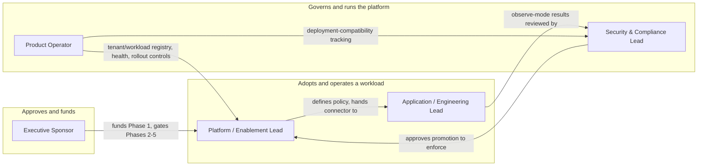

**AI Guardrails — Audience and Personas**

**Authority level:** L4
**Status:** Draft
**Date:** 2026-07-24
**Derived from:** seed.md + AGREEMENTS.md

---

## Purpose and scope

This document defines the five audiences the AI Guardrails sales deck must speak to, and what each one needs to hear to move from skepticism to sponsorship. It is written for whoever builds or presents the deck — sales engineering, product marketing, or a solution lead running a discovery conversation.

This is an **L4** document: a derived sales artifact. It must not contradict [`AGREEMENTS.md`](../00-source-of-truth/AGREEMENTS.md) or [`CONSTRAINTS.md`](../00-source-of-truth/CONSTRAINTS.md) (both L1), and every persona statement below uses the same "designed to / supports" language discipline required by [`CLAIMS-REGISTER.md`](../70-governance/CLAIMS-REGISTER.md) rather than proven-performance language. No metric, dollar figure, SLA, or timeline appears below unless it already exists in the seed material or the agreements register; where none exists, this document says **TBD**.

Four of the five personas map directly onto the stakeholder groups named in seed.md §7 ("Initial users and stakeholders"):

| Persona in this document | seed.md §7 source group |
| --- | --- |
| Platform / Enablement Lead | Platform teams |
| Application / Engineering Lead | Application teams |
| Security & Compliance Lead | Security and compliance teams |
| Product Operator | Product operators |

The fifth persona, **Executive Sponsor**, is not a named stakeholder group in seed.md §7 — a sales deck needs a decision-maker persona that §7 does not itemize. It is synthesized from material elsewhere in the charter that speaks directly to an executive audience: the product vision (seed.md §2), the decision summary and product statement (seed.md §22–§23), the success-metrics framework (seed.md §19), the key-risks register (seed.md §20, especially "product over-expansion"), and the phased-delivery and MVP-boundary agreements ([AGR-001](../00-source-of-truth/AGREEMENTS.md#agr-001--standalone-platform-not-embedded-in-the-internal-litellm), [AGR-019](../00-source-of-truth/AGREEMENTS.md#agr-019--mvp-scope-boundaries), [AGR-020](../00-source-of-truth/AGREEMENTS.md#agr-020--mvp-success-demonstration), [AGR-022](../00-source-of-truth/AGREEMENTS.md#agr-022--five-phase-delivery)). Nothing in the Executive Sponsor profile below asserts a figure the charter does not supply.

---

## Persona summary at a glance

| Persona | Primary question they're asking | The message that lands | The objection they will raise |
| --- | --- | --- | --- |
| **Platform / Enablement Lead** | "How do I stop every team reinventing guardrails?" | One versioned policy, bound by many workloads through a thin connector — you own the policy, not each team's detection logic. | "Why build a whole new platform instead of just extending our existing LiteLLM instance?" |
| **Application / Engineering Lead** | "What does this do to my request path?" | Keep your gateway and provider; bind a policy, run it in observe mode, and only enforce once you've seen the evidence. | "What's the latency cost, and what happens to my traffic when evaluation times out or the API is down?" |
| **Security & Compliance Lead** | "Can I trust this is actually enforced?" | Every decision is versioned and reason-coded, and the platform tells you plainly which of three enforcement postures a workload really has. | "A cooperative connector can be removed or misconfigured — how is that acceptable evidence for a regulated workload?" |
| **Executive Sponsor** | "What am I actually approving, and what does it cost?" | This is a bounded, falsifiable Phase 1 — prove the reusable-policy hypothesis with two independent teams before any further phase is funded. | "Give me the ROI and the timeline — and why phase this instead of building the whole governance platform now?" |
| **Product Operator** | "How do I run this at scale without flying blind?" | Tenant, workload, policy, and binding are registered, first-class entities from day one — not a spreadsheet you maintain yourself. | "Where's the admin portal to manage all of this centrally?" |

---

## 1. Platform / Enablement Lead

*(seed.md §7 — Platform teams)*

**Role.** Owns the guardrail policy layer as a shared internal capability: defines policies, curates connectors, and is accountable for guardrails being applied consistently across teams that do not share a gateway, provider, or framework.

**Goals** (seed.md §7):
- Central guardrail policy definitions.
- Reusable connectors.
- Deployment consistency.
- Audit visibility.
- Controlled policy rollouts.
- Low operational overhead.

**Top pains:**
- Every application team today builds or bolts on its own detection logic, at different quality bars, with no shared definition of "safe" (seed.md §1–§2; [`PROBLEM-STATEMENT.md`](../20-product/PROBLEM-STATEMENT.md) §2.1).
- Heterogeneous gateways, providers, and frameworks defeat any attempt to centralize guardrail logic that is embedded directly in one team's stack (seed.md §2, §5.1).
- Uncontrolled workload-specific overrides risk quietly re-fragmenting a shared policy back into per-workload variants — the "policy fragmentation" risk named in seed.md §20.
- Standing up a new shared capability can itself look like added operational overhead unless it is architected to be thin at the connector layer and centralized at the policy layer.

**The message that lands:**
> "Define the guardrail policy once, own its version lifecycle, and let every workload — on any gateway, any provider — bind to that same definition through a connector that only invokes and enforces, never redefines, your policy."

This is the direct promise of [AGR-005](../00-source-of-truth/AGREEMENTS.md#agr-005--policy-portability), [AGR-007](../00-source-of-truth/AGREEMENTS.md#agr-007--policies-are-separate-from-connectors), and [AGR-017](../00-source-of-truth/AGREEMENTS.md#agr-017--core-domain-model): policies are portable, connectors carry no policy logic, and the domain model (tenant, workload, policy, binding) is the same one every team's onboarding maps onto.

**The objection they will raise:**
> "Why build this as a standalone platform at all, instead of extending our existing internal LiteLLM instance to do the same thing?"

This is the exact question [AGR-001](../00-source-of-truth/AGREEMENTS.md#agr-001--standalone-platform-not-embedded-in-the-internal-litellm) was written to settle: embedding guardrails inside one team's LiteLLM instance would couple policy enforcement to that team's gateway lifecycle and block reuse by teams on different gateways, providers, or deployment modes. The deck should answer with AGR-001's rationale directly, not a deflection — LiteLLM becomes the platform's first connector, not its foundation, and the guardrails runtime is deployable, versioned, and operated independently.

---

## 2. Application / Engineering Lead

*(seed.md §7 — Application teams)*

**Role.** Owns an application, assistant, agent, or inference service that consumes an LLM and is asked to adopt a shared guardrail policy without disrupting production traffic or taking on a large integration burden.

**Goals** (seed.md §7):
- A simple onboarding process.
- Minimal application changes.
- Predictable latency.
- Clear failure behavior.
- Understandable violation reasons.
- A way to test policies before blocking users.

**Top pains:**
- Adopting an unproven capability is risky when there is no non-blocking way to see what a policy would do before it can affect real users (seed.md §5.6; [`PROBLEM-STATEMENT.md`](../20-product/PROBLEM-STATEMENT.md) §5.1, "the all-or-nothing guardrail trap").
- Synchronous input and output evaluation calls sit directly on the request path, adding latency exactly where the team is least willing to absorb it (seed.md §14, §15, §20 "Latency").
- Without an explicit failure-behavior definition, a timed-out evaluator or an unavailable control plane could silently break production traffic, or silently fail open and defeat the guardrail's purpose (seed.md §5.7, §14; [AGR-012](../00-source-of-truth/AGREEMENTS.md#agr-012--failure-behavior-is-part-of-policy)).
- Opaque pass/fail results give the team nothing actionable when a request is blocked or redacted.

**The message that lands:**
> "You keep your gateway, your model provider, and your routing exactly as they are today. You bind a policy, run it in observe mode against real traffic, and only move to enforcement once you've reviewed the evidence yourself — never as a side effect of someone else's rollout."

This is the onboarding flow itself (seed.md §4; [AGR-021](../00-source-of-truth/AGREEMENTS.md#agr-021--meaning-of-import)): register workload, select policy, generate integration manifest, install connector, run in observe mode, review results, enable enforcement — and the observe-before-enforce progression ([AGR-011](../00-source-of-truth/AGREEMENTS.md#agr-011--observe-before-enforce-progression)) that defaults every new binding to Observe, not Block.

**The objection they will raise:**
> "This adds a synchronous call into my request path before and after every model invocation. What's the latency cost, and what happens to my traffic when the Evaluation API is slow, a detector is unavailable, or the control plane can't be reached?"

The honest answer is that failure behavior is mandatory and explicit, not implicit: a workload's policy must define what happens on Evaluation API timeout, detector unavailability, unresolved policy, control-plane unavailability, audit-delivery failure, or an unsafe response transformation — allow-and-log, safe fallback, block, cached policy, or manual approval are the documented options, and there is no undocumented fallback ([AGR-012](../00-source-of-truth/AGREEMENTS.md#agr-012--failure-behavior-is-part-of-policy); [CON-016](../00-source-of-truth/CONSTRAINTS.md#con-016--timeout-limits)). Specific latency and timeout figures are workload- and stage-dependent and are recorded as **TBD** until set for a given deployment — the deck must not promise a number the source material does not supply.

---

## 3. Security & Compliance Lead

*(seed.md §7 — Security and compliance teams)*

**Role.** Owns organization-level policy requirements, approves guardrail policies before they govern production workloads, and must be able to produce evidence — not just an assertion — that guardrails are actually in effect.

**Goals** (seed.md §7):
- Policy ownership.
- Decision evidence.
- Policy-version traceability.
- Content-retention controls.
- Exception tracking.
- Evidence that policies are being applied.

**Top pains:**
- Fragmented, bespoke guardrails cannot produce comparable evidence across workloads, because each team's implementation records different things — or nothing at all ([`PROBLEM-STATEMENT.md`](../20-product/PROBLEM-STATEMENT.md) §2.3, §6).
- A cooperative connector — the only enforcement posture the initial MVP requires — can be disabled, removed, or misconfigured by the team that installs it, and must never be represented as a hard security boundary (seed.md §8, §20 "Connector bypass"; [AGR-018](../00-source-of-truth/AGREEMENTS.md#agr-018--trust-and-enforcement-model)).
- Teams may conflate "guardrail evaluation passed" with "this workload is fully secure," when in fact authorization, tenant isolation, and application security remain the consuming application's responsibility (seed.md §5.5, §20 "False confidence"; [AGR-010](../00-source-of-truth/AGREEMENTS.md#agr-010--guardrails-are-not-authorization)).
- Content-retention posture must be independently verifiable per deployment, not inferred from who operates the infrastructure (seed.md §5.4; [AGR-008](../00-source-of-truth/AGREEMENTS.md#agr-008--explicit-content-exposure-model-ownership-vs-exposure-are-separate-concerns)).

**The message that lands:**
> "Every decision carries a policy name and version, structured reason codes, evaluator metadata, and an explicit record of whether raw content was retained. And the platform never lets you assume a security guarantee that isn't there — each workload's enforcement posture (cooperative, platform-managed, or network/IAM-enforced) is recorded and visible, not asserted."

This draws directly on the decision structure (seed.md §9, "Decision"), the audit-metadata requirements (seed.md §15), and the trust-and-enforcement model ([AGR-018](../00-source-of-truth/AGREEMENTS.md#agr-018--trust-and-enforcement-model)).

**The objection they will raise:**
> "A cooperative connector can be disabled or misconfigured by any team that installs it. How is that acceptable evidence of enforcement for a regulated workload — and doesn't Remote Evaluation still send our content to a hosted service outside our own environment?"

Both halves of this objection are legitimate and must be answered honestly, not minimized: cooperative integration is appropriate only where teams are trusted and bypass prevention is not a formal requirement, and stronger postures (platform-managed, network/IAM-enforced) exist specifically for when it is ([AGR-018](../00-source-of-truth/AGREEMENTS.md#agr-018--trust-and-enforcement-model)). And Remote Evaluation must never be described as data-local — content does reach the hosted Evaluation API — so a workload with genuine data-residency or non-transmission requirements should be routed to Customer-Managed Runtime instead ([AGR-009](../00-source-of-truth/AGREEMENTS.md#agr-009--remote-evaluation-is-not-a-private-data-or-data-local-model)).

---

## 4. Executive Sponsor

*(synthesized from seed.md §2, §19, §20, §22–§23; not a named group in seed.md §7 — see [Purpose and scope](#purpose-and-scope))*

**Role.** Approves the investment, resourcing, and organizational commitment to build AI Guardrails, and owns the decision to fund each successive delivery phase.

**Goals** (derived from seed.md §2 product vision, §22 decision summary, §23 product statement):
- A model-independent, deployment-flexible platform that lets the organization define governance once rather than pay for it repeatedly per team.
- A validated hypothesis before further investment, not a large up-front commitment to an unproven capability.
- Strategic alignment: reusability over duplicated engineering spend, and a graduated trust model rather than an overreaching, all-at-once enforcement mandate.
- Confidence that the initiative will not silently expand into adjacent, unapproved scope (authorization, full AI governance, agent orchestration) before its core premise is proven (seed.md §20 "Product over-expansion").

**Top pains:**
- No dollar-value ROI, adoption percentage, or SLA figure exists in the source material to justify the investment on a numeric basis alone — the case must be made qualitatively, and the deck must say so rather than inventing a number (seed.md §19; [`EXECUTIVE-BRIEF.md`](../30-executive/EXECUTIVE-BRIEF.md) §3, §7).
- Every adjacent capability — gateway replacement, full governance platform, agent authorization, organization-wide enforcement — is a plausible scope-creep target that could turn a bounded MVP into an open-ended program (seed.md §6.3, §20 "Product over-expansion"; [AGR-019](../00-source-of-truth/AGREEMENTS.md#agr-019--mvp-scope-boundaries)).
- A phased commitment (five phases; seed.md §18) requires trusting that each phase will actually be gated on the prior one's validated outcome, not on schedule momentum alone ([AGR-022](../00-source-of-truth/AGREEMENTS.md#agr-022--five-phase-delivery)).

**The message that lands:**
> "This is a bounded, falsifiable Phase 1, not a bet on a finished platform: approve resourcing to prove that one reusable policy applies consistently across two organizationally independent LiteLLM deployments, with no shared credentials and no undocumented failure behavior — then decide, phase by phase, whether to fund the next one."

This is the exact ask in the decision summary and MVP success demonstration (seed.md §16, §22; [AGR-019](../00-source-of-truth/AGREEMENTS.md#agr-019--mvp-scope-boundaries), [AGR-020](../00-source-of-truth/AGREEMENTS.md#agr-020--mvp-success-demonstration), [AGR-022](../00-source-of-truth/AGREEMENTS.md#agr-022--five-phase-delivery)), and is the same decision framed in [`EXECUTIVE-BRIEF.md`](../30-executive/EXECUTIVE-BRIEF.md) §10.

**The objection they will raise:**
> "Give me the ROI and the timeline. And if the goal is organization-wide governance eventually, why phase this at all instead of building the complete platform — including authorization and agent protection — now?"

The honest answer, again, is not a number the material doesn't have: budget, headcount, and delivery-date figures for Phase 1 are **TBD**, tracked as open items pending confirmation from delivery and product leads ([`EXECUTIVE-BRIEF.md`](../30-executive/EXECUTIVE-BRIEF.md) §7; [`ASSUMPTIONS.md`](../00-source-of-truth/ASSUMPTIONS.md)). On phasing: attempting authorization, full governance, and agent orchestration alongside the core reusable-policy problem is precisely the "product over-expansion" risk the charter names (seed.md §20) — five sequenced phases exist so that each phase's operational and security scope is only taken on once the smaller, prior phase has proven the hypothesis it depends on ([AGR-022](../00-source-of-truth/AGREEMENTS.md#agr-022--five-phase-delivery)).

---

## 5. Product Operator

*(seed.md §7 — Product operators)*

**Role.** Runs AI Guardrails as an operated service: registers tenants and workloads, manages capacity, oversees policy rollouts, and tracks what version of what is running where.

**Goals** (seed.md §7):
- Tenant and workload registration.
- Service-health visibility.
- Usage metrics.
- Runtime capacity management.
- Policy rollout controls.
- Deployment compatibility tracking.

**Top pains:**
- Without a shared registry, there is no way to know what tenants, workloads, and policy bindings actually exist across a growing portfolio ([`PROBLEM-STATEMENT.md`](../20-product/PROBLEM-STATEMENT.md) §6).
- Fragmented, bespoke guardrail implementations produce no comparable service-health or usage signal — each one records different things, if anything at all.
- As three deployment modes are adopted in parallel, deployment-compatibility drift (which policy version a given runtime or connector actually supports) becomes an operational risk without explicit tracking (seed.md §9 "Policy," §15 "Policy rollout").
- The MVP intentionally does not ship a full administration portal — operators must be prepared to work through a minimal management API and version-controlled configuration during this phase (seed.md §17).

**The message that lands:**
> "Tenant, workload, policy, and policy binding are first-class, registered domain entities from day one — not implicit knowledge scattered across teams. You get evaluation-API availability, timeout rate, detector-specific latency, decision distribution, and policy-cache hit rate as defined operational signals, plus immutable policy versions with controlled promotion and immediate rollback."

This is the domain model (seed.md §9; [AGR-017](../00-source-of-truth/AGREEMENTS.md#agr-017--core-domain-model)) paired with the operational-requirements set (seed.md §15) that the platform is designed to expose.

**The objection they will raise:**
> "Where's the full administration portal to manage all of this centrally?"

The MVP does not include one, and the deck must say so rather than imply otherwise: a complete administration portal is explicitly named as an MVP non-goal (seed.md §17); a minimal management API and version-controlled configuration are what the MVP provides instead. This is a scope trade-off consistent with the MVP's tight boundary ([AGR-019](../00-source-of-truth/AGREEMENTS.md#agr-019--mvp-scope-boundaries)), not an oversight, and should be framed to product operators as "which phase does the fuller operator experience land in," not denied.

---

## How the five personas relate

No persona's concern is satisfied by a different persona's message. Security & Compliance is not reassured by application-lead latency talk; the Executive Sponsor is not persuaded by operator-level rollout mechanics. Each profile above must be used on its own terms.

---

## Sequencing guidance for the deck

A single deck rarely presents all five personas in one uninterrupted narrative to one room, but when structuring a discovery conversation or a mixed-audience session, the following order follows the platform's own logic — cause before effect, adoption before governance, governance before the funding ask:

1. **Application / Engineering Lead** — establish that adoption does not require ripping out an existing gateway or provider, and that nothing blocks production traffic on day one.
2. **Platform / Enablement Lead** — establish that one policy, centrally owned, replaces per-team reinvention.
3. **Security & Compliance Lead** — establish that the resulting evidence and enforcement posture are honest, versioned, and auditable — not asserted.
4. **Executive Sponsor** — close with the bounded, phased investment ask, now that the audience understands what is actually being adopted and governed.
5. **Product Operator** — used in operationally focused conversations (platform engineering reviews, SRE handoffs) rather than in the primary sales narrative, since this persona's concerns are largely post-decision.

This sequencing is a presentation recommendation for deck authors, not a claim recorded in the agreements register.

---

## Claims discipline and language guardrails

Every "message that lands" above uses "designed to / supports / is intended to" framing implicitly through its grounding in the agreements register, consistent with the discipline [`CLAIMS-REGISTER.md`](../70-governance/CLAIMS-REGISTER.md) is intended to enforce. When adapting these messages into deck copy:

- Do not attach a specific latency, availability, adoption, or cost figure to any message above — none exists in the source material, and all are recorded as **TBD** in [`ASSUMPTIONS.md`](../00-source-of-truth/ASSUMPTIONS.md) until measured or committed.
- Do not tell the Security & Compliance Lead or the Executive Sponsor that a cooperative-mode connector is bypass-proof — it is not, per [AGR-018](../00-source-of-truth/AGREEMENTS.md#agr-018--trust-and-enforcement-model).
- Do not tell the Application / Engineering Lead or Security & Compliance Lead that Remote Evaluation keeps content local — it does not, per [AGR-009](../00-source-of-truth/AGREEMENTS.md#agr-009--remote-evaluation-is-not-a-private-data-or-data-local-model).
- Do not tell any persona that a guardrail decision constitutes authorization — it does not, per [AGR-010](../00-source-of-truth/AGREEMENTS.md#agr-010--guardrails-are-not-authorization).
- Do not tell the Executive Sponsor that Phase 1 approval commits leadership to Phases 2 through 5 — each remains a separately gated decision, per [AGR-022](../00-source-of-truth/AGREEMENTS.md#agr-022--five-phase-delivery) and [`EXECUTIVE-BRIEF.md`](../30-executive/EXECUTIVE-BRIEF.md) §10.

---

## Related documents

- [`AGREEMENTS.md`](../00-source-of-truth/AGREEMENTS.md) — the authoritative agreements every persona message above derives from.
- [`CONSTRAINTS.md`](../00-source-of-truth/CONSTRAINTS.md) — non-negotiable boundaries referenced in the objection answers above.
- [`ASSUMPTIONS.md`](../00-source-of-truth/ASSUMPTIONS.md) — unvalidated beliefs (latency tolerance, adoption willingness, budget) that qualify several persona pains above.
- [`PROBLEM-STATEMENT.md`](../20-product/PROBLEM-STATEMENT.md) — the fuller stakeholder-pain analysis (§6) this document draws its "top pains" from.
- [`VALUE-PROPOSITION.md`](../20-product/VALUE-PROPOSITION.md) — the audience-by-audience benefit statements this persona set is built to make land in a deck.
- [`DIFFERENTIATORS.md`](../20-product/DIFFERENTIATORS.md) — the honest-scoping and portability differentiators referenced in several objection answers above.
- [`FAQ.md`](../20-product/FAQ.md) — longer-form answers to the same objections raised here, suitable for follow-up questions after a deck.
- [`../30-executive/EXECUTIVE-BRIEF.md`](../30-executive/EXECUTIVE-BRIEF.md) — the fuller executive-facing narrative the Executive Sponsor profile is drawn from.
- [`DECK-BRIEF.md`](DECK-BRIEF.md) — the deck narrative and slide structure this audience/persona set is designed to support (sibling document in this directory).
- [`../70-governance/CLAIMS-REGISTER.md`](../70-governance/CLAIMS-REGISTER.md) — the authoritative register of approved external-facing claims language.
- [`../70-governance/RISK-REGISTER.md`](../70-governance/RISK-REGISTER.md) — the fuller risk register behind the objections raised above.
