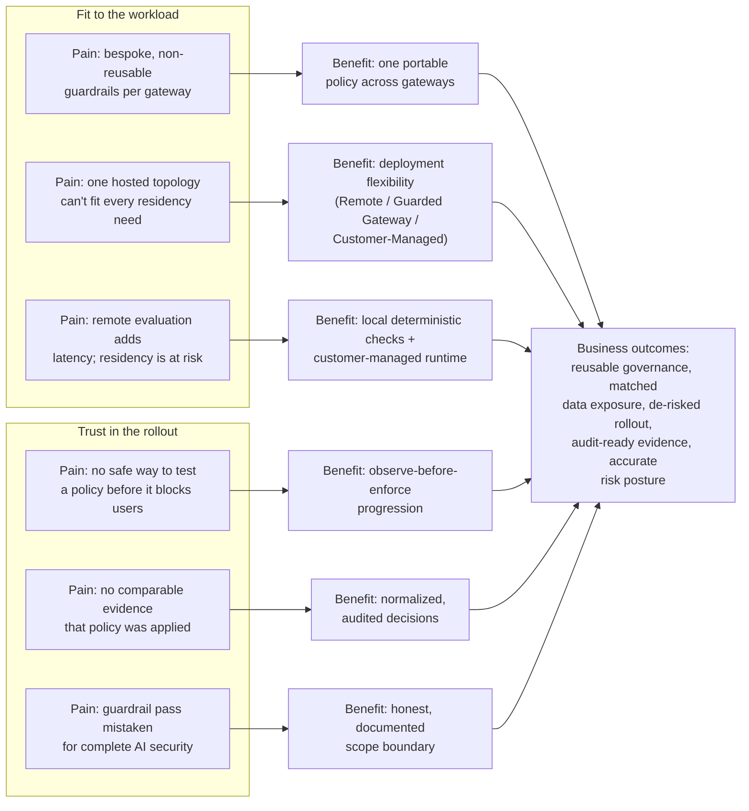

**AI Guardrails — Benefits and Outcomes**

**Authority level:** L4
**Status:** Draft
**Date:** 2026-07-24
**Derived from:** seed.md + AGREEMENTS.md

---

## Purpose and how to use this document

This document translates the pains organizations face when adopting LLMs and agentic workflows into the specific benefits AI Guardrails is designed to deliver, and the business outcomes those benefits support. It is written for sales, sales-engineering, and customer-facing product roles who need a single reference that connects **pain → benefit → business outcome** without drifting from the authoritative agreement register.

This is an **L4** document: a derived sales artifact. It must not contradict [`AGREEMENTS.md`](../00-source-of-truth/AGREEMENTS.md) or [`CONSTRAINTS.md`](../00-source-of-truth/CONSTRAINTS.md) (both L1), and every benefit statement below is phrased using the same "designed to / supports / is intended to" language discipline required of [`70-governance/CLAIMS-REGISTER.md`](../70-governance/CLAIMS-REGISTER.md) — this document's wording must be checked against that register, and the register governs if the two ever diverge. No dollar figures, adoption percentages, SLA numbers, or customer names appear here; where the source material does not supply a figure, this document says **TBD** rather than inventing one.

This document assumes the pain inventory formalized in [`CUSTOMER-PAIN-POINTS.md`](CUSTOMER-PAIN-POINTS.md) (same directory). The pain statements below are drawn directly from the current-state problem framing in [`../20-product/PROBLEM-STATEMENT.md`](../20-product/PROBLEM-STATEMENT.md) and seed.md §1, §2, §7, and §20, so that this document does not get ahead of its own source material.

---

## 1. The shape of the pain, in one view

Before mapping individual pains to benefits, it helps to see how they relate. Three of the six pains addressed below are about **trust in the rollout** (will this break my production traffic, can I prove it's applied, can I be honest about what it doesn't cover), and three are about **fit to the workload** (can I reuse one policy everywhere, can I control where my content goes, can I keep latency and residency acceptable). AI Guardrails is designed to answer both groups from the same underlying platform rather than treating them as separate products.

---

## 2. Pain → benefit → business outcome

| # | Pain (current state) | Benefit (what AI Guardrails is designed to do) | Business outcome |
| --- | --- | --- | --- |
| 1 | Guardrail logic today is bespoke or absent per team, tied to one gateway's configuration or one model provider's response format, and cannot be reused elsewhere (seed.md §1–§2, §5.1). | **One portable policy across gateways.** A policy is defined once — independent of LiteLLM configuration structures, Bedrock Guardrails response formats, a specific model provider, language, or framework — and is designed to bind to any number of workloads across gateways ([AGR-005](../00-source-of-truth/AGREEMENTS.md#agr-005--policy-portability), [AGR-007](../00-source-of-truth/AGREEMENTS.md#agr-007--policies-are-separate-from-connectors)). | A single organizational safeguard can be pointed to as "the" policy for prompt injection, sensitive-output handling, and similar checks, instead of every team re-solving the same detection problem at a different quality bar. Reduces duplicated engineering effort qualitatively; no dollar or hours figure is asserted (**TBD**). |
| 2 | Different workloads have different data-residency and operational-ownership requirements, and a single hosted topology cannot serve both a team that wants to hand off operations and a team that must keep content in its own account (seed.md §1, §3, §20 "Hosted data exposure"). | **Deployment flexibility to control data exposure.** Remote Evaluation, Guarded Gateway, and Customer-Managed Runtime let a workload choose its own ownership/exposure trade-off under one contract, with exposure documented explicitly and independently of who operates the component ([AGR-002](../00-source-of-truth/AGREEMENTS.md#agr-002--three-deployment-modes), [AGR-008](../00-source-of-truth/AGREEMENTS.md#agr-008--explicit-content-exposure-model-ownership-vs-exposure-are-separate-concerns), [AGR-009](../00-source-of-truth/AGREEMENTS.md#agr-009--remote-evaluation-is-not-a-private-data-or-data-local-model)). | Regulated, high-volume, air-gapped, or residency-sensitive workloads get a documented path to adopt the same governance model as every other workload, without content leaving their AWS account, while less constrained workloads can still choose reduced operational ownership. No forked policy model is required to serve both. |
| 3 | Teams will not enable an unproven check in blocking mode because a high false-positive rate can break production traffic; without a middle ground, workloads stay unguarded indefinitely or adopt guardrails and then disable them the first time something breaks (seed.md §5.6, §7). | **Observe-before-enforce to de-risk rollout.** Every policy supports Disabled → Observe → Warn → Redact → Block; new bindings default to Observe, and promotion is an explicit, auditable action, never an implicit side effect ([AGR-011](../00-source-of-truth/AGREEMENTS.md#agr-011--observe-before-enforce-progression)). | A team can measure false positives, latency, and business impact against real traffic before a policy can affect a single user — turning "will this break production" from an unanswered fear into a measured, reviewable decision, and increasing the number of workloads willing to adopt guardrails in the first place. |
| 4 | Remote input/output evaluation adds synchronous network and processing latency to every request, and workloads that must minimize latency or keep content local have no fit with a purely hosted evaluation path (seed.md §20 "Latency", §3 Mode C). | **Local deterministic checks and customer-managed runtime for latency and residency.** Per-evaluator latency is measured, only relevant evaluators are applied, deterministic checks can run locally, stage-specific timeouts are defined as policy, and the Customer-Managed Runtime executes policy without requiring a synchronous connection to the hosted control plane ([CON-016](../00-source-of-truth/CONSTRAINTS.md#con-016--timeout-limits), [AGR-015](../00-source-of-truth/AGREEMENTS.md#agr-015--customer-managed-runtime-executes-without-a-synchronous-control-plane-connection)). | Latency-sensitive, high-volume, and residency-constrained workloads get a deployment path designed to keep evaluation local and remove the hosted round trip and control-plane dependency from the evaluation path — instead of being told to accept added latency or forgo guardrails entirely. Specific latency figures remain **TBD** per workload and detector until measured. |
| 5 | Security and compliance teams cannot produce comparable evidence that a policy was actually applied, at what version, with what outcome — because fragmented, bespoke implementations record different things, or nothing (seed.md §7, §15). | **Normalized audit decisions for compliance evidence.** Every evaluation produces the same decision shape — action, allowed status, reason codes, policy name and version, evaluator metadata, correlation identifier, audit identifier, evaluation latency, and whether raw content was retained — regardless of connector, gateway, or deployment mode ([AGR-006](../00-source-of-truth/AGREEMENTS.md#agr-006--one-logical-evaluation-contract-across-all-modes); seed.md §9 "Decision", §15 "Auditing"). | Compliance stakeholders get one comparable evidentiary record across every workload and every deployment mode, supporting policy-version traceability and "evidence that policies are being applied" — the exact needs named in seed.md §7 — instead of reconciling incompatible logs from each team's own implementation. |
| 6 | Teams and stakeholders may mistake a passing guardrail evaluation for complete AI security, or for business authorization — leaving authentication, tenant isolation, and approval-workflow gaps unaddressed while believing they are covered (seed.md §5.5, §20 "False confidence"). | **Honest scope to avoid false confidence.** The platform states plainly, in product and sales material alike, that guardrail evaluation is distinct from business authorization, that a cooperative connector is not a hard security boundary, and that the feature set excludes a complete DLP platform, proprietary detection model, or full AI governance suite (seed.md §6.3) ([AGR-010](../00-source-of-truth/AGREEMENTS.md#agr-010--guardrails-are-not-authorization), [AGR-018](../00-source-of-truth/AGREEMENTS.md#agr-018--trust-and-enforcement-model)). | Stakeholders get an accurate, bounded picture of what is and is not covered, so authentication, authorization, tenant isolation, and approval workflows stay assigned and owned rather than silently assumed to be someone else's already-solved problem. This reduces the risk of an unaddressed gap surfacing at audit or incident time. |

---

## 3. Benefit deep dives

### 3.1 One portable policy across gateways

**The pain.** Organizations adopt LLMs team by team, each choosing its own gateway, provider, and framework, with guardrail logic — where it exists at all — embedded directly in that team's stack. Nothing transfers: a check written against one team's LiteLLM configuration or one vendor's response format cannot be reused by the next team, so the organization re-solves the same detection problem repeatedly, at inconsistent quality, and cannot point to a single control and say "this is enforced everywhere."

**The benefit.** A policy defines *what* must be evaluated and how violations are handled; a connector defines *how* a specific gateway invokes and enforces that policy — a separation that is mandatory in every implementation ([AGR-007](../00-source-of-truth/AGREEMENTS.md#agr-007--policies-are-separate-from-connectors)). LiteLLM is the first connector and Amazon Bedrock Guardrails is the first evaluation engine, but neither defines the product boundary or the public contract ([AGR-003](../00-source-of-truth/AGREEMENTS.md#agr-003--litellm-as-first-connector-not-the-product-boundary), [AGR-004](../00-source-of-truth/AGREEMENTS.md#agr-004--bedrock-guardrails-as-first-engine-vendor-independent-contract)). Bounded, ownership-attributed override categories keep a portable policy from re-fragmenting into per-workload variants as adoption scales (seed.md §20, "Policy fragmentation" mitigation).

**The outcome.** A policy author writes intent once; every workload — regardless of gateway or provider — binds to the same versioned artifact. This is the same reusable-policy hypothesis the Phase 1–2 validation demonstration exists to prove (seed.md §16; [`../60-delivery/VALIDATION-PLAN.md`](../60-delivery/VALIDATION-PLAN.md)): two organizationally independent LiteLLM instances consuming the same policy, without sharing model-provider credentials with the guardrail platform, is the concrete proof point sales teams can cite once demonstrated — and only once demonstrated.

---

### 3.2 Deployment flexibility to control data exposure

**The pain.** A team's willingness to adopt a shared guardrail capability depends heavily on where its content ends up — and today there is no single product that serves both a team comfortable with hosted evaluation and a team that must keep every prompt and response inside its own AWS account for regulatory or residency reasons.

**The benefit.** Three deployment modes cover this range under one logical evaluation contract ([AGR-002](../00-source-of-truth/AGREEMENTS.md#agr-002--three-deployment-modes), [AGR-006](../00-source-of-truth/AGREEMENTS.md#agr-006--one-logical-evaluation-contract-across-all-modes)):

| Mode | Who operates the gateway | Where tenant content goes |
| --- | --- | --- |
| A — Remote Evaluation | Consuming team | Transmitted to the hosted Evaluation API. **Not** a private-data or data-local model ([AGR-009](../00-source-of-truth/AGREEMENTS.md#agr-009--remote-evaluation-is-not-a-private-data-or-data-local-model)). |
| B — Guarded Gateway | AI Guardrails provider | Passes through the provider-managed gateway end to end. |
| C — Customer-Managed Runtime | Consuming team, in its own AWS account | Stays inside the customer's account by default; only customer-selected telemetry (or none) reaches the hosted control plane. |

Operational ownership and data exposure are always documented as two independent questions ([AGR-008](../00-source-of-truth/AGREEMENTS.md#agr-008--explicit-content-exposure-model-ownership-vs-exposure-are-separate-concerns)) — a team is never told that "you keep running your own gateway" also means "your content stays local," because in Mode A it does not.

**The outcome.** A prospect with a data-residency requirement is routed to Mode C rather than sold Mode A on a false premise; a prospect without such a requirement can still choose Mode A or B for reduced operational ownership. The same policy, decision structure, and audit metadata apply in every case — the sales conversation is "which mode fits this workload," not "which product do you need to buy instead."

---

### 3.3 Observe-before-enforce to de-risk rollout

**The pain.** Where informal guardrails exist today, they typically ship in one of two states — absent or blocking — with no middle ground to see what a policy *would* flag without rejecting real traffic. A team that turns on an unproven check risks breaking production the moment false positives appear; a team that never turns one on leaves the workload permanently unguarded. Both outcomes are rational responses to the same missing capability.

**The benefit.** Every policy supports a non-blocking evaluation mode and a defined progression — Disabled → Observe → Warn → Redact → Block ([AGR-011](../00-source-of-truth/AGREEMENTS.md#agr-011--observe-before-enforce-progression)). Onboarding defaults new bindings to Observe, not Block, and promotion between states is an explicit, auditable action rather than an implicit side effect of another change.

**The outcome.** A team measures false positives, latency, and business impact before enforcement can affect a single user. This directly answers the application-team need named in seed.md §7 — "a way to test policies before blocking users" — and is one of the conditions the Phase 1–2 validation demonstration must satisfy to be considered complete (seed.md §16; [`../60-delivery/VALIDATION-PLAN.md`](../60-delivery/VALIDATION-PLAN.md)): one workload running in observe mode while another runs in enforce mode, on the same policy.

---

### 3.4 Local deterministic checks and customer-managed runtime for latency and residency

**The pain.** Synchronous input/output evaluation over a network sits directly on the request path — every remote call adds latency the application team did not have before, and workloads that are both latency-sensitive and residency-constrained have no deployment option that addresses both concerns at once.

**The benefit.** The platform's own risk register names latency mitigations directly: measure per-evaluator latency, apply only relevant evaluators, support local deterministic checks, use the Customer-Managed Runtime for latency-sensitive workloads, and define stage-specific timeouts as part of policy (seed.md §20, "Latency"; [CON-016](../00-source-of-truth/CONSTRAINTS.md#con-016--timeout-limits)). The Customer-Managed Runtime is additionally capable of executing policy without a synchronous connection to the hosted control plane — it maintains a local policy cache and synchronizes asynchronously ([AGR-015](../00-source-of-truth/AGREEMENTS.md#agr-015--customer-managed-runtime-executes-without-a-synchronous-control-plane-connection)).

**The outcome.** A workload that is both latency-sensitive and subject to data-residency requirements is designed to be served by a single deployment choice — Customer-Managed Runtime with local deterministic evaluators — rather than being asked to accept a latency penalty for compliance, or accept compliance risk for latency. No specific latency number is asserted here; P50/P95/P99 evaluation latency is a measured, reported metric per seed.md §15, and stage-specific timeout values remain **TBD** until agreed per workload.

---

### 3.5 Normalized audit decisions for compliance evidence

**The pain.** Security and compliance teams need policy ownership, decision evidence, policy-version traceability, content-retention controls, exception tracking, and evidence that policies are being applied (seed.md §7). Fragmented, bespoke guardrails cannot produce this evidence in a comparable form, because each team's implementation records different things — or nothing at all.

**The benefit.** Every evaluation produces the same normalized decision structure — action (`allow`, `block`, `redact`, `log_only`), allowed status, reason codes, policy name and version, evaluator metadata, transformed content where applicable, correlation identifier, audit identifier, and evaluation latency (seed.md §9, "Decision") — and this holds regardless of connector, gateway, or deployment mode ([AGR-006](../00-source-of-truth/AGREEMENTS.md#agr-006--one-logical-evaluation-contract-across-all-modes)). Audit metadata additionally records whether raw content was retained for a given evaluation, and the hosted runtime does not persist raw prompts and responses by default ([AGR-014](../00-source-of-truth/AGREEMENTS.md#agr-014--no-raw-promptresponse-retention-by-default)).

**The outcome.** A compliance reviewer gets one comparable evidentiary record across every workload, connector, and deployment mode, supporting the policy-version traceability and audit-evidence needs named in seed.md §7 and §15 — without having to reconcile incompatible logging formats from each team's own bespoke implementation.

---

### 3.6 Honest scope to avoid false confidence

**The pain.** The single largest risk named in the solution charter is teams interpreting successful guardrail evaluation as complete AI security (seed.md §20, "False confidence") — a guardrail may determine that a tool call appears safe without determining whether the current user is authorized to execute it (seed.md §5.5). A cooperative connector, similarly, can be disabled, removed, or misconfigured, and must never be represented as a hard security boundary (seed.md §8).

**The benefit.** The platform states, in product and sales material alike, exactly what it does and does not cover: content evaluation is distinct from business authorization, and authentication, tenant isolation, resource ownership, transaction limits, and approval workflows remain the consuming application's responsibility ([AGR-010](../00-source-of-truth/AGREEMENTS.md#agr-010--guardrails-are-not-authorization)). Three distinct enforcement postures — cooperative integration, platform-managed enforcement, and network/IAM-enforced gateway — are named explicitly so a workload's actual bypass-resistance level is recorded, not assumed ([AGR-018](../00-source-of-truth/AGREEMENTS.md#agr-018--trust-and-enforcement-model)).

**The outcome.** Prospects and internal stakeholders get an accurate risk picture instead of an implied guarantee: they know which risks the platform addresses (content evaluation, policy-version evidence, graduated enforcement) and which remain theirs to own (authentication, authorization, tenant isolation, full application security). This is deliberately a precision claim, not a limited-usefulness claim — it is what keeps the platform from being blamed for gaps it never claimed to close, and what keeps genuinely unaddressed risks from going unmanaged.

---

## 4. Benefits by stakeholder

The six benefits above land differently depending on which stakeholder group (seed.md §7) is evaluating the platform. See [`../20-product/TARGET-USERS.md`](../20-product/TARGET-USERS.md) for the full stakeholder detail; the summary below exists only to help a seller route the right benefit to the right buyer in the room.

| Stakeholder | Benefits that resonate most | Why |
| --- | --- | --- |
| Platform teams | One portable policy across gateways; deployment flexibility | They own reusable connectors and deployment consistency across teams with different gateways (seed.md §7). |
| Application teams | Observe-before-enforce; local checks and customer-managed runtime for latency | They need predictable latency, clear failure behavior, and a safe way to test policies before they affect users (seed.md §7). |
| Security and compliance teams | Normalized audit decisions; honest scope | They need decision evidence, policy-version traceability, and an accurate picture of what guardrail evaluation does and does not prove (seed.md §7). |
| Product operators | Deployment flexibility; normalized audit decisions | They need deployment-compatibility tracking and usage/reliability metrics across every mode a tenant might run (seed.md §7). |

---

## 5. Claims discipline and language guardrails

Every benefit and outcome statement above uses "designed to / supports / is intended to" language rather than proven-performance language, consistent with the discipline [`70-governance/CLAIMS-REGISTER.md`](../70-governance/CLAIMS-REGISTER.md) enforces. Sales usage of this document must preserve that discipline. In particular, this document does **not** claim:

* That Remote Evaluation (Mode A) keeps tenant content local or private — it does not; content reaches the hosted Evaluation API ([AGR-009](../00-source-of-truth/AGREEMENTS.md#agr-009--remote-evaluation-is-not-a-private-data-or-data-local-model)).
* That a guardrail decision constitutes business authorization, tenant isolation, or approval — these remain the consuming application's responsibility ([AGR-010](../00-source-of-truth/AGREEMENTS.md#agr-010--guardrails-are-not-authorization)).
* That a cooperative-mode connector is a hard, bypass-proof security boundary — only platform-managed or network/IAM-enforced postures raise bypass resistance ([AGR-018](../00-source-of-truth/AGREEMENTS.md#agr-018--trust-and-enforcement-model)).
* Any specific latency figure, availability target, adoption percentage, false-positive rate, or dollar-value ROI. None of these are established in the source material at this stage; where a figure is needed, it is marked **TBD** rather than estimated, per [`../00-source-of-truth/CONSTRAINTS.md`](../00-source-of-truth/CONSTRAINTS.md) and [`../00-source-of-truth/ASSUMPTIONS.md`](../00-source-of-truth/ASSUMPTIONS.md).
* That guardrail evaluation constitutes a complete AI-security or governance solution — it is one layer, and content evaluation, authorization, data isolation, and application security are explicitly kept as distinct concerns (seed.md §20, "False confidence").
* Feature parity across all three deployment modes at every point in delivery — portability is a design commitment validated by conformance testing, not a same-day guarantee across all five delivery phases (see [`../20-product/DIFFERENTIATORS.md`](../20-product/DIFFERENTIATORS.md), "Note on delivery phasing").

---

## Related documents

* [`../00-source-of-truth/AGREEMENTS.md`](../00-source-of-truth/AGREEMENTS.md) — the authoritative agreements every benefit statement above traces to.
* [`../00-source-of-truth/CONSTRAINTS.md`](../00-source-of-truth/CONSTRAINTS.md) — non-negotiable boundaries referenced throughout this document.
* [`../00-source-of-truth/ASSUMPTIONS.md`](../00-source-of-truth/ASSUMPTIONS.md) — unvalidated beliefs (latency tolerance, adoption willingness) that qualify several outcomes above.
* [`../20-product/PROBLEM-STATEMENT.md`](../20-product/PROBLEM-STATEMENT.md) — the current-state pain this document maps benefits against.
* [`../20-product/VALUE-PROPOSITION.md`](../20-product/VALUE-PROPOSITION.md) — the audience-level value proposition this document specializes into pain/benefit/outcome form.
* [`../20-product/DIFFERENTIATORS.md`](../20-product/DIFFERENTIATORS.md) — what makes these benefits distinct from a single embedded gateway feature or point detection model.
* [`../20-product/TARGET-USERS.md`](../20-product/TARGET-USERS.md) — full detail on the stakeholder groups referenced in Section 4.
* [`../30-executive/EXECUTIVE-BRIEF.md`](../30-executive/EXECUTIVE-BRIEF.md) — the executive-level framing of business impact and expected outcomes.
* [`CUSTOMER-PAIN-POINTS.md`](CUSTOMER-PAIN-POINTS.md) — the formalized pain inventory this document's pain column is derived from (same directory).
* [`DECK-BRIEF.md`](DECK-BRIEF.md) — the sales-deck narrative brief this document supports (same directory).
* [`../70-governance/CLAIMS-REGISTER.md`](../70-governance/CLAIMS-REGISTER.md) — the authoritative external-facing claims wording this document's language must align with.
* [`../70-governance/RISK-REGISTER.md`](../70-governance/RISK-REGISTER.md) — the full risk register behind the mitigations cited in Section 3.
