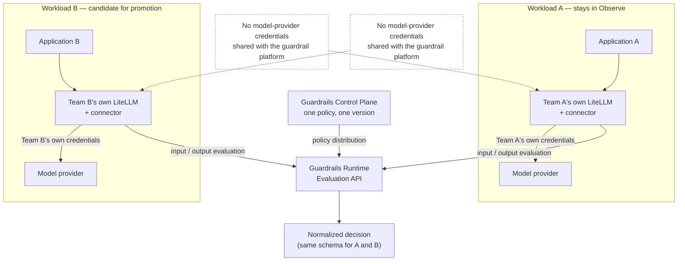
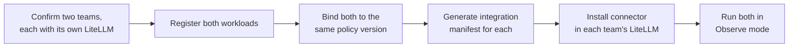

**AI Guardrails — Call to Action**

**Authority level:** L4
**Status:** Draft
**Date:** 2026-07-24
**Derived from:** AGREEMENTS.md

---

> This is the closing document of the sales deck: a single, concrete ask a sponsoring stakeholder can approve today. It does not restate the full product case — see [`30-executive/EXECUTIVE-BRIEF.md`](../30-executive/EXECUTIVE-BRIEF.md) for that — and it introduces no commitment beyond what [`AGREEMENTS.md`](../00-source-of-truth/AGREEMENTS.md) and [`10-charter/SUCCESS-CRITERIA.md`](../10-charter/SUCCESS-CRITERIA.md) already authorize. No dates, dollar figures, or SLA numbers are asserted; where the source material does not supply one, this document says **TBD** rather than estimating.

---

## Table of contents

- [1. The ask, in one sentence](#1-the-ask-in-one-sentence)
- [2. Why a pilot, and why this shape](#2-why-a-pilot-and-why-this-shape)
- [3. Pilot design](#3-pilot-design)
- [4. Immediate next step](#4-immediate-next-step)
- [5. Who to involve](#5-who-to-involve)
- [6. What success looks like for this pilot](#6-what-success-looks-like-for-this-pilot)
- [7. What this ask does not commit to](#7-what-this-ask-does-not-commit-to)
- [8. Decision requested](#8-decision-requested)
- [Related documents](#related-documents)

---

## 1. The ask, in one sentence

> **Run a pilot with two workloads bound to the same guardrail policy, both starting in observe mode, with model-provider credentials remaining under each team's own control throughout — then, after reviewing the observe-mode findings together, promote one workload to enforce.**

This pilot is the concrete, in-room commitment that accompanies the deck's broader ask: approval of **the AI Guardrails solution — full feature set, delivered in five phases**, each phase validated before the next proceeds ([AGR-020](../00-source-of-truth/AGREEMENTS.md#agr-020--five-phase-delivery); [DEC-008](../00-source-of-truth/DECISIONS.md#dec-008--supersede-the-mvp-bounded-scope-define-and-estimate-the-full-feature-set-across-five-phases)). The pilot authorizes the smallest activity that produces real evidence toward the reusable-policy hypothesis stated in the charter — **one reusable policy can be applied consistently to multiple independent LiteLLM deployments** — the target of the Phase 1–2 validation demonstration ([`SUCCESS-CRITERIA.md`](../10-charter/SUCCESS-CRITERIA.md); [`../60-delivery/VALIDATION-PLAN.md`](../60-delivery/VALIDATION-PLAN.md)).

---

## 2. Why a pilot, and why this shape

* **Two workloads, not one.** A single workload cannot show that a policy is *reusable* — it can only show that it runs once. The pilot requires two organizationally distinct workloads ([`SUCCESS-CRITERIA.md`](../10-charter/SUCCESS-CRITERIA.md); [`../60-delivery/VALIDATION-PLAN.md`](../60-delivery/VALIDATION-PLAN.md)).
* **One shared policy, not two bespoke ones.** The point being tested is policy reuse, not policy authoring. Both workloads bind to the same policy name and version ([AGR-017](../00-source-of-truth/AGREEMENTS.md#agr-017--core-domain-model), Policy binding; [AGR-017](../00-source-of-truth/AGREEMENTS.md#agr-017--core-domain-model)).
* **Observe mode first, for both.** Per the observe-before-enforce principle, no workload is put into a blocking posture before its team has had a chance to measure false positives, latency, and business impact ([AGR-011](../00-source-of-truth/AGREEMENTS.md#agr-011--observe-before-enforce-progression)).
* **Credentials stay with the teams.** "Importing" a policy never means transferring model-provider credentials, exposing gateway administration endpoints, or handing the guardrail platform administrative access to a team's LiteLLM instance ([AGR-019](../00-source-of-truth/AGREEMENTS.md#agr-019--meaning-of-import)). Each team's LiteLLM instance keeps sole custody of its own credentials for the life of the pilot.
* **Promotion is a decision, not a default.** Moving a workload from observe to enforce happens only after its findings are reviewed, and only as an explicit, auditable action — never as a side effect of onboarding or of the other workload's progress ([AGR-011](../00-source-of-truth/AGREEMENTS.md#agr-011--observe-before-enforce-progression)).

---

## 3. Pilot design

### 3.1 Topology

This is the same demonstration topology defined in [`10-charter/SUCCESS-CRITERIA.md` §1.1](../10-charter/SUCCESS-CRITERIA.md#11-demonstration-architecture); the pilot is the first live exercise of it, not a separate design.

### 3.2 Pilot parameters

| Parameter | Value for the pilot |
| --- | --- |
| Number of workloads | Two, each owned by an organizationally distinct team, each operating its own LiteLLM instance ([`SUCCESS-CRITERIA.md`](../10-charter/SUCCESS-CRITERIA.md)). |
| Policy | One versioned guardrail policy, bound identically to both workloads ([AGR-017](../00-source-of-truth/AGREEMENTS.md#agr-017--core-domain-model), Policy binding). |
| Starting enforcement mode | **Observe** for both workloads ([AGR-011](../00-source-of-truth/AGREEMENTS.md#agr-011--observe-before-enforce-progression)). |
| Model-provider credentials | Remain with each team; never transferred to or stored by the guardrail platform ([AGR-019](../00-source-of-truth/AGREEMENTS.md#agr-019--meaning-of-import)). |
| Review step | Both teams, together with the guardrail platform team and security/governance, review observe-mode findings before any promotion decision ([`TEAM-AND-OWNERSHIP.md`](../60-delivery/TEAM-AND-OWNERSHIP.md)). |
| End state | One workload promoted to **enforce**; the other may remain in observe or be promoted in a later, separately reviewed step. |
| Deployment mode exercised | Remote Evaluation (Mode A) — each team keeps its own LiteLLM gateway and consumes the hosted Evaluation API ([AGR-002](../00-source-of-truth/AGREEMENTS.md#agr-002--three-deployment-modes)). |

### 3.3 What "credentials stay with the teams" does and does not mean

Retaining model-provider credentials is a statement about **operational ownership**, not about **data exposure** — the two are deliberately separate concerns ([AGR-008](../00-source-of-truth/AGREEMENTS.md#agr-008--explicit-content-exposure-model-ownership-vs-exposure-are-separate-concerns)). In this pilot's Mode A topology, prompts and responses submitted for evaluation still reach the hosted Evaluation API; Remote Evaluation must never be described as a private-data or data-local model ([AGR-009](../00-source-of-truth/AGREEMENTS.md#agr-009--remote-evaluation-is-not-a-private-data-or-data-local-model)). Teams with a hard requirement that content never leave their own AWS account should be routed to Customer-Managed Runtime instead, which is a later-phase deliverable, not part of this pilot ([AGR-020](../00-source-of-truth/AGREEMENTS.md#agr-020--five-phase-delivery), Phase 4; [AGR-020](../00-source-of-truth/AGREEMENTS.md#agr-020--five-phase-delivery)).

---

## 4. Immediate next step

The single action needed to start the clock on this pilot:

> **Confirm the two candidate teams and register their workloads against one policy version.**

Concretely, this means walking the first steps of the standard onboarding flow ([AGR-019](../00-source-of-truth/AGREEMENTS.md#agr-019--meaning-of-import)) for both workloads in parallel:

Confirming named commitments from two organizationally independent teams, each already operating its own LiteLLM instance, is the pilot's first gating dependency — without it, the demonstration cannot proceed as designed (per [`00-source-of-truth/ASSUMPTIONS.md`](../00-source-of-truth/ASSUMPTIONS.md), ASM-002 and ASM-003; [`30-executive/RISKS-AND-DEPENDENCIES.md`](../30-executive/RISKS-AND-DEPENDENCIES.md) §4). This is the step that should be scheduled immediately following approval of this ask.

---

## 5. Who to involve

| Role | Pilot responsibility |
| --- | --- |
| **Application team owner — Workload A** | Registers Workload A, installs the connector in Team A's LiteLLM instance, keeps Team A's model-provider credentials, reviews Workload A's observe-mode findings ([`TARGET-USERS.md`](../20-product/TARGET-USERS.md), [`TEAM-AND-OWNERSHIP.md`](../60-delivery/TEAM-AND-OWNERSHIP.md)). |
| **Application team owner — Workload B** | Registers Workload B, installs the connector in Team B's LiteLLM instance, keeps Team B's model-provider credentials, reviews Workload B's observe-mode findings, and — if findings support it — accepts the move to enforce mode ([`TARGET-USERS.md`](../20-product/TARGET-USERS.md), [`TEAM-AND-OWNERSHIP.md`](../60-delivery/TEAM-AND-OWNERSHIP.md)). |
| **AI Guardrails / platform team** | Selects or confirms the policy version both workloads bind to, generates the integration manifests, operates the Evaluation API and decision engine, and produces the audit/decision evidence both teams review ([`TEAM-AND-OWNERSHIP.md`](../60-delivery/TEAM-AND-OWNERSHIP.md)). |
| **Security and governance lead** | Approves the policy content being piloted, confirms the content-exposure statement for Mode A is understood by both teams, and signs off before any workload is promoted from observe to enforce ([`TARGET-USERS.md`](../20-product/TARGET-USERS.md); [AGR-010](../00-source-of-truth/AGREEMENTS.md#agr-010--guardrails-are-not-authorization); [`30-executive/RISKS-AND-DEPENDENCIES.md`](../30-executive/RISKS-AND-DEPENDENCIES.md) §4, "Security review"). |
| **Product or technical lead (pilot sponsor)** | Coordinates the two teams, tracks the pilot against the criteria in Section 6, and is accountable for reporting the outcome. |

This mirrors the ownership boundaries already agreed for the platform ([`TEAM-AND-OWNERSHIP.md`](../60-delivery/TEAM-AND-OWNERSHIP.md)) — the pilot introduces no new roles.

---

## 6. What success looks like for this pilot

### 6.1 Mapping to the Phase 1–2 validation demonstration criteria

The pilot is designed to produce direct, checkable evidence against the criteria table in [`10-charter/SUCCESS-CRITERIA.md` §1.2](../10-charter/SUCCESS-CRITERIA.md#12-criteria-table). It exercises the following criteria directly:

| Criterion | What the pilot must show | Pilot activity that produces it |
| --- | --- | --- |
| MVP-01 | Two separate LiteLLM instances consume the same policy. | Workloads A and B, each on its own LiteLLM instance, bound to identical policy name and version. |
| MVP-02 | Neither instance shares model-provider credentials with the guardrail platform. | Both teams retain their own credentials for the pilot's full duration; the platform's stored secrets show none for either workload. |
| MVP-03 | Both receive consistent normalized decisions. | Evaluations from both workloads return decisions using the same schema (action, allowed status, reason codes, policy name/version, evaluator metadata, correlation identifier). |
| MVP-04 | One workload can run in observe mode. | Workload A (or whichever workload is not promoted) remains in observe for the pilot's duration. |
| MVP-05 | Another workload can run in enforce mode. | Workload B is promoted to enforce after its observe-mode findings are reviewed and accepted. |

Two consuming-team responsibilities named in the charter are exercised explicitly by this pilot: **review of observe-mode findings** and **acceptance of enforcement behavior** ([`TEAM-AND-OWNERSHIP.md`](../60-delivery/TEAM-AND-OWNERSHIP.md)).

### 6.2 What this pilot does not, by itself, complete

Per the gating rule in [`10-charter/SUCCESS-CRITERIA.md` §1.3](../10-charter/SUCCESS-CRITERIA.md#13-gating-rule), the Phase 1–2 validation demonstration is complete only when **all nine** criteria (MVP-01 through MVP-09) are demonstrated together — not a subset. This pilot, as scoped, does not by itself exercise:

* **MVP-06** — a policy version upgrade and rollback,
* **MVP-07** — disabling raw-content persistence,
* **MVP-08** — a forced evaluation-failure path following the configured failure policy, and
* **MVP-09** — packaging the runtime for customer-managed deployment without changing the connector contract.

Because the pilot already stands up the two-workload, one-policy topology those four criteria also require, it is the natural staging ground for exercising them next — but this ask should not be represented, in any sales or executive material, as completing the Phase 1–2 validation demonstration on its own. That claim may only be made once all nine criteria are recorded as met in [`10-charter/SUCCESS-CRITERIA.md`](../10-charter/SUCCESS-CRITERIA.md) or [`70-governance/CLAIMS-REGISTER.md`](../70-governance/CLAIMS-REGISTER.md).

---

## 7. What this ask does not commit to

* **Not a platform-wide rollout.** This is two workloads, not an organization-wide mandate.
* **Not a hard security boundary.** The pilot uses cooperative integration — the connector can be disabled, removed, or misconfigured by either team, and it must not be represented as bypass-proof ([AGR-018](../00-source-of-truth/AGREEMENTS.md#agr-018--trust-and-enforcement-model)).
* **Not a data-residency guarantee.** As noted in Section 3.3, prompts and responses reach the hosted Evaluation API in this Mode A pilot; this is not a private-data or data-local deployment ([AGR-009](../00-source-of-truth/AGREEMENTS.md#agr-009--remote-evaluation-is-not-a-private-data-or-data-local-model)).
* **Not an authorization decision.** A guardrail decision that content or a tool call appears safe does not determine whether a user is permitted to take that action; the consuming applications remain responsible for authentication and business authorization throughout the pilot ([AGR-010](../00-source-of-truth/AGREEMENTS.md#agr-010--guardrails-are-not-authorization)).
* **Not a budget, timeline, or SLA commitment.** No dollar figure, date, or availability target is asserted for the pilot; these remain **TBD** per [`00-source-of-truth/ASSUMPTIONS.md`](../00-source-of-truth/ASSUMPTIONS.md) and [`00-source-of-truth/OPEN-QUESTIONS.md`](../00-source-of-truth/OPEN-QUESTIONS.md).
* **Not delivery of Phases 2–5 today.** Guarded Gateway, Customer-Managed Runtime, and Advanced Agent Protection are committed-in-scope and estimated as part of the full solution, but each proceeds only after the prior phase validates; none is built or available today ([AGR-020](../00-source-of-truth/AGREEMENTS.md#agr-020--five-phase-delivery)).
* **Not anything in the [`SCOPE.md`](../10-charter/SCOPE.md) exclusions.** A general-purpose gateway replacement, complete AI governance or DLP platform, proprietary detection models, general MCP security, and organization-wide AWS enforcement remain excluded from the feature set.

---

## 8. Decision requested

> **Approve the AI Guardrails solution — full feature set, delivered in five phases with each phase validated before the next proceeds — and commit its first pilot: register two organizationally independent workloads against one shared guardrail policy, run both in observe mode with each team retaining its own model-provider credentials, review the observe-mode findings together with security and governance, and — on that basis — promote one workload to enforce.**

The immediate action this unlocks is the first step in Section 4: confirming the two candidate teams and registering their workloads.

---

## Related documents

* [`10-charter/SUCCESS-CRITERIA.md`](../10-charter/SUCCESS-CRITERIA.md) — the full Phase 1–2 validation demonstration criteria table (MVP-01 through MVP-09) and gating rule this pilot is evidence toward.
* [`60-delivery/VALIDATION-PLAN.md`](../60-delivery/VALIDATION-PLAN.md) — the delivery-plan home of the Phase 1–2 validation demonstration this pilot feeds.
* [`00-source-of-truth/AGREEMENTS.md`](../00-source-of-truth/AGREEMENTS.md) — authoritative agreements, in particular AGR-011 (observe-before-enforce), AGR-019 (meaning of "import"), and AGR-020 (five-phase delivery).
* [`00-source-of-truth/ASSUMPTIONS.md`](../00-source-of-truth/ASSUMPTIONS.md) — ASM-002 and ASM-003, the unvalidated beliefs this pilot's first gating dependency depends on.
* [`00-source-of-truth/OPEN-QUESTIONS.md`](../00-source-of-truth/OPEN-QUESTIONS.md) — decisions not yet made that this ask deliberately does not require answering.
* [`10-charter/CHARTER.md`](../10-charter/CHARTER.md) — full charter narrative, including the onboarding flow (§4) this pilot's next step follows.
* [`20-product/USE-CASES.md`](../20-product/USE-CASES.md) — actor-driven use cases illustrating the same onboarding and observe-to-enforce flow.
* [`30-executive/EXECUTIVE-BRIEF.md`](../30-executive/EXECUTIVE-BRIEF.md) — the fuller executive case this ask closes.
* [`30-executive/RISKS-AND-DEPENDENCIES.md`](../30-executive/RISKS-AND-DEPENDENCIES.md) — dependencies gating Phase 1 / the Phase 1–2 validation demonstration, including confirmed team participation and security review.
* [`70-governance/CLAIMS-REGISTER.md`](../70-governance/CLAIMS-REGISTER.md) — must be checked before any external claim that this pilot completed the Phase 1–2 validation demonstration.
