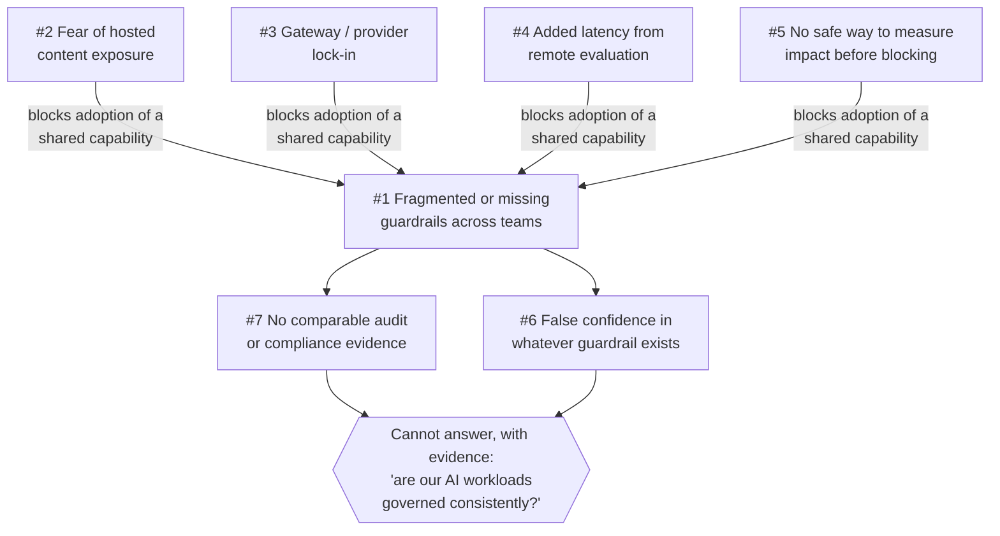

**AI Guardrails — Customer Pain Points**

**Authority level:** L4
**Status:** Draft
**Date:** 2026-07-24
**Derived from:** AGREEMENTS.md

---

## Purpose and scope

This document catalogs the customer pain points that justify AI Guardrails as a purchase or build decision, for use in sales conversations, discovery calls, and deck construction. It answers one question: *what is actually hurting a prospective customer today, and how does that pain show up in the systems and habits they already have?*

This is an **L4** document: a derived sales artifact. It must not contradict [`AGREEMENTS.md`](../00-source-of-truth/AGREEMENTS.md) or [`CONSTRAINTS.md`](../00-source-of-truth/CONSTRAINTS.md) (both L1), and every product-response reference below uses the same "designed to / supports / is intended to" language discipline required of [`70-governance/CLAIMS-REGISTER.md`](../70-governance/CLAIMS-REGISTER.md), not proven-performance language. Every pain point below traces to the accepted agreements and constraints; none introduces a metric, customer name, dollar figure, or SLA that the source material does not supply. Where a number would normally strengthen a sales point — a latency figure, a false-positive rate, an adoption count — the source material has not yet established one, and this document says **TBD** rather than inventing it.

This document is a sibling of [`../20-product/PROBLEM-STATEMENT.md`](../20-product/PROBLEM-STATEMENT.md), which frames the same underlying problem for a product audience. Where that document explains *why the problem matters to the organization building the product*, this document is written for *the prospect's own experience of the problem*, structured for direct use in discovery and sales narrative.

---

## How to use this document

Each of the seven pain points below is a real, source-backed condition — not a hypothetical objection invented for sales purposes. For each one:

* **Description** states the pain in plain terms.
* **How it manifests today** lists the concrete, observable symptoms a prospect is likely already living with, phrased so a seller can recognize them in a prospect's own words.
* **Who feels it most** names the stakeholder group (per [`TARGET-USERS.md`](../20-product/TARGET-USERS.md)) most exposed to that pain, so the conversation can be routed to the right buyer.
* **Source** links back to the source material and agreements that ground the pain point, so no claim here is asserted without traceability.

None of these sections claim the product eliminates the pain outright. Each links onward to [`../20-product/VALUE-PROPOSITION.md`](../20-product/VALUE-PROPOSITION.md) and [`../20-product/DIFFERENTIATORS.md`](../20-product/DIFFERENTIATORS.md) for the disciplined statement of how AI Guardrails is designed to respond.

---

## The seven pain points at a glance

| # | Pain point | One-line description | Primary stakeholder | Where the product responds |
| --- | --- | --- | --- | --- |
| 1 | [Inconsistent or missing guardrails across teams](#1-inconsistent-or-missing-guardrails-across-teams) | Every team builds its own safeguards, or none, with no shared policy anyone can point to. | Platform teams | Policy portability, one policy applied broadly ([AGR-005](../00-source-of-truth/AGREEMENTS.md#agr-005--policy-portability), [AGR-017](../00-source-of-truth/AGREEMENTS.md#agr-017--core-domain-model)) |
| 2 | [Fear of sending prompts/responses to a hosted service](#2-fear-of-sending-promptsresponses-to-a-hosted-service) | Adopting a shared guardrail seems to require handing sensitive content to infrastructure the team doesn't control. | Security and compliance teams | Explicit content-exposure model; Customer-Managed Runtime option ([AGR-008](../00-source-of-truth/AGREEMENTS.md#agr-008--explicit-content-exposure-model-ownership-vs-exposure-are-separate-concerns), [AGR-016](../00-source-of-truth/AGREEMENTS.md#agr-016--customer-controlled-telemetry-for-the-customer-managed-runtime)) |
| 3 | [Gateway/provider lock-in](#3-gatewayprovider-lock-in) | Guardrail logic tied to one gateway or one vendor can't move with the team when the stack changes. | Platform and architecture teams | Policy portability; vendor-independent contract ([AGR-003](../00-source-of-truth/AGREEMENTS.md#agr-003--litellm-as-first-connector-not-the-product-boundary), [AGR-004](../00-source-of-truth/AGREEMENTS.md#agr-004--bedrock-guardrails-as-first-engine-vendor-independent-contract), [AGR-005](../00-source-of-truth/AGREEMENTS.md#agr-005--policy-portability)) |
| 4 | [Added latency from remote evaluation](#4-added-latency-from-remote-evaluation) | Every evaluation call sits on the request path and adds time users can feel. | Application teams | Measured per-stage/per-detector latency; Customer-Managed Runtime for latency-sensitive workloads ([CON-016](../00-source-of-truth/CONSTRAINTS.md#con-016--timeout-limits)) |
| 5 | [Inability to measure impact before blocking users](#5-inability-to-measure-impact-before-blocking-users) | Guardrails today are absent or fully blocking, with no safe way to try one out first. | Application teams | Observe-before-enforce progression ([AGR-011](../00-source-of-truth/AGREEMENTS.md#agr-011--observe-before-enforce-progression)) |
| 6 | [False confidence that basic guardrails equal complete AI security](#6-false-confidence-that-basic-guardrails-equal-complete-ai-security) | Passing a guardrail check gets mistaken for full security or authorization coverage. | Security and compliance leadership | Explicit scope boundary; guardrails are not authorization ([AGR-010](../00-source-of-truth/AGREEMENTS.md#agr-010--guardrails-are-not-authorization), [AGR-018](../00-source-of-truth/AGREEMENTS.md#agr-018--trust-and-enforcement-model)) |
| 7 | [Audit and compliance evidence gaps](#7-audit-and-compliance-evidence-gaps) | No consistent, comparable evidence exists that policies are defined, versioned, and actually applied. | Security and compliance teams | Normalized decision metadata, policy-version traceability ([`NON-FUNCTIONAL-REQUIREMENTS.md`](../50-architecture/NON-FUNCTIONAL-REQUIREMENTS.md); [AGR-012](../00-source-of-truth/AGREEMENTS.md#agr-012--failure-behavior-is-part-of-policy)) |

---

## 1. Inconsistent or missing guardrails across teams

**Description.** Organizations adopt LLMs and agentic workflows team by team, each choosing its own gateway, model provider, and application framework, with no reusable policy, evaluation, and enforcement layer shared across them. Where guardrails exist at all, they are bespoke, undocumented, and coupled to whatever stack the team happens to run.

**How it manifests today:**

* Some teams call a model provider directly, or through an unmanaged gateway, with no input or output evaluation at all — there is nothing to detect prompt injection, sensitive-data leakage, or policy violations, and nothing to audit after the fact.
* Other teams have written their own regex filters, ad hoc moderation calls, or one-off Bedrock Guardrails wiring inside their own gateway or application code — logic that has never been tested against another team's traffic, is undocumented outside its author, and quietly drifts or disappears the moment that person changes teams.
* Multiple teams independently solve the same detection problem — PII in prompts, unsafe model output — with different quality bars and different working definitions of "safe," so the organization pays for the same problem multiple times and gets a different answer each time to "is this workload safe."
* There is no single place to define "detect prompt injection and block it" once and have every workload obey the same definition — a prospect asked "can you point to the one guardrail policy that governs all your AI workloads" cannot answer yes.

**Who feels it most.** Platform teams, who need central policy definitions, reusable connectors, deployment consistency, and audit visibility but have none of it ([`TARGET-USERS.md`](../20-product/TARGET-USERS.md)); security and compliance leadership trying to answer "are our AI workloads governed consistently" across a fragmented landscape.

**Source:** [`CHARTER.md`](../10-charter/CHARTER.md), [`TARGET-USERS.md`](../20-product/TARGET-USERS.md) (Platform teams); [`../20-product/PROBLEM-STATEMENT.md`](../20-product/PROBLEM-STATEMENT.md) §2.1–§2.3; [AGR-005](../00-source-of-truth/AGREEMENTS.md#agr-005--policy-portability), [AGR-017](../00-source-of-truth/AGREEMENTS.md#agr-017--core-domain-model).

---

## 2. Fear of sending prompts/responses to a hosted service

**Description.** Teams considering a shared guardrail capability worry — correctly, in some deployment modes — that adopting it means transmitting prompt and response content, possibly containing sensitive, regulated, or proprietary information, to infrastructure they do not operate.

**How it manifests today:**

* A team that keeps operating its own gateway naturally assumes its content also stays local. That assumption does not hold for Remote Evaluation: prompts, responses, and any additional evaluated content are transmitted to the hosted Evaluation API by design, and this mode must never be described as private-data or data-local ([AGR-009](../00-source-of-truth/AGREEMENTS.md#agr-009--remote-evaluation-is-not-a-private-data-or-data-local-model)). A prospect who discovers this mismatch during a security review — rather than being told upfront — loses trust in the vendor and the review process both.
* Security and compliance reviewers asked to approve a hosted evaluation capability without an explicit, per-deployment statement of where content is processed, what is persisted, and what telemetry leaves the runtime routinely stall the approval or reject it outright, because "who operates this component" and "where does my data go" are being treated as one question when they are two.
* Regulated workloads, data-residency-constrained workloads, high-volume workloads, and air-gapped environments cannot accept any arrangement where raw content leaves their own AWS account, and have no confidence that a "bring your own gateway" story alone addresses that requirement.
* Even where a team is willing to accept some hosted processing, it wants clear answers on retention: whether raw prompts and responses are persisted, for how long, and under what configuration — questions a fragmented, undocumented set of bespoke checks (pain #1) has never had to answer consistently.

**Who feels it most.** Security and compliance teams, who need content-retention controls and an explicit content-exposure model before they can sign off ([`TARGET-USERS.md`](../20-product/TARGET-USERS.md)); regulated or data-residency-sensitive workloads specifically.

**Source:** [AGR-002](../00-source-of-truth/AGREEMENTS.md#agr-002--three-deployment-modes) (Mode A, Mode C), [AGR-008](../00-source-of-truth/AGREEMENTS.md#agr-008--explicit-content-exposure-model-ownership-vs-exposure-are-separate-concerns), [`DATA-ARCHITECTURE.md`](../50-architecture/DATA-ARCHITECTURE.md), [`RISK-REGISTER.md`](../70-governance/RISK-REGISTER.md) ("Hosted data exposure"); [AGR-008](../00-source-of-truth/AGREEMENTS.md#agr-008--explicit-content-exposure-model-ownership-vs-exposure-are-separate-concerns), [AGR-009](../00-source-of-truth/AGREEMENTS.md#agr-009--remote-evaluation-is-not-a-private-data-or-data-local-model), [AGR-014](../00-source-of-truth/AGREEMENTS.md#agr-014--no-raw-promptresponse-retention-by-default), [AGR-016](../00-source-of-truth/AGREEMENTS.md#agr-016--customer-controlled-telemetry-for-the-customer-managed-runtime); [CON-007](../00-source-of-truth/CONSTRAINTS.md#con-007--explicit-content-exposure-documentation-per-deployment), [CON-013](../00-source-of-truth/CONSTRAINTS.md#con-013--raw-content-must-not-leave-a-customer-managed-runtime-unless-explicitly-configured), [CON-014](../00-source-of-truth/CONSTRAINTS.md#con-014--no-raw-content-retention-by-default-in-the-hosted-runtime).

> **Sales caution:** Do not tell a data-residency-sensitive prospect that "keeping your own gateway" (Mode A) means their content stays local — it does not. Route that prospect toward the Customer-Managed Runtime conversation instead. Overstating Mode A's data locality directly contradicts [AGR-009](../00-source-of-truth/AGREEMENTS.md#agr-009--remote-evaluation-is-not-a-private-data-or-data-local-model) and is the exact claim [`70-governance/CLAIMS-REGISTER.md`](../70-governance/CLAIMS-REGISTER.md) will reject.

---

## 3. Gateway/provider lock-in

**Description.** Teams resist adopting a guardrail capability that ties their organizational safety policy to a single gateway product or a single model-evaluation vendor, fearing that a future change of gateway, provider, or framework would force them to redefine or rebuild their policies from nothing.

**How it manifests today:**

* Guardrail logic embedded directly in one team's gateway configuration or provider SDK does not transfer to another team's stack — a policy written against one gateway's request/response shape has to be reimplemented, not reused, the moment a team changes gateway or switches model provider.
* Teams that use a different gateway than whatever is currently supported, or that want to invoke an evaluation capability directly from an SDK without a gateway at all, have no path today to adopt the same organizational policy as everyone else — they either wait for a new connector to be built or go without.
* Procurement and architecture reviewers evaluating a guardrail vendor have to ask whether that vendor's policy format is genuinely portable, or whether it silently assumes one gateway's configuration structure or one evaluation engine's response format — a common pattern among single-vendor moderation add-ons.
* Any organization that has previously invested in guardrail logic wired directly into one internal LiteLLM deployment already knows the cost of this pain firsthand: that investment does not travel to the next team's gateway or the next model-provider contract.

**Who feels it most.** Platform and architecture teams evaluating long-term vendor and technology risk; application teams that do not use the currently-supported gateway or provider; procurement functions assessing dependency risk in a purchase decision.

**Source:** [`CHARTER.md`](../10-charter/CHARTER.md) ("Avoid coupling policy definitions to LiteLLM or Amazon Bedrock"), [AGR-005](../00-source-of-truth/AGREEMENTS.md#agr-005--policy-portability), [AGR-003](../00-source-of-truth/AGREEMENTS.md#agr-003--litellm-as-first-connector-not-the-product-boundary), [AGR-001](../00-source-of-truth/AGREEMENTS.md#agr-001--standalone-platform-not-embedded-in-the-internal-litellm); [AGR-003](../00-source-of-truth/AGREEMENTS.md#agr-003--litellm-as-first-connector-not-the-product-boundary), [AGR-004](../00-source-of-truth/AGREEMENTS.md#agr-004--bedrock-guardrails-as-first-engine-vendor-independent-contract), [AGR-005](../00-source-of-truth/AGREEMENTS.md#agr-005--policy-portability); [CON-003](../00-source-of-truth/CONSTRAINTS.md#con-003--no-coupling-to-litellm-configuration-structures), [CON-004](../00-source-of-truth/CONSTRAINTS.md#con-004--no-coupling-to-bedrock-guardrails-response-formats).

---

## 4. Added latency from remote evaluation

**Description.** Routing every prompt and response through a synchronous input/output evaluation call — whether to a hosted Evaluation API or through a Guarded Gateway — adds network and processing time directly onto the path a user or agent experiences.

**How it manifests today:**

* Any workload that adds a remote evaluation step before and after model invocation incurs additional round-trip latency on top of the model provider's own inference time, on every single request.
* Teams have no established latency budget to reason about before adoption — the source material identifies latency measurement (P50, P95, P99, per-detector, timeout rate) as something the platform is built to produce and expose, not a number that already exists for a prospect to check against.
* Latency-sensitive workloads — real-time chat interfaces, low-latency agent loops — are the most exposed to this pain, and are typically the workloads most likely to ask about a locally-deployed evaluation path instead of a remote one.
* Whether a given amount of added latency is acceptable to a specific workload is genuinely unresolved industry-wide, not just for this product: [`../00-source-of-truth/ASSUMPTIONS.md`](../00-source-of-truth/ASSUMPTIONS.md) (ASM-011, ASM-012) records that the latency-tolerance question is currently unvalidated rather than answered, and no specific millisecond figure should be quoted until a workload's own measurement exists.

**Who feels it most.** Application teams, who need predictable latency and clear failure behavior ([`TARGET-USERS.md`](../20-product/TARGET-USERS.md)); end users of latency-sensitive, real-time workloads; platform teams responsible for sizing runtime capacity.

**Source:** [`NON-FUNCTIONAL-REQUIREMENTS.md`](../50-architecture/NON-FUNCTIONAL-REQUIREMENTS.md) (Performance), [`RISK-REGISTER.md`](../70-governance/RISK-REGISTER.md) ("Latency"); [`../00-source-of-truth/ASSUMPTIONS.md`](../00-source-of-truth/ASSUMPTIONS.md) ASM-011, ASM-012; [CON-016](../00-source-of-truth/CONSTRAINTS.md#con-016--timeout-limits).

> **Sales caution:** Do not quote a specific latency figure, percentile, or SLA for evaluation overhead — none exists yet in the source material. Frame this pain honestly as "measured and managed, with per-stage timeouts," not "solved" or "eliminated."

---

## 5. Inability to measure impact before blocking users

**Description.** Where guardrails exist today at all, they typically ship in one of two states: absent, or fully blocking. There is rarely a middle ground that lets a team see what a policy *would* flag without actually rejecting real user or agent traffic.

**How it manifests today:**

* A team that enables an unproven check in blocking mode and hits a high false-positive rate sees production behavior degrade or break immediately — and the predictable response is to disable or bypass the check entirely, which reinforces the fragmentation described in pain #1.
* A team that never enables a check for fear of exactly that outcome leaves the workload unguarded indefinitely, and the organization gains nothing from the effort already spent building the check.
* Application teams explicitly need "a way to test policies before blocking users" ([`TARGET-USERS.md`](../20-product/TARGET-USERS.md)) and today have no structural mechanism — no non-blocking mode, no false-positive measurement, no business-impact visibility — to get that evidence before enforcement is switched on.
* Detection-quality itself is an open question a prospect is right to ask about: [`../00-source-of-truth/ASSUMPTIONS.md`](../00-source-of-truth/ASSUMPTIONS.md) (ASM-017) records that adequate detection quality from Bedrock Guardrails plus deterministic rules is an assumption still being validated, not a settled fact — which is exactly why a non-blocking measurement step matters before any workload is promoted to enforcement.

**Who feels it most.** Application teams, who bear the risk of broken production traffic; platform teams responsible for the rollout; security and compliance teams who need evidence before a policy is promoted from observe to enforce.

**Source:** [AGR-011](../00-source-of-truth/AGREEMENTS.md#agr-011--observe-before-enforce-progression), [`TARGET-USERS.md`](../20-product/TARGET-USERS.md) (Application teams); [AGR-011](../00-source-of-truth/AGREEMENTS.md#agr-011--observe-before-enforce-progression); [`../00-source-of-truth/ASSUMPTIONS.md`](../00-source-of-truth/ASSUMPTIONS.md) ASM-017.

---

## 6. False confidence that basic guardrails equal complete AI security

**Description.** Teams that adopt any guardrail evaluation — their own bespoke check, or a vendor's basic moderation call — are prone to treating a passing evaluation as proof the workload is fully secure, when content evaluation is only one narrow layer of a much larger security and governance picture.

**How it manifests today:**

* Teams conflate "the guardrail evaluation passed" with "this AI workload is fully secure," leaving authorization, tenant-isolation, and application-security gaps unaddressed while stakeholders believe those gaps are already covered.
* A guardrail decision that a tool call or piece of content "appears safe" gets treated internally as if it also confirms the current user is authorized to execute that action against a given resource — a distinction the evaluation itself does not make and was never designed to make.
* A cooperative, opt-in connector that a team installs and maintains gets described internally as a hard, bypass-proof security boundary, when in practice it can be disabled, removed, or misconfigured by that same team at any time.
* Categories the guardrail layer does not attempt to cover at all — a complete DLP platform, full compliance certification, fully autonomous agent governance, a general MCP security platform — go unaddressed in practice because stakeholders assume "we already have guardrails" extends to cover them too.
* This is the single risk named most explicitly in the source material as a compounding danger: teams interpreting successful guardrail evaluation as complete AI security ([`RISK-REGISTER.md`](../70-governance/RISK-REGISTER.md)).

**Who feels it most.** Security and compliance leadership, who face false assurance surfacing in an audit; executives making risk decisions on an incomplete picture; incident responders who discover the gap only after an event.

**Source:** [AGR-010](../00-source-of-truth/AGREEMENTS.md#agr-010--guardrails-are-not-authorization), [`RISK-REGISTER.md`](../70-governance/RISK-REGISTER.md) ("False confidence"); [AGR-010](../00-source-of-truth/AGREEMENTS.md#agr-010--guardrails-are-not-authorization), [AGR-018](../00-source-of-truth/AGREEMENTS.md#agr-018--trust-and-enforcement-model); [`../20-product/DIFFERENTIATORS.md`](../20-product/DIFFERENTIATORS.md) §5 ("Honest scoping of guardrails").

> **Sales caution:** This pain point is also a boundary on what AI Guardrails itself may be sold as. Never position AI Guardrails as a complete AI-security platform, an authorization system, or a bypass-proof enforcement mechanism in cooperative mode — doing so recreates the exact failure this pain point describes, this time with the vendor as the source of the false confidence.

---

## 7. Audit and compliance evidence gaps

**Description.** Security and compliance stakeholders need to demonstrate, with evidence, that guardrail policies exist, are versioned, and are actually being applied to production traffic. Fragmented, bespoke guardrail implementations (pain #1) cannot produce this evidence in any comparable form across workloads.

**How it manifests today:**

* Each team's bespoke implementation records different things, or nothing at all — there is no consistent decision evidence, no shared reason codes, and no comparable evaluator metadata to point to across workloads.
* There is no policy-version traceability when policy logic lives scattered inside individually-built implementations — compliance cannot answer "which version of which policy evaluated this specific request" for most of the organization's AI traffic.
* Content-retention posture is unknown or undocumented per workload: whether raw prompts and responses were persisted, for how long, and under what configuration is not something a fragmented set of bespoke checks can answer consistently, or sometimes at all.
* Exception tracking has no consistent home — when a workload deviates from whatever the "standard" check is supposed to be, there is no record of who approved the deviation or why.
* The compounding result: an organization cannot answer, with evidence, "are our AI workloads governed consistently" — precisely the evidentiary gap security and compliance teams are asked to close and cannot, given the current state described in pain #1.

**Who feels it most.** Security and compliance teams, who need policy ownership, decision evidence, policy-version traceability, content-retention controls, and exception tracking ([`TARGET-USERS.md`](../20-product/TARGET-USERS.md)); auditors; product operators who need deployment-compatibility and usage visibility across workloads.

**Source:** [`TARGET-USERS.md`](../20-product/TARGET-USERS.md) (Security and compliance teams), [`NON-FUNCTIONAL-REQUIREMENTS.md`](../50-architecture/NON-FUNCTIONAL-REQUIREMENTS.md) (Auditing), [`TEAM-AND-OWNERSHIP.md`](../60-delivery/TEAM-AND-OWNERSHIP.md); [AGR-012](../00-source-of-truth/AGREEMENTS.md#agr-012--failure-behavior-is-part-of-policy); [`../20-product/PROBLEM-STATEMENT.md`](../20-product/PROBLEM-STATEMENT.md) §2.3, §6.

---

## How these pains compound

These seven pains are not independent. Fragmentation (#1) is the root condition; the remaining six are either a direct consequence of it, an adoption blocker that keeps an organization from fixing it, or a risk that resurfaces even after a shared policy exists.

Pain #1 is the condition a prospect is actually living in. Pains #2 through #5 are the specific, rational reasons a team resists fixing it even when a shared capability is offered — and pains #6 and #7 are what keeps hurting the organization even where some guardrail, of unknown quality, already exists.

---

## What this document does not claim

Consistent with [AGR-009](../00-source-of-truth/AGREEMENTS.md#agr-009--remote-evaluation-is-not-a-private-data-or-data-local-model), [AGR-010](../00-source-of-truth/AGREEMENTS.md#agr-010--guardrails-are-not-authorization), and [AGR-018](../00-source-of-truth/AGREEMENTS.md#agr-018--trust-and-enforcement-model), this document does not claim, and no sales conversation built on it should claim:

* That Remote Evaluation (Mode A) keeps tenant content local or private — it does not; content reaches the hosted Evaluation API by design.
* That AI Guardrails resolves pain #6 by becoming a complete AI-security or authorization platform — it explicitly does not attempt to be one; it separates content evaluation from authorization, data isolation, and application security as distinct concerns.
* That a cooperative-mode connector is bypass-proof — it can be disabled, removed, or misconfigured by the team that installed it, and only platform-managed or network/IAM-enforced postures raise bypass resistance.
* Any specific latency figure, false-positive rate, availability number, adoption count, or dollar figure for any pain point above. Where the underlying source material and agreements do not supply one, this document records that gap as **TBD** rather than inventing a number to make a stronger sales point.

---

## Related documents

- [`../20-product/PROBLEM-STATEMENT.md`](../20-product/PROBLEM-STATEMENT.md) — the product-audience framing of the same underlying problem, with fuller stakeholder and risk analysis.
- [`../20-product/VALUE-PROPOSITION.md`](../20-product/VALUE-PROPOSITION.md) — the disciplined, audience-by-audience statement of how AI Guardrails is designed to respond to each need.
- [`../20-product/DIFFERENTIATORS.md`](../20-product/DIFFERENTIATORS.md) — what makes the product's response to these pains non-trivial to replicate informally, and what it deliberately does not claim.
- [`../00-source-of-truth/AGREEMENTS.md`](../00-source-of-truth/AGREEMENTS.md) — the authoritative agreements this document must not contradict, particularly AGR-005 through AGR-011, AGR-018.
- [`../00-source-of-truth/CONSTRAINTS.md`](../00-source-of-truth/CONSTRAINTS.md) — non-negotiable boundaries underlying pains #2, #3, and #4.
- [`../00-source-of-truth/ASSUMPTIONS.md`](../00-source-of-truth/ASSUMPTIONS.md) — unvalidated beliefs (latency tolerance, detection quality) referenced in pains #4 and #5.
- [`../10-charter/CHARTER.md`](../10-charter/CHARTER.md) — the solution's overall response to the problem this document frames.
- [`DECK-BRIEF.md`](DECK-BRIEF.md) — the sales deck narrative this document supplies pain-point material to.
- [`../70-governance/CLAIMS-REGISTER.md`](../70-governance/CLAIMS-REGISTER.md) — the authoritative register of approved external-facing wording that governs how these pain points may be voiced externally.
- [`../70-governance/RISK-REGISTER.md`](../70-governance/RISK-REGISTER.md) — tracks the risks (false confidence, connector bypass, hosted data exposure) that qualify pains #2 and #6.
