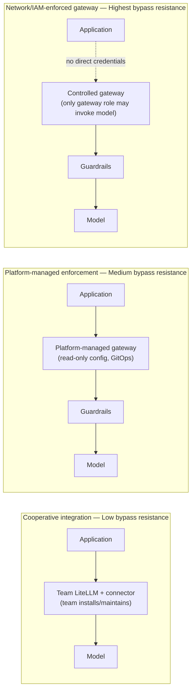

**AI Guardrails — Objection Handling**

**Authority level:** L4
**Status:** Draft
**Date:** 2026-07-24
**Derived from:** seed.md + AGREEMENTS.md

---

## Purpose and how to use this document

This document equips sales, sales-engineering, and solution-consulting teams with honest, source-grounded responses to the objections prospects most commonly raise about AI Guardrails. It is a **derived, L4** document: every response traces back to the authoritative [`AGREEMENTS.md`](../00-source-of-truth/AGREEMENTS.md) (L1) and [`CONSTRAINTS.md`](../00-source-of-truth/CONSTRAINTS.md) (L1) registers, and to `seed.md`. Where the source material does not establish a number, timeline, or dollar figure, this document says **TBD** rather than inventing one.

**Ground rule for anyone using this document in a live conversation:** the single largest named risk in the solution charter is *false confidence* — a prospect (or a rep) overstating what guardrails guarantee. Every response below is written to close deals honestly, not to win an objection by overclaiming. Where a stronger-sounding answer would contradict `AGREEMENTS.md`, the honest, narrower answer is the one to give. If an answer here ever appears to conflict with `AGREEMENTS.md` or `CONSTRAINTS.md`, those registers win and this document must be corrected — never the other way around.

[`../70-governance/CLAIMS-REGISTER.md`](../70-governance/CLAIMS-REGISTER.md) holds the definitive, enforceable external-facing wording. This document should be checked against it directly.

---

## Quick-reference table

| # | Objection | One-line response | Section |
|---|---|---|---|
| 1 | "Our data would leave our environment." | Depends on the mode you choose — Customer-Managed Runtime keeps raw content in your own AWS account by design; every mode's data flow is documented explicitly, and nothing is hidden. | [§1](#1-our-data-would-leave-our-environment) |
| 2 | "It adds latency to every request." | Yes, remote evaluation adds a network hop — which is why we measure it per evaluator, apply only relevant evaluators, support local deterministic checks, define stage timeouts, and offer a customer-managed runtime for latency-sensitive workloads. | [§2](#2-it-adds-latency) |
| 3 | "We already use [another vendor] / this locks us in." | The policy contract is vendor-independent by design — it doesn't depend on LiteLLM's structures or Bedrock Guardrails' response format, and your LiteLLM instance stays yours. | [§3](#3-another-vendor-is-already-in-place--this-creates-lock-in) |
| 4 | "Couldn't someone just disable or bypass the connector?" | In cooperative mode, yes — and we won't tell you otherwise. That's why we offer three enforcement postures, from cooperative up to network/IAM-enforced, matched to your actual trust and compliance requirements. | [§4](#4-the-connector-can-be-bypassed) |
| 5 | "So this is our complete AI security solution?" | No. Guardrails evaluate content; they are not authorization, not a complete security boundary, and not a full AI governance platform. We say this explicitly so you know what you still own. | [§5](#5-is-this-complete-ai-security) |

---

## 1. "Our data would leave our environment"

### The objection

A prospect — usually a security, compliance, or data-residency stakeholder — pushes back that adopting AI Guardrails means their prompts, responses, or other sensitive content will be transmitted to infrastructure they do not control.

### Response

This is a legitimate question, and the honest answer depends entirely on which of the three deployment modes the workload uses — the platform is explicit that *operational ownership* (who runs the component) and *data exposure* (where the data goes) are two separate questions, answered independently for every mode:

| Mode | Where prompts/responses are processed | Does raw content leave your environment? |
|---|---|---|
| **A — Remote Evaluation** | Hosted, provider-operated Evaluation API | **Yes.** Your team keeps its own LiteLLM (or equivalent gateway), but input and output evaluation calls transmit prompts, responses, and any other evaluated content to the hosted Evaluation API. This mode must never be described as data-local — its benefit is reduced operational ownership of the inference path, not reduced data exposure. |
| **B — Guarded Gateway** | Provider-managed gateway and guardrail runtime | **Yes**, by construction — this mode is a fully managed inference-and-guardrail path, so content passes through provider-operated infrastructure end to end. |
| **C — Customer-Managed Runtime** | Inside your own AWS account | **No, not by default.** The guardrail runtime — policy cache, Bedrock Guardrails adapter, custom evaluators, local audit integration — runs inside your AWS account alongside your own LiteLLM or application. Raw content stays there unless you explicitly configure otherwise, and the runtime can keep evaluating without a live connection back to the hosted control plane. |

If the requirement is genuinely "prompts and responses must never leave our account," the correct answer is **Customer-Managed Runtime (Mode C)** — not a reassurance that Remote Evaluation is somehow private. Routing a data-residency requirement into Mode A would be a misrepresentation the platform explicitly prohibits.

Two further points worth making regardless of mode:

* **No raw retention by default, even in the hosted runtime.** The hosted runtime (Modes A and B) processes content only for evaluation and does not persist raw prompts or responses by default. It persists decision metadata only (action, reason codes, policy version, evaluator metadata, latency, correlation identifier), hashes user/conversation identifiers where possible, and strips secrets from telemetry. Any raw-content retention requires explicit, tenant-level configuration — it is never a platform default, and every audit record states whether raw content was retained for that evaluation.
* **Even in Customer-Managed Runtime, telemetry is your choice.** You control what — if anything — the hosted control plane receives: health status, product version, policy version, aggregated evaluation counts, reason-code totals, latency metrics, sanitized decision metadata, or nothing at all. A fully supported "no telemetry" configuration exists. Raw content never leaves your account through this telemetry channel unless you explicitly configure it to.

### What not to say

* Do not describe Remote Evaluation (Mode A) as private, data-local, or "your data never leaves your environment" — it does leave, to the hosted Evaluation API, by the mode's own design.
* Do not imply that choosing a mode with less operational burden (Modes A/B) automatically means less data exposure — the two are independent, and conflating them is the specific failure mode this platform's content-exposure principle exists to prevent.

### Supporting source

seed.md §3 (Mode A, Mode C), §5.4 (Explicit content-exposure model), §13 (Data handling requirements); [`AGREEMENTS.md` — AGR-008](../00-source-of-truth/AGREEMENTS.md#agr-008--explicit-content-exposure-model-ownership-vs-exposure-are-separate-concerns), [AGR-009](../00-source-of-truth/AGREEMENTS.md#agr-009--remote-evaluation-is-not-a-private-data-or-data-local-model), [AGR-014](../00-source-of-truth/AGREEMENTS.md#agr-014--no-raw-promptresponse-retention-by-default), [AGR-015](../00-source-of-truth/AGREEMENTS.md#agr-015--customer-managed-runtime-executes-without-a-synchronous-control-plane-connection), [AGR-016](../00-source-of-truth/AGREEMENTS.md#agr-016--customer-controlled-telemetry-for-the-customer-managed-runtime); [`CONSTRAINTS.md` — CON-007](../00-source-of-truth/CONSTRAINTS.md#con-007--explicit-content-exposure-documentation-per-deployment), [CON-013](../00-source-of-truth/CONSTRAINTS.md#con-013--raw-content-must-not-leave-a-customer-managed-runtime-unless-explicitly-configured), [CON-014](../00-source-of-truth/CONSTRAINTS.md#con-014--no-raw-content-retention-by-default-in-the-hosted-runtime).

---

## 2. "It adds latency"

### The objection

An application-team or performance-conscious stakeholder objects that inserting a synchronous evaluation call before and after model inference will slow down every request, and that this is unacceptable for their workload.

### Response

This objection should be met with agreement on the underlying fact, not denial: remote input and output evaluation **does** add synchronous network and processing latency. Pretending otherwise would be dishonest and would surface as a support problem later. The right answer is what the platform does about it:

* **Latency is measured, not assumed.** The platform is built to measure P50, P95, and P99 evaluation latency, evaluation throughput, timeout rate, detector-specific latency, decision distribution, and policy-cache hit rate — so a workload's actual latency profile is visible rather than guessed at. (Specific latency figures and SLAs are **TBD** — the charter establishes what must be measured, not target numbers yet.)
* **Only relevant evaluators run.** A policy applies the evaluators it actually needs for a given stage and workload rather than running every possible check on every request.
* **Local, deterministic checks are supported.** Basic deterministic organization rules can execute without a full round trip to a remote detection engine, reducing the latency contribution of at least part of the policy.
* **Stage-specific timeouts are mandatory, not optional.** Every evaluation stage (input, output, and any future stage) enforces an explicit timeout, and what happens when that timeout is hit is a required, documented part of the workload's failure behavior — never an undocumented default that could stall production traffic indefinitely.
* **Customer-Managed Runtime is the answer for latency-sensitive workloads.** Because the runtime executes inside the customer's own AWS account and does not require a synchronous connection to the hosted control plane for policy execution, it avoids the network hop to a hosted, provider-operated service that Modes A and B carry by construction. This is the mode to recommend when latency sensitivity is the primary driver.

### What not to say

* Do not claim guardrail evaluation is "latency-free" or "no different from not having guardrails at all."
* Do not quote a specific millisecond figure, percentile target, or SLA number — none are established in the source material yet. If a prospect asks for a number, the honest answer is that specific timeout values and latency targets are **TBD per evaluation stage and per detector**, and that per-evaluator latency is measured so the true cost can be shown once instrumented for their workload.

### Supporting source

seed.md §15 (Operational requirements — Performance), §20 (Key risks — Latency); [`AGREEMENTS.md` — AGR-012](../00-source-of-truth/AGREEMENTS.md#agr-012--failure-behavior-is-part-of-policy); [`CONSTRAINTS.md` — CON-016](../00-source-of-truth/CONSTRAINTS.md#con-016--timeout-limits).

---

## 3. "Another vendor / this creates lock-in"

### The objection

A prospect already has a preferred model provider, gateway, or moderation tool, or is generally wary of adopting a platform that would force them onto a specific vendor's stack, hand over their gateway, or make future migration difficult.

### Response

The product is explicitly designed to avoid exactly this coupling, on two fronts:

* **Your LiteLLM instance stays yours.** "Import" — the term for adopting a guardrail policy — means adopting a versioned policy, a workload identity, an integration manifest, a connector configuration, and an enforcement mode. It never means importing, cloning, registering, or remotely controlling another team's LiteLLM instance. Onboarding does not require copying your LiteLLM database, transferring your model-provider credentials, exposing your gateway's administration endpoints, replacing your model-routing configuration, or giving the guardrail provider administrative access to your gateway. In Remote Evaluation (Mode A), you keep operating LiteLLM (or an equivalent gateway) exactly as before — the guardrails platform only adds an Evaluation API your gateway calls before and after inference.
* **The policy contract is vendor-independent by construction.** Guardrail policies do not depend on LiteLLM's configuration structures, on Amazon Bedrock Guardrails' response format, on a specific model provider, a specific programming language, or a specific application framework. LiteLLM is the platform's *first supported connector* and Amazon Bedrock Guardrails is its *first managed evaluation engine* — neither defines the boundary of the product. Vendor- and gateway-specific logic sits behind adapters (a Bedrock Guardrails adapter, a LiteLLM connector), so a policy author writes intent ("detect prompt injection and block it"), not integration mechanics. Additional gateways and evaluation engines are expected to be added behind the same adapter pattern without changing policy semantics.

Put simply: adopting AI Guardrails does not require replacing your gateway, your model provider, or your existing tooling, and switching or adding a gateway or evaluation engine later does not require rewriting your policies.

### What not to say

* Do not claim every gateway or model provider is already supported out of the box — LiteLLM and Bedrock Guardrails are the validated initial integrations; the claim is about where the seams are (vendor-specific logic is isolated behind adapters), not that all integrations already exist.
* Do not describe onboarding as requiring the guardrail provider to take over or administer the customer's gateway — that is precisely what "import" is defined not to mean.

### Supporting source

seed.md §4 (Definition of the import capability), §5.1 (Policy portability), §12 (LiteLLM integration), §22 (Decision summary); [`AGREEMENTS.md` — AGR-003](../00-source-of-truth/AGREEMENTS.md#agr-003--litellm-as-first-connector-not-the-product-boundary), [AGR-004](../00-source-of-truth/AGREEMENTS.md#agr-004--bedrock-guardrails-as-first-engine-vendor-independent-contract), [AGR-005](../00-source-of-truth/AGREEMENTS.md#agr-005--policy-portability), [AGR-019](../00-source-of-truth/AGREEMENTS.md#agr-019--meaning-of-import); [`CONSTRAINTS.md` — CON-003](../00-source-of-truth/CONSTRAINTS.md#con-003--no-coupling-to-litellm-configuration-structures), [CON-004](../00-source-of-truth/CONSTRAINTS.md#con-004--no-coupling-to-bedrock-guardrails-response-formats).

---

## 4. "The connector can be bypassed"

### The objection

A security-minded prospect points out — correctly — that if the consuming team installs and maintains its own connector, that team (or a misconfiguration, or an incident) could disable, remove, or bypass it, so guardrails cannot be relied on as a real control.

### Response

Agree with the premise before explaining the model — this objection is factually correct for one of the three enforcement postures the platform defines, and the platform does not claim otherwise:

| Posture | Who installs/manages the connector or gateway | Bypass resistance |
|---|---|---|
| **Cooperative integration** | The consuming team installs and maintains its own connector. | **Low.** The connector can be disabled, removed, or misconfigured by the team that owns it. A cooperative connector must not be represented as a hard security boundary. |
| **Platform-managed enforcement** | The platform team manages the LiteLLM configuration or gateway deployment; application teams cannot change mandatory guardrail settings. | **Medium.** Controls can include read-only gateway configuration, GitOps-managed deployment, restricted IAM roles, removal of model credentials from application workloads, configuration validation, and connector-health telemetry. |
| **Network and IAM-enforced gateway** | All supported model traffic is required to pass through a controlled gateway; applications hold no direct provider credentials. | **Highest.** Applications have no direct Bedrock permissions or provider API credentials; egress policies restrict direct provider connectivity; only the gateway role may invoke approved model services; mandatory policies cannot be overridden by consumers. |

Cooperative integration is the model the initial delivery (Phases 1–2) targets, and it is appropriate specifically when teams are trusted, guardrails are being adopted as an engineering standard, and bypass prevention is not yet a formal requirement — i.e., the objective is adoption and evaluation, not enforcement against an adversarial or untrusted actor. When bypass prevention actually is a formal requirement — because teams are only semi-trusted, or compliance evidence is required, or direct provider access must be prohibited — the answer is to move that workload to platform-managed enforcement or, for the strongest guarantee, a network- and IAM-enforced gateway where model traffic simply cannot reach the provider except through the controlled path.

The platform also does not treat weak signals as substitutes for real enforcement: it must not rely exclusively on API keys stored in LiteLLM configuration, tenant-supplied identifiers without authentication, client-supplied policy versions without authorization, or connector telemetry as evidence that enforcement is actually mandatory. Each workload's enforcement posture is recorded and visible, not assumed — so a customer can always ask, and get an honest answer to, "which posture is this workload actually running under today?"

### What not to say

* Do not tell a customer that a cooperative connector is bypass-proof, unbypassable, or a hard security boundary — it is explicitly none of these, and claiming otherwise directly contradicts the platform's own trust model.
* Do not point to connector-health telemetry alone as proof that enforcement is mandatory — telemetry is a signal, not evidence of an enforced boundary.
* Do not present the network/IAM-enforced posture as required for the initial phases — it is the strongest available posture, not a baseline requirement, and should be positioned as the answer to a specific bypass-prevention requirement, not a default sales claim.

### Supporting source

seed.md §8 (Trust and enforcement model), §14 (Security requirements), §20 (Key risks — Connector bypass); [`AGREEMENTS.md` — AGR-018](../00-source-of-truth/AGREEMENTS.md#agr-018--trust-and-enforcement-model); [`CONSTRAINTS.md` — CON-012](../00-source-of-truth/CONSTRAINTS.md#con-012--no-exclusive-reliance-on-weak-security-proxies).

---

## 5. "Is this complete AI security?"

### The objection

Having heard the pitch, a prospect (or, worse, a prospect's leadership after the deal closes) concludes that deploying AI Guardrails means their AI systems are now fully secure and governed — a form of false confidence the charter names as a top-level risk.

### Response

The direct answer is **no**, and this should be stated plainly rather than softened, because the platform's own risk analysis identifies false confidence — teams interpreting successful guardrail evaluation as complete AI security — as a named risk to actively guard against, not a nuance to gloss over in a sales conversation.

Specifically:

* **Guardrails are not authorization.** A guardrail can determine that a prompt, response, or tool call *appears safe* from a content-policy perspective. It does not determine whether the current, authenticated user is permitted to execute that action against a particular resource. Authentication, business authorization, tenant isolation, resource ownership, transaction limits, and approval workflows remain the consuming application's responsibility, in full. Tool and agent authorization integration lands in Phase 5 of the delivery sequence and is not available today; end-user authentication and application business authorization remain excluded from the feature set entirely (seed.md §6.3).
* **Guardrails are not a complete security boundary.** The platform explicitly excludes from its feature set (seed.md §6.3): a general-purpose LLM gateway replacement, a complete AI governance platform, model training or fine-tuning, a proprietary prompt-injection model, a proprietary moderation model, a complete DLP platform, end-user authentication, application business authorization, fully autonomous agent governance, organization-wide AWS enforcement, cross-cloud deployment, full compliance certification, or a general MCP security platform. (Multi-region active-active availability was formerly part of this exclusion list; [DEC-019](../00-source-of-truth/DECISIONS.md#dec-019--multi-region-active-active-availability-committed-as-a-later-phase) (Proposed, pending owner ratification) supersedes that exclusion and commits it as a later-phase capability, [`CAP-036`](../20-product/CAPABILITIES.md) — not yet delivered, but no longer excluded.)
* **What guardrails actually deliver:** a reusable policy, evaluation, and enforcement layer that applies consistent input/output content evaluation across workloads, gateways, and providers, with normalized decisions, observe-before-enforce rollout, and auditable evidence that policies were applied. That is a precise and valuable scope — it is just not the same thing as "your AI systems are fully secured."

The correct sales posture is to state the scope boundary as part of the value proposition, not as a caveat buried in a footnote: telling a prospect exactly which risks the platform addresses, and which remain theirs to own (authentication, authorization, tenant isolation, full compliance certification, and the risk categories the platform does not yet cover), is itself part of what makes the platform trustworthy.

### What not to say

* Do not market or describe AI Guardrails as "complete AI security," "full AI governance," or a "security boundary" on its own.
* Do not describe a guardrail decision (content appears safe) as an authorization decision (this user may take this action).
* Do not claim coverage for risk categories excluded from the feature set — proprietary detection models, a complete DLP platform, a general MCP security platform, or full compliance certification (seed.md §6.3) — and do not present Phase 5 capabilities (tool-call validation, MCP integration) as already delivered.

### Supporting source

seed.md §5.5 (Guardrails are not authorization), §6 (scope, including the §6.3 exclusions), §20 (Key risks — False confidence); [`AGREEMENTS.md` — AGR-010](../00-source-of-truth/AGREEMENTS.md#agr-010--guardrails-are-not-authorization); [`../10-charter/SCOPE.md`](../10-charter/SCOPE.md) (authoritative scope boundaries; the former MVP-scope agreement was removed by [DEC-008](../00-source-of-truth/DECISIONS.md#dec-008--supersede-the-mvp-bounded-scope-define-and-estimate-the-full-feature-set-across-five-phases)).

---

## Cross-cutting principle: honesty outranks a closed deal

Every response in this document is built on the same discipline the source material applies to itself: where a claim would sound better but is not supported by `AGREEMENTS.md`, `CONSTRAINTS.md`, or `seed.md`, the narrower, accurate claim is the one to use. This is not a compliance formality — it is the direct mitigation for two of the six risks named in the charter (false confidence and, indirectly, connector bypass, if a customer is sold a posture stronger than what they actually deploy). A rep who oversells the exposure model, the bypass resistance of a cooperative connector, or the completeness of guardrail coverage is creating exactly the risk exposure this platform is designed to reduce.

---

## Related documents

- [`../00-source-of-truth/AGREEMENTS.md`](../00-source-of-truth/AGREEMENTS.md) — L1 authoritative agreement register every response above is derived from.
- [`../00-source-of-truth/CONSTRAINTS.md`](../00-source-of-truth/CONSTRAINTS.md) — L1 authoritative constraint register operationalizing the same agreements as checkable boundaries.
- [`../20-product/FAQ.md`](../20-product/FAQ.md) — companion document answering the same underlying questions in a product-neutral, non-sales framing.
- [`../20-product/DIFFERENTIATORS.md`](../20-product/DIFFERENTIATORS.md) — the positive framing of what makes the platform distinct, including its explicit scope boundaries.
- [`../30-executive/RISKS-AND-DEPENDENCIES.md`](../30-executive/RISKS-AND-DEPENDENCIES.md) — the executive-level view of the connector bypass, false confidence, latency, and hosted data-exposure risks referenced above.
- [`../10-charter/PRINCIPLES.md`](../10-charter/PRINCIPLES.md) — the product principles (policy portability, explicit content-exposure model, guardrails-are-not-authorization, observe-before-enforce) these responses apply.
- [`../10-charter/SCOPE.md`](../10-charter/SCOPE.md) — the in-scope, future-scope, and out-of-scope boundaries referenced in §5.
- [`../70-governance/CLAIMS-REGISTER.md`](../70-governance/CLAIMS-REGISTER.md) — register of enforceable, approved external-facing wording; governs this document.
- [`../70-governance/RISK-REGISTER.md`](../70-governance/RISK-REGISTER.md) — fuller risk register, including connector bypass and false confidence.
- [seed.md](../../seed.md) — original charter source for every objection response above.
