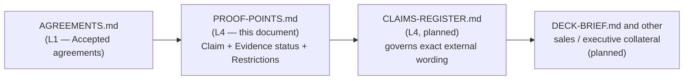

**AI Guardrails — Proof Points**

**Authority level:** L4
**Status:** Draft
**Date:** 2026-07-24
**Derived from:** seed.md + AGREEMENTS.md

---

## Purpose and scope

This document is an **evidence register**, not a pitch. It exists to keep what can be claimed about AI Guardrails separate from how it gets said — sales, executive, and marketing language belongs in [`DECK-BRIEF.md`](DECK-BRIEF.md) and in [`../70-governance/CLAIMS-REGISTER.md`](../70-governance/CLAIMS-REGISTER.md); this document only records, per claim, what it rests on and how far it can honestly be stretched.

Every entry below follows one format:

* **Claim** — the exact statement being made.
* **Evidence status** — how solid the claim is (see [Evidence status legend](#evidence-status-legend)).
* **Supporting sources** — the AGR IDs, seed.md sections, ADR, and constraints (CON IDs) the claim is traceable to.
* **Restrictions** — what the claim must **not** be stretched into, and what figures it must not be paired with.

This is an **L4** document: a derived product artifact. It must not contradict [`AGREEMENTS.md`](../00-source-of-truth/AGREEMENTS.md) or [`CONSTRAINTS.md`](../00-source-of-truth/CONSTRAINTS.md) (both L1). No claim in this register is paired with a dollar figure, an adoption number, a percentage improvement, a latency figure, or a customer name — none of these exist in `seed.md` or in `AGREEMENTS.md`, and none have been invented here. Where a figure would strengthen a claim but is not yet available, the corresponding restriction says so explicitly rather than leaving the gap implicit.

---

## Evidence status legend

| Status | Meaning |
| --- | --- |
| **Confirmed design** | The claim restates a settled architectural decision — an agreement recorded as **Accepted** in [`AGREEMENTS.md`](../00-source-of-truth/AGREEMENTS.md) (L1), or a constraint recorded in [`CONSTRAINTS.md`](../00-source-of-truth/CONSTRAINTS.md) (L1). It states what the platform is committed to building and how. It is **not** a claim that the capability has been measured in production, run at scale, or demonstrated end-to-end against real traffic. |
| **Architectural hypothesis** | The claim follows logically from an Accepted agreement, or describes the intended benefit of one, but its outcome — effectiveness, a specific number, a completed demonstration — has not yet been measured, executed, or observed, and no source document supplies a figure for it. |

No proof point in this register may be read as evidence of completed production performance, a shipped customer deployment, or a measured outcome, because none has occurred yet according to `seed.md` or `AGREEMENTS.md`. Every entry marked **Confirmed design** is confirmed at the design-commitment level only.

---

## Where this register sits

Sales-facing wording is authored downstream of this register, not the other way around: if a claim is not listed here with its restrictions, it should not appear in customer-facing collateral.

---

## Summary

| ID | Title | Evidence status |
| --- | --- | --- |
| [PP-001](#pp-001--adopt-a-shared-policy-without-replacing-the-model-gateway) | Adopt a shared policy without replacing the model gateway | Confirmed design |
| [PP-002](#pp-002--one-policy-portable-across-three-deployment-modes) | One policy, portable across three deployment modes | Confirmed design |
| [PP-003](#pp-003--vendor-independent-evaluation-contract) | Vendor-independent evaluation contract | Confirmed design |
| [PP-004](#pp-004--content-need-not-leave-a-customer-managed-runtime) | Content need not leave a customer-managed runtime | Confirmed design |
| [PP-005](#pp-005--observe-mode-measures-effectiveness-before-blocking-becomes-possible) | Observe mode measures effectiveness before blocking becomes possible | Confirmed design (mechanism) / Architectural hypothesis (outcome) |
| [PP-006](#pp-006--mvp-demonstration-one-policy-two-independent-gateways-no-shared-credentials) | MVP demonstration: one policy, two independent gateways, no shared credentials | Architectural hypothesis |
| [PP-007](#pp-007--no-undocumented-fallback-failure-behavior-is-explicit) | No undocumented fallback: failure behavior is explicit | Confirmed design |
| [PP-008](#pp-008--guardrails-are-not-authorization) | Guardrails are not authorization | Confirmed design |

---

## PP-001 — Adopt a shared policy without replacing the model gateway

**Claim:** A consuming team can adopt ("import") a versioned, centrally defined guardrail policy and bind it to a workload without importing, cloning, registering, or remotely controlling that team's LiteLLM (or other gateway) instance — and without copying the team's LiteLLM database, transferring model-provider credentials, exposing gateway administration endpoints, or replacing the team's model-routing configuration.

**Evidence status:** Confirmed design. This is a directly accepted agreement, not an inferred benefit.

**Supporting sources:** [AGR-021](../00-source-of-truth/AGREEMENTS.md#agr-021--meaning-of-import) (meaning of "import"); [AGR-001](../00-source-of-truth/AGREEMENTS.md#agr-001--standalone-platform-not-embedded-in-the-internal-litellm) (standalone platform, not embedded in a single team's LiteLLM); seed.md §4 (Definition of the import capability, onboarding flow diagram); seed.md §3, Mode A (consuming team retains LiteLLM availability, model routing, retry/fallback, gateway upgrades, inference capacity, model-provider costs); [`../50-architecture/adrs/ADR-0001-example-decision.md`](../50-architecture/adrs/ADR-0001-example-decision.md) (records the standalone-platform architecture decision this claim depends on).

**Restrictions:** Do not describe "import" as taking administrative control of, cloning, or remotely operating another team's gateway — the onboarding flow (register workload → select policy → generate integration manifest → install connector → observe → review → enforce) is the only sanctioned reference implementation of the term. Do not imply zero engineering effort: a connector must still be installed and, in cooperative mode, maintained by the consuming team. Do not cite an onboarding-duration figure — "time required to onboard a workload" is listed in seed.md §19 as an adoption metric to be measured, not a number available today.

---

## PP-002 — One policy, portable across three deployment modes

**Claim:** A single guardrail policy definition is designed to be bindable, without modification, to a workload running under any of the platform's three supported deployment modes — Remote Evaluation, Guarded Gateway, or Customer-Managed Runtime — because all three modes commit to the same logical evaluation contract: policy definitions, request structures, decision structures, reason codes, enforcement actions, audit metadata, and policy-version semantics.

**Evidence status:** Confirmed design. Both the three-mode model and the shared contract are directly accepted agreements.

**Supporting sources:** [AGR-002](../00-source-of-truth/AGREEMENTS.md#agr-002--three-deployment-modes) (three deployment modes); [AGR-006](../00-source-of-truth/AGREEMENTS.md#agr-006--one-logical-evaluation-contract-across-all-modes) (one logical evaluation contract); seed.md §3 (Core architectural decision — Modes A, B, C); seed.md §5.2 (One contract across deployment modes); [CON-005](../00-source-of-truth/CONSTRAINTS.md#con-005--one-logical-evaluation-contract-across-all-modes).

**Restrictions:** Do not claim feature parity across modes is automatic or effortless — per AGR-002, feature-parity gaps between modes must be explicitly tracked and justified, not assumed away. Do not claim this portability is already generally available across all three modes today: per [AGR-022](../00-source-of-truth/AGREEMENTS.md#agr-022--five-phase-delivery), Customer-Managed Runtime is a Phase 4 deliverable, sequenced after Phase 1 (integration proof), Phase 2 (internal multi-team platform), and Phase 3 (guarded gateway). State this claim as an architectural commitment across the delivery arc, not a same-day capability.

---

## PP-003 — Vendor-independent evaluation contract

**Claim:** The policy schema, evaluation request and decision structures, and reason codes are designed to be independent of LiteLLM's configuration structures, Amazon Bedrock Guardrails' response format, any specific model provider, programming language, or application framework. Vendor- and gateway-specific behavior is isolated behind adapters (a Bedrock Guardrails adapter) and connectors (a LiteLLM connector), so a policy author expresses intent — "detect prompt injection and block it" — not integration mechanics.

**Evidence status:** Confirmed design.

**Supporting sources:** [AGR-003](../00-source-of-truth/AGREEMENTS.md#agr-003--litellm-as-first-connector-not-the-product-boundary) (LiteLLM as first connector, not the boundary); [AGR-004](../00-source-of-truth/AGREEMENTS.md#agr-004--bedrock-guardrails-as-first-engine-vendor-independent-contract) (Bedrock Guardrails as first engine, vendor-independent contract); [AGR-005](../00-source-of-truth/AGREEMENTS.md#agr-005--policy-portability) (policy portability); seed.md §5.1 (Policy portability); seed.md §22 (Decision summary: "the public product contract will remain vendor-independent"); [CON-003](../00-source-of-truth/CONSTRAINTS.md#con-003--no-coupling-to-litellm-configuration-structures), [CON-004](../00-source-of-truth/CONSTRAINTS.md#con-004--no-coupling-to-bedrock-guardrails-response-formats); [`../50-architecture/adrs/ADR-0001-example-decision.md`](../50-architecture/adrs/ADR-0001-example-decision.md).

**Restrictions:** Do not state or imply that every model provider or gateway is already supported — LiteLLM and Amazon Bedrock Guardrails are the only validated initial integrations (seed.md §12, §22). Do not describe Bedrock Guardrails as the product's permanent or exclusive detection engine — per AGR-004, additional evaluation engines must be addable behind the same adapter pattern. This is a claim about where the seams are designed to be, not a claim of broad out-of-the-box provider coverage.

---

## PP-004 — Content need not leave a customer-managed runtime

**Claim:** In Customer-Managed Runtime deployments, raw prompt and response content is designed to remain inside the customer's own AWS account by default. The customer independently selects which telemetry categories, if any, reach the hosted control plane — ranging from health status, product version, policy version, aggregated evaluation counts, reason-code totals, latency metrics, and sanitized decision metadata down to no telemetry at all.

**Evidence status:** Confirmed design. This is a directly accepted agreement and a non-negotiable constraint, not an inferred property of the architecture.

**Supporting sources:** [AGR-015](../00-source-of-truth/AGREEMENTS.md#agr-015--customer-managed-runtime-executes-without-a-synchronous-control-plane-connection) (executes without a synchronous control-plane connection); [AGR-016](../00-source-of-truth/AGREEMENTS.md#agr-016--customer-controlled-telemetry-for-the-customer-managed-runtime) (customer-controlled telemetry); seed.md §13 (Customer-managed telemetry: "Raw content must never leave a customer-managed runtime unless explicitly configured"); seed.md §3, Mode C; [CON-013](../00-source-of-truth/CONSTRAINTS.md#con-013--raw-content-must-not-leave-a-customer-managed-runtime-unless-explicitly-configured).

**Restrictions:** This claim applies **only** to Mode C (Customer-Managed Runtime). It must never be generalized to Mode A (Remote Evaluation), which explicitly transmits prompts, responses, and any additional evaluated content to the hosted Evaluation API — per [AGR-009](../00-source-of-truth/AGREEMENTS.md#agr-009--remote-evaluation-is-not-a-private-data-or-data-local-model), Mode A must never be described as a private-data or data-local model. Do not present Customer-Managed Runtime as generally available today — per AGR-022 it is a Phase 4 deliverable. Do not cite a specific latency or throughput figure for the local runtime — none is established in the source material.

---

## PP-005 — Observe mode measures effectiveness before blocking becomes possible

**Claim:** Every policy is designed to support a non-blocking Observe mode as part of a graduated progression — Disabled → Observe → Warn → Redact → Block — so a team can measure false positives, latency, and business impact against real traffic before a policy is permitted to block requests. New workload bindings default to Observe, not Block, and promotion between states is an explicit, auditable action rather than an implicit side effect.

**Evidence status:** Confirmed design for the mechanism (the five-state progression, the default-to-Observe rule, and the requirement that promotion be explicit and auditable are directly accepted in AGR-011). Architectural hypothesis for the outcome (that Observe mode will, in practice, surface a measurable and useful false-positive signal before enforcement is expected but has not yet been measured against real traffic).

**Supporting sources:** [AGR-011](../00-source-of-truth/AGREEMENTS.md#agr-011--observe-before-enforce-progression) (observe-before-enforce progression); seed.md §5.6 (Observable before enforceable); seed.md §15 (Policy rollout — "Observe mode," "Evaluation-result comparison between versions"); seed.md §19 (Effectiveness metrics — "False-positive review rate," "Percentage of policies promoted from observe to enforce," both listed as metrics to be collected, not figures already available).

**Restrictions:** Do not cite any specific false-positive rate, percentage reduction, or observe-to-enforce promotion rate — none exists in `seed.md` or `AGREEMENTS.md`; any such figure must be marked **TBD** until actually measured. Do not describe Observe mode as detecting or preventing anything by itself — it produces evaluation results for review; the value is in the measured, auditable transition to enforcement it enables, not in observation substituting for enforcement.

---

## PP-006 — MVP demonstration: one policy, two independent gateways, no shared credentials

**Claim:** The MVP is designed to demonstrate that two separate LiteLLM instances can consume the same guardrail policy and receive consistent, normalized decisions, while neither instance shares model-provider credentials with the guardrail platform; that one workload can run in observe mode while another runs in enforce mode; that a policy can be upgraded and rolled back; that raw content persistence can be disabled; and that the runtime can later be packaged for customer-managed deployment without changing the connector contract.

**Evidence status:** Architectural hypothesis. [AGR-020](../00-source-of-truth/AGREEMENTS.md#agr-020--mvp-success-demonstration) records this as the condition the MVP delivery must satisfy to be considered successful — it is a planned validation milestone, not a result already obtained.

**Supporting sources:** [AGR-020](../00-source-of-truth/AGREEMENTS.md#agr-020--mvp-success-demonstration) (MVP success demonstration); seed.md §16 (MVP demonstration); seed.md §18, Phase 1 (Integration proof: "Prove that guardrail policy and evaluation can be separated from LiteLLM and reused across multiple gateways").

**Restrictions:** Do not present this demonstration as already completed, or cite it as production evidence, until it has actually been executed and its results recorded against a real, independent pair of LiteLLM deployments — per AGR-020's own implication, delivery planning must produce two genuinely independent deployments, not one deployment tested twice. Until execution, describe this only prospectively ("the MVP is designed to demonstrate," "the MVP's success criterion is"), never retrospectively ("AI Guardrails has demonstrated" or "proven").

---

## PP-007 — No undocumented fallback: failure behavior is explicit

**Claim:** Every workload's guardrail policy is designed to define explicit failure behavior for each failure mode the runtime can encounter — Evaluation API timeout, detector unavailability, an unresolved policy, control-plane unavailability, audit-delivery failure, and inability to safely transform a response — with no undocumented fallback behavior permitted anywhere in the runtime.

**Evidence status:** Confirmed design. AGR-012 requires runtime implementations to reject or flag any policy that omits failure behavior rather than defaulting silently.

**Supporting sources:** [AGR-012](../00-source-of-truth/AGREEMENTS.md#agr-012--failure-behavior-is-part-of-policy) (failure behavior is part of policy); seed.md §5.7 (Failure behavior is part of policy); seed.md §15 (Auditing — capture of which failure-behavior path was taken); [CON-016](../00-source-of-truth/CONSTRAINTS.md#con-016--timeout-limits).

**Restrictions:** Do not cite specific timeout values, retry counts, or availability figures in connection with this claim — per [CON-015](../00-source-of-truth/CONSTRAINTS.md#con-015--input-size-limits) and CON-016, these are marked **TBD** pending definition per evaluation stage and detector. Do not imply a single, universal failure behavior applies across all workloads — failure behavior is configured and documented per workload and per policy, not set once platform-wide.

---

## PP-008 — Guardrails are not authorization

**Claim:** A guardrail decision that content or a tool call "appears safe" is architecturally and contractually distinct from a determination that the current user is authorized to execute that action against a given resource. The consuming application retains full responsibility for authentication, business authorization, tenant isolation, resource ownership, transaction limits, and approval workflows.

**Evidence status:** Confirmed design. This is a directly accepted agreement, and tool/agent authorization is explicitly named as out of scope for the guardrail MVP.

**Supporting sources:** [AGR-010](../00-source-of-truth/AGREEMENTS.md#agr-010--guardrails-are-not-authorization) (guardrails are not authorization); seed.md §5.5 (Guardrails are not authorization); seed.md §6.3 (Out of scope for the MVP — "Application business authorization," "End-user authentication"); [CON-012](../00-source-of-truth/CONSTRAINTS.md#con-012--no-exclusive-reliance-on-weak-security-proxies).

**Restrictions:** Never describe a guardrail "allow" decision as an authorization decision, an access-control decision, or a compliance sign-off in sales or customer-facing language. Do not imply the platform performs tenant isolation, resource-ownership checks, transaction-limit enforcement, or approval workflows — these remain the consuming application's responsibility, both today and in the near-term roadmap (tool and agent authorization is future scope, per seed.md §6.2, not an MVP capability).

---

## What this register deliberately excludes

Consistent with the restriction on fabricated evidence, this document does **not** include a proof point for:

* Any specific latency, availability, or throughput figure (P50/P95/P99 evaluation latency, timeout rate, evaluation throughput) — seed.md §15 defines these as things the platform *must measure*, not numbers already measured.
* Any adoption figure (number of onboarded workloads, number of active tenants, time to onboard) — seed.md §19 lists these as adoption metrics to be tracked going forward.
* Any customer name, case study, or deployment outcome — none appears in `seed.md` or `AGREEMENTS.md`.
* Any claim that a cooperative-mode connector is bypass-proof — per [AGR-018](../00-source-of-truth/AGREEMENTS.md#agr-018--trust-and-enforcement-model), a cooperative connector must never be represented as a hard security boundary; only platform-managed or network/IAM-enforced postures raise bypass resistance, and neither is an MVP requirement.

Where sales or executive materials need one of the figures above, the correct action is to mark it **TBD**, not to draft language around an assumed number.

---

## Related documents

* [`../00-source-of-truth/AGREEMENTS.md`](../00-source-of-truth/AGREEMENTS.md) — the authoritative agreement register every proof point above is traceable to.
* [`../00-source-of-truth/CONSTRAINTS.md`](../00-source-of-truth/CONSTRAINTS.md) — the non-negotiable boundaries (CON IDs) cited alongside several proof points.
* [`../20-product/DIFFERENTIATORS.md`](../20-product/DIFFERENTIATORS.md) — the product-facing framing this evidence supports.
* [`../20-product/VALUE-PROPOSITION.md`](../20-product/VALUE-PROPOSITION.md) — audience-level benefit statements built on the same claims discipline.
* [`DECK-BRIEF.md`](DECK-BRIEF.md) — the sales narrative this register is meant to keep honest.
* [`../70-governance/CLAIMS-REGISTER.md`](../70-governance/CLAIMS-REGISTER.md) — the authoritative register of approved external-facing wording; where this document and the claims register diverge, the claims register governs exact phrasing.
* [`../70-governance/RISK-REGISTER.md`](../70-governance/RISK-REGISTER.md) — risks (false confidence, connector bypass, hosted data exposure) that qualify several claims above.
* [`../50-architecture/adrs/ADR-0001-example-decision.md`](../50-architecture/adrs/ADR-0001-example-decision.md) — the architecture decision record backing the standalone-platform claim in PP-001 and PP-003.
* [`../30-executive/EXPECTED-OUTCOMES.md`](../30-executive/EXPECTED-OUTCOMES.md) — executive framing of the MVP demonstration referenced in PP-006.
