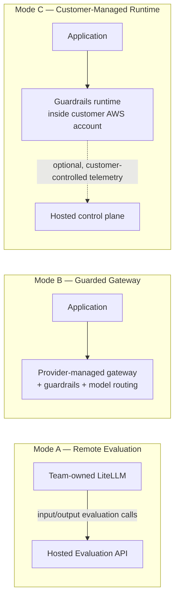
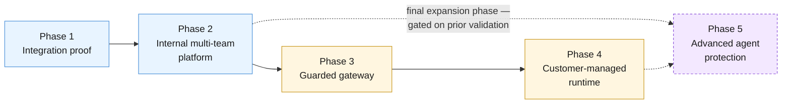

**AI Guardrails — Sales Deck Slide Outline**

**Authority level:** L4
**Status:** Draft
**Date:** 2026-07-24
**Derived from:** seed.md + AGREEMENTS.md

---

## Purpose and scope

This document is the **story-arc outline** for the AI Guardrails sales deck: for each slide, a one-line purpose and the key points a deck author or sales engineer should build from. It is not the deck itself (no slide copy, imagery, or layout is prescribed here), and it is not a claims register.

This is an **L4** document: a derived, audience-facing artifact. It must not contradict [`../00-source-of-truth/AGREEMENTS.md`](../00-source-of-truth/AGREEMENTS.md) or [`../00-source-of-truth/CONSTRAINTS.md`](../00-source-of-truth/CONSTRAINTS.md) (both L1). Every bullet below traces to seed.md or to an accepted agreement; where the source material does not supply a metric, customer name, dollar figure, date, or SLA, this outline says **TBD** or describes the point qualitatively rather than inventing one. Wording choices below are written to align with the "designed to / supports" discipline expected of [`../70-governance/CLAIMS-REGISTER.md`](../70-governance/CLAIMS-REGISTER.md); where this outline and that register later diverge, the claims register governs.

The arc below covers the twelve narrative beats requested for this deck. "How it works" is presented across **two slides** (three deployment modes, then the evaluate-before/after-inference mechanics) because the two ideas are structurally distinct and both are load-bearing for a technical buying audience — this yields **13 slides** total, still "about 12" in spirit. A deck author may recombine slides 5–6 into one if time is constrained, provided both ideas survive.

---

## Story arc at a glance

| # | Slide | One-line purpose |
| --- | --- | --- |
| 1 | [Title and product promise](#slide-1--title-and-product-promise) | Introduce AI Guardrails and its core promise in the vendor's own product statement. |
| 2 | [The current problem](#slide-2--the-current-problem) | Establish that guardrails today are fragmented, bespoke, and unauditable across heterogeneous stacks. |
| 3 | [Why existing approaches fall short](#slide-3--why-existing-approaches-fall-short) | Show why "no guardrails," "bespoke guardrails," and "embed it in one gateway/vendor" all fail to scale. |
| 4 | [The proposed solution](#slide-4--the-proposed-solution) | Introduce AI Guardrails as a standalone platform separating policy from connectors. |
| 5 | [How it works — three deployment modes](#slide-5--how-it-works--three-deployment-modes) | Show the three ways a team can adopt the same policy. |
| 6 | [How it works — evaluate before and after inference](#slide-6--how-it-works--evaluate-before-and-after-inference) | Explain the evaluation lifecycle: input/output stages, decisions, and the authorization boundary. |
| 7 | [Core capabilities](#slide-7--core-capabilities) | Summarize the concrete Phase 1–2 core capability set. |
| 8 | [Customer journey — onboard, observe, enforce](#slide-8--customer-journey--onboard-observe-enforce) | Walk through onboarding ("import") and the graduated enforcement ladder. |
| 9 | [Business outcomes](#slide-9--business-outcomes) | State the qualitative value delivered to each stakeholder group. |
| 10 | [Differentiation](#slide-10--differentiation) | State what is structurally different about this platform, without overclaiming. |
| 11 | [Adoption and deployment model](#slide-11--adoption-and-deployment-model) | Show how enforcement posture and AWS footprint mature over time. |
| 12 | [Roadmap — five phases](#slide-12--roadmap--five-phases) | Show the sequencing discipline from integration proof to advanced agent protection. |
| 13 | [Call to action](#slide-13--call-to-action) | Close with a grounded, phase-appropriate ask. |

```mermaid
flowchart LR
    S1["1. Title &<br/>promise"] --> S2["2. Problem"]
    S2 --> S3["3. Why current<br/>approaches fail"]
    S3 --> S4["4. Proposed<br/>solution"]
    S4 --> S5["5. Three modes"]
    S5 --> S6["6. Evaluate<br/>before/after"]
    S6 --> S7["7. Core<br/>capabilities"]
    S7 --> S8["8. Onboard →<br/>observe → enforce"]
    S8 --> S9["9. Business<br/>outcomes"]
    S9 --> S10["10. Differentiation"]
    S10 --> S11["11. Adoption &<br/>deployment"]
    S11 --> S12["12. Roadmap<br/>(5 phases)"]
    S12 --> S13["13. Call<br/>to action"]

    classDef problem fill:#fdecea,stroke:#c0392b,color:#1b1b1b;
    classDef solution fill:#e8f4ff,stroke:#4a90d9,color:#1b1b1b;
    classDef proof fill:#eafaf1,stroke:#27834a,color:#1b1b1b;
    classDef ask fill:#fff6e0,stroke:#c9971d,color:#1b1b1b;
    class S2,S3 problem;
    class S4,S5,S6,S7 solution;
    class S8,S9,S10,S11 proof;
    class S1 solution;
    class S12,S13 ask;
```



---

## Slide 1 — Title and product promise

**One-line purpose:** Introduce AI Guardrails and its core promise in the vendor's own product statement.

**Key points:**

* Product identity: **AI Guardrails** — an enterprise AI governance and runtime-enforcement platform (seed.md product type header).
* Open on the accepted product statement, unmodified (seed.md §23):
  > "AI Guardrails is an AWS-based policy and enforcement platform that applies reusable safeguards to LLM applications and gateways. Teams may connect their existing LiteLLM instance to a hosted Evaluation API, consume a fully managed Guarded Gateway, or deploy the same guardrail runtime within their own AWS account. Policies remain portable across all three modes, while operational ownership and content exposure are explicitly defined for each deployment."
* Headline promise: **define a policy once; apply it across teams, gateways, and deployment modes** (seed.md §2).
* Visual: a compact strip previewing the three deployment modes (Remote Evaluation / Guarded Gateway / Customer-Managed Runtime), expanded later in slide 5.
* Category framing: primary cloud is AWS; initial integration target is LiteLLM (seed.md header) — stated as fact, not as an exclusivity claim (LiteLLM is the *first* connector, not the boundary — [AGR-003](../00-source-of-truth/AGREEMENTS.md#agr-003--litellm-as-first-connector-not-the-product-boundary)).

---

## Slide 2 — The current problem

**One-line purpose:** Establish that guardrails today are fragmented, bespoke, and unauditable across heterogeneous stacks.

**Key points:**

* Teams adopt LLMs and agentic workflows **team by team** — each choosing its own gateway, model provider, and application framework, with no shared mechanism for consistent policy (seed.md §1–§2).
* Where guardrails exist at all, they are bespoke, undocumented, and coupled to whatever stack a team happens to run — so they cannot be reused, audited consistently, or trusted as organization-wide evidence.
* Two questions that should have independent answers are routinely conflated instead: **who operates this component** and **where does my content go** (seed.md §5.4).
* Teams have no low-risk way to validate a policy's real-world impact before it can affect production traffic (seed.md §5.6).
* Net result: the organization cannot answer, with evidence, "are our AI workloads governed consistently" — while individual teams have every rational reason to resist a shared guardrail capability that might expose their data, seize control of their gateway, or start blocking real users on day one.
* No dollar figures, incident counts, or adoption timelines are asserted here — the seed material does not supply them, and none are invented.

---

## Slide 3 — Why existing approaches fall short

**One-line purpose:** Show why "no guardrails," "bespoke guardrails," and "embed it in one gateway/vendor" all fail to scale.

**Key points:**

* **No guardrails at all** — a team calls a model provider directly or through an unmanaged gateway with no input/output evaluation; violations are undetectable after the fact.
* **Bespoke guardrails** — one-off regex filters, ad hoc moderation calls, or one-off Bedrock Guardrails wiring inside a single team's code; untested against other teams' traffic, undocumented, and drifts or disappears when the author moves on.
* **Duplicated effort** — multiple teams independently solve the same detection problem (PII in prompts, unsafe output) with different quality bars and different definitions of "safe."
* **The all-or-nothing trap** — where a guardrail exists, it typically ships as either absent or fully blocking, with no middle ground to see what a policy *would* have flagged; this drives teams to disable unproven checks or never enable them at all (seed.md §5.6).
* **Embedding guardrails inside one gateway or one vendor's format doesn't scale either** — this is precisely why the platform is *not* being built as a feature inside the existing internal LiteLLM instance, and *not* being permanently coupled to one model provider or one evaluation engine's response format ([AGR-001](../00-source-of-truth/AGREEMENTS.md#agr-001--standalone-platform-not-embedded-in-the-internal-litellm), [AGR-004](../00-source-of-truth/AGREEMENTS.md#agr-004--bedrock-guardrails-as-first-engine-vendor-independent-contract)) — doing so would couple enforcement to one team's gateway lifecycle and prevent reuse.
* None of these patterns produce a policy that can be pointed to as **the** organizational safeguard.

---

## Slide 4 — The proposed solution

**One-line purpose:** Introduce AI Guardrails as a standalone platform separating policy from connectors.

**Key points:**

* AI Guardrails is a **standalone policy and enforcement platform** — not functionality embedded inside any single team's LiteLLM instance ([AGR-001](../00-source-of-truth/AGREEMENTS.md#agr-001--standalone-platform-not-embedded-in-the-internal-litellm)).
* Built around a stable domain model: **tenant, workload, policy, policy binding, evaluation, decision** (seed.md §9; [AGR-017](../00-source-of-truth/AGREEMENTS.md#agr-017--core-domain-model)).
* Mandatory separation of concerns ([AGR-007](../00-source-of-truth/AGREEMENTS.md#agr-007--policies-are-separate-from-connectors)):
  ```text
  Policy:
      Detect prompt injection and block it.

  Connector:
      Invoke the Evaluation API during LiteLLM pre-call execution.
  ```
* One logical evaluation contract holds across every deployment mode — policy definitions, request structures, decision structures, reason codes, enforcement actions, audit metadata, and policy-version semantics do not change based on where the runtime executes ([AGR-006](../00-source-of-truth/AGREEMENTS.md#agr-006--one-logical-evaluation-contract-across-all-modes)).
* LiteLLM is the first supported connector and Amazon Bedrock Guardrails is the first managed evaluation engine — **neither defines the product boundary** ([AGR-003](../00-source-of-truth/AGREEMENTS.md#agr-003--litellm-as-first-connector-not-the-product-boundary), [AGR-004](../00-source-of-truth/AGREEMENTS.md#agr-004--bedrock-guardrails-as-first-engine-vendor-independent-contract)).
* Close the slide on the product vision line: allow an organization to define guardrail policies once and apply the same policies to multiple workloads, gateways, and providers (seed.md §2).

---

## Slide 5 — How it works: three deployment modes

**One-line purpose:** Show the three ways a team can adopt the same policy.

**Key points:**

| Mode | Who operates the gateway | Who operates the guardrail runtime | Best fit |
| --- | --- | --- | --- |
| **A — Remote Evaluation** | Consuming team (existing LiteLLM or equivalent) | AI Guardrails (hosted Evaluation API) | Teams that already run a gateway and want reduced operational ownership of the guardrail path. |
| **B — Guarded Gateway** | AI Guardrails | AI Guardrails (fully managed) | Teams without their own gateway that want a managed, OpenAI-compatible inference-and-guardrail path. |
| **C — Customer-Managed Runtime** | Consuming team | Consuming team, inside their own AWS account | Regulated, data-residency-sensitive, high-volume, or air-gapped workloads (seed.md §3, Mode C). |



* **Say this exact caveat every time Mode A is shown:** Mode A does not reduce how much tenant content reaches the hosted guardrail service — prompts, responses, and any additional evaluated content are transmitted to the Evaluation API. Its benefit is reduced *operational ownership*, not reduced *data exposure*. It must be described only as **"bring your own gateway while consuming a hosted guardrail runtime"** — never as private-data or data-local ([AGR-009](../00-source-of-truth/AGREEMENTS.md#agr-009--remote-evaluation-is-not-a-private-data-or-data-local-model)).
* A team is not forced into one topology to get centrally governed policy — mode selection is driven by each workload's own operational-ownership and data-residency needs, not by which mode the platform happens to support best.

---

## Slide 6 — How it works: evaluate before and after inference

**One-line purpose:** Explain the evaluation lifecycle: input/output stages, decisions, and the authorization boundary.

**Key points:**

* The gateway invokes the Evaluation API **before** model invocation (input evaluation) and **after** it (output evaluation) — shown in seed.md §3 for both Mode A and Mode B:
  ```text
  Application
      │
      ▼
  Team-owned LiteLLM
      │
      ├── Input evaluation ─────► Hosted Guardrails Runtime
      │
      ├── Model invocation
      │
      └── Output evaluation ────► Hosted Guardrails Runtime
  ```
* Supported initial evaluation stages: `input`, `output`. Later stages (`retrieval`, `tool_call`, `tool_result`, `memory_write`, `final_response`) are architecture-permitted and land in later phases — **not** part of the Phase 1–2 core (seed.md §9).
* Every evaluation returns a normalized **decision**: an action (`allow`, `block`, `redact`, or `log_only` initially), an allowed status, reason codes, policy name and version, evaluator metadata, transformed content where applicable, a correlation identifier, an audit identifier, and evaluation latency (seed.md §9).
* Failure behavior is explicit and part of the policy itself — what happens on Evaluation API timeout, detector unavailability, unresolved policy, control-plane unavailability, audit-delivery failure, or an unsafe response transformation. **There is no undocumented fallback behavior** ([AGR-012](../00-source-of-truth/AGREEMENTS.md#agr-012--failure-behavior-is-part-of-policy)).
* **Say this exact caveat on this slide:** a guardrail decision that content or a tool call "appears safe" does not determine whether the current user is permitted to execute that action against a particular resource. Authentication, business authorization, tenant isolation, resource ownership, transaction limits, and approval workflows remain the consuming application's responsibility ([AGR-010](../00-source-of-truth/AGREEMENTS.md#agr-010--guardrails-are-not-authorization)).

---

## Slide 7 — Core capabilities

**One-line purpose:** Summarize the concrete Phase 1–2 core capability set.

**Key points** (seed.md §6.1, §9, §16):

* Versioned guardrail policies, workload registration, and policy-to-workload bindings.
* Input and output evaluation through a generic HTTP Evaluation API.
* LiteLLM integration: a pre-call connector (input evaluation, enforcement) and a post-call connector (output evaluation, safe fallback).
* Amazon Bedrock Guardrails adapter, deterministic organization rules, and basic sensitive-data handling — all normalized behind one decision structure.
* Normalized evaluation decisions with structured reason codes, not an opaque pass/fail.
* Observe and enforce modes, evaluation latency metrics (P50/P95/P99, timeout rate — figures TBD until measured), and decision-metadata auditing.
* Hosted runtime deployment today, with an explicit architectural path to customer-managed deployment ([AGR-015](../00-source-of-truth/AGREEMENTS.md#agr-015--customer-managed-runtime-executes-without-a-synchronous-control-plane-connection)).
* **Frame as capability, not completeness:** later-phase items — retrieval-content evaluation, tool-call validation, MCP authorization, streaming evaluation, and others — are part of the estimated full feature set (seed.md §6.2; [DEC-008](../00-source-of-truth/DECISIONS.md#dec-008--supersede-the-mvp-bounded-scope-define-and-estimate-the-full-feature-set-across-five-phases)) but land in later phases and are **not** available today.

---

## Slide 8 — Customer journey: onboard, observe, enforce

**One-line purpose:** Walk through onboarding ("import") and the graduated enforcement ladder.

**Key points:**

```text
Register workload
    │
    ▼
Select policy
    │
    ▼
Generate integration manifest
    │
    ▼
Install connector
    │
    ▼
Run in observe mode
    │
    ▼
Review evaluation results
    │
    ▼
Enable enforcement
```

* This flow is the canonical meaning of **"import"** ([AGR-019](../00-source-of-truth/AGREEMENTS.md#agr-019--meaning-of-import)): a team adopts a versioned policy, a workload identity, an integration manifest, a connector configuration, and an enforcement mode.
* **Say this exact caveat on this slide:** "import" never means cloning, registering, or remotely controlling another team's LiteLLM instance. Onboarding never requires copying a team's LiteLLM database, transferring model-provider credentials, exposing gateway administration endpoints, or granting the provider administrative access to the team's gateway.
* Every policy binding defaults to **Observe**, not Block, and follows the graduated ladder:
  ```text
  Disabled → Observe → Warn → Redact → Block
  ```
* A team measures false positives, latency, and business impact in Observe mode before enabling any blocking behavior; promotion between states is an explicit, auditable action, never an implicit side effect ([AGR-011](../00-source-of-truth/AGREEMENTS.md#agr-011--observe-before-enforce-progression)).
* Connector installation requires minimal application change — it sits at the gateway/SDK layer, not inside application code.

---

## Slide 9 — Business outcomes

**One-line purpose:** State the qualitative value delivered to each stakeholder group.

**Key points** (seed.md §7):

| Stakeholder | What they gain |
| --- | --- |
| **Platform teams** | Central policy definitions, reusable connectors, deployment consistency, audit visibility, controlled policy rollouts, lower operational overhead. |
| **Application teams** | Simple onboarding, minimal application changes, predictable latency expectations, clear failure behavior, understandable violation reasons, a safe way to test before enforcement. |
| **Security and compliance teams** | Policy ownership, decision evidence, policy-version traceability, content-retention controls, exception tracking, evidence that policies are actually applied. |
| **Product operators** | Tenant and workload registration, service-health visibility, usage metrics, capacity management, policy rollout controls, deployment compatibility tracking. |

* Longer-term success is tracked across four qualitative categories (seed.md §19): **adoption** (onboarded workloads, active tenants, time to onboard), **reliability** (evaluation-API availability, timeout rate, latency), **effectiveness** (confirmed detections, false-positive review rate, observe-to-enforce promotion rate), and **product portability** (deployment-mode-independent policy coverage, number of supported connectors).
* **No dollar-value ROI, adoption percentage, or SLA number is asserted anywhere in this deck** — none exists in the source material yet; where a figure is needed, say "TBD" rather than estimate one.

---

## Slide 10 — Differentiation

**One-line purpose:** State what is structurally different about this platform, without overclaiming.

**Key points** (condensed from [`../20-product/DIFFERENTIATORS.md`](../20-product/DIFFERENTIATORS.md)):

1. **Model- and gateway-independent contract** — vendor- and framework-specific logic lives behind adapters and connectors, not inside the policy itself.
2. **Policy portability across three deployment modes** — one policy definition is bindable to a workload in Remote Evaluation, Guarded Gateway, or Customer-Managed Runtime.
3. **Operational ownership separated from data exposure** — "who runs this" and "where does my content go" are always answered independently, for every mode.
4. **Observe-before-enforce as a structural default** — built into the policy schema and runtime, not left to each team to improvise.
5. **Honest scoping** — the platform states plainly what it is *not*: not authorization, not a bypass-proof boundary in cooperative mode, not a complete AI security or governance platform.
6. **One evaluation contract, hosted or customer-managed** — including continued policy execution during a control-plane outage, via a local policy cache ([AGR-015](../00-source-of-truth/AGREEMENTS.md#agr-015--customer-managed-runtime-executes-without-a-synchronous-control-plane-connection)).

* **What this slide must not claim:** that every gateway or model provider is already supported out of the box (only LiteLLM and Bedrock Guardrails are validated today); that feature parity across modes is automatic; or that any differentiator is backed by a named competitive benchmark — none is present in the source material.

---

## Slide 11 — Adoption and deployment model

**One-line purpose:** Show how enforcement posture and AWS footprint mature over time.

**Key points:**

* Three enforcement postures, adopted progressively as trust and compliance needs grow (seed.md §8; [AGR-018](../00-source-of-truth/AGREEMENTS.md#agr-018--trust-and-enforcement-model)):
  1. **Cooperative integration** — the team installs and maintains its own connector; appropriate for trusted teams focused on adoption and evaluation. **Must never be represented as a hard security boundary** — the connector can be disabled, removed, or misconfigured.
  2. **Platform-managed enforcement** — the platform team manages the gateway configuration or deployment (GitOps, restricted IAM roles, connector-health telemetry).
  3. **Network and IAM-enforced gateway** — all supported model traffic passes through a controlled gateway; applications hold no direct provider credentials. Strongest posture; not required for the initial cooperative delivery (Phases 1–2).
* Mode selection is driven by each workload's own data-residency and operational-ownership needs — repeat the Mode A caveat from slide 5 if this slide stands alone in a shorter deck.
* Customer-Managed Runtime lets the customer choose exactly what telemetry (if any) reaches the hosted control plane, down to a fully supported **"no telemetry"** configuration; raw content never leaves a customer-managed runtime unless explicitly configured ([AGR-016](../00-source-of-truth/AGREEMENTS.md#agr-016--customer-controlled-telemetry-for-the-customer-managed-runtime)).
* AWS is the primary cloud; delivery starts with a **minimal account model** — one non-production and one production account — with additional separation introduced only when justified by external customers, compliance requirements, independent security ownership, immutable audit requirements, production scale, or dedicated tenant deployments ([AGR-013](../00-source-of-truth/AGREEMENTS.md#agr-013--aws-as-primary-cloud-minimal-mvp-account-model)).

---

## Slide 12 — Roadmap: five phases

**One-line purpose:** Show the sequencing discipline from integration proof to advanced agent protection.

**Key points** (seed.md §18; [AGR-020](../00-source-of-truth/AGREEMENTS.md#agr-020--five-phase-delivery); [DEC-008](../00-source-of-truth/DECISIONS.md#dec-008--supersede-the-mvp-bounded-scope-define-and-estimate-the-full-feature-set-across-five-phases)):

All five phases are **committed-in-scope and estimated** as one solution; execution is sequenced, with each phase validated before the next proceeds. Phase 1 is where delivery starts — not the only thing being approved.

| Phase | Objective (one line) |
| --- | --- |
| **1 — Integration proof** | Prove that guardrail policy and evaluation can be separated from LiteLLM and reused across multiple gateways. |
| **2 — Internal multi-team platform** | Allow multiple internal teams to onboard and operate distinct workloads; completes the Phase 1–2 validation demonstration (policy promotion and rollback). |
| **3 — Guarded gateway** | Offer a fully hosted model and guardrail path for teams without their own gateway (Mode B). |
| **4 — Customer-managed runtime** | Support workloads that require local evaluation and content isolation (Mode C). |
| **5 — Advanced agent protection** | Extend guardrail coverage beyond prompt and response evaluation — retrieval, tool calls, tool results, memory writes, human approvals, MCP integration. |



* **Say this exact caveat on this slide:** Phase 5 is a separate product expansion sequenced last — in the estimated scope, but gated on the prior phases' validation, and its capabilities must never be presented as available or delivered today.
* **No calendar dates, quarters, durations, or headcounts for any phase** — the ordering of phases is fixed by agreement; *when* each phase starts or ends is not yet decided and must not be inferred or implied on this slide.

---

## Slide 13 — Call to action

**One-line purpose:** Close with a grounded, phase-appropriate ask.

**Key points:**

* The ask: approve **the AI Guardrails solution — full feature set, delivered in five phases** ([AGR-020](../00-source-of-truth/AGREEMENTS.md#agr-020--five-phase-delivery); [DEC-008](../00-source-of-truth/DECISIONS.md#dec-008--supersede-the-mvp-bounded-scope-define-and-estimate-the-full-feature-set-across-five-phases)). Delivery starts with **Phase 1 — Integration Proof**, whose deliverables are the evaluation contract, the policy format, the Bedrock Guardrails adapter, the LiteLLM connector, observe mode, basic auditing, and an internal deployment (seed.md §18); each subsequent phase proceeds only after the prior phase validates.
* Reiterate the falsifiable hypothesis the Phase 1–2 validation demonstration is designed to prove: **one reusable policy applied consistently across independently operated LiteLLM deployments**, with normalized decisions, an observe-before-enforce rollout path, and no undocumented failure behavior (seed.md §16; [`../60-delivery/VALIDATION-PLAN.md`](../60-delivery/VALIDATION-PLAN.md)). Phrase it as a target milestone, never as achieved.
* Audience-specific next step:
  * **Platform teams** — nominate a pilot workload and confirm connector installation ownership.
  * **Application teams** — identify a workload willing to start in Observe mode.
  * **Security and compliance teams** — review the policy-ownership, audit-metadata, and retention model before workloads onboard.
* This is not a request to commit to a specific budget figure or headcount (**TBD** until the full-feature-set estimation is supplied), to calendar dates, or to anything in the seed.md §6.3 exclusions — execution remains sequenced, each phase validated before the next proceeds (mirrors [`../30-executive/EXECUTIVE-BRIEF.md`](../30-executive/EXECUTIVE-BRIEF.md) §10).
* Named contact, pricing, and scheduling details: **TBD** — none are present in the source material and none are invented here.

---

## What this deck must not claim

Consolidated from the caveats embedded above, for quick pre-delivery review by any presenter:

* Mode A (Remote Evaluation) must never be called private-data or data-local — tenant content reaches the hosted Evaluation API ([AGR-009](../00-source-of-truth/AGREEMENTS.md#agr-009--remote-evaluation-is-not-a-private-data-or-data-local-model)).
* A guardrail decision must never be equated with business authorization — authentication, authorization, tenant isolation, and approval workflows remain the consuming application's responsibility ([AGR-010](../00-source-of-truth/AGREEMENTS.md#agr-010--guardrails-are-not-authorization)).
* A cooperative-mode connector must never be presented as a hard, bypass-proof security boundary ([AGR-018](../00-source-of-truth/AGREEMENTS.md#agr-018--trust-and-enforcement-model)).
* Phase 3, 4, or 5 capabilities must never be presented as available or delivered today — they are committed-in-scope but sequenced behind per-phase validation gates ([AGR-020](../00-source-of-truth/AGREEMENTS.md#agr-020--five-phase-delivery)).
* No customer name, dollar figure, adoption percentage, SLA number, or delivery date may appear anywhere in the deck unless it later becomes present in the source-of-truth set — until then, every such slot is **TBD**.
* This platform must never be described as a complete AI governance or security platform, a general-purpose LLM gateway replacement, or a general MCP security platform — all are explicitly excluded from the feature set (seed.md §6.3).

---

## Related documents

- [`../00-source-of-truth/AGREEMENTS.md`](../00-source-of-truth/AGREEMENTS.md) — authoritative agreements this outline must not contradict.
- [`../00-source-of-truth/CONSTRAINTS.md`](../00-source-of-truth/CONSTRAINTS.md) — non-negotiable boundaries referenced throughout.
- [`../00-source-of-truth/ASSUMPTIONS.md`](../00-source-of-truth/ASSUMPTIONS.md) — unvalidated beliefs (adoption, latency tolerance) that this deck must not present as settled facts.
- [`../10-charter/CHARTER.md`](../10-charter/CHARTER.md) — full product charter narrative behind slides 4–6.
- [`../10-charter/PRINCIPLES.md`](../10-charter/PRINCIPLES.md) — the product principles underlying the differentiation slide.
- [`../20-product/PROBLEM-STATEMENT.md`](../20-product/PROBLEM-STATEMENT.md) — the fuller problem narrative behind slides 2–3.
- [`../20-product/PRODUCT-OVERVIEW.md`](../20-product/PRODUCT-OVERVIEW.md) — the product narrative this outline compresses for a sales audience.
- [`../20-product/VALUE-PROPOSITION.md`](../20-product/VALUE-PROPOSITION.md) — the fuller audience-by-audience value detail behind slide 9.
- [`../20-product/DIFFERENTIATORS.md`](../20-product/DIFFERENTIATORS.md) — the fuller differentiator detail behind slide 10, including "what this does not claim" for each point.
- [`../20-product/PRODUCT-ROADMAP.md`](../20-product/PRODUCT-ROADMAP.md) — the fuller five-phase roadmap behind slide 12.
- [`../30-executive/EXECUTIVE-BRIEF.md`](../30-executive/EXECUTIVE-BRIEF.md) — the executive-facing framing this deck's call to action mirrors.
- [`DECK-BRIEF.md`](DECK-BRIEF.md) — companion deck brief with audience, positioning, and messaging guidance.
- [`../70-governance/CLAIMS-REGISTER.md`](../70-governance/CLAIMS-REGISTER.md) — the authoritative register of approved external-facing claims language governing final slide copy.
- [`../70-governance/RISK-REGISTER.md`](../70-governance/RISK-REGISTER.md) — risks (false confidence, connector bypass, hosted data exposure) that qualify several of this deck's claims.
