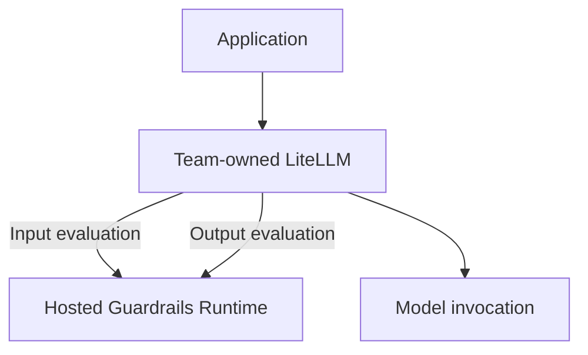

**AI Guardrails — Visual Direction for the Sales Deck**

**Authority level:** L4
**Status:** Draft
**Date:** 2026-07-24
**Derived from:** AGREEMENTS.md

---

## Purpose and scope

This document gives the deck-building agent (or any human designer assembling `40-sales-deck` materials) concrete, checkable presentation guidance: what tokens exist and which are placeholders, what diagrams to draw and from which source, which chart types are acceptable given the current absence of real metrics, and what production rules (editability, speaker notes) are mandatory.

This is an **L4** document: a derived presentation-guidance artifact. It must not contradict [`AGREEMENTS.md`](../00-source-of-truth/AGREEMENTS.md) or [`CONSTRAINTS.md`](../00-source-of-truth/CONSTRAINTS.md) (both L1), and every restriction below is written to stay inside the phrasing boundaries that [`CLAIMS-REGISTER.md`](../70-governance/CLAIMS-REGISTER.md) enforces for external-facing material. Where this document and that register diverge, the claims register governs.

**What this document is not:**

* It is not the deck itself, and it is not [`DECK-BRIEF.md`](DECK-BRIEF.md) (the sibling document that defines the deck's narrative arc, slide sequence, and audience). This document governs *how things look and are built*; [`DECK-BRIEF.md`](DECK-BRIEF.md) governs *what is said and in what order*.
* It is not a finalized brand guideline. No brand package exists yet in the source material. Every visual token below is explicitly marked **TBD** or **placeholder** and must be replaced once a real brand kit is issued — nothing here should be treated as a final color, font, or logo decision.
* It does not introduce any metric, dollar figure, SLA, date, or customer name absent from the L1 registers. Where a chart or slide would conventionally show a number, this document tells the deck agent what to do in the absence of one (see [§3](#3-preferred-chart-types) and [§4](#4-image-policy)).

---

## Table of contents

<!-- BEGIN GENERATED: toc -->
- [Purpose and scope](#purpose-and-scope)
- [1. Brand and design tokens](#1-brand-and-design-tokens)
- [2. Diagram style](#2-diagram-style)
- [3. Preferred chart types](#3-preferred-chart-types)
- [4. Image policy](#4-image-policy)
- [5. Icon style](#5-icon-style)
- [6. Color restrictions](#6-color-restrictions)
- [7. Slide density](#7-slide-density)
- [8. Speaker notes](#8-speaker-notes)
- [9. Diagram editability](#9-diagram-editability)
- [10. Diagram source map](#10-diagram-source-map)
- [11. Open items before external use](#11-open-items-before-external-use)
- [Related documents](#related-documents)
<!-- END GENERATED: toc -->
---

## 1. Brand and design tokens

No brand kit exists in the source material. Every token below is a **placeholder for internal drafting only**. The deck agent must treat this section as a set of stand-ins, not final values, and must not present drafts built from these tokens as brand-approved to a prospect or customer.

| Token category | Status | Interim guidance for drafting |
|---|---|---|
| Logo / wordmark | **TBD** — no asset exists | Use a plain text wordmark, "AI Guardrails," in the placeholder heading typeface until a logo is delivered. Do not draw an improvised shield/lock logo and present it as a real mark. |
| Primary color | **TBD** | Use a single restrained, low-saturation neutral (e.g., a dark slate) as a placeholder primary until brand supplies one. |
| Secondary / accent color | **TBD** | One accent color, used sparingly (headline emphasis, single call-to-action element per slide). |
| Semantic colors (allow / block / warn) | **TBD**, but functionally constrained — see [§6](#6-color-restrictions) | Map only to the `Decision` domain actions (`allow`, `block`, `redact`, `log_only`) defined in [AGR-017](../00-source-of-truth/AGREEMENTS.md#agr-017--core-domain-model), not to overall product-quality claims. |
| Neutral / background palette | **TBD** | Light and dark neutral placeholders sufficient to build one light-theme and one dark-theme template. |
| Heading typeface | **TBD** | Use a system-safe sans-serif until a licensed typeface is confirmed. Do not embed a commercial font without confirming license coverage for redistribution in a deck. |
| Body typeface | **TBD** | Same constraint as heading typeface; pair with a neutral system-safe serif or sans-serif. |
| Grid / slide format | 16:9 widescreen | Not brand-dependent; adopt now. Maintain a consistent margin and a consistent title-block position across every slide so template swaps (once brand tokens land) are mechanical, not a redesign. |
| Iconography set | **TBD** license/library | See [§5](#5-icon-style) for style rules to apply once a set is chosen. |

All placeholder values exist so that slide *structure* (layout, diagram geometry, information hierarchy) can be built now and re-skinned later without redoing the underlying work. Do not let a placeholder token silently become the shipped value — flag it in the deck's own README or cover slide as "placeholder styling, pending brand" until replaced.

---

## 2. Diagram style

### 2.1 General rules

* Clean, minimal, single-direction flow diagrams: top-down or left-to-right, never both in the same diagram.
* Consistent box shape and consistent line weight across the entire deck — a box drawn for "Application" on slide 4 must look identical to a box drawn for "Application" on slide 11.
* Labeled arrows only; no unlabeled connectors where the relationship (invokes, transmits, evaluates, routes) is not obvious from context.
* No drop shadows, no 3D bevels, no clip-art style icons inside architecture boxes, no photographic textures behind diagrams.
* One diagram communicates one architectural idea. Do not combine the three deployment-mode topologies into a single mega-diagram — see [§7](#7-slide-density).
* Ownership lists (who owns what within a mode) belong beside the diagram as a compact two-column table, not crammed into the diagram's boxes as nested text.

### 2.2 Worked example: redrawing an ASCII source as a clean diagram

[AGR-002](../00-source-of-truth/AGREEMENTS.md#agr-002--three-deployment-modes) gives Mode A as ASCII art. The deck must never paste that ASCII block onto a slide as literal monospace text or as a screenshot of it. It is a **content source**, redrawn as a native, editable diagram. A clean redraw — shown here as Mermaid only to illustrate the target shape, not as the shippable artifact (see [§9](#9-diagram-editability)) — looks like:

The same discipline applies to Mode B and Mode C ([AGR-002](../00-source-of-truth/AGREEMENTS.md#agr-002--three-deployment-modes)) and to the logical architecture diagram ([`CONTAINER-ARCHITECTURE.md`](../50-architecture/CONTAINER-ARCHITECTURE.md)): identify the boxes, identify the labeled relationships, drop anything that is purely ASCII layout artifact (box-drawing corners, vertical bars used only for alignment), and rebuild as shapes and connectors in the deck tool.

### 2.3 Required diagram set

At minimum, the deck must include native, editable versions of:

1. **Three-mode topology diagrams** — one per mode (Mode A, Mode B, Mode C), each on its own slide, redrawn from [AGR-002](../00-source-of-truth/AGREEMENTS.md#agr-002--three-deployment-modes).
2. **Logical architecture diagram** — Control Plane → policy distribution → Guardrails Runtime → Evaluation engines, redrawn from [`CONTAINER-ARCHITECTURE.md`](../50-architecture/CONTAINER-ARCHITECTURE.md).
3. **Onboarding / "import" flow** — the seven-step stepper (Register workload → Select policy → Generate integration manifest → Install connector → Run in observe mode → Review evaluation results → Enable enforcement), redrawn from [AGR-019](../00-source-of-truth/AGREEMENTS.md#agr-019--meaning-of-import), as a horizontal stepper rather than a vertical flowchart, since it is a sales-narrative sequence rather than a system diagram.
4. **Trust and enforcement ladder** — cooperative integration → platform-managed enforcement → network/IAM-enforced gateway, redrawn from [AGR-018](../00-source-of-truth/AGREEMENTS.md#agr-018--trust-and-enforcement-model) as an escalating three-tier diagram, not three independent boxes of equal visual weight (the ladder shape communicates "increasing enforcement strength," which flat boxes do not).
5. **Observe-before-enforce progression** — Disabled → Observe → Warn → Redact → Block, from [AGR-011](../00-source-of-truth/AGREEMENTS.md#agr-011--observe-before-enforce-progression), as a horizontal stepped progression bar. This diagram is reused wherever the deck discusses policy rollout, since it is the same progression referenced by [AGR-011](../00-source-of-truth/AGREEMENTS.md#agr-011--observe-before-enforce-progression).
6. **Policy vs. connector separation** — the two-box "Policy: detect and block" / "Connector: invoke during pre-call" contrast from [AGR-007](../00-source-of-truth/AGREEMENTS.md#agr-007--policies-are-separate-from-connectors), used wherever the deck needs to make the policy/connector distinction concrete (this is a frequent buyer-confusion point per [AGR-007](../00-source-of-truth/AGREEMENTS.md#agr-007--policies-are-separate-from-connectors)).

Diagrams 1–2 are the core "how it works" slides; diagrams 3–6 are supporting slides used where the narrative in [`DECK-BRIEF.md`](DECK-BRIEF.md) calls for them.

---

## 3. Preferred chart types

[`SUCCESS-CRITERIA.md`](../10-charter/SUCCESS-CRITERIA.md) lists success-metric *categories* (adoption, reliability, effectiveness, portability) but contains no populated numbers — no percentages, no latency figures, no dollar values. The deck must not fabricate sample data to fill a chart shape. Preferred chart types, in order of use:

| Chart type | Use for | Notes |
|---|---|---|
| Two/three-column comparison table | Mode A vs. Mode B vs. Mode C ownership ([AGR-002](../00-source-of-truth/AGREEMENTS.md#agr-002--three-deployment-modes)) | Preferred over any chart form for this content — it is inherently tabular, not numeric. |
| Horizontal phase timeline (no dates) | Five-phase delivery sequence ([AGR-020](../00-source-of-truth/AGREEMENTS.md#agr-020--five-phase-delivery)) | Show sequence and phase names only; do not add invented duration estimates or calendar dates not present in the source. |
| Stepped progression bar | Disabled → Observe → Warn → Redact → Block | Same shape as diagram 5 in [§2.3](#23-required-diagram-set); reusable as both an architecture diagram and, simplified, as a chart-like progress indicator. |
| Ownership / RACI-style table | Stakeholder needs ([`TARGET-USERS.md`](../20-product/TARGET-USERS.md)) and ownership boundaries ([`TEAM-AND-OWNERSHIP.md`](../60-delivery/TEAM-AND-OWNERSHIP.md)) | Rows = responsibility area, columns = owning party. |
| Capability grid (icon + label, no numbers) | In-scope vs. future-scope capability counts ([`SCOPE.md`](../10-charter/SCOPE.md)) | Present as a categorized list/grid, not a bar chart with counts, unless the count is a literal, verifiable enumeration of named items already listed in the source (e.g., number of named Phase 1–2 core components in [`SUCCESS-CRITERIA.md`](../10-charter/SUCCESS-CRITERIA.md) — count the list, do not estimate it). |

**Not permitted:** bar, line, or pie charts depicting adoption rates, latency numbers, false-positive rates, ROI, cost savings, or any other quantity not explicitly present in the L1 registers. If a slide in [`DECK-BRIEF.md`](DECK-BRIEF.md) calls for this kind of metric visualization before real pilot or production data exists, the deck agent must render a clearly labeled placeholder chart shell — axes and legend present, data area replaced with a "TBD — pending pilot data" watermark or callout — rather than plausible-looking sample data that a viewer could mistake for a real result.

---

## 4. Image policy

* **No stock photography.** No handshake photos, no generic "AI brain" or humanoid-robot imagery, no server-room clichés, no stock-photo people at laptops. These add no information and read as filler in an enterprise technical sale.
* **No fabricated product screenshots.** [`SCOPE.md`](../10-charter/SCOPE.md) confirms the initial phases do not require a full administration portal, and no UI artifacts exist in the source material. Do not invent a screenshot of a dashboard, policy editor, or audit console. Where the narrative wants to show "what the product looks like," use an architecture or flow diagram instead, or a clearly labeled wireframe explicitly marked "Illustrative — not final UI" if a low-fidelity mockup is truly needed for a specific narrative beat.
* **No fabricated customer logos or names.** Consistent with the source-of-truth rule against inventing customer names, the deck must not include a customer logo wall, testimonial, or case-study photo that does not exists in the L1 registers.
* **Backgrounds:** plain or subtly textured neutral backgrounds only, consistent with the placeholder palette in [§1](#1-brand-and-design-tokens). Avoid busy photographic or abstract-art backgrounds behind text or diagrams — they reduce diagram legibility and fight the "clean architecture flow" style mandated in [§2](#2-diagram-style).

---

## 5. Icon style

* **Line/outline icons**, single consistent stroke weight throughout the deck. No mixing of outline icons with filled/glyph icons in the same slide or the same icon family.
* Monochrome or restrained two-tone, drawn from the placeholder palette in [§1](#1-brand-and-design-tokens) — no rainbow icon sets, no per-icon custom coloring.
* No skeuomorphic, no gradient-filled, no photographic or 3D-rendered icons.
* Icons should exist for, at minimum, the core domain-model entities and architectural concepts so the same icon is reused consistently wherever that concept appears ([AGR-017](../00-source-of-truth/AGREEMENTS.md#agr-017--core-domain-model), [`CONTAINER-ARCHITECTURE.md`](../50-architecture/CONTAINER-ARCHITECTURE.md)):

| Concept | Icon needed for |
|---|---|
| Tenant | Domain-model and ownership slides |
| Workload | Domain-model, onboarding-flow slides |
| Policy / policy version | Domain-model, policy-vs-connector slides |
| Policy binding | Domain-model, rollout slides |
| Evaluation | Architecture, evaluation-stage slides |
| Decision | Architecture, decision-structure slides |
| Connector / gateway | All three topology diagrams |
| Guardrail / shield | Cover slide, section dividers — used sparingly, not as a literal "100% protected" claim (see [§6](#6-color-restrictions)) |
| Lock / key | Security-requirements slides |
| Cloud / AWS | Deployment and AWS-services slides |
| Audit / ledger | Auditing and decision-metadata slides |

Reuse one icon per concept across the whole deck rather than choosing a fresh icon each time the concept recurs — visual consistency here does double duty as an implicit reinforcement of the "one domain model, one contract" positioning in [AGR-006](../00-source-of-truth/AGREEMENTS.md#agr-006--one-logical-evaluation-contract-across-all-modes) and [AGR-017](../00-source-of-truth/AGREEMENTS.md#agr-017--core-domain-model).

---

## 6. Color restrictions

* No brand palette is final ([§1](#1-brand-and-design-tokens)); use the placeholder palette consistently until replaced.
* **Semantic color use is functionally restricted, not merely stylistic.** Green/red/amber coloring may be used only to represent the literal `Decision` actions (`allow`, `block`, `redact`, `log_only`) or the five-state policy progression (`Disabled → Observe → Warn → Redact → Block`, [AGR-011](../00-source-of-truth/AGREEMENTS.md#agr-011--observe-before-enforce-progression)). It must not be used to imply an overall product-quality, safety, or compliance-certification claim — [`SCOPE.md`](../10-charter/SCOPE.md) explicitly exclude "full compliance certification" from the feature set, so a green shield-with-checkmark motif that reads as "certified secure" is not permitted.
* **No AWS trademark or co-branding implication.** Do not use AWS's orange/black brand colors, the AWS "Smile" mark, or a visual treatment styled to resemble official AWS partner badging, unless a real, approved partnership agreement exists. The product runs on AWS ([`DEPLOYMENT-ARCHITECTURE.md`](../50-architecture/DEPLOYMENT-ARCHITECTURE.md)) but that is an implementation detail, not a co-branding license.
* **No color treatment may imply Mode A (Remote Evaluation) is as data-local as Mode C (Customer-Managed Runtime).** Per [AGR-009](../00-source-of-truth/AGREEMENTS.md#agr-009--remote-evaluation-is-not-a-private-data-or-data-local-model), Mode A transmits tenant content to the hosted service. Do not, for example, color-code Mode A with the same "your data stays here" green treatment used for Mode C — that would visually contradict an L1 agreement. If a shared visual language is used for ownership across the three modes, keep the *content-exposure* dimension visually distinct from the *operational-ownership* dimension, per [AGR-008](../00-source-of-truth/AGREEMENTS.md#agr-008--explicit-content-exposure-model-ownership-vs-exposure-are-separate-concerns) and [CON-007](../00-source-of-truth/CONSTRAINTS.md#con-007--explicit-content-exposure-documentation-per-deployment).
* Maintain WCAG AA contrast minimums for all text-on-background and icon-on-background pairings, including in dark-theme delivery (e.g., a projector or shared-screen setting with a dark room), even while palette values remain placeholders.

---

## 7. Slide density

* **One core idea per slide.** A slide that tries to carry a full architecture diagram, a full ownership table, and a bullet list simultaneously is a density failure, not an efficiency win.
* Prefer a diagram (or single table) plus a short caption over a bullet-list wall. Where bullets are used, keep the list short enough to be read at a glance rather than studied — long enumerations (e.g., the full in-scope/out-of-scope capability lists in [`SCOPE.md`](../10-charter/SCOPE.md)) belong in backup/appendix slides, not the primary narrative deck.
* Architecture and topology slides carry exactly one diagram, optionally paired with one compact ownership table (see the Mode A/B/C ownership lists in [AGR-002](../00-source-of-truth/AGREEMENTS.md#agr-002--three-deployment-modes)) — not both a diagram and a separate detailed bullet breakdown of the same content.
* Detail that exists in the source purely for completeness — the full domain-model attribute lists ([AGR-017](../00-source-of-truth/AGREEMENTS.md#agr-017--core-domain-model)), the full constraint register, the full risk register — belongs in backup slides referenced from, but not inline in, the main narrative.
* Section-divider slides should be visually quiet: a single statement (e.g., a phase name from [AGR-020](../00-source-of-truth/AGREEMENTS.md#agr-020--five-phase-delivery)) and minimal supporting text, not a dense recap of the prior section.

---

## 8. Speaker notes

**Speaker notes are required on every slide.** A slide with a diagram or a short headline and no speaker notes is incomplete, not "clean."

Each slide's speaker notes must include:

* **Sourcing** — which `AGREEMENTS.md` entry or `CONSTRAINTS.md` entry the slide's content is derived from, so the presenter can point to the underlying source if challenged.
* **Caveats not shown on-slide** — for example, a Mode A topology slide's notes must state the AGR-009 caveat (content is transmitted to the hosted service) even if the slide's visual treatment keeps that caveat implicit for narrative pacing.
* **Talk track** — one or two sentences bridging from the previous slide and into the next, so the deck can be delivered by someone other than its author without losing the thread.
* **Anticipated questions** — where the underlying material is qualified (e.g., "the initial phases do not include a full administration portal," [`SCOPE.md`](../10-charter/SCOPE.md)), a one-line pointer to how to answer if asked, without overclaiming beyond what the source supports.

---

## 9. Diagram editability

**All diagrams must remain fully editable in the deck's native format.** This applies to every diagram listed in [§2.3](#23-required-diagram-set) and to any additional diagram [`DECK-BRIEF.md`](DECK-BRIEF.md) calls for.

* Diagrams must be built as native, grouped/ungrouped vector shapes in the deck-authoring tool (e.g., native shapes/SmartArt in a slide tool, or vector objects imported from a diagramming tool that exports editable groups) — never as a flattened raster image, a screenshot, or literal pasted ASCII/monospace text.
* Mermaid (as used illustratively in [§2.2](#22-worked-example-redrawing-an-ascii-source-as-a-clean-diagram)) or the ASCII diagrams in [AGR-002](../00-source-of-truth/AGREEMENTS.md#agr-002--three-deployment-modes), [`CONTAINER-ARCHITECTURE.md`](../50-architecture/CONTAINER-ARCHITECTURE.md) may be used as an authoring or staging aid, but the diagram is not considered deck-ready until it has been rebuilt as native editable shapes.
* Rationale: the deployment-mode topologies, ownership boundaries, and phase sequencing are all sourced from a solution charter that is still in **Draft** status and governed by an agreements register that can be amended. A flattened image forces a full redraw on every such change; an editable native diagram allows a box label, an arrow, or an ownership column to be updated in place.
* Text inside diagram boxes must be real, editable text objects — not text baked into an image — so that future translation, rebranding, or terminology updates (e.g., if a domain-model term changes) do not require re-exporting artwork.

---

## 10. Diagram source map

| Deck diagram | Primary source | Cross-referenced solution-docs |
|---|---|---|
| Mode A — Remote Evaluation topology | [AGR-002](../00-source-of-truth/AGREEMENTS.md#agr-002--three-deployment-modes) (lines ~54–96) | [AGREEMENTS.md AGR-009](../00-source-of-truth/AGREEMENTS.md#agr-009--remote-evaluation-is-not-a-private-data-or-data-local-model), [CHARTER.md §10](../10-charter/CHARTER.md#10-operating-model) |
| Mode B — Guarded Gateway topology | [AGR-002](../00-source-of-truth/AGREEMENTS.md#agr-002--three-deployment-modes) (lines ~99–146) | [CHARTER.md §10](../10-charter/CHARTER.md#10-operating-model) |
| Mode C — Customer-Managed Runtime topology | [AGR-002](../00-source-of-truth/AGREEMENTS.md#agr-002--three-deployment-modes) (lines ~148–200) | [AGREEMENTS.md AGR-015](../00-source-of-truth/AGREEMENTS.md#agr-015--customer-managed-runtime-executes-without-a-synchronous-control-plane-connection), [AGREEMENTS.md AGR-016](../00-source-of-truth/AGREEMENTS.md#agr-016--customer-controlled-telemetry-for-the-customer-managed-runtime), [CONSTRAINTS.md CON-013](../00-source-of-truth/CONSTRAINTS.md#con-013--raw-content-must-not-leave-a-customer-managed-runtime-unless-explicitly-configured) |
| Logical architecture (control plane / runtime / evaluation engines) | [`CONTAINER-ARCHITECTURE.md`](../50-architecture/CONTAINER-ARCHITECTURE.md) (lines ~700–735) | [AGREEMENTS.md AGR-004](../00-source-of-truth/AGREEMENTS.md#agr-004--bedrock-guardrails-as-first-engine-vendor-independent-contract) |
| Onboarding / "import" stepper | [AGR-019](../00-source-of-truth/AGREEMENTS.md#agr-019--meaning-of-import) (lines ~225–247) | [AGREEMENTS.md AGR-019](../00-source-of-truth/AGREEMENTS.md#agr-019--meaning-of-import) |
| Trust and enforcement ladder | [AGR-018](../00-source-of-truth/AGREEMENTS.md#agr-018--trust-and-enforcement-model) (lines ~505–573) | [AGREEMENTS.md AGR-018](../00-source-of-truth/AGREEMENTS.md#agr-018--trust-and-enforcement-model) |
| Observe-before-enforce progression | [AGR-011](../00-source-of-truth/AGREEMENTS.md#agr-011--observe-before-enforce-progression) (lines ~338–353) | [AGREEMENTS.md AGR-011](../00-source-of-truth/AGREEMENTS.md#agr-011--observe-before-enforce-progression) |
| Policy vs. connector separation | [AGR-007](../00-source-of-truth/AGREEMENTS.md#agr-007--policies-are-separate-from-connectors) (lines ~283–298) | [AGREEMENTS.md AGR-007](../00-source-of-truth/AGREEMENTS.md#agr-007--policies-are-separate-from-connectors) |
| Five-phase delivery timeline | [AGR-020](../00-source-of-truth/AGREEMENTS.md#agr-020--five-phase-delivery) | [PRODUCT-ROADMAP.md](../20-product/PRODUCT-ROADMAP.md#phase-sequence-at-a-glance), [AGREEMENTS.md AGR-020](../00-source-of-truth/AGREEMENTS.md#agr-020--five-phase-delivery) |
| Ownership / RACI tables | [`TARGET-USERS.md`](../20-product/TARGET-USERS.md), [`TEAM-AND-OWNERSHIP.md`](../60-delivery/TEAM-AND-OWNERSHIP.md) | [CHARTER.md §11](../10-charter/CHARTER.md#11-ownership-and-responsibilities) |

---

## 11. Open items before external use

The following must be resolved before this deck (or any drafts built against the placeholder tokens in [§1](#1-brand-and-design-tokens)) is shown to an external prospect or customer:

* Final logo/wordmark asset.
* Final color palette (primary, secondary, semantic, neutral).
* Confirmed, licensed typography for headings and body text.
* Confirmed icon set license (or a decision to commission a custom outline set).
* Explicit confirmation of whether any AWS co-branding or partner badging is authorized for use, or whether all AWS references remain text-only implementation detail per [§6](#6-color-restrictions).
* Confirmation from [`DECK-BRIEF.md`](DECK-BRIEF.md) that the slide sequence and narrative claims built against these visual rules stay inside the phrasing boundaries of [`CLAIMS-REGISTER.md`](../70-governance/CLAIMS-REGISTER.md).

---

## Related documents

- [`AGREEMENTS.md`](../00-source-of-truth/AGREEMENTS.md) — L1 authoritative agreements this document must not contradict.
- [`CONSTRAINTS.md`](../00-source-of-truth/CONSTRAINTS.md) — L1 authoritative boundary conditions, particularly on content exposure (CON-007, CON-013, CON-014).
- [`CHARTER.md`](../10-charter/CHARTER.md) — narrative source for the operating model and ownership sections diagrammed here.
- [`DIFFERENTIATORS.md`](../20-product/DIFFERENTIATORS.md) — precise, non-overclaiming phrasing this deck's visuals must stay consistent with.
- [`CAPABILITIES.md`](../20-product/CAPABILITIES.md) — capability lifecycle and scope detail behind the capability-grid slides.
- [`PRODUCT-ROADMAP.md`](../20-product/PRODUCT-ROADMAP.md) — phase sequence behind the delivery-timeline diagram.
- [`DECK-BRIEF.md`](DECK-BRIEF.md) — defines the deck's narrative arc and slide sequence; this document supplies the visual rules that narrative is built within.
- [`CLAIMS-REGISTER.md`](../70-governance/CLAIMS-REGISTER.md) — governs permitted external phrasing; this document's color, image, and chart restrictions are written to remain consistent with it.
