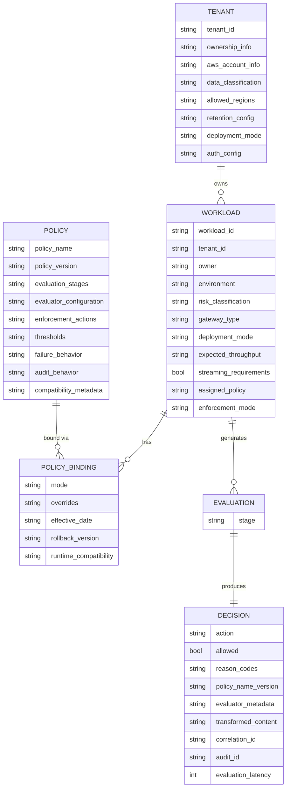
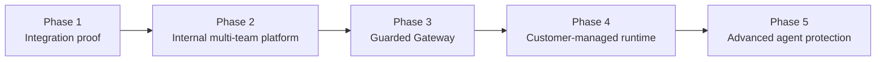

**AI Guardrails — Architecture Report**

**Authority level:** L3
**Status:** Draft
**Date:** 2026-07-24
**Derived from:** seed.md + AGREEMENTS.md

---

> This is the consolidated technical report for the AI Guardrails platform. It is a derived (L3) view: it does not introduce new decisions and must not contradict [`AGREEMENTS.md`](../00-source-of-truth/AGREEMENTS.md) (L1) or [`CONSTRAINTS.md`](../00-source-of-truth/CONSTRAINTS.md) (L1). Where this report and those registers appear to differ, the registers win and this report must be corrected. Figures, dates, and dollar amounts not present in `seed.md` are marked **TBD** rather than invented.

## Table of contents

1. [Executive technical summary](#1-executive-technical-summary)
2. [Architecture objectives](#2-architecture-objectives)
3. [Scope and system boundaries](#3-scope-and-system-boundaries)
4. [Functional requirements](#4-functional-requirements)
5. [Non-functional requirements](#5-non-functional-requirements)
6. [Current-state context](#6-current-state-context)
7. [Proposed architecture](#7-proposed-architecture)
8. [Major components and responsibilities](#8-major-components-and-responsibilities)
9. [Data architecture](#9-data-architecture)
10. [Integration model](#10-integration-model)
11. [Identity and access management](#11-identity-and-access-management)
12. [Security and threat considerations](#12-security-and-threat-considerations)
13. [Deployment and infrastructure](#13-deployment-and-infrastructure)
14. [Availability and resilience](#14-availability-and-resilience)
15. [Scalability and performance](#15-scalability-and-performance)
16. [Observability and operations](#16-observability-and-operations)
17. [Configuration and secrets management](#17-configuration-and-secrets-management)
18. [Multi-tenancy or isolation model](#18-multi-tenancy-or-isolation-model)
19. [Delivery and migration approach](#19-delivery-and-migration-approach)
20. [Technical feasibility assessment](#20-technical-feasibility-assessment)
21. [Trade-offs](#21-trade-offs)
22. [Risks and mitigations](#22-risks-and-mitigations)
23. [Open technical questions](#23-open-technical-questions)
24. [Proofs of concept required](#24-proofs-of-concept-required)
25. [Recommendation](#25-recommendation)

---

## 1. Executive technical summary

AI Guardrails is a standalone policy, evaluation, and enforcement layer for applications and gateways that consume LLMs or execute agentic workflows (seed §1; [AGR-001](../00-source-of-truth/AGREEMENTS.md#agr-001--standalone-platform-not-embedded-in-the-internal-litellm)). It is built and delivered independently of any single internal LiteLLM instance, so that one reusable policy can be applied consistently across heterogeneous gateways, providers, and deployment models.

The platform's central technical commitment is a **single logical evaluation contract** — policy definitions, request structures, decision structures, reason codes, enforcement actions, audit metadata, and policy-version semantics — that is implemented identically across three deployment modes ([AGR-002](../00-source-of-truth/AGREEMENTS.md#agr-002--three-deployment-modes), [AGR-006](../00-source-of-truth/AGREEMENTS.md#agr-006--one-logical-evaluation-contract-across-all-modes)):

| Mode | Who operates the gateway | Who operates the guardrail runtime | Where content is evaluated |
|---|---|---|---|
| A — Remote Evaluation | Consuming team | AI Guardrails provider (hosted) | Hosted Evaluation API |
| B — Guarded Gateway | AI Guardrails provider | AI Guardrails provider (hosted) | Provider-managed Guarded Gateway |
| C — Customer-Managed Runtime | Consuming team | Consuming team, inside their own AWS account | Inside the customer's AWS account |

LiteLLM is the first supported connector, not the product boundary ([AGR-003](../00-source-of-truth/AGREEMENTS.md#agr-003--litellm-as-first-connector-not-the-product-boundary)); Amazon Bedrock Guardrails is the first managed evaluation engine, behind a vendor-independent contract ([AGR-004](../00-source-of-truth/AGREEMENTS.md#agr-004--bedrock-guardrails-as-first-engine-vendor-independent-contract)). The platform targets AWS as the primary cloud and a minimal two-account model, with scope defined over the full feature set and delivered across five phases (seed §6, §18; [`../10-charter/SCOPE.md`](../10-charter/SCOPE.md); [AGR-020](../00-source-of-truth/AGREEMENTS.md#agr-020--five-phase-delivery)); Phases 1–2 (core platform) are validated by a concrete demonstration involving two independent LiteLLM deployments sharing one policy (seed §16; [`../60-delivery/VALIDATION-PLAN.md`](../60-delivery/VALIDATION-PLAN.md)).

This report consolidates the architecture implied by `seed.md` §§1–23 and constrained by `AGREEMENTS.md` and [`CONSTRAINTS.md`](../00-source-of-truth/CONSTRAINTS.md) into the 25 sections a technical stakeholder needs to assess feasibility, risk, and delivery approach. Detailed requirements, feasibility, trade-off, and risk analysis are held in their own documents and referenced from here rather than duplicated.

---

## 2. Architecture objectives

Derived from seed §2 (product vision) and §5 (product principles), the architecture must satisfy the following objectives:

1. **Model and framework independence** — policies must not depend on a specific model provider, programming language, or application framework (seed §5.1).
2. **One contract, three deployment locations** — the same policy, request/decision structures, and audit semantics must hold across Remote Evaluation, Guarded Gateway, and Customer-Managed Runtime (seed §5.2).
3. **Separation of policy from integration** — what is evaluated and how violations are handled (policy) must be independent of how a specific gateway invokes and enforces that policy (connector) (seed §5.3).
4. **Explicit content-exposure disclosure** — every deployment must state where prompts/responses are processed, what is transmitted, what is persisted, what telemetry leaves the runtime, and which AWS accounts/Regions are involved (seed §5.4).
5. **Guardrails are not authorization** — content evaluation is architecturally and organizationally separate from business authorization, tenant isolation, and approval workflows (seed §5.5).
6. **Observable before enforceable** — every policy must support a non-blocking evaluation mode and a graduated Disabled → Observe → Warn → Redact → Block progression (seed §5.6).
7. **Explicit failure behavior** — failure handling for timeouts, unavailable detectors, unresolved policy, control-plane outage, audit-delivery failure, and unsafe transforms must be a declared part of policy, never an implicit default (seed §5.7).

These objectives are non-negotiable design inputs; any component design that cannot satisfy all seven must be revised before acceptance, per [AGR-002](../00-source-of-truth/AGREEMENTS.md#agr-002--three-deployment-modes)'s implication that "every architectural component must be evaluated against all three modes before being accepted."

---

## 3. Scope and system boundaries

### 3.1 In scope (MVP)

Per seed §6.1 and [`../10-charter/SCOPE.md`](../10-charter/SCOPE.md): versioned guardrail policies, workload registration, policy-to-workload bindings, input evaluation, output evaluation, LiteLLM integration, a generic HTTP Evaluation API, an Amazon Bedrock Guardrails integration, deterministic organization rules, basic sensitive-data handling, normalized evaluation decisions, observe/enforce modes, evaluation latency metrics, decision-metadata auditing, hosted runtime deployment, and a path to customer-managed deployment.

### 3.2 Explicitly out of scope for the MVP

Per seed §6.3 and [`../10-charter/SCOPE.md`](../10-charter/SCOPE.md): a general-purpose LLM gateway replacement, a complete AI governance platform, model training or fine-tuning, a proprietary prompt-injection or moderation model, a complete DLP platform, end-user authentication, application business authorization, fully autonomous agent governance, organization-wide AWS enforcement, cross-cloud deployment, full compliance certification, and a general MCP security platform. Multi-region active-active availability was previously listed here as a `seed.md` §6.3 exclusion; [`DECISIONS.md` DEC-019](../00-source-of-truth/DECISIONS.md#dec-019--multi-region-active-active-availability-committed-as-a-later-phase) (Status: Proposed) explicitly supersedes that exclusion and commits it as later-phase scope ([`CAPABILITIES.md` CAP-036](../20-product/CAPABILITIES.md)) — committed, but not yet delivered, and still not part of the MVP itself.

### 3.3 Permitted future scope (architecturally accommodated, not built now)

Per seed §6.2: retrieval-content evaluation, indirect prompt-injection detection, streaming output evaluation, tool-call validation, MCP authorization, memory-write validation, groundedness evaluation, automated reasoning, multilingual policy packs, human approval workflows, dedicated hosted runtimes, air-gapped installation, policy signing, policy inheritance, customer-specific evaluator plugins, commercial metering, and policy marketplace capabilities.

This future scope — together with uncommitted, vision-level growth beyond it — is now classified through the guardrail-category catalog ([`../20-product/GUARDRAIL-CATALOG.md`](../20-product/GUARDRAIL-CATALOG.md), `GR-001`–`GR-018`, per [AGR-021](../00-source-of-truth/AGREEMENTS.md#agr-021--guardrail-category-taxonomy-and-extension-model)), which distinguishes delivered, committed, vision-only, and out-of-boundary items per entry. The catalog classifies; it commits nothing beyond what this section and [`../20-product/CAPABILITIES.md`](../20-product/CAPABILITIES.md) already record.

### 3.4 System context

```text
        Platform teams          Application teams        Security & compliance
              │                        │                          │
              ▼                        ▼                          ▼
     ┌──────────────────────────────────────────────────────────────────┐
     │                     AI Guardrails Platform                       │
     │   (Control Plane + Guardrails Runtime — this report's subject)   │
     └───────────┬───────────────────────────────────┬──────────────────┘
                 │                                   │
                 ▼                                   ▼
     Team-owned / provider-managed              Evaluation engines
     LiteLLM or generic SDK / gateway           (Bedrock Guardrails,
     (Mode A / B / C connectors)                 deterministic rules,
                                                  PII, schema validators)
```

The platform's boundary excludes: model-provider infrastructure, the consuming application's business logic, end-user authentication, and business authorization — all of which remain the consuming team's responsibility per [AGR-010](../00-source-of-truth/AGREEMENTS.md#agr-010--guardrails-are-not-authorization). Full scope narrative: [`10-charter/SCOPE.md`](../10-charter/SCOPE.md).

---

## 4. Functional requirements

Functional scope centers on the core domain model (tenant, workload, policy, policy binding, evaluation, decision — seed §9; [AGR-017](../00-source-of-truth/AGREEMENTS.md#agr-017--core-domain-model)) and the onboarding flow: register workload → select policy → generate integration manifest → install connector → run in observe mode → review evaluation results → enable enforcement (seed §4).

Summary of functional capability areas required for the MVP:

| Capability area | Representative requirement (seed reference) |
|---|---|
| Policy management | Versioned, immutable policy definitions with evaluator configuration, thresholds, enforcement actions, and mandatory failure behavior (§9, §15) |
| Workload lifecycle | Register a workload, bind it to a policy version, select observe or enforce mode (§9) |
| Evaluation | Evaluate `input` and `output` stages against configured evaluators; future stages (`retrieval`, `tool_call`, `tool_result`, `memory_write`, `final_response`) reserved but not built (§9) |
| Decisioning | Return a normalized decision (`allow`, `block`, `redact`, `log_only` initially) with reason codes, evaluator metadata, correlation ID, audit ID, and latency (§9) |
| LiteLLM connector | Map LiteLLM pre-call/post-call requests to the evaluation contract, enforce block/redact, apply safe fallbacks, propagate correlation IDs (§12) |
| Auditing | Record tenant, workload, policy version, stage, decision, reason codes, evaluator versions, timestamp, correlation ID, and raw-content-retention flag for every evaluation (§15) |
| Policy rollout | Support immutable versions, workload-scoped rollout, immediate rollback, and compatibility validation (§15) |

Full functional requirements, acceptance criteria, and traceability to seed sections are maintained in [`REQUIREMENTS.md`](REQUIREMENTS.md) — this report summarizes only; that document is authoritative for functional detail.

---

## 5. Non-functional requirements

Non-functional requirements derive from seed §14 (security), §15 (operational requirements), and the constraints register. Categories requiring architectural treatment:

- **Availability** — explicit availability objective, timeout/retry/cached-policy/degraded-mode/circuit-breaker behavior (§15). Numeric objective: **TBD** (not specified in seed). The topology question once tracked as [OPEN-QUESTIONS.md OQ-016](../00-source-of-truth/OPEN-QUESTIONS.md#oq-016--multi-region-active-active-availability-need) is now **resolved** by [`DECISIONS.md` DEC-019](../00-source-of-truth/DECISIONS.md#dec-019--multi-region-active-active-availability-committed-as-a-later-phase) (Status: Proposed) — see [§14](#14-availability-and-resilience).
- **Performance/latency** — P50/P95/P99 evaluation latency, throughput, timeout rate, detector-specific latency, decision distribution, and policy-cache hit rate must all be measured (§15). Numeric SLOs: **TBD**.
- **Security** — TLS everywhere, IAM authentication, short-lived least-privilege credentials, KMS encryption, per-tenant workload identity, policy authorization checks, request correlation, rate limiting, input-size limits, timeout limits, audit-event integrity, dependency/container scanning (§14; see [CONSTRAINTS.md](../00-source-of-truth/CONSTRAINTS.md) CON-008–CON-016).
- **Data protection** — no raw prompt/response retention by default in the hosted runtime; decision metadata persisted; identifiers hashed where possible; secrets stripped from telemetry; tenant-specific retention configuration supported (§13; [AGR-014](../00-source-of-truth/AGREEMENTS.md#agr-014--no-raw-promptresponse-retention-by-default)).
- **Portability** — percentage of policy definitions that are deployment-mode independent, and percentage of runtime code shared across hosted and customer-managed modes, are tracked success metrics (§19) even though no numeric target is given in seed.

Full non-functional requirements and measurement definitions are maintained in [`NON-FUNCTIONAL-REQUIREMENTS.md`](NON-FUNCTIONAL-REQUIREMENTS.md); this section is a summary and pointer only.

---

## 6. Current-state context

There is no pre-existing AI Guardrails runtime; the solution is greenfield. The relevant "current state" is the internal LiteLLM instance and the organizational status quo it implies:

- Teams currently invoke LLMs through their own or a shared LiteLLM deployment with no centrally reusable, portable guardrail policy layer.
- Any existing guardrail-like behavior, if present, is not decoupled from a specific gateway's lifecycle, which is precisely the coupling [AGR-001](../00-source-of-truth/AGREEMENTS.md#agr-001--standalone-platform-not-embedded-in-the-internal-litellm) rejects as the target architecture.
- Amazon Bedrock Guardrails exists as an available AWS managed capability but is not yet integrated behind a vendor-independent contract.

The architectural implication is that AI Guardrails must be introduced as a **new, additive layer** that the internal LiteLLM instance (and any other gateway) calls into, rather than a refactor of an existing enforcement mechanism. This shapes the delivery approach in [§19](#19-delivery-and-migration-approach): there is no legacy runtime to migrate away from, only new integration points to add cooperatively.

---

## 7. Proposed architecture

### 7.1 Logical architecture

The following diagram is reused verbatim from seed §10 and is authoritative for the platform's logical component layout:

```text
                              ┌─────────────────────────┐
                              │ Guardrails Control Plane│
                              │                         │
                              │ Tenants                 │
                              │ Workloads               │
                              │ Policies                │
                              │ Bindings                │
                              │ Rollouts                │
                              └────────────┬────────────┘
                                           │
                                Policy distribution
                                           │
                                           ▼
┌────────────────┐              ┌─────────────────────────┐
│ LiteLLM        │              │ Guardrails Runtime      │
│ Connector      │─────────────►│                         │
└────────────────┘              │ Evaluation API          │
                                │ Policy resolver         │
┌────────────────┐              │ Decision engine         │
│ Generic SDK    │─────────────►│ Evaluator adapters      │
└────────────────┘              │ Audit producer          │
                                └────────────┬────────────┘
┌────────────────┐                           │
│ Guarded Gateway│───────────────────────────┘
└────────────────┘                           │
                                             ▼
                                 ┌────────────────────────┐
                                 │ Evaluation engines     │
                                 │                        │
                                 │ Bedrock Guardrails     │
                                 │ Deterministic rules    │
                                 │ PII evaluators         │
                                 │ Schema validators      │
                                 └────────────────────────┘
```

### 7.2 Structural principles

- The **Control Plane** owns the domain model (tenants, workloads, policies, bindings, rollouts) and distributes policy to the Runtime; it is not on the synchronous evaluation path for Customer-Managed Runtime deployments ([AGR-015](../00-source-of-truth/AGREEMENTS.md#agr-015--customer-managed-runtime-executes-without-a-synchronous-control-plane-connection)).
- The **Guardrails Runtime** exposes one Evaluation API, resolves the effective policy for a request, executes evaluators through adapters, produces a normalized decision, and emits audit records — identically regardless of which of the three modes it is deployed in.
- **Connectors** (LiteLLM connector, generic SDK, Guarded Gateway) are the only components that vary by gateway; they invoke the same Evaluation API contract and must not embed policy logic ([AGR-007](../00-source-of-truth/AGREEMENTS.md#agr-007--policies-are-separate-from-connectors)).
- **Evaluation engines** sit behind adapters so that Bedrock Guardrails, deterministic rules, PII evaluators, and schema validators are interchangeable and additive without changing the public contract ([AGR-004](../00-source-of-truth/AGREEMENTS.md#agr-004--bedrock-guardrails-as-first-engine-vendor-independent-contract)).
- **Growth is seam-shaped.** All guardrail-coverage growth flows through four formalized extension seams — new evaluation stage, new evaluation engine, new decision action, new connector — defined in [`EXTENSIBILITY-ARCHITECTURE.md`](EXTENSIBILITY-ARCHITECTURE.md), each extending (never forking) the domain model per [AGR-017](../00-source-of-truth/AGREEMENTS.md#agr-017--core-domain-model) and versioned across all three modes per [AGR-006](../00-source-of-truth/AGREEMENTS.md#agr-006--one-logical-evaluation-contract-across-all-modes).

### 7.3 Deployment-mode topology (from seed §3)

```text
Mode A — Remote Evaluation                 Mode B — Guarded Gateway
Application → Team-owned LiteLLM           Application → Provider-managed
    ├─ Input eval  ──► Hosted Runtime           Guarded Gateway
    ├─ Model invocation                            ├─ Input guardrails
    └─ Output eval ──► Hosted Runtime               ├─ Model routing
                                                     ├─ Model invocation
                                                     ├─ Output guardrails
                                                     └─ Audit & usage reporting

Mode C — Customer-Managed Runtime (inside customer AWS account)
Application → Customer LiteLLM/application
    └─ Customer-hosted Guardrails Runtime
          ├─ Policy cache
          ├─ Bedrock Guardrails adapter
          ├─ Custom evaluators
          └─ Local audit integration
    └─ Model provider
```

---

## 8. Major components and responsibilities

| Component | Responsibilities | Not responsible for |
|---|---|---|
| **Guardrails Control Plane** | Tenant/workload registry, policy authoring and versioning, policy-to-workload bindings, rollout control, policy distribution to runtimes (seed §10, §9) | Synchronous evaluation of any single request; must not be a hard runtime dependency for Mode C ([AGR-015](../00-source-of-truth/AGREEMENTS.md#agr-015--customer-managed-runtime-executes-without-a-synchronous-control-plane-connection)) |
| **Evaluation API** | Accepts evaluation requests at `input`/`output` stages, returns normalized decisions (seed §9, §10) | Defining organizational policy content itself |
| **Policy resolver** | Determines the effective policy version and configuration for a given workload and binding (seed §10) | Executing detection logic |
| **Decision engine** | Normalizes evaluator outputs into the platform's decision structure (action, reason codes, policy version, evaluator metadata, correlation ID, audit ID, latency) (seed §9, §10) | Vendor-specific response interpretation (delegated to evaluator adapters) |
| **Evaluator adapters** | Normalize vendor- or engine-specific outputs (e.g., Bedrock Guardrails) into the common decision structure (seed §10; [AGR-004](../00-source-of-truth/AGREEMENTS.md#agr-004--bedrock-guardrails-as-first-engine-vendor-independent-contract)) | Policy definition or thresholds |
| **Audit producer** | Emits decision metadata, reason codes, evaluator versions, timestamps, correlation IDs, and retention flags for every evaluation (seed §10, §15) | Long-term audit storage design (delegated to the audit archive) |
| **LiteLLM connector** | Maps LiteLLM pre-/post-call requests to the evaluation contract, invokes input/output evaluation, enforces block/redact, applies safe fallbacks, propagates correlation IDs, handles timeouts, emits connector-health telemetry (seed §12) | Defining policy, implementing detection models, managing model credentials, persisting audit records, user authorization, policy-version management (seed §12) |
| **Generic SDK / HTTP Evaluation API client** | Allows non-LiteLLM applications and future connectors to invoke the same contract (seed §6.1, §10) | Gateway-specific enforcement mechanics |
| **Guarded Gateway** | Combines model routing, input/output guardrails, and audit/usage reporting for Mode B (seed §3, Mode B) | Application business logic, end-user authorization |
| **Evaluation engines** (Bedrock Guardrails, deterministic rules, PII evaluators, schema validators) | Perform actual content detection (seed §10, §16) | Decision normalization, audit, policy management |

Full component-level design (interfaces, internal data flow, and extensibility points) is out of this report's depth; see [`COMPONENT-ARCHITECTURE.md`](COMPONENT-ARCHITECTURE.md) if/when produced, and [AGR-007](../00-source-of-truth/AGREEMENTS.md#agr-007--policies-are-separate-from-connectors) / [AGR-005](../00-source-of-truth/AGREEMENTS.md#agr-005--policy-portability) for the governing separation rules.

---

## 9. Data architecture

### 9.1 Core domain model

The domain model is authoritative per [AGR-017](../00-source-of-truth/AGREEMENTS.md#agr-017--core-domain-model) and is reproduced from seed §9:



Initial evaluation stages: `input`, `output`. Future stages (not built in MVP): `retrieval`, `tool_call`, `tool_result`, `memory_write`, `final_response`. Initial decision actions: `allow`, `block`, `redact`, `log_only`. Future actions: `rewrite`, `discard`, `abstain`, `require_approval` (seed §9).

### 9.2 Data classification and handling

| Data category | Default hosted-runtime treatment | Reference |
|---|---|---|
| User/system prompts, conversation history, model responses | Processed for evaluation only; **not persisted by default** | Seed §13; [AGR-014](../00-source-of-truth/AGREEMENTS.md#agr-014--no-raw-promptresponse-retention-by-default) |
| Retrieved documents, tool arguments/responses, structured-output payloads | Named as evaluable content categories in seed §13, but MVP support is **limited to user/model input and output only** | Seed §13 |
| Decision metadata (action, reason codes, policy version, evaluator metadata, correlation/audit IDs, latency) | Persisted by default | Seed §9, §13, §15 |
| User/conversation identifiers | Hashed where possible | Seed §13 |
| Secrets | Removed from telemetry | Seed §13, §14 |
| Raw content in Customer-Managed Runtime | Never transmitted to the hosted control plane unless explicitly configured | Seed §13; [AGR-016](../00-source-of-truth/AGREEMENTS.md#agr-016--customer-controlled-telemetry-for-the-customer-managed-runtime) |

### 9.3 Storage mapping (from seed §11)

| Data | Suggested store |
|---|---|
| Policies | DynamoDB or versioned S3 |
| Workload registry | DynamoDB |
| Audit events (buffer) | Amazon SQS |
| Audit events (archive) | Amazon S3 |

All storage is encrypted in transit and at rest via AWS KMS (seed §13, §14; [CONSTRAINTS.md](../00-source-of-truth/CONSTRAINTS.md) CON-009). Detailed data flows, retention schedules, and PII-handling design belong in a dedicated data architecture document; this section summarizes the model and classification only.

---

## 10. Integration model

### 10.1 Connector/policy separation (mandatory)

```text
Policy:
    Detect prompt injection and block it.

Connector:
    Invoke the Evaluation API during LiteLLM pre-call execution.
```

This separation (seed §5.3; [AGR-007](../00-source-of-truth/AGREEMENTS.md#agr-007--policies-are-separate-from-connectors)) is the mechanism that lets the same policy be reused across the LiteLLM connector, a generic SDK, and the Guarded Gateway without modification.

### 10.2 LiteLLM connector responsibilities (seed §12)

**Owns:** mapping LiteLLM requests into the evaluation contract; invoking input evaluation before inference; enforcing block/redact decisions; invoking output evaluation after inference; applying safe output fallbacks; propagating correlation identifiers; handling evaluation timeouts; emitting connector-health telemetry.

**Does not own:** organization policy definition, detection-model implementation, model-credential management, audit-record persistence, user authorization, policy-version management.

### 10.3 Onboarding / "import" flow (seed §4)

```text
Register workload
    │
    ▼
Select policy
    │
    ▼
Generate integration manifest
    │
    ▼
Install connector
    │
    ▼
Run in observe mode
    │
    ▼
Review evaluation results
    │
    ▼
Enable enforcement
```

"Import" means adopting a versioned policy, workload identity, integration manifest, connector configuration, and enforcement mode — **not** cloning, registering, or remotely controlling another team's LiteLLM instance ([AGR-019](../00-source-of-truth/AGREEMENTS.md#agr-019--meaning-of-import)). The process must never require copying another team's LiteLLM database, transferring model-provider credentials, exposing gateway administration endpoints, replacing model-routing configuration, or granting the guardrail provider administrative access to the team's gateway (seed §4).

### 10.4 Extensibility

Additional connectors (other gateways, direct SDK use) must be addable by implementing the invocation contract only, without changing policy semantics ([AGR-003](../00-source-of-truth/AGREEMENTS.md#agr-003--litellm-as-first-connector-not-the-product-boundary)). Detailed connector interface specifications are maintained in [`INTEGRATION-ARCHITECTURE.md`](INTEGRATION-ARCHITECTURE.md) if produced; this section is the report-level summary.

---

## 11. Identity and access management

- **AWS-consumer authentication** must be IAM-based, using short-lived credentials and least-privilege runtime roles (seed §14).
- **Per-tenant workload identities** are mandatory; each workload's identity ties its evaluations, decisions, and audit records back to the correct tenant, and is a prerequisite for policy authorization checks (seed §9, §14).
- **Policy authorization checks** must confirm a workload is entitled to the policy version it requests, rather than trusting a client-supplied policy version (seed §14).
- **Rejected as sole controls:** API keys stored in LiteLLM configuration, tenant-supplied identifiers without authentication, client-provided policy versions without authorization, and connector telemetry as evidence of mandatory enforcement (seed §14; [CONSTRAINTS.md](../00-source-of-truth/CONSTRAINTS.md) CON-012). Any of these may exist as a convenience signal but none may stand alone as a security control.
- **Guardrails are not authorization.** IAM and workload-identity controls govern *who may call the Evaluation API and with what policy* — they do not determine whether the end user of the consuming application is authorized to perform the business action being evaluated. That remains entirely the consuming application's responsibility ([AGR-010](../00-source-of-truth/AGREEMENTS.md#agr-010--guardrails-are-not-authorization)).

---

## 12. Security and threat considerations

### 12.1 Required controls (seed §14)

TLS for all runtime communication; IAM-based authentication for AWS consumers; short-lived credentials; least-privilege runtime roles; KMS encryption; per-tenant workload identities; policy authorization checks; request correlation; rate limiting; input-size limits; timeout limits; audit-event integrity; dependency and container scanning.

### 12.2 Trust and enforcement postures (seed §8; [AGR-018](../00-source-of-truth/AGREEMENTS.md#agr-018--trust-and-enforcement-model))

| Posture | Topology | Appropriate when |
|---|---|---|
| Cooperative integration | `Application → Team LiteLLM with connector → Model` | Teams are trusted; guardrails are an engineering standard; bypass prevention is not a formal requirement |
| Platform-managed enforcement | `Application → Platform-managed gateway → Guardrails → Model` | Platform owns gateway infra; teams should not alter mandatory settings; centralized credentials acceptable |
| Network/IAM-enforced gateway | All model traffic forced through a controlled gateway; no direct provider credentials or connectivity for applications | Bypass prevention is required; teams are semi-trusted; compliance evidence is required |

A cooperative connector must never be represented as a hard security boundary — it can be disabled, removed, or misconfigured (seed §8; [AGR-018](../00-source-of-truth/AGREEMENTS.md#agr-018--trust-and-enforcement-model)). The network/IAM-enforced posture is the strongest but is not required for the first cooperative MVP.

### 12.3 Threat/mitigation summary relevant to architecture

| Threat | Architectural mitigation | Reference |
|---|---|---|
| Connector bypass or misconfiguration | Configuration validation; progression toward managed-gateway or network/IAM enforcement as trust requirements increase | Seed §20 |
| False confidence that guardrails equal complete AI security | Explicit separation of evaluation, authorization, data isolation, and application security in documentation and design | Seed §20; [AGR-010](../00-source-of-truth/AGREEMENTS.md#agr-010--guardrails-are-not-authorization) |
| Hosted data exposure | No raw-content retention by default; explicit content-exposure documentation; Customer-Managed Runtime option for content that must not leave the account | Seed §20; [AGR-009](../00-source-of-truth/AGREEMENTS.md#agr-009--remote-evaluation-is-not-a-private-data-or-data-local-model), [AGR-014](../00-source-of-truth/AGREEMENTS.md#agr-014--no-raw-promptresponse-retention-by-default) |
| Telemetry as unacknowledged exfiltration path (Mode C) | Customer-controlled telemetry, including a fully supported "no telemetry" configuration; telemetry payloads reviewed to ensure no raw content can be carried by construction | Seed §13; [AGR-016](../00-source-of-truth/AGREEMENTS.md#agr-016--customer-controlled-telemetry-for-the-customer-managed-runtime) |

Full threat modeling, control mapping, and residual-risk analysis are out of this report's depth and belong in a dedicated security architecture document; this section summarizes the seed-derived requirements only.

---

## 13. Deployment and infrastructure

### 13.1 Three deployment modes (seed §3; [AGR-002](../00-source-of-truth/AGREEMENTS.md#agr-002--three-deployment-modes))

**Mode A — Remote Evaluation.** Consuming team operates its own LiteLLM/equivalent gateway; the gateway calls the hosted Evaluation API before and after inference. Consuming team owns gateway availability, model credentials, routing, retries, upgrades, and inference capacity/cost. Provider owns Evaluation API availability, policy execution, detection engines, policy versions, decision normalization, audit metadata, and runtime scaling. Must be described only as "bring your own gateway while consuming a hosted guardrail runtime" — never as data-local ([AGR-009](../00-source-of-truth/AGREEMENTS.md#agr-009--remote-evaluation-is-not-a-private-data-or-data-local-model)).

**Mode B — Guarded Gateway.** Provider operates both the LLM gateway and the guardrail runtime. Provider owns gateway availability, provider credentials/delegated AWS access, model routing/integrations, retries/fallbacks, guardrail execution, rate limits, quotas, and audit/telemetry. Consuming team owns application behavior, workload configuration, policy selection where permitted, end-user authorization, and business approval flows. Strongest centralized control; largest operational/security/compliance scope for the provider.

**Mode C — Customer-Managed Runtime.** Runtime deployed inside the consuming team's AWS account, containing a policy cache, Bedrock Guardrails adapter, custom evaluators, and local audit integration. Consuming team owns infrastructure, availability, networking, model credentials, gateway configuration, local audit storage, and upgrades (unless managed support is purchased). Provider owns runtime software, policy schemas, deployment artifacts, policy compatibility, product updates, documentation, and optional hosted policy management/support. Must execute policies without requiring a synchronous connection to the hosted control plane ([AGR-015](../00-source-of-truth/AGREEMENTS.md#agr-015--customer-managed-runtime-executes-without-a-synchronous-control-plane-connection)).

### 13.2 AWS implementation direction — MVP service mapping (seed §11)

| Capability | Initial AWS service |
|---|---|
| Evaluation runtime | ECS Fargate or EKS |
| Public or internal API | API Gateway or Application Load Balancer |
| Policy storage | DynamoDB or versioned S3 |
| Workload registry | DynamoDB |
| Guardrail evaluation | Amazon Bedrock Guardrails |
| Runtime credentials | IAM roles |
| Secrets | AWS Secrets Manager |
| Encryption | AWS KMS |
| Operational metrics | CloudWatch |
| Audit event buffering | Amazon SQS |
| Audit archive | Amazon S3 |
| Container registry | Amazon ECR |

### 13.3 Account model

The MVP uses **one non-production account and one production account** ([CONSTRAINTS.md](../00-source-of-truth/CONSTRAINTS.md) CON-002; [AGR-013](../00-source-of-truth/AGREEMENTS.md#agr-013--aws-as-primary-cloud-minimal-mvp-account-model)), provided IAM, storage, and environment boundaries remain explicit. Additional account separation is introduced only when justified by external customers, compliance requirements, independent security ownership, immutable audit requirements, production scale, or dedicated tenant deployments (seed §11). The measurable trigger for moving beyond two accounts is not yet defined ([OPEN-QUESTIONS.md OQ-009](../00-source-of-truth/OPEN-QUESTIONS.md#oq-009--trigger-point-for-three-account-aws-separation)).

For Mode C, the customer's own AWS account and Region choice supply the infrastructure; the provider ships runtime artifacts (container, Helm chart, ECS deployment template, infrastructure module) rather than operating the infrastructure itself (seed §18, Phase 4).

---

## 14. Availability and resilience

Seed §15 requires the runtime to define, per workload/policy:

- **Availability objective** — numeric SLO: **TBD** (not present in seed). The topology question once tracked here as [OPEN-QUESTIONS.md OQ-016](../00-source-of-truth/OPEN-QUESTIONS.md#oq-016--multi-region-active-active-availability-need) is now **resolved** — see below.
- **Timeout behavior** — every evaluation stage must enforce an explicit timeout; behavior on timeout is part of failure policy, not an undocumented default ([CONSTRAINTS.md](../00-source-of-truth/CONSTRAINTS.md) CON-016; [AGR-012](../00-source-of-truth/AGREEMENTS.md#agr-012--failure-behavior-is-part-of-policy)).
- **Retry behavior** — must be explicitly defined per workload.
- **Cached-policy behavior** — the Customer-Managed Runtime must keep a local policy cache sufficient to keep evaluating during control-plane outages, with asynchronous, non-blocking policy synchronization ([AGR-015](../00-source-of-truth/AGREEMENTS.md#agr-015--customer-managed-runtime-executes-without-a-synchronous-control-plane-connection)).
- **Degraded operating mode** — must be defined (e.g., stale-cache behavior) as part of failure behavior.
- **Circuit-breaker behavior** — must be defined to prevent cascading failure when a detector or the control plane is unavailable.

Failure behavior itself is treated as part of policy, not infrastructure incidental (seed §5.7; [AGR-012](../00-source-of-truth/AGREEMENTS.md#agr-012--failure-behavior-is-part-of-policy)). A workload must define what happens when the Evaluation API times out, a detector is unavailable, the policy cannot be resolved, the control plane is unavailable, audit delivery fails, or a response cannot be safely transformed — with example behaviors including allow-and-log, safe fallback, block, cached policy, or manual approval. There must be no undocumented fallback behavior.

The platform offers multi-region availability from GA, with each tenant pinned to a single processing region ([`DECISIONS.md` DEC-018](../00-source-of-truth/DECISIONS.md#dec-018--multi-region-availability-at-ga) (Status: Proposed) / [`CAPABILITIES.md` CAP-035](../20-product/CAPABILITIES.md)) — this supersedes the single-Region-for-MVP assumption this report previously carried; see [`DEPLOYMENT-ARCHITECTURE.md`](DEPLOYMENT-ARCHITECTURE.md) §7.4. Multi-region active-active availability is committed as a **later phase**, not yet delivered ([`DECISIONS.md` DEC-019](../00-source-of-truth/DECISIONS.md#dec-019--multi-region-active-active-availability-committed-as-a-later-phase) (Status: Proposed) / [`CAPABILITIES.md` CAP-036](../20-product/CAPABILITIES.md)) — this supersedes the prior `seed.md` §6.3 exclusion. [OQ-016](../00-source-of-truth/OPEN-QUESTIONS.md#oq-016--multi-region-active-active-availability-need), which previously tracked this topology question, is now **resolved** by DEC-019; the numeric availability SLO itself remains **TBD** (see [§5](#5-non-functional-requirements) above).

---

## 15. Scalability and performance

Seed §15 requires the platform to measure:

- P50, P95, and P99 evaluation latency.
- Evaluation throughput.
- Timeout rate.
- Detector-specific latency.
- Decision distribution.
- Policy-cache hit rate.

No numeric latency, throughput, or capacity targets are specified in `seed.md`; all such figures are **TBD** and must not be invented. The architecture's scaling posture is qualitative at this stage:

- The Guardrails Runtime is deployed on ECS Fargate or EKS (seed §11), both of which support horizontal scaling of stateless evaluation workers.
- Latency is a named key risk: "Remote input and output evaluation adds synchronous network and processing latency" (seed §20). Mitigations include measuring per-evaluator latency, applying only relevant evaluators per policy, supporting local deterministic checks, using the Customer-Managed Runtime for latency-sensitive workloads, and defining stage-specific timeouts.
- Expected throughput and streaming requirements are captured per-workload in the domain model (seed §9) to inform capacity planning, but streaming *evaluation* itself is future scope, not MVP (seed §6.2, §17).

Performance targets, load-testing methodology, and capacity-planning models belong in [`NON-FUNCTIONAL-REQUIREMENTS.md`](NON-FUNCTIONAL-REQUIREMENTS.md); this section summarizes the measurement obligations only.

---

## 16. Observability and operations

### 16.1 Metrics (seed §15, §19)

Required operational metrics: evaluation latency (P50/P95/P99), throughput, timeout rate, detector-specific latency, decision distribution, and policy-cache hit rate. CloudWatch is the suggested initial metrics store (seed §11). Success-metric categories tracked at the product level include adoption (onboarded workloads, active tenants, connector usage percentage, onboarding time, shared-policy percentage), reliability (Evaluation API availability, timeout rate, P95 latency, policy-resolution failure rate, audit delivery success rate), effectiveness (interventions, false-positive review rate, detection/prevention rates, observe-to-enforce promotion rate, rollback count), and product portability (mode-independent policy percentage, connector count, shared runtime-code percentage, Mode C deployment time) (seed §19).

### 16.2 Auditing (seed §15)

Every audit record must include: tenant, workload, policy version, evaluation stage, decision, reason codes, evaluator versions, timestamp, correlation identifier, and whether raw content was retained. Audit-event integrity is a required security control (seed §14), and audit delivery failure is one of the failure modes a workload's policy must explicitly define behavior for ([AGR-012](../00-source-of-truth/AGREEMENTS.md#agr-012--failure-behavior-is-part-of-policy)).

### 16.3 Connector-health telemetry

The LiteLLM connector emits connector-health telemetry (seed §12), but this telemetry must never be treated as evidence of mandatory enforcement — it is a health signal, not a security control ([CONSTRAINTS.md](../00-source-of-truth/CONSTRAINTS.md) CON-012; [AGR-018](../00-source-of-truth/AGREEMENTS.md#agr-018--trust-and-enforcement-model)).

### 16.4 Customer-managed runtime telemetry

Mode C telemetry is a customer-controlled, first-class setting, ranging from full sanitized telemetry (health status, product version, policy version, aggregated evaluation counts, reason-code totals, latency metrics, sanitized decision metadata) down to no telemetry at all; raw content must never leave the customer-managed runtime unless explicitly configured (seed §13; [AGR-016](../00-source-of-truth/AGREEMENTS.md#agr-016--customer-controlled-telemetry-for-the-customer-managed-runtime)).

---

## 17. Configuration and secrets management

- **Secrets** are stored in AWS Secrets Manager (seed §11) and must be excluded from telemetry entirely (seed §13, §14).
- **Encryption keys** are managed via AWS KMS for both transit and at-rest encryption of policy storage, workload registry, audit buffers/archives, and any cached policy data (seed §11, §13, §14; [CONSTRAINTS.md](../00-source-of-truth/CONSTRAINTS.md) CON-009).
- **Runtime credentials** are IAM roles, short-lived, and least-privilege — never long-lived static secrets embedded in connector or gateway configuration (seed §14).
- **Policy configuration** is versioned and immutable per version, distributed from the Control Plane to the Runtime (seed §10, §15); a minimal management API and version-controlled configuration are acceptable for the MVP in lieu of a full administration portal (seed §17).
- **Rejected pattern:** API keys stored directly in LiteLLM configuration as a sole authentication mechanism (seed §14; [CONSTRAINTS.md](../00-source-of-truth/CONSTRAINTS.md) CON-012).
- **Customer-managed runtime configuration** additionally includes an explicit, first-class telemetry-level setting (seed §13; [AGR-016](../00-source-of-truth/AGREEMENTS.md#agr-016--customer-controlled-telemetry-for-the-customer-managed-runtime)) and local audit-integration configuration (seed §3, Mode C).

---

## 18. Multi-tenancy or isolation model

The domain model's **Tenant** entity is the primary isolation unit, carrying tenant identifier, ownership information, AWS account information, data classification, allowed Regions, retention configuration, deployment mode, and authentication configuration (seed §9). Isolation is enforced through:

- **Per-tenant workload identities** — no workload identity is shared across tenants (seed §14; [CONSTRAINTS.md](../00-source-of-truth/CONSTRAINTS.md) CON-011).
- **Policy authorization checks** — a workload may only resolve and use policy versions it is authorized for (seed §14).
- **Deployment-mode isolation** — Mode C provides the strongest isolation, as the runtime and its data reside entirely inside the customer's own AWS account (seed §3, Mode C); Modes A and B share a provider-operated runtime and therefore rely on logical (identity- and policy-based) tenant isolation rather than infrastructure-level separation.
- **Allowed Regions** — recorded per tenant in the domain model. [OPEN-QUESTIONS.md OQ-003](../00-source-of-truth/OPEN-QUESTIONS.md#oq-003--regional-deployment-strategy-and-data-residency) (which Regions are supported at GA, and whether residency is enforced) is now **resolved** by [`DECISIONS.md` DEC-018](../00-source-of-truth/DECISIONS.md#dec-018--multi-region-availability-at-ga) (Status: Proposed): the platform is multi-region from GA, and per-tenant residency enforcement is committed as core scope ([`CAPABILITIES.md` CAP-035](../20-product/CAPABILITIES.md)). The specific enforcement *mechanism* (IAM condition keys, region-scoped routing, per-region deployment topology) remains **TBD** — see [`DATA-ARCHITECTURE.md`](DATA-ARCHITECTURE.md) §5.
- **Dedicated tenant runtimes** — architecturally permitted future scope (seed §6.2) but not required or built for the MVP (seed §17); the MVP does not assume single-tenant infrastructure per customer.

Multi-tenancy in the MVP is therefore primarily a **logical isolation model** (identity, policy binding, and data-classification boundaries within shared hosted infrastructure), with **physical isolation available today only via Mode C**, where the tenant's own AWS account is the isolation boundary.

---

## 19. Delivery and migration approach

There is no existing system to migrate off of ([§6](#6-current-state-context)); "delivery" here means phased rollout of new capability, and "migration" applies only to workloads moving between the platform's own deployment modes over time (e.g., a workload starting on Mode A and later adopting Mode C).

### 19.1 Five-phase delivery (seed §18; [AGR-020](../00-source-of-truth/AGREEMENTS.md#agr-020--five-phase-delivery))



| Phase | Objective | Key deliverables |
|---|---|---|
| 1 — Integration proof | Prove guardrail policy/evaluation can be separated from LiteLLM and reused across gateways | Evaluation contract, policy format, Bedrock Guardrails adapter, LiteLLM connector, observe mode, basic auditing, internal deployment |
| 2 — Internal multi-team platform | Allow multiple internal teams to onboard distinct workloads | Tenant/workload registry, policy bindings, IAM authentication, quotas, policy promotion/rollback, service-level monitoring, basic administration workflow |
| 3 — Guarded gateway | Offer a fully hosted model + guardrail path | Managed LiteLLM gateway, model-provider configuration, per-tenant routing, cost/rate controls, managed credentials, unified availability objectives |
| 4 — Customer-managed runtime | Support workloads needing local evaluation and content isolation | Runtime container, Helm chart, ECS deployment template, infrastructure module, local policy cache, policy synchronization, customer-controlled telemetry, upgrade compatibility checks |
| 5 — Advanced agent protection | Extend coverage beyond prompt/response evaluation | Retrieval evaluation, tool-call validation, tool-result evaluation, memory-write controls, human approvals, agent delegation restrictions, MCP integration, advanced authorization integration |

Phase 5 is treated as a separate product expansion, not an MVP prerequisite ([AGR-020](../00-source-of-truth/AGREEMENTS.md#agr-020--five-phase-delivery)).

### 19.2 Phase 1–2 validation demonstration (seed §16; [`60-delivery/VALIDATION-PLAN.md`](../60-delivery/VALIDATION-PLAN.md))

Phases 1–2 (core platform) are validated only when: two separate LiteLLM instances consume the same policy; neither shares model-provider credentials with the platform; both receive consistent normalized decisions; one workload runs in observe mode while another runs in enforce mode; a policy can be upgraded and rolled back; raw-content persistence can be disabled; evaluation failures follow a configured failure policy; and the runtime can later be packaged for customer-managed deployment without changing the connector contract (seed §16).

Full delivery sequencing, milestones, and staffing are maintained in the `60-delivery/` document set; this section is the architecture-relevant summary.

---

## 20. Technical feasibility assessment

At a summary level, the architecture described in this report is assessed as **feasible for the MVP scope**, on the following basis:

- All MVP components map to available, well-understood AWS managed services (ECS Fargate/EKS, API Gateway/ALB, DynamoDB, S3, Bedrock Guardrails, IAM, Secrets Manager, KMS, CloudWatch, SQS, ECR — seed §11); no unavailable or speculative technology is required.
- The adapter/connector separation pattern (policy vs. connector, seed §5.3; evaluator adapters, seed §10) is a standard integration architecture and does not require novel engineering.
- The hardest technical requirement is maintaining **one logical evaluation contract** identically across hosted and customer-managed deployments ([AGR-006](../00-source-of-truth/AGREEMENTS.md#agr-006--one-logical-evaluation-contract-across-all-modes)); this is achievable but requires conformance testing discipline (seed's contract-compatibility implication) rather than new infrastructure.
- The minimal two-account AWS model (seed §11; [AGR-013](../00-source-of-truth/AGREEMENTS.md#agr-013--aws-as-primary-cloud-minimal-mvp-account-model)) further reduces MVP delivery complexity.

No seed-provided cost, staffing, or timeline figures exist to validate feasibility against budget or schedule; those figures are **TBD**. Full feasibility analysis, including a component-by-component confidence rating and identified technical unknowns, is maintained in [`FEASIBILITY-ASSESSMENT.md`](FEASIBILITY-ASSESSMENT.md); this section is a summary and pointer only.

---

## 21. Trade-offs

This report does not restate the full trade-off analysis. Key trade-off dimensions implied directly by seed.md and the agreements register — each of which involves a genuine architectural cost on both sides — include:

- **Mode A operational simplicity vs. data exposure** — Remote Evaluation minimizes the consuming team's operational burden but transmits full prompt/response content to the hosted service; it must never be marketed as reducing data exposure ([AGR-009](../00-source-of-truth/AGREEMENTS.md#agr-009--remote-evaluation-is-not-a-private-data-or-data-local-model)).
- **Mode B centralization vs. provider scope** — Guarded Gateway gives the strongest centralized control but creates the largest operational, security, and compliance scope for the provider (seed §3, Mode B).
- **Mode C isolation vs. delivery/operational complexity** — Customer-Managed Runtime satisfies the strictest residency and isolation requirements but shifts infrastructure ownership, availability, and (absent managed support) upgrades onto the customer (seed §3, Mode C).
- **Cooperative trust vs. enforcement strength** — cooperative integration is fastest to adopt but is bypassable by design; stronger postures (platform-managed, network/IAM-enforced) trade adoption friction for bypass resistance (seed §8; [AGR-018](../00-source-of-truth/AGREEMENTS.md#agr-018--trust-and-enforcement-model)).
- **Minimal two-account model vs. compliance/isolation rigor** — reduces MVP delivery complexity at the cost of weaker account-level blast-radius containment until a triggering event justifies separation (seed §11; [AGR-013](../00-source-of-truth/AGREEMENTS.md#agr-013--aws-as-primary-cloud-minimal-mvp-account-model)).

Full trade-off analysis, including options considered and rejected, is maintained in [`TRADE-OFFS.md`](TRADE-OFFS.md); this section only orients the reader to the dimensions already visible in the seed material.

---

## 22. Risks and mitigations

The seed's key-risks register (§20) identifies six risks with architectural relevance: connector bypass, false confidence, latency, hosted data exposure, policy fragmentation, and product over-expansion. Each has a named mitigation strategy already summarized in [§12.3](#123-threatmitigation-summary-relevant-to-architecture) and [§15](#15-scalability-and-performance) above. This report does not duplicate the full risk register, ownership, likelihood/impact ratings, or tracking status.

Full risk detail, ownership, and tracking are maintained in [`TECHNICAL-RISKS.md`](TECHNICAL-RISKS.md); this section is a pointer only. See also [`00-source-of-truth/OPEN-QUESTIONS.md`](../00-source-of-truth/OPEN-QUESTIONS.md), which tracks unresolved decisions whose downside is, in several cases, the same underlying uncertainty expressed as an open question rather than a standing risk.

---

## 23. Open technical questions

The questions below have direct architectural weight. All are now **resolved** — each by a decision recorded in [`00-source-of-truth/DECISIONS.md`](../00-source-of-truth/DECISIONS.md) and marked closed in [`00-source-of-truth/OPEN-QUESTIONS.md`](../00-source-of-truth/OPEN-QUESTIONS.md) (the closing decisions are Status: Proposed, pending owner ratification). They are retained here because each leaves a residual engineering detail this architecture must carry:

| ID | Question | Architectural relevance |
|---|---|---|
| OQ-001 | Which enforcement posture is required for the first external customers? | **Resolved** by [DEC-010](../00-source-of-truth/DECISIONS.md#dec-010--serve-ai-guardrails-as-a-developer-service-with-mode-a-as-the-front-door) (Status: Proposed): cooperative posture at the front door; network/IAM-enforced gateway stays a later graduation, not pulled forward for MVP |
| OQ-002 | Is PrivateLink/private connectivity required for Mode A or Mode B, and by when? | **Resolved** by [DEC-017](../00-source-of-truth/DECISIONS.md#dec-017--deployment-and-commercial-posture) (Status: Proposed): public TLS+IAM at GA; PrivateLink added on-demand, trigger = first strict-egress customer |
| OQ-003 | Which AWS Regions are supported at GA, and how are per-tenant "Allowed Regions" enforced? | **Resolved** by [DEC-018](../00-source-of-truth/DECISIONS.md#dec-018--multi-region-availability-at-ga) (Status: Proposed): multi-region from GA, tenant-pinned, residency enforcement committed as core scope (CAP-035); the specific enforcement mechanism remains TBD |
| OQ-009 | What measurable trigger moves the MVP from two AWS accounts to three-or-more? | **Resolved** by [DEC-017](../00-source-of-truth/DECISIONS.md#dec-017--deployment-and-commercial-posture) (Status: Proposed): two-account model retained; move to 3+ on first external customer, compliance requirement, or independent security ownership |
| OQ-012 | How will policy signing and policy inheritance work once introduced? | **Resolved** by [DEC-011](../00-source-of-truth/DECISIONS.md#dec-011--policy-governance-classes-and-mandatory-policy-authority) (inheritance v0 = mandatory-pin layering) and [DEC-015](../00-source-of-truth/DECISIONS.md#dec-015--evaluator-plugin-and-policy-signing-governance) (signing deferred to Phase 4, Mode C) — both Proposed |
| OQ-014 | What are the objective go/no-go criteria to promote a workload from observe to enforce? | **Resolved** by [DEC-012](../00-source-of-truth/DECISIONS.md#dec-012--observe-to-enforce-promotion-criteria) (Status: Proposed): objective promotion gate; numeric thresholds owner-set at ratification |
| OQ-016 | Is multi-region active-active availability ever required? | **Resolved** by [DEC-019](../00-source-of-truth/DECISIONS.md#dec-019--multi-region-active-active-availability-committed-as-a-later-phase) (Status: Proposed): committed as later-phase CAP-036, not yet delivered; the numeric availability objective itself remains TBD |

All twenty tracked questions (OQ-001 through OQ-020) are now resolved — see the register for the complete set and their closing decisions; the table above lists only those with the most direct architectural bearing, each carrying a residual engineering detail this report must honor.

---

## 24. Proofs of concept required

Derived from the Phase 1–2 validation demonstration criteria (seed §16; [`../60-delivery/VALIDATION-PLAN.md`](../60-delivery/VALIDATION-PLAN.md)) and the architecture's riskiest assumptions, the following proofs of concept are required before the architecture in this report can be considered validated:

1. **Dual-connector policy reuse.** Stand up two genuinely independent LiteLLM instances, each with its own connector installation, and demonstrate both consuming the same policy version and producing consistent normalized decisions — without either sharing model-provider credentials with the guardrail platform (seed §16).
2. **Bedrock Guardrails adapter normalization.** Prove that Bedrock Guardrails' native response format can be fully normalized into the platform's own decision structure (action, reason codes, evaluator metadata) without leaking vendor-specific shapes into the policy or connector layers ([AGR-004](../00-source-of-truth/AGREEMENTS.md#agr-004--bedrock-guardrails-as-first-engine-vendor-independent-contract)).
3. **Observe/enforce mode split across independent workloads.** Demonstrate one workload running in observe mode and a second running in enforce mode simultaneously, under the same policy family, with correct decision and audit behavior for each (seed §16).
4. **Policy upgrade and rollback.** Demonstrate promoting a policy to a new version and rolling it back, verifying workload-scoped rollout and that in-flight evaluations remain consistent with the intended version (seed §15, §16).
5. **Raw-content persistence toggle.** Prove that raw prompt/response persistence can be disabled by default and selectively re-enabled per tenant, with audit metadata correctly recording whether raw content was retained for each evaluation ([AGR-014](../00-source-of-truth/AGREEMENTS.md#agr-014--no-raw-promptresponse-retention-by-default)).
6. **Configured failure-policy behavior.** Simulate an Evaluation API timeout, a detector outage, and a control-plane outage, and confirm that each workload's documented failure behavior (e.g., allow-and-log, safe fallback, block, cached policy) is actually what occurs — not an undocumented default (seed §5.7, §16).
7. **Customer-managed packaging without contract change.** Package the runtime for a customer-managed deployment (container/Helm/ECS artifact) and confirm the LiteLLM connector requires no contract change to point at the customer-managed runtime instead of the hosted one (seed §16; [AGR-006](../00-source-of-truth/AGREEMENTS.md#agr-006--one-logical-evaluation-contract-across-all-modes)).
8. **Control-plane-independent evaluation (Mode C).** Disconnect the customer-managed runtime from the hosted control plane and confirm policy evaluation continues correctly against the local policy cache ([AGR-015](../00-source-of-truth/AGREEMENTS.md#agr-015--customer-managed-runtime-executes-without-a-synchronous-control-plane-connection)).

These map directly to the release criteria that gate Phase 1–2 completion and should be treated as go/no-go gates for Phase 1–2 delivery, not optional validation exercises.

---

## 25. Recommendation

Based on the seed material and the accepted agreements, the recommended technical path forward is:

1. **Proceed with the three-mode architecture as scoped**, building Mode A (Remote Evaluation) first, since it requires only the Control Plane, Guardrails Runtime, Evaluation API, and LiteLLM connector — the minimum footprint needed to run the Phase 1 integration proof and the dual-connector PoC in [§24](#24-proofs-of-concept-required).
2. **Enforce the policy/connector and vendor-adapter separations from day one**, even though only one connector (LiteLLM) and one primary evaluation engine (Bedrock Guardrails) exist at MVP launch — retrofitting this separation later is materially more expensive than building it in from the start, and it is what makes AGR-003/004/005/006/007 achievable rather than aspirational.
3. **Treat the failure-behavior schema as a first-class policy artifact**, not an operational afterthought, given how many Phase 1–2 validation demonstration criteria and success metrics depend on it (observe/enforce correctness, rollback safety, audit completeness).
4. **Hold the minimal two-account AWS model** through Phase 1–2, and gate any account-topology change on an explicit review against the seed §11 trigger list rather than incremental drift — this keeps delivery focused on the reusable-policy hypothesis rather than premature infrastructure investment.
5. **Sequence Customer-Managed Runtime (Mode C) packaging concerns into the architecture early, even though Mode C ships in Phase 4** — the requirement that the connector contract not change between hosted and customer-managed deployment ([AGR-006](../00-source-of-truth/AGREEMENTS.md#agr-006--one-logical-evaluation-contract-across-all-modes)) is far cheaper to satisfy by design than to retrofit after Mode A/B implementation choices have leaked mode-specific assumptions into the contract.
6. **Resolve OQ-009 (account-separation trigger) and OQ-014 (observe→enforce promotion criteria), and finalize the numeric availability SLO, before Phase 2 exits pilot scale** — OQ-016's topology question is now **resolved** (multi-region from GA with tenant pinning, DEC-018/CAP-035; active-active committed as a later phase, DEC-019/CAP-036), but the numeric availability objective itself remains open and, together with OQ-009 and OQ-014, most directly blocks operational readiness of the platform's own rollout mechanics, independent of any specific customer commitment.
7. **Defer all Phase 5 (advanced agent protection) capability** — retrieval evaluation, tool-call validation, MCP authorization, and related items — until the core reusable-policy hypothesis is demonstrated in the Phase 1–2 validation demonstration (seed §16; [`../60-delivery/VALIDATION-PLAN.md`](../60-delivery/VALIDATION-PLAN.md)); this capability is Phase 5 scope per [`../10-charter/SCOPE.md`](../10-charter/SCOPE.md) and [AGR-020](../00-source-of-truth/AGREEMENTS.md#agr-020--five-phase-delivery), not built during the earlier phases.

This architecture is assessed as ready to move into detailed component design and Phase 1 implementation, subject to closing the proofs of concept in [§24](#24-proofs-of-concept-required) and the open questions flagged in [§23](#23-open-technical-questions).
