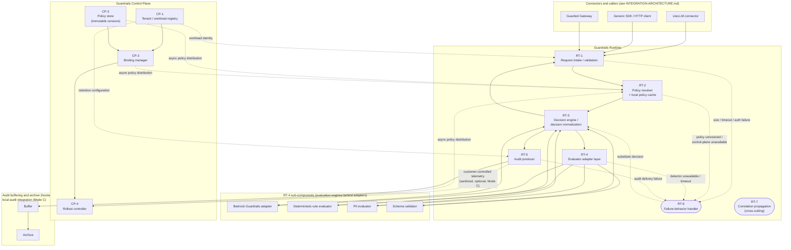

**AI Guardrails — Component Architecture (C4 Level 3)**

**Authority level:** L3
**Status:** Draft
**Date:** 2026-07-24
**Derived from:** seed.md + AGREEMENTS.md

---

> This is a derived (L3) architecture view. It does not introduce new decisions and must not contradict [`AGREEMENTS.md`](../00-source-of-truth/AGREEMENTS.md) or [`CONSTRAINTS.md`](../00-source-of-truth/CONSTRAINTS.md) (both L1). Where this document and those registers appear to differ, the registers win and this document must be corrected. Metrics, SLAs, capacity figures, and dates not present in `seed.md` are marked **TBD** rather than invented, per source-of-truth policy.

## Table of contents

1. [Purpose and scope](#1-purpose-and-scope)
2. [Where this document sits (C4 recap)](#2-where-this-document-sits-c4-recap)
3. [Component inventory](#3-component-inventory)
4. [Guardrails Runtime — components](#4-guardrails-runtime--components)
   - [RT-1 — Request intake / validation](#rt-1--request-intake--validation)
   - [RT-2 — Policy resolver (with local policy cache)](#rt-2--policy-resolver-with-local-policy-cache)
   - [RT-3 — Decision engine / decision normalization](#rt-3--decision-engine--decision-normalization)
   - [RT-4 — Evaluator adapter layer](#rt-4--evaluator-adapter-layer)
   - [RT-5 — Audit producer](#rt-5--audit-producer)
   - [RT-6 — Failure-behavior handler](#rt-6--failure-behavior-handler)
   - [RT-7 — Correlation propagation](#rt-7--correlation-propagation)
5. [Guardrails Control Plane — components](#5-guardrails-control-plane--components)
   - [CP-1 — Tenant / workload registry](#cp-1--tenant--workload-registry)
   - [CP-2 — Policy store (immutable versions)](#cp-2--policy-store-immutable-versions)
   - [CP-3 — Binding manager](#cp-3--binding-manager)
   - [CP-4 — Rollout controller](#cp-4--rollout-controller)
6. [Cross-cutting contracts](#6-cross-cutting-contracts)
7. [Component interaction diagrams](#7-component-interaction-diagrams)
8. [Component placement across deployment modes](#8-component-placement-across-deployment-modes)
9. [Design rules this architecture enforces](#9-design-rules-this-architecture-enforces)
10. [Open items and TBDs](#10-open-items-and-tbds)
11. [Related documents](#11-related-documents)

---

## 1. Purpose and scope

This document is the **C4 level-3 (component) view** of the two containers introduced at the logical-architecture level in `seed.md` §10 and summarized at container granularity in [`ARCHITECTURE-REPORT.md`](ARCHITECTURE-REPORT.md) §7–§8:

- The **Guardrails Runtime** — the container that exposes the Evaluation API, resolves policy, executes evaluators, normalizes decisions, and produces audit records, identically across all three deployment modes.
- The **Guardrails Control Plane** — the container that owns the domain model (tenants, workloads, policies, bindings, rollouts) and distributes policy to every Runtime instance.

For each component, this document states its **responsibility**, its **key inputs and outputs**, and the **contract it upholds** — principally the normalized decision structure and the reason-code contract defined in `seed.md` §9 and made mandatory across deployment modes by [AGR-006](../00-source-of-truth/AGREEMENTS.md#agr-006--one-logical-evaluation-contract-across-all-modes).

This document does **not** cover:

- Connectors (LiteLLM connector, generic SDK, Guarded Gateway) — their internal design belongs in [`INTEGRATION-ARCHITECTURE.md`](INTEGRATION-ARCHITECTURE.md).
- Evaluation engines' internal detection logic (what Bedrock Guardrails, the deterministic-rule engine, the PII evaluator, or the schema validator actually detect) — only the adapter contract each must satisfy.
- System-context (C4 level 1) or container (C4 level 2) diagrams — those belong in [`SYSTEM-CONTEXT.md`](SYSTEM-CONTEXT.md) and [`CONTAINER-ARCHITECTURE.md`](CONTAINER-ARCHITECTURE.md) respectively; this document assumes the two containers those documents define (Guardrails Control Plane, Guardrails Runtime) as given, and picks up exactly where [`CONTAINER-ARCHITECTURE.md`](CONTAINER-ARCHITECTURE.md) §4 leaves off: "This document describes these five elements at the responsibility level only; their internal structure ... is defined in the planned `COMPONENT-ARCHITECTURE.md` (C4 L3)."
- Deployment topology, AWS service selection, and account model — those belong in [`DEPLOYMENT-ARCHITECTURE.md`](DEPLOYMENT-ARCHITECTURE.md); [§8](#8-component-placement-across-deployment-modes) below gives only the component-to-mode mapping needed to keep every component honest against [AGR-002](../00-source-of-truth/AGREEMENTS.md#agr-002--three-deployment-modes)'s "every architectural component must be evaluated against all three modes before being accepted."

---

## 2. Where this document sits (C4 recap)

```text
C4 Level 1 — System context      : Platform teams, application teams, security/compliance,
                                    product operators ⇄ AI Guardrails Platform ⇄ evaluation
                                    engines, model providers  (see SYSTEM-CONTEXT.md)

C4 Level 2 — Containers           : Guardrails Control Plane | Guardrails Runtime | Evaluation
                                    engines | Connectors (LiteLLM connector, generic SDK,
                                    Guarded Gateway)  (see CONTAINER-ARCHITECTURE.md; summarized
                                    in ARCHITECTURE-REPORT.md §7–§8)

C4 Level 3 — Components (HERE)    : The internal components of the Guardrails Runtime
                                    and the Guardrails Control Plane containers only.

C4 Level 4 — Code                 : Classes/modules — out of scope for solution-docs.
```

The logical diagram this document decomposes is reproduced from `seed.md` §10:

```text
                              ┌─────────────────────────┐
                              │ Guardrails Control Plane│
                              │                         │
                              │ Tenants                 │
                              │ Workloads               │
                              │ Policies                │
                              │ Bindings                │
                              │ Rollouts                │
                              └────────────┬────────────┘
                                           │
                                Policy distribution
                                           │
                                           ▼
┌────────────────┐              ┌─────────────────────────┐
│ LiteLLM        │              │ Guardrails Runtime      │
│ Connector      │─────────────►│                         │
└────────────────┘              │ Evaluation API          │
                                │ Policy resolver         │
┌────────────────┐              │ Decision engine         │
│ Generic SDK    │─────────────►│ Evaluator adapters      │
└────────────────┘              │ Audit producer          │
                                └────────────┬────────────┘
┌────────────────┐                           │
│ Guarded Gateway│───────────────────────────┘
└────────────────┘                           │
                                             ▼
                                 ┌────────────────────────┐
                                 │ Evaluation engines     │
                                 │                        │
                                 │ Bedrock Guardrails     │
                                 │ Deterministic rules    │
                                 │ PII evaluators         │
                                 │ Schema validators      │
                                 └────────────────────────┘
```

The "Evaluation API" box above is not one component — it is the externally-facing name for the Runtime container as a whole. This document decomposes it into RT-1 through RT-7. The "Evaluation engines" box is not a separate container in this decomposition; it is exposed to the rest of the Runtime only through the four sub-components of RT-4 (the evaluator adapter layer), consistent with [AGR-004](../00-source-of-truth/AGREEMENTS.md#agr-004--bedrock-guardrails-as-first-engine-vendor-independent-contract)'s requirement that vendor-specific formats never reach policies or connectors unnormalized.

---

## 3. Component inventory

### 3.1 Guardrails Runtime

| ID | Component | One-line responsibility |
|---|---|---|
| RT-1 | Request intake / validation | Authenticates, validates, and admits (or rejects) every evaluation request |
| RT-2 | Policy resolver (local policy cache) | Resolves the effective policy for a workload from a locally cached, asynchronously synchronized copy |
| RT-3 | Decision engine / decision normalization | Orchestrates evaluators per policy and produces the single normalized `Decision` |
| RT-4 | Evaluator adapter layer | Normalizes each evaluation engine's native call/response into a common per-evaluator finding |
| RT-5 | Audit producer | Emits the audit record for every evaluation, including failure-path evaluations |
| RT-6 | Failure-behavior handler | Applies the workload's configured behavior for each of the six defined failure modes |
| RT-7 | Correlation propagation | Generates and threads one correlation identifier across every other Runtime component |

### 3.2 Guardrails Control Plane

| ID | Component | One-line responsibility |
|---|---|---|
| CP-1 | Tenant / workload registry | System of record for the `Tenant` and `Workload` domain entities and per-tenant workload identity |
| CP-2 | Policy store (immutable versions) | System of record for the `Policy` domain entity; enforces version immutability |
| CP-3 | Binding manager | System of record for the `Policy binding` domain entity — workload ⇄ policy version ⇄ mode |
| CP-4 | Rollout controller | Drives controlled promotion, comparison, and rollback of policy versions across bound workloads |

All eleven components are expressed in terms of the six-entity domain model (tenant, workload, policy, policy binding, evaluation, decision) mandated by [AGR-017](../00-source-of-truth/AGREEMENTS.md#agr-017--core-domain-model); none introduces a parallel vocabulary.

---

## 4. Guardrails Runtime — components

### RT-1 — Request intake / validation

| Field | Detail |
|---|---|
| **Responsibility** | Single entry point for the Evaluation API. Authenticates the caller via IAM and per-tenant workload identity ([CON-010](../00-source-of-truth/CONSTRAINTS.md#con-010--iam-based-authentication-and-least-privilege-roles), [CON-011](../00-source-of-truth/CONSTRAINTS.md#con-011--per-tenant-workload-identities)); validates the request against the evaluation contract (stage, tenant/workload identifiers, content payload); enforces input-size limits ([CON-015](../00-source-of-truth/CONSTRAINTS.md#con-015--input-size-limits)) and establishes the per-request timeout budget ([CON-016](../00-source-of-truth/CONSTRAINTS.md#con-016--timeout-limits)) before any content reaches an evaluator. |
| **Key inputs** | Raw evaluation request from a connector (LiteLLM connector, generic SDK, or Guarded Gateway) — tenant ID, workload ID, evaluation stage (`input` or `output` in the MVP; `seed.md` §9), content, optional caller-supplied correlation ID, IAM credentials. |
| **Key outputs** | A validated internal evaluation-request object passed to RT-2; a structural/authentication rejection returned directly to the caller; a size- or timeout-budget violation routed to RT-6. Every accepted request carries a correlation identifier (assigned by RT-7 if the caller did not supply one). |
| **Contract upheld** | Enforces the **one logical evaluation contract** ([AGR-006](../00-source-of-truth/AGREEMENTS.md#agr-006--one-logical-evaluation-contract-across-all-modes), [CON-005](../00-source-of-truth/CONSTRAINTS.md#con-005--one-logical-evaluation-contract-across-all-modes)) at the boundary: it accepts only contract-conformant requests regardless of which connector or deployment mode submitted them, so nothing downstream needs to special-case the caller. |

### RT-2 — Policy resolver (with local policy cache)

| Field | Detail |
|---|---|
| **Responsibility** | Resolves the effective policy definition for a (tenant, workload) pair by looking up the active [policy binding](#cp-3--binding-manager) and the corresponding [policy version](#cp-2--policy-store-immutable-versions) from a **local cache**. The cache is kept current by asynchronous, non-blocking policy distribution from the Control Plane, so evaluation never depends on a synchronous control-plane call ([AGR-015](../00-source-of-truth/AGREEMENTS.md#agr-015--customer-managed-runtime-executes-without-a-synchronous-control-plane-connection)). On control-plane unavailability, serves the last-known-good cached policy, subject to the workload's degraded-mode failure behavior. |
| **Key inputs** | Tenant ID + workload ID (from RT-1); the local policy cache; an asynchronous policy-distribution feed sourced from CP-2, CP-3, and CP-4. |
| **Key outputs** | A resolved policy (evaluation stages, evaluator configuration, thresholds, enforcement actions, failure behavior, audit behavior — `seed.md` §9) passed to RT-3; a "policy cannot be resolved" event routed to RT-6 when no binding or no usable cached version exists. |
| **Contract upheld** | Preserves **policy-version semantics** identically across deployment modes ([CON-005](../00-source-of-truth/CONSTRAINTS.md#con-005--one-logical-evaluation-contract-across-all-modes)) and is the component that makes [AGR-015](../00-source-of-truth/AGREEMENTS.md#agr-015--customer-managed-runtime-executes-without-a-synchronous-control-plane-connection) true in practice — the Runtime keeps evaluating during a Control Plane outage in every mode, not only Mode C. |

### RT-3 — Decision engine / decision normalization

| Field | Detail |
|---|---|
| **Responsibility** | Orchestrates the [evaluator adapter layer](#rt-4--evaluator-adapter-layer) according to the resolved policy's evaluation stages and evaluator configuration; aggregates per-evaluator findings; applies the policy's thresholds and enforcement actions; determines the final decision action consistent with the workload's current binding mode along the Disabled → Observe → Warn → Redact → Block progression ([AGR-011](../00-source-of-truth/AGREEMENTS.md#agr-011--observe-before-enforce-progression)); and normalizes every result — whatever engine produced it — into the single `Decision` structure defined in the domain model (`seed.md` §9). |
| **Key inputs** | Resolved policy (from RT-2); per-evaluator findings (from RT-4), each already carrying its own reason code(s) and evaluator metadata; the workload's current binding mode (sourced, via the resolved policy/binding, from CP-3). |
| **Key outputs** | A normalized `Decision` object — **action** (`allow`, `block`, `redact`, or `log_only` in the MVP; `rewrite`, `discard`, `abstain`, `require_approval` are future-scope only per [AGR-019](../00-source-of-truth/AGREEMENTS.md#agr-019--mvp-scope-boundaries)), **allowed status**, **reason codes**, **policy name and version**, **evaluator metadata**, **transformed content** where applicable, **correlation identifier**, **audit identifier**, and **evaluation latency** — returned via RT-1's response path and forwarded to RT-5. |
| **Contract upheld** | This is the primary owner of the **normalized-decision contract** ([AGR-006](../00-source-of-truth/AGREEMENTS.md#agr-006--one-logical-evaluation-contract-across-all-modes); `seed.md` §9 `Decision` entity). Every deployment mode and every evaluation engine must funnel through this single normalization point so that connectors and audit consumers never observe an evaluator- or vendor-specific response shape. |

### RT-4 — Evaluator adapter layer

| Field | Detail |
|---|---|
| **Responsibility** | Translates the Runtime's internal evaluation call into each backing engine's native invocation, and translates that engine's native output back into a common **per-evaluator finding** (category, verdict/confidence, reason code(s), evaluator version, latency). This is the *only* place in the Runtime where vendor- or engine-specific logic or response formats are permitted to exist ([CON-003](../00-source-of-truth/CONSTRAINTS.md#con-003--no-coupling-to-litellm-configuration-structures), [CON-004](../00-source-of-truth/CONSTRAINTS.md#con-004--no-coupling-to-bedrock-guardrails-response-formats)). It houses four adapters at MVP scope: |
| — | **Bedrock Guardrails adapter** — wraps Amazon Bedrock Guardrails as the first managed evaluation engine; normalizes Bedrock's native response format ([AGR-004](../00-source-of-truth/AGREEMENTS.md#agr-004--bedrock-guardrails-as-first-engine-vendor-independent-contract)). |
| — | **Deterministic-rule evaluator** — executes organization-defined deterministic rules (`seed.md` §6.1). |
| — | **PII evaluator** — performs basic sensitive-data handling/detection (`seed.md` §6.1). |
| — | **Schema validator** — validates structured-output payloads against an expected schema (`seed.md` §9, §13). |
| **Key inputs** | Content to evaluate, scoped by the resolved policy to only the evaluators and stage(s) it configures (from RT-3); per-evaluator configuration and thresholds (from the resolved policy). |
| **Key outputs** | A normalized per-evaluator finding to RT-3 for each invoked evaluator; a detector-unavailable or detector-timeout event routed to RT-6 when an engine cannot respond within its stage timeout ([CON-016](../00-source-of-truth/CONSTRAINTS.md#con-016--timeout-limits)). |
| **Contract upheld** | Guarantees that adding a new evaluation engine never requires a policy or connector change ([AGR-004](../00-source-of-truth/AGREEMENTS.md#agr-004--bedrock-guardrails-as-first-engine-vendor-independent-contract), [AGR-005](../00-source-of-truth/AGREEMENTS.md#agr-005--policy-portability)), as long as the adapter emits the standard finding shape. This is the structural mechanism behind the constraint that the public product contract must never couple to any one vendor's response format. |

### RT-5 — Audit producer

| Field | Detail |
|---|---|
| **Responsibility** | Emits the audit record for **every** evaluation — whether the normal decision path completed or a failure-behavior path was taken. Captures tenant, workload, policy version, evaluation stage, decision, reason codes, evaluator versions, timestamp, correlation identifier, and whether raw content was retained (`seed.md` §15). Buffers and archives audit events per the hosted-runtime AWS mapping in `seed.md` §11 (SQS buffer, S3 archive) and, in Customer-Managed Runtime deployments, integrates with the customer's own local audit stack (`seed.md` §3, Mode C diagram) instead of the hosted pipeline. |
| **Key inputs** | The normalized `Decision` (from RT-3); the failure-path outcome (from RT-6, when applicable); the tenant's retention configuration (sourced from CP-1). |
| **Key outputs** | An audit event delivered to the buffering/archive pipeline (hosted modes) or the local audit integration (Mode C); an audit identifier returned into the `Decision` object before RT-3 responds to the caller. |
| **Contract upheld** | Upholds the shared **audit-metadata contract** across all three modes ([AGR-006](../00-source-of-truth/AGREEMENTS.md#agr-006--one-logical-evaluation-contract-across-all-modes)) and the "no undocumented fallback behavior" transparency requirement ([AGR-012](../00-source-of-truth/AGREEMENTS.md#agr-012--failure-behavior-is-part-of-policy)) by always recording which path — normal or failure — produced a given decision, and by never persisting raw content unless the tenant has explicitly configured retention ([CON-014](../00-source-of-truth/CONSTRAINTS.md#con-014--no-raw-content-retention-by-default-in-the-hosted-runtime), [CON-013](../00-source-of-truth/CONSTRAINTS.md#con-013--raw-content-must-not-leave-a-customer-managed-runtime-unless-explicitly-configured)). |

### RT-6 — Failure-behavior handler

| Field | Detail |
|---|---|
| **Responsibility** | Implements the workload's explicitly configured failure behavior for each of the six failure modes `seed.md` §5.7 requires a policy to define: the Evaluation API times out; a detector is unavailable; the policy cannot be resolved; the control plane is unavailable; audit delivery fails; a response cannot be safely transformed. Selects among the documented behaviors — allow and log, return a safe fallback, block the request, use a cached policy, require manual approval — strictly according to the policy's mandatory failure-behavior section, and refuses to apply any behavior the policy does not declare ([AGR-012](../00-source-of-truth/AGREEMENTS.md#agr-012--failure-behavior-is-part-of-policy)). |
| **Key inputs** | Failure signals from RT-1 (size/timeout/auth), RT-2 (policy unresolved / control-plane unavailable), RT-4 (detector unavailable or timed out), RT-5 (audit delivery failure); the resolved policy's failure-behavior configuration. |
| **Key outputs** | A substitute decision or action fed back into RT-3's normalization path — so the caller still receives a normalized `Decision`, now annotated with the failure path taken — or an explicit rejection when the policy specifies fail-closed behavior; a mandatory audit annotation delivered to RT-5 recording which failure path fired. |
| **Contract upheld** | Guarantees **"no undocumented fallback behavior"** ([AGR-012](../00-source-of-truth/AGREEMENTS.md#agr-012--failure-behavior-is-part-of-policy)) and that even a degraded or failed evaluation still returns a normalized `Decision`, never an ad hoc error shape — preserving the one-logical-contract requirement ([AGR-006](../00-source-of-truth/AGREEMENTS.md#agr-006--one-logical-evaluation-contract-across-all-modes)) even under failure. |

### RT-7 — Correlation propagation

| Field | Detail |
|---|---|
| **Responsibility** | Generates a correlation identifier at first ingress (RT-1) when the caller did not supply one, and threads that identifier unchanged through policy resolution (RT-2), evaluator adapter calls (RT-4), decision normalization (RT-3), audit production (RT-5), and the failure-behavior path (RT-6), and back to the connector. This is a **cross-cutting** concern threaded through every other Runtime component rather than a discrete processing stage. |
| **Key inputs** | A connector-supplied correlation identifier, if present (`seed.md` §12 — the LiteLLM connector is responsible for "propagating correlation identifiers"); otherwise none. |
| **Key outputs** | A single correlation identifier embedded in every internal call between RT-1 and RT-6, in the final `Decision` object, and in the audit record — enabling a paired `input`/`output` evaluation for one logical request to be traced end-to-end. |
| **Contract upheld** | Correlation identifier is a mandatory field of the `Decision` structure (`seed.md` §9) and of audit metadata (`seed.md` §15; "request correlation" is also a named security requirement in §14). This is what makes the one-logical-evaluation-contract requirement ([AGR-006](../00-source-of-truth/AGREEMENTS.md#agr-006--one-logical-evaluation-contract-across-all-modes)) traceable end-to-end, regardless of deployment mode. |

---

## 5. Guardrails Control Plane — components

### CP-1 — Tenant / workload registry

| Field | Detail |
|---|---|
| **Responsibility** | System of record for the `Tenant` and `Workload` domain entities (`seed.md` §9): tenant identifier, ownership information, AWS account information, data classification, allowed Regions, retention configuration, deployment mode, and authentication configuration; workload identifier, tenant identifier, owner, environment, risk classification, gateway type, deployment mode, expected throughput, streaming requirements, assigned policy, and enforcement mode. Issues the **per-tenant workload identities** ([CON-011](../00-source-of-truth/CONSTRAINTS.md#con-011--per-tenant-workload-identities)) that RT-1 authenticates against. |
| **Key inputs** | Registration requests from the onboarding / "import" flow's "Register workload" step (`seed.md` §4); updates from product operators (`seed.md` §7). |
| **Key outputs** | Tenant and workload records consumed by the [Binding manager](#cp-3--binding-manager); workload identity material consumed by RT-1; tenant retention configuration consumed by RT-5. |
| **Contract upheld** | Is the sole authoritative source of "who is this tenant/workload" — every other component resolves tenant/workload identity through this registry rather than trusting a caller-supplied identifier alone ([CON-012](../00-source-of-truth/CONSTRAINTS.md#con-012--no-exclusive-reliance-on-weak-security-proxies)). |

### CP-2 — Policy store (immutable versions)

| Field | Detail |
|---|---|
| **Responsibility** | System of record for the `Policy` domain entity (`seed.md` §9): policy name, policy version, evaluation stages, evaluator configuration, enforcement actions, thresholds, failure behavior, audit behavior, and compatibility metadata. Enforces that a published policy version is **immutable** (`seed.md` §15, "Policy rollout: Immutable versions") — any change produces a new version rather than mutating an existing one. |
| **Key inputs** | Policy authoring and publication actions, owned organizationally by security and governance (`seed.md` §7, §21); compatibility metadata submitted at publication time. |
| **Key outputs** | Versioned, immutable policy definitions consumed by the [Binding manager](#cp-3--binding-manager) and, via asynchronous policy distribution, by [RT-2](#rt-2--policy-resolver-with-local-policy-cache)'s local cache in every deployment mode. |
| **Contract upheld** | Is the origin of the **policy-version semantics** that must stay compatible across all three deployment modes ([AGR-006](../00-source-of-truth/AGREEMENTS.md#agr-006--one-logical-evaluation-contract-across-all-modes), [CON-005](../00-source-of-truth/CONSTRAINTS.md#con-005--one-logical-evaluation-contract-across-all-modes)). Immutability is what lets RT-2's local cache, and RT-6's cached-policy failure path, be trusted as a faithful, unaltered copy of a specific version rather than something that could have silently drifted. |

### CP-3 — Binding manager

| Field | Detail |
|---|---|
| **Responsibility** | System of record for the `Policy binding` domain entity (`seed.md` §9): associates a workload with a specific policy version; records the workload's current mode along the Disabled → Observe → Warn → Redact → Block progression ([AGR-011](../00-source-of-truth/AGREEMENTS.md#agr-011--observe-before-enforce-progression)); records allowed workload-specific overrides (deliberately bounded to limit the policy-fragmentation risk identified in `seed.md` §20), effective date, rollback version, and runtime compatibility requirements. |
| **Key inputs** | Policy selection during onboarding (`seed.md` §4, "Select policy" step); promotion/rollback actions from the [Rollout controller](#cp-4--rollout-controller); workload and policy references from CP-1 and CP-2. |
| **Key outputs** | The active binding (workload → policy version → mode) consumed by [RT-2](#rt-2--policy-resolver-with-local-policy-cache) to determine which policy — and which enforcement mode — applies to a given workload's evaluations. |
| **Contract upheld** | Makes binding-mode promotion an **explicit, auditable action** rather than an implicit side effect of another change ([AGR-011](../00-source-of-truth/AGREEMENTS.md#agr-011--observe-before-enforce-progression)); keeps policy and connector concerns strictly separate ([AGR-007](../00-source-of-truth/AGREEMENTS.md#agr-007--policies-are-separate-from-connectors), [CON-006](../00-source-of-truth/CONSTRAINTS.md#con-006--policies-separate-from-connectors)), since a binding references only a policy version — never connector-specific configuration. |

### CP-4 — Rollout controller

| Field | Detail |
|---|---|
| **Responsibility** | Drives controlled promotion and rollback of policy versions across bound workloads: workload-scoped rollout, immediate rollback, compatibility validation before promotion, and evaluation-result comparison between an incoming and outgoing version (`seed.md` §15, "Policy rollout"). Is the mechanism behind the MVP demonstration requirement that "a policy can be upgraded and rolled back" (`seed.md` §16; [AGR-020](../00-source-of-truth/AGREEMENTS.md#agr-020--mvp-success-demonstration)). |
| **Key inputs** | Candidate policy version (from CP-2); current bindings (from CP-3); evaluation-result comparison data sourced from audit/telemetry produced by RT-5 — or, in Mode C, only whatever telemetry category the customer has chosen to share ([AGR-016](../00-source-of-truth/AGREEMENTS.md#agr-016--customer-controlled-telemetry-for-the-customer-managed-runtime)). |
| **Key outputs** | Binding updates (new version, rollback version) applied through CP-3; rollout/rollback events that flow into the same asynchronous policy-distribution feed that reaches RT-2's local cache in every deployment mode. |
| **Contract upheld** | Upholds "controlled promotion" and "immediate rollback" as first-class, auditable operations (`seed.md` §15) and guarantees rollout decisions are propagated in a way that never breaks the one-logical-contract requirement ([AGR-006](../00-source-of-truth/AGREEMENTS.md#agr-006--one-logical-evaluation-contract-across-all-modes)) — the same rollout mechanism governs hosted and customer-managed runtimes alike, differing only in policy-distribution latency, never in contract shape. |

---

## 6. Cross-cutting contracts

Three contracts are shared across every component above and must never vary by deployment mode ([AGR-006](../00-source-of-truth/AGREEMENTS.md#agr-006--one-logical-evaluation-contract-across-all-modes)).

### 6.1 Normalized decision contract

Owned structurally by [RT-3](#rt-3--decision-engine--decision-normalization). Per the domain model (`seed.md` §9), a `Decision` must always contain:

| Field | Meaning |
|---|---|
| Action | `allow`, `block`, `redact`, or `log_only` at MVP scope. `rewrite`, `discard`, `abstain`, `require_approval` are named future actions — architecturally accommodated, not built now ([AGR-019](../00-source-of-truth/AGREEMENTS.md#agr-019--mvp-scope-boundaries)). |
| Allowed status | Whether the evaluated content/request may proceed. |
| Reason codes | See [§6.2](#62-reason-code-contract) below. |
| Policy name and version | The exact immutable policy version (from CP-2) the decision was evaluated against. |
| Evaluator metadata | Which evaluator(s) contributed, and their versions (from RT-4). |
| Transformed content | Present only when the action requires it (e.g., `redact`). |
| Correlation identifier | See [§6.3](#63-correlation-identifier-contract) below. |
| Audit identifier | Assigned by RT-5; links the decision to its audit record. |
| Evaluation latency | Measured end-to-end for the request, supporting the P50/P95/P99 latency metrics required by `seed.md` §15. |

No component other than RT-3 may emit a `Decision`-shaped object to a connector or to RT-5 — this is what prevents a vendor- or evaluator-specific shape from leaking past RT-4.

### 6.2 Reason-code contract

Every per-evaluator finding (RT-4 → RT-3) and every normalized `Decision` (RT-3 → caller/RT-5) must carry one or more reason codes that are:

- **Machine-readable and stable** across policy versions, so connectors and audit consumers can program against them rather than parse free text.
- **Attributable** to the evaluator/engine, evaluation stage, and violation category that produced them.
- **Vendor-neutral at the point they leave RT-4** — no engine-proprietary code (e.g., a raw Bedrock Guardrails filter identifier) may reach RT-3, a connector, or the audit record unnormalized; this is what [CON-004](../00-source-of-truth/CONSTRAINTS.md#con-004--no-coupling-to-bedrock-guardrails-response-formats) requires structurally.

The exact reason-code taxonomy (the enumerated list of codes, their namespace convention, and their governance/versioning process) is a policy-schema concern, not a runtime-architecture concern, and is intentionally **not enumerated in this document** — it is **TBD**, owned by a future policy-schema/reason-code registry document (see [§10](#10-open-items-and-tbds)).

### 6.3 Correlation identifier contract

Owned by [RT-7](#rt-7--correlation-propagation). A correlation identifier is mandatory on every `Decision` and every audit record; it must be preserved unchanged from first ingress (RT-1) through to the audit archive, and it must be the same identifier across a paired `input`/`output` evaluation of one logical request so the two stages can be reconstructed as a single transaction during audit review.

---

## 7. Component interaction diagrams

### 7.1 Component diagram



### 7.2 Input-evaluation sequence, including a failure path

```mermaid
sequenceDiagram
    participant Conn as Connector (e.g. LiteLLM)
    participant RT1 as RT-1 Intake / Validation
    participant RT2 as RT-2 Policy Resolver
    participant RT3 as RT-3 Decision Engine
    participant RT4 as RT-4 Evaluator Adapters
    participant RT5 as RT-5 Audit Producer
    participant RT6 as RT-6 Failure Handler

    Conn->>RT1: Evaluation request (stage=input, content, correlation_id?)
    Note over RT1: RT-7 assigns correlation_id if absent;<br/>validates size, auth, structure
    RT1->>RT2: Validated request + correlation_id
    RT2->>RT2: Resolve policy from local cache
    alt Policy resolvable
        RT2->>RT3: Resolved policy + correlation_id
        RT3->>RT4: Invoke configured evaluators
        alt All evaluators respond in time
            RT4-->>RT3: Normalized per-evaluator findings + reason codes
            RT3->>RT3: Apply thresholds and current binding mode
            RT3->>RT5: Normalized Decision + correlation_id
            RT5-->>RT3: audit_id
            RT3-->>RT1: Decision (action, reason codes, audit_id, latency)
            RT1-->>Conn: Decision
        else Evaluator timeout or unavailable
            RT4-->>RT6: Detector-unavailable signal + correlation_id
            RT6->>RT6: Apply this workload's configured failure behavior
            RT6-->>RT3: Substitute decision (e.g. allow-and-log, safe fallback, block)
            RT3->>RT5: Normalized Decision (failure path annotated)
            RT3-->>RT1: Decision
            RT1-->>Conn: Decision
        end
    else Policy unresolved (no usable cache entry)
        RT2-->>RT6: Policy-unresolved signal + correlation_id
        RT6->>RT6: Apply this workload's policy-unresolved failure behavior
        RT6-->>RT1: Substitute decision
        RT1-->>Conn: Decision
    end
```

The `output` stage follows the identical sequence, reusing the same correlation identifier established during the paired `input` evaluation (`seed.md` §12 — the LiteLLM connector is responsible for invoking both stages and propagating the correlation identifier between them).

---

## 8. Component placement across deployment modes

Per [AGR-002](../00-source-of-truth/AGREEMENTS.md#agr-002--three-deployment-modes), every component must be evaluated against all three modes before acceptance. None of the eleven components changes its internal contract by mode; only **where it runs** and **what crosses the trust boundary** changes.

| Component | Mode A — Remote Evaluation | Mode B — Guarded Gateway | Mode C — Customer-Managed Runtime |
|---|---|---|---|
| RT-1 Request intake / validation | Hosted (provider) | Hosted (provider), fronting the Guarded Gateway's input path | Deployed inside the customer's AWS account |
| RT-2 Policy resolver + local cache | Hosted (provider); cache mainly a latency/availability optimization | Hosted (provider) | Deployed in the customer account; the cache is **load-bearing** — it is what satisfies [AGR-015](../00-source-of-truth/AGREEMENTS.md#agr-015--customer-managed-runtime-executes-without-a-synchronous-control-plane-connection) |
| RT-3 Decision engine | Hosted (provider) | Hosted (provider) | Deployed in the customer account |
| RT-4 Evaluator adapter layer | Hosted (provider); Bedrock adapter calls Bedrock Guardrails from the provider side | Hosted (provider) | Deployed in the customer account; adapters call Bedrock Guardrails (or other configured engines) reachable from that account (`seed.md` §3, Mode C diagram: "Bedrock Guardrails adapter", "Custom evaluators") |
| RT-5 Audit producer | Hosted (provider) SQS/S3 pipeline | Hosted (provider) SQS/S3 pipeline, combined with usage reporting | **Local audit integration** in the customer account (`seed.md` §3); only customer-selected telemetry categories — or none — reach the hosted control plane ([AGR-016](../00-source-of-truth/AGREEMENTS.md#agr-016--customer-controlled-telemetry-for-the-customer-managed-runtime)) |
| RT-6 Failure-behavior handler | Hosted (provider) | Hosted (provider) | Deployed in the customer account |
| RT-7 Correlation propagation | End-to-end across connector ⇄ hosted runtime | End-to-end within the Guarded Gateway | End-to-end within the customer account; may also flow into the customer's own logs |
| CP-1…CP-4 (all Control Plane components) | Always hosted by the provider; reached at onboarding/administration time, never on the synchronous evaluation path | Always hosted by the provider | Always hosted by the provider; reached **only asynchronously**, per [AGR-015](../00-source-of-truth/AGREEMENTS.md#agr-015--customer-managed-runtime-executes-without-a-synchronous-control-plane-connection) — never a runtime-path dependency |

Two things stay constant regardless of this table: (1) prompts and responses reach the hosted Runtime in Modes A and B — Mode A must never be described as data-local ([AGR-009](../00-source-of-truth/AGREEMENTS.md#agr-009--remote-evaluation-is-not-a-private-data-or-data-local-model)); (2) raw content never leaves a Mode C runtime unless the customer explicitly configures that transmission ([CON-013](../00-source-of-truth/CONSTRAINTS.md#con-013--raw-content-must-not-leave-a-customer-managed-runtime-unless-explicitly-configured)).

---

## 9. Design rules this architecture enforces

| Rule | Enforced by | Traces to |
|---|---|---|
| Vendor-specific formats never reach a policy or connector unnormalized | RT-4 is the only component permitted to hold engine-specific logic; RT-3 emits only the normalized `Decision` | [AGR-004](../00-source-of-truth/AGREEMENTS.md#agr-004--bedrock-guardrails-as-first-engine-vendor-independent-contract), [AGR-005](../00-source-of-truth/AGREEMENTS.md#agr-005--policy-portability), [CON-003](../00-source-of-truth/CONSTRAINTS.md#con-003--no-coupling-to-litellm-configuration-structures), [CON-004](../00-source-of-truth/CONSTRAINTS.md#con-004--no-coupling-to-bedrock-guardrails-response-formats) |
| A policy defines *what*; a connector defines *how* | CP-3 (Binding manager) references only a policy version, never connector configuration; connectors are entirely outside this document's component set | [AGR-007](../00-source-of-truth/AGREEMENTS.md#agr-007--policies-are-separate-from-connectors), [CON-006](../00-source-of-truth/CONSTRAINTS.md#con-006--policies-separate-from-connectors) |
| Guardrails evaluate content, they do not authorize actions | No Runtime or Control Plane component reasons about end-user identity, resource ownership, or business authorization — only tenant/workload identity for the purpose of policy resolution and audit attribution | [AGR-010](../00-source-of-truth/AGREEMENTS.md#agr-010--guardrails-are-not-authorization) |
| Observe-before-enforce is a first-class, auditable state | CP-3 records binding mode explicitly; RT-3 applies it deterministically at decision time | [AGR-011](../00-source-of-truth/AGREEMENTS.md#agr-011--observe-before-enforce-progression) |
| No undocumented fallback behavior | RT-6 is the sole component permitted to select a failure-path behavior, and only from the policy's declared failure-behavior section | [AGR-012](../00-source-of-truth/AGREEMENTS.md#agr-012--failure-behavior-is-part-of-policy) |
| Evaluation never has a hard synchronous dependency on the Control Plane | RT-2's local cache and asynchronous policy distribution from CP-2/CP-3/CP-4 | [AGR-015](../00-source-of-truth/AGREEMENTS.md#agr-015--customer-managed-runtime-executes-without-a-synchronous-control-plane-connection) |
| Raw content exposure and telemetry are explicit, tenant-controlled settings | RT-5 consults tenant retention configuration (CP-1) before persisting anything beyond decision metadata; Mode C telemetry to CP-4 is opt-in and sanitized | [AGR-014](../00-source-of-truth/AGREEMENTS.md#agr-014--no-raw-promptresponse-retention-by-default), [AGR-016](../00-source-of-truth/AGREEMENTS.md#agr-016--customer-controlled-telemetry-for-the-customer-managed-runtime) |
| Per-tenant identity, never a shared or unauthenticated proxy for identity | CP-1 issues and is the sole source of workload identity; RT-1 authenticates against it | [CON-011](../00-source-of-truth/CONSTRAINTS.md#con-011--per-tenant-workload-identities), [CON-012](../00-source-of-truth/CONSTRAINTS.md#con-012--no-exclusive-reliance-on-weak-security-proxies) |

---

## 10. Open items and TBDs

The following are intentionally left undefined here, consistent with source-of-truth policy against inventing figures:

- **Reason-code taxonomy** — the enumerated code list, namespace convention, and versioning/governance process referenced in [§6.2](#62-reason-code-contract) is TBD; owned by a future policy-schema document, not this one.
- **Input-size and timeout values enforced by RT-1/RT-4/RT-6** — the ceilings themselves are TBD per [CON-015](../00-source-of-truth/CONSTRAINTS.md#con-015--input-size-limits) and [CON-016](../00-source-of-truth/CONSTRAINTS.md#con-016--timeout-limits); only the requirement that they exist and are explicit is architected here.
- **Policy-compatibility validation algorithm** used by CP-4 before promotion — `seed.md` requires "compatibility validation" but does not specify its method; see [OQ-012](../00-source-of-truth/OPEN-QUESTIONS.md#oq-012--policy-signing-and-policy-inheritance-design) for the related open question on policy signing and inheritance.
- **Objective promotion criteria** (observe → enforce) that CP-4/CP-3 would gate on — tracked as [OQ-014](../00-source-of-truth/OPEN-QUESTIONS.md#oq-014--gono-go-criteria-to-move-a-workload-from-observe-to-enforce), not resolved by this document.
- **Numeric availability/latency objectives** for RT-1 through RT-6 — TBD; tracked at the requirements level in [`NON-FUNCTIONAL-REQUIREMENTS.md`](NON-FUNCTIONAL-REQUIREMENTS.md) and [OQ-016](../00-source-of-truth/OPEN-QUESTIONS.md#oq-016--multi-region-active-active-availability-need).
- **Customer-specific evaluator plugin governance** for a potential fifth RT-4 sub-component beyond the MVP's four — future scope only ([AGR-019](../00-source-of-truth/AGREEMENTS.md#agr-019--mvp-scope-boundaries)); see [OQ-013](../00-source-of-truth/OPEN-QUESTIONS.md#oq-013--customer-specific-evaluator-plugin-governance).

---

## 11. Related documents

- [`../00-source-of-truth/AGREEMENTS.md`](../00-source-of-truth/AGREEMENTS.md) — authoritative agreement register (L1); this document must never contradict it.
- [`../00-source-of-truth/CONSTRAINTS.md`](../00-source-of-truth/CONSTRAINTS.md) — authoritative constraint register (L1), operationalized here at the component level.
- [`../00-source-of-truth/OPEN-QUESTIONS.md`](../00-source-of-truth/OPEN-QUESTIONS.md) — tracks the unresolved decisions referenced in [§10](#10-open-items-and-tbds).
- [`ARCHITECTURE-REPORT.md`](ARCHITECTURE-REPORT.md) — the consolidated technical report summarizing C4 level-1/2 at responsibility level (see its §7–§8).
- [`CONTAINER-ARCHITECTURE.md`](CONTAINER-ARCHITECTURE.md) — the C4 level-2 container view this document decomposes; its §4 (Guardrails Runtime) and §3 (Guardrails Control Plane) name the same five Runtime elements and five Control Plane sub-domains this document expands into RT-1…RT-7 and CP-1…CP-4.
- [`NON-FUNCTIONAL-REQUIREMENTS.md`](NON-FUNCTIONAL-REQUIREMENTS.md) — availability, latency, and security requirements each component must satisfy.
- [`SYSTEM-CONTEXT.md`](SYSTEM-CONTEXT.md) — C4 level-1 system-context diagram.
- [`DEPLOYMENT-ARCHITECTURE.md`](DEPLOYMENT-ARCHITECTURE.md) — deployment topology, AWS service selection, and account model behind [§8](#8-component-placement-across-deployment-modes).
- [`INTEGRATION-ARCHITECTURE.md`](INTEGRATION-ARCHITECTURE.md) — connector-side design (LiteLLM connector, generic SDK, Guarded Gateway) that calls into RT-1.
- [`SECURITY-ARCHITECTURE.md`](SECURITY-ARCHITECTURE.md) — full threat model and control mapping for CON-008 through CON-012.
- [`DATA-ARCHITECTURE.md`](DATA-ARCHITECTURE.md) — full data-flow and retention design for CON-007, CON-013, CON-014.
- [`OPERABILITY.md`](OPERABILITY.md) — availability objectives, circuit-breaker behavior, and rollout operability for RT-6 and CP-4.
- [`adrs/README.md`](adrs/README.md) — architecture decision records for component-level design alternatives and trade-offs not captured in this inventory view.
- [`../10-charter/PRINCIPLES.md`](../10-charter/PRINCIPLES.md) — narrative source for the design rules in [§9](#9-design-rules-this-architecture-enforces).
- [`../20-product/CAPABILITIES.md`](../20-product/CAPABILITIES.md) — product-facing capability descriptions this component set implements.
