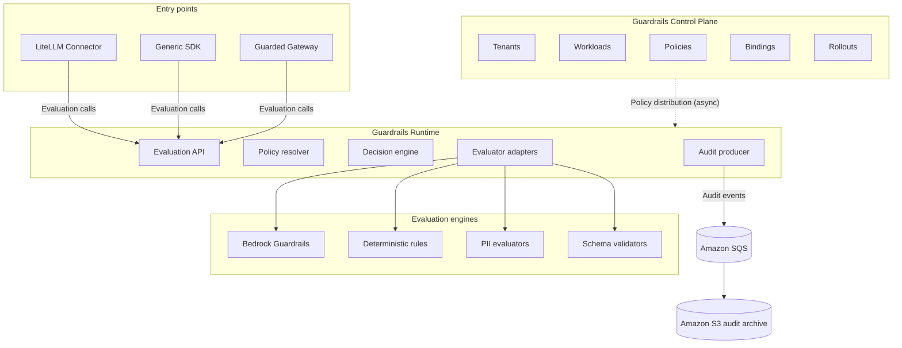
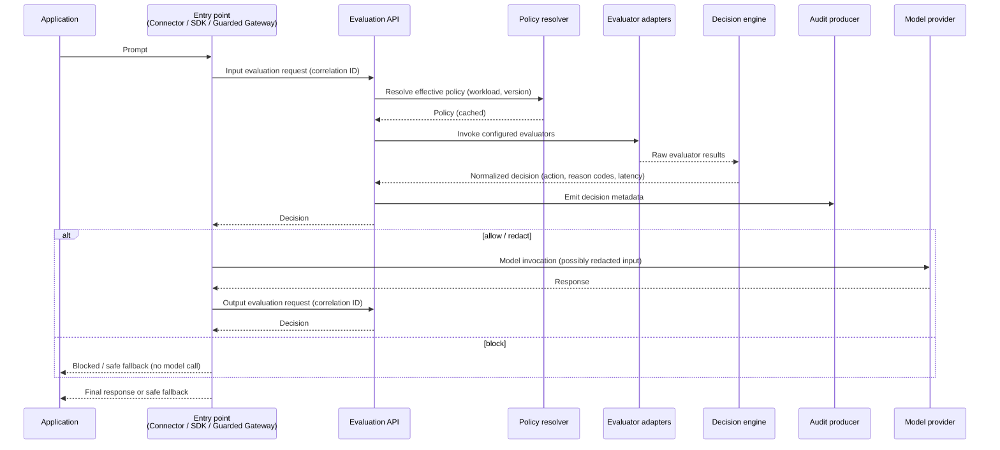

**AI Guardrails — Container Architecture**

**Authority level:** L3
**Status:** Draft
**Date:** 2026-07-24
**Derived from:** AGREEMENTS.md

---

## Purpose and authority

This document is the **C4 Level-2 (Container) view** of the AI Guardrails platform. It decomposes the platform boundary into its major deployable/logical containers — the Guardrails Control Plane, the Guardrails Runtime, the evaluation engines it invokes, and the connector/SDK/Guarded-Gateway entry points that call it — and describes each container's responsibility, technology, and the inter-container communication that ties them together.

This document is **L3 — derived**. It must not contradict [`AGREEMENTS.md`](../00-source-of-truth/AGREEMENTS.md) or [`CONSTRAINTS.md`](../00-source-of-truth/CONSTRAINTS.md) (both **L1 — authoritative**). Where a conflict is found, those documents win and this architecture view must be corrected. Figures that are not present in the L1 registers (specific latency ceilings, throughput numbers, cost figures) are marked **TBD** rather than invented, consistent with source-of-truth policy.

### Relationship to other architecture documents

This is a **logical container view**, not a physical network topology and not a component-internals view. It sits between the following documents in the architecture set:

| Level | Document | Scope |
| --- | --- | --- |
| C4 L1 — System context | [`SYSTEM-CONTEXT.md`](SYSTEM-CONTEXT.md) | External actors (consuming teams, security/governance, model providers) and the platform's outer boundary. |
| **C4 L2 — Container (this document)** | **`CONTAINER-ARCHITECTURE.md`** | Major containers inside the platform boundary and how they communicate. |
| C4 L3 — Component | [`COMPONENT-ARCHITECTURE.md`](COMPONENT-ARCHITECTURE.md) | Internal decomposition of each container (e.g., what modules live inside the Guardrails Runtime). |
| Physical / deployment | [`DEPLOYMENT-ARCHITECTURE.md`](DEPLOYMENT-ARCHITECTURE.md) | Account topology, networking, and how containers map onto AWS infrastructure per deployment mode. |
| Integration contract | [`INTEGRATION-ARCHITECTURE.md`](INTEGRATION-ARCHITECTURE.md) | Detailed connector and evaluation-contract specification (request/response shapes, versioning). |
| Data | [`DATA-ARCHITECTURE.md`](DATA-ARCHITECTURE.md) | Storage schemas, retention, and data flows for policy, registry, and audit data. |
| Security | [`SECURITY-ARCHITECTURE.md`](SECURITY-ARCHITECTURE.md) | Authentication, authorization, encryption, and trust-boundary controls across containers. |
| Operability | [`OPERABILITY.md`](OPERABILITY.md) | Availability objectives, failure behavior, rollout, and monitoring per container. |

This document governs the container catalog and inter-container communication; it defers component internals, physical deployment specifics, detailed contract schemas, data models, security controls, and operational targets to the documents above.

---

## Table of contents

- [1. Container map (logical architecture)](#1-container-map-logical-architecture)
- [2. Container catalog](#2-container-catalog)
- [3. Guardrails Control Plane](#3-guardrails-control-plane)
- [4. Guardrails Runtime](#4-guardrails-runtime)
- [5. Evaluation engines](#5-evaluation-engines)
- [6. Entry points — connectors, SDK, Guarded Gateway](#6-entry-points--connectors-sdk-guarded-gateway)
- [7. Inter-container communication](#7-inter-container-communication)
  - [7.1 Policy distribution](#71-policy-distribution-control-plane--runtime)
  - [7.2 Evaluation calls](#72-evaluation-calls-entry-points--evaluation-api)
  - [7.3 Evaluator invocation](#73-evaluator-invocation-runtime--evaluation-engines)
  - [7.4 Audit events](#74-audit-events-runtime--audit-pipeline)
- [8. Technology mapping](#8-technology-mapping)
- [9. Containers across the three deployment modes](#9-containers-across-the-three-deployment-modes)
- [10. Domain-model alignment](#10-domain-model-alignment)
- [11. Constraints and agreements applied in this view](#11-constraints-and-agreements-applied-in-this-view)
- [Related documents](#related-documents)

---

## 1. Container map (logical architecture)

The container map below is reproduced verbatim from [original charter §10](../00-source-of-truth/PROVENANCE.md#3-section-by-section-map) ("Logical architecture"), which is the source-of-truth diagram this document expands on.

```text
                              ┌─────────────────────────┐
                              │ Guardrails Control Plane│
                              │                         │
                              │ Tenants                 │
                              │ Workloads               │
                              │ Policies                │
                              │ Bindings                │
                              │ Rollouts                │
                              └────────────┬────────────┘
                                           │
                                Policy distribution
                                           │
                                           ▼
┌────────────────┐              ┌─────────────────────────┐
│ LiteLLM        │              │ Guardrails Runtime      │
│ Connector      │─────────────►│                         │
└────────────────┘              │ Evaluation API          │
                                │ Policy resolver         │
┌────────────────┐              │ Decision engine         │
│ Generic SDK    │─────────────►│ Evaluator adapters      │
└────────────────┘              │ Audit producer          │
                                └────────────┬────────────┘
┌────────────────┐                           │
│ Guarded Gateway│───────────────────────────┘
└────────────────┘                           │
                                             ▼
                                 ┌────────────────────────┐
                                 │ Evaluation engines     │
                                 │                        │
                                 │ Bedrock Guardrails     │
                                 │ Deterministic rules    │
                                 │ PII evaluators         │
                                 │ Schema validators      │
                                 └────────────────────────┘
```

The Mermaid diagram below expresses the same container map with explicit edges and the audit path (Amazon SQS → Amazon S3) added, for rendering clarity:



---

## 2. Container catalog

| # | Container | Type | Responsibility summary | Primary technology |
| --- | --- | --- | --- | --- |
| 1 | **Guardrails Control Plane** | Management/administration container | Owns tenants, workloads, policies, policy bindings, and policy rollouts; the system of record for "what should be evaluated, for whom, and how." | ECS Fargate or EKS; API Gateway/ALB; DynamoDB or versioned S3; Secrets Manager; KMS |
| 2 | **Guardrails Runtime** | Request-serving container | Hosts the Evaluation API and executes policy against submitted content at request time; the system that actually evaluates and decides. | ECS Fargate or EKS; API Gateway/ALB; IAM roles; KMS; SQS (outbound) |
| 3 | **Evaluation engines** | Detection containers/adapters invoked by the Runtime | Perform the actual content inspection: managed Bedrock Guardrails, deterministic organizational rules, PII evaluators, and schema validators. | Amazon Bedrock Guardrails (managed); in-process evaluators within Runtime compute |
| 4 | **LiteLLM Connector** | Entry point (customer-operated) | Maps LiteLLM pre-call/post-call requests into the evaluation contract and enforces the returned decision. | Embedded library/plugin inside the consuming team's LiteLLM process |
| 5 | **Generic SDK** | Entry point (customer-operated) | Client-side implementation of the generic HTTP Evaluation API for applications that do not run LiteLLM. | Embedded client library inside the consuming application |
| 6 | **Guarded Gateway** | Entry point (provider-operated) | Fully managed inference + guardrail path: model routing, model invocation, and guardrail enforcement in one provider-operated container. | ECS Fargate or EKS (managed LiteLLM deployment), per Phase 3 |

Containers 1–3 sit inside the AI Guardrails platform boundary in every deployment mode (though container 2 and part of container 3 relocate into the customer's AWS account in Mode C — see [§9](#9-containers-across-the-three-deployment-modes)). Containers 4–6 are the three supported entry points through which a workload's traffic reaches the Runtime; a given workload uses exactly one of them, matching its assigned deployment mode ([AGR-002](../00-source-of-truth/AGREEMENTS.md#agr-002--three-deployment-modes)).

---

## 3. Guardrails Control Plane

**Responsibility.** The Control Plane is the authoring and administration surface of the platform. It owns the five sub-domains named in [original charter §10](../00-source-of-truth/PROVENANCE.md#3-section-by-section-map) and formalized in the [core domain model](../00-source-of-truth/AGREEMENTS.md#agr-017--core-domain-model) (AGR-017):

| Sub-domain | What it owns |
| --- | --- |
| **Tenants** | Tenant identifier, ownership information, AWS account information, data classification, allowed Regions, retention configuration, deployment mode, authentication configuration ([AGR-017](../00-source-of-truth/AGREEMENTS.md#agr-017--core-domain-model)). |
| **Workloads** | Workload identifier, tenant identifier, owner, environment, risk classification, gateway type, deployment mode, expected throughput, streaming requirements, assigned policy, enforcement mode ([AGR-017](../00-source-of-truth/AGREEMENTS.md#agr-017--core-domain-model)). |
| **Policies** | Policy name, version, evaluation stages, evaluator configuration, enforcement actions, thresholds, failure behavior, audit behavior, compatibility metadata ([AGR-017](../00-source-of-truth/AGREEMENTS.md#agr-017--core-domain-model)). Policies are **immutable per version** ([`NON-FUNCTIONAL-REQUIREMENTS.md`](NON-FUNCTIONAL-REQUIREMENTS.md), Policy rollout). |
| **Bindings** | Workload-to-policy-version association: observe/enforce mode, allowed workload-specific overrides, effective date, rollback version, runtime compatibility requirements ([AGR-017](../00-source-of-truth/AGREEMENTS.md#agr-017--core-domain-model)). |
| **Rollouts** | Controlled promotion of a policy version across bound workloads, immediate rollback, and evaluation-result comparison between versions ([`NON-FUNCTIONAL-REQUIREMENTS.md`](NON-FUNCTIONAL-REQUIREMENTS.md)). |

**Technology.** Per [`DEPLOYMENT-ARCHITECTURE.md`](DEPLOYMENT-ARCHITECTURE.md):

* **Compute:** ECS Fargate or EKS, hosting the registration and policy-management services.
* **API surface:** API Gateway or an Application Load Balancer, fronting a minimal management API ([`SCOPE.md`](../10-charter/SCOPE.md) — "A minimal management API and version-controlled configuration are acceptable during the MVP").
* **Policy storage:** DynamoDB or versioned S3 — versioning is required to satisfy the immutable-policy-version requirement above.
* **Workload/tenant registry:** DynamoDB.
* **Secrets:** AWS Secrets Manager.
* **Encryption:** AWS KMS, in transit and at rest.
* **Operational metrics:** CloudWatch.
* **Container images:** Amazon ECR.

**What it does not do.** The Control Plane does not evaluate content and is not on the synchronous request path of any inference call. It is the producer side of policy distribution ([§7.1](#71-policy-distribution-control-plane--runtime)) and has no inbound dependency on the Runtime.

**Consumers.** Product operators and security/governance stakeholders interact with the Control Plane directly (registration, policy authoring, binding, rollout); the Guardrails Runtime is its sole downstream system consumer.

---

## 4. Guardrails Runtime

**Responsibility.** The Runtime is the container that actually executes policy against evaluated content. It hosts, at the responsibility level, the five elements named in [original charter §10](../00-source-of-truth/PROVENANCE.md#3-section-by-section-map):

| Element | Responsibility |
| --- | --- |
| **Evaluation API** | The externally callable surface (generic HTTP Evaluation API, [`SCOPE.md`](../10-charter/SCOPE.md)) that entry points invoke for `input` and `output` stage evaluation ([AGR-017](../00-source-of-truth/AGREEMENTS.md#agr-017--core-domain-model), Evaluation). |
| **Policy resolver** | Resolves the effective policy version for a given workload and stage, from a local cache where possible, so evaluation is not blocked on a synchronous control-plane round trip ([`NON-FUNCTIONAL-REQUIREMENTS.md`](NON-FUNCTIONAL-REQUIREMENTS.md), Policy-cache hit rate; AGR-015). |
| **Decision engine** | Normalizes raw evaluator output into the platform's decision structure: action (`allow`/`block`/`redact`/`log_only`), allowed status, reason codes, policy name/version, evaluator metadata, transformed content, correlation identifier, audit identifier, and evaluation latency ([AGR-017](../00-source-of-truth/AGREEMENTS.md#agr-017--core-domain-model), Decision). |
| **Evaluator adapters** | Vendor- and technique-specific adapters that invoke each configured evaluation engine ([§5](#5-evaluation-engines)) and translate its native output into the Decision engine's normalized input, per AGR-004/AGR-005. |
| **Audit producer** | Emits decision metadata (never raw content by default, per AGR-014) as audit events for downstream buffering and archival ([§7.4](#74-audit-events-runtime--audit-pipeline)). |

This document describes these five elements at the responsibility level only; their internal structure (interfaces, data flow within the container) is defined in [`COMPONENT-ARCHITECTURE.md`](COMPONENT-ARCHITECTURE.md) (C4 L3).

**Technology.** Per [`DEPLOYMENT-ARCHITECTURE.md`](DEPLOYMENT-ARCHITECTURE.md):

* **Compute:** ECS Fargate or EKS.
* **API surface:** API Gateway or an Application Load Balancer in front of the Evaluation API.
* **Runtime credentials:** IAM roles, least-privilege and short-lived (CON-010).
* **Encryption:** AWS KMS.
* **Operational metrics:** CloudWatch, including per-evaluator and per-stage latency ([`NON-FUNCTIONAL-REQUIREMENTS.md`](NON-FUNCTIONAL-REQUIREMENTS.md), Performance).
* **Audit egress:** Amazon SQS (see [§7.4](#74-audit-events-runtime--audit-pipeline)).
* **Container images:** Amazon ECR.

**Failure behavior.** Per AGR-012 (Failure behavior is part of policy), the Runtime must have an explicit, policy-defined behavior for: Evaluation API timeout, detector unavailability, unresolved policy, control-plane unavailability, audit-delivery failure, and inability to safely transform a response. There is no undocumented fallback; the specific per-workload failure behaviors are configured in policy, not hardcoded in the Runtime.

**Mode C relocation.** In Customer-Managed Runtime deployments, this entire container — along with a local policy cache and the in-process evaluators from [§5](#5-evaluation-engines) — is deployed inside the customer's own AWS account and must remain capable of evaluating without a synchronous connection to the Control Plane (AGR-015; see [§9](#9-containers-across-the-three-deployment-modes)).

---

## 5. Evaluation engines

[original charter §10](../00-source-of-truth/PROVENANCE.md#3-section-by-section-map) groups four evaluation engines behind the Runtime's evaluator adapters. Each is normalized to the same decision structure before it reaches the Decision engine (AGR-004, AGR-005), so policies never depend on any one engine's native format.

| Engine | Nature | Technology | Normalization note |
| --- | --- | --- | --- |
| **Bedrock Guardrails** | Managed, AWS-hosted evaluation engine; the initial managed detection engine for the MVP ([`DEPLOYMENT-ARCHITECTURE.md`](DEPLOYMENT-ARCHITECTURE.md), [AGR-001](../00-source-of-truth/AGREEMENTS.md#agr-001--standalone-platform-not-embedded-in-the-internal-litellm)). | Amazon Bedrock Guardrails, invoked over IAM-authenticated calls. | Bedrock-specific response formats must be normalized into the platform's own decision structure before reaching policies or connectors (AGR-004). |
| **Deterministic rules** | Organization-authored deterministic checks ([`SCOPE.md`](../10-charter/SCOPE.md) — "Deterministic organization rules"). | In-process evaluator invoked by the Runtime's evaluator adapters; no external managed service is named in the source material. | Rule outcomes map directly onto reason codes and the normalized decision structure. |
| **PII evaluators** | Basic sensitive-data handling ([`SCOPE.md`](../10-charter/SCOPE.md)). The MVP explicitly excludes a complete DLP platform ([`SCOPE.md`](../10-charter/SCOPE.md)). | In-process evaluator invoked by the Runtime's evaluator adapters. | Detection results normalize to the same decision/reason-code structure as other engines. |
| **Schema validators** | Structured-output validation, supporting the `final_response`/structured-output content category ([`DATA-ARCHITECTURE.md`](DATA-ARCHITECTURE.md)). | In-process evaluator invoked by the Runtime's evaluator adapters. | Validation failures map to `block`/`redact`/`log_only` per policy configuration. |

**Adapter pattern.** Per AGR-005 (Policy portability), vendor-specific implementation details for every engine — Bedrock or otherwise — must be placed behind the evaluator-adapter boundary inside the Runtime. Additional third-party or customer-specific evaluators ([`SCOPE.md`](../10-charter/SCOPE.md), future scope) are addable behind this same adapter pattern without changing policy semantics.

**Guardrail-category mapping.** Each engine serves one or more guardrail categories of the category catalog ([AGR-021](../00-source-of-truth/AGREEMENTS.md#agr-021--guardrail-category-taxonomy-and-extension-model)); the authoritative engine↔category mapping is the `Evaluator family` field of each category entry in [`20-product/GUARDRAIL-CATALOG.md`](../20-product/GUARDRAIL-CATALOG.md) and is deliberately **not** duplicated here. New engines attach through the evaluator seam defined in [`EXTENSIBILITY-ARCHITECTURE.md`](EXTENSIBILITY-ARCHITECTURE.md) §4 — adapter-internal, no contract change.

**Latency mitigation.** Per [`RISK-REGISTER.md`](../70-governance/RISK-REGISTER.md) (Latency risk), the Runtime applies only the evaluators a given policy configures for a given stage, rather than invoking all four engines unconditionally — this is a design intent recorded in the source material, not a claim about achieved latency figures, which remain **TBD** pending measurement ([`NON-FUNCTIONAL-REQUIREMENTS.md`](NON-FUNCTIONAL-REQUIREMENTS.md), Performance).

---

## 6. Entry points — connectors, SDK, Guarded Gateway

Three entry points feed the Guardrails Runtime, matching the three deployment modes in [AGR-002](../00-source-of-truth/AGREEMENTS.md#agr-002--three-deployment-modes).

### 6.1 LiteLLM Connector

* **Role:** Maps LiteLLM's pre-call and post-call execution into the evaluation contract; invokes input evaluation before inference and output evaluation after inference; enforces `block`/`redact` decisions; applies safe output fallbacks; propagates correlation identifiers; handles evaluation timeouts; emits connector-health telemetry ([AGR-003](../00-source-of-truth/AGREEMENTS.md#agr-003--litellm-as-first-connector-not-the-product-boundary)).
* **What it is not responsible for:** Defining organization policy, implementing detection models, managing model credentials, persisting audit records, performing user authorization, or managing policy versions ([AGR-003](../00-source-of-truth/AGREEMENTS.md#agr-003--litellm-as-first-connector-not-the-product-boundary); AGR-007).
* **Technology:** An embedded library/plugin running inside the consuming team's own LiteLLM process. It is not a separately hosted AWS container — it runs wherever the team's LiteLLM instance runs, which in Mode A and Mode C is the consuming team's own environment.
* **Deployment mode:** Used in **Mode A — Remote Evaluation** (calling the hosted Evaluation API) and, in principle, as the local-invocation path in **Mode C — Customer-Managed Runtime** (calling the customer-hosted Runtime instead).

### 6.2 Generic SDK

* **Role:** Client-side implementation of the generic HTTP Evaluation API ([`SCOPE.md`](../10-charter/SCOPE.md)) for applications and agents that do not run LiteLLM at all. Provides the same invocation contract as the LiteLLM Connector — input/output evaluation calls, decision enforcement, correlation-identifier propagation — for any application framework or model provider (AGR-003).
* **Technology:** An embedded client library inside the consuming application; not a separately hosted AWS container.

### 6.3 Guarded Gateway

* **Role:** The fully managed entry point for **Mode B — Guarded Gateway**. It combines input guardrails, model routing, model invocation, output guardrails, and audit/usage reporting in one provider-operated path ([AGR-002](../00-source-of-truth/AGREEMENTS.md#agr-002--three-deployment-modes), Mode B). Internally it invokes the same Evaluation API as the other two entry points — it does not implement its own detection logic.
* **Technology:** ECS Fargate or EKS, hosting a provider-managed LiteLLM deployment (the "Managed LiteLLM gateway" deliverable of Phase 3, per [`DECISIONS.md` DEC-006](../00-source-of-truth/DECISIONS.md#dec-006--sequence-delivery-into-five-phases)).
* **Ownership:** Fully provider-operated — model routing, provider credentials, inference retries/fallbacks, guardrail execution, rate limits, and usage quotas are all owned by the AI Guardrails provider in this mode ([AGR-002](../00-source-of-truth/AGREEMENTS.md#agr-002--three-deployment-modes), Mode B).

---

## 7. Inter-container communication

### 7.1 Policy distribution (Control Plane → Runtime)

* **Direction:** Control Plane → Runtime (one-way distribution of policy state; the Runtime does not write back to the Control Plane's policy store).
* **Nature:** Asynchronous. The Runtime maintains a local policy cache so that evaluation does not require a synchronous call to the Control Plane on the request path ([`NON-FUNCTIONAL-REQUIREMENTS.md`](NON-FUNCTIONAL-REQUIREMENTS.md), Policy-cache hit rate; AGR-015).
* **Contents distributed:** Versioned policy definitions, workload-to-policy bindings (including observe/enforce mode and effective date), and rollout/rollback state ([AGR-017](../00-source-of-truth/AGREEMENTS.md#agr-017--core-domain-model), [`NON-FUNCTIONAL-REQUIREMENTS.md`](NON-FUNCTIONAL-REQUIREMENTS.md)).
* **Mode C requirement:** In Customer-Managed Runtime deployments, this distribution must not become a hard runtime dependency — the customer-hosted Runtime must be able to keep evaluating against its local policy cache through a control-plane outage (AGR-015). Degraded-mode behavior when the local cache is stale is defined as part of the workload's failure behavior (AGR-012), not as an implicit default.
* **Mechanism detail:** The specific transport (push vs. pull, polling interval, or event-driven sync) is an implementation decision not specified in the L1 registers and is **TBD** at the component-design level (see [`COMPONENT-ARCHITECTURE.md`](COMPONENT-ARCHITECTURE.md)).

### 7.2 Evaluation calls (entry points → Evaluation API)

* **Direction:** Entry point (LiteLLM Connector, Generic SDK, or Guarded Gateway) → Runtime's Evaluation API.
* **Nature:** Synchronous, on the request path. Two stages are supported in the MVP: `input` (before model invocation) and `output` (after model invocation) ([AGR-017](../00-source-of-truth/AGREEMENTS.md#agr-017--core-domain-model), Evaluation; §12).
* **Transport controls:** TLS for all runtime communication (CON-008); IAM-based authentication and per-tenant workload identity for AWS-facing entry points (CON-010, CON-011).
* **Correlation:** Every call propagates a correlation identifier end to end, carried into the resulting Decision and into the audit event ([AGR-017](../00-source-of-truth/AGREEMENTS.md#agr-017--core-domain-model), Decision; §12).
* **Enforcement:** The entry point — not the Runtime — enforces the returned decision against the actual model call (blocking, redacting, or applying a safe fallback), consistent with the mandatory separation between evaluation and enforcement mechanics owned by the connector (AGR-007).



### 7.3 Evaluator invocation (Runtime → Evaluation engines)

* **Direction:** Runtime's evaluator adapters → each configured evaluation engine ([§5](#5-evaluation-engines)).
* **Nature:** Synchronous, within the scope of a single evaluation call. The Decision engine waits on the evaluator adapters' normalized results before returning a decision.
* **Bedrock Guardrails specifically:** Invoked as an external AWS managed service call, IAM-authenticated, with its native response normalized by the adapter before it reaches the Decision engine (AGR-004).
* **In-process engines:** Deterministic rules, PII evaluators, and schema validators run as in-process evaluators within the Runtime's own compute (ECS Fargate/EKS tasks) rather than as separately invoked network services, per the source material's silence on any dedicated AWS service for these engines ([`DEPLOYMENT-ARCHITECTURE.md`](DEPLOYMENT-ARCHITECTURE.md)).

### 7.4 Audit events (Runtime → audit pipeline)

* **Direction:** Runtime's audit producer → Amazon SQS → Amazon S3.
* **Nature:** Asynchronous fan-out from the evaluation path. The audit producer emits decision metadata as an event; SQS buffers the event stream; S3 is the durable audit archive ([`DEPLOYMENT-ARCHITECTURE.md`](DEPLOYMENT-ARCHITECTURE.md)).
* **Contents:** Tenant, workload, policy version, evaluation stage, decision, reason codes, evaluator versions, timestamp, correlation identifier, and whether raw content was retained ([`NON-FUNCTIONAL-REQUIREMENTS.md`](NON-FUNCTIONAL-REQUIREMENTS.md), Auditing). Raw prompts/responses are not persisted by default (AGR-014); audit records capture metadata about the decision, not the evaluated content itself, unless a tenant has explicitly configured retention.
* **Failure behavior:** Audit-delivery failure is one of the explicit failure modes a workload's policy must define behavior for (AGR-012) — there is no undocumented fallback if an audit event cannot be delivered.

---

## 8. Technology mapping

The table below reproduces the AWS implementation direction from [`DEPLOYMENT-ARCHITECTURE.md`](DEPLOYMENT-ARCHITECTURE.md) and maps each capability onto the container(s) that use it.

| Capability | Initial AWS service | Used by |
| --- | --- | --- |
| Evaluation runtime | ECS Fargate or EKS | Guardrails Runtime; Guarded Gateway |
| Public or internal API | API Gateway or Application Load Balancer | Guardrails Control Plane (management API); Guardrails Runtime (Evaluation API) |
| Policy storage | DynamoDB or versioned S3 | Guardrails Control Plane |
| Workload registry | DynamoDB | Guardrails Control Plane |
| Guardrail evaluation | Amazon Bedrock Guardrails | Evaluation engines (Bedrock Guardrails engine) |
| Runtime credentials | IAM roles | Guardrails Runtime; Guarded Gateway; evaluator adapters calling Bedrock |
| Secrets | AWS Secrets Manager | Guardrails Control Plane; Guardrails Runtime |
| Encryption | AWS KMS | All containers (data in transit and at rest) |
| Operational metrics | CloudWatch | Guardrails Control Plane; Guardrails Runtime; Guarded Gateway |
| Audit event buffering | Amazon SQS | Guardrails Runtime (audit producer, outbound) |
| Audit archive | Amazon S3 | Audit pipeline, downstream of SQS |
| Container registry | Amazon ECR | All containerized components (Control Plane, Runtime, Guarded Gateway) |

Per CON-002 and AGR-013, the MVP account model is one non-production and one production AWS account; this technology mapping does not assume additional account separation unless later justified by external customers, compliance requirements, independent security ownership, immutable audit requirements, production scale, or dedicated tenant deployments.

---

## 9. Containers across the three deployment modes

Per AGR-002, every architectural component must be evaluated against all three deployment modes. The table below shows where each container physically runs and who operates it, per mode.

| Container | Mode A — Remote Evaluation | Mode B — Guarded Gateway | Mode C — Customer-Managed Runtime |
| --- | --- | --- | --- |
| **Guardrails Control Plane** | Provider-operated, provider AWS account | Provider-operated, provider AWS account | Provider-operated, provider AWS account (policy authoring and distribution only — the customer does not run the Control Plane) |
| **Guardrails Runtime** | Provider-operated, provider AWS account (hosted Evaluation API) | Provider-operated, provider AWS account (invoked internally by the Guarded Gateway) | **Customer-operated, customer AWS account** — deployed as the "Customer-hosted Guardrails Runtime" with its own policy cache ([AGR-002](../00-source-of-truth/AGREEMENTS.md#agr-002--three-deployment-modes), Mode C) |
| **Evaluation engines** | Provider-operated (Bedrock Guardrails and in-process engines run alongside the hosted Runtime) | Provider-operated | Bedrock Guardrails adapter and custom evaluators run **inside the customer-hosted Runtime**, in the customer's account ([AGR-002](../00-source-of-truth/AGREEMENTS.md#agr-002--three-deployment-modes), Mode C) |
| **LiteLLM Connector** | **Customer-operated**, customer environment (the team's own LiteLLM) | Not used — Guarded Gateway is the entry point instead | **Customer-operated**, customer environment, invoking the local (customer-hosted) Runtime instead of the hosted one |
| **Generic SDK** | Customer-operated, embedded in the consuming application (alternative to the LiteLLM Connector) | Not applicable | Customer-operated, embedded in the consuming application, invoking the local Runtime |
| **Guarded Gateway** | Not used | **Provider-operated**, provider AWS account | Not used |

**Content exposure per mode** (per AGR-008/AGR-009, ownership and exposure are documented as separate concerns):

* **Mode A:** Prompts, responses, and any additional evaluated content are transmitted to the hosted Evaluation API. Mode A must never be described as data-local (AGR-009) — it only reduces the consuming team's *operational ownership* of the inference path, not the platform's data exposure.
* **Mode B:** The provider participates in the complete inference path; the provider-operated Guarded Gateway and Runtime process prompts, responses, and routing in the provider's account.
* **Mode C:** Raw content is evaluated inside the customer-hosted Runtime, within the customer's own AWS account, and does not reach the hosted Control Plane by default. Only customer-selected telemetry categories (or none) reach the hosted control plane (AGR-016); raw content must never leave the customer-managed runtime unless explicitly configured (AGR-016, CON-013).

---

## 10. Domain-model alignment

Per AGR-017, the platform's six core domain entities must map directly onto the containers described here.

| Domain entity | Owning container | Notes |
| --- | --- | --- |
| **Tenant** | Guardrails Control Plane | Tenant registration and configuration. |
| **Workload** | Guardrails Control Plane | Workload registration, risk classification, deployment mode, assigned policy. |
| **Policy** | Guardrails Control Plane (authoring/versioning); cached in Guardrails Runtime (execution) | Immutable per version; distributed to the Runtime asynchronously ([§7.1](#71-policy-distribution-control-plane--runtime)). |
| **Policy binding** | Guardrails Control Plane | Workload-to-policy-version association, observe/enforce mode, rollback version. |
| **Evaluation** | Guardrails Runtime | A request to inspect content at the `input` or `output` stage. |
| **Decision** | Guardrails Runtime (Decision engine) | Normalized action, reason codes, policy version, evaluator metadata, correlation and audit identifiers, latency. |

---

## 11. Constraints and agreements applied in this view

| ID | Constraint / agreement | How this document applies it |
| --- | --- | --- |
| [AGR-002](../00-source-of-truth/AGREEMENTS.md#agr-002--three-deployment-modes) | Three deployment modes | [§9](#9-containers-across-the-three-deployment-modes) evaluates every container against Mode A, B, and C. |
| [AGR-003](../00-source-of-truth/AGREEMENTS.md#agr-003--litellm-as-first-connector-not-the-product-boundary) | LiteLLM as first connector, not the boundary | [§6](#6-entry-points--connectors-sdk-guarded-gateway) treats the LiteLLM Connector as one of three interchangeable entry points, not the product boundary. |
| [AGR-004](../00-source-of-truth/AGREEMENTS.md#agr-004--bedrock-guardrails-as-first-engine-vendor-independent-contract) / [CON-004](../00-source-of-truth/CONSTRAINTS.md#con-004--no-coupling-to-bedrock-guardrails-response-formats) | Bedrock as first engine, vendor-independent contract | [§5](#5-evaluation-engines) requires the evaluator adapter to normalize Bedrock's response before it reaches the Decision engine. |
| [AGR-005](../00-source-of-truth/AGREEMENTS.md#agr-005--policy-portability) / [CON-003](../00-source-of-truth/CONSTRAINTS.md#con-003--no-coupling-to-litellm-configuration-structures) | Policy portability | Vendor- and connector-specific logic is isolated in evaluator adapters ([§5](#5-evaluation-engines)) and entry points ([§6](#6-entry-points--connectors-sdk-guarded-gateway)), never in policy itself. |
| [AGR-006](../00-source-of-truth/AGREEMENTS.md#agr-006--one-logical-evaluation-contract-across-all-modes) / [CON-005](../00-source-of-truth/CONSTRAINTS.md#con-005--one-logical-evaluation-contract-across-all-modes) | One logical evaluation contract | The Evaluation API, Decision structure, and audit metadata described in [§4](#4-guardrails-runtime) and [§7](#7-inter-container-communication) are identical regardless of which entry point or deployment mode is in use. |
| [AGR-007](../00-source-of-truth/AGREEMENTS.md#agr-007--policies-are-separate-from-connectors) / [CON-006](../00-source-of-truth/CONSTRAINTS.md#con-006--policies-separate-from-connectors) | Policies separate from connectors | [§6](#6-entry-points--connectors-sdk-guarded-gateway) explicitly excludes policy logic, thresholds, and detection rules from every entry point's responsibilities. |
| [AGR-008](../00-source-of-truth/AGREEMENTS.md#agr-008--explicit-content-exposure-model-ownership-vs-exposure-are-separate-concerns) / [AGR-009](../00-source-of-truth/AGREEMENTS.md#agr-009--remote-evaluation-is-not-a-private-data-or-data-local-model) | Explicit content exposure; Mode A is not data-local | [§9](#9-containers-across-the-three-deployment-modes) states content exposure per mode as a dimension separate from operational ownership. |
| [AGR-012](../00-source-of-truth/AGREEMENTS.md#agr-012--failure-behavior-is-part-of-policy) | Failure behavior is part of policy | [§4](#4-guardrails-runtime) and [§7.1](#71-policy-distribution-control-plane--runtime)/[§7.4](#74-audit-events-runtime--audit-pipeline) require explicit, policy-defined behavior for timeout, detector unavailability, unresolved policy, control-plane unavailability, and audit-delivery failure — no undocumented fallback. |
| [AGR-013](../00-source-of-truth/AGREEMENTS.md#agr-013--aws-as-primary-cloud-minimal-mvp-account-model) / [CON-001](../00-source-of-truth/CONSTRAINTS.md#con-001--aws-as-primary-cloud) / [CON-002](../00-source-of-truth/CONSTRAINTS.md#con-002--minimal-mvp-account-model) | AWS primary cloud; minimal account model | [§8](#8-technology-mapping) assumes AWS services throughout and a minimal (non-prod + prod) account model. |
| [AGR-014](../00-source-of-truth/AGREEMENTS.md#agr-014--no-raw-promptresponse-retention-by-default) / [CON-014](../00-source-of-truth/CONSTRAINTS.md#con-014--no-raw-content-retention-by-default-in-the-hosted-runtime) | No raw-content retention by default | [§7.4](#74-audit-events-runtime--audit-pipeline) states audit events carry decision metadata, not raw content, by default. |
| [AGR-015](../00-source-of-truth/AGREEMENTS.md#agr-015--customer-managed-runtime-executes-without-a-synchronous-control-plane-connection) | No synchronous control-plane dependency in Mode C | [§7.1](#71-policy-distribution-control-plane--runtime) and [§9](#9-containers-across-the-three-deployment-modes) require the Runtime's local policy cache to sustain evaluation through a control-plane outage. |
| [AGR-016](../00-source-of-truth/AGREEMENTS.md#agr-016--customer-controlled-telemetry-for-the-customer-managed-runtime) / [CON-013](../00-source-of-truth/CONSTRAINTS.md#con-013--raw-content-must-not-leave-a-customer-managed-runtime-unless-explicitly-configured) | Customer-controlled telemetry | [§9](#9-containers-across-the-three-deployment-modes) states raw content stays in the customer account by default in Mode C. |
| [AGR-017](../00-source-of-truth/AGREEMENTS.md#agr-017--core-domain-model) | Core domain model | [§10](#10-domain-model-alignment) maps every domain entity onto an owning container. |
| [CON-008](../00-source-of-truth/CONSTRAINTS.md#con-008--tls-for-all-runtime-communication) / [CON-009](../00-source-of-truth/CONSTRAINTS.md#con-009--kms-encryption-in-transit-and-at-rest) | TLS and KMS encryption | [§7.2](#72-evaluation-calls-entry-points--evaluation-api) and [§8](#8-technology-mapping) require TLS transport and KMS encryption throughout. |
| [CON-010](../00-source-of-truth/CONSTRAINTS.md#con-010--iam-based-authentication-and-least-privilege-roles) / [CON-011](../00-source-of-truth/CONSTRAINTS.md#con-011--per-tenant-workload-identities) | IAM authentication; per-tenant identity | [§4](#4-guardrails-runtime) and [§7.2](#72-evaluation-calls-entry-points--evaluation-api) require IAM-based, least-privilege, per-tenant-identified access to the Evaluation API. |

---

## Related documents

- [`../00-source-of-truth/AGREEMENTS.md`](../00-source-of-truth/AGREEMENTS.md) — authoritative agreements this container view implements (see [§11](#11-constraints-and-agreements-applied-in-this-view)).
- [`../00-source-of-truth/CONSTRAINTS.md`](../00-source-of-truth/CONSTRAINTS.md) — non-negotiable boundaries this container view must respect.
- [`../00-source-of-truth/DECISIONS.md`](../00-source-of-truth/DECISIONS.md) — decision log, including DEC-001 through DEC-004 (platform shape, connector model, evaluation engine, deployment modes) and DEC-006 (five-phase delivery, referenced in [§6.3](#63-guarded-gateway)).
- [`../10-charter/CHARTER.md`](../10-charter/CHARTER.md) — product charter narrative that this container view is derived from.
- [`../20-product/CAPABILITIES.md`](../20-product/CAPABILITIES.md) — capability catalog; each core capability in [`../10-charter/SCOPE.md`](../10-charter/SCOPE.md) traces to one or more containers described here.
- [`SYSTEM-CONTEXT.md`](SYSTEM-CONTEXT.md) — C4 Level-1 view this document zooms into.
- [`COMPONENT-ARCHITECTURE.md`](COMPONENT-ARCHITECTURE.md) — C4 Level-3 breakdown of each container's internals.
- [`DEPLOYMENT-ARCHITECTURE.md`](DEPLOYMENT-ARCHITECTURE.md) — physical AWS account/network topology per deployment mode, expanding on [§9](#9-containers-across-the-three-deployment-modes).
- [`INTEGRATION-ARCHITECTURE.md`](INTEGRATION-ARCHITECTURE.md) — detailed connector and evaluation-contract specification, expanding on [§6](#6-entry-points--connectors-sdk-guarded-gateway) and [§7.2](#72-evaluation-calls-entry-points--evaluation-api).
- [`DATA-ARCHITECTURE.md`](DATA-ARCHITECTURE.md) — storage schemas and data flows for the Control Plane and audit pipeline described in [§3](#3-guardrails-control-plane) and [§7.4](#74-audit-events-runtime--audit-pipeline).
- [`SECURITY-ARCHITECTURE.md`](SECURITY-ARCHITECTURE.md) — authentication, authorization, and trust-boundary controls across the containers in this view.
- [`OPERABILITY.md`](OPERABILITY.md) — availability objectives and failure-behavior detail referenced in [§4](#4-guardrails-runtime) and [§7](#7-inter-container-communication).
- [`adrs/`](adrs/) — Architecture Decision Records capturing design alternatives considered for individual containers.
