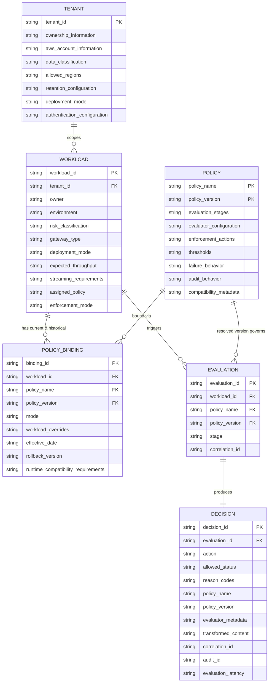

**AI Guardrails — Data Architecture**

**Authority level:** L3
**Status:** Draft
**Date:** 2026-07-24
**Derived from:** seed.md + AGREEMENTS.md

---

## Purpose and authority

This document defines the AI Guardrails **data architecture**: the six core domain entities, their attributes and relationships, the AWS storage services assigned to each, and the data-handling rules that govern what content the platform processes, persists, and transmits.

This is a **derived (L3)** artifact. It must not contradict [`AGREEMENTS.md`](../00-source-of-truth/AGREEMENTS.md) or [`CONSTRAINTS.md`](../00-source-of-truth/CONSTRAINTS.md) (both L1 — authoritative), and it must remain consistent with [`CHARTER.md`](../10-charter/CHARTER.md) and [`CAPABILITIES.md`](../20-product/CAPABILITIES.md) (L2). Where a conflict is found, the L1 documents win and this document must be corrected. This document specifically implements [`CONSTRAINTS.md`](../00-source-of-truth/CONSTRAINTS.md) **CON-007**, **CON-013**, and **CON-014**, as recorded in that register's [related documents](../00-source-of-truth/CONSTRAINTS.md#related-documents) section.

No metric, dollar figure, SLA, retention period, or performance number is asserted beyond what `seed.md` states. Where a figure would normally appear and is not present in the seed, this document says **TBD**.

---

## Table of contents

- [1. Domain entity model](#1-domain-entity-model)
  - [1.1 Entity summary](#11-entity-summary)
  - [1.2 Tenant](#12-tenant)
  - [1.3 Workload](#13-workload)
  - [1.4 Policy](#14-policy)
  - [1.5 Policy binding](#15-policy-binding)
  - [1.6 Evaluation](#16-evaluation)
  - [1.7 Decision](#17-decision)
  - [1.8 Relationships](#18-relationships)
  - [1.9 Entity-relationship diagram](#19-entity-relationship-diagram)
- [2. Storage architecture](#2-storage-architecture)
  - [2.1 Storage mapping by entity](#21-storage-mapping-by-entity)
  - [2.2 Policy storage: DynamoDB or versioned S3](#22-policy-storage-dynamodb-or-versioned-s3)
  - [2.3 Audit event pipeline: SQS buffering to S3 archive](#23-audit-event-pipeline-sqs-buffering-to-s3-archive)
  - [2.4 Storage in the Customer-Managed Runtime](#24-storage-in-the-customer-managed-runtime)
  - [2.5 Encryption and transport](#25-encryption-and-transport)
- [3. Data-handling policy](#3-data-handling-policy)
  - [3.1 Default behavior (hosted runtime)](#31-default-behavior-hosted-runtime)
  - [3.2 Content categories that may be evaluated](#32-content-categories-that-may-be-evaluated)
  - [3.3 MVP content-scope limitation](#33-mvp-content-scope-limitation)
  - [3.4 Customer-managed telemetry](#34-customer-managed-telemetry)
- [4. Audit metadata](#4-audit-metadata)
- [5. Open items and TBDs](#5-open-items-and-tbds)
- [6. Traceability](#6-traceability)
- [7. Related documents](#7-related-documents)

---

## 1. Domain entity model

The platform's domain model consists of exactly six core entities — **Tenant**, **Workload**, **Policy**, **Policy binding**, **Evaluation**, and **Decision** — as agreed in [`AGREEMENTS.md` AGR-017](../00-source-of-truth/AGREEMENTS.md#agr-017--core-domain-model) and defined in `seed.md` §9 ("Core domain model"). All data storage, APIs, and audit records must map directly onto these six concepts; new capabilities must extend this model rather than introduce parallel vocabulary.

### 1.1 Entity summary

| Entity | Represents | seed.md source |
|---|---|---|
| Tenant | An organization, business unit, or consuming team | §9 |
| Workload | An application, assistant, agent, gateway, or inference service using guardrails | §9 |
| Policy | The checks and actions applied to evaluated content, at a specific immutable version | §9 |
| Policy binding | The association between a workload and a policy version | §9 |
| Evaluation | A request to inspect content at a particular stage | §9 |
| Decision | The normalized result of an evaluation | §9 |

### 1.2 Tenant

Represents an organization, business unit, or consuming team.

| Attribute | Notes |
|---|---|
| Tenant identifier | Primary identifier; anchors per-tenant workload identity and tenant isolation (`CONSTRAINTS.md` CON-011) |
| Ownership information | Who owns/operates the tenant relationship |
| AWS account information | Which AWS account(s) the tenant's workloads run in |
| Data classification | Governs handling and retention expectations for the tenant's content |
| Allowed Regions | Constrains which AWS Regions may process the tenant's requests |
| Retention configuration | The tenant-specific retention setting referenced throughout §13 (see [3. Data-handling policy](#3-data-handling-policy)) |
| Deployment mode | Which of the three modes (Remote Evaluation, Guarded Gateway, Customer-Managed Runtime) the tenant operates under |
| Authentication configuration | How the tenant's workloads authenticate to the platform |

### 1.3 Workload

Represents an application, assistant, agent, gateway, or inference service using guardrails.

| Attribute | Notes |
|---|---|
| Workload identifier | Primary identifier |
| Tenant identifier | Foreign key to the owning Tenant |
| Owner | Accountable owner for the workload |
| Environment | e.g., non-production or production, consistent with the minimal MVP account model (`CONSTRAINTS.md` CON-002) |
| Risk classification | Informs which policies and enforcement postures apply |
| Gateway type | e.g., LiteLLM, generic SDK, Guarded Gateway |
| Deployment mode | May differ per workload even within one tenant |
| Expected throughput | Capacity-planning input |
| Streaming requirements | Whether the workload requires streaming evaluation (future scope; see `seed.md` §6.2) |
| Assigned policy | Denormalized pointer to the workload's currently effective policy — the operational read of the active [Policy binding](#15-policy-binding) |
| Enforcement mode | Denormalized pointer to the workload's currently effective mode (Disabled → Observe → Warn → Redact → Block, per [`AGREEMENTS.md` AGR-011](../00-source-of-truth/AGREEMENTS.md#agr-011--observe-before-enforce-progression)) |

### 1.4 Policy

Defines the checks and actions applied to evaluated content.

| Attribute | Notes |
|---|---|
| Policy name | Groups an ordered family of immutable versions |
| Policy version | Immutable; supports controlled promotion, rollback, and evaluation-result comparison (`seed.md` §15) |
| Evaluation stages | Which stages the policy applies to (`input`, `output`, and future stages — see [1.6 Evaluation](#16-evaluation)) |
| Evaluator configuration | Which evaluator adapters/engines are invoked and how |
| Enforcement actions | Which [Decision](#17-decision) actions the policy may produce |
| Thresholds | Detection thresholds per evaluator |
| Failure behavior | Mandatory per [`AGREEMENTS.md` AGR-012](../00-source-of-truth/AGREEMENTS.md#agr-012--failure-behavior-is-part-of-policy) — no undocumented fallback is permitted |
| Audit behavior | What the policy requires to be captured in the audit trail (see [4. Audit metadata](#4-audit-metadata)) |
| Compatibility metadata | Supports runtime compatibility checks across hosted and customer-managed deployments |

A Policy is not attributed to a single Tenant in the seed model: the product vision explicitly calls for defining a policy once and applying it to multiple workloads (`seed.md` §2), so Policy is scoped independently of Tenant and joined to workloads only through the Policy binding.

### 1.5 Policy binding

Associates a workload with a policy version.

| Attribute | Notes |
|---|---|
| Workload identifier | Foreign key to Workload |
| Policy name + Policy version | Foreign key to the specific immutable Policy version |
| Observe or enforce mode | The binding's current position on the Disabled → Observe → Warn → Redact → Block progression |
| Allowed workload-specific overrides | Bounded per [`AGREEMENTS.md` AGR-005](../00-source-of-truth/AGREEMENTS.md#agr-005--policy-portability) to avoid policy fragmentation (`seed.md` §20) |
| Effective date | When the binding becomes/became active |
| Rollback version | The version to revert to if the bound version must be rolled back |
| Runtime compatibility requirements | Whether the runtime executing the workload's evaluations supports the bound policy version |

A workload may accumulate multiple Policy binding records over time (current and historical), which is what makes "immediate rollback" and "evaluation-result comparison between versions" (`seed.md` §15) possible; the Workload's `Assigned policy` / `Enforcement mode` attributes are the operational read of whichever binding is currently effective.

### 1.6 Evaluation

Represents a request to inspect content at a particular stage.

Supported initial stages: `input`, `output`. Future stages: `retrieval`, `tool_call`, `tool_result`, `memory_write`, `final_response` (`seed.md` §9).

> **Note on completeness:** unlike the other five entities, `seed.md` §9 does not give Evaluation an explicit attribute bullet list — only its purpose and its stage enumeration. The minimal identifying attributes below (evaluation identifier, workload reference, resolved policy-version reference, correlation identifier) are inferred from the relationships the seed describes elsewhere — the Decision's `Correlation identifier` attribute, and the audit metadata list in `seed.md` §15 — rather than asserted as a literal seed enumeration. No additional fields, formats, or cardinalities beyond what those two sources support are introduced here.

| Attribute (inferred, see note above) | Notes |
|---|---|
| Evaluation identifier | Needed to relate one Evaluation to exactly one Decision |
| Workload identifier | The workload on whose behalf the evaluation runs |
| Policy name + Policy version (resolved) | The specific policy version in effect for the workload at evaluation time |
| Stage | `input` or `output` (MVP); see [3.3 MVP content-scope limitation](#33-mvp-content-scope-limitation) |
| Correlation identifier | Propagated end-to-end per `seed.md` §12 (LiteLLM connector responsibility: "Propagating correlation identifiers") |

### 1.7 Decision

Represents the normalized result of an evaluation.

Initial actions: `allow`, `block`, `redact`, `log_only`. Future actions: `rewrite`, `discard`, `abstain`, `require_approval` (`seed.md` §9).

| Attribute | Notes |
|---|---|
| Action | One of the initial (or future) actions above |
| Allowed status | Whether the evaluated content is allowed to proceed |
| Reason codes | Normalized codes explaining the decision, independent of the underlying evaluator/vendor |
| Policy name and version | Restated on the Decision itself so the record is self-describing without a live binding lookup |
| Evaluator metadata | Which evaluator engines/adapters produced the result |
| Transformed content | Present only where a transformation (e.g., redaction) was applied |
| Correlation identifier | Ties the decision back to the originating request |
| Audit identifier | Ties the decision to its durable audit record (see [4. Audit metadata](#4-audit-metadata)) |
| Evaluation latency | Per-decision latency measurement, feeding the P50/P95/P99 metrics in `seed.md` §15 |

### 1.8 Relationships

* A **Tenant** owns many **Workloads** (`Workload.Tenant identifier`).
* A **Workload** has one currently effective **Policy binding**, plus zero or more historical bindings retained for rollback and version comparison.
* A **Policy** version may be bound, via **Policy binding**, to many **Workloads** — this many-to-many reuse (one policy, many workloads) is the core product hypothesis under validation in the Phase 1–2 validation demonstration (`seed.md` §16; [`../60-delivery/VALIDATION-PLAN.md`](../60-delivery/VALIDATION-PLAN.md)).
* A **Workload** triggers many **Evaluations**; each **Evaluation** runs under exactly one resolved **Policy** version (the one currently bound to that workload).
* Each **Evaluation** produces exactly one **Decision** — the decision is defined in the seed as "the normalized result of an evaluation," a one-to-one relationship.

### 1.9 Entity-relationship diagram



---

## 2. Storage architecture

`seed.md` §11 ("AWS implementation direction") lists the suggested initial AWS service per capability. This section maps those service choices onto the domain entities in [Section 1](#1-domain-entity-model).

### 2.1 Storage mapping by entity

| Domain entity / data concern | Initial AWS service (seed.md §11) | Notes |
|---|---|---|
| Tenant registry | DynamoDB | Grouped with the workload registry as control-plane registry data |
| Workload registry | DynamoDB | `seed.md` §11: "Workload registry — DynamoDB" |
| Policy | DynamoDB or versioned S3 | `seed.md` §11: "Policy storage — DynamoDB or versioned S3"; see [2.2](#22-policy-storage-dynamodb-or-versioned-s3) |
| Policy binding | DynamoDB | Requires low-latency point lookups on the evaluation path to resolve a workload's currently effective policy |
| Evaluation (in-flight) | Not persisted independently | Transient, request-scoped state inside the Evaluation runtime (ECS Fargate or EKS per `seed.md` §11); it is not a durable store — its durable trace is the Decision plus its audit record |
| Decision metadata (audit) | Amazon SQS (buffer) → Amazon S3 (archive) | `seed.md` §11: "Audit event buffering — Amazon SQS"; "Audit archive — Amazon S3"; see [2.3](#23-audit-event-pipeline-sqs-buffering-to-s3-archive) |

Compute, networking, and cross-cutting services referenced by `seed.md` §11 (Evaluation runtime, API layer, Bedrock Guardrails, runtime credentials, Secrets Manager, CloudWatch, ECR) are architectural concerns outside the scope of a data-architecture document and are addressed in [`COMPONENT-ARCHITECTURE.md`](COMPONENT-ARCHITECTURE.md) and [`DEPLOYMENT-ARCHITECTURE.md`](DEPLOYMENT-ARCHITECTURE.md).

### 2.2 Policy storage: DynamoDB or versioned S3

`seed.md` §11 lists policy storage as "DynamoDB or versioned S3" without selecting between them; this document does not resolve that choice beyond restating the seed's constraint on the outcome, consistent with the "write TBD rather than invent" rule for absent figures. Whichever store is selected must satisfy the immutable-version and rollout requirements in `seed.md` §15:

* Immutable versions — a stored policy version must never be mutated in place.
* Observe mode and controlled promotion — the store must support a policy version existing before it is promoted to any workload.
* Workload-scoped rollout — the store must allow different workloads to be bound to different versions simultaneously (supported structurally by the separate Policy binding entity, regardless of which store holds Policy itself).
* Immediate rollback — a prior version must remain retrievable and immediately bindable.
* Compatibility validation — the store (or a layer above it) must expose compatibility metadata per version.

The choice between DynamoDB (single low-latency store, natural fit for point lookups by policy name/version) and versioned S3 (natural fit for immutable, content-addressed version objects with native versioning) is an implementation decision left open by the seed; either can satisfy the requirements above.

### 2.3 Audit event pipeline: SQS buffering to S3 archive

```text
Decision engine (Guardrails Runtime)
        │
        │  emits one audit event per Evaluation + Decision pair
        ▼
Amazon SQS  ── audit event buffer ──┐
        │                            │  absorbs downstream archive
        │                            │  latency; durable, decouples
        │                            │  evaluation path from archival
        ▼                            │
Audit archive writer  ◄──────────────┘
        │
        ▼
Amazon S3  ── audit archive ──  (seed.md §11)
        │
        ▼
KMS-encrypted at rest; tenant-scoped retention lifecycle applied
(see 3.1 Default behavior and CONSTRAINTS.md CON-009, CON-014)
```

Buffering audit events through SQS before they land in the S3 archive keeps the synchronous evaluation path (which is on the consuming application's request path, per `seed.md` §20 "Latency" risk) decoupled from archive-write latency and transient archive-side unavailability. Audit-delivery failure is itself a documented failure mode under [`AGREEMENTS.md` AGR-012](../00-source-of-truth/AGREEMENTS.md#agr-012--failure-behavior-is-part-of-policy) ("Audit delivery fails" is one of the failure conditions a workload's policy must define behavior for), and audit delivery success rate is a named reliability metric (`seed.md` §19).

### 2.4 Storage in the Customer-Managed Runtime

In Mode C (Customer-Managed Runtime), storage responsibility splits between the customer's AWS account and the hosted control plane, per `seed.md` §3 (Mode C) and §11:

| Data | Location | Owner |
|---|---|---|
| Policy cache | Customer AWS account, inside the customer-hosted Guardrails Runtime | Consuming team (runtime infrastructure) |
| Local audit integration / local audit storage | Customer AWS account | Consuming team (`seed.md` §3, Mode C: "The consuming team owns... Local audit storage") |
| Policy source of truth (DynamoDB / versioned S3) | Hosted control plane | AI Guardrails provider; synchronized to the local cache asynchronously |
| Telemetry reaching the hosted control plane | Customer-selectable — health status, product version, policy version, aggregated evaluation counts, reason-code totals, latency metrics, sanitized decision metadata, or none at all | Consuming team selects; provider receives only what is selected |

The customer-managed runtime must execute policies from its local cache without requiring a synchronous connection to the hosted control plane ([`AGREEMENTS.md` AGR-015](../00-source-of-truth/AGREEMENTS.md#agr-015--customer-managed-runtime-executes-without-a-synchronous-control-plane-connection)); policy synchronization is asynchronous and must not sit on the evaluation path. Raw content must never leave the customer-managed runtime unless explicitly configured (`CONSTRAINTS.md` CON-013).

### 2.5 Encryption and transport

All storage described in this section is subject to the transport and cryptographic constraints in [`CONSTRAINTS.md`](../00-source-of-truth/CONSTRAINTS.md):

* **CON-008** — TLS for all runtime communication, including writes to DynamoDB, S3, and SQS.
* **CON-009** — KMS-backed encryption in transit and at rest, applying to policy storage, the workload/tenant registry, the audit buffer and archive, and any local policy cache in a customer-managed runtime.

Detailed key-management and IAM boundary design is out of scope for this document; see [`SECURITY-ARCHITECTURE.md`](SECURITY-ARCHITECTURE.md).

---

## 3. Data-handling policy

### 3.1 Default behavior (hosted runtime)

Per `seed.md` §13 ("Data handling requirements — Default behavior"), the hosted runtime (Remote Evaluation and Guarded Gateway modes) must:

1. **Process content only for evaluation.** Prompt and response content is read in order to run evaluators and produce a Decision; it is not used for any other purpose by default.
2. **Avoid persisting raw prompts and responses by default.** No raw-content retention occurs unless a tenant explicitly configures it (`CONSTRAINTS.md` CON-014).
3. **Persist decision metadata.** The Decision entity (see [1.7](#17-decision)) and its associated audit record (see [4. Audit metadata](#4-audit-metadata)) are persisted regardless of whether raw content is retained.
4. **Hash user and conversation identifiers where possible.** Identifiers that would otherwise directly identify an end user or conversation are hashed before being carried into audit or telemetry records.
5. **Remove secrets from telemetry.** Any secret material incidentally present in evaluated content must not appear in telemetry pipelines.
6. **Encrypt data in transit and at rest.** See [2.5 Encryption and transport](#25-encryption-and-transport).
7. **Support tenant-specific retention configuration.** Retention behavior is configured per Tenant (`Tenant.Retention configuration`, see [1.2](#12-tenant)), not fixed platform-wide.
8. **Clearly document which content is transmitted.** Per [`AGREEMENTS.md` AGR-008](../00-source-of-truth/AGREEMENTS.md#agr-008--explicit-content-exposure-model-ownership-vs-exposure-are-separate-concerns), every deployment must state where prompts/responses are processed, whether retrieved documents or tool arguments are transmitted, whether content is persisted, which telemetry leaves the runtime, and which AWS accounts/Regions process the request — as a dedicated statement, independent of who operates the component.

Any retention of raw content requires explicit, tenant-level configuration — never a platform default (`AGREEMENTS.md` AGR-014). Data-architecture and security reviews must verify no incidental raw-content persistence occurs in logs, caches, or telemetry pipelines.

Remote Evaluation (Mode A) must never be described as private-data or data-local: prompts, responses, and any additional evaluated content are transmitted to the hosted Evaluation API regardless of who operates the gateway in front of it (`AGREEMENTS.md` AGR-009).

### 3.2 Content categories that may be evaluated

`seed.md` §13 lists the content categories that may be evaluated, depending on workload configuration:

| Content category | Description |
|---|---|
| User prompts | End-user input submitted to the model |
| System prompts | Instructions supplied to the model by the application |
| Conversation history | Prior turns in a multi-turn conversation |
| Retrieved documents | Content retrieved by a RAG or similar retrieval step |
| Model responses | Output produced by the model |
| Tool arguments | Arguments passed to a tool or function call |
| Tool responses | Results returned by a tool or function call |
| Structured-output payloads | Structured (e.g., JSON) output produced by the model |

### 3.3 MVP content-scope limitation

The MVP initially limits support to **user/model input and model output** — that is, user prompts as `input`-stage content and model responses as `output`-stage content (`seed.md` §13). This directly matches the two initial [Evaluation](#16-evaluation) stages (`input`, `output`) defined in `seed.md` §9. System prompts, conversation history, retrieved documents, tool arguments, tool responses, and structured-output payloads remain content categories the architecture must **permit**, but none are evaluated in the MVP; several correspond to future evaluation stages (`retrieval`, `tool_call`, `tool_result`) explicitly deferred to Phase 5 (`seed.md` §18, "Advanced agent protection") and future scope (`seed.md` §6.2).

### 3.4 Customer-managed telemetry

For Customer-Managed Runtime deployments specifically, `seed.md` §13 ("Customer-managed telemetry") requires that the customer be able to choose what the hosted control plane receives, from a defined set down to nothing:

| Telemetry category | Notes |
|---|---|
| Health status | |
| Product version | |
| Policy version | |
| Aggregated evaluation counts | |
| Reason-code totals | |
| Latency metrics | |
| Sanitized decision metadata | |
| No telemetry | A fully supported configuration, not a degraded one (`AGREEMENTS.md` AGR-016) |

Raw content must never leave a customer-managed runtime unless explicitly configured (`seed.md` §13; `CONSTRAINTS.md` CON-013). Any telemetry payload design must be reviewed to confirm it cannot carry raw prompt or response content by construction (`AGREEMENTS.md` AGR-016).

---

## 4. Audit metadata

Per `seed.md` §15 ("Operational requirements — Auditing"), audit metadata must include the following fields for every evaluation:

| Field | Description |
|---|---|
| Tenant | The owning tenant, per [1.2 Tenant](#12-tenant) |
| Workload | The workload that triggered the evaluation, per [1.3 Workload](#13-workload) |
| Policy version | The specific immutable policy version applied, per [1.4 Policy](#14-policy) |
| Evaluation stage | `input`, `output`, or a future stage, per [1.6 Evaluation](#16-evaluation) |
| Decision | The normalized decision produced, per [1.7 Decision](#17-decision) |
| Reason codes | Normalized codes explaining the decision |
| Evaluator versions | Versions of the evaluator engines/adapters invoked |
| Timestamp | When the evaluation occurred |
| Correlation identifier | Ties the audit record back to the originating request across connector, runtime, and any downstream system |
| Whether raw content was retained | Records whether raw prompt/response content was persisted for this evaluation — defaults to "no" per [3.1](#31-default-behavior-hosted-runtime) |

These fields are the durable record written through the [audit event pipeline](#23-audit-event-pipeline-sqs-buffering-to-s3-archive) and are what security and compliance teams rely on as decision evidence and policy-version traceability (`seed.md` §7, "Security and compliance teams").

---

## 5. Open items and TBDs

Per source-of-truth policy, the following figures are not present in `seed.md` and are recorded here as **TBD** rather than invented:

| Item | Status | Related constraint |
|---|---|---|
| Specific retention period(s) per tenant | TBD — tenant-specific retention is required, but no default duration is specified in the seed | `Tenant.Retention configuration` ([1.2](#12-tenant)) |
| Specific hashing algorithm for user/conversation identifiers | TBD — "hash where possible" is required; the algorithm is not specified | [3.1](#31-default-behavior-hosted-runtime), item 4 |
| Specific input-size limits per evaluation stage | TBD — see `CONSTRAINTS.md` CON-015 | CON-015 |
| Specific timeout values per stage/detector | TBD — see `CONSTRAINTS.md` CON-016 | CON-016 |
| Choice between DynamoDB and versioned S3 for Policy storage | TBD — seed.md §11 lists both as acceptable without selecting one | [2.2](#22-policy-storage-dynamodb-or-versioned-s3) |

---

## 6. Traceability

| This document's content | seed.md source | AGREEMENTS.md / CONSTRAINTS.md |
|---|---|---|
| Domain entities and attributes | §9 | AGR-017 |
| Storage choices | §11 | — |
| Data-handling default behavior | §13 | AGR-014, CON-014 |
| Content-exposure documentation requirement | §5.4 | AGR-008, CON-007 |
| Remote Evaluation is not data-local | §3 (Mode A) | AGR-009 |
| Customer-managed telemetry and raw-content boundary | §13 | AGR-016, CON-013 |
| Customer-managed runtime independence from control plane | §3 (Mode C) | AGR-015 |
| Audit metadata fields | §15 | — |
| Content categories and phased scope limitation | §13 | — (scope per [`../10-charter/SCOPE.md`](../10-charter/SCOPE.md)) |

---

## 7. Related documents

- [`AGREEMENTS.md`](../00-source-of-truth/AGREEMENTS.md) — authoritative agreement register, in particular AGR-008, AGR-009, AGR-014, AGR-015, AGR-016, AGR-017.
- [`CONSTRAINTS.md`](../00-source-of-truth/CONSTRAINTS.md) — authoritative constraint register, in particular CON-007, CON-009, CON-013, CON-014.
- [`CHARTER.md`](../10-charter/CHARTER.md) — product charter narrative.
- [`CAPABILITIES.md`](../20-product/CAPABILITIES.md) — capability catalog referencing this same domain model.
- `SECURITY-ARCHITECTURE.md` — IAM, KMS key management, and transport security detail (implements CON-008 through CON-012).
- `DEPLOYMENT-ARCHITECTURE.md` — account model and per-mode deployment topology (implements CON-001, CON-002, CON-005).
- `INTEGRATION-ARCHITECTURE.md` — connector and evaluation-contract detail (implements CON-003, CON-004, CON-006).
- `COMPONENT-ARCHITECTURE.md` — runtime component decomposition (Evaluation API, policy resolver, decision engine, evaluator adapters, audit producer).
