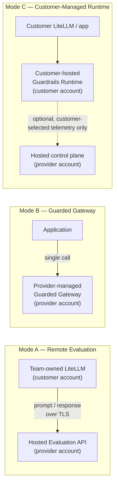
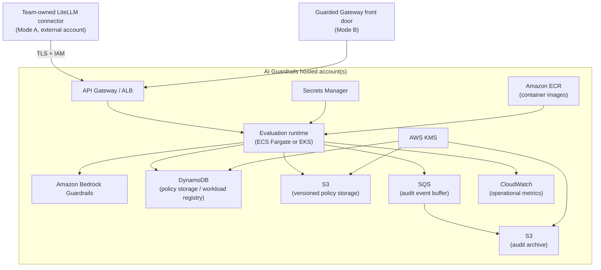
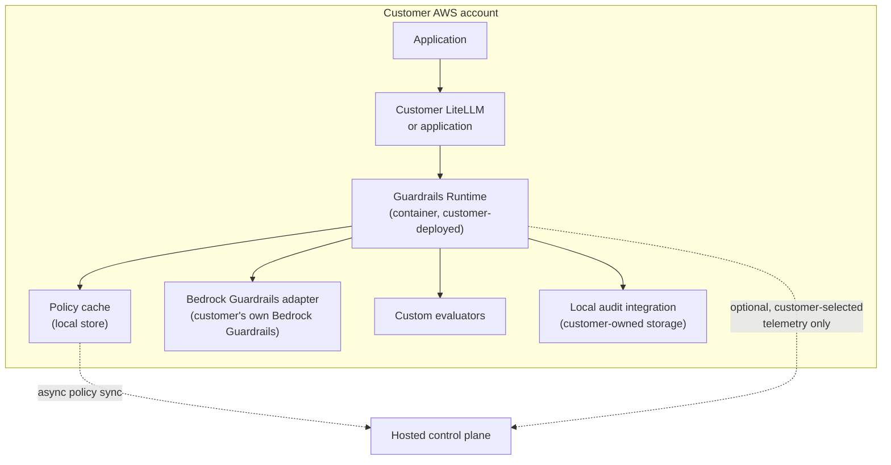
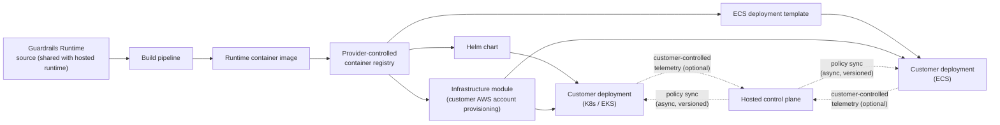

**AI Guardrails — Deployment Architecture**

**Authority level:** L3
**Status:** Draft
**Date:** 2026-07-24
**Derived from:** seed.md + AGREEMENTS.md

---

## Purpose and authority

This document defines the deployment topologies for the AI Guardrails platform: the three supported deployment modes, the AWS implementation direction behind them, the MVP account model, and the Phase 4 customer-managed packaging plan.

This is an **L3 (derived)** document. It must not contradict [`AGREEMENTS.md`](../00-source-of-truth/AGREEMENTS.md) or [`CONSTRAINTS.md`](../00-source-of-truth/CONSTRAINTS.md) (both L1 — authoritative). Where this document references a specific agreement or constraint, the ID is given (`AGR-NNN`, `CON-NNN`) so the two can be cross-checked. Where seed.md does not supply a concrete figure (throughput numbers, SLA targets, cost figures), this document says **TBD** or describes the requirement qualitatively rather than inventing one.

Related documents:

- [`00-source-of-truth/AGREEMENTS.md`](../00-source-of-truth/AGREEMENTS.md) — authoritative agreements, especially AGR-002 (three modes), AGR-009 (Mode A is not data-local), AGR-013 (AWS, minimal account model), AGR-015 (customer-managed runtime without synchronous control-plane dependency), AGR-016 (customer-controlled telemetry), AGR-022 (five-phase delivery).
- [`00-source-of-truth/CONSTRAINTS.md`](../00-source-of-truth/CONSTRAINTS.md) — CON-001/CON-002 (cloud and account model), CON-005 (one contract), CON-007 (content-exposure documentation), CON-013/CON-014 (content handling), CON-008/CON-009/CON-010/CON-011 (transport, encryption, identity).
- [`10-charter/PRINCIPLES.md`](../10-charter/PRINCIPLES.md) — the product principles this architecture implements (policy portability, one contract, policies vs. connectors, explicit content exposure, observe-before-enforce, failure behavior as policy).
- [`10-charter/SCOPE.md`](../10-charter/SCOPE.md) — MVP and future-scope boundaries referenced throughout.
- [`20-product/PRODUCT-ROADMAP.md`](../20-product/PRODUCT-ROADMAP.md) — the five delivery phases this document's Phase 4 section elaborates.
- [`50-architecture/SYSTEM-CONTEXT.md`](SYSTEM-CONTEXT.md), [`50-architecture/COMPONENT-ARCHITECTURE.md`](COMPONENT-ARCHITECTURE.md), [`50-architecture/INTEGRATION-ARCHITECTURE.md`](INTEGRATION-ARCHITECTURE.md), [`50-architecture/DATA-ARCHITECTURE.md`](DATA-ARCHITECTURE.md), [`50-architecture/SECURITY-ARCHITECTURE.md`](SECURITY-ARCHITECTURE.md), [`50-architecture/OPERABILITY.md`](OPERABILITY.md), [`50-architecture/ARCHITECTURE-REPORT.md`](ARCHITECTURE-REPORT.md) — sibling architecture documents that consume the topologies defined here.

---

## 1. Cross-cutting principles that constrain every topology

Before describing individual topologies, the following must hold **regardless of which mode a workload uses**. Each mode section below shows how the principle is realized in that specific topology, not a mode-specific exception to it.

| Principle | Requirement | Source |
|---|---|---|
| One logical evaluation contract | Policy definitions, request/decision structures, reason codes, enforcement actions, and audit metadata must be identical in shape across all three modes. Only the deployment location changes. | AGR-006, CON-005 |
| Policies are separate from connectors | A connector (LiteLLM pre/post-call hook, generic SDK, Guarded Gateway integration) invokes a policy; it must never encode policy logic itself, in any mode. | AGR-007, CON-006 |
| Explicit content-exposure model | Every topology diagram below is paired with a content-exposure statement answering: where prompts/responses are processed, whether retrieved documents or tool arguments are transmitted, whether content is persisted, what telemetry leaves the runtime, and which AWS accounts/Regions are involved. | AGR-008, CON-007 |
| Ownership and exposure are independent axes | "Who operates this component" and "where does my data go" are answered separately for every mode. A mode that reduces operational ownership (Mode B) does not necessarily reduce data exposure, and a mode that increases operational ownership (Mode C) is the only one that keeps raw content local by default. | AGR-008, AGR-009 |
| Observe-before-enforce | Every mode must support the same Disabled → Observe → Warn → Redact → Block progression at the workload/policy-binding level, independent of topology. | AGR-011 |
| Failure behavior is explicit | Every mode must define what happens on Evaluation API timeout, detector unavailability, unresolved policy, control-plane unavailability, and audit-delivery failure. Mode C additionally must define behavior when the **local policy cache** is stale (see §4.4). | AGR-012, AGR-015 |

---

## 2. Mode A — Remote Evaluation

> **Framing (mandatory, AGR-009):** Mode A must be described only as *"bring your own gateway while consuming a hosted guardrail runtime."* It must **never** be described as a private-data or data-local deployment model.

### 2.1 Topology

```text
Application
    │
    ▼
Team-owned LiteLLM
    │
    ├── Input evaluation ─────► Hosted Guardrails Runtime
    │
    ├── Model invocation
    │
    └── Output evaluation ────► Hosted Guardrails Runtime
```

The consuming team's LiteLLM (or equivalent gateway) lives entirely inside the **team's own environment**. It calls out to the **hosted** AI Guardrails Evaluation API before and after each model invocation. The model invocation itself never touches AI Guardrails infrastructure — only the input and output evaluation calls do.

### 2.2 Ownership split

| Consuming team owns | AI Guardrails provider owns |
|---|---|
| LiteLLM availability | Evaluation API availability |
| Model-provider credentials | Guardrail policy execution |
| Model routing | Detection engines |
| Retry and fallback behavior | Policy versions |
| Gateway upgrades | Decision normalization |
| Inference capacity | Guardrail audit metadata |
| Model-provider costs | Runtime scaling |

### 2.3 Content-exposure statement

| Question | Answer |
|---|---|
| Where are prompts processed? | In the team's own LiteLLM, then transmitted to the hosted Evaluation API for input evaluation. |
| Where are responses processed? | In the team's own LiteLLM (post-inference), then transmitted to the hosted Evaluation API for output evaluation. |
| Is retrieved content transmitted? | Only if the workload is configured to submit it for evaluation; the MVP limits evaluated content to model input/output (seed.md §13). |
| Are tool arguments transmitted? | Not in the MVP; tool-call evaluation is future scope (seed.md §6.2). |
| Is content persisted? | Not by default. The hosted runtime persists decision metadata, not raw prompts/responses, unless the tenant explicitly configures retention (CON-014). |
| What telemetry leaves the runtime? | Decision metadata, evaluation latency, and audit records flow to the hosted control plane and audit pipeline as part of normal operation — this is not optional telemetry, it is how the hosted service functions. |
| Which AWS accounts/Regions are involved? | The team's own account/Region for LiteLLM; the AI Guardrails hosted account/Region for the Evaluation API and audit pipeline. |

**Bottom line:** Mode A reduces the consuming team's *operational* burden for evaluation (they do not run detectors), but it does **not** reduce data exposure — prompts, responses, and any additional evaluated content reach the hosted Evaluation API on every call. Teams with data-residency or "content must never leave our account" requirements must use [Mode C](#4-mode-c--customer-managed-runtime), not Mode A.

---

## 3. Mode B — Guarded Gateway

### 3.1 Topology

```text
Application
    │
    ▼
Provider-managed Guarded Gateway
    │
    ├── Input guardrails
    ├── Model routing
    ├── Model invocation
    ├── Output guardrails
    └── Audit and usage reporting
```

Here the AI Guardrails provider operates **both** the LLM gateway and the guardrail runtime as a single managed service. The application calls one provider-operated endpoint; guardrails, routing, invocation, and audit all happen inside the provider's boundary.

### 3.2 Ownership split

| AI Guardrails provider owns | Consuming team owns |
|---|---|
| Gateway availability | Application behavior |
| Provider credentials or delegated AWS access | Workload-specific configuration |
| Model routing | Policy selection where permitted |
| Model-provider integrations | End-user authorization |
| Inference retries and fallbacks | Business-level approval flows |
| Guardrail execution | |
| Rate limits and usage quotas | |
| Audit and operational telemetry | |

### 3.3 Content-exposure statement

| Question | Answer |
|---|---|
| Where are prompts/responses processed? | Entirely within the provider-managed Guarded Gateway — guardrails, routing, and model invocation all occur inside the provider's boundary. |
| Is content persisted? | Governed by the same no-raw-retention-by-default policy as the hosted runtime (CON-014); decision metadata is retained, raw content is not, absent explicit tenant configuration. |
| What telemetry leaves the runtime? | None — there is no separate "runtime" to leave from; the gateway *is* the provider's environment. Usage and audit reporting are delivered back to the tenant as a service output. |
| Which AWS accounts/Regions are involved? | Entirely the provider's hosted account/Region(s); the consuming team supplies no infrastructure. |

**Bottom line:** Mode B provides the strongest centralized control and the lowest integration burden, but it also creates the **largest operational, security, and compliance scope for the provider** — the provider participates in the complete inference path, including holding or brokering model-provider credentials. It is intended for teams that do not operate LiteLLM, want a managed OpenAI-compatible endpoint, and accept that the provider sits inside the full request path.

---

## 4. Mode C — Customer-Managed Runtime

### 4.1 Topology

```text
Customer AWS account

Application
    │
    ▼
Customer LiteLLM or application
    │
    ├── Customer-hosted Guardrails Runtime
    │       ├── Policy cache
    │       ├── Bedrock Guardrails adapter
    │       ├── Custom evaluators
    │       └── Local audit integration
    │
    └── Model provider
```

The entire guardrail runtime — policy cache, evaluator adapters, and local audit integration — is deployed **inside the customer's own AWS account**. The runtime evaluates content locally; only optional, customer-selected telemetry (never raw content by default) crosses back to the hosted control plane.

### 4.2 Runtime component responsibilities

| Component | Responsibility |
|---|---|
| Policy cache | Holds the most recently synchronized, immutable policy version(s) locally so evaluation can proceed without a synchronous call to the hosted control plane (AGR-015). Populated by asynchronous policy synchronization (§6.5). |
| Bedrock Guardrails adapter | Normalizes calls to Amazon Bedrock Guardrails — running in the customer's own account — into the platform's vendor-independent decision structure (AGR-004, CON-004). |
| Custom evaluators | Deterministic rules and any customer-specific evaluator plugins (future scope, seed.md §6.2) that run entirely inside the customer's account. |
| Local audit integration | Writes audit records (tenant, workload, policy version, stage, decision, reason codes, evaluator versions, timestamp, correlation ID, whether raw content was retained) to storage the customer controls. |

### 4.3 Ownership split

| Consuming team owns | AI Guardrails provider owns |
|---|---|
| Runtime infrastructure | Runtime software |
| Runtime availability | Policy schemas |
| Networking | Supported deployment artifacts |
| Model credentials | Policy compatibility |
| Gateway configuration | Product updates |
| Local audit storage | Documentation |
| Runtime upgrades (unless managed support is purchased) | Optional hosted policy management |
| | Optional support and upgrade services |

### 4.4 No synchronous control-plane dependency (AGR-015)

The customer-managed runtime **must** be capable of executing policies without a synchronous connection to the hosted control plane. This is realized through:

1. **Local policy cache** — the runtime evaluates against the last successfully synchronized, immutable policy version held in the local cache.
2. **Asynchronous policy synchronization** — new or updated policy versions are pulled (or pushed) into the cache out of band; synchronization failures never block an in-flight evaluation.
3. **Explicit degraded-mode behavior** — per AGR-012/CON-016, the workload's failure-behavior configuration must state what happens when the cache is stale beyond a defined tolerance (e.g., continue on last-known-good policy and log, or apply a documented fallback action). There is no undocumented default.

### 4.5 Content-exposure statement

| Question | Answer |
|---|---|
| Where are prompts/responses processed? | Entirely inside the customer's own AWS account, by the customer-hosted Guardrails Runtime. |
| Is retrieved content / are tool arguments transmitted? | Only within the customer's own account, if the workload is configured to evaluate them; nothing is transmitted outside the account for this purpose. |
| Is content persisted? | Local audit storage is entirely customer-controlled; retention configuration is the customer's decision, not a platform default. |
| What telemetry leaves the runtime? | Only what the customer explicitly configures — anywhere from full operational telemetry (health, product version, policy version, aggregated evaluation counts, reason-code totals, latency metrics, sanitized decision metadata) down to **no telemetry at all** (AGR-016, CON-013). Raw content must never leave the customer-managed runtime unless explicitly configured. |
| Which AWS accounts/Regions are involved? | Entirely the customer's own AWS account and chosen Region(s); the hosted control plane is contacted only for asynchronous policy sync and any telemetry the customer has opted into. |

**Bottom line:** Mode C is the only mode where raw prompt/response content stays inside the customer's environment by default. It is intended for regulated workloads, data-residency requirements, high-volume workloads, air-gapped environments, teams that prohibit prompt/response content from leaving their account, and customers requiring independent operational ownership.

---

## 5. Cross-mode comparison



| Dimension | Mode A — Remote Evaluation | Mode B — Guarded Gateway | Mode C — Customer-Managed Runtime |
|---|---|---|---|
| Who runs the gateway | Consuming team | AI Guardrails provider | Consuming team |
| Who runs the guardrail runtime | AI Guardrails provider (hosted) | AI Guardrails provider (hosted) | Consuming team (in their own AWS account) |
| Raw content leaves the customer environment? | **Yes** — always, on every evaluated call | **Yes** — the gateway itself is the provider's environment | **No**, by default; only if explicitly configured |
| Data-local / private-data model? | **No** (AGR-009 — must never be described this way) | No — provider is in the full inference path | Yes, by default |
| Synchronous control-plane dependency per evaluation | Yes — the Evaluation API call is synchronous and hosted | Yes — inherent to the managed gateway | No — evaluates against local policy cache (AGR-015) |
| Model-provider credential ownership | Consuming team | Provider (or delegated AWS access) | Consuming team |
| Best suited for | Teams that already operate a gateway and want to offload guardrail operations | Teams without a gateway who want a fully managed, OpenAI-compatible endpoint | Regulated, data-residency-sensitive, high-volume, or air-gapped workloads |
| Provider security/compliance scope | Evaluation API only | Largest — full inference path | Smallest — control plane + distributed software only |

---

## 6. Enforcement posture is orthogonal to deployment mode

The three deployment modes describe **where** the runtime lives. Separately, seed.md §8 defines three **trust/enforcement postures** describing how hard it is to bypass the guardrail connector. Both dimensions must be tracked independently per workload (AGR-018) — a workload's deployment mode does not by itself determine its enforcement posture.

| Posture | Description | Topology | Appropriate when |
|---|---|---|---|
| Cooperative integration | Consuming team installs and maintains the connector voluntarily. | `Application → Team LiteLLM with connector → Model` | Teams are trusted; guardrails are an engineering standard; bypass prevention is not a formal requirement; goal is adoption and evaluation. |
| Platform-managed enforcement | The platform team manages the LiteLLM configuration or gateway deployment. | `Application → Platform-managed gateway → Guardrails → Model` | Platform owns gateway infrastructure; application teams should not change mandatory guardrail settings; centralized provider credentials are acceptable. |
| Network- and IAM-enforced gateway | All supported model traffic must pass through a controlled gateway; applications have no direct provider credentials or Bedrock permissions. | `Application → (no direct model path) → Enforced gateway → Guardrails → Model` | Bypass prevention is required; teams are semi-trusted; compliance evidence is required; direct provider access must be prohibited. |

A **cooperative connector must never be represented as a hard security boundary** (AGR-018, CON-012) — the connector can be disabled, removed, or misconfigured. This is true regardless of whether the workload runs in Mode A, B, or C. Network/IAM-enforced posture is the strongest control but is **not required** for the first cooperative MVP.

---

## 7. AWS implementation direction

### 7.1 Service mapping

The MVP uses the minimum AWS architecture required to validate the product (seed.md §11):

| Capability | Initial AWS service |
|---|---|
| Evaluation runtime | ECS Fargate or EKS |
| Public or internal API | API Gateway or Application Load Balancer |
| Policy storage | DynamoDB or versioned S3 |
| Workload registry | DynamoDB |
| Guardrail evaluation | Amazon Bedrock Guardrails |
| Runtime credentials | IAM roles |
| Secrets | AWS Secrets Manager |
| Encryption | AWS KMS |
| Operational metrics | CloudWatch |
| Audit event buffering | Amazon SQS |
| Audit archive | Amazon S3 |
| Container registry | Amazon ECR |

This mapping applies to the **hosted side** (Modes A and B, and the Guardrails Control Plane that supports Mode C). It is the reference for `50-architecture/COMPONENT-ARCHITECTURE.md` and `50-architecture/SECURITY-ARCHITECTURE.md`, which describe the runtime's internal design and IAM/KMS posture in depth.

### 7.2 Logical hosted-side AWS layout



This diagram represents the hosted control plane and hosted runtime that Modes A and B call into, and that Mode C's policy synchronization talks to asynchronously. It is illustrative of the target logical layout, not a final infrastructure-as-code layout — actual resource boundaries are defined in `50-architecture/COMPONENT-ARCHITECTURE.md` and the Phase 4/Phase 2 delivery artifacts.

### 7.3 Logical customer-managed-side AWS layout (Mode C)



---

## 8. MVP account model

### 8.1 Two-account model

Per AGR-013 / CON-002, the MVP does **not** require separate management, production, and audit AWS accounts. A minimal two-account model is sufficient, provided IAM, storage, and environment boundaries remain explicit within it:

```text
┌─────────────────────────────┐        ┌─────────────────────────────┐
│  Non-production account     │        │  Production account         │
│                              │        │                              │
│  - Development/staging      │        │  - Production hosted runtime │
│    Guardrails Runtime        │        │  - Production control plane  │
│  - Test tenants/workloads    │        │  - Production audit pipeline │
│  - Non-production policy     │        │  - Production policy         │
│    storage                   │        │    storage                   │
│                              │        │                              │
│  Explicit IAM / storage /    │        │  Explicit IAM / storage /    │
│  environment boundaries      │        │  environment boundaries      │
└─────────────────────────────┘        └─────────────────────────────┘
```

This two-account model applies to the **hosted side of the platform** (i.e., the AI Guardrails provider's own infrastructure supporting Modes A and B, and the control plane behind Mode C). It is independent of however many AWS accounts a given Mode C customer chooses to deploy the customer-managed runtime into — that is the customer's own account topology decision.

### 8.2 When to add account separation

Additional account separation should be introduced **only when justified** by one or more of the following triggers (seed.md §11, CON-002):

| Trigger | Why it justifies more accounts |
|---|---|
| External customers | Blast-radius and billing isolation between internal and external tenants. |
| Compliance requirements | Some regimes require independent audit or security-ownership boundaries that a shared account cannot provide. |
| Independent security ownership | A separate security team wanting its own account boundary and controls. |
| Immutable audit requirements | An audit trail that must be provably isolated from the production runtime's own write path. |
| Production scale | Operational or capacity isolation once a single production account becomes a scaling or blast-radius concern. |
| Dedicated tenant deployments | A tenant requiring infrastructure dedicated to them rather than shared multi-tenant hosted infrastructure. |

Three-account (or greater) AWS separation is explicitly an **MVP non-goal** (seed.md §17) and must not be assumed by MVP infrastructure-as-code (CON-002). Any request to add account separation must be justified against this trigger list before implementation, not adopted speculatively.

---

## 9. Phase 4 packaging — Customer-Managed Runtime deliverables

Phase 4 of the five-phase delivery plan (AGR-022; see [`20-product/PRODUCT-ROADMAP.md`](../20-product/PRODUCT-ROADMAP.md)) exists to *"support workloads that require local evaluation and content isolation"* — i.e., to make Mode C consumable by a customer rather than only architecturally possible. Its deliverables are:

| Artifact | Purpose |
|---|---|
| Runtime container | The packaged Guardrails Runtime (policy resolver, decision engine, Bedrock Guardrails adapter, evaluator adapters) as a container image the customer deploys inside their own account. Published to a registry the provider controls (mirroring Amazon ECR on the hosted side); the customer pulls and runs it under their own IAM. |
| Helm chart | Deployment artifact for customers running Kubernetes (e.g., EKS or self-managed), templating the runtime container, its configuration, and the local policy cache alongside it. |
| ECS deployment template | Equivalent deployment artifact for customers standardized on Amazon ECS rather than Kubernetes. |
| Infrastructure module | An IaC module (e.g., Terraform or CDK) provisioning the supporting AWS resources inside the customer's account — the runtime service, policy cache storage, local audit storage/integration, IAM roles, and KMS keys — consistent with CON-009/CON-010. |
| Local policy cache | The runtime component (see §4.2, §4.4) that lets evaluation continue without a synchronous control-plane connection (AGR-015). |
| Policy synchronization | The asynchronous mechanism that keeps the local policy cache current with the hosted control plane's published policy versions, without ever blocking the evaluation path. |
| Customer-controlled telemetry | The configurable telemetry mechanism (AGR-016, CON-013) letting the customer choose what — if anything — the hosted control plane receives back from their runtime. |
| Upgrade compatibility checks | Tooling/process ensuring a customer can upgrade the runtime container and policy schema version without breaking the connector contract that Modes A/B already rely on (AGR-006, AGR-020). |

### 9.1 Packaging and delivery flow



### 9.2 Relationship to the shared contract

Consistent with AGR-006/AGR-020, Phase 4 packaging must not introduce a divergent connector contract. The MVP demonstration criteria explicitly require that *"the runtime can later be packaged for customer-managed deployment without changing the connector contract"* (seed.md §16, §20). Phase 4 is therefore a **packaging and deployment-automation exercise** on top of the runtime already validated in Phases 1–3, not a redesign of the evaluation contract, policy schema, or decision structure.

---

## 10. Choosing a deployment mode

The following decision guide summarizes when each mode is appropriate, consistent with §2–§4 above:

| Workload characteristic | Recommended mode |
|---|---|
| Already operates LiteLLM (or equivalent gateway); wants to offload guardrail operations only | Mode A — Remote Evaluation |
| Does not operate a gateway; wants a fully managed, OpenAI-compatible endpoint | Mode B — Guarded Gateway |
| Regulated workload, data-residency requirement, or prohibition on prompt/response content leaving the account | Mode C — Customer-Managed Runtime |
| High-volume workload sensitive to added network latency from remote evaluation | Mode C — Customer-Managed Runtime |
| Air-gapped or independently-operated environment | Mode C — Customer-Managed Runtime |
| Wants the lowest integration effort and accepts provider participation in the full inference path | Mode B — Guarded Gateway |

This guide is directional; it does not override the explicit content-exposure and ownership statements in §2–§4, which must be consulted (and documented per-workload, per CON-007) for any actual onboarding decision.

---

## 11. Summary

- Three deployment modes — Remote Evaluation, Guarded Gateway, Customer-Managed Runtime — share one logical evaluation contract but differ sharply in operational ownership and, independently, in content exposure (AGR-002, AGR-006, AGR-008).
- Mode A must never be marketed as data-local (AGR-009); only Mode C keeps raw content in the customer's account by default.
- Mode C's runtime (policy cache, Bedrock Guardrails adapter, custom evaluators, local audit) must operate without a synchronous control-plane connection (AGR-015), with explicit degraded-mode behavior when the local policy cache goes stale.
- The MVP AWS footprint follows the seed.md §11 service mapping and a minimal two-account model (AGR-013, CON-002); additional account separation is added only against a documented trigger, never speculatively.
- Phase 4 turns Mode C from an architectural capability into a consumable product: runtime container, Helm chart, ECS template, IaC module, local policy cache, policy synchronization, customer-controlled telemetry, and upgrade compatibility checks — all without changing the connector contract validated in earlier phases.
