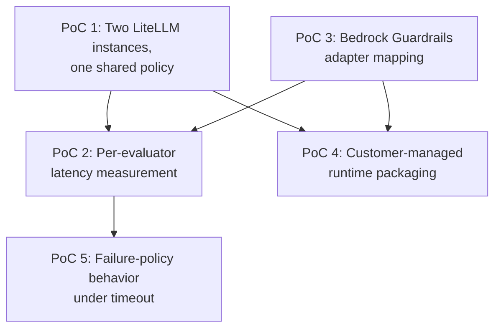

**AI Guardrails — Feasibility Assessment**

**Authority level:** L3
**Status:** Draft
**Date:** 2026-07-24
**Derived from:** AGREEMENTS.md

---

## Purpose and scope

This assessment answers one question: **can the AI Guardrails MVP, as bounded by [`AGREEMENTS.md`](../00-source-of-truth/AGREEMENTS.md) and [`CONSTRAINTS.md`](../00-source-of-truth/CONSTRAINTS.md), actually be built and operated with the technology, skills, and evidence currently available to the program?**

It is grounded in [`DEPLOYMENT-ARCHITECTURE.md`](DEPLOYMENT-ARCHITECTURE.md) (AWS implementation direction), [AGR-003](../00-source-of-truth/AGREEMENTS.md#agr-003--litellm-as-first-connector-not-the-product-boundary) (LiteLLM integration), [`DATA-ARCHITECTURE.md`](DATA-ARCHITECTURE.md) (data handling requirements), [`CONSTRAINTS.md`](../00-source-of-truth/CONSTRAINTS.md) (security requirements), [`NON-FUNCTIONAL-REQUIREMENTS.md`](NON-FUNCTIONAL-REQUIREMENTS.md) (operational requirements), [`RISK-REGISTER.md`](../70-governance/RISK-REGISTER.md) (key risks), and the Phase 1–2 validation demonstration in §16. It does not restate product scope — see [`10-charter/SCOPE.md`](../10-charter/SCOPE.md) — or re-litigate accepted decisions — see [`AGREEMENTS.md`](../00-source-of-truth/AGREEMENTS.md). It exists to surface, in one place, everything that must be true, tested, staffed, or funded before the architecture described elsewhere in this set can be trusted.

This document is **L3** (a derived working assessment): it must not contradict [`AGREEMENTS.md`](../00-source-of-truth/AGREEMENTS.md) or [`CONSTRAINTS.md`](../00-source-of-truth/CONSTRAINTS.md) (both L1), and it treats [`ASSUMPTIONS.md`](../00-source-of-truth/ASSUMPTIONS.md) (L1) as the authoritative register of what remains unvalidated. Where this assessment references a numeric figure that the source material does not supply, it is marked **TBD** rather than invented, per source-of-truth policy.

---

## 1. Overall assessment

> **Feasible with conditions.**

The Phases 1–2 core platform as scoped in [`SUCCESS-CRITERIA.md`](../10-charter/SUCCESS-CRITERIA.md) and [`../10-charter/SCOPE.md`](../10-charter/SCOPE.md), and validated per [`../60-delivery/VALIDATION-PLAN.md`](../60-delivery/VALIDATION-PLAN.md), does not require inventing new detection technology, new cryptography, or a new cloud platform. It composes existing, well-understood building blocks — a stateless evaluation API, a managed detection engine (Amazon Bedrock Guardrails), a lightweight gateway connector (LiteLLM pre-/post-call hooks), and a conventional AWS data/audit stack (DynamoDB, SQS, S3, KMS). None of these components, individually, is a feasibility risk.

The conditions attach to three things this assessment cannot yet confirm from the source material alone:

1. **Two organizationally independent LiteLLM deployments must actually exist and be willing to participate** in the Phase 1–2 validation demonstration ([`SUCCESS-CRITERIA.md`](../10-charter/SUCCESS-CRITERIA.md); [`../60-delivery/VALIDATION-PLAN.md`](../60-delivery/VALIDATION-PLAN.md); [ASM-002](../00-source-of-truth/ASSUMPTIONS.md#a-demand-adoption-and-trust-assumptions), [ASM-003](../00-source-of-truth/ASSUMPTIONS.md#a-demand-adoption-and-trust-assumptions)). Without them, "feasible" cannot be demonstrated — it can only be argued.
2. **No performance, availability, or capacity figure in the source material is yet numeric** ([`NON-FUNCTIONAL-REQUIREMENTS.md`](NON-FUNCTIONAL-REQUIREMENTS.md); [ASM-011](../00-source-of-truth/ASSUMPTIONS.md#c-performance-and-operational-nfr-assumptions), [ASM-012](../00-source-of-truth/ASSUMPTIONS.md#c-performance-and-operational-nfr-assumptions)). Latency, availability objectives, and throughput are all currently qualitative intents ("must measure," "must define") rather than committed targets, which means feasibility of the *runtime path* specifically — not the platform concept — cannot be confirmed until those targets are set and measured.
3. **The riskiest single component in the architecture is a vendor dependency the product must not be coupled to** — Amazon Bedrock Guardrails is the first evaluation engine ([`DEPLOYMENT-ARCHITECTURE.md`](DEPLOYMENT-ARCHITECTURE.md), [AGR-001](../00-source-of-truth/AGREEMENTS.md#agr-001--standalone-platform-not-embedded-in-the-internal-litellm); [AGR-004](../00-source-of-truth/AGREEMENTS.md#agr-004--bedrock-guardrails-as-first-engine-vendor-independent-contract)) but the public contract must remain vendor-independent ([CON-004](../00-source-of-truth/CONSTRAINTS.md#con-004--no-coupling-to-bedrock-guardrails-response-formats)). Building that normalization layer correctly on the first attempt, with only one evaluation engine to design against, is a real design risk, not just an execution risk.

None of these conditions require re-scoping the solution. They require running the proofs of concept in [§4](#4-required-proofs-of-concept) before committing delivery dates, and treating the linked entries in [`ASSUMPTIONS.md`](../00-source-of-truth/ASSUMPTIONS.md) as open until the phase gates in [AGR-020](../00-source-of-truth/AGREEMENTS.md#agr-020--five-phase-delivery) require them closed.

---

## 2. Confirmed capabilities

The following are assessed as **low technical risk** — they rely on mature, widely deployed patterns and AWS-native services, and the source material describes them at a level of detail sufficient to design against today.

| Capability | Why it is confirmed | Source |
| --- | --- | --- |
| Stateless HTTP Evaluation API fronting a policy resolver and decision engine | Standard synchronous request/response API pattern; no novel distributed-systems problem | [`CONTAINER-ARCHITECTURE.md`](CONTAINER-ARCHITECTURE.md), [`SUCCESS-CRITERIA.md`](../10-charter/SUCCESS-CRITERIA.md) (MVP component 5) |
| Versioned policy storage | DynamoDB or versioned S3 are both mature, well-documented AWS services for this access pattern | [`DEPLOYMENT-ARCHITECTURE.md`](DEPLOYMENT-ARCHITECTURE.md) |
| Workload registry | Same DynamoDB pattern as policy storage; a standard registration/lookup table | [AGR-017](../00-source-of-truth/AGREEMENTS.md#agr-017--core-domain-model), [`DEPLOYMENT-ARCHITECTURE.md`](DEPLOYMENT-ARCHITECTURE.md), [`SUCCESS-CRITERIA.md`](../10-charter/SUCCESS-CRITERIA.md) |
| LiteLLM pre-call / post-call connector | LiteLLM's hook architecture is a documented extension point; the connector's job (map request, invoke API, apply decision) is a thin adapter, not new gateway logic | [AGR-003](../00-source-of-truth/AGREEMENTS.md#agr-003--litellm-as-first-connector-not-the-product-boundary), [`SUCCESS-CRITERIA.md`](../10-charter/SUCCESS-CRITERIA.md) (MVP components 8–9) |
| Deterministic evaluator | Rule-based checks (pattern matching, allow/deny lists) are a well-understood, low-latency evaluation mode requiring no ML infrastructure | [`SCOPE.md`](../10-charter/SCOPE.md), [`SUCCESS-CRITERIA.md`](../10-charter/SUCCESS-CRITERIA.md) (MVP component 7) |
| Decision normalization structure | A well-defined internal schema (action, allowed, reason codes, policy version, evaluator metadata) is an ordinary API-design exercise | [AGR-017](../00-source-of-truth/AGREEMENTS.md#agr-017--core-domain-model) (Decision) |
| Observe/Enforce mode switching | A binding-level flag that gates whether a decision is applied is straightforward state to carry and check | [AGR-011](../00-source-of-truth/AGREEMENTS.md#agr-011--observe-before-enforce-progression), [`SUCCESS-CRITERIA.md`](../10-charter/SUCCESS-CRITERIA.md) (MVP component 10) |
| Audit event production to SQS → S3 | A standard buffered-event-to-archive pipeline; no novel durability or ordering requirement stated | [`DEPLOYMENT-ARCHITECTURE.md`](DEPLOYMENT-ARCHITECTURE.md), [`NON-FUNCTIONAL-REQUIREMENTS.md`](NON-FUNCTIONAL-REQUIREMENTS.md) (Auditing) |
| TLS + IAM + KMS baseline | All are default AWS platform capabilities, not custom-built controls | [`CONSTRAINTS.md`](../00-source-of-truth/CONSTRAINTS.md); [CON-008](../00-source-of-truth/CONSTRAINTS.md#con-008--tls-for-all-runtime-communication), [CON-009](../00-source-of-truth/CONSTRAINTS.md#con-009--kms-encryption-in-transit-and-at-rest), [CON-010](../00-source-of-truth/CONSTRAINTS.md#con-010--iam-based-authentication-and-least-privilege-roles) |
| ECS Fargate or EKS as the runtime host | Both are mature, widely operated AWS compute platforms; the L1 registers leave the specific choice open, which is itself a low-risk position at this stage | [`DEPLOYMENT-ARCHITECTURE.md`](DEPLOYMENT-ARCHITECTURE.md) |

These capabilities being "confirmed" means the *pattern* is not in question. It does not mean every associated number (capacity, cost, latency) is known — those gaps are tracked in [§3](#3-unvalidated-assumptions) and [§10](#10-cost-drivers).

---

## 3. Unvalidated assumptions

Every load-bearing belief this feasibility assessment depends on but cannot itself confirm is tracked, with an owner and a validation activity, in [`ASSUMPTIONS.md`](../00-source-of-truth/ASSUMPTIONS.md). Rather than duplicate that register, this section maps its categories onto the feasibility question directly:

| ASSUMPTIONS.md category | Feasibility relevance |
| --- | --- |
| [A — Demand, adoption, and trust](../00-source-of-truth/ASSUMPTIONS.md#a-demand-adoption-and-trust-assumptions) (ASM-001–005) | Determines whether the Phase 1–2 validation demonstration ([`SUCCESS-CRITERIA.md`](../10-charter/SUCCESS-CRITERIA.md); [`../60-delivery/VALIDATION-PLAN.md`](../60-delivery/VALIDATION-PLAN.md)) is even executable — it requires two real, independent, willing LiteLLM-operating teams (ASM-002, ASM-003), not a simulated pair. |
| [B — Technical and infrastructure feasibility](../00-source-of-truth/ASSUMPTIONS.md#b-technical-and-infrastructure-feasibility) (ASM-006–010) | Directly this document's subject matter: account provisioning timelines, team AWS skills, Bedrock Guardrails regional availability, and storage performance at unknown volume. |
| [C — Performance and operational NFRs](../00-source-of-truth/ASSUMPTIONS.md#c-performance-and-operational-nfr-assumptions) (ASM-011–013) | No latency budget, availability objective, or cache-staleness tolerance is yet numeric; feasibility of the *synchronous evaluation path specifically* cannot be confirmed until these are set and measured. |
| [D — Budget and delivery sequencing](../00-source-of-truth/ASSUMPTIONS.md#d-budget-and-delivery-sequencing-assumptions) (ASM-014–015) | Feasibility is conditioned on funding actually covering a two-account MVP through Phase 1–2, and on Phase 5 not being pulled forward under stakeholder pressure. |
| [E — Security, compliance, and policy-governance](../00-source-of-truth/ASSUMPTIONS.md#e-security-compliance-and-policy-governance-assumptions) (ASM-016–018) | Determines whether Mode A documentation alone will satisfy security/compliance reviewers, and whether Bedrock Guardrails plus deterministic rules will provide adequate detection quality without a proprietary model (explicitly out of scope per [`SCOPE.md`](../10-charter/SCOPE.md)).

No new assumptions are introduced by this document. Where a proof of concept in [§4](#4-required-proofs-of-concept) is designed specifically to retire one of these entries, that linkage is called out explicitly.

---

## 4. Required proofs of concept

Five proofs of concept must be run before schedule or capacity commitments are finalized. Each is scoped to be small, time-boxed, and falsifiable — a PoC that cannot fail is not doing its job.

PoC 1, PoC 3, and PoC 2 are direct inputs to the Phase 1–2 validation demonstration ([`SUCCESS-CRITERIA.md`](../10-charter/SUCCESS-CRITERIA.md); [`../60-delivery/VALIDATION-PLAN.md`](../60-delivery/VALIDATION-PLAN.md)) and Phase 1 exit ([AGR-020](../00-source-of-truth/AGREEMENTS.md#agr-020--five-phase-delivery)). PoC 4 previews Phase 4 packaging risk early, per [`SUCCESS-CRITERIA.md`](../10-charter/SUCCESS-CRITERIA.md)'s requirement that the runtime be "later packaged for customer-managed deployment without changing the connector contract." PoC 5 validates that failure behavior — mandatory per [AGR-012](../00-source-of-truth/AGREEMENTS.md#agr-012--failure-behavior-is-part-of-policy) — is actually implementable as specified, not merely documentable.

### PoC 1 — Two LiteLLM instances, one policy

| Field | Detail |
| --- | --- |
| **Question it answers** | Can one versioned policy be bound to two organizationally independent LiteLLM deployments and produce consistent normalized decisions, without either instance sharing model-provider credentials with the guardrail platform? |
| **Why it is required** | This is the literal Phase 1–2 validation demonstration ([`SUCCESS-CRITERIA.md`](../10-charter/SUCCESS-CRITERIA.md); [`../60-delivery/VALIDATION-PLAN.md`](../60-delivery/VALIDATION-PLAN.md)). It cannot be inferred from a single-instance test — the "reusable across independent gateways" claim is only proven by two. |
| **Scope** | Stand up two separate LiteLLM instances (distinct configuration, distinct credentials, ideally distinct teams). Bind the same policy version to both. Run one in Observe mode, one in Enforce mode. Exercise the same test inputs against both and compare normalized decisions. |
| **Success criteria** | Identical policy version produces consistent decisions across both instances; no model-provider credential or LiteLLM configuration is exchanged with the guardrail platform; the Observe-mode instance logs findings without blocking; the Enforce-mode instance blocks/redacts per policy. |
| **Retires** | [ASM-002](../00-source-of-truth/ASSUMPTIONS.md#a-demand-adoption-and-trust-assumptions), [ASM-003](../00-source-of-truth/ASSUMPTIONS.md#a-demand-adoption-and-trust-assumptions) (in part — full retirement requires real, not simulated, independent teams). |

### PoC 2 — Per-evaluator latency measurement

| Field | Detail |
| --- | --- |
| **Question it answers** | What is the actual latency contribution of each evaluator (Bedrock Guardrails, deterministic rules) individually, and in combination, on the synchronous input/output evaluation path? |
| **Why it is required** | [`NON-FUNCTIONAL-REQUIREMENTS.md`](NON-FUNCTIONAL-REQUIREMENTS.md) mandates measuring P50/P95/P99 evaluation latency and detector-specific latency; [`RISK-REGISTER.md`](../70-governance/RISK-REGISTER.md) (Latency risk) explicitly calls for measuring per-evaluator latency before applying only relevant evaluators. No numeric latency budget exists yet ([ASM-011](../00-source-of-truth/ASSUMPTIONS.md#c-performance-and-operational-nfr-assumptions)) — this PoC is the mechanism that produces the first real numbers. |
| **Scope** | Instrument the Evaluation API to record per-evaluator start/end timestamps. Run representative input and output payloads through Bedrock Guardrails alone, the deterministic evaluator alone, and both in sequence. Measure across a range of payload sizes up to the (TBD) input-size limit in [CON-015](../00-source-of-truth/CONSTRAINTS.md#con-015--input-size-limits). |
| **Success criteria** | P50/P95/P99 latency recorded per evaluator and combined; a defensible stage-specific timeout candidate can be proposed from the data (feeding [CON-016](../00-source-of-truth/CONSTRAINTS.md#con-016--timeout-limits)); no evaluator shows unbounded or highly variable tail latency without explanation. |
| **Retires** | [ASM-011](../00-source-of-truth/ASSUMPTIONS.md#c-performance-and-operational-nfr-assumptions) (in part), and supplies the input data [ASM-012](../00-source-of-truth/ASSUMPTIONS.md#c-performance-and-operational-nfr-assumptions) needs to set an availability/timeout objective. |

### PoC 3 — Bedrock Guardrails adapter mapping

| Field | Detail |
| --- | --- |
| **Question it answers** | Can Bedrock Guardrails' native response format be normalized into the platform's vendor-independent decision structure without loss of information the policy or audit trail needs? |
| **Why it is required** | [CON-004](../00-source-of-truth/CONSTRAINTS.md#con-004--no-coupling-to-bedrock-guardrails-response-formats) and [AGR-004](../00-source-of-truth/AGREEMENTS.md#agr-004--bedrock-guardrails-as-first-engine-vendor-independent-contract) require that Bedrock's response shape never leak into the public contract, but this has not yet been attempted against real Bedrock Guardrails output. Designing the normalization contract without first mapping real fields risks discovering a mismatch after policies and connectors have already been built against it. |
| **Scope** | Invoke Bedrock Guardrails directly against representative inputs (including intentionally violating ones). Map every field in its response (categories, confidence/severity, filtered content, action taken) onto the platform's Decision structure (action, allowed, reason codes, evaluator metadata, transformed content). Identify any Bedrock-specific concept with no natural home in the normalized structure. |
| **Success criteria** | A complete field-by-field mapping exists; any Bedrock-specific concept without a normalized equivalent is either resolved (extend the Decision schema in a vendor-neutral way) or explicitly logged as a known gap; the adapter can be swapped for a second, hypothetical evaluation engine without changing the Decision schema. |
| **Retires** | [ASM-008](../00-source-of-truth/ASSUMPTIONS.md#b-technical-and-infrastructure-feasibility) (regional availability/feature parity, verified concretely rather than assumed), and de-risks [AGR-004](../00-source-of-truth/AGREEMENTS.md#agr-004--bedrock-guardrails-as-first-engine-vendor-independent-contract) compliance. |

### PoC 4 — Customer-managed runtime packaging

| Field | Detail |
| --- | --- |
| **Question it answers** | Can the same runtime code that serves Remote Evaluation and Guarded Gateway be packaged and run inside a separate AWS account, with a local policy cache, without changing the connector contract? |
| **Why it is required** | [`SUCCESS-CRITERIA.md`](../10-charter/SUCCESS-CRITERIA.md) requires that "the runtime can later be packaged for customer-managed deployment without changing the connector contract" as part of MVP success; [AGR-015](../00-source-of-truth/AGREEMENTS.md#agr-015--customer-managed-runtime-executes-without-a-synchronous-control-plane-connection) requires the runtime execute policies without a synchronous control-plane connection. Discovering a packaging blocker during Phase 4 ([AGR-020](../00-source-of-truth/AGREEMENTS.md#agr-020--five-phase-delivery)) — after Phases 1–3 have already been built around hosted-only assumptions — would be far more expensive than discovering it now. |
| **Scope** | Package the evaluation runtime as a container image. Deploy it into a second, isolated AWS account (or namespace) with a local policy cache seeded from a one-time sync. Disconnect it from the control plane and confirm it continues evaluating using the cached policy. Reconnect and confirm asynchronous policy sync resumes without blocking evaluation. |
| **Success criteria** | The same connector (unmodified) can invoke either the hosted runtime or the customer-managed runtime; evaluation continues correctly during simulated control-plane unavailability; policy sync is confirmed asynchronous (does not block the evaluation path); telemetry configuration (including "no telemetry") is confirmed to withhold raw content by construction, not by operator discipline. |
| **Retires** | [ASM-013](../00-source-of-truth/ASSUMPTIONS.md#c-performance-and-operational-nfr-assumptions) (in part — full retirement needs real Mode C customer input on staleness tolerance), and validates [AGR-015](../00-source-of-truth/AGREEMENTS.md#agr-015--customer-managed-runtime-executes-without-a-synchronous-control-plane-connection) / [AGR-016](../00-source-of-truth/AGREEMENTS.md#agr-016--customer-controlled-telemetry-for-the-customer-managed-runtime) are actually implementable, not just documentable. |

### PoC 5 — Failure-policy behavior under timeout

| Field | Detail |
| --- | --- |
| **Question it answers** | When the Evaluation API times out, a detector is unavailable, or the control plane cannot be reached, does the runtime actually execute the configured failure behavior — deterministically and auditably — rather than an implicit default? |
| **Why it is required** | [AGR-012](../00-source-of-truth/AGREEMENTS.md#agr-012--failure-behavior-is-part-of-policy) is explicit that "there must be no undocumented fallback behavior," and requires the runtime to *reject or flag* policies that omit failure behavior. This is a runtime-enforcement claim, not just a schema field, and needs to be tested under actual induced failure. |
| **Scope** | Configure a policy with an explicit failure-behavior section (e.g., "allow and log" for detector unavailability, "block" for control-plane unresolvable policy). Induce each failure mode artificially (kill the Bedrock Guardrails call, delay it past the stage timeout, disconnect the policy resolver from storage, fail audit delivery). Confirm the runtime takes exactly the configured path and records which path was taken. |
| **Success criteria** | Every failure mode in [AGR-012](../00-source-of-truth/AGREEMENTS.md#agr-012--failure-behavior-is-part-of-policy) (API timeout, detector unavailable, policy unresolved, control-plane unavailable, audit-delivery failure, unsafe response transform) produces the configured, not an implicit, outcome; a policy missing a required failure-behavior section is rejected or flagged rather than silently defaulted; audit metadata records the failure path taken. |
| **Retires** | Directly validates [CON-016](../00-source-of-truth/CONSTRAINTS.md#con-016--timeout-limits) and [AGR-012](../00-source-of-truth/AGREEMENTS.md#agr-012--failure-behavior-is-part-of-policy) are implementable as written; informs the timeout values PoC 2 leaves open. |

---

## 5. Technology maturity

| Component | Maturity | Assessment |
| --- | --- | --- |
| ECS Fargate / EKS | Mature | Both are long-established AWS compute platforms; choice between them is an operational preference, not a feasibility question. Decision itself is still open per [`DEPLOYMENT-ARCHITECTURE.md`](DEPLOYMENT-ARCHITECTURE.md) phrasing ("ECS Fargate **or** EKS"). |
| API Gateway / Application Load Balancer | Mature | Standard AWS front-door services for the Evaluation API. |
| DynamoDB / versioned S3 | Mature | Both are proven for registry and versioned-config workloads; the open question is performance *at actual MVP volume*, which is unknown ([ASM-001](../00-source-of-truth/ASSUMPTIONS.md#a-demand-adoption-and-trust-assumptions), [ASM-010](../00-source-of-truth/ASSUMPTIONS.md#b-technical-and-infrastructure-feasibility)), not the technology's inherent maturity. |
| Amazon Bedrock Guardrails | Managed service, externally maintained | Mature as an AWS service, but it is a single-vendor dependency the product must abstract behind an adapter ([AGR-004](../00-source-of-truth/AGREEMENTS.md#agr-004--bedrock-guardrails-as-first-engine-vendor-independent-contract)). Regional availability and feature parity for the organization's target Region(s) is unverified ([ASM-008](../00-source-of-truth/ASSUMPTIONS.md#b-technical-and-infrastructure-feasibility)) — see PoC 3. |
| LiteLLM hook/connector model | Actively maintained open-source project | The pre-call/post-call hook pattern is a documented extension point; feasibility risk is in the connector's correctness (mapping, timeout/enforcement handling), not in LiteLLM's own maturity. |
| Deterministic rule evaluator | Well-understood pattern | Rule/pattern matching requires no new infrastructure; risk is entirely in rule quality and coverage, which is a policy-content question, not a technology one (tracked as [ASM-017](../00-source-of-truth/ASSUMPTIONS.md#e-security-compliance-and-policy-governance-assumptions)). |
| SQS + S3 audit pipeline | Mature | Standard buffered-event-to-archive pattern; no novel ordering, durability, or replay requirement is stated in the source material. |
| KMS / IAM / Secrets Manager | Mature | AWS baseline security services; no custom cryptography or identity system is being built. |

No component in the MVP architecture requires unproven or emerging technology. The maturity risk in this platform is concentrated entirely in **the vendor-abstraction layer around Bedrock Guardrails** and in **the as-yet-unbuilt normalization/decision contract**, not in any individual AWS service.

---

## 6. Integration complexity

| Integration point | Complexity | Notes |
| --- | --- | --- |
| LiteLLM pre-call connector | Low–Moderate | Must map LiteLLM's request shape into the evaluation contract, invoke input evaluation, and enforce block/redact decisions before inference proceeds ([AGR-003](../00-source-of-truth/AGREEMENTS.md#agr-003--litellm-as-first-connector-not-the-product-boundary)). Complexity is bounded because the connector is explicitly *not* responsible for policy definition, detection logic, or credential management ([AGR-003](../00-source-of-truth/AGREEMENTS.md#agr-003--litellm-as-first-connector-not-the-product-boundary)). |
| LiteLLM post-call connector | Low–Moderate | Must invoke output evaluation, apply safe output fallbacks, and propagate correlation identifiers ([AGR-003](../00-source-of-truth/AGREEMENTS.md#agr-003--litellm-as-first-connector-not-the-product-boundary)). The "safe output fallback" behavior needs a concrete design — what a workload receives when output is blocked is not fully specified in the original charter and should be resolved before Phase 1 exit. |
| Bedrock Guardrails adapter | Moderate | The technical call is simple (a managed API); the complexity is entirely in normalization discipline — see PoC 3 and [CON-004](../00-source-of-truth/CONSTRAINTS.md#con-004--no-coupling-to-bedrock-guardrails-response-formats). |
| Generic HTTP Evaluation API (non-LiteLLM consumers) | Low | A directly documented, versioned HTTP contract; complexity is proportional to how well the contract is specified up front, which is why [AGR-006](../00-source-of-truth/AGREEMENTS.md#agr-006--one-logical-evaluation-contract-across-all-modes) requires one logical contract across all three modes rather than mode-specific variants. |
| Policy resolver ↔ policy storage | Low | Straightforward versioned lookup; complexity increases only if workload-specific override handling is not tightly bounded ([`RISK-REGISTER.md`](../70-governance/RISK-REGISTER.md), Policy fragmentation risk; [ASM-018](../00-source-of-truth/ASSUMPTIONS.md#e-security-compliance-and-policy-governance-assumptions)). |
| Control plane ↔ customer-managed runtime (Phase 4 preview) | Moderate–High | This is the most structurally novel integration in the MVP scope: it must support asynchronous, non-blocking policy sync and fully optional/configurable telemetry, and must survive prolonged control-plane unavailability ([AGR-015](../00-source-of-truth/AGREEMENTS.md#agr-015--customer-managed-runtime-executes-without-a-synchronous-control-plane-connection)). It is previewed by PoC 4 precisely because its complexity is higher than the other integration points. |

Overall integration complexity for the MVP proper (Phases 1–2) is **low to moderate** — the source material's own design discipline (thin connectors, no policy logic in connectors, vendor-neutral contract) is what keeps it there. The complexity budget is concentrated in getting the Decision/contract normalization right the first time, since [AGR-006](../00-source-of-truth/AGREEMENTS.md#agr-006--one-logical-evaluation-contract-across-all-modes) requires that contract to hold unchanged across all three deployment modes going forward.

---

## 7. Operational complexity

[`NON-FUNCTIONAL-REQUIREMENTS.md`](NON-FUNCTIONAL-REQUIREMENTS.md) requires the runtime to define availability objective, timeout behavior, retry behavior, cached-policy behavior, degraded operating mode, and circuit-breaker behavior — none of which are yet numerically specified. Operational complexity for the MVP breaks down as follows:

| Operational dimension | Complexity for MVP | Driver |
| --- | --- | --- |
| Availability/SLO definition | Moderate | No numeric availability objective exists yet ([ASM-012](../00-source-of-truth/ASSUMPTIONS.md#c-performance-and-operational-nfr-assumptions)). The topology question that once complicated this — whether multi-region active-active availability would be required ([OQ-016](../00-source-of-truth/OPEN-QUESTIONS.md#oq-016--multi-region-active-active-availability-need)) — is now **resolved**: the platform is multi-region from GA with each tenant pinned to a single processing region ([DEC-018](../00-source-of-truth/DECISIONS.md#dec-018--multi-region-availability-at-ga)/CAP-035), and active-active is committed as a later phase, not yet delivered ([DEC-019](../00-source-of-truth/DECISIONS.md#dec-019--multi-region-active-active-availability-committed-as-a-later-phase)/CAP-036, both Status: Proposed). Setting a numeric SLO that pilot teams will accept still requires a deliberate trade-off conversation, not just an engineering decision. |
| Timeout/retry/circuit-breaker behavior | Moderate | Must be defined per stage and detector ([`CONSTRAINTS.md`](../00-source-of-truth/CONSTRAINTS.md), [`NON-FUNCTIONAL-REQUIREMENTS.md`](NON-FUNCTIONAL-REQUIREMENTS.md); [CON-016](../00-source-of-truth/CONSTRAINTS.md#con-016--timeout-limits)); PoC 2 and PoC 5 supply the data this depends on. |
| Policy rollout (versioning, promotion, rollback) | Low–Moderate | Immutable versions plus Observe→Enforce promotion is a well-understood pattern ([`NON-FUNCTIONAL-REQUIREMENTS.md`](NON-FUNCTIONAL-REQUIREMENTS.md), "Policy rollout"; [AGR-011](../00-source-of-truth/AGREEMENTS.md#agr-011--observe-before-enforce-progression)); complexity is in building the tooling to make promotion an explicit, auditable action rather than an implicit side effect. |
| Auditing pipeline operations | Low | Standard buffered-event operational pattern (SQS backlog monitoring, S3 lifecycle); no novel operational burden. |
| Two-account model operations (Phase 1–2) | Low | A minimal, explicit two-account topology ([CON-002](../00-source-of-truth/CONSTRAINTS.md#con-002--minimal-mvp-account-model)) is deliberately simpler to operate than a multi-account structure; this constraint exists specifically to keep MVP operational load low. |
| Customer-managed runtime operations (Phase 4 preview) | High | Once packaged, upgrade cadence, local audit integration, and degraded-mode behavior during cache staleness become the customer's operational burden unless managed support is purchased ([AGR-002](../00-source-of-truth/AGREEMENTS.md#agr-002--three-deployment-modes), Mode C); this is a materially different operating model from the hosted runtime and should not be underestimated when Phase 4 is resourced. |

Operationally, the Phases 1–2 core platform (hosted-only) is **low-to-moderate complexity** by design — the minimal account model and bounded phase scope are deliberate complexity-reduction choices. Operational complexity rises sharply once Customer-Managed Runtime (Phase 4) is introduced, which is exactly why [AGR-020](../00-source-of-truth/AGREEMENTS.md#agr-020--five-phase-delivery) sequences it as its own phase rather than folding it into Phases 1–2.

---

## 8. Security feasibility

Every security requirement in [`CONSTRAINTS.md`](../00-source-of-truth/CONSTRAINTS.md) and its corresponding constraint in [`CONSTRAINTS.md`](../00-source-of-truth/CONSTRAINTS.md) is achievable using standard AWS-native controls; none requires bespoke cryptography or an unproven identity model.

| Requirement | Feasibility | Constraint reference |
| --- | --- | --- |
| TLS for all runtime communication | High — default AWS/ALB/API Gateway capability | [CON-008](../00-source-of-truth/CONSTRAINTS.md#con-008--tls-for-all-runtime-communication) |
| KMS encryption in transit and at rest | High — native AWS KMS integration across DynamoDB, S3, SQS | [CON-009](../00-source-of-truth/CONSTRAINTS.md#con-009--kms-encryption-in-transit-and-at-rest) |
| IAM-based auth, least-privilege, short-lived credentials | High — standard IAM role design discipline | [CON-010](../00-source-of-truth/CONSTRAINTS.md#con-010--iam-based-authentication-and-least-privilege-roles) |
| Per-tenant workload identities | Moderate — requires deliberate identity-model design tying every evaluation/decision/audit record to tenant+workload, but no new primitive is needed | [CON-011](../00-source-of-truth/CONSTRAINTS.md#con-011--per-tenant-workload-identities) |
| No exclusive reliance on weak security proxies (API keys, unauthenticated identifiers, unauthenticated policy versions, connector telemetry as enforcement evidence) | Moderate — this is a discipline requirement more than a technology one; it must be actively designed against, since each of the four weak proxies is the *easy* path | [CON-012](../00-source-of-truth/CONSTRAINTS.md#con-012--no-exclusive-reliance-on-weak-security-proxies) |
| Raw content must not leave a customer-managed runtime unless explicitly configured | Moderate–High — requires the telemetry payload design to be incapable of carrying raw content **by construction**, not by operator discipline; validated by PoC 4 | [CON-013](../00-source-of-truth/CONSTRAINTS.md#con-013--raw-content-must-not-leave-a-customer-managed-runtime-unless-explicitly-configured) |
| No raw-content retention by default (hosted runtime) | Moderate — achievable, but requires disciplined data-flow review to confirm no incidental persistence in logs, caches, or telemetry pipelines | [CON-014](../00-source-of-truth/CONSTRAINTS.md#con-014--no-raw-content-retention-by-default-in-the-hosted-runtime) |
| Input-size and timeout limits | Moderate — the mechanism is trivial to implement; the specific limit values are TBD and depend on PoC 2 | [CON-015](../00-source-of-truth/CONSTRAINTS.md#con-015--input-size-limits), [CON-016](../00-source-of-truth/CONSTRAINTS.md#con-016--timeout-limits) |

**Security feasibility is high overall**, conditioned on two things that are process risks rather than technology risks: (1) the "no exclusive reliance on weak proxies" constraint must be enforced by architecture review discipline throughout delivery, not just at sign-off; and (2) the enforcement-posture distinction in [AGR-018](../00-source-of-truth/AGREEMENTS.md#agr-018--trust-and-enforcement-model) (cooperative vs. platform-managed vs. network/IAM-enforced) must never be blurred in how the MVP's security posture is described — a cooperative connector is not a hard security boundary, and treating it as one in any internal or external claim would be a self-inflicted feasibility failure of trust, not of engineering.

Security feasibility explicitly does **not** extend to claims the product does not make: guardrail evaluation is not authorization ([AGR-010](../00-source-of-truth/AGREEMENTS.md#agr-010--guardrails-are-not-authorization)), and the MVP is not attempting a complete DLP platform, proprietary detection model, or full compliance certification ([`SCOPE.md`](../10-charter/SCOPE.md)).

---

## 9. Skills and staffing requirements

| Skill area | Requirement | Current status |
| --- | --- | --- |
| AWS core services (ECS/EKS, API Gateway/ALB, DynamoDB, IAM, KMS, SQS, S3, CloudWatch, ECR) | Team must be able to design, deploy, and operate this stack independently | Assumed but not yet confirmed — [ASM-007](../00-source-of-truth/ASSUMPTIONS.md#b-technical-and-infrastructure-feasibility) calls for an explicit skills-gap assessment before Phase 1 planning is finalized |
| Amazon Bedrock Guardrails (configuration, response semantics, regional behavior) | Needed to build PoC 3 and the production adapter | Not separately assessed in the source material; should be folded into the ASM-007 skills-gap exercise |
| LiteLLM internals (hook architecture, request/response lifecycle) | Needed to build and validate the connector | Not separately assessed; recommend explicit inclusion alongside ASM-007 |
| API/contract design discipline | Needed to design and hold the vendor-neutral Decision/evaluation contract stable across all three modes ([AGR-006](../00-source-of-truth/AGREEMENTS.md#agr-006--one-logical-evaluation-contract-across-all-modes)) | General software-engineering skill; not AWS- or vendor-specific, but still a named risk if under-invested — a poorly designed first contract is expensive to fix once connectors depend on it |
| Security/IAM design (least-privilege roles, per-tenant identity model) | Needed to satisfy [CON-010](../00-source-of-truth/CONSTRAINTS.md#con-010--iam-based-authentication-and-least-privilege-roles)/[CON-011](../00-source-of-truth/CONSTRAINTS.md#con-011--per-tenant-workload-identities) | Standard AWS security-engineering skill; covered by the general AWS skills assessment |
| Container packaging / Helm / ECS deployment templates (Phase 4 preview) | Needed only for PoC 4 and Phase 4 proper | Not required for Phase 1–2 delivery; should be staffed closer to Phase 4, not upfront |

**Staffing conclusion:** the skill set required is a conventional AWS platform-engineering profile plus working familiarity with LiteLLM and Bedrock Guardrails specifically — no specialized ML, cryptography, or novel-infrastructure hiring is implied by the source material. The open item is not *what* skills are needed but *whether the current delivery team already has them*, which [ASM-007](../00-source-of-truth/ASSUMPTIONS.md#b-technical-and-infrastructure-feasibility) explicitly flags as unconfirmed. That skills-gap assessment should run in parallel with, not after, the PoCs in [§4](#4-required-proofs-of-concept).

---

## 10. Cost drivers

The source material and the accepted agreements do not supply dollar figures, and none are invented here. The cost *drivers* — the variables that will determine actual spend — are nonetheless identifiable from the architecture:

| Cost driver | Why it matters | Status |
| --- | --- | --- |
| Evaluation runtime compute (ECS Fargate / EKS) | Scales with evaluation request volume, which is unknown ([ASM-001](../00-source-of-truth/ASSUMPTIONS.md#a-demand-adoption-and-trust-assumptions)) | TBD — depends on workload/tenant intake survey |
| Amazon Bedrock Guardrails usage | Typically usage-metered by evaluation call; directly proportional to evaluation volume and to how many evaluators run per request (input-only vs. input+output, per PoC 2 findings) | TBD |
| DynamoDB / S3 policy and registry storage | Low relative to compute/evaluation cost at small scale, but read/write pattern is untested at real volume ([ASM-010](../00-source-of-truth/ASSUMPTIONS.md#b-technical-and-infrastructure-feasibility)) | TBD |
| SQS/S3 audit pipeline | Scales with decision volume, not raw content volume (raw content is not retained by default per [CON-014](../00-source-of-truth/CONSTRAINTS.md#con-014--no-raw-content-retention-by-default-in-the-hosted-runtime)) — comparatively low and predictable driver | TBD, but structurally bounded |
| Delivery-team cost (staffing) | The largest near-term cost driver named in [ASM-014](../00-source-of-truth/ASSUMPTIONS.md#d-budget-and-delivery-sequencing-assumptions); explicitly assumed, not yet confirmed, to be funded through Phase 1–2 | Unconfirmed — funding commitment must be secured before detailed planning is finalized |
| Account/infrastructure provisioning | One non-production, one production account ([CON-002](../00-source-of-truth/CONSTRAINTS.md#con-002--minimal-mvp-account-model)); minimal by design, but provisioning timeline itself is unconfirmed ([ASM-006](../00-source-of-truth/ASSUMPTIONS.md#b-technical-and-infrastructure-feasibility)) | TBD |
| Customer-managed runtime packaging and support (Phase 4 preview) | Helm chart, ECS template, and optional managed-support offering are new deliverables with their own build and ongoing-maintenance cost, not yet estimated | Out of MVP cost scope; deferred to Phase 4 sizing |

No cost figure in this section should be read as a budget commitment. The purpose of this table is to name what the program must measure — via the workload/tenant intake survey ([ASM-001](../00-source-of-truth/ASSUMPTIONS.md#a-demand-adoption-and-trust-assumptions)) and the PoCs in [§4](#4-required-proofs-of-concept) — before a defensible cost estimate can exist.

---

## 11. Schedule risks

| Risk | Description | Mitigation / dependency |
| --- | --- | --- |
| No committed validation demonstration partners | If two organizationally independent LiteLLM-operating teams are not secured, the Phase 1–2 validation demonstration ([`SUCCESS-CRITERIA.md`](../10-charter/SUCCESS-CRITERIA.md); [`../60-delivery/VALIDATION-PLAN.md`](../60-delivery/VALIDATION-PLAN.md)) cannot be executed, and Phase 1–2 completion would need to be redefined or delayed | Secure named team commitments before Phase 1 exit ([ASM-003](../00-source-of-truth/ASSUMPTIONS.md#a-demand-adoption-and-trust-assumptions)) |
| Account provisioning delay | If IAM/network boundary setup for the two-account model slips, Phase 1/2 delivery slips with it, or teams improvise with shared ad hoc accounts, weakening [CON-002](../00-source-of-truth/CONSTRAINTS.md#con-002--minimal-mvp-account-model) | Confirm account-provisioning request filed and approved with target dates before Phase 1 kickoff ([ASM-006](../00-source-of-truth/ASSUMPTIONS.md#b-technical-and-infrastructure-feasibility)) |
| Skills gap discovered mid-delivery | If the delivery team lacks the AWS/Bedrock/LiteLLM skills assumed in [§9](#9-skills-and-staffing-requirements), timeline slips or requires external hiring/contracting | Run the skills-gap assessment before Phase 1 planning is finalized ([ASM-007](../00-source-of-truth/ASSUMPTIONS.md#b-technical-and-infrastructure-feasibility)) |
| Bedrock Guardrails regional/feature-parity surprise | If Bedrock Guardrails is unavailable or feature-limited in the target deployment Region, the adapter (PoC 3) cannot be validated as designed, forcing either a Region change or a deterministic-rules-only fallback | Verify regional availability before Phase 1 architecture sign-off ([ASM-008](../00-source-of-truth/ASSUMPTIONS.md#b-technical-and-infrastructure-feasibility)) |
| Contract redesign after connectors are built | If the vendor-neutral Decision/evaluation contract is finalized before PoC 3's field-mapping exercise is complete, a late-discovered normalization gap forces contract changes after connectors already depend on it | Sequence PoC 3 before finalizing the public contract, per the PoC dependency diagram in [§4](#4-required-proofs-of-concept) |
| Undefined performance targets block Phase 2 exit | [AGR-011](../00-source-of-truth/AGREEMENTS.md#agr-011--observe-before-enforce-progression) requires teams be able to measure false positives, latency, and business impact before enforcing; without a latency budget or availability objective, "ready to enforce" has no defined finish line | Run PoC 2, then define and socialize latency/availability objectives with pilot teams before Phase 2 exit ([ASM-011](../00-source-of-truth/ASSUMPTIONS.md#c-performance-and-operational-nfr-assumptions), [ASM-012](../00-source-of-truth/ASSUMPTIONS.md#c-performance-and-operational-nfr-assumptions)) |
| Stakeholder pressure to pull Phase 5 forward | [`RISK-REGISTER.md`](../70-governance/RISK-REGISTER.md) names "product over-expansion" as a named risk; if it materializes, phase-scope discipline under [`../10-charter/SCOPE.md`](../10-charter/SCOPE.md) and [AGR-020](../00-source-of-truth/AGREEMENTS.md#agr-020--five-phase-delivery) erodes and schedule pressure follows scope creep | Communicate phase boundaries at program kickoff; require an explicit, documented scope-change decision for any proposal to pull forward future-scope items ([ASM-015](../00-source-of-truth/ASSUMPTIONS.md#d-budget-and-delivery-sequencing-assumptions)) |
| Funding gap mid-Phase 1/2 | If budget does not in fact cover a two-account MVP through Phase 1–2 ([ASM-014](../00-source-of-truth/ASSUMPTIONS.md#d-budget-and-delivery-sequencing-assumptions)), delivery re-scoping or timeline extension follows | Confirm funding commitment before detailed planning is finalized |

None of these risks are architectural — every one of them is a *sequencing or confirmation* risk: something that must be checked, committed, or measured before or during Phase 1, not a sign that the chosen architecture is wrong.

---

## 12. Blocking decisions

These decisions must be made — not merely assumed — before delivery planning can be finalized. Each is phrased as a decision the organization owns, not a technical detail engineering can resolve unilaterally.

| # | Decision | Owner (per [AGREEMENTS.md](../00-source-of-truth/AGREEMENTS.md) role naming) | Blocks |
| --- | --- | --- | --- |
| 1 | Confirm two named, organizationally independent teams willing to run the Phase 1–2 validation demonstration | Delivery lead | Validation demonstration execution ([`SUCCESS-CRITERIA.md`](../10-charter/SUCCESS-CRITERIA.md); [`../60-delivery/VALIDATION-PLAN.md`](../60-delivery/VALIDATION-PLAN.md)); Phase 1 exit |
| 2 | Choose ECS Fargate vs. EKS as the evaluation runtime host | Technical lead | Infrastructure-as-code work, operational runbook design |
| 3 | Confirm target AWS Region(s) for Bedrock Guardrails deployment and verify feature parity there | Architecture lead | PoC 3; the Bedrock adapter design; any data-residency conversation with regulated pilot candidates |
| 4 | Set an initial (even provisional) latency budget and availability objective for Observe-mode pilots | Technical lead / Architecture lead | PoC 2 interpretation; Phase 2 exit criteria under [AGR-011](../00-source-of-truth/AGREEMENTS.md#agr-011--observe-before-enforce-progression) |
| 5 | Confirm funding commitment covering Phase 1–2 delivery | Product lead | All Phase 1–2 planning |
| 6 | Confirm the account-provisioning request (one non-prod, one prod) is filed with target dates | Platform operations lead | Phase 1 kickoff |
| 7 | Decide the "safe output fallback" behavior for LiteLLM post-call blocking ([AGR-003](../00-source-of-truth/AGREEMENTS.md#agr-003--litellm-as-first-connector-not-the-product-boundary) leaves this under-specified) | Technical lead / Integration lead | LiteLLM post-call connector implementation; PoC 5 scope |
| 8 | Confirm which override categories (if any) workloads may request against a shared policy, before Phase 2 onboarding begins | Policy owner | [ASM-018](../00-source-of-truth/ASSUMPTIONS.md#e-security-compliance-and-policy-governance-assumptions); onboarding UX design |

None of these decisions requires new agreements — each is already anticipated by an existing AGR or CON entry. They are "blocking" because the architecture and delivery plan cannot be finalized while they remain open, not because they are in dispute.

---

## 13. Recommendation

**Proceed to Phase 1 ([AGR-020](../00-source-of-truth/AGREEMENTS.md#agr-020--five-phase-delivery)) conditioned on running the five proofs of concept in [§4](#4-required-proofs-of-concept) and closing the eight blocking decisions in [§12](#12-blocking-decisions) before committing hard delivery dates or a cost estimate.**

The recommendation is **not** "further validation is required before any work begins." The MVP's component technologies are mature ([§5](#5-technology-maturity)), its integration surface is intentionally thin ([§6](#6-integration-complexity)), and its security posture is achievable with standard AWS controls ([§8](#8-security-feasibility)). Architecture and contract design work — the Decision structure, the policy schema's failure-behavior section, the connector invocation contract — can and should start immediately, in parallel with the PoCs, since none of the PoCs are expected to invalidate the chosen component stack.

What must not happen is committing a schedule, a cost estimate, or an "MVP complete" declaration before:

* PoC 1 has demonstrated the reusable-policy claim against two real, independent LiteLLM instances (not one instance tested twice, per the validation demonstration's explicit requirement — [`SUCCESS-CRITERIA.md`](../10-charter/SUCCESS-CRITERIA.md); [`../60-delivery/VALIDATION-PLAN.md`](../60-delivery/VALIDATION-PLAN.md)).
* PoC 2 has produced real per-evaluator latency numbers, so that [CON-016](../00-source-of-truth/CONSTRAINTS.md#con-016--timeout-limits) timeout values and an availability objective ([ASM-012](../00-source-of-truth/ASSUMPTIONS.md#c-performance-and-operational-nfr-assumptions)) are set from evidence rather than guessed.
* PoC 3 has confirmed the Bedrock Guardrails adapter mapping holds without leaking vendor-specific concepts into the public contract, protecting the [AGR-004](../00-source-of-truth/AGREEMENTS.md#agr-004--bedrock-guardrails-as-first-engine-vendor-independent-contract) commitment before connectors are built against it.
* PoC 4 has previewed customer-managed packaging early enough that Phase 4 ([AGR-020](../00-source-of-truth/AGREEMENTS.md#agr-020--five-phase-delivery)) is not the first time the runtime is asked to run disconnected from the control plane.
* PoC 5 has confirmed failure behavior is enforced by the runtime, not merely documented in policy — the single requirement in [AGR-012](../00-source-of-truth/AGREEMENTS.md#agr-012--failure-behavior-is-part-of-policy) most likely to be under-tested if left to the end.

Subject to those conditions, this assessment finds no technology, integration, security, or operational barrier that would make the AI Guardrails MVP infeasible as scoped. The risks that remain are demand, staffing-confirmation, funding, and measurement risks — all addressable through the activities already named in [`ASSUMPTIONS.md`](../00-source-of-truth/ASSUMPTIONS.md) and the PoCs above — not signs that the architectural direction in [`AGREEMENTS.md`](../00-source-of-truth/AGREEMENTS.md) needs to change.

---

## Related documents

- [`AGREEMENTS.md`](../00-source-of-truth/AGREEMENTS.md) — authoritative decisions this assessment must not contradict.
- [`CONSTRAINTS.md`](../00-source-of-truth/CONSTRAINTS.md) — the checkable boundary conditions referenced throughout this assessment.
- [`ASSUMPTIONS.md`](../00-source-of-truth/ASSUMPTIONS.md) — the authoritative register of unvalidated beliefs this assessment draws on.
- [`10-charter/SCOPE.md`](../10-charter/SCOPE.md) — the MVP scope boundary this assessment tests for feasibility, not scope.
- `60-delivery/VALIDATION-PLAN.md` — should incorporate the five PoCs in [§4](#4-required-proofs-of-concept) as concrete, scheduled activities.
- `60-delivery/IMPLEMENTATION-STRATEGY.md` — should sequence Phase 1 work around the blocking decisions in [§12](#12-blocking-decisions).
- `60-delivery/RELEASE-CRITERIA.md` — should gate Phase 1/2 exit on the PoC success criteria and assumption-retirement status described here.
- `70-governance/RISK-REGISTER.md` — tracks the ongoing mitigations for the schedule and demand risks named in [§11](#11-schedule-risks).
- `50-architecture/INTEGRATION-ARCHITECTURE.md`, `50-architecture/COMPONENT-ARCHITECTURE.md`, `50-architecture/DEPLOYMENT-ARCHITECTURE.md`, `50-architecture/SECURITY-ARCHITECTURE.md`, `50-architecture/OPERABILITY.md` — the architecture documents this feasibility assessment should be read alongside, and which should incorporate its findings once written.
