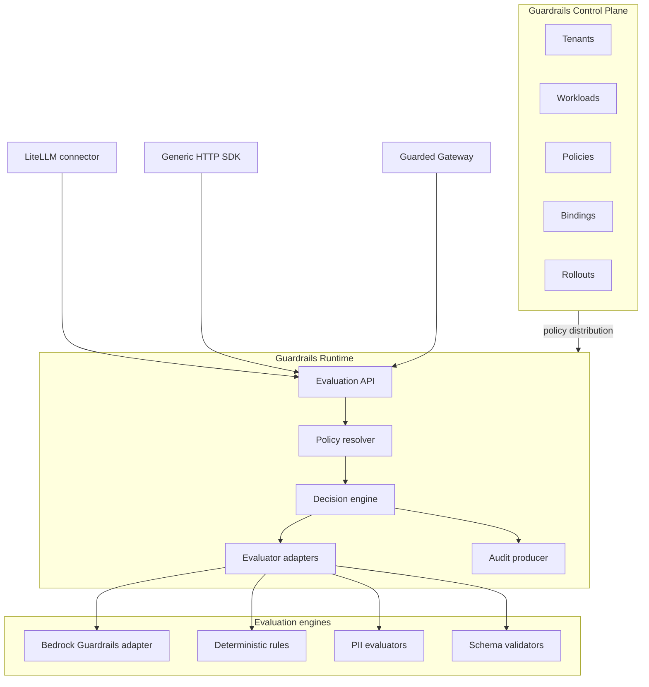
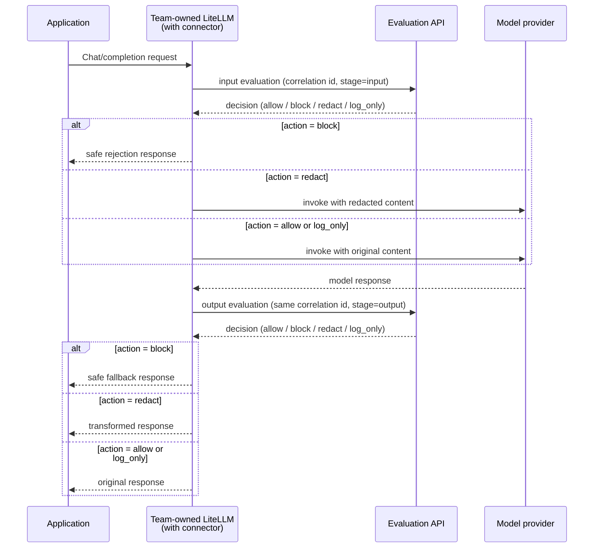
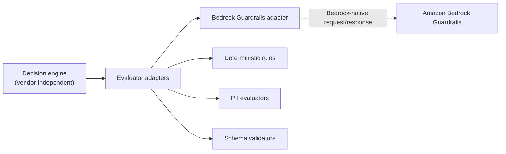

**AI Guardrails — Integration Architecture**

**Authority level:** L3
**Status:** Draft
**Date:** 2026-07-24
**Derived from:** seed.md + AGREEMENTS.md

---

> This document describes how external gateways, applications, and evaluation engines connect to the AI Guardrails runtime without becoming the product's boundary. It expands the LiteLLM integration described in the charter into the connector responsibilities, the vendor-independent evaluation contract, the generic HTTP Evaluation API and SDK, and the Bedrock Guardrails adapter. Where this document could be read as conflicting with [`AGREEMENTS.md`](../00-source-of-truth/AGREEMENTS.md), the agreements register is authoritative (L1) and wins.

---

## 1. Purpose and scope

This document defines the integration surface of AI Guardrails: the set of ways an external gateway, application, or SDK invokes the guardrail runtime, and the contract that every such integration must honor identically.

It covers:

* The **LiteLLM connector** — the first supported gateway integration, including what it is and is not responsible for.
* The **generic HTTP Evaluation API and SDK** — the integration path for workloads that do not use LiteLLM.
* The **Bedrock Guardrails adapter** — the first managed evaluation engine, isolated behind the vendor-independent contract.
* The **evaluation request/decision contract** — stages, actions, reason codes, policy identity, and latency reporting that must remain stable regardless of which connector or engine is in use.
* The **extensibility guarantee** — that additional integrations can be added without changing policy semantics.

It does not cover per-mode deployment topology (see [`DEPLOYMENT-ARCHITECTURE.md`](DEPLOYMENT-ARCHITECTURE.md)), internal component decomposition of the runtime (see [`COMPONENT-ARCHITECTURE.md`](COMPONENT-ARCHITECTURE.md)), or data-retention and telemetry policy (see [`DATA-ARCHITECTURE.md`](DATA-ARCHITECTURE.md)).

This document is governed directly by [AGR-003](../00-source-of-truth/AGREEMENTS.md#agr-003--litellm-as-first-connector-not-the-product-boundary), [AGR-004](../00-source-of-truth/AGREEMENTS.md#agr-004--bedrock-guardrails-as-first-engine-vendor-independent-contract), [AGR-005](../00-source-of-truth/AGREEMENTS.md#agr-005--policy-portability), [AGR-006](../00-source-of-truth/AGREEMENTS.md#agr-006--one-logical-evaluation-contract-across-all-modes), [AGR-007](../00-source-of-truth/AGREEMENTS.md#agr-007--policies-are-separate-from-connectors), and [AGR-012](../00-source-of-truth/AGREEMENTS.md#agr-012--failure-behavior-is-part-of-policy). None of the statements below may narrow or contradict those agreements.

---

## 2. Architectural position of integrations

LiteLLM is the first supported gateway adapter, **not the product boundary** ([AGR-003](../00-source-of-truth/AGREEMENTS.md#agr-003--litellm-as-first-connector-not-the-product-boundary)). Connectors and SDKs are thin, replaceable clients of a stable Evaluation API; evaluation engines (Bedrock Guardrails, deterministic rules, PII evaluators, schema validators) are thin, replaceable adapters behind a stable decision-normalization boundary. Nothing about policy meaning may live inside either boundary layer.

Three integration clients are shown because they are the ones defined in the charter's logical architecture ([seed.md §10](../../seed.md)): the LiteLLM connector, the generic SDK, and the provider-operated Guarded Gateway (which internally reuses the same connector contract against a provider-managed LiteLLM instance). All three call the same Evaluation API and receive the same decision structure — this is the one-contract guarantee ([AGR-006](../00-source-of-truth/AGREEMENTS.md#agr-006--one-logical-evaluation-contract-across-all-modes)).

---

## 3. The evaluation contract

The evaluation contract is the logical interface that every deployment mode and every connector must implement identically: policy definitions, request structures, decision structures, reason codes, enforcement actions, audit metadata, and policy-version semantics ([AGR-006](../00-source-of-truth/AGREEMENTS.md#agr-006--one-logical-evaluation-contract-across-all-modes)). It is expressed in terms of the core domain model — tenant, workload, policy, policy binding, evaluation, decision ([AGR-017](../00-source-of-truth/AGREEMENTS.md#agr-017--core-domain-model)).

### 3.1 Evaluation stages

An evaluation request always targets a named stage. The MVP supports two:

| Stage | Description | Status |
| --- | --- | --- |
| `input` | Evaluates content before it reaches the model (prompt, system prompt, conversation history, per workload configuration). | Supported (MVP) |
| `output` | Evaluates content after model inference, before it reaches the caller. | Supported (MVP) |
| `retrieval` | Evaluates retrieved documents before they are added to context. | Future scope |
| `tool_call` | Evaluates a proposed tool invocation. | Future scope |
| `tool_result` | Evaluates content returned by a tool. | Future scope |
| `memory_write` | Evaluates content before it is written to persistent memory. | Future scope |
| `final_response` | Evaluates a fully assembled response distinct from `output`. | Future scope |

The MVP initially limits evaluated content to user/model input and model output ([seed.md §13](../../seed.md)); future stages must be added by extending this table, not by inventing a parallel model.

### 3.2 Evaluation request (conceptual shape)

An evaluation request carries, at minimum:

| Field | Purpose |
| --- | --- |
| Tenant identifier | Resolves which organization's policy configuration applies. |
| Workload identifier | Resolves the effective policy binding and enforcement mode. |
| Stage | `input` or `output` (see §3.1). |
| Content payload | The prompt, response, or other stage-appropriate content to evaluate. |
| Correlation identifier | Propagated end to end so a single logical request can be traced across pre-call and post-call evaluations and audit records. |
| Policy reference (optional) | Client-asserted policy/version hint; never authoritative on its own — the runtime resolves and authorizes the effective policy server-side ([seed.md §14](../../seed.md)). |

### 3.3 Decision structure

A decision is the normalized result of an evaluation, regardless of which evaluator or engine produced it. Per the domain model, a decision must contain:

| Field | Purpose |
| --- | --- |
| Action | One of the enforcement actions in §3.4. |
| Allowed status | Whether the evaluated content may proceed. |
| Reason codes | Standardized codes identifying which check(s) drove the decision (see §3.5). |
| Policy name and version | Identifies exactly which immutable policy version produced the decision. |
| Evaluator metadata | Which evaluator(s)/engine(s) contributed, and their versions. |
| Transformed content | Present when the action alters content (for example, `redact`). |
| Correlation identifier | Ties the decision back to the originating request across stages. |
| Audit identifier | Reference to the corresponding audit record. |
| Evaluation latency | Time spent producing the decision, feeding the P50/P95/P99 latency metrics tracked platform-wide ([seed.md §15](../../seed.md)). |

This structure is identical whether the decision was produced by a hosted Evaluation API call (Mode A/B) or a customer-managed runtime (Mode C) — see [`DEPLOYMENT-ARCHITECTURE.md`](DEPLOYMENT-ARCHITECTURE.md).

### 3.4 Enforcement actions

| Action | Meaning | Status |
| --- | --- | --- |
| `allow` | Content proceeds unmodified. | MVP |
| `block` | Content is rejected; the connector must not forward it. | MVP |
| `redact` | Content proceeds in a transformed form supplied in the decision. | MVP |
| `log_only` | Content proceeds unmodified; the decision is recorded for observe-mode measurement without affecting the request. | MVP |
| `rewrite` / `discard` / `abstain` / `require_approval` | Additional normalized actions. | Future scope |

These four MVP actions are what every connector — LiteLLM or otherwise — must be able to enforce ([seed.md §9](../../seed.md)).

### 3.5 Reason codes

Every decision carries one or more reason codes identifying which check produced it (for example, which evaluator category or rule matched). Reason codes are:

* Defined by the policy schema and evaluator adapters, not by any single connector.
* Stable across evaluation engines — a Bedrock-sourced detection and a deterministic-rule detection covering the same category surface a consistent code, so policy authors and downstream audiences reason about violations independently of which engine ran.
* Part of the audit record, supporting the reason-code totals referenced in the customer-managed telemetry model ([AGR-016](../00-source-of-truth/AGREEMENTS.md#agr-016--customer-controlled-telemetry-for-the-customer-managed-runtime)).

The concrete reason-code taxonomy is owned by the policy schema (see [`COMPONENT-ARCHITECTURE.md`](COMPONENT-ARCHITECTURE.md)) and is out of scope for this document; no specific code values are asserted here.

### 3.6 Policy name, version, and compatibility

Every decision names the exact immutable policy version that produced it. Policies support immutable versions, controlled promotion, workload-scoped rollout, immediate rollback, and compatibility validation ([seed.md §15](../../seed.md)). The evaluation contract must remain compatible across policy versions and across deployment modes simultaneously; contract changes are versioned and evaluated for backward compatibility before release ([AGR-006](../00-source-of-truth/AGREEMENTS.md#agr-006--one-logical-evaluation-contract-across-all-modes)).

### 3.7 Latency

Evaluation latency is a first-class decision field, not an out-of-band metric. It rolls up into platform-level P50/P95/P99 evaluation latency, timeout rate, and detector-specific latency measurements used for both reliability reporting and the observe-mode graduation described in [AGR-011](../00-source-of-truth/AGREEMENTS.md#agr-011--observe-before-enforce-progression).

---

## 4. The LiteLLM connector

The LiteLLM connector is the first supported gateway integration. It is a client of the evaluation contract, not an extension of it — it must not embed policy logic, thresholds, or detection rules ([AGR-007](../00-source-of-truth/AGREEMENTS.md#agr-007--policies-are-separate-from-connectors)).

### 4.1 Request flow

This is the pre-call / post-call pattern shown in Mode A of [`DEPLOYMENT-ARCHITECTURE.md`](DEPLOYMENT-ARCHITECTURE.md); the same sequence applies whether the Evaluation API is the hosted runtime (Mode A), the provider-managed Guarded Gateway's internal runtime (Mode B), or a customer-managed runtime reached over the local network (Mode C).

### 4.2 Connector responsibilities

The LiteLLM connector is responsible for ([seed.md §12](../../seed.md)):

| Responsibility | Detail |
| --- | --- |
| Mapping LiteLLM requests into the evaluation contract | Translates LiteLLM's request/response structures into the stage-appropriate evaluation request defined in §3.2, and translates decisions back into LiteLLM-native effects. |
| Invoking input evaluation before inference | Calls the Evaluation API at `stage=input` prior to sending the request to the model provider. |
| Enforcing block or redact decisions | Rejects the request on `block`, and substitutes the transformed content on `redact`, before allowing the call to proceed. |
| Invoking output evaluation after inference | Calls the Evaluation API at `stage=output` on the model's response before it is returned to the application. |
| Applying safe output fallbacks | When the output decision is `block` (or evaluation cannot complete per the workload's failure policy), returns a safe fallback response rather than the raw model output. |
| Propagating correlation identifiers | Carries a single correlation identifier through the input evaluation, the model call, and the output evaluation, so both decisions and the eventual audit trail can be joined. |
| Handling evaluation timeouts | Applies the workload's configured timeout and failure behavior (§4.6) when the Evaluation API does not respond in time. |
| Emitting connector-health telemetry | Reports connector-level health signals (reachability, timeout rate, error rate) distinct from the evaluation decisions themselves, supporting platform-managed enforcement visibility ([seed.md §8](../../seed.md)). |

### 4.3 Connector non-responsibilities

The connector explicitly does **not** own ([seed.md §12](../../seed.md)):

| Not the connector's job | Owned instead by |
| --- | --- |
| Defining organization policy | The policy schema and the policy owner (see [`COMPONENT-ARCHITECTURE.md`](COMPONENT-ARCHITECTURE.md)). |
| Implementing detection models | Evaluator adapters and evaluation engines (§6). |
| Managing model credentials | The consuming team (Mode A/C) or the provider's gateway operations (Mode B) — never the guardrail platform ([seed.md §3](../../seed.md)). |
| Persisting audit records | The audit producer inside the Guardrails Runtime. |
| Performing user authorization | The consuming application ([AGR-010](../00-source-of-truth/AGREEMENTS.md#agr-010--guardrails-are-not-authorization)). |
| Managing policy versions | The control plane's policy resolver and rollout tooling. |

This split is what keeps a policy expressible and testable independently of any specific connector, and lets new connectors be added by implementing the invocation contract only ([AGR-007](../00-source-of-truth/AGREEMENTS.md#agr-007--policies-are-separate-from-connectors)).

### 4.4 Correlation identifiers and timeouts

* A correlation identifier is generated (or accepted, if already present in the incoming request) at the start of the LiteLLM pre-call step and threaded through the post-call step and every decision and audit record for that logical request.
* Per-stage timeouts are configured as part of the workload's policy binding, not hardcoded in the connector, so different workloads can tolerate different latency budgets.
* On timeout, the connector applies the workload's documented failure behavior (§4.6) rather than an implicit default — there must be no undocumented fallback behavior ([AGR-012](../00-source-of-truth/AGREEMENTS.md#agr-012--failure-behavior-is-part-of-policy)).

### 4.5 Connector-health telemetry

Connector-health telemetry (reachability, timeout rate, error rate) is distinct from evaluation decisions and from tenant content. It is one of the controls available under platform-managed enforcement, but it must not, on its own, be treated as evidence of mandatory enforcement — a cooperative connector remains removable, disableable, or misconfigurable regardless of what its own health telemetry reports ([AGR-018](../00-source-of-truth/AGREEMENTS.md#agr-018--trust-and-enforcement-model)).

### 4.6 Failure behavior

Failure behavior is part of the policy, not an implementation detail left to the connector ([AGR-012](../00-source-of-truth/AGREEMENTS.md#agr-012--failure-behavior-is-part-of-policy)). The connector must consult and apply the workload's configured behavior for each of the following, with no undocumented fallback:

| Failure condition | Example configured behaviors |
| --- | --- |
| Evaluation API times out | Allow and log; block; use a cached policy decision. |
| A detector is unavailable | Degrade to remaining detectors and log; block. |
| The policy cannot be resolved | Block; require manual approval. |
| The control plane is unavailable | Use the local/cached policy (Mode C); block. |
| Audit delivery fails | Allow and log locally for later reconciliation; block. |
| A response cannot be safely transformed | Return a safe fallback response; block. |

### 4.7 Behavior across deployment modes

| Mode | Where the connector runs | What the connector talks to |
| --- | --- | --- |
| A — Remote Evaluation | Inside the team-owned LiteLLM instance. | The hosted Evaluation API. |
| B — Guarded Gateway | Inside the provider-managed LiteLLM instance underlying the Guarded Gateway. | The provider's own Guardrails Runtime, in-process or over the private network. |
| C — Customer-Managed Runtime | Inside the customer's LiteLLM or application. | The customer-hosted Guardrails Runtime, including its local policy cache and Bedrock Guardrails adapter. |

The connector contract itself does not change across modes — only the network destination of the Evaluation API does. This is what allows the runtime to later be packaged for customer-managed deployment without changing the connector contract ([AGR-020](../00-source-of-truth/AGREEMENTS.md#agr-020--mvp-success-demonstration)).

---

## 5. Generic HTTP Evaluation API and SDK

Not every workload uses LiteLLM. The generic HTTP Evaluation API is the direct, framework-independent surface that the LiteLLM connector itself is built on top of, and the SDK is a thin client library over that same API.

* **Generic HTTP Evaluation API.** Exposes the same evaluation request/decision contract described in §3, callable by any application, custom gateway, or agent framework capable of making an authenticated HTTP call. This is explicitly in MVP scope alongside the LiteLLM integration ([seed.md §6.1](../../seed.md)).
* **Generic SDK.** A language-level convenience wrapper around the HTTP API (request construction, correlation-id propagation, timeout handling) with the same non-responsibilities as the LiteLLM connector (§4.3) — it does not define policy, implement detection, manage credentials, persist audit records, perform authorization, or manage policy versions.
* **Relationship to the LiteLLM connector.** The LiteLLM connector and the generic SDK are two clients of one contract, not two contracts. A team migrating from a custom SDK integration to LiteLLM (or vice versa) changes only which client calls the Evaluation API — policies, decisions, reason codes, and audit records are unaffected.

This is the mechanism by which the product supports teams that do not operate LiteLLM at all, without requiring a second evaluation contract.

---

## 6. Bedrock Guardrails adapter

Amazon Bedrock Guardrails is the first managed evaluation engine, adopted to accelerate delivery of a working managed evaluator — but it sits **behind** the vendor-independent evaluation contract, not as part of it ([AGR-004](../00-source-of-truth/AGREEMENTS.md#agr-004--bedrock-guardrails-as-first-engine-vendor-independent-contract)).

* **Normalization responsibility.** The adapter is solely responsible for translating Bedrock Guardrails' native request and response formats into the platform's own decision structure (§3.3) before any result reaches a policy or a connector. No Bedrock-specific field, code, or response shape may leak past the adapter boundary.
* **Adapter pattern applies uniformly.** Deterministic rules, PII evaluators, schema validators, and any future third-party evaluation engine are added behind the same adapter interface as Bedrock Guardrails — none of them are special-cased in the decision engine or in policy definitions.
* **Contract permanence.** Marketing and technical documentation must not describe Bedrock Guardrails as the product's permanent or exclusive detection engine ([AGR-004](../00-source-of-truth/AGREEMENTS.md#agr-004--bedrock-guardrails-as-first-engine-vendor-independent-contract)); the public contract is designed to outlive any single engine choice.
* **Deployment-mode presence.** In Mode C (Customer-Managed Runtime), the Bedrock Guardrails adapter runs inside the customer's own AWS account alongside the local policy cache and custom evaluators ([seed.md §3](../../seed.md)), using the same normalization logic as the hosted runtime.

---

## 7. Extensibility: additional integrations without changing policy semantics

The product must later support additional integrations — further gateways, agent frameworks, or evaluation engines — without changing policy semantics ([seed.md §12](../../seed.md)). This is achieved structurally, not by convention:

1. **Policies never reference connectors or engines.** A policy is defined purely in terms of stages, evaluator configuration, thresholds, enforcement actions, and failure behavior (§3), never in terms of "LiteLLM," "Bedrock," or any other vendor or framework identifier ([AGR-005](../00-source-of-truth/AGREEMENTS.md#agr-005--policy-portability)).
2. **Connectors implement an invocation contract, not a policy contract.** Adding a new connector means implementing request mapping, evaluation invocation, action enforcement, correlation propagation, timeout handling, and health telemetry (§4.2) against the existing Evaluation API — no policy, decision, or reason-code change is required.
3. **Evaluation engines implement an adapter contract, not a decision contract.** Adding a new evaluation engine means normalizing its native output into the existing decision structure (§3.3, §6) — the decision engine and audit producer are unaffected.
4. **Conformance is testable independently of any one integration.** Because the contract is defined once (§3) and shared across modes ([AGR-006](../00-source-of-truth/AGREEMENTS.md#agr-006--one-logical-evaluation-contract-across-all-modes)), a conformance test suite can validate any new connector or engine against the same fixtures used for LiteLLM and Bedrock Guardrails, without bespoke per-integration test design.

The MVP success demonstration directly exercises this property: two independent LiteLLM instances must consume the same policy and receive consistent normalized decisions, and the runtime must later be packaged for customer-managed deployment without changing the connector contract ([AGR-020](../00-source-of-truth/AGREEMENTS.md#agr-020--mvp-success-demonstration)).

---

## 8. Integration summary across deployment modes

| Concern | Mode A — Remote Evaluation | Mode B — Guarded Gateway | Mode C — Customer-Managed Runtime |
| --- | --- | --- | --- |
| Connector location | Team-owned LiteLLM | Provider-managed LiteLLM | Customer-hosted LiteLLM or application |
| Evaluation API location | Hosted (provider-operated) | Hosted, internal to the Guarded Gateway | Customer AWS account |
| Bedrock Guardrails adapter location | Hosted runtime | Hosted runtime | Customer AWS account |
| Policy source | Control-plane distribution | Control-plane distribution | Local policy cache, asynchronously synchronized ([AGR-015](../00-source-of-truth/AGREEMENTS.md#agr-015--customer-managed-runtime-executes-without-a-synchronous-control-plane-connection)) |
| Contract shape (§3) | Unchanged | Unchanged | Unchanged |

Only the network location of the Evaluation API and the evaluator adapters changes between modes; the request/decision contract, the connector responsibilities, and the adapter pattern do not ([AGR-006](../00-source-of-truth/AGREEMENTS.md#agr-006--one-logical-evaluation-contract-across-all-modes)).

---

## 9. Related documents

| Document | Relationship |
| --- | --- |
| [`AGREEMENTS.md`](../00-source-of-truth/AGREEMENTS.md) | Authoritative (L1) source of truth this document is derived from. |
| [`CHARTER.md`](../10-charter/CHARTER.md) | Solution-level framing of the three deployment modes and the LiteLLM-as-first-connector decision. |
| [`PRINCIPLES.md`](../10-charter/PRINCIPLES.md) | Policy-portability and policies-separate-from-connectors principles expanded here into concrete contract detail. |
| [`CAPABILITIES.md`](../20-product/CAPABILITIES.md) | Capability-level view of the LiteLLM integration and Evaluation API. |
| [`DEPLOYMENT-ARCHITECTURE.md`](DEPLOYMENT-ARCHITECTURE.md) | Full per-mode deployment topology referenced in §4.7 and §8. |
| [`COMPONENT-ARCHITECTURE.md`](COMPONENT-ARCHITECTURE.md) | Internal decomposition of the Guardrails Runtime, policy schema, and reason-code taxonomy. |
| [`DATA-ARCHITECTURE.md`](DATA-ARCHITECTURE.md) | Content-exposure and retention detail for data flowing through these integrations. |
| [`SECURITY-ARCHITECTURE.md`](SECURITY-ARCHITECTURE.md) | Trust and enforcement model referenced in §4.5. |
| [`CLAIMS-REGISTER.md`](../70-governance/CLAIMS-REGISTER.md) | Approved external claims about connector scope and vendor independence. |
| [`IMPLEMENTATION-STRATEGY.md`](../60-delivery/IMPLEMENTATION-STRATEGY.md) | Phase-by-phase delivery of the connector, generic SDK, and Bedrock adapter. |
