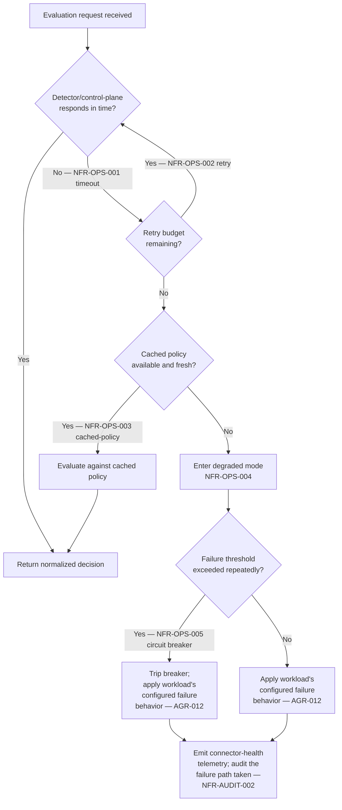

**AI Guardrails — Non-Functional Requirements**

**Authority level:** L2
**Status:** Draft
**Date:** 2026-07-24
**Derived from:** AGREEMENTS.md

---

## Purpose and authority

This document specifies measurable non-functional requirements (NFRs) for the AI Guardrails runtime, control plane, and connectors, across all three deployment modes (Remote Evaluation, Guarded Gateway, Customer-Managed Runtime).

This is an **L2 — derived** document. It operationalizes, but never overrides, the L1 authoritative material in [`../00-source-of-truth/AGREEMENTS.md`](../00-source-of-truth/AGREEMENTS.md) and [`../00-source-of-truth/CONSTRAINTS.md`](../00-source-of-truth/CONSTRAINTS.md). Where a constraint (`CON-###`) already states a hard boundary, the corresponding NFR here restates it as a measurable target, adds how it is validated, and identifies at which delivery stage that validation occurs. Where the L1 registers do not provide a concrete number, the target is marked **TBD** rather than invented, per source-of-truth policy — no metrics, SLAs, or performance numbers appear here that are not present in or directly inferable from the L1 registers.

Each requirement below follows a fixed shape:

```text
## NFR-<CATEGORY>-NNN — <short name>
Requirement:      the measurable statement, with a concrete target or TBD
**Measurement:**       how the target is observed or computed
**Validation stage:**  when/where this is checked (delivery phase, review gate, or ongoing operation)
**Source:**            register entries and/or AGR-/CON- reference
```

Categories are ordered: Availability, Reliability, Recovery, Performance, Scalability, Security, Privacy, Auditability, Maintainability, Portability, Operability, Cost, Compliance. Every category contains at least one requirement, per the scope of this document.

---

## Table of contents

- [Availability](#availability)
- [Reliability](#reliability)
- [Recovery](#recovery)
- [Performance](#performance)
- [Scalability](#scalability)
- [Security](#security)
- [Privacy](#privacy)
- [Auditability](#auditability)
- [Maintainability](#maintainability)
- [Portability](#portability)
- [Operability](#operability)
- [Cost](#cost)
- [Compliance](#compliance)
- [Summary table](#summary-table)
- [Operability failure-path diagram](#operability-failure-path-diagram)
- [Related documents](#related-documents)

---

## Availability

[original charter §15](../00-source-of-truth/PROVENANCE.md#3-section-by-section-map) requires the guardrail runtime to define an availability objective and the operating behaviors that support it; success metrics in [`SUCCESS-CRITERIA.md`](../10-charter/SUCCESS-CRITERIA.md) name "Evaluation API availability" as a tracked reliability metric.

### NFR-AVAIL-001 — Evaluation API availability objective

Requirement: The hosted Evaluation API (Remote Evaluation and Guarded Gateway modes) must have a documented, monitored availability objective. The specific percentage is **TBD** — no target figure exists in the source material — and must be set and published before general availability.

**Measurement:** Uptime monitoring against the published objective, computed over a rolling window (window length TBD); reported as a success metric per [`SUCCESS-CRITERIA.md`](../10-charter/SUCCESS-CRITERIA.md) ("Evaluation API availability").
**Validation stage:** Objective defined during Phase 2 (Internal multi-team platform); measured continuously in production thereafter.
**Source:** [original charter §15](../00-source-of-truth/PROVENANCE.md#3-section-by-section-map) (Operational requirements — Availability: "Availability objective"), [`SUCCESS-CRITERIA.md`](../10-charter/SUCCESS-CRITERIA.md) (Reliability metrics); AGR-002.

### NFR-AVAIL-002 — Degraded-mode continuity

Requirement: When the control plane, a detector, or policy resolution is unavailable, the runtime must continue operating in a documented degraded mode rather than failing with undefined behavior. 100% of policies must declare an explicit degraded-mode behavior before they can be promoted out of Observe.

**Measurement:** Policy schema validation rejects any policy version lacking a failure-behavior/degraded-mode section; audit sampling confirms the declared behavior was the one actually taken during an observed outage.
**Validation stage:** Enforced at policy authoring/validation time (Phase 2 onward); exercised via chaos/failure-injection testing before promotion of any mode to general availability.
**Source:** [AGR-012](../00-source-of-truth/AGREEMENTS.md#agr-012--failure-behavior-is-part-of-policy) (Failure behavior is part of policy), [original charter §15](../00-source-of-truth/PROVENANCE.md#3-section-by-section-map) (Availability: "Degraded operating mode"); AGR-012, AGR-015.

---

## Reliability

[`SUCCESS-CRITERIA.md`](../10-charter/SUCCESS-CRITERIA.md) names four reliability metrics the platform must track; this section restates them as measurable NFRs.

### NFR-REL-001 — Evaluation timeout rate

Requirement: The proportion of evaluation requests that exceed their stage-specific timeout must be measured continuously. The acceptable ceiling is **TBD** pending timeout-value definition (see CON-016); until then, any non-zero, unexpected upward trend must trigger investigation.

**Measurement:** `timed_out_evaluations / total_evaluations` per stage, per detector, per workload, emitted as an operational metric.
**Validation stage:** Instrumented from Phase 1 (Integration proof); ceiling formalized once stage timeouts are finalized (Phase 2).
**Source:** [original charter §15](../00-source-of-truth/PROVENANCE.md#3-section-by-section-map) (Performance: "Timeout rate"), [`SUCCESS-CRITERIA.md`](../10-charter/SUCCESS-CRITERIA.md) (Reliability: "Evaluation timeout rate"); CON-016.

### NFR-REL-002 — Policy-resolution failure rate

Requirement: The rate at which a workload's effective policy cannot be resolved (version not found, incompatible runtime, cache miss with no fallback) must be measured and kept as close to zero as achievable; a specific ceiling is **TBD**.

**Measurement:** `policy_resolution_failures / policy_resolution_attempts`, tracked per workload and per deployment mode.
**Validation stage:** Phase 2 onward, as policy bindings and rollout controls come online; monitored continuously in production.
**Source:** [`SUCCESS-CRITERIA.md`](../10-charter/SUCCESS-CRITERIA.md) (Reliability: "Policy-resolution failure rate"); AGR-006, AGR-015.

### NFR-REL-003 — Audit delivery success rate

Requirement: The proportion of evaluations for which an audit record is successfully produced and delivered to the audit pipeline must be measured; a specific target is **TBD**, but audit-delivery failure must always be a defined, non-silent failure-behavior path (see NFR-AUDIT-002).

**Measurement:** `audit_records_delivered / evaluations_performed`, reported per tenant and per deployment mode.
**Validation stage:** Phase 1 (basic auditing) for instrumentation; Phase 2 for SLA-style tracking against a target once set.
**Source:** [original charter §15](../00-source-of-truth/PROVENANCE.md#3-section-by-section-map) (Auditing), [`SUCCESS-CRITERIA.md`](../10-charter/SUCCESS-CRITERIA.md) (Reliability: "Audit delivery success rate"); AGR-012.

---

## Recovery

the L1 registers do not provide numeric RTO/RPO figures; recovery requirements here are derived from the policy-rollback, control-plane-independence, and circuit-breaker behaviors specified in [AGR-011](../00-source-of-truth/AGREEMENTS.md#agr-011--observe-before-enforce-progression), [AGR-012](../00-source-of-truth/AGREEMENTS.md#agr-012--failure-behavior-is-part-of-policy), [original charter §15](../00-source-of-truth/PROVENANCE.md#3-section-by-section-map), and the Phase 1–2 validation demonstration criteria in §16 (see [`../60-delivery/VALIDATION-PLAN.md`](../60-delivery/VALIDATION-PLAN.md)).

### NFR-REC-001 — Immediate policy rollback

Requirement: A promoted policy version must be reversible to its prior version through an explicit, auditable rollback action. The time required to complete a rollback is **TBD**, but rollback must not require a new deployment of runtime software — only a policy-version change.

**Measurement:** Time from rollback initiation to the prior version becoming effective for all bound workloads, measured in a controlled test; verified as part of the Phase 1–2 validation demonstration ("a policy can be upgraded and rolled back").
**Validation stage:** Phase 1/2 (policy promotion and rollback tooling); re-verified at every subsequent policy-rollout release.
**Source:** [original charter §15](../00-source-of-truth/PROVENANCE.md#3-section-by-section-map) (Policy rollout: "Immediate rollback"), [`SUCCESS-CRITERIA.md`](../10-charter/SUCCESS-CRITERIA.md); [`../60-delivery/VALIDATION-PLAN.md`](../60-delivery/VALIDATION-PLAN.md).

### NFR-REC-002 — Customer-managed runtime reconnection recovery

Requirement: A Customer-Managed Runtime that has been operating disconnected from the hosted control plane must, upon reconnection, resume asynchronous policy synchronization without requiring a restart, without evaluation-path downtime, and without loss of locally buffered audit records.

**Measurement:** Controlled disconnect/reconnect test measuring (a) evaluation availability during the outage window, (b) successful resumption of policy sync, (c) completeness of audit records produced during the outage once flushed.
**Validation stage:** Phase 4 (Customer-managed runtime) delivery and acceptance testing.
**Source:** [AGR-002](../00-source-of-truth/AGREEMENTS.md#agr-002--three-deployment-modes) (Mode C: "must be capable of executing policies without requiring a synchronous connection to the hosted control plane"); AGR-015.

### NFR-REC-003 — Circuit-breaker reset

Requirement: When a circuit breaker trips around an unavailable detector or dependency, the runtime must attempt automatic recovery (reset/half-open probing) rather than requiring manual intervention to restore normal operation. Specific probe intervals and thresholds are **TBD**.

**Measurement:** Time from underlying dependency recovery to circuit closing and normal evaluation resuming, measured in failure-injection tests.
**Validation stage:** Phase 2 onward, as part of runtime resiliency hardening; re-verified before each mode's general availability.
**Source:** [original charter §15](../00-source-of-truth/PROVENANCE.md#3-section-by-section-map) (Availability: "Circuit-breaker behavior"); AGR-012.

---

## Performance

[original charter §15](../00-source-of-truth/PROVENANCE.md#3-section-by-section-map) requires the platform to measure P50/P95/P99 evaluation latency, throughput, timeout rate, detector-specific latency, decision distribution, and policy-cache hit rate. No numeric SLA figures are present in the source material, so all targets below are marked TBD; what is fixed is that each metric must be measured, reported, and gated at defined stages.

### NFR-PERF-001 — P50 evaluation latency

Requirement: Median end-to-end evaluation latency (request received by the Evaluation API to decision returned) must be measured per stage (input/output) and per deployment mode. Target value is **TBD**.

**Measurement:** P50 of evaluation-latency distribution, computed continuously and reported per workload, per stage, per mode.
**Validation stage:** Instrumented from Phase 1; target thresholds set once representative load data exists (Phase 2).
**Source:** [original charter §15](../00-source-of-truth/PROVENANCE.md#3-section-by-section-map) (Performance: "P50 evaluation latency"), [`SUCCESS-CRITERIA.md`](../10-charter/SUCCESS-CRITERIA.md) ("P95 evaluation latency" as reliability metric implies the full percentile family is tracked).

### NFR-PERF-002 — P95 evaluation latency

Requirement: 95th-percentile evaluation latency must be measured per stage and per deployment mode. Target value is **TBD**.

**Measurement:** P95 of the same latency distribution as NFR-PERF-001.
**Validation stage:** Instrumented from Phase 1; used as the primary reliability-facing latency metric per [`SUCCESS-CRITERIA.md`](../10-charter/SUCCESS-CRITERIA.md).
**Source:** [original charter §15](../00-source-of-truth/PROVENANCE.md#3-section-by-section-map) (Performance: "P95 evaluation latency"), [`SUCCESS-CRITERIA.md`](../10-charter/SUCCESS-CRITERIA.md) (Reliability: "P95 evaluation latency"); AGR-006.

### NFR-PERF-003 — P99 evaluation latency

Requirement: 99th-percentile evaluation latency must be measured per stage and per deployment mode, to surface tail-latency behavior not visible at P50/P95. Target value is **TBD**.

**Measurement:** P99 of the same latency distribution.
**Validation stage:** Instrumented from Phase 1; reviewed at each load test and before general availability of each mode.
**Source:** [original charter §15](../00-source-of-truth/PROVENANCE.md#3-section-by-section-map) (Performance: "P99 evaluation latency").

### NFR-PERF-004 — Evaluation throughput

Requirement: The runtime must sustain the expected throughput declared per workload (a workload attribute in the domain model) without degrading latency beyond the targets above. Numeric throughput ceilings are **TBD**.

**Measurement:** Sustained evaluations-per-second under load test, compared against each workload's declared "Expected throughput" attribute.
**Validation stage:** Load testing prior to onboarding a workload whose expected throughput exceeds previously validated levels; re-validated at Phase 2/3 scale-up.
**Source:** [AGR-017](../00-source-of-truth/AGREEMENTS.md#agr-017--core-domain-model) (Workload: "Expected throughput"), [original charter §15](../00-source-of-truth/PROVENANCE.md#3-section-by-section-map) (Performance: "Evaluation throughput").

### NFR-PERF-005 — Timeout rate as a performance signal

Requirement: Timeout rate must be tracked as a first-class performance metric, distinct from the reliability ceiling in NFR-REL-001, so that latency regressions are visible before they cross the timeout boundary.

**Measurement:** Same computation as NFR-REL-001, reviewed alongside latency percentiles in the same dashboard/report.
**Validation stage:** Continuous, from Phase 1 onward.
**Source:** [original charter §15](../00-source-of-truth/PROVENANCE.md#3-section-by-section-map) (Performance: "Timeout rate").

### NFR-PERF-006 — Detector-specific latency

Requirement: Latency must be measured per individual evaluator/detector (e.g., Bedrock Guardrails adapter, deterministic rules engine, PII evaluator), not only as an aggregate evaluation latency, so that a single slow detector can be identified and isolated.

**Measurement:** Per-detector latency histogram, attributed by evaluator identity in the decision/audit metadata.
**Validation stage:** Phase 1 (Bedrock adapter, deterministic evaluator) onward; required input to the "apply only relevant evaluators" latency mitigation in [`RISK-REGISTER.md`](../70-governance/RISK-REGISTER.md).
**Source:** [original charter §15](../00-source-of-truth/PROVENANCE.md#3-section-by-section-map) (Performance: "Detector-specific latency"), [`RISK-REGISTER.md`](../70-governance/RISK-REGISTER.md) (Key risks — Latency mitigation: "Measure per-evaluator latency").

### NFR-PERF-007 — Policy-cache hit rate

Requirement: The proportion of policy-resolution lookups served from a local/warm cache versus a cold lookup against the control plane or policy store must be measured. Target hit rate is **TBD**, but the metric must be visible per deployment mode, since Customer-Managed Runtime depends on the cache for control-plane-independent execution.

**Measurement:** `cache_hits / policy_resolution_attempts`, reported per mode; correlated with NFR-REL-002 (policy-resolution failure rate).
**Validation stage:** Phase 4 (local policy cache, policy synchronization) for Customer-Managed Runtime; Phase 2 onward for hosted modes.
**Source:** [original charter §15](../00-source-of-truth/PROVENANCE.md#3-section-by-section-map) (Performance: "Policy-cache hit rate"); AGR-015.

---

## Scalability

the L1 registers do not provide numeric capacity ceilings. Scalability requirements are derived from the domain model's "Expected throughput" workload attribute, the "Runtime scaling" and "capacity management" ownership items, and Mode C's stated fit for high-volume workloads.

### NFR-SCALE-001 — Horizontal scaling of the evaluation runtime

Requirement: The Evaluation Runtime must scale horizontally to accommodate a growing number of tenants, workloads, and aggregate evaluation volume without requiring architectural redesign. Specific capacity ceilings are **TBD**.

**Measurement:** Load tests that add tenants/workloads incrementally while holding per-workload latency targets (Performance section) constant; capacity headroom reported to product operators as "Runtime capacity management" telemetry.
**Validation stage:** Phase 2 (Internal multi-team platform) onward, as multiple tenants and workloads are onboarded.
**Source:** [`TARGET-USERS.md`](../20-product/TARGET-USERS.md) (Product operators need "Runtime capacity management"), [AGR-002](../00-source-of-truth/AGREEMENTS.md#agr-002--three-deployment-modes) (Mode A: provider owns "Runtime scaling").

### NFR-SCALE-002 — High-volume and independent-scale support in Customer-Managed Runtime

Requirement: The Customer-Managed Runtime packaging must support workloads explicitly characterized as high-volume, scaling independently of the hosted control plane and of other tenants' deployments.

**Measurement:** Deployment-mode-specific load test executed against the customer-managed runtime container/Helm/ECS artifacts, independent of hosted-mode infrastructure.
**Validation stage:** Phase 4 (Customer-managed runtime) delivery.
**Source:** [AGR-002](../00-source-of-truth/AGREEMENTS.md#agr-002--three-deployment-modes) (Mode C: "intended for... High-volume workloads").

---

## Security

Security NFRs restate the CON-008 through CON-016 boundaries from `CONSTRAINTS.md` as measurable, verifiable targets. Where a constraint is already the boundary statement, this section adds measurement method and validation stage rather than re-deriving rationale.

### NFR-SEC-001 — TLS coverage

Requirement: 100% of runtime communication paths (application–connector, connector–Evaluation API, runtime–evaluation engines, runtime–control plane) must use TLS; zero unencrypted paths are permitted.

**Measurement:** Automated network/configuration scan confirming TLS termination on every listener; flagged as a release-blocking finding if any path is found in plaintext.
**Validation stage:** Security review at every release; continuous scanning in production.
**Source:** [`CONSTRAINTS.md`](../00-source-of-truth/CONSTRAINTS.md) (Security requirements: "TLS for all runtime communication"); CON-008.

### NFR-SEC-002 — IAM-based, short-lived, least-privilege authentication

Requirement: 100% of AWS-facing consumers must authenticate via IAM using short-lived credentials; zero long-lived static credentials may be used for runtime authentication.

**Measurement:** IAM policy and credential-lifetime audit; CI check rejecting infrastructure-as-code that provisions long-lived access keys for runtime roles.
**Validation stage:** Security review at Phase 2 (IAM authentication delivery) and at every subsequent release.
**Source:** [`CONSTRAINTS.md`](../00-source-of-truth/CONSTRAINTS.md) (Security requirements: "IAM-based authentication for AWS consumers," "Short-lived credentials," "Least-privilege runtime roles"); CON-010.

### NFR-SEC-003 — Rate limiting per workload identity

Requirement: The Evaluation API must enforce rate limits scoped to per-tenant workload identity. Specific numeric limits are **TBD**.

**Measurement:** Load test confirming requests beyond the configured limit are rejected with a defined response rather than degrading shared capacity; limits reviewed as part of usage-quota configuration (Phase 3, Guarded Gateway).
**Validation stage:** Phase 2 onward; formalized as part of Phase 3 "Cost and rate controls."
**Source:** [`CONSTRAINTS.md`](../00-source-of-truth/CONSTRAINTS.md) (Security requirements: "Rate limiting"); CON-011.

### NFR-SEC-004 — Input-size limits

Requirement: Every evaluation stage must enforce an input-size ceiling; no unbounded input path is permitted. Specific byte/character ceilings are **TBD** per stage.

**Measurement:** Automated test submitting oversized payloads per stage and confirming rejection with a defined error rather than resource exhaustion.
**Validation stage:** Defined before general availability of each stage; re-verified at every evaluator-adapter addition.
**Source:** [`CONSTRAINTS.md`](../00-source-of-truth/CONSTRAINTS.md) (Security requirements: "Input-size limits"); CON-015.

### NFR-SEC-005 — Audit-event integrity

Requirement: Audit events must be protected against undetected tampering between production and archival; 100% of audit records must carry integrity metadata sufficient to detect modification.

**Measurement:** Verification job confirming archived audit records match their integrity metadata (e.g., checksum/hash chain) on a sampling basis.
**Validation stage:** Phase 1 (basic auditing) for record structure; Phase 2 for integrity-verification tooling.
**Source:** [`CONSTRAINTS.md`](../00-source-of-truth/CONSTRAINTS.md) (Security requirements: "Audit-event integrity").

### NFR-SEC-006 — Dependency and container scanning

Requirement: 100% of runtime container images and declared dependencies must be scanned for known vulnerabilities before deployment; deployments with unresolved critical findings must be blocked pending an explicit exception.

**Measurement:** CI/CD scan gate results, tracked per release and per deployment artifact (including customer-managed packaging: container, Helm chart, ECS template).
**Validation stage:** Every build, from Phase 1 onward; re-verified for each new deployment artifact added in Phase 4.
**Source:** [`CONSTRAINTS.md`](../00-source-of-truth/CONSTRAINTS.md) (Security requirements: "Dependency and container scanning").

---

## Privacy

Privacy NFRs restate the default-behavior requirements in [`DATA-ARCHITECTURE.md`](DATA-ARCHITECTURE.md) (no raw retention by default, hashed identifiers, secret removal) as measurable targets, aligned with CON-013/CON-014 and AGR-014/AGR-016.

### NFR-PRIV-001 — No raw content retention by default

Requirement: 0% of raw prompts and responses are persisted by the hosted runtime unless a tenant has explicitly configured retention. Decision metadata is persisted for 100% of evaluations regardless of retention configuration.

**Measurement:** Storage audit confirming no raw-content fields exist in default-configuration persistence stores; audit metadata field "whether raw content was retained" checked against actual tenant configuration on a sampling basis.
**Validation stage:** Data-architecture review at Phase 1/2; re-verified at every schema change to storage or audit records.
**Source:** [`DATA-ARCHITECTURE.md`](DATA-ARCHITECTURE.md) (Default behavior: "Avoid persisting raw prompts and responses by default," "Persist decision metadata"), [original charter §15](../00-source-of-truth/PROVENANCE.md#3-section-by-section-map) (Auditing: "Whether raw content was retained"); AGR-014, CON-014.

### NFR-PRIV-002 — Identifier hashing

Requirement: User and conversation identifiers must be hashed before persistence wherever technically possible; the percentage of identifier fields hashed is targeted at 100% of fields where hashing is feasible without breaking required correlation.

**Measurement:** Schema review confirming identifier fields in persisted records are hashed, not raw; correlation-identifier design reviewed to confirm hashing does not break the required correlation-identifier function in the decision structure.
**Validation stage:** Data-architecture review at Phase 1/2.
**Source:** [`DATA-ARCHITECTURE.md`](DATA-ARCHITECTURE.md) (Default behavior: "Hash user and conversation identifiers where possible"); AGR-014.

### NFR-PRIV-003 — Secret removal from telemetry

Requirement: 100% of telemetry payloads emitted by the runtime must be free of secrets (credentials, API keys, tokens) by construction, not by post-hoc filtering alone.

**Measurement:** Telemetry schema/payload review confirming secret-bearing fields cannot be populated; automated secret-pattern scan on sampled telemetry as a secondary control.
**Validation stage:** Reviewed at Phase 1/2 telemetry design, and again whenever a new telemetry field is added.
**Source:** [`DATA-ARCHITECTURE.md`](DATA-ARCHITECTURE.md) (Default behavior: "Remove secrets from telemetry"); CON-009.

### NFR-PRIV-004 — Configurable customer-managed telemetry down to none

Requirement: Customer-Managed Runtime deployments must support telemetry configuration ranging from full sanctioned categories (health status, product version, policy version, aggregated evaluation counts, reason-code totals, latency metrics, sanitized decision metadata) down to a fully supported "no telemetry" setting, with raw content excluded from every configuration by construction.

**Measurement:** Configuration test matrix exercising each telemetry level, confirming payload contents match the selected level and that raw content cannot appear at any level.
**Validation stage:** Phase 4 (Customer-managed runtime) delivery and acceptance testing.
**Source:** [`DATA-ARCHITECTURE.md`](DATA-ARCHITECTURE.md) (Customer-managed telemetry); AGR-016, CON-013.

---

## Auditability

[original charter §15](../00-source-of-truth/PROVENANCE.md#3-section-by-section-map) enumerates the mandatory audit metadata fields; this section makes their completeness and delivery measurable.

### NFR-AUDIT-001 — Audit record field completeness

Requirement: 100% of audit records must contain all mandated fields: tenant, workload, policy version, evaluation stage, decision, reason codes, evaluator versions, timestamp, correlation identifier, and whether raw content was retained. No audit record may omit a mandated field.

**Measurement:** Schema validation on audit-record production; sampling-based completeness audit against the mandated field list.
**Validation stage:** Phase 1 (basic auditing) for initial fields; re-verified at every audit-schema change and before each mode's general availability.
**Source:** [original charter §15](../00-source-of-truth/PROVENANCE.md#3-section-by-section-map) (Auditing: full field list); AGR-006, AGR-017.

### NFR-AUDIT-002 — Defined behavior on audit-delivery failure

Requirement: 100% of workloads must have an explicit, non-silent failure behavior defined for the case where audit delivery fails (e.g., allow-and-log locally, block, buffer-and-retry); no workload may operate with an undefined audit-failure path.

**Measurement:** Policy/workload configuration review confirming an audit-failure behavior is set; failure-injection test confirming the configured behavior is actually taken when audit delivery is forced to fail.
**Validation stage:** Phase 1/2, as part of failure-behavior policy validation; re-verified at every policy-schema change.
**Source:** [AGR-012](../00-source-of-truth/AGREEMENTS.md#agr-012--failure-behavior-is-part-of-policy) (Failure behavior is part of policy: "Audit delivery fails"), [original charter §15](../00-source-of-truth/PROVENANCE.md#3-section-by-section-map) (Auditing); AGR-012.

---

## Maintainability

the adapter-isolation principles (§5.1) and policy-versioning rules (§15) are the basis for measurable maintainability targets.

### NFR-MAINT-001 — Vendor/framework isolation behind adapters

Requirement: 100% of LiteLLM-specific and Bedrock-Guardrails-specific logic must be isolated inside their respective connector/adapter; zero vendor-specific types, formats, or configuration structures may appear in the public policy schema or evaluation contract.

**Measurement:** Architecture-conformance check (static analysis or code review checklist) confirming no vendor-specific symbols cross the contract boundary; new evaluation engines or connectors added without modifying existing policies, as a functional test of isolation.
**Validation stage:** Reviewed at every connector/adapter addition; gated at Phase 1 (Bedrock adapter, LiteLLM connector) and re-verified at each subsequent connector (Phase 3+).
**Source:** [AGR-005](../00-source-of-truth/AGREEMENTS.md#agr-005--policy-portability) (Policy portability), [AGR-003](../00-source-of-truth/AGREEMENTS.md#agr-003--litellm-as-first-connector-not-the-product-boundary) (LiteLLM integration: connector responsibilities); AGR-003, AGR-004, AGR-005.

### NFR-MAINT-002 — Immutable policy versions

Requirement: 100% of published policy versions are immutable; any change to a policy's checks, thresholds, or actions must produce a new version rather than mutating an existing one.

**Measurement:** Policy-store write-path check rejecting in-place modification of a published version; version-history audit confirming monotonic version creation.
**Validation stage:** Phase 1/2, as policy storage and rollout controls are delivered.
**Source:** [original charter §15](../00-source-of-truth/PROVENANCE.md#3-section-by-section-map) (Policy rollout: "Immutable versions").

### NFR-MAINT-003 — Bounded evaluator and category sprawl

Requirement: Guardrail-coverage growth must remain governable: 100% of evaluation engines sit behind the standard evaluator-adapter contract (no engine invoked outside it); 100% of registered engines are mapped to at least one guardrail category of [`../20-product/GUARDRAIL-CATALOG.md`](../20-product/GUARDRAIL-CATALOG.md); engines are selectable only through policy `evaluator configuration` (a policy cannot invoke an unlisted engine); and only policy-configured evaluators execute for a given stage, so the size of the available evaluator set does not affect the latency of workloads that configure few. Category additions, removals, and status reclassifications follow register-level change control (AGR-021) — never editorial edits. Numeric ceilings (maximum engines per stage, per-policy evaluator budget) are **TBD** — no figure exists in the source material.

**Measurement:** Architecture-conformance review at every engine addition (adapter present, category mapped, catalog updated in the same change set); per-stage evaluator-invocation audit confirming only policy-configured evaluators ran; documentation-consistency check between the catalog's evaluator-family fields and the registered engine list.
**Validation stage:** Reviewed at every evaluator/engine addition from Phase 1 onward; re-verified at each catalog graduation ([`EXTENSIBILITY-ARCHITECTURE.md`](EXTENSIBILITY-ARCHITECTURE.md) §10).
**Source:** [AGR-004](../00-source-of-truth/AGREEMENTS.md#agr-004--bedrock-guardrails-as-first-engine-vendor-independent-contract), [AGR-006](../00-source-of-truth/AGREEMENTS.md#agr-006--one-logical-evaluation-contract-across-all-modes), [AGR-021](../00-source-of-truth/AGREEMENTS.md#agr-021--guardrail-category-taxonomy-and-extension-model); [`TECHNICAL-RISKS.md`](TECHNICAL-RISKS.md) §4.9; [`CONTAINER-ARCHITECTURE.md`](CONTAINER-ARCHITECTURE.md) §5 (latency mitigation).

---

## Portability

[`SUCCESS-CRITERIA.md`](../10-charter/SUCCESS-CRITERIA.md) (Product portability metrics) is the direct source for this section.

### NFR-PORT-001 — Deployment-mode-independent policy definitions

Requirement: The percentage of policy definitions that are deployment-mode independent (expressible and executable identically in Remote Evaluation, Guarded Gateway, and Customer-Managed Runtime) is tracked as a product portability metric. Target percentage is **TBD**, with the design intent being as close to 100% as the evaluator ecosystem allows.

**Measurement:** Policy-catalog audit classifying each published policy as mode-independent or mode-restricted, with mode-restricted policies requiring an explicit justification.
**Validation stage:** Tracked from Phase 1 onward; reported as an ongoing product-portability metric per [`SUCCESS-CRITERIA.md`](../10-charter/SUCCESS-CRITERIA.md).
**Source:** [`SUCCESS-CRITERIA.md`](../10-charter/SUCCESS-CRITERIA.md) (Product portability: "Percentage of policy definitions that are deployment-mode independent"); AGR-006.

### NFR-PORT-002 — Shared runtime code across hosted and customer-managed modes

Requirement: The percentage of runtime code shared across hosted (Remote Evaluation/Guarded Gateway) and Customer-Managed Runtime deployments is tracked. Target percentage is **TBD**.

**Measurement:** Build/packaging analysis identifying shared modules versus mode-specific code, expressed as a percentage of total runtime code by an agreed unit (e.g., lines of code or module count).
**Validation stage:** Baseline established at Phase 4 (Customer-managed runtime packaging); re-measured at each subsequent release affecting the runtime core.
**Source:** [`SUCCESS-CRITERIA.md`](../10-charter/SUCCESS-CRITERIA.md) (Product portability: "Percentage of runtime code shared across hosted and customer-managed modes"); AGR-015.

### NFR-PORT-003 — Time to deploy a customer-managed runtime

Requirement: The elapsed time required to deploy a functioning Customer-Managed Runtime into a new customer AWS account is tracked as a portability/operability metric. Target duration is **TBD**.

**Measurement:** Timed deployment exercise using the supported artifacts (container, Helm chart, ECS deployment template, infrastructure module), measured from artifact acquisition to first successful evaluation.
**Validation stage:** Phase 4 delivery and acceptance testing; re-measured whenever deployment artifacts change materially.
**Source:** [`SUCCESS-CRITERIA.md`](../10-charter/SUCCESS-CRITERIA.md) (Product portability: "Time required to deploy a customer-managed runtime").

---

## Operability

[original charter §15](../00-source-of-truth/PROVENANCE.md#3-section-by-section-map) requires the runtime to define timeout, retry, cached-policy, degraded-mode, and circuit-breaker behavior. This section makes each one a discrete, verifiable requirement (see also the [operability failure-path diagram](#operability-failure-path-diagram) below).

### NFR-OPS-001 — Explicit, enforced timeout behavior

Requirement: Every evaluation stage must have an explicit timeout, and the behavior taken when that timeout is reached must be defined per workload (e.g., allow-and-log, safe fallback, block). No stage may operate with an undefined or unbounded timeout.

**Measurement:** Configuration audit confirming a timeout value and a mapped failure behavior exist for every stage/workload combination; failure-injection test confirming the defined behavior is what actually occurs.
**Validation stage:** Phase 1/2, as stage timeouts are finalized; re-verified at every new evaluation stage (future scope: retrieval, tool_call, etc.).
**Source:** [original charter §15](../00-source-of-truth/PROVENANCE.md#3-section-by-section-map) (Availability: "Timeout behavior"), [AGR-012](../00-source-of-truth/AGREEMENTS.md#agr-012--failure-behavior-is-part-of-policy) (Failure behavior is part of policy); CON-016, AGR-012.

### NFR-OPS-002 — Bounded retry behavior

Requirement: Retry behavior for evaluation calls must be explicit and bounded (maximum attempts, backoff); unbounded or undefined retry loops are not permitted, since they can stall the consuming application's request path indefinitely.

**Measurement:** Configuration review confirming a maximum retry count and backoff policy are set; load/failure test confirming retries terminate and hand off to the defined failure behavior once exhausted.
**Validation stage:** Phase 1/2, alongside timeout behavior.
**Source:** [original charter §15](../00-source-of-truth/PROVENANCE.md#3-section-by-section-map) (Availability: "Retry behavior"); AGR-012.

### NFR-OPS-003 — Cached-policy behavior

Requirement: The runtime must be able to serve the last-known-good policy version from a local cache when live policy resolution or the control plane is unavailable; the behavior when the cache itself is stale beyond an acceptable age must also be explicitly defined as part of failure behavior.

**Measurement:** Failure-injection test disconnecting the control plane and confirming the runtime continues evaluating using the cached policy; staleness-threshold test confirming the defined stale-cache behavior triggers correctly.
**Validation stage:** Phase 4 (local policy cache, policy synchronization) for Customer-Managed Runtime; Phase 2 for hosted-mode caching.
**Source:** [original charter §15](../00-source-of-truth/PROVENANCE.md#3-section-by-section-map) (Availability: "Cached-policy behavior"), [AGR-002](../00-source-of-truth/AGREEMENTS.md#agr-002--three-deployment-modes) (Mode C: local policy cache); AGR-015, AGR-012.

### NFR-OPS-004 — Documented degraded operating mode

Requirement: Each workload must have an explicit degraded-mode definition describing runtime behavior when one or more dependencies (detector, control plane, audit pipeline) are unavailable, distinct from full outage and from normal operation.

**Measurement:** Policy/workload configuration review confirming a degraded-mode definition exists; scenario test exercising partial-dependency failure and confirming the documented degraded behavior is observed.
**Validation stage:** Phase 2 onward, as part of failure-behavior policy validation.
**Source:** [original charter §15](../00-source-of-truth/PROVENANCE.md#3-section-by-section-map) (Availability: "Degraded operating mode"); AGR-012.

### NFR-OPS-005 — Circuit-breaker behavior

Requirement: The runtime must implement circuit-breaker behavior around evaluators/detectors and the control-plane connection, tripping on sustained failure and reporting the tripped state as part of connector-health telemetry.

**Measurement:** Failure-injection test confirming the breaker trips after a defined failure threshold, that evaluation continues per the defined degraded/failure behavior while tripped, and that connector-health telemetry reflects the tripped state.
**Validation stage:** Phase 2 onward; re-verified before each mode's general availability.
**Source:** [original charter §15](../00-source-of-truth/PROVENANCE.md#3-section-by-section-map) (Availability: "Circuit-breaker behavior"), [AGR-003](../00-source-of-truth/AGREEMENTS.md#agr-003--litellm-as-first-connector-not-the-product-boundary) (LiteLLM integration: "Emitting connector-health telemetry").

---

## Cost

the L1 registers do not provide dollar figures for the MVP; cost-related requirements here are qualitative or process-oriented, derived from the rate/quota and cost-control language in [AGR-002](../00-source-of-truth/AGREEMENTS.md#agr-002--three-deployment-modes), [AGR-020](../00-source-of-truth/AGREEMENTS.md#agr-020--five-phase-delivery) (Phase 3).

### NFR-COST-001 — Cost model established before Guarded Gateway general availability

Requirement: A cost model covering runtime infrastructure cost and, for Guarded Gateway, model-provider inference cost, must be established before that mode reaches general availability. Specific dollar figures are **TBD** and out of scope for this document; see `../30-executive/INVESTMENT-SUMMARY.md` for financial detail where available.

**Measurement:** Existence and review sign-off of a documented cost model per deployment mode.
**Validation stage:** Phase 3 (Guarded Gateway: "Cost and rate controls").
**Source:** [AGR-020](../00-source-of-truth/AGREEMENTS.md#agr-020--five-phase-delivery) (Phase 3 deliverables: "Cost and rate controls"), [AGR-002](../00-source-of-truth/AGREEMENTS.md#agr-002--three-deployment-modes) (Mode A: consuming team owns "Model-provider costs"; Mode B: provider owns rate limits and usage quotas).

### NFR-COST-002 — Usage quotas and rate controls bound cost exposure

Requirement: The Guarded Gateway must enforce usage quotas and rate controls per tenant so that cost exposure from model-provider inference is bounded and predictable, independent of the specific dollar figures in NFR-COST-001.

**Measurement:** Configuration audit confirming quota/rate-control settings exist per tenant; load test confirming requests beyond quota are rejected or queued per the defined behavior rather than incurring unbounded inference cost.
**Validation stage:** Phase 3 (Guarded Gateway) delivery and acceptance testing.
**Source:** [AGR-020](../00-source-of-truth/AGREEMENTS.md#agr-020--five-phase-delivery) (Phase 3 deliverables: "Cost and rate controls," "Managed credentials"); [`CONSTRAINTS.md`](../00-source-of-truth/CONSTRAINTS.md) (Security requirements: "Rate limiting," "Usage quotas" via §7 Product operators needs).

---

## Compliance

the L1 registers explicitly exclude "Full compliance certification" from the MVP (§6.3) while still requiring tenant-level retention configuration, regional documentation, and audit evidence — the compliance-relevant capabilities that must exist even though certification itself is out of scope.

### NFR-COMPL-001 — Tenant-specific retention configuration

Requirement: 100% of tenants must be able to configure their own content-retention behavior (within the platform's supported options), rather than being bound to a single global retention setting.

**Measurement:** Configuration schema review confirming retention is a per-tenant setting; audit sampling confirming actual retention behavior matches each tenant's configured setting.
**Validation stage:** Phase 1/2, alongside default no-retention behavior (NFR-PRIV-001).
**Source:** [AGR-017](../00-source-of-truth/AGREEMENTS.md#agr-017--core-domain-model) (Tenant: "Retention configuration"), [`DATA-ARCHITECTURE.md`](DATA-ARCHITECTURE.md) (Default behavior: "Support tenant-specific retention configuration"); AGR-014.

### NFR-COMPL-002 — Full compliance certification explicitly out of scope

Requirement: Full compliance certification (e.g., formal attestations or certifications) is explicitly not a deliverable of the solution (a product-category exclusion, [`SCOPE.md`](../10-charter/SCOPE.md)). This is a scope boundary, not a target to be silently pursued; any future certification effort requires an explicit scope-change decision.

**Measurement:** Not applicable as a measured target; tracked as a scope-boundary item in `../10-charter/SCOPE.md` and release criteria.
**Validation stage:** Confirmed at each release-readiness review that no undocumented certification claim has been introduced into product or sales materials.
**Source:** [`SCOPE.md`](../10-charter/SCOPE.md) (Out of scope for the MVP: "Full compliance certification"); [`../10-charter/SCOPE.md`](../10-charter/SCOPE.md).

### NFR-COMPL-003 — Regional processing boundary documented and enforced

Requirement: For every tenant, the AWS accounts and Regions that process that tenant's requests must be documented and, where the tenant has configured "Allowed Regions," enforced so that processing does not occur outside them.

**Measurement:** Configuration audit confirming allowed-Regions settings exist per tenant; request-routing trace confirming no evaluation traffic for a tenant is processed outside its configured Regions.
**Validation stage:** Phase 1/2, as part of the explicit content-exposure model.
**Source:** [AGR-017](../00-source-of-truth/AGREEMENTS.md#agr-017--core-domain-model) (Tenant: "Allowed Regions"), [AGR-008](../00-source-of-truth/AGREEMENTS.md#agr-008--explicit-content-exposure-model-ownership-vs-exposure-are-separate-concerns) (Explicit content-exposure model: "Which AWS accounts and Regions process the request"); AGR-008, CON-007.

---

## Summary table

| ID | Requirement (short form) | Target | Source |
|---|---|---|---|
| NFR-AVAIL-001 | Evaluation API availability objective | TBD | [original charter §15](../00-source-of-truth/PROVENANCE.md#3-section-by-section-map), [`SUCCESS-CRITERIA.md`](../10-charter/SUCCESS-CRITERIA.md); AGR-002 |
| NFR-AVAIL-002 | Degraded-mode continuity declared per policy | 100% of promoted policies | [AGR-012](../00-source-of-truth/AGREEMENTS.md#agr-012--failure-behavior-is-part-of-policy), [original charter §15](../00-source-of-truth/PROVENANCE.md#3-section-by-section-map); AGR-012/015 |
| NFR-REL-001 | Evaluation timeout rate ceiling | TBD | [original charter §15](../00-source-of-truth/PROVENANCE.md#3-section-by-section-map), [`SUCCESS-CRITERIA.md`](../10-charter/SUCCESS-CRITERIA.md); CON-016 |
| NFR-REL-002 | Policy-resolution failure rate ceiling | TBD | [`SUCCESS-CRITERIA.md`](../10-charter/SUCCESS-CRITERIA.md); AGR-006/015 |
| NFR-REL-003 | Audit delivery success rate | TBD | [original charter §15](../00-source-of-truth/PROVENANCE.md#3-section-by-section-map), [`SUCCESS-CRITERIA.md`](../10-charter/SUCCESS-CRITERIA.md); AGR-012 |
| NFR-REC-001 | Policy rollback time | TBD | [original charter §15](../00-source-of-truth/PROVENANCE.md#3-section-by-section-map), [`SUCCESS-CRITERIA.md`](../10-charter/SUCCESS-CRITERIA.md); 60-delivery/VALIDATION-PLAN.md |
| NFR-REC-002 | Control-plane reconnection recovery | No downtime / no audit loss | [AGR-002](../00-source-of-truth/AGREEMENTS.md#agr-002--three-deployment-modes); AGR-015 |
| NFR-REC-003 | Circuit-breaker auto-reset | TBD interval | [original charter §15](../00-source-of-truth/PROVENANCE.md#3-section-by-section-map); AGR-012 |
| NFR-PERF-001 | P50 evaluation latency | TBD | [original charter §15](../00-source-of-truth/PROVENANCE.md#3-section-by-section-map) |
| NFR-PERF-002 | P95 evaluation latency | TBD | [original charter §15](../00-source-of-truth/PROVENANCE.md#3-section-by-section-map), [`SUCCESS-CRITERIA.md`](../10-charter/SUCCESS-CRITERIA.md) |
| NFR-PERF-003 | P99 evaluation latency | TBD | [original charter §15](../00-source-of-truth/PROVENANCE.md#3-section-by-section-map) |
| NFR-PERF-004 | Evaluation throughput | TBD, per workload | [AGR-017](../00-source-of-truth/AGREEMENTS.md#agr-017--core-domain-model), [original charter §15](../00-source-of-truth/PROVENANCE.md#3-section-by-section-map) |
| NFR-PERF-005 | Timeout rate (performance signal) | TBD | [original charter §15](../00-source-of-truth/PROVENANCE.md#3-section-by-section-map) |
| NFR-PERF-006 | Detector-specific latency | Measured per evaluator | [original charter §15](../00-source-of-truth/PROVENANCE.md#3-section-by-section-map), [`RISK-REGISTER.md`](../70-governance/RISK-REGISTER.md) |
| NFR-PERF-007 | Policy-cache hit rate | TBD | [original charter §15](../00-source-of-truth/PROVENANCE.md#3-section-by-section-map); AGR-015 |
| NFR-SCALE-001 | Horizontal scaling of evaluation runtime | TBD capacity ceiling | [`TARGET-USERS.md`](../20-product/TARGET-USERS.md), [AGR-002](../00-source-of-truth/AGREEMENTS.md#agr-002--three-deployment-modes) |
| NFR-SCALE-002 | High-volume support in Customer-Managed Runtime | Qualitative | [AGR-002](../00-source-of-truth/AGREEMENTS.md#agr-002--three-deployment-modes) |
| NFR-SEC-001 | TLS coverage | 100% | [`CONSTRAINTS.md`](../00-source-of-truth/CONSTRAINTS.md); CON-008 |
| NFR-SEC-002 | IAM-based, short-lived, least-privilege auth | 100% | [`CONSTRAINTS.md`](../00-source-of-truth/CONSTRAINTS.md); CON-010 |
| NFR-SEC-003 | Rate limiting per workload identity | TBD | [`CONSTRAINTS.md`](../00-source-of-truth/CONSTRAINTS.md); CON-011 |
| NFR-SEC-004 | Input-size limits per stage | TBD | [`CONSTRAINTS.md`](../00-source-of-truth/CONSTRAINTS.md); CON-015 |
| NFR-SEC-005 | Audit-event integrity | 100% of records | [`CONSTRAINTS.md`](../00-source-of-truth/CONSTRAINTS.md) |
| NFR-SEC-006 | Dependency/container scanning | 100% of builds | [`CONSTRAINTS.md`](../00-source-of-truth/CONSTRAINTS.md) |
| NFR-PRIV-001 | No raw content retention by default | 0% by default | [`DATA-ARCHITECTURE.md`](DATA-ARCHITECTURE.md); AGR-014/CON-014 |
| NFR-PRIV-002 | Identifier hashing | 100% where feasible | [`DATA-ARCHITECTURE.md`](DATA-ARCHITECTURE.md); AGR-014 |
| NFR-PRIV-003 | Secret removal from telemetry | 100% | [`DATA-ARCHITECTURE.md`](DATA-ARCHITECTURE.md); CON-009 |
| NFR-PRIV-004 | Configurable telemetry down to none (Mode C) | Full range supported | [`DATA-ARCHITECTURE.md`](DATA-ARCHITECTURE.md); AGR-016/CON-013 |
| NFR-AUDIT-001 | Audit record field completeness | 100% | [original charter §15](../00-source-of-truth/PROVENANCE.md#3-section-by-section-map); AGR-006/017 |
| NFR-AUDIT-002 | Defined behavior on audit-delivery failure | 100% of workloads | [AGR-012](../00-source-of-truth/AGREEMENTS.md#agr-012--failure-behavior-is-part-of-policy), [original charter §15](../00-source-of-truth/PROVENANCE.md#3-section-by-section-map); AGR-012 |
| NFR-MAINT-001 | Vendor/framework isolation behind adapters | 100% | [AGR-005](../00-source-of-truth/AGREEMENTS.md#agr-005--policy-portability), [AGR-003](../00-source-of-truth/AGREEMENTS.md#agr-003--litellm-as-first-connector-not-the-product-boundary); AGR-003/004/005 |
| NFR-MAINT-002 | Immutable policy versions | 100% | [original charter §15](../00-source-of-truth/PROVENANCE.md#3-section-by-section-map) |
| NFR-MAINT-003 | Bounded evaluator and category sprawl | 100% adapter/category conformance; ceilings TBD | AGR-004/006/021; TECHNICAL-RISKS §4.9 |
| NFR-PORT-001 | Deployment-mode-independent policy definitions | TBD %, goal ~100% | [`SUCCESS-CRITERIA.md`](../10-charter/SUCCESS-CRITERIA.md); AGR-006 |
| NFR-PORT-002 | Shared runtime code across modes | TBD % | [`SUCCESS-CRITERIA.md`](../10-charter/SUCCESS-CRITERIA.md); AGR-015 |
| NFR-PORT-003 | Time to deploy customer-managed runtime | TBD | [`SUCCESS-CRITERIA.md`](../10-charter/SUCCESS-CRITERIA.md) |
| NFR-OPS-001 | Explicit, enforced timeout behavior | 100% of stages | [original charter §15](../00-source-of-truth/PROVENANCE.md#3-section-by-section-map), [AGR-012](../00-source-of-truth/AGREEMENTS.md#agr-012--failure-behavior-is-part-of-policy); CON-016/AGR-012 |
| NFR-OPS-002 | Bounded retry behavior | 100% of stages | [original charter §15](../00-source-of-truth/PROVENANCE.md#3-section-by-section-map); AGR-012 |
| NFR-OPS-003 | Cached-policy behavior | Continues serving on outage | [original charter §15](../00-source-of-truth/PROVENANCE.md#3-section-by-section-map), [AGR-002](../00-source-of-truth/AGREEMENTS.md#agr-002--three-deployment-modes); AGR-015/012 |
| NFR-OPS-004 | Documented degraded operating mode | 100% of workloads | [original charter §15](../00-source-of-truth/PROVENANCE.md#3-section-by-section-map); AGR-012 |
| NFR-OPS-005 | Circuit-breaker behavior | Trips + reports on failure | [original charter §15](../00-source-of-truth/PROVENANCE.md#3-section-by-section-map), [AGR-003](../00-source-of-truth/AGREEMENTS.md#agr-003--litellm-as-first-connector-not-the-product-boundary) |
| NFR-COST-001 | Cost model before Guarded Gateway GA | TBD figures | [AGR-020](../00-source-of-truth/AGREEMENTS.md#agr-020--five-phase-delivery), [AGR-002](../00-source-of-truth/AGREEMENTS.md#agr-002--three-deployment-modes) |
| NFR-COST-002 | Usage quotas / rate controls bound cost | Enforced per tenant | [AGR-020](../00-source-of-truth/AGREEMENTS.md#agr-020--five-phase-delivery), [`CONSTRAINTS.md`](../00-source-of-truth/CONSTRAINTS.md), [`TARGET-USERS.md`](../20-product/TARGET-USERS.md) |
| NFR-COMPL-001 | Tenant-specific retention configuration | 100% of tenants | [AGR-017](../00-source-of-truth/AGREEMENTS.md#agr-017--core-domain-model), [`DATA-ARCHITECTURE.md`](DATA-ARCHITECTURE.md); AGR-014 |
| NFR-COMPL-002 | Full compliance certification | Out of scope | [`SCOPE.md`](../10-charter/SCOPE.md); 10-charter/SCOPE.md |
| NFR-COMPL-003 | Regional processing boundary documented/enforced | 100% of tenants | [AGR-017](../00-source-of-truth/AGREEMENTS.md#agr-017--core-domain-model), [AGR-008](../00-source-of-truth/AGREEMENTS.md#agr-008--explicit-content-exposure-model-ownership-vs-exposure-are-separate-concerns); AGR-008/CON-007 |

---

## Operability failure-path diagram

The diagram below shows how the five operability behaviors required by [original charter §15](../00-source-of-truth/PROVENANCE.md#3-section-by-section-map) (timeout, retry, cached-policy, degraded mode, circuit-breaker) compose along a single evaluation call, and where each corresponding NFR applies.



---

## Related documents

- [`../00-source-of-truth/AGREEMENTS.md`](../00-source-of-truth/AGREEMENTS.md) — L1 agreements this document operationalizes (notably AGR-006, AGR-012, AGR-014, AGR-015, AGR-016).
- [`../00-source-of-truth/CONSTRAINTS.md`](../00-source-of-truth/CONSTRAINTS.md) — L1 boundary conditions (CON-001 through CON-016) that the Security, Privacy, and Compliance sections above restate as measurable targets.
- [`../10-charter/SCOPE.md`](../10-charter/SCOPE.md) — scope boundaries referenced by NFR-COMPL-002 and the Cost section.
- [`../60-delivery/VALIDATION-PLAN.md`](../60-delivery/VALIDATION-PLAN.md) — the Phase 1–2 validation demonstration referenced by the Recovery section.
- [`../10-charter/PRINCIPLES.md`](../10-charter/PRINCIPLES.md) — product principles (portability, one contract, observe-before-enforce, explicit failure behavior) that motivate the Portability, Reliability, and Operability sections.
- [`SECURITY-ARCHITECTURE.md`](SECURITY-ARCHITECTURE.md) — implements the Security-section NFRs in concrete controls.
- [`DATA-ARCHITECTURE.md`](DATA-ARCHITECTURE.md) — implements the Privacy- and Compliance-section NFRs.
- [`DEPLOYMENT-ARCHITECTURE.md`](DEPLOYMENT-ARCHITECTURE.md) — implements the Availability, Scalability, and Recovery NFRs per deployment mode.
- [`OPERABILITY.md`](OPERABILITY.md) — expands the Operability-section NFRs into concrete runbooks and dashboards.
- [`COMPONENT-ARCHITECTURE.md`](COMPONENT-ARCHITECTURE.md) — component-level design that must satisfy the Maintainability- and Portability-section NFRs.
