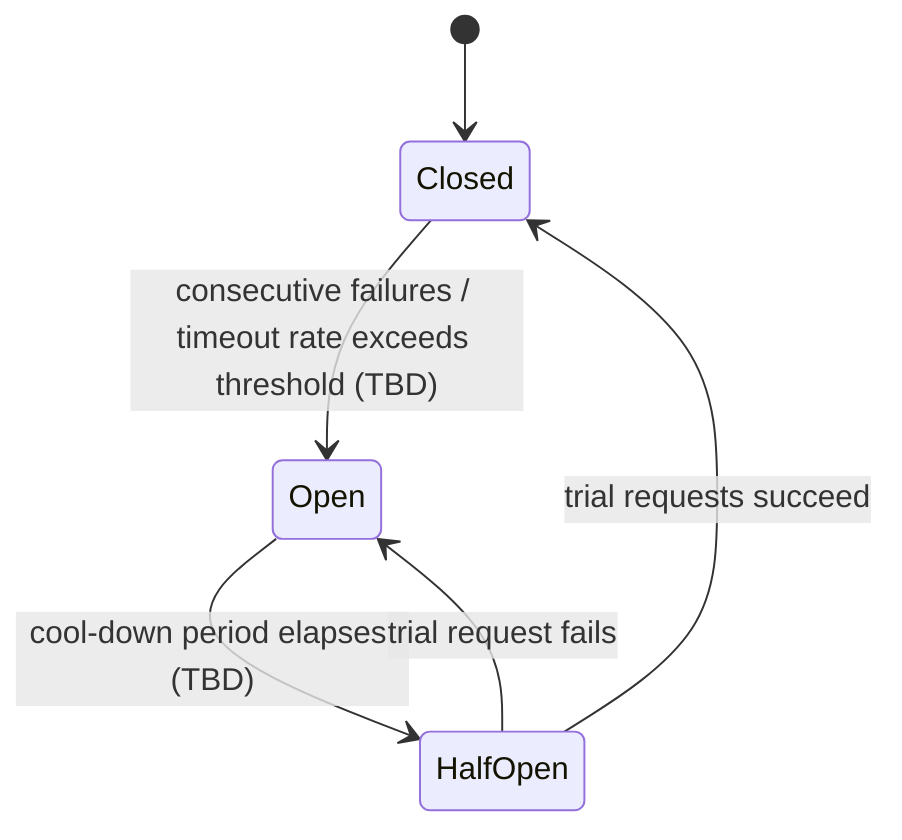
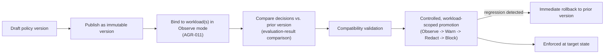

**AI Guardrails — Operability**

**Authority level:** L3
**Status:** Draft
**Date:** 2026-07-24
**Derived from:** AGREEMENTS.md

---

> This document is **L3 — Product & architecture**. It operationalizes the availability, performance, policy-rollout, and auditing requirements stated in [`NON-FUNCTIONAL-REQUIREMENTS.md`](NON-FUNCTIONAL-REQUIREMENTS.md), the failure-behavior agreement [AGR-012](../00-source-of-truth/AGREEMENTS.md#agr-012--failure-behavior-is-part-of-policy), the observe-before-enforce agreement [AGR-011](../00-source-of-truth/AGREEMENTS.md#agr-011--observe-before-enforce-progression), and the resource/operational-limit constraints [CON-015, CON-016](../00-source-of-truth/CONSTRAINTS.md#resource-and-operational-limits). Where anything below could be read as conflicting with [`AGREEMENTS.md`](../00-source-of-truth/AGREEMENTS.md) or [`CONSTRAINTS.md`](../00-source-of-truth/CONSTRAINTS.md) (both L1), those documents win and this document must be corrected.
>
> Numeric targets (availability percentages, latency budgets, retry counts, cache-staleness windows, cool-down durations) are **not yet defined** in the source material. Every such figure below is marked **TBD** rather than invented, per [`ASSUMPTIONS.md` ASM-011, ASM-012, ASM-013](../00-source-of-truth/ASSUMPTIONS.md). The availability-topology question that previously gated this — [`OPEN-QUESTIONS.md` OQ-016](../00-source-of-truth/OPEN-QUESTIONS.md#oq-016--multi-region-active-active-availability-need) — is now **resolved**: the platform is multi-region from GA with each tenant pinned to a single processing region ([`DECISIONS.md` DEC-018](../00-source-of-truth/DECISIONS.md#dec-018--multi-region-availability-at-ga), Status: Proposed / [`CAPABILITIES.md` CAP-035](../20-product/CAPABILITIES.md)), and multi-region active-active availability is committed as a later phase, not yet delivered ([`DECISIONS.md` DEC-019](../00-source-of-truth/DECISIONS.md#dec-019--multi-region-active-active-availability-committed-as-a-later-phase), Status: Proposed / [`CAPABILITIES.md` CAP-036](../20-product/CAPABILITIES.md)). The *numeric* availability objective itself remains **TBD** — see [2.1](#21-availability-objective). This document defines the *shape* of each behavior — what must be defined, measured, and configurable — so that numeric targets can be filled in later without redesigning the runtime.

---

## Table of contents

1. [Purpose and scope](#1-purpose-and-scope)
2. [Availability](#2-availability)
   - 2.1 [Availability objective](#21-availability-objective)
   - 2.2 [Timeout behavior](#22-timeout-behavior)
   - 2.3 [Retry behavior](#23-retry-behavior)
   - 2.4 [Cached-policy behavior](#24-cached-policy-behavior)
   - 2.5 [Degraded operating mode](#25-degraded-operating-mode)
   - 2.6 [Circuit-breaker behavior](#26-circuit-breaker-behavior)
3. [Performance metrics](#3-performance-metrics)
4. [Policy rollout](#4-policy-rollout)
5. [Auditing metadata](#5-auditing-metadata)
6. [Observability signals and health checks](#6-observability-signals-and-health-checks)
7. [Failure behavior is explicit — no undocumented fallback](#7-failure-behavior-is-explicit--no-undocumented-fallback)
8. [Operator runbook](#8-operator-runbook)
9. [Operability across deployment modes](#9-operability-across-deployment-modes)
10. [Related documents](#10-related-documents)

---

## 1. Purpose and scope

This document defines how the AI Guardrails Runtime behaves under normal load, degraded conditions, and outright failure, and what must be measured, published, and actionable by an operator at any point in that spectrum. It covers, per [`NON-FUNCTIONAL-REQUIREMENTS.md`](NON-FUNCTIONAL-REQUIREMENTS.md):

* **Availability** — the objective, and the timeout, retry, cached-policy, degraded-mode, and circuit-breaker behaviors that support it.
* **Performance** — the metrics the platform must measure to know whether the availability objective is being met.
* **Policy rollout** — how a policy version moves from draft to enforced without breaking the workloads bound to it.
* **Auditing** — the metadata every evaluation must produce, regardless of outcome.
* **Observability and health** — the signals, checks, and runbook guidance an operator uses to diagnose and respond.

This document does not define specific numeric SLA targets, specific detector implementations, or mode-specific infrastructure topology — those are addressed in [`DEPLOYMENT-ARCHITECTURE.md`](DEPLOYMENT-ARCHITECTURE.md), [`COMPONENT-ARCHITECTURE.md`](COMPONENT-ARCHITECTURE.md), and [`INTEGRATION-ARCHITECTURE.md`](INTEGRATION-ARCHITECTURE.md). It governs the operational *contract* that all of those documents, and every deployment mode, must satisfy — per [AGR-006](../00-source-of-truth/AGREEMENTS.md#agr-006--one-logical-evaluation-contract-across-all-modes) and [CON-005](../00-source-of-truth/CONSTRAINTS.md#con-005--one-logical-evaluation-contract-across-all-modes), the operational contract does not vary by deployment location, even though the infrastructure implementing it does.

Every requirement in this document is binding on the Evaluation API, the policy resolver, the decision engine, and every evaluator adapter, in every deployment mode (Remote Evaluation, Guarded Gateway, Customer-Managed Runtime) per [AGR-002](../00-source-of-truth/AGREEMENTS.md#agr-002--three-deployment-modes).

---

## 2. Availability

The guardrail runtime sits synchronously on the request path of every consuming application ([`RISK-REGISTER.md`](../70-governance/RISK-REGISTER.md), "Latency" risk). Availability behavior must therefore be defined explicitly rather than left to default library or framework behavior — an undefined timeout, retry, or fallback on this path can stall production inference indefinitely.

### 2.1 Availability objective

| Item | Status |
| --- | --- |
| Numeric availability target (e.g., a percentage uptime figure) for the Evaluation API | **TBD** — not defined in the L1 registers. The topology question once tracked here as [`OPEN-QUESTIONS.md` OQ-016](../00-source-of-truth/OPEN-QUESTIONS.md#oq-016--multi-region-active-active-availability-need) is now **resolved** by [`DECISIONS.md` DEC-019](../00-source-of-truth/DECISIONS.md#dec-019--multi-region-active-active-availability-committed-as-a-later-phase) (Status: Proposed); the remaining numeric-target gap is tracked via [`ASSUMPTIONS.md` ASM-012](../00-source-of-truth/ASSUMPTIONS.md) and the Process row below. |
| Topology assumption | Multi-region availability from GA, with each tenant pinned to a single processing Region — not active-active ([`DECISIONS.md` DEC-018](../00-source-of-truth/DECISIONS.md#dec-018--multi-region-availability-at-ga) (Status: Proposed) / [`CAPABILITIES.md` CAP-035](../20-product/CAPABILITIES.md); see `DEPLOYMENT-ARCHITECTURE.md` §7.4). Multi-region active-active availability is committed as a **later phase**, not yet delivered ([`DECISIONS.md` DEC-019](../00-source-of-truth/DECISIONS.md#dec-019--multi-region-active-active-availability-committed-as-a-later-phase) (Status: Proposed) / [`CAPABILITIES.md` CAP-036](../20-product/CAPABILITIES.md)) — this supersedes the prior [`SCOPE.md`](../10-charter/SCOPE.md) exclusion. The two-account model ([AGR-013](../00-source-of-truth/AGREEMENTS.md#agr-013--aws-as-primary-cloud-minimal-mvp-account-model), amended) is retained. |
| Success-metric linkage | "Evaluation API availability" is a tracked reliability success metric ([`SUCCESS-CRITERIA.md`](../10-charter/SUCCESS-CRITERIA.md)); the actively tracked, current value is maintained in [`SUCCESS-CRITERIA.md`](../10-charter/SUCCESS-CRITERIA.md), not restated here. |
| Process | A specific availability objective, together with the timeout, retry, cached-policy, and degraded-mode behaviors below, must be defined and socialized with pilot workloads before Phase 2 exit, and captured as a written non-functional requirement rather than an implicit expectation ([`ASSUMPTIONS.md` ASM-012](../00-source-of-truth/ASSUMPTIONS.md)). |

Until a numeric objective is set, the runtime must still be built so that one can be enforced later without redesign: every dependency on the request path (policy resolution, evaluator adapters, audit delivery) must have an explicit timeout and an explicit, configured behavior for exceeding it (see [Section 7](#7-failure-behavior-is-explicit--no-undocumented-fallback)).

### 2.2 Timeout behavior

Per [CON-016](../00-source-of-truth/CONSTRAINTS.md#con-016--timeout-limits), every evaluation stage — `input`, `output`, and any future stage — must enforce an explicit timeout, and every evaluator adapter invoked within a stage must enforce its own timeout budget within the stage's overall budget.

| Layer | Timeout scope | Status |
| --- | --- | --- |
| Stage-level (`input`, `output`) | Wall-clock budget for the entire evaluation stage, across all evaluators invoked in that stage | **TBD** value; mandatory per policy ([CON-016](../00-source-of-truth/CONSTRAINTS.md#con-016--timeout-limits)) |
| Detector-level | Wall-clock budget per evaluator adapter (for example, the Bedrock Guardrails adapter, a deterministic-rule evaluator) | **TBD** value; must be strictly less than the stage-level budget |
| Control-plane resolution | Wall-clock budget for resolving a policy version when not already cached | **TBD** value; on expiry, falls back to [cached-policy behavior](#24-cached-policy-behavior) |
| Audit delivery | Wall-clock budget for emitting an audit event before it is treated as failed delivery | **TBD** value; on expiry, follows the audit-delivery failure behavior in the workload's policy ([Section 7](#7-failure-behavior-is-explicit--no-undocumented-fallback)) |

What happens when a timeout is reached is **not** a runtime default — it is a per-workload, per-failure-mode configuration item, defined in [Section 7](#7-failure-behavior-is-explicit--no-undocumented-fallback) and [`PRINCIPLES.md` §5.7](../10-charter/PRINCIPLES.md#57-failure-behavior-is-part-of-policy).

### 2.3 Retry behavior

Retry behavior applies to the guardrail runtime's own calls to its dependencies (evaluation engines, the control plane, audit sinks) — it is distinct from, and must not be confused with, the consuming team's own retry and fallback behavior for **model invocation**, which remains the consuming team's responsibility in Mode A and Mode C ([AGR-002](../00-source-of-truth/AGREEMENTS.md#agr-002--three-deployment-modes), Mode A/C ownership lists).

Principles that must hold regardless of numeric values (all **TBD**):

* Retries must be **bounded** — an unbounded retry loop on a synchronous request path would itself become an availability failure.
* Retries must respect the **remaining stage-level timeout budget** ([Section 2.2](#22-timeout-behavior)); a retry must never be attempted once the stage budget cannot accommodate it.
* Retries must be applied only to calls that are safe to repeat (idempotent) — for example, a stateless evaluator invocation — and must not be applied to actions with side effects that would duplicate an audit record or decision.
* Retry exhaustion must transition deterministically into the workload's configured failure behavior ([Section 7](#7-failure-behavior-is-explicit--no-undocumented-fallback)) — it must never silently return an unannounced default.
* The correlation identifier ([Section 5](#5-auditing-metadata)) must be preserved across every retry attempt so that audit and observability tooling can reconstruct the full attempt sequence for one logical evaluation.

### 2.4 Cached-policy behavior

A **local policy cache** is a first-class resilience mechanism, not an optimization:

* **Customer-Managed Runtime (Mode C)** must be capable of executing policies without a synchronous connection to the hosted control plane ([AGR-015](../00-source-of-truth/AGREEMENTS.md#agr-015--customer-managed-runtime-executes-without-a-synchronous-control-plane-connection)). This requires a local policy cache sufficient to keep evaluating through control-plane outages, populated by asynchronous, non-blocking policy synchronization that never sits on the evaluation request path.
* **Remote Evaluation and Guarded Gateway (Modes A and B)** may also cache resolved policy versions to avoid a policy-resolution round trip on every request; this is an internal performance optimization and, per [CON-005](../00-source-of-truth/CONSTRAINTS.md#con-005--one-logical-evaluation-contract-across-all-modes), must not alter the externally observable decision or audit contract.
* **Cache-staleness tolerance** — how long a cached policy may be served after the control plane becomes unreachable, and what happens once that tolerance is exceeded — is **TBD** and must be captured from candidate Mode C adopters during Phase 4 discovery ([`ASSUMPTIONS.md` ASM-013](../00-source-of-truth/ASSUMPTIONS.md)). Until defined, "policy cache exceeds staleness tolerance" is treated as its own failure condition requiring an explicit, configured behavior (see [Section 7](#7-failure-behavior-is-explicit--no-undocumented-fallback)).
* **Policy-cache hit rate** is a required performance metric ([Section 3](#3-performance-metrics)) precisely because cache behavior is on the critical path for both latency and availability.

### 2.5 Degraded operating mode

A degraded operating mode is the runtime continuing to serve evaluations with **reduced capability**, rather than failing the entire evaluation stage, when a non-critical dependency is unavailable. Examples derived from the failure-behavior options already established for detector unavailability ([`PRINCIPLES.md` §5.7](../10-charter/PRINCIPLES.md#57-failure-behavior-is-part-of-policy)):

* If a specific evaluator (for example, a Bedrock Guardrails adapter) is unavailable, the policy may configure the runtime to fall back to a cached policy result, to deterministic rules only, or to an "allow and log" path for that evaluator — while other evaluators in the same stage continue to run normally.
* If the hosted control plane is unreachable, a Customer-Managed Runtime enters a degraded mode governed by its cached policy ([Section 2.4](#24-cached-policy-behavior)) rather than stopping evaluation entirely.
* Degraded mode is **always** a configured, policy-visible state — never an undocumented, implicit fallback ([AGR-012](../00-source-of-truth/AGREEMENTS.md#agr-012--failure-behavior-is-part-of-policy)). The audit record for any evaluation performed while degraded must indicate that degraded mode was in effect and which dependency was unavailable.
* Entering and leaving degraded mode must be an observable event (see [Section 6](#6-observability-signals-and-health-checks)), not something an operator can only infer from a latency or error spike after the fact.

### 2.6 Circuit-breaker behavior

Because the runtime sits synchronously on the request path, a stalled or consistently failing dependency (an evaluator adapter, the control plane) must not be allowed to accumulate timeouts request after request — each of which consumes the stage-level timeout budget before failing. A circuit breaker per dependency prevents this:

| State | Behavior |
| --- | --- |
| **Closed** | Requests flow to the dependency normally; failures and latencies are tracked. |
| **Open** | Requests to the failing dependency are short-circuited immediately (no wasted timeout wait) and routed directly into the workload's configured failure behavior for "detector unavailable" or "control plane unavailable" ([Section 7](#7-failure-behavior-is-explicit--no-undocumented-fallback)). |
| **Half-open** | After a cool-down period, a limited number of trial requests are allowed through to test recovery before fully closing the breaker again. |

The failure-count threshold, timeout-rate threshold, and cool-down duration that govern these transitions are **TBD** and must be tuned against real evaluator latency and failure data rather than assumed; they are operational configuration, not policy-schema fields. A circuit breaker's Open/Half-open state must itself be an observable signal (see [Section 6](#6-observability-signals-and-health-checks)) and must be attributable, per dependency, in audit and health telemetry.

---

## 3. Performance metrics

The platform must measure the following, per [`NON-FUNCTIONAL-REQUIREMENTS.md`](NON-FUNCTIONAL-REQUIREMENTS.md). These are the metrics that turn the qualitative availability behaviors in [Section 2](#2-availability) into evidence an operator, a workload owner, or a security/governance reviewer can act on.

| Metric | Definition | Why it matters |
| --- | --- | --- |
| **P50 evaluation latency** | Median end-to-end latency of an evaluation request | Represents typical-case latency experienced by consuming applications |
| **P95 evaluation latency** | 95th-percentile end-to-end evaluation latency | Tracked reliability success metric ([`SUCCESS-CRITERIA.md`](../10-charter/SUCCESS-CRITERIA.md)); the figure most commonly used to characterize "slow but not pathological" behavior |
| **P99 evaluation latency** | 99th-percentile end-to-end evaluation latency | Surfaces tail-latency behavior that P50/P95 can mask, and that is most likely to trigger circuit-breaker or timeout paths |
| **Evaluation throughput** | Evaluations processed per unit time, by stage and by workload | Required for capacity planning and for validating the runtime against actual (not assumed) workload volume ([`ASSUMPTIONS.md` ASM-001](../00-source-of-truth/ASSUMPTIONS.md)) |
| **Timeout rate** | Proportion of evaluations that exceed their configured timeout, by stage and by detector | Tracked reliability success metric ([`SUCCESS-CRITERIA.md`](../10-charter/SUCCESS-CRITERIA.md)); directly informs [Section 2.2](#22-timeout-behavior) and circuit-breaker tuning ([Section 2.6](#26-circuit-breaker-behavior)) |
| **Detector-specific latency** | Latency contribution of each individual evaluator adapter (Bedrock Guardrails adapter, deterministic evaluator, PII evaluator, schema validator, and future adapters) | Lets an operator or policy author identify which evaluator is responsible for a stage's latency, and supports the "apply only relevant evaluators" latency mitigation ([`RISK-REGISTER.md`](../70-governance/RISK-REGISTER.md), "Latency" risk) |
| **Decision distribution** | Count of evaluations by normalized decision (`allow`, `block`, `redact`, `log_only`, and future actions), by policy version and by workload | Surfaces policy behavior in aggregate; feeds [evaluation-result comparison between versions](#4-policy-rollout) and the effectiveness success metrics in [`SUCCESS-CRITERIA.md`](../10-charter/SUCCESS-CRITERIA.md) |
| **Policy-cache hit rate** | Proportion of evaluations served from a cached, already-resolved policy version versus a fresh resolution | Directly measures the effectiveness of [cached-policy behavior](#24-cached-policy-behavior) and is a leading indicator of policy-resolution latency and failure risk |

**Numeric targets** for each metric (for example, an acceptable P95 latency ceiling, an acceptable timeout-rate threshold) are **TBD**; per [`ASSUMPTIONS.md` ASM-011](../00-source-of-truth/ASSUMPTIONS.md), these must be measured against actual pilot-workload traffic during Observe mode, before any workload is promoted to Enforce. The related reliability and effectiveness success-metric definitions are maintained in [`SUCCESS-CRITERIA.md`](../10-charter/SUCCESS-CRITERIA.md) rather than duplicated here.

All metrics must be attributable by **tenant**, **workload**, **policy version**, and **evaluation stage** — the same dimensions carried in the audit record ([Section 5](#5-auditing-metadata)) — so that a performance anomaly can always be traced back to a specific policy, workload, or tenant without cross-referencing a separate system.

**Guardrail category as a planned metric dimension.** With the category catalog adopted ([AGR-021](../00-source-of-truth/AGREEMENTS.md#agr-021--guardrail-category-taxonomy-and-extension-model); [`../20-product/GUARDRAIL-CATALOG.md`](../20-product/GUARDRAIL-CATALOG.md)), per-category decision counts and block/redact rates are a natural future extension of the decision-distribution metric — but they are **not committed**: category attribution of a decision depends on the reason-code taxonomy, which is TBD and tracked as [OQ-019](../00-source-of-truth/OPEN-QUESTIONS.md#oq-019--reason-code-taxonomy-and-guardrail-category-as-an-auditmetric-dimension). Until OQ-019 resolves, no per-category metric is defined and no figure is invented for one.

---

## 4. Policy rollout

Policies are **immutable, versioned artifacts** ([AGR-017](../00-source-of-truth/AGREEMENTS.md#agr-017--core-domain-model), Policy entity; [AGR-017](../00-source-of-truth/AGREEMENTS.md#agr-017--core-domain-model)). A published policy version is never edited in place — a change is always a new version. This is what makes controlled promotion, comparison, and rollback possible without ambiguity about what was actually running at a given time.

| Rollout requirement | What it means | Source |
| --- | --- | --- |
| **Immutable versions** | Once published, a policy version's content never changes; a new version number is required for any change. Audit records reference the exact version in force at evaluation time. | [AGR-017](../00-source-of-truth/AGREEMENTS.md#agr-017--core-domain-model) (Policy), §15 |
| **Observe mode** | Every new policy version defaults to Observe when first bound to a workload — never directly to Block. Onboarding workflows must not bypass this default. | [AGR-011](../00-source-of-truth/AGREEMENTS.md#agr-011--observe-before-enforce-progression) |
| **Controlled promotion** | Moving a binding from one enforcement state to the next (Disabled → Observe → Warn → Redact → Block) is an explicit, auditable action taken deliberately by a workload owner and, per current working practice, jointly with security/governance — never an implicit side effect of another change. | [AGR-011](../00-source-of-truth/AGREEMENTS.md#agr-011--observe-before-enforce-progression); [`OPEN-QUESTIONS.md`](../00-source-of-truth/OPEN-QUESTIONS.md) (promotion-gate question) |
| **Workload-scoped rollout** | A policy version's promotion is scoped to one policy binding (one workload) at a time; promoting for one workload does not implicitly promote the same version for every other workload bound to it. | [AGR-017](../00-source-of-truth/AGREEMENTS.md#agr-017--core-domain-model) (Policy binding) |
| **Immediate rollback** | A workload's binding can be reverted to its prior policy version at any time, without waiting for a scheduled release; the binding entity records a rollback version for exactly this purpose. | [AGR-017](../00-source-of-truth/AGREEMENTS.md#agr-017--core-domain-model) (Policy binding — "Rollback version") |
| **Compatibility validation** | A candidate policy version must be validated against the runtime's supported schema and the workload's declared runtime-compatibility requirements before it can be bound or promoted. | [AGR-017](../00-source-of-truth/AGREEMENTS.md#agr-017--core-domain-model) (Policy — "Compatibility metadata"; Policy binding — "Runtime compatibility requirements") |
| **Evaluation-result comparison between versions** | The runtime (or an offline replay process) must be able to compare the decisions produced by an old and a candidate policy version against the same evaluated content, to surface regressions before promotion. | [`NON-FUNCTIONAL-REQUIREMENTS.md`](NON-FUNCTIONAL-REQUIREMENTS.md) |

A **quantitative or procedural promotion gate** (for example, a maximum acceptable false-positive rate, or a minimum observation period before promotion is allowed) is **not yet defined** in the source material; promotion currently remains a manual, jointly owned decision informed by the Observe-mode metrics required above (false-positive rate, latency, decision distribution), with rationale captured in audit metadata regardless. This gap is tracked as an open question and must not be resolved by inventing a numeric threshold here.

Policy rollout mechanics must behave identically across all three deployment modes ([AGR-006](../00-source-of-truth/AGREEMENTS.md#agr-006--one-logical-evaluation-contract-across-all-modes)); Customer-Managed Runtime rollout additionally depends on asynchronous policy synchronization to the local cache ([Section 2.4](#24-cached-policy-behavior)) rather than a synchronous push.

---

## 5. Auditing metadata

Every evaluation — regardless of decision outcome, and regardless of whether it completed normally or via a configured failure-behavior path — must produce an audit record containing at least the following fields ([`NON-FUNCTIONAL-REQUIREMENTS.md`](NON-FUNCTIONAL-REQUIREMENTS.md)):

| Field | Description | Related constraint |
| --- | --- | --- |
| **Tenant** | The tenant the evaluated workload belongs to | [CON-011](../00-source-of-truth/CONSTRAINTS.md#con-011--per-tenant-workload-identities) (per-tenant workload identity) |
| **Workload** | The specific workload the evaluation was performed for | [CON-011](../00-source-of-truth/CONSTRAINTS.md#con-011--per-tenant-workload-identities) |
| **Policy version** | The exact immutable policy version in force at evaluation time | [Section 4](#4-policy-rollout) (immutable versions) |
| **Evaluation stage** | Which stage was evaluated (`input`, `output`, or a future stage) | [AGR-017](../00-source-of-truth/AGREEMENTS.md#agr-017--core-domain-model) (Evaluation) |
| **Decision** | The normalized decision produced (`allow`, `block`, `redact`, `log_only`, or a future action) | [AGR-017](../00-source-of-truth/AGREEMENTS.md#agr-017--core-domain-model) (Decision) |
| **Reason codes** | The normalized reason code(s) explaining the decision | [AGR-017](../00-source-of-truth/AGREEMENTS.md#agr-017--core-domain-model) (Decision) |
| **Evaluator versions** | Version identifiers of every evaluator/adapter that contributed to the decision | Supports [detector-specific latency](#3-performance-metrics) attribution and reproducibility |
| **Timestamp** | When the evaluation occurred | Baseline audit requirement |
| **Correlation identifier** | The identifier propagated across the request, connector, runtime, and any retries, that ties the audit record back to one logical evaluation | [Section 2.3](#23-retry-behavior) (correlation identifier preserved across retries) |
| **Whether raw content was retained** | An explicit flag recording whether raw prompt/response content was persisted for this evaluation, and under what retention configuration | [CON-014](../00-source-of-truth/CONSTRAINTS.md#con-014--no-raw-content-retention-by-default-in-the-hosted-runtime) (no raw-content retention by default) |

Additional operational conditions must also be reflected in the audit record where they occurred for a given evaluation:

* Whether the evaluation was served from a **cached policy** ([Section 2.4](#24-cached-policy-behavior)).
* Whether the evaluation was performed while the runtime was in **degraded mode**, and which dependency was unavailable ([Section 2.5](#25-degraded-operating-mode)).
* Which **failure-behavior path** was taken, if the evaluation could not complete normally ([Section 7](#7-failure-behavior-is-explicit--no-undocumented-fallback)) — required per [AGR-012](../00-source-of-truth/AGREEMENTS.md#agr-012--failure-behavior-is-part-of-policy).

Per [`DEPLOYMENT-ARCHITECTURE.md`](DEPLOYMENT-ARCHITECTURE.md), audit events are intended to be buffered (Amazon SQS) and archived (Amazon S3) with KMS encryption at rest ([CON-009](../00-source-of-truth/CONSTRAINTS.md#con-009--kms-encryption-in-transit-and-at-rest)). **Audit delivery success rate** is itself a tracked reliability success metric ([`SUCCESS-CRITERIA.md`](../10-charter/SUCCESS-CRITERIA.md)); what happens when audit delivery itself fails is governed by the workload's failure behavior ([Section 7](#7-failure-behavior-is-explicit--no-undocumented-fallback)), not by silent event loss.

---

## 6. Observability signals and health checks

### 6.1 Metrics

The performance metrics in [Section 3](#3-performance-metrics) are the primary quantitative observability signal, intended for the operational-metrics AWS service named in [`DEPLOYMENT-ARCHITECTURE.md`](DEPLOYMENT-ARCHITECTURE.md) (Amazon CloudWatch). All metrics must be attributable by tenant, workload, policy version, and evaluation stage. Guardrail category ([`../20-product/GUARDRAIL-CATALOG.md`](../20-product/GUARDRAIL-CATALOG.md)) is a planned fifth attribution dimension, gated on the reason-code taxonomy ([OQ-019](../00-source-of-truth/OPEN-QUESTIONS.md#oq-019--reason-code-taxonomy-and-guardrail-category-as-an-auditmetric-dimension)) — see the note in Section 3.

### 6.2 Logs and correlation

Every log line associated with a single evaluation must carry the same **correlation identifier** used in the audit record ([Section 5](#5-auditing-metadata)), so that an operator can reconstruct the full lifecycle of one evaluation — including retries ([Section 2.3](#23-retry-behavior)) and any circuit-breaker short-circuit ([Section 2.6](#26-circuit-breaker-behavior)) — across logs, metrics, and the audit trail without cross-referencing by timestamp alone.

### 6.3 Health checks

The runtime must expose the standard distinction between:

* **Liveness** — the runtime process is running and able to respond at all.
* **Readiness** — the runtime can currently serve evaluations: policy resolution is functioning (from the control plane or a valid cache), and dependent evaluator adapters are reachable or the runtime has a valid degraded-mode path configured for the ones that are not.

A runtime that is live but not ready must be removed from active traffic routing before it produces silent failures or exhausted-timeout responses.

### 6.4 Connector-health telemetry

Connectors (starting with the LiteLLM connector) are responsible for emitting connector-health telemetry ([AGR-003](../00-source-of-truth/AGREEMENTS.md#agr-003--litellm-as-first-connector-not-the-product-boundary)) — evidence that the connector is installed, invoking evaluation as expected, and correctly propagating correlation identifiers and enforcement decisions. Per [CON-012](../00-source-of-truth/CONSTRAINTS.md#con-012--no-exclusive-reliance-on-weak-security-proxies) and [AGR-018](../00-source-of-truth/AGREEMENTS.md#agr-018--trust-and-enforcement-model), connector-health telemetry is a useful operational signal but must **never** be treated as evidence of mandatory enforcement — a connector can always be disabled, removed, or misconfigured in the cooperative-integration trust model.

### 6.5 Customer-managed telemetry categories

For Customer-Managed Runtime, the categories of telemetry the customer may choose to send to the hosted control plane are fixed and exhaustive ([AGR-016](../00-source-of-truth/AGREEMENTS.md#agr-016--customer-controlled-telemetry-for-the-customer-managed-runtime), [CON-013](../00-source-of-truth/CONSTRAINTS.md#con-013--raw-content-must-not-leave-a-customer-managed-runtime-unless-explicitly-configured)):

| Telemetry category | Content |
| --- | --- |
| Health status | Runtime liveness/readiness signal |
| Product version | Deployed runtime software version |
| Policy version | Currently cached/active policy version |
| Aggregated evaluation counts | Counts, not content |
| Reason-code totals | Aggregated reason-code frequencies |
| Latency metrics | The performance metrics in [Section 3](#3-performance-metrics) |
| Sanitized decision metadata | Decision distribution without raw content |
| **No telemetry** | A fully supported configuration; nothing leaves the customer's environment |

Raw prompt or response content must never be part of any telemetry payload by construction — this is a design requirement, not an operator setting to be careful with ([CON-013](../00-source-of-truth/CONSTRAINTS.md#con-013--raw-content-must-not-leave-a-customer-managed-runtime-unless-explicitly-configured)). Full data-flow detail is maintained in [`DATA-ARCHITECTURE.md`](DATA-ARCHITECTURE.md).

---

## 7. Failure behavior is explicit — no undocumented fallback

Per [AGR-012](../00-source-of-truth/AGREEMENTS.md#agr-012--failure-behavior-is-part-of-policy) and [`PRINCIPLES.md` §5.7](../10-charter/PRINCIPLES.md#57-failure-behavior-is-part-of-policy), runtime failure behavior is **part of the policy itself**, not an operational afterthought and not a runtime default. A workload's policy must define, explicitly and per failure mode, what happens when:

| Failure condition | Example configured behaviors (illustrative, not exhaustive or ranked) |
| --- | --- |
| The Evaluation API times out | Allow and log · Return a safe fallback · Block the request |
| A detector is unavailable | Use a cached policy · Block the request · Allow and log |
| The policy cannot be resolved | Block the request · Require manual approval |
| The control plane is unavailable | Use a cached policy (Customer-Managed Runtime) |
| Audit delivery fails | Allow and log · Block the request, depending on audit criticality |
| A response cannot be safely transformed | Return a safe fallback · Block the request |

Binding rules that follow directly from AGR-012 and must be enforced by the runtime, not merely documented:

* A policy that omits a failure-behavior entry for any of the failure modes above must be **rejected or flagged** at publish or bind time — the runtime must not silently default to "allow" or "block" on its own initiative.
* Every audit record for an evaluation that did not complete normally must state **which failure-behavior path was taken** ([Section 5](#5-auditing-metadata)).
* Input-size limits ([CON-015](../00-source-of-truth/CONSTRAINTS.md#con-015--input-size-limits)) and per-stage/per-detector timeouts ([Section 2.2](#22-timeout-behavior)) are policy-visible, documented boundaries — not internal implementation details a policy author is unaware of.
* Degraded mode ([Section 2.5](#25-degraded-operating-mode)) and circuit-breaker short-circuiting ([Section 2.6](#26-circuit-breaker-behavior)) are themselves triggers that must resolve into one of the configured failure-behavior paths above — they are mechanisms for *detecting* a failure condition, not independent fallback behaviors in their own right.

This requirement holds identically across all three deployment modes; only the *available* failure-behavior options differ in practice (for example, "use a cached policy" is the primary control-plane-unavailability option for Mode C, per [Section 2.4](#24-cached-policy-behavior)), never the requirement that a behavior be explicitly configured.

---

## 8. Operator runbook

The following table maps observable signals to likely causes and first-response operator actions. It is a starting reference, not a substitute for incident-specific investigation, and it assumes the metrics ([Section 3](#3-performance-metrics)), audit fields ([Section 5](#5-auditing-metadata)), and health checks ([Section 6](#6-observability-signals-and-health-checks)) above are in place.

| Observed signal | Likely cause | First-response action |
| --- | --- | --- |
| Timeout rate rising for one detector | A specific evaluator adapter (for example, the Bedrock Guardrails adapter) is slow or degraded | Check detector-specific latency ([Section 3](#3-performance-metrics)); confirm whether the per-detector circuit breaker ([Section 2.6](#26-circuit-breaker-behavior)) has opened; verify the affected workloads' configured failure behavior for "detector unavailable" is the intended one |
| Circuit breaker Open for a dependency | Consecutive failures or a sustained timeout-rate breach against that dependency | Confirm downstream dependency health directly; do not manually force-close the breaker until the underlying dependency is confirmed healthy; monitor Half-open trial outcomes |
| P99 latency spike with normal P50/P95 | Tail-latency issue — likely a specific slow evaluator, a policy-resolution stall, or GC/resource contention | Correlate with detector-specific latency and policy-cache hit rate; check for policy-resolution timeouts specifically |
| Policy-cache hit rate drops sharply | Control-plane connectivity issue, cache invalidation storm, or a large batch of newly bound workloads | Check control-plane reachability and policy-synchronization health first (especially for Mode C); confirm whether degraded mode ([Section 2.5](#25-degraded-operating-mode)) has been entered |
| Audit delivery success rate drops | Audit sink (queue/archive) unavailable or throttled | Check the audit-buffering/archival path directly (Amazon SQS / Amazon S3 per [`DEPLOYMENT-ARCHITECTURE.md`](DEPLOYMENT-ARCHITECTURE.md)); confirm the workload's configured audit-delivery-failure behavior is active as expected, not silently dropping events |
| A workload's decision distribution shifts sharply after a policy promotion | The newly promoted policy version behaves differently than the version it replaced | Use evaluation-result comparison ([Section 4](#4-policy-rollout)) against the prior version; if the shift is a regression, execute immediate rollback ([Section 4](#4-policy-rollout)) |
| Connector-health telemetry stops reporting for a workload | Connector removed, disabled, or misconfigured (cooperative-integration risk) | Treat as a connector-bypass signal, not a runtime outage; do **not** treat resumed telemetry alone as proof of enforcement ([Section 6.4](#64-connector-health-telemetry); [AGR-018](../00-source-of-truth/AGREEMENTS.md#agr-018--trust-and-enforcement-model)) |
| Readiness check failing while liveness passes | A dependency required for evaluation (policy resolution, a mandatory evaluator) is unreachable and no valid degraded-mode path is configured | Remove the instance from active routing; escalate as a policy-configuration gap if no degraded-mode behavior was defined for the affected dependency |

---

## 9. Operability across deployment modes

The operational **contract** defined in this document — what must be measured, what must be audited, and the requirement that failure behavior be explicit — is identical across Remote Evaluation, Guarded Gateway, and Customer-Managed Runtime ([AGR-006](../00-source-of-truth/AGREEMENTS.md#agr-006--one-logical-evaluation-contract-across-all-modes)). What differs by mode is which dependencies are on the critical path and who operates them:

| Concern | Mode A — Remote Evaluation | Mode B — Guarded Gateway | Mode C — Customer-Managed Runtime |
| --- | --- | --- | --- |
| Who operates the evaluation runtime | AI Guardrails provider (hosted) | AI Guardrails provider (hosted) | Consuming team, in its own AWS account |
| Control-plane connection during evaluation | Synchronous, provider-operated | Synchronous, provider-operated | Not required — must execute from local cache ([Section 2.4](#24-cached-policy-behavior); [AGR-015](../00-source-of-truth/AGREEMENTS.md#agr-015--customer-managed-runtime-executes-without-a-synchronous-control-plane-connection)) |
| Primary availability risk | Hosted Evaluation API availability | Combined gateway + guardrail availability | Local runtime and infrastructure availability, owned by the consuming team unless managed support is purchased |
| Telemetry reaching the hosted control plane | Full operational telemetry (provider-operated end to end) | Full operational telemetry (provider-operated end to end) | Customer-selected categories only, or none ([Section 6.5](#65-customer-managed-telemetry-categories)) |

This table does not introduce new obligations beyond [Sections 2–8](#2-availability); it clarifies that "operated by the provider" versus "operated by the customer" ([AGR-008](../00-source-of-truth/AGREEMENTS.md#agr-008--explicit-content-exposure-model-ownership-vs-exposure-are-separate-concerns)) changes *who* is accountable for a given signal in the runbook above, not *whether* the signal must exist.

---

## 10. Related documents

| Document | Relationship |
| --- | --- |
| [`AGREEMENTS.md`](../00-source-of-truth/AGREEMENTS.md) | L1 authoritative source for AGR-006, AGR-011, AGR-012, AGR-015, AGR-016, AGR-017, AGR-018 referenced throughout this document. |
| [`CONSTRAINTS.md`](../00-source-of-truth/CONSTRAINTS.md) | L1 checkable boundaries — CON-005, CON-009, CON-011, CON-012, CON-013, CON-014, CON-015, CON-016 — that this document operationalizes. |
| [`ASSUMPTIONS.md`](../00-source-of-truth/ASSUMPTIONS.md) | Unvalidated beliefs this document depends on, notably ASM-011, ASM-012, ASM-013 on latency budget, availability objective, and cache-staleness tolerance. |
| [`OPEN-QUESTIONS.md`](../00-source-of-truth/OPEN-QUESTIONS.md) | OQ-016 (availability-topology) is **resolved** by DEC-019; the numeric availability objective and the policy-promotion-gate question remain deferred rather than resolved by this document. |
| [`PRINCIPLES.md`](../10-charter/PRINCIPLES.md) | Full articulation of principle 5.6 (Observable before enforceable) and 5.7 (Failure behavior is part of policy) that this document operationalizes. |
| [`SUCCESS-CRITERIA.md`](../10-charter/SUCCESS-CRITERIA.md) | Measurable reliability and effectiveness success indicators, including numeric targets once defined. |
| [`COMPONENT-ARCHITECTURE.md`](COMPONENT-ARCHITECTURE.md) | Component-level design of the policy resolver, decision engine, and evaluator adapters whose behavior this document constrains. |
| [`DEPLOYMENT-ARCHITECTURE.md`](DEPLOYMENT-ARCHITECTURE.md) | Per-mode infrastructure detail underlying [Section 9](#9-operability-across-deployment-modes). |
| [`INTEGRATION-ARCHITECTURE.md`](INTEGRATION-ARCHITECTURE.md) | Connector-level timeout handling and connector-health telemetry emission ([Section 6.4](#64-connector-health-telemetry)). |
| [`DATA-ARCHITECTURE.md`](DATA-ARCHITECTURE.md) | Full content-exposure and telemetry data-flow detail underlying [Section 6.5](#65-customer-managed-telemetry-categories). |
| [`RELEASE-CRITERIA.md`](../60-delivery/RELEASE-CRITERIA.md) | Gates MVP and phase completion against the operability behaviors defined here. |
| [`RISK-REGISTER.md`](../70-governance/RISK-REGISTER.md) | Tracks the "latency" and "false confidence" risks this document's metrics and runbook exist to surface and mitigate. |
