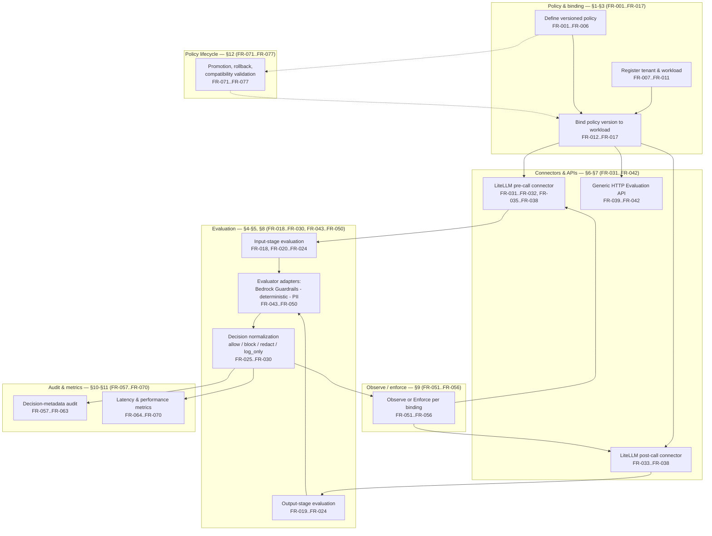

**AI Guardrails — Functional Requirements**

**Authority level:** L2
**Status:** Draft
**Date:** 2026-07-24
**Derived from:** seed.md + AGREEMENTS.md

---

## Purpose and authority

This document enumerates the **functional requirements** for the AI Guardrails solution: individually identified (`FR-001` …), measurable, testable statements of what the platform must do. It is a **derived (L2)** artifact and must not contradict [`AGREEMENTS.md`](../00-source-of-truth/AGREEMENTS.md) or [`CONSTRAINTS.md`](../00-source-of-truth/CONSTRAINTS.md) (both L1 — authoritative). Where a conflict is found, those documents win and this register must be corrected.

Every requirement below is derived from `seed.md` §6.1 (in-scope product scope), §9 (core domain model), §10 (logical architecture), §12 (LiteLLM integration), §15 (operational requirements), and §16 (MVP definition), read alongside the accepted agreements in [`AGREEMENTS.md`](../00-source-of-truth/AGREEMENTS.md). No metric, dollar figure, SLA, or performance number is asserted beyond what `seed.md` states; where a numeric target would normally appear and is not present in the seed, this document says the target is **TBD**, consistent with [`CONSTRAINTS.md`](../00-source-of-truth/CONSTRAINTS.md).

This document is deliberately more granular than [`../20-product/CAPABILITIES.md`](../20-product/CAPABILITIES.md). `CAPABILITIES.md` catalogs *what the product does* at capability granularity (`CAP-001` …); this document states, for each capability, the individually verifiable *requirement statements* (`FR-001` …) that a test plan, an architecture document, or an implementation can be checked against. Every `FR-` below cross-references the `CAP-` ID(s) it operationalizes.

---

## How to read this document

| Column | Meaning |
|---|---|
| **ID** | Stable identifier (`FR-001` …), referenced by architecture documents, test plans, and the traceability matrix. |
| **Requirement** | A single, testable "must" / "must not" statement. Where a requirement is intentionally scoped narrower than a related future capability, that scoping is stated explicitly in the requirement text, not hidden in the Priority column. |
| **Rationale / Source** | The precise `seed.md` section the requirement is derived from, plus the `AGREEMENTS.md` (`AGR-`), `CONSTRAINTS.md` (`CON-`), `CAPABILITIES.md` (`CAP-`), or `OPEN-QUESTIONS.md` (`OQ-`) entry it is bound by or traces to. |
| **Priority** | `MVP` — required for the MVP per [AGR-019](../00-source-of-truth/AGREEMENTS.md#agr-019--mvp-scope-boundaries) and the MVP component list (`seed.md` §16). `Future` — architecturally permitted but explicitly **not** built during the MVP, per [AGR-019](../00-source-of-truth/AGREEMENTS.md#agr-019--mvp-scope-boundaries) and [AGR-022](../00-source-of-truth/AGREEMENTS.md#agr-022--five-phase-delivery). |

> **Change control:** A requirement's Priority may only move from `Future` to `MVP` (or vice versa) through the scope-change governance rule in [`../10-charter/SCOPE.md` §8](../10-charter/SCOPE.md#8-scope-change-governance-rule) — never as an incidental edit to this document.

---

## Table of contents

- [Purpose and authority](#purpose-and-authority)
- [How to read this document](#how-to-read-this-document)
- [Functional area map](#functional-area-map)
- [1. Policy definition and versioning](#1-policy-definition-and-versioning)
- [2. Tenant and workload registration](#2-tenant-and-workload-registration)
- [3. Policy-to-workload binding](#3-policy-to-workload-binding)
- [4. Evaluation stages: input and output](#4-evaluation-stages-input-and-output)
- [5. Decision normalization](#5-decision-normalization)
- [6. LiteLLM connector: pre-call and post-call](#6-litellm-connector-pre-call-and-post-call)
- [7. Generic HTTP Evaluation API](#7-generic-http-evaluation-api)
- [8. Evaluator adapters: Bedrock Guardrails, deterministic rules, and sensitive-data handling](#8-evaluator-adapters-bedrock-guardrails-deterministic-rules-and-sensitive-data-handling)
- [9. Observe and enforce modes](#9-observe-and-enforce-modes)
- [10. Decision-metadata audit](#10-decision-metadata-audit)
- [11. Evaluation latency and performance metrics](#11-evaluation-latency-and-performance-metrics)
- [12. Policy promotion and rollback](#12-policy-promotion-and-rollback)
- [13. Future-scope functional requirements (not built in the MVP)](#13-future-scope-functional-requirements-not-built-in-the-mvp)
- [14. Traceability summary](#14-traceability-summary)
- [15. Related documents](#15-related-documents)

---

## Functional area map

The diagram below places each functional area (and its `FR-` range) against the logical architecture in `seed.md` §10, showing how a request moves from connector, through evaluation and decision normalization, into mode enforcement, audit, and metrics.

---

## 1. Policy definition and versioning

A policy defines what must be evaluated and how violations are handled ([`AGREEMENTS.md` AGR-007](../00-source-of-truth/AGREEMENTS.md#agr-007--policies-are-separate-from-connectors)). It is the portable entity ([AGR-005](../00-source-of-truth/AGREEMENTS.md#agr-005--policy-portability)) that every deployment mode must resolve identically ([AGR-006](../00-source-of-truth/AGREEMENTS.md#agr-006--one-logical-evaluation-contract-across-all-modes)). Implements [`CAPABILITIES.md` CAP-001](../20-product/CAPABILITIES.md#policy-governance).

| ID | Requirement | Rationale / Source | Priority |
|---|---|---|---|
| FR-001 | The platform must allow defining a guardrail policy with, at minimum: policy name, an immutable version identifier, one or more evaluation stages, evaluator configuration, enforcement actions, thresholds, a failure-behavior section, audit behavior, and compatibility metadata. | seed.md §9 (Policy); [AGR-017](../00-source-of-truth/AGREEMENTS.md#agr-017--core-domain-model) | MVP |
| FR-002 | Once published, a policy version must be immutable; any change to checks, thresholds, or actions must be expressed as a new policy version, never as a modification of an existing one. | seed.md §15 (Policy rollout — "Immutable versions"); [AGR-017](../00-source-of-truth/AGREEMENTS.md#agr-017--core-domain-model) | MVP |
| FR-003 | A policy must not be accepted by the runtime unless its failure-behavior section explicitly addresses: Evaluation API timeout, detector unavailability, unresolved policy, control-plane unavailability, audit-delivery failure, and inability to safely transform a response. Policies missing any of these must be rejected or flagged, never defaulted silently. | seed.md §5.7 (Failure behavior is part of policy); [AGR-012](../00-source-of-truth/AGREEMENTS.md#agr-012--failure-behavior-is-part-of-policy) | MVP |
| FR-004 | A policy definition must not encode LiteLLM configuration structures, Bedrock Guardrails response formats, a specific model provider, a specific programming language, or a specific application framework; any such vendor- or framework-specific logic must live in a connector or adapter, never in the policy itself. | seed.md §5.1 (Policy portability); [AGR-005](../00-source-of-truth/AGREEMENTS.md#agr-005--policy-portability); [CON-003](../00-source-of-truth/CONSTRAINTS.md#con-003--no-coupling-to-litellm-configuration-structures); [CON-004](../00-source-of-truth/CONSTRAINTS.md#con-004--no-coupling-to-bedrock-guardrails-response-formats) | MVP |
| FR-005 | Policy storage must retain every previously published policy version in a resolvable form, so a binding can reference, compare against, or roll back to any prior version. | seed.md §11 (Policy storage), §15 (Policy rollout) | MVP |
| FR-006 | A policy version's compatibility metadata must be evaluable by the runtime to determine whether that version is compatible with a given runtime or connector version before it can be bound to a workload. | seed.md §9 (Policy — compatibility metadata), §15 (Compatibility validation) | MVP |

---

## 2. Tenant and workload registration

Tenant and Workload are the two identity entities that every policy binding, evaluation, and audit record must resolve to ([AGR-017](../00-source-of-truth/AGREEMENTS.md#agr-017--core-domain-model)). Per-tenant workload identity is also a security constraint, not only a domain-model convenience ([CON-011](../00-source-of-truth/CONSTRAINTS.md#con-011--per-tenant-workload-identities)). Implements [`CAPABILITIES.md` CAP-002](../20-product/CAPABILITIES.md#workload-and-binding).

| ID | Requirement | Rationale / Source | Priority |
|---|---|---|---|
| FR-007 | The platform must represent a Tenant with, at minimum: tenant identifier, ownership information, AWS account information, data classification, allowed Regions, retention configuration, deployment mode, and authentication configuration, and must issue each tenant's workloads a distinct, non-shared workload identity. | seed.md §9 (Tenant); [AGR-017](../00-source-of-truth/AGREEMENTS.md#agr-017--core-domain-model); [CON-011](../00-source-of-truth/CONSTRAINTS.md#con-011--per-tenant-workload-identities) | MVP |
| FR-008 | The platform must allow registering a Workload — an application, assistant, agent, gateway, or inference service — with, at minimum: workload identifier, tenant identifier, owner, environment, risk classification, gateway type, deployment mode, expected throughput, streaming requirements, assigned policy, and enforcement mode. | seed.md §9 (Workload) | MVP |
| FR-009 | Workload registration must record a gateway-type field that is not restricted to LiteLLM, so a workload calling the generic HTTP Evaluation API directly, or through a future non-LiteLLM gateway, can be registered without a schema change. | seed.md §12 (LiteLLM integration); [AGR-003](../00-source-of-truth/AGREEMENTS.md#agr-003--litellm-as-first-connector-not-the-product-boundary) | MVP |
| FR-010 | Registering a workload must not require copying another team's LiteLLM database, transferring model-provider credentials, exposing gateway administration endpoints, replacing the team's model-routing configuration, or granting the AI Guardrails provider administrative access to the team's gateway. | seed.md §4 (Definition of the import capability); [AGR-021](../00-source-of-truth/AGREEMENTS.md#agr-021--meaning-of-import) | MVP |
| FR-011 | Workload registration must capture a "streaming requirements" attribute; the runtime must not represent, imply, or advertise streaming output evaluation as supported for a workload registered as streaming, since streaming evaluation remains future scope (see FR-080). | seed.md §9 (Workload — streaming requirements), §17; [OQ-004](../00-source-of-truth/OPEN-QUESTIONS.md#oq-004--streaming-output-evaluation-timeline) | MVP |

---

## 3. Policy-to-workload binding

A binding associates a workload with a specific, immutable policy version and carries the mode, override, and rollback metadata needed to operate the observe-before-enforce progression ([AGR-011](../00-source-of-truth/AGREEMENTS.md#agr-011--observe-before-enforce-progression)). Implements [`CAPABILITIES.md` CAP-003](../20-product/CAPABILITIES.md#workload-and-binding).

| ID | Requirement | Rationale / Source | Priority |
|---|---|---|---|
| FR-012 | The platform must allow creating a binding that associates exactly one workload with exactly one specific, immutable policy version. | seed.md §9 (Policy binding) | MVP |
| FR-013 | Every binding must record whether it is currently operating in Observe or Enforce mode (see [Section 9](#9-observe-and-enforce-modes)). | seed.md §9 (Policy binding); [AGR-011](../00-source-of-truth/AGREEMENTS.md#agr-011--observe-before-enforce-progression) | MVP |
| FR-014 | A binding may define workload-specific overrides only from a limited, explicitly tracked category list, and each such override must require a recorded owner. | seed.md §9 (Policy binding), §20 (Policy fragmentation mitigation) | MVP |
| FR-015 | Every binding must record an effective date and a designated rollback policy version. | seed.md §9 (Policy binding) | MVP |
| FR-016 | Every binding must record its runtime compatibility requirements, and the platform must validate those requirements against the resolving runtime/connector version before the binding is activated. | seed.md §9 (Policy binding), §15 (Compatibility validation) | MVP |
| FR-017 | A newly created binding must default to Observe mode; enforcement must never be enabled as an implicit side effect of binding creation or of any other change. | [AGR-011](../00-source-of-truth/AGREEMENTS.md#agr-011--observe-before-enforce-progression) (implications) | MVP |

---

## 4. Evaluation stages: input and output

Evaluation represents a request to inspect content at a particular stage. The MVP requires exactly two stages — `input` and `output` — while the Evaluation entity's stage field must remain extensible to future stages without redesign ([AGR-006](../00-source-of-truth/AGREEMENTS.md#agr-006--one-logical-evaluation-contract-across-all-modes)). Implements [`CAPABILITIES.md` CAP-004 and CAP-005](../20-product/CAPABILITIES.md#evaluation).

| ID | Requirement | Rationale / Source | Priority |
|---|---|---|---|
| FR-018 | The Evaluation API must accept a request to evaluate content at the `input` stage, executed before the model is invoked. | seed.md §9 (Evaluation — supported initial stages) | MVP |
| FR-019 | The Evaluation API must accept a request to evaluate content at the `output` stage, executed after the model responds and before that response reaches the caller. | seed.md §9 (Evaluation — supported initial stages) | MVP |
| FR-020 | In the MVP, the Evaluation entity must support only the `input` and `output` stages, and evaluated content categories must be limited to user/model input and model output; the stage field must nonetheless be defined so future stages (`retrieval`, `tool_call`, `tool_result`, `memory_write`, `final_response`) can be added without redesigning the entity. | seed.md §9, §13 ("The MVP should initially limit support to user/model input and model output"), §6.2 | MVP |
| FR-021 | Every evaluation request and its resulting decision must carry a correlation identifier that is propagated end-to-end from the originating request through the decision and into the audit record. | seed.md §9 (Decision), §12 ("Propagating correlation identifiers") | MVP |
| FR-022 | Every evaluation stage must enforce an explicit, configurable timeout; the behavior when that timeout is reached must be governed by the workload's configured failure behavior, never an undocumented default. | seed.md §14 (Timeout limits), §15 (Availability — timeout behavior); [AGR-012](../00-source-of-truth/AGREEMENTS.md#agr-012--failure-behavior-is-part-of-policy); [CON-016](../00-source-of-truth/CONSTRAINTS.md#con-016--timeout-limits) | MVP |
| FR-023 | The Evaluation API and every evaluator adapter must enforce an input-size limit on content submitted for evaluation; no evaluation path may accept unbounded input. | seed.md §14 (Input-size limits); [CON-015](../00-source-of-truth/CONSTRAINTS.md#con-015--input-size-limits) | MVP |
| FR-024 | Every evaluation must record the exact, immutable policy version that was applied, so a decision is always traceable to one specific policy version rather than a policy name in the abstract. | seed.md §9 (Decision — "Policy name and version") | MVP |

---

## 5. Decision normalization

Every evaluator's output must be normalized into one vendor-independent decision structure, regardless of which engine produced it ([AGR-004](../00-source-of-truth/AGREEMENTS.md#agr-004--bedrock-guardrails-as-first-engine-vendor-independent-contract)). Implements [`CAPABILITIES.md` CAP-012](../20-product/CAPABILITIES.md#decisions-audit-and-observability).

| ID | Requirement | Rationale / Source | Priority |
|---|---|---|---|
| FR-025 | Every evaluator's output — whether produced by the Bedrock Guardrails adapter, the deterministic evaluator, or the sensitive-data evaluator — must be normalized into one common platform decision structure before it reaches a policy, a connector, or an audit record. | seed.md §9 (Decision); [AGR-004](../00-source-of-truth/AGREEMENTS.md#agr-004--bedrock-guardrails-as-first-engine-vendor-independent-contract); [AGR-006](../00-source-of-truth/AGREEMENTS.md#agr-006--one-logical-evaluation-contract-across-all-modes) | MVP |
| FR-026 | In the MVP, a decision's action field must be restricted to exactly four values: `allow`, `block`, `redact`, `log_only`. | seed.md §9 (Decision — initial actions) | MVP |
| FR-027 | Every decision must contain: action, allowed status, reason codes, policy name and version, evaluator metadata, transformed content where applicable, correlation identifier, audit identifier, and evaluation latency. | seed.md §9 (Decision) | MVP |
| FR-028 | The decision schema must reserve, but need not operationally implement, the future actions `rewrite`, `discard`, `abstain`, and `require_approval`, so a later action can extend the schema without a breaking redesign. | seed.md §9 (Decision — future actions); [OQ-007](../00-source-of-truth/OPEN-QUESTIONS.md#oq-007--human-approval-workflows-introduction-timing-and-ownership) | Future |
| FR-029 | Reason codes must be part of the vendor-independent contract and must be identical in meaning regardless of which evaluation engine produced the decision or which deployment mode is executing it. | seed.md §5.2 (One contract across deployment modes); [CON-005](../00-source-of-truth/CONSTRAINTS.md#con-005--one-logical-evaluation-contract-across-all-modes) | MVP |
| FR-030 | When a decision's action is `redact`, the decision must include the transformed (redacted) content, and the invoking connector must apply that transformed content rather than the original. | seed.md §9 (Decision — "Transformed content where applicable") | MVP |

---

## 6. LiteLLM connector: pre-call and post-call

LiteLLM is the first supported gateway connector, not the product boundary ([AGR-003](../00-source-of-truth/AGREEMENTS.md#agr-003--litellm-as-first-connector-not-the-product-boundary)). The connector owns request mapping and enforcement invocation only, never policy definition or detection logic ([AGR-007](../00-source-of-truth/AGREEMENTS.md#agr-007--policies-are-separate-from-connectors)). Implements [`CAPABILITIES.md` CAP-006 and CAP-007](../20-product/CAPABILITIES.md#connectors-and-apis).

| ID | Requirement | Rationale / Source | Priority |
|---|---|---|---|
| FR-031 | The LiteLLM pre-call connector must map the LiteLLM request into the evaluation contract and invoke `input`-stage evaluation before model invocation proceeds. | seed.md §12 (LiteLLM integration) | MVP |
| FR-032 | The LiteLLM pre-call connector must enforce the input-evaluation decision: a `block` decision must prevent model invocation, and a `redact` decision must cause the redacted content to be used for model invocation instead of the original. | seed.md §12 ("Enforcing block or redact decisions") | MVP |
| FR-033 | The LiteLLM post-call connector must invoke `output`-stage evaluation after model inference completes and before the response is returned to the calling application. | seed.md §12 (LiteLLM integration) | MVP |
| FR-034 | The LiteLLM post-call connector must apply a safe output fallback when the output decision is `block`, and must return the transformed content when the output decision is `redact`. | seed.md §12 ("Applying safe output fallbacks") | MVP |
| FR-035 | Both the pre-call and post-call connectors must propagate the same correlation identifier for a given request across input evaluation, model invocation, and output evaluation. | seed.md §12 ("Propagating correlation identifiers") | MVP |
| FR-036 | Both connectors must handle an evaluation timeout according to the workload's configured failure behavior, not a fixed, undocumented default. | seed.md §12 ("Handling evaluation timeouts"); [AGR-012](../00-source-of-truth/AGREEMENTS.md#agr-012--failure-behavior-is-part-of-policy) | MVP |
| FR-037 | Both connectors must emit connector-health telemetry; this telemetry must never, by itself, be treated as evidence that guardrail enforcement is mandatory or bypass-proof. | seed.md §12 ("Emitting connector-health telemetry"); [CON-012](../00-source-of-truth/CONSTRAINTS.md#con-012--no-exclusive-reliance-on-weak-security-proxies) | MVP |
| FR-038 | Neither connector may define organizational policy, implement detection models, manage model-provider credentials, persist audit records, perform user authorization, or manage policy versions; these responsibilities remain with the policy author, the Guardrails Runtime, and the consuming application, respectively. | seed.md §12 ("The connector is not responsible for"); [AGR-007](../00-source-of-truth/AGREEMENTS.md#agr-007--policies-are-separate-from-connectors) | MVP |

---

## 7. Generic HTTP Evaluation API

The generic HTTP Evaluation API is the proof that the evaluation contract does not depend on LiteLLM ([AGR-003](../00-source-of-truth/AGREEMENTS.md#agr-003--litellm-as-first-connector-not-the-product-boundary)) and is exercised directly by the MVP success demonstration ([AGR-020](../00-source-of-truth/AGREEMENTS.md#agr-020--mvp-success-demonstration)). Implements [`CAPABILITIES.md` CAP-008](../20-product/CAPABILITIES.md#connectors-and-apis).

| ID | Requirement | Rationale / Source | Priority |
|---|---|---|---|
| FR-039 | The platform must expose a generic, gateway-agnostic HTTP Evaluation API that implements the same evaluation contract used by the LiteLLM connector, callable directly by an application, SDK, or a non-LiteLLM gateway. | seed.md §6.1; [AGR-003](../00-source-of-truth/AGREEMENTS.md#agr-003--litellm-as-first-connector-not-the-product-boundary); [AGR-006](../00-source-of-truth/AGREEMENTS.md#agr-006--one-logical-evaluation-contract-across-all-modes) | MVP |
| FR-040 | The generic HTTP Evaluation API must accept both `input`- and `output`-stage evaluation requests using the identical request and decision schema used by the LiteLLM connector path, with no LiteLLM-specific fields required. | seed.md §6.1; [CON-003](../00-source-of-truth/CONSTRAINTS.md#con-003--no-coupling-to-litellm-configuration-structures); [CON-005](../00-source-of-truth/CONSTRAINTS.md#con-005--one-logical-evaluation-contract-across-all-modes) | MVP |
| FR-041 | The generic HTTP Evaluation API must authenticate callers via IAM-based authentication and must not treat a tenant-supplied identifier as sufficient authentication on its own. | seed.md §14 (Security requirements); [CON-010](../00-source-of-truth/CONSTRAINTS.md#con-010--iam-based-authentication-and-least-privilege-roles); [CON-012](../00-source-of-truth/CONSTRAINTS.md#con-012--no-exclusive-reliance-on-weak-security-proxies) | MVP |
| FR-042 | The generic HTTP Evaluation API must be independently demonstrable — callable and enforceable without any LiteLLM instance present — to prove that LiteLLM is a connector and not the product boundary. | [AGR-003](../00-source-of-truth/AGREEMENTS.md#agr-003--litellm-as-first-connector-not-the-product-boundary); [AGR-020](../00-source-of-truth/AGREEMENTS.md#agr-020--mvp-success-demonstration) | MVP |

---

## 8. Evaluator adapters: Bedrock Guardrails, deterministic rules, and sensitive-data handling

Amazon Bedrock Guardrails is the first managed evaluation engine, but the public contract remains vendor-independent ([AGR-004](../00-source-of-truth/AGREEMENTS.md#agr-004--bedrock-guardrails-as-first-engine-vendor-independent-contract)). The deterministic evaluator and sensitive-data evaluator run behind the same adapter pattern. Implements [`CAPABILITIES.md` CAP-009, CAP-010, and CAP-011](../20-product/CAPABILITIES.md#connectors-and-apis).

| ID | Requirement | Rationale / Source | Priority |
|---|---|---|---|
| FR-043 | The platform must implement a Bedrock Guardrails adapter that invokes Amazon Bedrock Guardrails and normalizes its response into the platform's own decision structure before that result reaches any policy, connector, or audit record. | seed.md §10 (Logical architecture), §11; [AGR-004](../00-source-of-truth/AGREEMENTS.md#agr-004--bedrock-guardrails-as-first-engine-vendor-independent-contract) | MVP |
| FR-044 | Bedrock Guardrails' native response format must never be exposed directly to a policy author, a connector, or an audit consumer; only the normalized decision structure may cross that boundary. | [AGR-004](../00-source-of-truth/AGREEMENTS.md#agr-004--bedrock-guardrails-as-first-engine-vendor-independent-contract); [CON-004](../00-source-of-truth/CONSTRAINTS.md#con-004--no-coupling-to-bedrock-guardrails-response-formats) | MVP |
| FR-045 | The platform must implement a deterministic evaluator supporting organization-authored, non-ML rule-based checks (for example, pattern-, keyword-, or schema-based validation), running behind the same evaluator-adapter interface as the Bedrock Guardrails adapter. | seed.md §16 (MVP components, item 7); §9 ("Deterministic organization rules") | MVP |
| FR-046 | The deterministic evaluator's rules must be addable and versioned through policy configuration, without requiring a code change to any connector. | seed.md §5.1 (Policy portability); [AGR-005](../00-source-of-truth/AGREEMENTS.md#agr-005--policy-portability) | MVP |
| FR-047 | The platform must implement a basic sensitive-data (PII) evaluator capable of detecting defined sensitive-data categories within evaluated content, sufficient to drive `redact`, `block`, or `log_only` decisions on recognized categories. | seed.md §6.1 (item 10), §10 ("PII evaluators") | MVP |
| FR-048 | The sensitive-data evaluator's scope must remain bounded to basic detection; it must not be represented as, or expanded into, a complete data-loss-prevention (DLP) platform during the MVP. | seed.md §6.3 ("A complete DLP platform") | MVP |
| FR-049 | The evaluator-adapter interface must be designed so additional evaluation engines beyond the Bedrock Guardrails adapter, the deterministic evaluator, and the sensitive-data evaluator can be added later without changing the policy schema or the decision structure; no additional engine is required to ship in the MVP itself. | [AGR-004](../00-source-of-truth/AGREEMENTS.md#agr-004--bedrock-guardrails-as-first-engine-vendor-independent-contract) (implications); [AGR-005](../00-source-of-truth/AGREEMENTS.md#agr-005--policy-portability) | MVP |
| FR-050 | Every evaluator adapter must report its own evaluator version as part of the decision and audit metadata for each evaluation it produces. | seed.md §15 (Auditing — "Evaluator versions") | MVP |

---

## 9. Observe and enforce modes

Every policy must support a non-blocking evaluation mode and a defined progression from Disabled to Observe to Warn to Redact to Block ([AGR-011](../00-source-of-truth/AGREEMENTS.md#agr-011--observe-before-enforce-progression)). The MVP requires Observe and Enforce to be fully operational end to end. Implements [`CAPABILITIES.md` CAP-013](../20-product/CAPABILITIES.md#decisions-audit-and-observability).

| ID | Requirement | Rationale / Source | Priority |
|---|---|---|---|
| FR-051 | The policy and binding schema must represent all five states of the observe-before-enforce progression — Disabled, Observe, Warn, Redact, Block — per policy, per workload. | seed.md §5.6 (Observable before enforceable); [AGR-011](../00-source-of-truth/AGREEMENTS.md#agr-011--observe-before-enforce-progression) | MVP |
| FR-052 | The MVP must implement Observe and Enforce as fully operational, end-to-end states; per the MVP success demonstration, one workload bound to a given policy must be able to run in Observe mode while a different workload bound to the same policy version runs in Enforce mode. | seed.md §16 (MVP components, item 10; MVP demonstration); [AGR-020](../00-source-of-truth/AGREEMENTS.md#agr-020--mvp-success-demonstration) | MVP |
| FR-053 | A binding operating in Observe mode must record every decision without blocking, redacting, or otherwise altering the request or response actually delivered to the caller or the model. | seed.md §5.6 | MVP |
| FR-054 | A binding operating in Enforce mode must apply the decision's action to the request or response before it is delivered to the caller or the model (a `block` decision must prevent delivery; a `redact` decision must substitute the transformed content). | seed.md §5.6, §9 | MVP |
| FR-055 | A new binding must default to Observe mode; promotion to Enforce (or any other state) must be an explicit, separately recorded action, never an implicit side effect of another change such as a policy-version upgrade. | [AGR-011](../00-source-of-truth/AGREEMENTS.md#agr-011--observe-before-enforce-progression) (implications) | MVP |
| FR-056 | The platform must record, in audit metadata, which mode (Observe or Enforce) was in effect for a given workload at the moment each decision was produced. | seed.md §15 (Auditing); [AGR-011](../00-source-of-truth/AGREEMENTS.md#agr-011--observe-before-enforce-progression) | MVP |

---

## 10. Decision-metadata audit

Audit metadata is the evidence that policies are being applied, and the mechanism for tracing every decision back to a tenant, workload, and policy version ([AGR-017](../00-source-of-truth/AGREEMENTS.md#agr-017--core-domain-model)). Default behavior must not retain raw content ([AGR-014](../00-source-of-truth/AGREEMENTS.md#agr-014--no-raw-promptresponse-retention-by-default)). Implements [`CAPABILITIES.md` CAP-015](../20-product/CAPABILITIES.md#decisions-audit-and-observability).

| ID | Requirement | Rationale / Source | Priority |
|---|---|---|---|
| FR-057 | Every evaluation decision must produce an audit record containing, at minimum: tenant, workload, policy version, evaluation stage, decision, reason codes, evaluator versions, timestamp, correlation identifier, and whether raw content was retained for that evaluation. | seed.md §15 (Auditing) | MVP |
| FR-058 | An audit record must be produced for every evaluation regardless of whether the governing binding is in Observe or Enforce mode. | seed.md §5.6; [AGR-011](../00-source-of-truth/AGREEMENTS.md#agr-011--observe-before-enforce-progression) | MVP |
| FR-059 | By default, the hosted runtime must persist decision metadata only; it must not persist raw prompts or responses unless the tenant has explicitly configured raw-content retention. | seed.md §13 (Default behavior); [AGR-014](../00-source-of-truth/AGREEMENTS.md#agr-014--no-raw-promptresponse-retention-by-default); [CON-014](../00-source-of-truth/CONSTRAINTS.md#con-014--no-raw-content-retention-by-default-in-the-hosted-runtime) | MVP |
| FR-060 | Audit and telemetry pipelines must hash user and conversation identifiers where possible rather than storing them in cleartext, and must remove secrets from any emitted telemetry. | seed.md §13 (Default behavior) | MVP |
| FR-061 | Audit-delivery failure must be handled according to the workload's configured failure behavior; the platform must record that audit delivery did not complete normally and which failure-behavior path was taken. | seed.md §5.7; [AGR-012](../00-source-of-truth/AGREEMENTS.md#agr-012--failure-behavior-is-part-of-policy) | MVP |
| FR-062 | Audit-event integrity must be preserved from the point a decision is generated through to durable storage — a decision must not be silently dropped between generation and archival. | seed.md §14 (Audit-event integrity) | MVP |
| FR-063 | In a Customer-Managed Runtime deployment, audit records generated locally must remain local by default; only telemetry categories the customer has explicitly selected (or none) may reach the hosted control plane. | seed.md §13 (Customer-managed telemetry); [AGR-016](../00-source-of-truth/AGREEMENTS.md#agr-016--customer-controlled-telemetry-for-the-customer-managed-runtime); [CON-013](../00-source-of-truth/CONSTRAINTS.md#con-013--raw-content-must-not-leave-a-customer-managed-runtime-unless-explicitly-configured) | MVP |

---

## 11. Evaluation latency and performance metrics

The platform must measure evaluation performance so a team can assess business impact before enforcing a policy ([AGR-011](../00-source-of-truth/AGREEMENTS.md#agr-011--observe-before-enforce-progression)). Specific numeric latency targets are **TBD** and are not asserted in this document. Implements [`CAPABILITIES.md` CAP-014](../20-product/CAPABILITIES.md#decisions-audit-and-observability).

| ID | Requirement | Rationale / Source | Priority |
|---|---|---|---|
| FR-064 | Every decision must include its own evaluation latency as a discrete field. | seed.md §9 (Decision) | MVP |
| FR-065 | The platform must measure and expose P50, P95, and P99 evaluation latency. | seed.md §15 (Performance) | MVP |
| FR-066 | The platform must measure evaluation throughput. | seed.md §15 (Performance) | MVP |
| FR-067 | The platform must measure the evaluation timeout rate. | seed.md §15 (Performance); [CON-016](../00-source-of-truth/CONSTRAINTS.md#con-016--timeout-limits) | MVP |
| FR-068 | The platform must measure detector-specific (per-evaluator) latency, so a specific slow evaluator can be identified independent of overall evaluation latency. | seed.md §15 (Performance — "Detector-specific latency") | MVP |
| FR-069 | The platform must measure decision distribution — the relative proportion of `allow`, `block`, `redact`, and `log_only` decisions produced. | seed.md §15 (Performance — "Decision distribution") | MVP |
| FR-070 | The platform must measure policy-cache hit rate. | seed.md §15 (Performance — "Policy-cache hit rate") | MVP |

> Specific numeric SLA or latency targets (for example, a P95 ceiling in milliseconds) are **not** defined in `seed.md` and are therefore **TBD**; this document requires only that the measurements above be captured, per source-of-truth policy against inventing figures.

---

## 12. Policy promotion and rollback

Policies must support controlled promotion, workload-scoped rollout, and immediate rollback so a policy can be evolved safely across workloads ([AGR-011](../00-source-of-truth/AGREEMENTS.md#agr-011--observe-before-enforce-progression)). This is exercised directly by the MVP success demonstration ([AGR-020](../00-source-of-truth/AGREEMENTS.md#agr-020--mvp-success-demonstration)). Implements [`CAPABILITIES.md` CAP-001 and CAP-003](../20-product/CAPABILITIES.md#policy-governance).

| ID | Requirement | Rationale / Source | Priority |
|---|---|---|---|
| FR-071 | The platform must support promoting a binding from a lower state to a higher state in the observe-before-enforce progression (for example, Observe → Enforce) only as an explicit, separately recorded action. | seed.md §5.6, §15 (Controlled promotion); [AGR-011](../00-source-of-truth/AGREEMENTS.md#agr-011--observe-before-enforce-progression) | MVP |
| FR-072 | The platform must support publishing a new, immutable policy version without mutating any previously published version. | seed.md §15 (Immutable versions) | MVP |
| FR-073 | The platform must support workload-scoped rollout: promoting a subset of workloads bound to a policy to a new policy version while other workloads remain bound to a prior version. | seed.md §15 (Workload-scoped rollout) | MVP |
| FR-074 | The platform must support immediate rollback of a workload's binding to its designated rollback policy version. | seed.md §9 (Policy binding — rollback version), §15 (Immediate rollback) | MVP |
| FR-075 | Before a new policy version is activated for a bound workload, the platform must validate that version's compatibility metadata against the resolving runtime/connector version. | seed.md §15 (Compatibility validation) | MVP |
| FR-076 | The platform must support comparing evaluation results produced under a candidate policy version against those produced under the currently bound version, to inform a promotion or rollback decision. | seed.md §15 (Evaluation-result comparison between versions) | MVP |
| FR-077 | The MVP success demonstration requires that a policy version can be upgraded and subsequently rolled back for a workload without changing that workload's connector integration or requiring any reconfiguration beyond the binding's policy-version reference. | seed.md §16 (MVP demonstration); [AGR-020](../00-source-of-truth/AGREEMENTS.md#agr-020--mvp-success-demonstration) | MVP |

---

## 13. Future-scope functional requirements (not built in the MVP)

`seed.md` §6.2 states the product architecture **should permit, but not initially require**, the capabilities below. Every requirement in this section carries `Priority = Future`: the architecture must not preclude them, but none may be scheduled, resourced, or silently built during the MVP ([AGR-019](../00-source-of-truth/AGREEMENTS.md#agr-019--mvp-scope-boundaries)). This section maps one-to-one onto the Future capabilities already cataloged in [`CAPABILITIES.md`](../20-product/CAPABILITIES.md#future-capabilities-not-in-mvp) (`CAP-018`–`CAP-034`); see that document for fuller descriptions and [`../10-charter/SCOPE.md` §4](../10-charter/SCOPE.md#4-future-scope) for the scope boundary these requirements sit inside.

| ID | Requirement | Rationale / Source | Priority |
|---|---|---|---|
| FR-078 | The architecture must permit adding a `retrieval` evaluation stage that inspects retrieved documents before they are incorporated into a prompt, without redesigning the Evaluation entity. | seed.md §6.2, §9; CAP-018; [OQ-005](../00-source-of-truth/OPEN-QUESTIONS.md#oq-005--retrieval-content-evaluation-and-indirect-prompt-injection-detection-timeline) | Future |
| FR-079 | The architecture must permit adding an indirect-prompt-injection detector as a new evaluator behind the existing adapter pattern. | seed.md §6.2; CAP-019; [OQ-005](../00-source-of-truth/OPEN-QUESTIONS.md#oq-005--retrieval-content-evaluation-and-indirect-prompt-injection-detection-timeline) | Future |
| FR-080 | The architecture must permit adding streaming output evaluation without changing the evaluation contract; until it ships, streaming workloads must be evaluated only on buffered, non-streamed content, or run in observe/log-only mode with the limitation documented (see FR-011). | seed.md §6.2, §17; CAP-020; [OQ-004](../00-source-of-truth/OPEN-QUESTIONS.md#oq-004--streaming-output-evaluation-timeline) | Future |
| FR-081 | The architecture must permit adding a `tool_call` evaluation stage that inspects tool name and arguments before an agent executes a tool call, without requiring the contract to be redesigned. | seed.md §6.2; CAP-021; [AGR-010](../00-source-of-truth/AGREEMENTS.md#agr-010--guardrails-are-not-authorization); [OQ-006](../00-source-of-truth/OPEN-QUESTIONS.md#oq-006--tool-call-validation-tool-result-evaluation-and-mcp-authorization-scope) | Future |
| FR-082 | The architecture must permit adding MCP-specific authorization controls scoped to the platform's own tool-call evaluation, while remaining clearly distinguished from a general-purpose MCP security platform, which stays out of scope ([`SCOPE.md` §5](../10-charter/SCOPE.md#5-out-of-scope-for-the-mvp)). | seed.md §6.2, §6.3; CAP-022; [AGR-010](../00-source-of-truth/AGREEMENTS.md#agr-010--guardrails-are-not-authorization); [OQ-006](../00-source-of-truth/OPEN-QUESTIONS.md#oq-006--tool-call-validation-tool-result-evaluation-and-mcp-authorization-scope) | Future |
| FR-083 | The architecture must permit adding a `memory_write` evaluation stage that inspects content before it is persisted to agent or assistant memory, using the same Evaluation/Decision entities as `input`/`output`. | seed.md §6.2, §9; CAP-023 | Future |
| FR-084 | The architecture must permit adding a groundedness evaluator (assessing whether a response is factually grounded in supplied or retrieved context) as a new evaluator, not a contract change. | seed.md §6.2; CAP-024 | Future |
| FR-085 | The architecture must permit adding automated-reasoning-based evaluation approaches as a new evaluator, not a contract change. | seed.md §6.2; CAP-025 | Future |
| FR-086 | The architecture must permit adding multilingual policy packs; until they ship, non-English workload owners must be informed explicitly during onboarding that MVP evaluators are assumed English-effective. | seed.md §6.2; CAP-026; [OQ-008](../00-source-of-truth/OPEN-QUESTIONS.md#oq-008--multilingual-policy-pack-timeline) | Future |
| FR-087 | The decision schema must reserve a `require_approval` action (see FR-028); the architecture must permit adding a human-approval workflow and UI around that action without further schema change. | seed.md §6.2, §9; CAP-027; [OQ-007](../00-source-of-truth/OPEN-QUESTIONS.md#oq-007--human-approval-workflows-introduction-timing-and-ownership) | Future |
| FR-088 | The architecture must permit adding cryptographic policy signing that layers onto the existing versioned-policy model without replacing it. | seed.md §6.2; CAP-028; [OQ-012](../00-source-of-truth/OPEN-QUESTIONS.md#oq-012--policy-signing-and-policy-inheritance-design) | Future |
| FR-089 | The architecture must permit adding structured policy inheritance or composition between policies, gated on a governance model that contains the policy-fragmentation risk (seed.md §20). | seed.md §6.2; CAP-029; [OQ-012](../00-source-of-truth/OPEN-QUESTIONS.md#oq-012--policy-signing-and-policy-inheritance-design) | Future |
| FR-090 | The architecture must permit adding a customer-specific evaluator plugin mechanism behind the standard evaluator-adapter contract, gated on a defined security and compatibility review model. | seed.md §6.2; CAP-030; [OQ-013](../00-source-of-truth/OPEN-QUESTIONS.md#oq-013--customer-specific-evaluator-plugin-governance) | Future |
| FR-091 | The architecture must permit adding policy-marketplace discovery and distribution capabilities across organizations or tenants. | seed.md §6.2; CAP-031; [OQ-011](../00-source-of-truth/OPEN-QUESTIONS.md#oq-011--commercial-metering-and-policy-marketplace) | Future |
| FR-092 | The architecture must permit adding per-tenant dedicated hosted runtime instances, as opposed to a shared multi-tenant hosted runtime. | seed.md §6.2; CAP-032; [OQ-010](../00-source-of-truth/OPEN-QUESTIONS.md#oq-010--dedicated-tenant-runtimes-and-air-gapped-deployment-timeline) | Future |
| FR-093 | The architecture must permit adding a fully air-gapped installation and policy-distribution model with no network connectivity to the hosted control plane at all, beyond the MVP's asynchronous, cache-tolerant Customer-Managed Runtime behavior. | seed.md §6.2, §3; CAP-033; [AGR-015](../00-source-of-truth/AGREEMENTS.md#agr-015--customer-managed-runtime-executes-without-a-synchronous-control-plane-connection); [OQ-010](../00-source-of-truth/OPEN-QUESTIONS.md#oq-010--dedicated-tenant-runtimes-and-air-gapped-deployment-timeline) | Future |
| FR-094 | The architecture must permit adding usage-based commercial metering suitable for customer-facing billing of evaluation volume, distinct from the internal cost/rate telemetry needed for Phase 3 quota and rate-limit enforcement. | seed.md §6.2, §18 (Phase 3); CAP-034; [OQ-011](../00-source-of-truth/OPEN-QUESTIONS.md#oq-011--commercial-metering-and-policy-marketplace) | Future |

---

## 14. Traceability summary

| FR range | Functional area | Primary capability IDs | Primary agreements / constraints |
|---|---|---|---|
| FR-001–FR-006 | Policy definition and versioning | CAP-001 | AGR-005, AGR-006, AGR-017 |
| FR-007–FR-011 | Tenant and workload registration | CAP-002 | AGR-017, AGR-021, CON-011 |
| FR-012–FR-017 | Policy-to-workload binding | CAP-003 | AGR-011, AGR-017 |
| FR-018–FR-024 | Evaluation stages: input and output | CAP-004, CAP-005 | AGR-006, AGR-019, CON-015, CON-016 |
| FR-025–FR-030 | Decision normalization | CAP-012 | AGR-004, AGR-006, AGR-017 |
| FR-031–FR-038 | LiteLLM pre-call and post-call connectors | CAP-006, CAP-007 | AGR-003, AGR-007, AGR-012 |
| FR-039–FR-042 | Generic HTTP Evaluation API | CAP-008 | AGR-003, AGR-006, CON-010 |
| FR-043–FR-050 | Evaluator adapters (Bedrock, deterministic, PII) | CAP-009, CAP-010, CAP-011 | AGR-004, AGR-005, AGR-014 |
| FR-051–FR-056 | Observe and enforce modes | CAP-013 | AGR-011, AGR-020 |
| FR-057–FR-063 | Decision-metadata audit | CAP-015 | AGR-012, AGR-014, AGR-016, CON-013, CON-014 |
| FR-064–FR-070 | Evaluation latency and performance metrics | CAP-014 | — (no numeric target set; TBD) |
| FR-071–FR-077 | Policy promotion and rollback | CAP-001, CAP-003 | AGR-011, AGR-020 |
| FR-078–FR-094 | Future-scope functional requirements | CAP-018–CAP-034 | AGR-019, AGR-022 |

**Requirement count summary**

| Category | Count |
|---|---|
| MVP requirements (`FR-001`–`FR-077`, minus FR-028) | 76 |
| Future requirements (`FR-028`, `FR-078`–`FR-094`) | 18 |
| **Total** | **94** |

---

## 15. Related documents

- [`../00-source-of-truth/AGREEMENTS.md`](../00-source-of-truth/AGREEMENTS.md) — authoritative agreements this requirements register operationalizes.
- [`../00-source-of-truth/CONSTRAINTS.md`](../00-source-of-truth/CONSTRAINTS.md) — non-negotiable boundaries that bound how MVP requirements may be implemented.
- [`../00-source-of-truth/OPEN-QUESTIONS.md`](../00-source-of-truth/OPEN-QUESTIONS.md) — tracks unresolved timing/design decisions referenced by the Future-scope requirements in [Section 13](#13-future-scope-functional-requirements-not-built-in-the-mvp).
- [`../00-source-of-truth/DECISIONS.md`](../00-source-of-truth/DECISIONS.md) — decision log recording why the MVP was bounded as it is.
- [`../10-charter/SCOPE.md`](../10-charter/SCOPE.md) — the scope boundary (in-scope, future, out-of-scope, non-goals) this requirements register must not exceed.
- [`../10-charter/PRINCIPLES.md`](../10-charter/PRINCIPLES.md) — guiding principles these requirements operationalize.
- [`../20-product/CAPABILITIES.md`](../20-product/CAPABILITIES.md) — capability-level catalog; every `FR-` here implements one or more `CAP-` entries there.
- [`COMPONENT-ARCHITECTURE.md`](COMPONENT-ARCHITECTURE.md) — the component design (Policy model, Workload registry, Policy binding, Evaluation API, Policy resolver, Decision engine, Evaluator adapters) that satisfies Sections 1–3, 5, 8, and 9 of this document.
- [`INTEGRATION-ARCHITECTURE.md`](INTEGRATION-ARCHITECTURE.md) — the connector and generic-SDK design that satisfies Sections 4, 6, and 7 of this document.
- [`DATA-ARCHITECTURE.md`](DATA-ARCHITECTURE.md) — the storage and retention design that satisfies Section 10 of this document.
- [`SECURITY-ARCHITECTURE.md`](SECURITY-ARCHITECTURE.md) — the authentication, authorization, and evaluator-plugin governance design referenced in Sections 7, 8, and 13.
- [`DEPLOYMENT-ARCHITECTURE.md`](DEPLOYMENT-ARCHITECTURE.md) — the hosted and customer-managed deployment design referenced in Sections 10 and 13.
- [`OPERABILITY.md`](OPERABILITY.md) — the availability, timeout, and performance-metric design that satisfies Section 11 of this document.
- [`../60-delivery/RELEASE-CRITERIA.md`](../60-delivery/RELEASE-CRITERIA.md) — gates MVP release on every `MVP`-priority requirement in this document, and on none of the `Future`-priority ones.
- [`../00-source-of-truth/TRACEABILITY-MATRIX.md`](../00-source-of-truth/TRACEABILITY-MATRIX.md) — cross-references each `FR-` ID to its implementing architecture section and test artifact.
