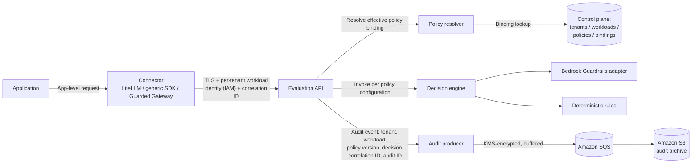

**AI Guardrails — Security Architecture**

**Authority level:** L3
**Status:** Draft
**Date:** 2026-07-24
**Derived from:** seed.md + AGREEMENTS.md

---

> This is an **L3 — derived** document. It does not introduce new decisions and must never contradict the L1 authoritative material in [`../00-source-of-truth/AGREEMENTS.md`](../00-source-of-truth/AGREEMENTS.md) and [`../00-source-of-truth/CONSTRAINTS.md`](../00-source-of-truth/CONSTRAINTS.md), or the L2 [`../10-charter/CHARTER.md`](../10-charter/CHARTER.md) and [`NON-FUNCTIONAL-REQUIREMENTS.md`](NON-FUNCTIONAL-REQUIREMENTS.md). Where this document and those registers appear to differ, the registers win and this document must be corrected. Figures, dates, and dollar amounts not present in `seed.md` are marked **TBD** rather than invented.
>
> This document expands, at implementation-relevant depth, the security summary already given at [`ARCHITECTURE-REPORT.md` §11–§12](ARCHITECTURE-REPORT.md#11-identity-and-access-management) and the measurable Security-section requirements in [`NON-FUNCTIONAL-REQUIREMENTS.md`](NON-FUNCTIONAL-REQUIREMENTS.md#security). It does not restate those measurement definitions; it explains the architectural mechanism each control depends on, the trust and enforcement model those controls sit inside, and the threat scenarios they are meant to resist.

---

## Table of contents

1. [Purpose and relationship to other documents](#1-purpose-and-relationship-to-other-documents)
2. [Security principles](#2-security-principles)
3. [Trust and enforcement model](#3-trust-and-enforcement-model)
4. [Security control catalog](#4-security-control-catalog)
5. [Identity, authentication, and policy authorization](#5-identity-authentication-and-policy-authorization)
6. [Rate limiting and resource protection](#6-rate-limiting-and-resource-protection)
7. [Audit-event integrity](#7-audit-event-integrity)
8. [Software supply-chain security](#8-software-supply-chain-security)
9. [What the product must not rely on](#9-what-the-product-must-not-rely-on)
10. [Threat model](#10-threat-model)
11. [Guardrails are not authorization](#11-guardrails-are-not-authorization)
12. [Security boundaries explicitly out of MVP scope](#12-security-boundaries-explicitly-out-of-mvp-scope)
13. [Traceability summary](#13-traceability-summary)
14. [Related documents](#14-related-documents)

---

## 1. Purpose and relationship to other documents

This document defines the security architecture of the AI Guardrails platform: the transport, identity, authorization, resource-protection, audit-integrity, and supply-chain controls the platform must implement (seed.md §14), and the trust and enforcement model that determines how strong a bypass-resistance guarantee any given deployment actually provides (seed.md §8). It also states the threat scenarios these controls are designed against and draws the explicit boundary between content evaluation and business authorization (seed.md §5.5; [AGR-010](../00-source-of-truth/AGREEMENTS.md#agr-010--guardrails-are-not-authorization)).

It is written for architects, security reviewers, and platform engineers who need to know **how** a control is implemented and **what it does and does not guarantee** — not only that it is required. Three other documents own adjacent, non-duplicated ground:

| Document | What it owns that this document does not |
|---|---|
| [`../00-source-of-truth/CONSTRAINTS.md`](../00-source-of-truth/CONSTRAINTS.md) | The authoritative (L1) boundary statements (CON-008 through CON-016) and their rationale. This document operationalizes them; it does not restate their rationale. |
| [`NON-FUNCTIONAL-REQUIREMENTS.md`](NON-FUNCTIONAL-REQUIREMENTS.md#security) | Measurable targets, measurement method, and validation stage for each Security-section NFR (NFR-SEC-001 through NFR-SEC-006). This document explains the mechanism behind each; it does not restate the measurement definitions. |
| [`DATA-ARCHITECTURE.md`](DATA-ARCHITECTURE.md) | Content-exposure and retention detail per deployment mode (AGR-008, AGR-009, AGR-014, AGR-016) — what content is processed, transmitted, and persisted. This document addresses how that content and every other request is authenticated, authorized, transported, and audited, not what content categories exist. |

Per [AGR-008](../00-source-of-truth/AGREEMENTS.md#agr-008--explicit-content-exposure-model-ownership-vs-exposure-are-separate-concerns), operational ownership and data exposure are separate concerns. This document is primarily about the **mechanisms that protect a request and its identity as it moves through the platform**, regardless of which party operates each hop; `DATA-ARCHITECTURE.md` is primarily about **what content is exposed to whom**. Both must be read together for a complete security and compliance picture of any deployment mode.

---

## 2. Security principles

The controls in this document exist to serve four principles already accepted at L1/L2 and restated here only as orientation:

1. **Explicit enforcement posture, never an implied one.** A deployment's actual bypass-resistance must be recorded and visible, not assumed from the presence of a connector ([AGR-018](../00-source-of-truth/AGREEMENTS.md#agr-018--trust-and-enforcement-model)).
2. **No single weak signal stands alone as a security control.** API keys in gateway configuration, unauthenticated tenant identifiers, unauthenticated client-supplied policy versions, and connector telemetry may each exist as a convenience or diagnostic signal, but none may be the sole basis for a security or enforcement-evidence claim ([`CONSTRAINTS.md` CON-012](../00-source-of-truth/CONSTRAINTS.md#con-012--no-exclusive-reliance-on-weak-security-proxies)).
3. **Failure behavior is part of policy, including security-relevant failure.** What happens when a detector, the control plane, or audit delivery is unavailable must be an explicit, auditable choice per workload — never a silent fail-open or fail-closed default ([AGR-012](../00-source-of-truth/AGREEMENTS.md#agr-012--failure-behavior-is-part-of-policy)).
4. **Content evaluation is not business authorization.** A favorable guardrail decision says a piece of content or a tool call appears safe; it says nothing about whether the current user may take that action against that resource ([AGR-010](../00-source-of-truth/AGREEMENTS.md#agr-010--guardrails-are-not-authorization); [§11](#11-guardrails-are-not-authorization)).

---

## 3. Trust and enforcement model

seed.md §8 requires the product to explicitly distinguish cooperative integration from mandatory enforcement rather than presenting one posture as if it were the other. Three enforcement postures are defined. They are not deployment modes (Remote Evaluation / Guarded Gateway / Customer-Managed Runtime, [AGR-002](../00-source-of-truth/AGREEMENTS.md#agr-002--three-deployment-modes)) — a posture is an orthogonal property of *how bypass-resistant a given workload's integration is*, and any of the three deployment modes can, in principle, be operated under any of the three postures.

### 3.1 The three postures

| Posture | Topology | Who can bypass it | Appropriate when |
|---|---|---|---|
| **Cooperative integration** | `Application → Team LiteLLM with connector → Model` | The consuming team, by disabling, removing, or misconfiguring the connector | Teams are trusted; guardrails are an engineering standard, not a compliance mandate; bypass prevention is not a formal requirement; the objective is adoption and evaluation |
| **Platform-managed enforcement** | `Application → Platform-managed gateway → Guardrails → Model` | Only someone with access to platform-owned gateway infrastructure or its GitOps pipeline — not the consuming application team | The platform owns gateway infrastructure; application teams should not be able to change mandatory guardrail settings; centralized provider credentials are acceptable; configuration consistency is required |
| **Network/IAM-enforced gateway** | All supported model traffic is forced through a controlled gateway; applications hold no direct model-provider credentials or connectivity | No application-side actor, absent a network or IAM misconfiguration at the platform layer itself | Bypass prevention is a formal requirement; teams are semi-trusted; compliance evidence is required; direct provider access must be prohibited |

Controls associated with each posture (seed.md §8):

- **Platform-managed enforcement** may add: read-only gateway configuration, GitOps-managed deployment, restricted IAM roles, removal of model credentials from application workloads, configuration validation, and connector-health telemetry.
- **Network/IAM-enforced gateway** may add: applications with no direct Bedrock permissions, applications holding no provider API credentials, egress policies restricting direct provider connectivity, only the gateway role permitted to invoke approved model services, centrally managed guardrail configuration, and mandatory policies that consumers cannot override.

### 3.2 Posture selection is a trust decision, not a technical default

Cooperative integration is the platform's starting posture for internal Phase 1–2 onboarding ([`ASSUMPTIONS.md` ASM-005](../00-source-of-truth/ASSUMPTIONS.md)); the network/IAM-enforced gateway posture is explicitly the strongest but is **not required for the first cooperative MVP** (seed.md §8). Which posture a given workload actually needs — and when platform-managed or network/IAM-enforced controls must be pulled forward — is an open question tracked in [`../00-source-of-truth/OPEN-QUESTIONS.md` OQ-001](../00-source-of-truth/OPEN-QUESTIONS.md#oq-001--enforcement-model-required-for-the-first-external-customers), not a decision this document makes. What this document fixes is the **honesty requirement**: whichever posture a workload is actually operating under must be recorded and visible, and must not be described as stronger than it is.

### 3.3 The cooperative-connector honesty statement

> **A cooperative connector must not be represented as a hard security boundary.** It can be disabled, removed, or misconfigured by the team that installed it. Its presence is evidence of an engineering standard being followed, not proof that guardrail evaluation cannot be bypassed.

This is a direct restatement of [AGR-018](../00-source-of-truth/AGREEMENTS.md#agr-018--trust-and-enforcement-model) and is binding on every product, sales, and executive artifact that describes enforcement. Concretely:

- Connector-health telemetry demonstrates that an installed connector is *reporting*, not that no request bypassed it (see [`CONSTRAINTS.md` CON-012(d)](../00-source-of-truth/CONSTRAINTS.md#con-012--no-exclusive-reliance-on-weak-security-proxies) and [§9](#9-what-the-product-must-not-rely-on)).
- Only the network/IAM-enforced gateway posture — applications holding no direct provider credentials and no egress path to provider APIs — makes bypass something that requires a platform-side misconfiguration rather than a consumer-side action.
- Between these extremes, platform-managed enforcement raises the cost and visibility of bypass (it requires access to platform-owned infrastructure) without eliminating every path to it.

---

## 4. Security control catalog

The eleven security requirements of seed.md §14 (rendered here as twelve discrete controls, splitting input-size and timeout limits as `CONSTRAINTS.md` does) apply, unless noted otherwise, across all three deployment modes — Remote Evaluation (A), Guarded Gateway (B), and Customer-Managed Runtime (C). Where `CONSTRAINTS.md` already states the boundary as `CON-###`, this catalog cites it rather than re-deriving it; where `NON-FUNCTIONAL-REQUIREMENTS.md` already states the measurable target as `NFR-SEC-###`, this catalog cites that too. What follows here is the **mechanism**.

| ID | Control | Modes | Constraint | Measurable target |
|---|---|---|---|---|
| SEC-001 | TLS for all runtime communication | A, B, C | [CON-008](../00-source-of-truth/CONSTRAINTS.md#con-008--tls-for-all-runtime-communication) | [NFR-SEC-001](NON-FUNCTIONAL-REQUIREMENTS.md#nfr-sec-001--tls-coverage) |
| SEC-002 | IAM-based authentication for AWS consumers | A, B, C | [CON-010](../00-source-of-truth/CONSTRAINTS.md#con-010--iam-based-authentication-and-least-privilege-roles) | [NFR-SEC-002](NON-FUNCTIONAL-REQUIREMENTS.md#nfr-sec-002--iam-based-short-lived-least-privilege-authentication) |
| SEC-003 | Short-lived, least-privilege runtime credentials | A, B, C | [CON-010](../00-source-of-truth/CONSTRAINTS.md#con-010--iam-based-authentication-and-least-privilege-roles) | [NFR-SEC-002](NON-FUNCTIONAL-REQUIREMENTS.md#nfr-sec-002--iam-based-short-lived-least-privilege-authentication) |
| SEC-004 | KMS encryption in transit and at rest | A, B, C | [CON-009](../00-source-of-truth/CONSTRAINTS.md#con-009--kms-encryption-in-transit-and-at-rest) | — |
| SEC-005 | Per-tenant workload identities | A, B, C | [CON-011](../00-source-of-truth/CONSTRAINTS.md#con-011--per-tenant-workload-identities) | — |
| SEC-006 | Policy authorization checks | A, B, C | [CON-012(c)](../00-source-of-truth/CONSTRAINTS.md#con-012--no-exclusive-reliance-on-weak-security-proxies) | — |
| SEC-007 | Request correlation | A, B, C | — | — |
| SEC-008 | Rate limiting | A, B (primary); C at customer's discretion | — | [NFR-SEC-003](NON-FUNCTIONAL-REQUIREMENTS.md#nfr-sec-003--rate-limiting-per-workload-identity) |
| SEC-009 | Input-size limits | A, B, C | [CON-015](../00-source-of-truth/CONSTRAINTS.md#con-015--input-size-limits) | [NFR-SEC-004](NON-FUNCTIONAL-REQUIREMENTS.md#nfr-sec-004--input-size-limits) |
| SEC-010 | Timeout limits | A, B, C | [CON-016](../00-source-of-truth/CONSTRAINTS.md#con-016--timeout-limits) | [NFR-OPS-001](NON-FUNCTIONAL-REQUIREMENTS.md#nfr-ops-001--explicit-enforced-timeout-behavior) |
| SEC-011 | Audit-event integrity | A, B, C | — | [NFR-SEC-005](NON-FUNCTIONAL-REQUIREMENTS.md#nfr-sec-005--audit-event-integrity) |
| SEC-012 | Dependency and container scanning | Build/supply-chain, all modes' artifacts | — | [NFR-SEC-006](NON-FUNCTIONAL-REQUIREMENTS.md#nfr-sec-006--dependency-and-container-scanning) |

### SEC-001 / SEC-004 — Transport and encryption

Every hop on the request path — application to connector, connector to Evaluation API, Evaluation API to evaluation engines, runtime to control plane, and control plane to any customer-managed runtime during policy synchronization — is TLS-only; no plaintext listener is permitted anywhere in the architecture (seed.md §14). Data at rest — policy storage, the workload registry, audit buffers and archives, and any locally cached policy data in a Customer-Managed Runtime — is encrypted using AWS KMS-backed keys (seed.md §11, §13, §14). TLS protects data in motion; KMS protects it once it lands. Neither substitutes for the other, and both apply regardless of which party operates a given hop.

### SEC-002 / SEC-003 — IAM authentication, short-lived credentials, least privilege

AWS-facing consumers of the platform — the LiteLLM connector, the generic SDK/HTTP client, and (in Mode C) the customer-managed runtime's own AWS presence — authenticate via IAM rather than a static shared secret. Runtime roles are scoped to least privilege (only the permissions a given component needs, e.g., the Evaluation API's role does not need write access to the policy store) and use short-lived, rotated credentials rather than long-lived access keys, so that a leaked credential has a bounded window of usefulness. This is the same identity substrate that per-tenant workload identity (SEC-005) and policy authorization (SEC-006) build on: see [§5](#5-identity-authentication-and-policy-authorization).

### SEC-008 — Rate limiting

The Evaluation API enforces rate limits keyed on per-tenant workload identity (SEC-005), not on a shared or unauthenticated key, so that one tenant's traffic cannot exhaust capacity shared with another. Numeric limits are **TBD** (not present in `seed.md`); the architectural commitment is that the rate-limit key is the authenticated workload identity, formalized further as "Cost and rate controls" and usage quotas in Phase 3 (Guarded Gateway, seed.md §18). In Mode C, the customer's own infrastructure enforces (or chooses not to enforce) rate limiting locally; the platform ships the capability but does not operate it for that mode.

### SEC-009 / SEC-010 — Input-size and timeout limits

No evaluation stage may accept an unbounded input or run without a timeout (seed.md §14). Both protect the same thing from two angles: an oversized payload and an unbounded wait are both denial-of-service surfaces against a runtime that sits synchronously on the consuming application's request path. Specific byte/character ceilings and timeout values are **TBD per stage and per detector** ([`CONSTRAINTS.md` CON-015](../00-source-of-truth/CONSTRAINTS.md#con-015--input-size-limits), [CON-016](../00-source-of-truth/CONSTRAINTS.md#con-016--timeout-limits)); what happens when a timeout is reached is not a fixed default but a declared part of each workload's failure behavior ([AGR-012](../00-source-of-truth/AGREEMENTS.md#agr-012--failure-behavior-is-part-of-policy)).

---

## 5. Identity, authentication, and policy authorization

### 5.1 Per-tenant workload identity

Every workload — an application, assistant, agent, gateway, or inference service that uses guardrails (seed.md §9) — is issued a distinct identity scoped to its tenant. A workload identity is never shared across tenants ([`CONSTRAINTS.md` CON-011](../00-source-of-truth/CONSTRAINTS.md#con-011--per-tenant-workload-identities)). This identity is created during the onboarding ("import") flow (seed.md §4):

```text
Register workload
    │
    ▼
Select policy
    │
    ▼
Generate integration manifest   ← workload identity + connector configuration issued here
    │
    ▼
Install connector
    │
    ▼
Run in observe mode
    │
    ▼
Review evaluation results
    │
    ▼
Enable enforcement
```

The integration manifest generated at onboarding carries the workload identity and connector configuration; it is what a consuming team installs, and it is the thing that must never require the team's LiteLLM database, model-provider credentials, gateway administration access, or model-routing configuration to be handed over ([AGR-019](../00-source-of-truth/AGREEMENTS.md#agr-019--meaning-of-import)). Per-tenant workload identity is the anchor that every downstream control in this section, and every audit record produced by the platform, ties back to.

### 5.2 Request path: identity and correlation



Every hop shown above is TLS-encrypted (SEC-001). The connector authenticates to the Evaluation API using the workload's IAM identity (SEC-002/003/005); the request and every downstream artifact it produces — the resolved policy binding, the decision, and the audit event — carry the same correlation identifier (SEC-007) so that input evaluation, output evaluation, the decision, and the audit record for a single logical request can be tied back together across the connector, the runtime, and the evaluation engines.

### 5.3 Policy authorization checks

A policy authorization check confirms that the policy version an evaluation request will actually be evaluated against is one the requesting workload is authorized for — resolved from the workload's active policy binding — rather than a value simply supplied by the caller. This is the concrete mechanism behind the rule that the product must not rely exclusively on "client-provided policy versions without authorization" ([`CONSTRAINTS.md` CON-012(c)](../00-source-of-truth/CONSTRAINTS.md#con-012--no-exclusive-reliance-on-weak-security-proxies)):

```mermaid
sequenceDiagram
    participant Conn as Connector
    participant API as Evaluation API
    participant PR as Policy resolver
    participant Bind as Policy binding store

    Conn->>API: Evaluation request (workload identity, correlation ID, optional client-supplied policy/version hint)
    API->>PR: Resolve effective policy for this authenticated workload identity
    PR->>Bind: Look up active binding(s) for the workload
    Bind-->>PR: Bound policy name + version + rollout state
    alt Client-supplied version matches an authorized binding
        PR-->>API: Use the client hint (already authorized)
    else Client-supplied version is not bound to this workload
        PR-->>API: Reject the hint; use the authoritative bound version; record a reason code
    end
    API-->>Conn: Decision, produced against the authoritative policy version — never raw client input
```

Two boundaries this check does **not** currently claim to provide:

- **Artifact-level integrity of a policy distributed to a Customer-Managed Runtime** is not yet cryptographically signed; per [`OPEN-QUESTIONS.md` OQ-012](../00-source-of-truth/OPEN-QUESTIONS.md#oq-012--policy-signing-and-policy-inheritance-design), Mode C policy synchronization currently relies on TLS-protected transport for the sync channel rather than signed policy artifacts, until policy signing (permitted future scope, seed.md §6.2) is designed and built.
- **Which policy a workload is bound to in the first place** is a control-plane administration decision, not something this check evaluates; it only prevents a caller from unilaterally selecting a different, unauthorized version at evaluation time.

### 5.4 Request correlation

Every evaluation request and its resulting decision carry a correlation identifier (a mandatory field of the decision structure, seed.md §9). Correlation identifiers exist to:

- Tie input evaluation, output evaluation, the decision, and the audit record for one logical request together across the connector, the Evaluation API, evaluator adapters, and the audit pipeline.
- Support debugging and incident investigation (which evaluation produced which decision, at which latency, using which policy version) without requiring raw content to be retained.
- Give security and compliance reviewers a stable key to correlate audit evidence with an application-side transaction, when the consuming application's own logs are examined alongside guardrail audit records.

Correlation identifiers are a **diagnostic and audit-linkage mechanism, not an enforcement or authentication mechanism**. A correlation ID proves that a request was seen and processed; it does not, by itself, prove the requester's identity (that is SEC-002/003/005) or that no other, uncorrelated request bypassed evaluation entirely (see [§9](#9-what-the-product-must-not-rely-on) and the connector-bypass threat in [§10](#10-threat-model)).

---

## 6. Rate limiting and resource protection

Rate limiting, input-size limits, and timeout limits (SEC-008, SEC-009, SEC-010) together bound the resource an unauthenticated, misbehaving, or merely high-volume caller can consume from the shared Evaluation API and its evaluation engines. All three are keyed, where applicable, on the same per-tenant workload identity used for authentication (SEC-005), so that quota and size enforcement is tenant-scoped rather than global. Numeric ceilings for all three are **TBD** — not present in `seed.md` — and must be defined per evaluation stage and per detector before general availability ([`CONSTRAINTS.md` CON-015](../00-source-of-truth/CONSTRAINTS.md#con-015--input-size-limits), [CON-016](../00-source-of-truth/CONSTRAINTS.md#con-016--timeout-limits)). What happens when a limit is exceeded is not left to an implicit default: it is part of each workload's declared failure behavior ([AGR-012](../00-source-of-truth/AGREEMENTS.md#agr-012--failure-behavior-is-part-of-policy)), reviewed alongside timeout and degraded-mode behavior in [`NON-FUNCTIONAL-REQUIREMENTS.md`](NON-FUNCTIONAL-REQUIREMENTS.md#operability).

---

## 7. Audit-event integrity

Every evaluation produces an audit record containing tenant, workload, policy version, evaluation stage, decision, reason codes, evaluator versions, timestamp, correlation identifier, and whether raw content was retained (seed.md §15). Audit-event integrity (SEC-011) means these records must be trustworthy evidence — protected from undetected tampering between production and archival — because they are what security and compliance teams rely on as "evidence that policies are being applied" (seed.md §7).

The baseline mechanism at MVP:

- Audit events are produced by the audit producer, buffered through Amazon SQS, and archived to Amazon S3 (seed.md §11), with KMS encryption at rest throughout (SEC-004).
- Write access to the audit archive is restricted to the audit-producer role under least privilege (SEC-003); no other runtime component holds write access to archived audit records.
- Audit-delivery failure is itself a defined failure-behavior path per workload, not a silent drop ([AGR-012](../00-source-of-truth/AGREEMENTS.md#agr-012--failure-behavior-is-part-of-policy); [`NON-FUNCTIONAL-REQUIREMENTS.md` NFR-AUDIT-002](NON-FUNCTIONAL-REQUIREMENTS.md#nfr-audit-002--defined-behavior-on-audit-delivery-failure)).

What this baseline does **not** yet claim: formal immutability (for example, object-lock/WORM storage or a cryptographic hash chain across records) is not a stated MVP mechanism in `seed.md`. seed.md §11 lists "immutable audit requirements" only as one of the triggers that would justify **additional AWS account separation** beyond the minimal two-account model — implying that a stronger, formally immutable audit posture is a deliberate future enhancement gated by that trigger, not an MVP guarantee. Until that trigger is reached, audit-event integrity rests on restricted write access, encryption at rest, and record completeness (verified against the mandated field list, [`NON-FUNCTIONAL-REQUIREMENTS.md` NFR-AUDIT-001](NON-FUNCTIONAL-REQUIREMENTS.md#nfr-audit-001--audit-record-field-completeness)) rather than on a cryptographically verifiable tamper-evidence mechanism.

---

## 8. Software supply-chain security

Dependency and container scanning (SEC-012) protects the runtime's build artifacts — not the request path. Every runtime container image (built for hosted deployment and for the customer-managed packaging: container, Helm chart, ECS deployment template) and every declared software dependency is scanned for known vulnerabilities before deployment, using Amazon ECR as the container registry (seed.md §11) alongside CI/CD scanning gates. Deployments with unresolved critical findings are blocked pending an explicit, reviewed exception rather than shipped by default ([`NON-FUNCTIONAL-REQUIREMENTS.md` NFR-SEC-006](NON-FUNCTIONAL-REQUIREMENTS.md#nfr-sec-006--dependency-and-container-scanning)). This control complements, but is architecturally distinct from, the request-path controls in [§4](#4-security-control-catalog)–[§7](#7-audit-event-integrity): it protects the integrity of the software the platform ships, including the artifacts a customer runs inside their own AWS account in Mode C, where the platform provider does not otherwise operate the runtime.

---

## 9. What the product must not rely on

seed.md §14 is explicit that the product must not rely **exclusively** on four items as a security mechanism. Restated here as an architectural rule, not merely a constraint statement ([`CONSTRAINTS.md` CON-012](../00-source-of-truth/CONSTRAINTS.md#con-012--no-exclusive-reliance-on-weak-security-proxies)):

| # | Must not be the sole control | Why it is insufficient alone | What actually carries the guarantee |
|---|---|---|---|
| 1 | API keys stored in LiteLLM configuration | Static secrets in application-owned configuration are easy to leak, copy, or leave unrotated | SEC-002/003 — IAM-based, short-lived, least-privilege authentication |
| 2 | Tenant-supplied identifiers without authentication | An unauthenticated identifier can be spoofed by any caller who knows or guesses it | SEC-005 — per-tenant workload identity issued and authenticated at onboarding |
| 3 | Client-provided policy versions without authorization | A caller could otherwise request evaluation against a weaker or stale policy version it is not entitled to | SEC-006 — policy authorization checks against the workload's active binding |
| 4 | Connector telemetry as evidence of mandatory enforcement | Telemetry shows an installed connector is reporting; it cannot prove no request bypassed it | The enforcement **posture** actually in force for that workload ([§3](#3-trust-and-enforcement-model)) — telemetry is a health signal, not a security control |

Each of the four may still exist in the architecture as a convenience or diagnostic signal — an API key may gate a low-risk internal tool alongside IAM, a tenant-supplied identifier may pre-populate a UI field, connector telemetry is genuinely useful for operational health — but none of them may be cited, in product, sales, or compliance material, as the reason a workload's guardrails cannot be bypassed.

---

## 10. Threat model

### 10.1 Threat catalog

| ID | Threat | Description | Primarily affects | Mitigating controls | Residual risk |
|---|---|---|---|---|---|
| THR-001 | **Connector bypass** | A consuming team disables, removes, or misconfigures the connector, so requests reach the model provider without input or output evaluation ever occurring. | Cooperative integration posture; Remote Evaluation (Mode A) and any mode operated cooperatively | Configuration validation; progression to platform-managed enforcement (removes the consuming team's ability to change mandatory settings) or network/IAM-enforced gateway (removes direct provider credentials/connectivity from applications entirely) as trust requirements increase (seed.md §20; [§3](#3-trust-and-enforcement-model)) | **Not eliminated under cooperative integration by design.** A cooperative connector is not a hard security boundary ([§3.3](#33-the-cooperative-connector-honesty-statement)); residual risk is accepted, not hidden, for teams and workloads where that posture is appropriate ([`ASSUMPTIONS.md` ASM-005](../00-source-of-truth/ASSUMPTIONS.md)) |
| THR-002 | **Credential exposure** | A model-provider credential, IAM credential, or shared secret is leaked (e.g., checked into source, logged, or exfiltrated), giving an attacker a path to invoke the model or the platform directly. | All modes; most severe where long-lived static credentials would otherwise exist | SEC-002/003 (IAM-based, short-lived, least-privilege credentials — bounds the exposure window and blast radius of any single leaked credential); SEC-004 (KMS-encrypted secrets at rest); Secrets Manager for stored secrets (seed.md §11); explicit rejection of API keys in gateway configuration as a sole control ([§9](#9-what-the-product-must-not-rely-on)) | Short-lived, least-privilege credentials reduce but do not eliminate impact from a credential leaked during its active lifetime; detection of anomalous use is an operational, not purely architectural, control and is outside this document's scope |
| THR-003 | **Tenant spoofing** | A caller attempts to present itself as, or act on behalf of, a tenant or workload it is not, to gain access to another tenant's policy, evaluation results, or audit trail. | All modes; most consequential in the shared hosted infrastructure of Modes A and B, where multiple tenants share runtime infrastructure ([`ARCHITECTURE-REPORT.md` §18](ARCHITECTURE-REPORT.md#18-multi-tenancy-or-isolation-model)) | SEC-005 (per-tenant workload identity, never shared across tenants); SEC-002/003 (IAM authentication of that identity); SEC-006 (policy authorization checks tie the resolved policy to the authenticated identity, not a caller-asserted tenant) | Logical isolation (identity- and policy-based) is the MVP's isolation model in Modes A/B, not infrastructure-level separation; only Mode C provides physical isolation, since the runtime runs entirely inside the customer's own AWS account |
| THR-004 | **Unauthorized policy-version selection** | A caller supplies a policy name or version in an evaluation request hoping the platform will evaluate against it directly, potentially selecting a weaker, stale, or otherwise unauthorized version. | All modes | SEC-006 (policy authorization checks reject a client-supplied version not bound to the authenticated workload — see the sequence in [§5.3](#53-policy-authorization-checks)) | Bounded by the current absence of cryptographic policy signing ([`OPEN-QUESTIONS.md` OQ-012](../00-source-of-truth/OPEN-QUESTIONS.md#oq-012--policy-signing-and-policy-inheritance-design)): the check verifies *authorization to use* a version, not the *cryptographic authenticity* of the policy artifact itself in transit to a Customer-Managed Runtime, where transport security (TLS) rather than a signed artifact is the current safeguard |

Two further risks named in seed.md §20 — false confidence and hosted data exposure — are architecturally addressed by [§11](#11-guardrails-are-not-authorization) and by [`DATA-ARCHITECTURE.md`](DATA-ARCHITECTURE.md) respectively, and are tracked in full at [`../70-governance/RISK-REGISTER.md`](../70-governance/RISK-REGISTER.md).

For orientation, the threats above map onto the guardrail-category catalog ([`../20-product/GUARDRAIL-CATALOG.md`](../20-product/GUARDRAIL-CATALOG.md)) as follows — THR-001 relates to the enforcement posture assumptions behind every evaluator-layer category (GR-001, GR-002, GR-003, GR-007, GR-018); THR-002 and THR-003 are platform security properties adjacent to, but deliberately outside, category GR-010 (identity and authorization, out-of-boundary per AGR-010); THR-004 relates to the policy-lifecycle category GR-015. The catalog's per-category external mappings hold the fuller risk orientation; this threat catalog stays scoped to the platform's own attack surface.

### 10.2 Where each threat can manifest across deployment modes

```mermaid
flowchart TB
    subgraph ModeA["Mode A — Remote Evaluation"]
        A1[Application] --> A2["Team-owned LiteLLM<br/>+ connector"]
        A2 -->|THR-001: connector can be<br/>disabled/removed here| A3[Model]
        A2 -.TLS + IAM + workload identity.-> A4["Hosted Evaluation API<br/>THR-003 / THR-004 checked here"]
    end
    subgraph ModeB["Mode B — Guarded Gateway"]
        B1[Application] --> B2["Provider-managed<br/>Guarded Gateway"]
        B2 -->|"No consumer-side bypass path:<br/>guardrails + routing are one<br/>provider-operated hop"| B3[Model]
    end
    subgraph ModeC["Mode C — Customer-Managed Runtime (customer AWS account)"]
        C1[Application] --> C2["Customer LiteLLM<br/>+ connector"]
        C2 -->|THR-001: same bypass<br/>surface as Mode A, but content<br/>never leaves this account| C3[Model]
        C2 -.TLS + IAM.-> C4["Customer-hosted<br/>Guardrails Runtime"]
        C4 -.async policy sync,<br/>THR-004 residual risk<br/>no signed artifact yet.-> CP[("Hosted control plane")]
    end
```



THR-002 (credential exposure) is omitted from the diagram because it is not tied to a single hop — it applies wherever an IAM or model-provider credential exists, across all three modes.

---

## 11. Guardrails are not authorization

Per [AGR-010](../00-source-of-truth/AGREEMENTS.md#agr-010--guardrails-are-not-authorization), every control in this document governs **who may call the Evaluation API, with what identity, against what policy, and how that call is protected in transit and at rest.** None of it determines **whether the end user of the consuming application is permitted to take the business action being evaluated.**

A guardrail decision may find that a tool call's content appears safe (no injected instructions, no disallowed content, no detected sensitive-data leakage). That decision says nothing about whether the current user is authorized to execute that tool against that particular resource, whether it respects a transaction limit, or whether it falls within that user's tenant. The consuming application remains fully responsible for:

| Responsibility | Owner |
|---|---|
| User authentication | Consuming application |
| Business authorization | Consuming application |
| Tenant isolation (at the application/business-data layer) | Consuming application |
| Resource ownership checks | Consuming application |
| Transaction limits | Consuming application |
| Approval workflows | Consuming application |

This boundary is architectural, not incidental: identity and authorization controls in this document (SEC-002/003/005/006) authenticate and authorize **calls into the guardrail platform itself** — they are not, and are not designed to be, a substitute for the consuming application's own authorization layer. Tool and agent authorization — validating that a specific tool call is permitted for a specific user against a specific resource — is explicitly excluded from Phases 1–2 (seed.md §5.5) and appears only as later-phase scope (MCP authorization, tool-call validation — seed.md §6.2; [`CAPABILITIES.md` CAP-022](../20-product/CAPABILITIES.md), targeted no earlier than Phase 5, [AGR-020](../00-source-of-truth/AGREEMENTS.md#agr-020--five-phase-delivery)). No document, sales artifact, or product surface may describe a guardrail decision as an authorization decision.

The guardrail-category catalog encodes this same boundary as classification: category [GR-010 (Identity, Authorization and Tenant Isolation)](../20-product/GUARDRAIL-CATALOG.md#gr-010--identity-authorization-and-tenant-isolation) is `Out-of-boundary → consuming application / identity provider` — listed to give coverage conversations an honest answer, never as a roadmap — and category [GR-009 (Agent, Tool and Action Safety)](../20-product/GUARDRAIL-CATALOG.md#gr-009--agent-tool-and-action-safety) evaluates the **content and arguments** of proposed tool calls (Phase 5, CAP-021/CAP-022) while never granting permission to execute them. Any catalog wording that drifts toward "future guardrail authorization" contradicts AGR-010 and must be corrected in the catalog, not accommodated here.

---

## 12. Security boundaries explicitly out of MVP scope

The following are named in `seed.md` as non-goals or future scope and are recorded here so this document does not imply a security guarantee the MVP does not provide:

| Item | Status | Source |
|---|---|---|
| PrivateLink / private connectivity | Not required for the MVP; open question on timing | seed.md §17; [`OPEN-QUESTIONS.md` OQ-002](../00-source-of-truth/OPEN-QUESTIONS.md) |
| Three-or-more-account AWS separation | Not required for the MVP; minimal two-account model applies ([`CONSTRAINTS.md` CON-002](../00-source-of-truth/CONSTRAINTS.md#con-002--minimal-mvp-account-model)) | seed.md §11, §17; [`OPEN-QUESTIONS.md` OQ-009](../00-source-of-truth/OPEN-QUESTIONS.md) |
| Policy-signing infrastructure | Permitted future scope, not built; Mode C policy sync currently relies on TLS transport, not signed artifacts | seed.md §6.2, §17; [`CAPABILITIES.md` CAP-028](../20-product/CAPABILITIES.md); [`OPEN-QUESTIONS.md` OQ-012](../00-source-of-truth/OPEN-QUESTIONS.md#oq-012--policy-signing-and-policy-inheritance-design) |
| MCP tool authorization / a general MCP security platform | Explicitly out of scope for the MVP; narrower future capability tracked separately | seed.md §6.3, §17; [`CAPABILITIES.md` CAP-022](../20-product/CAPABILITIES.md) |
| Organization-wide Bedrock/AWS enforcement | Explicitly out of scope for the MVP | seed.md §6.3, §17 |
| Air-gapped installation | Permitted future scope, not built | seed.md §6.2, §17 |
| Full compliance certification | Explicitly out of scope for the MVP | seed.md §6.3; [`NON-FUNCTIONAL-REQUIREMENTS.md` NFR-COMPL-002](NON-FUNCTIONAL-REQUIREMENTS.md#nfr-compl-002--full-compliance-certification-explicitly-out-of-scope) |
| Customer-specific evaluator plugins (untrusted third-party code inside the runtime) | Not supported in the MVP or any currently committed phase; no plugin trust/sandboxing model exists yet | seed.md §6.2, §16; [`OPEN-QUESTIONS.md` OQ-013](../00-source-of-truth/OPEN-QUESTIONS.md#oq-013--customer-specific-evaluator-plugin-governance) |

None of these absences contradict the security controls in [§4](#4-security-control-catalog)–[§8](#8-software-supply-chain-security); they are scope boundaries, not gaps in what was promised for the MVP. Any proposal to build one of these ahead of its planned phase requires an explicit, documented scope-change decision ([`../10-charter/SCOPE.md`](../10-charter/SCOPE.md); [DEC-008](../00-source-of-truth/DECISIONS.md#dec-008--supersede-the-mvp-bounded-scope-define-and-estimate-the-full-feature-set-across-five-phases)) against the phase gating in [AGR-020](../00-source-of-truth/AGREEMENTS.md#agr-020--five-phase-delivery).

---

## 13. Traceability summary

| SEC ID | Control (short form) | CON ID | AGR ID | NFR ID |
|---|---|---|---|---|
| SEC-001 | TLS everywhere | CON-008 | — | NFR-SEC-001 |
| SEC-002 | IAM-based authentication | CON-010 | — | NFR-SEC-002 |
| SEC-003 | Short-lived, least-privilege credentials | CON-010 | — | NFR-SEC-002 |
| SEC-004 | KMS encryption in transit/at rest | CON-009 | — | NFR-PRIV-003 (secrets telemetry) |
| SEC-005 | Per-tenant workload identities | CON-011 | AGR-017 | — |
| SEC-006 | Policy authorization checks | CON-012(c) | — | — |
| SEC-007 | Request correlation | — | AGR-006 (decision structure) | — |
| SEC-008 | Rate limiting | — | — | NFR-SEC-003 |
| SEC-009 | Input-size limits | CON-015 | — | NFR-SEC-004 |
| SEC-010 | Timeout limits | CON-016 | AGR-012 | NFR-OPS-001 |
| SEC-011 | Audit-event integrity | — | AGR-012 | NFR-SEC-005, NFR-AUDIT-001/002 |
| SEC-012 | Dependency/container scanning | — | — | NFR-SEC-006 |
| THR-001 | Connector bypass | CON-012(d) | AGR-018 | — |
| THR-002 | Credential exposure | CON-009, CON-010 | — | — |
| THR-003 | Tenant spoofing | CON-011 | AGR-017 | — |
| THR-004 | Unauthorized policy-version selection | CON-012(c) | — | — |

---

## 14. Related documents

- [`../00-source-of-truth/AGREEMENTS.md`](../00-source-of-truth/AGREEMENTS.md) — L1 agreements this document implements, notably [AGR-010](../00-source-of-truth/AGREEMENTS.md#agr-010--guardrails-are-not-authorization), [AGR-012](../00-source-of-truth/AGREEMENTS.md#agr-012--failure-behavior-is-part-of-policy), [AGR-017](../00-source-of-truth/AGREEMENTS.md#agr-017--core-domain-model), and [AGR-018](../00-source-of-truth/AGREEMENTS.md#agr-018--trust-and-enforcement-model).
- [`../00-source-of-truth/CONSTRAINTS.md`](../00-source-of-truth/CONSTRAINTS.md) — L1 boundary conditions CON-008 through CON-016, which this document operationalizes into concrete mechanisms.
- [`../00-source-of-truth/ASSUMPTIONS.md`](../00-source-of-truth/ASSUMPTIONS.md) — ASM-005 (workload trust classification underlying posture selection) and ASM-016 (whether content-exposure documentation alone satisfies security/compliance reviewers for Mode A).
- [`../00-source-of-truth/OPEN-QUESTIONS.md`](../00-source-of-truth/OPEN-QUESTIONS.md) — OQ-001 (enforcement posture for first external customers), OQ-002 (PrivateLink), OQ-009 (three-account trigger), OQ-012 (policy signing/inheritance), OQ-013 (evaluator plugin governance).
- [`NON-FUNCTIONAL-REQUIREMENTS.md`](NON-FUNCTIONAL-REQUIREMENTS.md#security) — measurable Security-, Privacy-, and Auditability-section targets this document's controls satisfy.
- [`ARCHITECTURE-REPORT.md`](ARCHITECTURE-REPORT.md#11-identity-and-access-management) — consolidated technical summary; this document is the full-depth security architecture it points to.
- [`DATA-ARCHITECTURE.md`](DATA-ARCHITECTURE.md) — content-exposure and retention model per deployment mode; the complementary "what is exposed" view to this document's "how is it protected" view.
- [`DEPLOYMENT-ARCHITECTURE.md`](DEPLOYMENT-ARCHITECTURE.md) — AWS account topology, networking, and per-mode infrastructure that this document's controls run on top of.
- [`COMPONENT-ARCHITECTURE.md`](COMPONENT-ARCHITECTURE.md) — internal component design of the Guardrails Runtime, Control Plane, and evaluator adapters referenced in [§5.2](#52-request-path-identity-and-correlation).
- [`../10-charter/PRINCIPLES.md`](../10-charter/PRINCIPLES.md) — product principles 5.4 (explicit content-exposure model) and 5.5 (guardrails are not authorization) that this document implements.
- [`../20-product/CAPABILITIES.md`](../20-product/CAPABILITIES.md) — CAP-022 (MCP authorization) and CAP-028 (policy signing), both tracked here as future-scope items not built in the MVP.
- [`../70-governance/RISK-REGISTER.md`](../70-governance/RISK-REGISTER.md) — full risk ownership, likelihood/impact ratings, and tracking status for connector bypass, false confidence, and hosted data exposure.
- [`../70-governance/CLAIMS-REGISTER.md`](../70-governance/CLAIMS-REGISTER.md) — must reject any external claim that a cooperative connector, connector telemetry, or client-supplied policy version is a hard security boundary.
