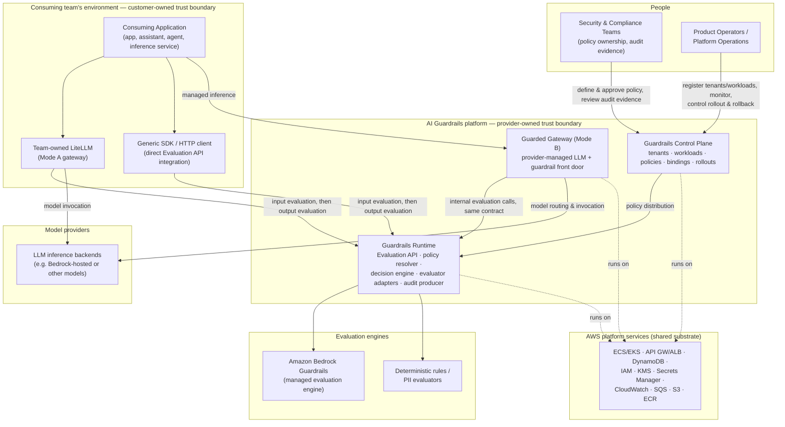

**AI Guardrails — System Context (C4 Level 1)**

**Authority level:** L3
**Status:** Draft
**Date:** 2026-07-24
**Derived from:** seed.md + AGREEMENTS.md

---

## 1. Purpose and scope of this document

This document is the C4 **Level 1 (System Context)** view of the AI Guardrails platform. It answers one question: *what sits outside the platform boundary, and how does each of those actors or external systems interact with it?*

A Level 1 view intentionally shows:

* The platform as a single box.
* The people (actors) who use or govern it.
* The external systems it depends on or is depended upon by.
* The nature of each interaction, at a level a non-technical stakeholder can follow.

It intentionally does **not** show:

* Internal components (policy resolver, decision engine, evaluator adapters) — that belongs in a future `50-architecture/COMPONENT-ARCHITECTURE.md`.
* Deployment topology, AWS account layout, or networking — that belongs in a future `50-architecture/DEPLOYMENT-ARCHITECTURE.md`.
* Detailed request/response contracts — that belongs in a future `50-architecture/INTEGRATION-ARCHITECTURE.md`.
* Threat modeling and control detail — that belongs in a future `50-architecture/SECURITY-ARCHITECTURE.md`.

This document is authoritative only for the *shape of the boundary*. It must not contradict [`00-source-of-truth/AGREEMENTS.md`](../00-source-of-truth/AGREEMENTS.md), and in particular must remain consistent with **AGR-001** (standalone platform), **AGR-002** (three deployment modes), **AGR-003** (LiteLLM as first connector, not the boundary), and **AGR-006** (one logical evaluation contract across modes).

---

## 2. What is inside the boundary

The system in scope for this document — referred to below as **"the AI Guardrails platform"** — consists of the two components the AI Guardrails team owns directly (per seed §21 / AGREEMENTS `AGR-001`):

| Component | Responsibility |
|---|---|
| **Guardrails Control Plane** | Tenants, workloads, policies, policy bindings, rollouts |
| **Guardrails Runtime** | Evaluation API, policy resolver, decision engine, evaluator adapters, audit producer |

Everything else in this document — including the **Guarded Gateway** — is modeled as an actor or external system relative to that boundary, even where the AI Guardrails provider organization also operates it. Section 5.3 explains why the Guarded Gateway is treated this way rather than folded into the platform box.

---

## 3. Actors and external systems at a glance

| # | Name | Type | Operated by | Primary interaction with the platform | Trust boundary |
|---|---|---|---|---|---|
| 1 | Consuming Application (Workload) | System (person-driven) | Consuming team | Generates prompts/responses that are routed for evaluation via one of the three integration paths below | Customer-owned |
| 2 | Team-owned LiteLLM (Mode A) | External system | Consuming team | Calls the hosted Evaluation API before and after model inference | Customer-owned |
| 3 | Guarded Gateway (Mode B) | External system | AI Guardrails provider | Provider-managed LLM gateway that invokes the same Runtime internally | Provider-owned |
| 4 | Generic SDK / HTTP client | External system | Consuming team | Calls the Evaluation API directly, without a LiteLLM intermediary | Customer-owned |
| 5 | Model Providers | External system | Model vendor / AWS | Performs the actual inference the gateway or connector routes to | Outside both parties' trust boundary |
| 6 | Amazon Bedrock Guardrails | External system | AWS | First managed evaluation engine invoked by the Runtime's evaluator adapters | Provider-owned integration, AWS-operated service |
| 7 | AWS Platform Services | External system | AWS | Compute, storage, identity, and messaging substrate the platform is built on | Provider-owned (Modes A/B) or customer-owned (Mode C) |
| 8 | Security & Compliance Teams | Person (actor) | Consuming org / provider org | Own policy definitions, approve exceptions, consume audit evidence | Governance, cross-boundary |
| 9 | Product Operators (Platform Operations) | Person (actor) | AI Guardrails provider | Register tenants/workloads, monitor health, manage rollouts and capacity | Provider-owned |

---

## 4. System context diagram



**Reading the diagram:** the platform box (dashed provider boundary) contains only the Control Plane and Runtime. The Guarded Gateway sits at the same boundary as the two customer-side integration paths (LiteLLM, Generic SDK) because — although the provider operates it — it is architecturally a third caller of the same Evaluation API, not a part of the reusable policy engine itself. This preserves **AGR-006** (one logical evaluation contract across all three modes) instead of special-casing Mode B with embedded guardrail logic.

---

## 5. External interaction narratives

### 5.1 Consuming Application (Workload)

The application, assistant, agent, or inference service built and operated by a consuming team. It is registered in the Control Plane as a **workload** (seed §9) and is the ultimate source of the prompts, responses, and — depending on configuration — retrieved documents and tool arguments that flow into evaluation.

* **Interaction:** indirect. The application never calls the Evaluation API itself in Modes A/B; it calls its gateway (LiteLLM, a generic client, or the Guarded Gateway), which performs evaluation on its behalf.
* **Trust boundary:** entirely inside the consuming team's environment. The AI Guardrails platform has no visibility into the application beyond what its chosen integration path sends it.
* **Ownership note:** end-user authentication and business authorization remain the consuming team's responsibility in every mode (seed §5.5, `AGR-010`) — a guardrail decision is never an authorization decision.

### 5.2 Team-owned LiteLLM (Mode A — Remote Evaluation)

The consuming team's own LiteLLM (or equivalent) gateway, calling the hosted Evaluation API before and after model inference.

* **Interaction:** synchronous HTTP calls into the Runtime for input evaluation (pre-call) and output evaluation (post-call); enforcement of `block`/`redact` decisions happens inside the connector.
* **What the consuming team owns:** gateway availability, model-provider credentials, model routing, retry/fallback behavior, gateway upgrades, inference capacity, model-provider costs (seed §3, Mode A).
* **What the platform owns:** Evaluation API availability, policy execution, detection engines, policy versions, decision normalization, audit metadata, runtime scaling.
* **Trust boundary:** the connector is customer-owned and can be disabled, removed, or misconfigured — it is a **cooperative** integration, not a hard security boundary (seed §8, `AGR-018`).
* **Explicit exposure statement:** Mode A does **not** reduce how much tenant content reaches the platform. Prompts, responses, and any additional evaluated content are transmitted to the hosted Evaluation API. Mode A must be described only as *"bring your own gateway while consuming a hosted guardrail runtime,"* never as a private-data or data-local model (`AGR-009`).

### 5.3 Guarded Gateway (Mode B)

A fully provider-managed LLM gateway. The provider organization operates both the gateway and the guardrail runtime; LiteLLM may serve as the substrate for this gateway (seed §22), but the product contract does not require it to.

* **Interaction:** the Guarded Gateway performs input guardrails, model routing, model invocation, and output guardrails as a single request flow (seed §3, Mode B). Architecturally, its "input guardrails" and "output guardrails" steps are implemented by invoking the same shared Evaluation API used by the LiteLLM connector and generic SDK — not a separate, gateway-embedded guardrail implementation. This keeps the evaluation contract identical across modes (`AGR-006`).
* **What the provider owns:** gateway availability, provider credentials or delegated AWS access, model routing, model-provider integrations, inference retries/fallbacks, guardrail execution, rate limits, usage quotas, audit and operational telemetry.
* **What the consuming team owns:** application behavior, workload-specific configuration, policy selection where permitted, end-user authorization, business-level approval flows.
* **Trust boundary:** provider-owned. This is the mode with the largest operational, security, and compliance scope for the provider, because the provider participates in the complete inference path (seed §3, Mode B).

### 5.4 Generic SDK / HTTP Evaluation API client

A direct integration path for teams whose gateway is not LiteLLM, or whose application calls the Evaluation API without any gateway intermediary. It carries the same Mode A ownership split and the same content-exposure statement as the LiteLLM connector — it is a second, connector-agnostic way to reach the same Runtime, consistent with the requirement that additional connectors be addable without changing policy semantics (`AGR-003`).

* **Interaction:** synchronous calls into the Evaluation API for input and/or output evaluation, using the generic HTTP contract in scope for the MVP (seed §6.1).
* **Trust boundary:** customer-owned, cooperative — identical posture to Mode A's LiteLLM connector.

### 5.5 Model Providers

The LLM inference backends that a gateway (team-owned LiteLLM or the Guarded Gateway) actually invokes to generate a response. This is a distinct role from Amazon Bedrock Guardrails: model providers **generate** content, Bedrock Guardrails (and other evaluators) **evaluate** content. The two can be physically colocated (e.g., a Bedrock-hosted foundation model alongside Bedrock Guardrails) but are logically separate interactions.

* **Interaction:** model invocation is orchestrated by the gateway/connector, not by the AI Guardrails Runtime. The Runtime never calls a model provider directly.
* **Trust boundary:** outside both the consuming team's and the provider's guardrail trust boundary. In Mode A and Mode C, the consuming team owns the model-provider credentials and costs; in Mode B, the provider owns them.
* **Scope note:** the seed does not name specific model providers beyond noting that Bedrock-hosted models may be one option; this document does not invent a provider list.

### 5.6 Amazon Bedrock Guardrails

The first managed evaluation engine invoked by the Runtime's evaluator adapters (seed §10, §11; `AGR-004`).

* **Interaction:** the Runtime's evaluator adapter layer calls Bedrock Guardrails as one of possibly several evaluation engines (alongside deterministic rules and PII evaluators). Bedrock's response format is normalized into the platform's own decision structure before reaching policies or connectors — policies and connectors never see a raw Bedrock response shape.
* **Trust boundary:** an AWS-operated service, invoked from within the provider's (or, in Mode C, the customer's) AWS environment. It is a first engine, not a permanent or exclusive one — documentation and marketing must not describe it as such (`AGR-004`).

### 5.7 AWS Platform Services

The underlying AWS services the Control Plane and Runtime are built on (seed §11):

| Capability | Initial AWS service |
|---|---|
| Evaluation runtime | ECS Fargate or EKS |
| Public or internal API | API Gateway or Application Load Balancer |
| Policy storage | DynamoDB or versioned S3 |
| Workload registry | DynamoDB |
| Guardrail evaluation | Amazon Bedrock Guardrails |
| Runtime credentials | IAM roles |
| Secrets | AWS Secrets Manager |
| Encryption | AWS KMS |
| Operational metrics | CloudWatch |
| Audit event buffering | Amazon SQS |
| Audit archive | Amazon S3 |
| Container registry | Amazon ECR |

* **Interaction:** compute, storage, identity, secrets, encryption, observability, and messaging substrate for every platform component.
* **Trust boundary:** provider-owned AWS account(s) in Modes A and B; the consuming team's own AWS account in Mode C. The MVP account model is a single non-production account and a single production account, with additional account separation introduced only when justified (external customers, compliance requirements, independent security ownership, immutable audit requirements, production scale, or dedicated tenant deployments — `AGR-013`).

### 5.8 Security & Compliance Teams

Own guardrail policy content and evidence, independent of who operates the infrastructure (seed §7, §21).

* **Interaction:** define and approve policies and thresholds in the Control Plane; consume decision evidence, policy-version traceability, and audit metadata; set content-retention and exception-tracking requirements.
* **Trust boundary:** a governance actor that spans both the consuming organization and the provider organization — policy ownership and approval sit with security/compliance regardless of deployment mode.

### 5.9 Product Operators (Platform Operations)

The provider-side operational actor (seed §7 "Product operators," §21 "Platform operations").

* **Interaction:** tenant and workload registration, service-health visibility, usage metrics, runtime capacity management, policy rollout controls, deployment compatibility tracking, hosted infrastructure operation, and production incident response.
* **Trust boundary:** provider-owned. This actor operates the platform box itself; it does not have standing access to raw tenant content beyond what the runtime's default no-raw-retention behavior already permits (`AGR-014`).

---

## 6. Trust boundaries by deployment mode

The system context above is mode-agnostic. The location of the trust boundary line shifts by mode (seed §3; `AGR-002`, `AGR-018`).

### Mode A — Remote Evaluation

```text
Customer-owned                          │  Provider-owned
                                         │
Application                             │
    │                                   │
    ▼                                   │
Team-owned LiteLLM                      │
    │                                   │
    ├── Input evaluation ───────────────┼──► Guardrails Runtime
    │                                   │
    ├── Model invocation ──► Model      │
    │                        Provider   │
    │                                   │
    └── Output evaluation ──────────────┼──► Guardrails Runtime
```

Boundary posture: **cooperative**. The connector is installed and maintained by the consuming team and can be disabled, removed, or misconfigured; it must not be represented as a hard security boundary.

### Mode B — Guarded Gateway

```text
Customer-owned  │  Provider-owned
                │
Application ────┼──► Provider-managed Guarded Gateway
                │        ├── Input guardrails   ─┐
                │        ├── Model routing        │  (all invoke the
                │        ├── Model invocation      >  shared Guardrails
                │        ├── Output guardrails    │   Runtime / model
                │        └── Audit & usage report ┘   providers)
```

Boundary posture: **platform-managed / provider-hosted**. The provider participates in the complete inference path; the consuming team's boundary shrinks to application behavior, workload configuration, policy selection where permitted, and end-user authorization.

### Mode C — Customer-Managed Runtime

```text
Customer AWS account (customer-owned)              │  Provider-owned
                                                     │
Application                                         │
    │                                                │
    ▼                                                │
Customer LiteLLM or application                      │
    │                                                │
    ├── Customer-hosted Guardrails Runtime            │
    │       ├── Policy cache        ◄── async sync ───┼── Guardrails
    │       ├── Bedrock Guardrails adapter             │   Control Plane
    │       ├── Custom evaluators                      │  (policy authoring,
    │       └── Local audit integration                │   optional telemetry
    │                                                   │   receiver)
    └── Model provider                                 │
```

Boundary posture: **network/IAM-enforced by the customer's own account**, not by the provider. The Runtime itself moves inside the customer's AWS account; only the Control Plane (policy authoring and, if configured, telemetry receipt) remains provider-hosted, and that connection is asynchronous — the customer-managed runtime must be able to keep evaluating during control-plane unavailability (`AGR-015`). Telemetry content is entirely customer-configured, from full operational detail down to none at all, and raw content must never leave this boundary unless explicitly configured (`AGR-016`).

### Enforcement posture summary

| Enforcement posture | Applies to | Bypass resistance | Reference |
|---|---|---|---|
| Cooperative integration | Mode A, generic SDK | Connector can be disabled/removed/misconfigured by the consuming team | seed §8; `AGR-018` |
| Platform-managed enforcement | Mode B (and Mode A gateways the platform team operates) | Platform owns gateway config; consumers cannot change mandatory guardrail settings | seed §8; `AGR-018` |
| Network/IAM-enforced gateway | Any mode, as an optional advanced posture | Applications hold no direct model-provider credentials; egress restricted to the gateway role | seed §8; `AGR-018` |

Network/IAM-enforced gateway is the strongest posture described in the seed material but is explicitly **not required** for the initial cooperative MVP.

---

## 7. Content exposure at the boundary

Per the explicit content-exposure principle (seed §5.4, §13; `AGR-008`), operational ownership and data exposure are separate concerns. This section states, for this boundary view only, what crosses it — a full treatment belongs in a future `50-architecture/DATA-ARCHITECTURE.md`.

| Content category | Crosses into provider-owned boundary? | Notes |
|---|---|---|
| User/system prompts, model responses | Yes, in Modes A and B | MVP-supported content categories (seed §13) |
| Conversation history, retrieved documents, tool arguments/responses, structured-output payloads | Only if the workload is configured to send them | Not required by the MVP scope (seed §13) |
| Raw prompts/responses at rest | No, by default | The hosted runtime does not persist raw content by default; retention requires explicit tenant configuration (`AGR-014`) |
| Decision metadata, reason codes, policy version, evaluator metadata | Yes, always | Persisted for audit regardless of mode (seed §9, §15) |
| Health status, product/policy version, aggregated counts, latency metrics | Optional, customer-controlled, in Mode C | Ranges down to no telemetry at all (`AGR-016`) |
| Raw content in Mode C | No, unless explicitly configured | The customer-managed runtime keeps content inside the customer's AWS account by construction |

---

## 8. What this document does not define

To keep this view at Level 1, the following are intentionally deferred to other architecture documents:

* Internal Runtime/Control Plane components and their responsibilities → `50-architecture/COMPONENT-ARCHITECTURE.md`
* Detailed request/response schemas for the evaluation contract → `50-architecture/INTEGRATION-ARCHITECTURE.md`
* AWS account topology, networking, and per-mode deployment artifacts → `50-architecture/DEPLOYMENT-ARCHITECTURE.md`
* Threat model, IAM design, and control detail → `50-architecture/SECURITY-ARCHITECTURE.md`
* Data model, retention, and telemetry payload design → `50-architecture/DATA-ARCHITECTURE.md`
* Availability, latency, and rollout operability targets → `50-architecture/OPERABILITY.md`
* Point-in-time architectural decisions → `50-architecture/adrs/`

---

## 9. Traceability

| Section of this document | Seed source | Agreements referenced |
|---|---|---|
| §2 System boundary | seed §21 (Ownership boundaries) | `AGR-001` |
| §4 Context diagram | seed §10 (Logical architecture) | `AGR-001`, `AGR-003`, `AGR-006` |
| §5.2, §5.4 | seed §3 (Mode A), §12 (LiteLLM integration) | `AGR-003`, `AGR-009` |
| §5.3 | seed §3 (Mode B), §22 (Decision summary) | `AGR-003`, `AGR-006` |
| §5.6 | seed §10, §11 | `AGR-004` |
| §5.7 | seed §11 (AWS implementation direction) | `AGR-013` |
| §5.8, §5.9 | seed §7 (Initial users and stakeholders), §21 (Ownership boundaries) | — |
| §6 Trust boundaries by mode | seed §3, §8 (Trust and enforcement model) | `AGR-002`, `AGR-015`, `AGR-016`, `AGR-018` |
| §7 Content exposure | seed §5.4, §13 (Data handling requirements) | `AGR-008`, `AGR-009`, `AGR-014`, `AGR-016` |

---

## Related documents

* [`00-source-of-truth/AGREEMENTS.md`](../00-source-of-truth/AGREEMENTS.md) — authoritative agreements referenced throughout this document
* [`10-charter/CHARTER.md`](../10-charter/CHARTER.md) — solution charter
* [`10-charter/PRINCIPLES.md`](../10-charter/PRINCIPLES.md) — product principles (policy portability, one contract, observe-before-enforce)
* [`10-charter/SCOPE.md`](../10-charter/SCOPE.md) — in-scope, future-scope, and out-of-scope boundaries
* [`20-product/CAPABILITIES.md`](../20-product/CAPABILITIES.md) — capability-level product description
* [`20-product/PRODUCT-OVERVIEW.md`](../20-product/PRODUCT-OVERVIEW.md) — product overview
* [`50-architecture/INTEGRATION-ARCHITECTURE.md`](INTEGRATION-ARCHITECTURE.md) — evaluation contract detail
* [`50-architecture/DEPLOYMENT-ARCHITECTURE.md`](DEPLOYMENT-ARCHITECTURE.md) — per-mode deployment topology
* [`50-architecture/COMPONENT-ARCHITECTURE.md`](COMPONENT-ARCHITECTURE.md) — internal component view
* [`50-architecture/SECURITY-ARCHITECTURE.md`](SECURITY-ARCHITECTURE.md) — security controls and threat model
* [`50-architecture/DATA-ARCHITECTURE.md`](DATA-ARCHITECTURE.md) — data and retention model
