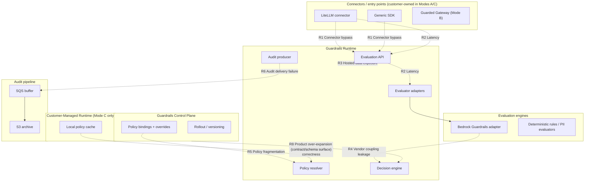

**AI Guardrails — Technical Risks**

**Authority level:** L3
**Status:** Draft
**Date:** 2026-07-24
**Derived from:** AGREEMENTS.md

---

> This is the architectural companion to [`../30-executive/RISKS-AND-DEPENDENCIES.md`](../30-executive/RISKS-AND-DEPENDENCIES.md). That document gives leadership a decision-relevant summary of the six risks named in the charter ([`RISK-REGISTER.md`](../70-governance/RISK-REGISTER.md)); this document gives architects, engineers, and operators the technical depth behind those risks — which components they concentrate in, which deployment mode(s) they bite hardest in, and which specific control or non-functional requirement is meant to hold them down. It is a derived (L3) view: it must not contradict [`../00-source-of-truth/AGREEMENTS.md`](../00-source-of-truth/AGREEMENTS.md) or [`../00-source-of-truth/CONSTRAINTS.md`](../00-source-of-truth/CONSTRAINTS.md) (both L1). Where a probability, dollar figure, or numeric SLO is not established in the source material, it is marked **TBD** rather than invented. [`ARCHITECTURE-REPORT.md`](ARCHITECTURE-REPORT.md) §22 points here for full risk detail, ownership, and tracking; this document is that detail.

---

## Table of contents

- [1. Purpose and scope](#1-purpose-and-scope)
- [2. How to read this register](#2-how-to-read-this-register)
- [3. Risk summary table](#3-risk-summary-table)
- [4. Detailed risk analysis](#4-detailed-risk-analysis)
  - [4.1 Connector bypass](#41-connector-bypass)
  - [4.2 Latency from synchronous remote evaluation](#42-latency-from-synchronous-remote-evaluation)
  - [4.3 Hosted data exposure](#43-hosted-data-exposure)
  - [4.4 Bedrock Guardrails dependency / vendor coupling leakage](#44-bedrock-guardrails-dependency--vendor-coupling-leakage)
  - [4.5 Policy fragmentation from workload-specific overrides](#45-policy-fragmentation-from-workload-specific-overrides)
  - [4.6 Audit delivery failure](#46-audit-delivery-failure)
  - [4.7 Degraded-mode correctness](#47-degraded-mode-correctness)
  - [4.8 Product over-expansion](#48-product-over-expansion)
  - [4.9 Category-taxonomy drift and evaluator sprawl](#49-category-taxonomy-drift-and-evaluator-sprawl)
- [5. Risk concentration by architecture component](#5-risk-concentration-by-architecture-component)
- [6. Risk exposure by deployment mode](#6-risk-exposure-by-deployment-mode)
- [7. Traceability](#7-traceability)
- [Related documents](#related-documents)

---

## 1. Purpose and scope

[`RISK-REGISTER.md`](../70-governance/RISK-REGISTER.md) names six key risks: connector bypass, false confidence, latency, hosted data exposure, policy fragmentation, and product over-expansion. This document keeps that same risk vocabulary but reframes it for a technical audience and extends it with three risks that are not headline items in [`RISK-REGISTER.md`](../70-governance/RISK-REGISTER.md) but are directly implicated by the architecture set already produced ([`ARCHITECTURE-REPORT.md`](ARCHITECTURE-REPORT.md), [`INTEGRATION-ARCHITECTURE.md`](INTEGRATION-ARCHITECTURE.md), [`DEPLOYMENT-ARCHITECTURE.md`](DEPLOYMENT-ARCHITECTURE.md), [`NON-FUNCTIONAL-REQUIREMENTS.md`](NON-FUNCTIONAL-REQUIREMENTS.md), [`CONTAINER-ARCHITECTURE.md`](CONTAINER-ARCHITECTURE.md)):

* **Bedrock Guardrails dependency / vendor coupling leakage** — the technical, adapter-boundary form of the vendor-independence commitment in [AGR-004](../00-source-of-truth/AGREEMENTS.md#agr-004--bedrock-guardrails-as-first-engine-vendor-independent-contract) and [CON-004](../00-source-of-truth/CONSTRAINTS.md#con-004--no-coupling-to-bedrock-guardrails-response-formats).
* **Audit delivery failure** — one of the six failure conditions [AGR-012](../00-source-of-truth/AGREEMENTS.md#agr-012--failure-behavior-is-part-of-policy) explicitly requires a documented behavior for, and a tracked reliability metric in [`SUCCESS-CRITERIA.md`](../10-charter/SUCCESS-CRITERIA.md) ("Audit delivery success rate") and [NFR-REL-003](NON-FUNCTIONAL-REQUIREMENTS.md#nfr-rel-003--audit-delivery-success-rate).
* **Degraded-mode correctness** — the technical consequence of the Customer-Managed Runtime's control-plane-independence requirement ([AGR-015](../00-source-of-truth/AGREEMENTS.md#agr-015--customer-managed-runtime-executes-without-a-synchronous-control-plane-connection)), distinct from an outright outage.

**Out of scope for this document:** [`RISK-REGISTER.md`](../70-governance/RISK-REGISTER.md)'s "false confidence" risk (teams mistaking guardrail evaluation for complete AI security or authorization) is a product-positioning and governance risk, not an architectural one; it is tracked in [`../30-executive/RISKS-AND-DEPENDENCIES.md`](../30-executive/RISKS-AND-DEPENDENCIES.md) and will be tracked in the future `../70-governance/CLAIMS-REGISTER.md` and `../70-governance/RISK-REGISTER.md`. This document does not restate it.

This document does not introduce new agreements, constraints, or NFRs — it only analyzes risk against the ones already recorded in [`../00-source-of-truth/AGREEMENTS.md`](../00-source-of-truth/AGREEMENTS.md), [`../00-source-of-truth/CONSTRAINTS.md`](../00-source-of-truth/CONSTRAINTS.md), and [`NON-FUNCTIONAL-REQUIREMENTS.md`](NON-FUNCTIONAL-REQUIREMENTS.md).

---

## 2. How to read this register

Neither `AGREEMENTS.md` nor `CONSTRAINTS.md` provides probability distributions, dollar-impact figures, or numeric SLOs for any of these risks. Likelihood and impact below are therefore **qualitative**, assigned against the architecture as currently scoped, using this scale:

| Rating | Likelihood meaning | Impact meaning |
|---|---|---|
| **Structural** | Not a probabilistic event — a standing property of the architecture in a given mode, present on every request unless the mode itself is changed. | — |
| **High** | Expected to occur under normal operation unless the listed mitigation is actively in place. | Breaks a core architectural guarantee (evaluation coverage, contract portability, audit integrity, tenant isolation) or directly contradicts an accepted agreement. |
| **Medium** | Plausible under normal operating conditions, or grows more likely as adoption/scale increases. | Degrades a specific guarantee (latency budget, detection coverage, evidentiary completeness) without breaking the core contract. |
| **Low** | Requires a specific misconfiguration, rare external failure, or an already-mitigated condition to occur. | Localized and recoverable; no cross-cutting effect on the platform's other guarantees. |

Likelihood and impact are rated **per deployment mode where they differ** (Section 6); a single rating in the summary table (Section 3) reflects the mode(s) where the risk is most acute, per [AGR-002](../00-source-of-truth/AGREEMENTS.md#agr-002--three-deployment-modes)'s requirement that every architectural component be evaluated against all three modes.

---

## 3. Risk summary table

| # | Risk | Likelihood | Impact | Technical mitigation (compressed) | Residual risk (compressed) |
|---|---|---|---|---|---|
| 1 | [Connector bypass](#41-connector-bypass) | High (cooperative posture, Modes A/generic SDK) | High | Connector-health telemetry, configuration validation, progression to platform-managed or network/IAM-enforced gateway | Cooperative mode cannot be made bypass-proof without moving posture ([OQ-001](../00-source-of-truth/OPEN-QUESTIONS.md#oq-001--enforcement-model-required-for-the-first-external-customers) open) |
| 2 | [Latency from synchronous remote evaluation](#42-latency-from-synchronous-remote-evaluation) | High (Modes A/B) | Medium–High | Per-evaluator latency measurement, selective evaluator application, local deterministic checks, stage-specific timeouts, Mode C for latency-sensitive workloads | Nonzero latency is structural to Modes A/B; no streaming-evaluation path exists yet ([OQ-004](../00-source-of-truth/OPEN-QUESTIONS.md#oq-004--streaming-output-evaluation-timeline) open) |
| 3 | [Hosted data exposure](#43-hosted-data-exposure) | Structural (Modes A/B) | High | No raw-content retention by default, TLS/KMS, explicit content-exposure documentation, Mode C as the structural alternative | Content is in cleartext during the evaluation window itself; only Mode C removes the exposure categorically |
| 4 | [Bedrock Guardrails dependency / vendor coupling leakage](#44-bedrock-guardrails-dependency--vendor-coupling-leakage) | Medium | High (if leakage occurs); Medium (availability dependency) | Mandatory adapter normalization, uniform adapter pattern for all engines, contract conformance testing, deterministic-rules fallback coverage | Adapter discipline is a process control; Bedrock Region availability is an unconfirmed external dependency ([ASM-008](../00-source-of-truth/ASSUMPTIONS.md#b-technical-and-infrastructure-feasibility)) |
| 5 | [Policy fragmentation from workload-specific overrides](#45-policy-fragmentation-from-workload-specific-overrides) | Medium–High (grows with adoption) | Medium | Bounded override categories, named ownership per exception, immutable versioned policy packs, tracked effective-policy-per-workload | No structural inheritance model exists yet ([OQ-012](../00-source-of-truth/OPEN-QUESTIONS.md#oq-012--policy-signing-and-policy-inheritance-design) open); containment is process discipline |
| 6 | [Audit delivery failure](#46-audit-delivery-failure) | Low–Medium per event | High (evidentiary) | Explicit per-workload failure behavior, SQS buffering decoupled from S3 archival, correlation-ID reconciliation, tracked delivery success rate | A workload configured to proceed on audit-delivery failure creates a real gap between "policy applied" and "evidence it was applied" |
| 7 | [Degraded-mode correctness](#47-degraded-mode-correctness) | Low–Medium (proportional to outage duration) | Medium–High | Mandatory degraded-mode declaration before Observe exit, immutable policy versions recorded per decision, asynchronous non-blocking sync, reconnection recovery testing | Staleness-threshold-to-failure-action mapping is workload-specific and not universally defined (**TBD**) |
| 8 | [Product over-expansion](#48-product-over-expansion) | Medium–High | Medium–High (compounds via one-contract requirement) | MVP-boundary gating for every proposed component, reserved-but-unbuilt schema placeholders, five-phase gating, adoption/effectiveness metrics before scope expansion, vision items parked in the guardrail-category catalog rather than the roadmap | Reserved placeholders can be mistaken for delivered capability if not clearly labeled |
| 9 | [Category-taxonomy drift and evaluator sprawl](#49-category-taxonomy-drift-and-evaluator-sprawl) | Medium (grows with catalog use) | Medium | Path A change control on categories, four-value status vocabulary, NFR-MAINT-003, adapter-only engine onboarding, catalog↔CAPABILITIES consistency review | Status drift between catalog and CAPABILITIES is a review-discipline control, not an automatic one |

---

## 4. Detailed risk analysis

### 4.1 Connector bypass

**Description.** A consuming team removes, disables, or misconfigures its LiteLLM connector (or generic SDK integration), so that input/output evaluation calls to the Evaluation API never occur. This is possible because, under the default MVP posture, the connector is a **cooperative** integration installed and maintained by the consuming team, not a network/IAM-enforced boundary ([AGR-018](../00-source-of-truth/AGREEMENTS.md#agr-018--trust-and-enforcement-model), [`RISK-REGISTER.md`](../70-governance/RISK-REGISTER.md); [AGR-018](../00-source-of-truth/AGREEMENTS.md#agr-018--trust-and-enforcement-model)).

**Where it concentrates.** The LiteLLM connector and Generic SDK client — both customer-owned components at the edge of the platform boundary ([`SYSTEM-CONTEXT.md`](SYSTEM-CONTEXT.md) §3, rows 1–4).

**Likelihood / impact.** High likelihood under the cooperative posture that is the only posture in scope for the MVP ([AGR-018](../00-source-of-truth/AGREEMENTS.md#agr-018--trust-and-enforcement-model)); high impact, since a bypassed connector means zero evaluation coverage for that workload, not degraded coverage.

**Technical mitigation.**
* Connector-health telemetry (reachability, timeout rate, error rate) reported to the control plane ([`INTEGRATION-ARCHITECTURE.md`](INTEGRATION-ARCHITECTURE.md) §4.5; [AGR-003](../00-source-of-truth/AGREEMENTS.md#agr-003--litellm-as-first-connector-not-the-product-boundary)).
* Configuration validation at binding time.
* Progression to platform-managed enforcement (read-only gateway configuration, GitOps-managed deployment, restricted IAM roles, removal of model credentials from application workloads) where the platform team owns gateway infrastructure ([AGR-018](../00-source-of-truth/AGREEMENTS.md#agr-018--trust-and-enforcement-model)).
* Network/IAM-enforced gateway posture (no direct model-provider credentials or connectivity for applications, egress restricted to the gateway role) available as an architecturally supported but **not required** MVP posture ([AGR-018](../00-source-of-truth/AGREEMENTS.md#agr-018--trust-and-enforcement-model)).

**Residual risk.** Connector-health telemetry is a health signal, not proof of enforcement — [CON-012](../00-source-of-truth/CONSTRAINTS.md#con-012--no-exclusive-reliance-on-weak-security-proxies) explicitly forbids treating it as evidence of mandatory enforcement. Under cooperative posture, bypass prevention is architecturally impossible by design; the only way to close this residual risk is to change enforcement posture, and the criteria for when that change is required for external customers remain open ([OQ-001](../00-source-of-truth/OPEN-QUESTIONS.md#oq-001--enforcement-model-required-for-the-first-external-customers)).

---

### 4.2 Latency from synchronous remote evaluation

**Description.** Input and output evaluation stages run synchronously on the request path in Modes A and B: the LiteLLM connector (or Guarded Gateway) blocks on a call to the Evaluation API before allowing model invocation to proceed, and again before returning the model's response ([`RISK-REGISTER.md`](../70-governance/RISK-REGISTER.md) "Latency"; [`INTEGRATION-ARCHITECTURE.md`](INTEGRATION-ARCHITECTURE.md) §4.1 sequence flow). Each additional network hop and detector execution adds directly to end-to-end latency perceived by the consuming application.

**Where it concentrates.** The Evaluation API and evaluator adapters, and specifically the network hop between the connector and the hosted Runtime in Modes A/B ([`CONTAINER-ARCHITECTURE.md`](CONTAINER-ARCHITECTURE.md) §7.2).

**Likelihood / impact.** High likelihood — inherent to any mode with a network hop to a hosted service (Modes A/B); medium-to-high impact depending on workload latency sensitivity, since teams under SLA pressure may disable guardrails or select laxer thresholds, undermining policy consistency ([`RISK-REGISTER.md`](../70-governance/RISK-REGISTER.md)).

**Technical mitigation.**
* Per-evaluator latency measurement, so a single slow detector can be identified and isolated ([NFR-PERF-006](NON-FUNCTIONAL-REQUIREMENTS.md#nfr-perf-006--detector-specific-latency); [`NON-FUNCTIONAL-REQUIREMENTS.md`](NON-FUNCTIONAL-REQUIREMENTS.md), [`RISK-REGISTER.md`](../70-governance/RISK-REGISTER.md)).
* Apply only the evaluators relevant to a given policy rather than a blanket set.
* Local deterministic checks executed before the remote call, short-circuiting cheap, high-confidence violations.
* Stage-specific timeouts ([CON-016](../00-source-of-truth/CONSTRAINTS.md#con-016--timeout-limits)) with defined failure behavior on timeout, rather than an unbounded wait ([AGR-012](../00-source-of-truth/AGREEMENTS.md#agr-012--failure-behavior-is-part-of-policy)).
* Customer-Managed Runtime (Mode C) for latency-sensitive or high-throughput workloads, collapsing the network hop into a local call inside the customer's own AWS account.
* Policy-cache hit rate tracked as an operational metric to reduce the policy-resolution contribution to overall latency ([NFR-PERF-007](NON-FUNCTIONAL-REQUIREMENTS.md#nfr-perf-007--policy-cache-hit-rate)).
* P50/P95/P99 evaluation latency measured continuously per stage and per mode ([NFR-PERF-001](NON-FUNCTIONAL-REQUIREMENTS.md#nfr-perf-001--p50-evaluation-latency)–[NFR-PERF-003](NON-FUNCTIONAL-REQUIREMENTS.md#nfr-perf-003--p99-evaluation-latency)).

**Residual risk.** Synchronous evaluation always adds nonzero latency in Modes A/B; there is no architecture in current MVP scope for streaming or incremental evaluation, so a workload that declares streaming requirements has no low-latency guardrail path today ([OQ-004](../00-source-of-truth/OPEN-QUESTIONS.md#oq-004--streaming-output-evaluation-timeline) open; [`SCOPE.md`](../10-charter/SCOPE.md) explicitly excludes streaming guardrail enforcement from the MVP). No numeric latency target exists in source material to certify "acceptable" against — all such figures are **TBD**.

---

### 4.3 Hosted data exposure

**Description.** Remote Evaluation (Mode A) and Guarded Gateway (Mode B) transmit tenant prompts, responses, and any additionally configured evaluated content to the hosted Evaluation API or Guarded Gateway ([`DATA-ARCHITECTURE.md`](DATA-ARCHITECTURE.md), [`RISK-REGISTER.md`](../70-governance/RISK-REGISTER.md); [AGR-009](../00-source-of-truth/AGREEMENTS.md#agr-009--remote-evaluation-is-not-a-private-data-or-data-local-model)). This is a structural property of those two modes, not a misconfiguration — [AGR-009](../00-source-of-truth/AGREEMENTS.md#agr-009--remote-evaluation-is-not-a-private-data-or-data-local-model) requires that Mode A never be described as data-local for exactly this reason.

**Where it concentrates.** The trust boundary crossing between the customer's environment and the provider-owned Evaluation API / Guarded Gateway ([`SYSTEM-CONTEXT.md`](SYSTEM-CONTEXT.md) §6, §7; [`DEPLOYMENT-ARCHITECTURE.md`](DEPLOYMENT-ARCHITECTURE.md) §2.3, §3.3).

**Likelihood / impact.** Structural (not probabilistic) for Modes A/B — content crosses the boundary on every request by design; high impact if mismanaged (breach, non-compliance), and the platform's job is to bound and document the exposure rather than eliminate it in those modes.

**Technical mitigation.**
* No raw-content retention by default in the hosted runtime; only decision metadata is persisted ([CON-014](../00-source-of-truth/CONSTRAINTS.md#con-014--no-raw-content-retention-by-default-in-the-hosted-runtime); [NFR-PRIV-001](NON-FUNCTIONAL-REQUIREMENTS.md#nfr-priv-001--no-raw-content-retention-by-default)).
* User/conversation identifiers hashed where possible; secrets removed from telemetry ([`DATA-ARCHITECTURE.md`](DATA-ARCHITECTURE.md)).
* TLS in transit and KMS encryption at rest for every runtime communication path ([CON-008](../00-source-of-truth/CONSTRAINTS.md#con-008--tls-for-all-runtime-communication), [CON-009](../00-source-of-truth/CONSTRAINTS.md#con-009--kms-encryption-in-transit-and-at-rest)).
* Explicit, per-deployment content-exposure documentation ([CON-007](../00-source-of-truth/CONSTRAINTS.md#con-007--explicit-content-exposure-documentation-per-deployment)).
* Regional deployment as a documented mitigation ([`RISK-REGISTER.md`](../70-governance/RISK-REGISTER.md)); specific supported Regions and residency-enforcement mechanism remain open ([OQ-003](../00-source-of-truth/OPEN-QUESTIONS.md#oq-003--regional-deployment-strategy-and-data-residency)).
* Private connectivity (e.g., PrivateLink) architecturally compatible but not required for the MVP ([OQ-002](../00-source-of-truth/OPEN-QUESTIONS.md#oq-002--privatelink--private-connectivity) open).
* Customer-Managed Runtime (Mode C) offered as the structural alternative for tenants that require zero hosted exposure ([CON-013](../00-source-of-truth/CONSTRAINTS.md#con-013--raw-content-must-not-leave-a-customer-managed-runtime-unless-explicitly-configured)).

**Residual risk.** For any tenant requiring zero hosted exposure, Modes A/B are categorically unsuitable regardless of mitigation depth — the only risk-eliminating action is routing that tenant to Mode C. Within Modes A/B, content must necessarily be in cleartext in-process during the evaluation window itself, and any tenant-enabled retention override reopens exposure that the platform default otherwise closes.

---

### 4.4 Bedrock Guardrails dependency / vendor coupling leakage

**Description.** Amazon Bedrock Guardrails is the first managed evaluation engine ([`DEPLOYMENT-ARCHITECTURE.md`](DEPLOYMENT-ARCHITECTURE.md), [`SUCCESS-CRITERIA.md`](../10-charter/SUCCESS-CRITERIA.md), [AGR-001](../00-source-of-truth/AGREEMENTS.md#agr-001--standalone-platform-not-embedded-in-the-internal-litellm); [AGR-004](../00-source-of-truth/AGREEMENTS.md#agr-004--bedrock-guardrails-as-first-engine-vendor-independent-contract)). This risk has two distinct technical faces:

1. **Operational dependency** — the platform's initial detection capability is bound to Bedrock Guardrails' availability, Region coverage, and feature set, none of which are guaranteed by the source material.
2. **Contract leakage** — Bedrock-specific response shapes, reason codes, or confidence-score semantics could leak past the evaluator-adapter boundary into the platform's normalized decision structure, policy schema, or connector contract if adapter discipline is not enforced ([CON-004](../00-source-of-truth/CONSTRAINTS.md#con-004--no-coupling-to-bedrock-guardrails-response-formats); [`INTEGRATION-ARCHITECTURE.md`](INTEGRATION-ARCHITECTURE.md) §6).

**Where it concentrates.** The Bedrock Guardrails adapter, inside the evaluator-adapter layer, in every mode — including Mode C, where the adapter runs inside the customer's own AWS account ([`INTEGRATION-ARCHITECTURE.md`](INTEGRATION-ARCHITECTURE.md) §6 diagram; [`DEPLOYMENT-ARCHITECTURE.md`](DEPLOYMENT-ARCHITECTURE.md) §4.2).

**Likelihood / impact.**
* Availability/Region-coverage dependency: medium likelihood (external vendor service, no SLA figure in source material — confirmed **unconfirmed** per [ASM-008](../00-source-of-truth/ASSUMPTIONS.md#b-technical-and-infrastructure-feasibility)); medium impact, since an outage or Region gap degrades coverage to deterministic-rules-only rather than causing a full platform outage, provided the adapter pattern holds.
* Contract leakage: medium likelihood (plausible any time a new decision field, reason code, or evaluator-config option is added without adapter normalization, more likely under delivery-schedule pressure); high impact, since leakage would silently violate [CON-004](../00-source-of-truth/CONSTRAINTS.md#con-004--no-coupling-to-bedrock-guardrails-response-formats)/[AGR-004](../00-source-of-truth/AGREEMENTS.md#agr-004--bedrock-guardrails-as-first-engine-vendor-independent-contract), defeat policy portability ([AGR-005](../00-source-of-truth/AGREEMENTS.md#agr-005--policy-portability), [CON-003](../00-source-of-truth/CONSTRAINTS.md#con-003--no-coupling-to-litellm-configuration-structures)), and lock every downstream policy and connector to Bedrock's format.

**Technical mitigation.**
* Bedrock responses are normalized into the platform's own decision structure by the adapter before reaching policies, connectors, or audit records; no Bedrock-specific field, code, or response shape may cross the adapter boundary ([`INTEGRATION-ARCHITECTURE.md`](INTEGRATION-ARCHITECTURE.md) §6).
* The same adapter pattern applies uniformly to deterministic rules, PII evaluators, schema validators, and any future engine, so no single engine — including Bedrock — is structurally load-bearing ([AGR-004](../00-source-of-truth/AGREEMENTS.md#agr-004--bedrock-guardrails-as-first-engine-vendor-independent-contract); [NFR-MAINT-001](NON-FUNCTIONAL-REQUIREMENTS.md#nfr-maint-001--vendorframework-isolation-behind-adapters)).
* Contract conformance tests validate that policy and decision structures remain identical regardless of which evaluator produced the underlying signal ([AGR-006](../00-source-of-truth/AGREEMENTS.md#agr-006--one-logical-evaluation-contract-across-all-modes); [CON-005](../00-source-of-truth/CONSTRAINTS.md#con-005--one-logical-evaluation-contract-across-all-modes)).
* Deterministic organization rules run independently of Bedrock, providing baseline coverage during a Bedrock outage or Region gap ([`SUCCESS-CRITERIA.md`](../10-charter/SUCCESS-CRITERIA.md)).
* Documentation and marketing must not describe Bedrock Guardrails as the permanent or exclusive engine ([AGR-004](../00-source-of-truth/AGREEMENTS.md#agr-004--bedrock-guardrails-as-first-engine-vendor-independent-contract)), which keeps investment in a second engine organizationally justified rather than deferred indefinitely.

**Residual risk.** Bedrock Guardrails availability in the organization's target Region is an **unconfirmed** dependency at this stage ([ASM-008](../00-source-of-truth/ASSUMPTIONS.md#b-technical-and-infrastructure-feasibility)); no SLA figure exists in source material (**TBD**). Adapter discipline is a process/code-review control, not an automatic one — a review gap or conformance-test gap could still let a Bedrock-specific field leak into the public contract before it is caught.

---

### 4.5 Policy fragmentation from workload-specific overrides

**Description.** A policy binding may define allowed workload-specific overrides ([AGR-017](../00-source-of-truth/AGREEMENTS.md#agr-017--core-domain-model), Policy binding). Excessive use of these overrides erodes the platform's core value proposition — one reusable policy applied consistently across workloads ([`CHARTER.md`](../10-charter/CHARTER.md), [`RISK-REGISTER.md`](../70-governance/RISK-REGISTER.md)).

**Where it concentrates.** The Guardrails Control Plane's policy-binding model, specifically the override-category surface of each binding ([`CONTAINER-ARCHITECTURE.md`](CONTAINER-ARCHITECTURE.md) §3, §10).

**Likelihood / impact.** Medium-to-high likelihood, growing proportionally with onboarded-workload count rather than being a rare-event risk ([`../30-executive/RISKS-AND-DEPENDENCIES.md`](../30-executive/RISKS-AND-DEPENDENCIES.md) §3); medium impact — it does not cause an outage or breach, but silently erodes the reusable-policy hypothesis ([`SUCCESS-CRITERIA.md`](../10-charter/SUCCESS-CRITERIA.md); [`../60-delivery/VALIDATION-PLAN.md`](../60-delivery/VALIDATION-PLAN.md)) and security/governance's ability to reason about "effective policy" per workload.

**Technical mitigation.**
* Limit override categories at the schema level — a binding may only override a bounded, explicitly defined set of fields, not arbitrary policy content ([`RISK-REGISTER.md`](../70-governance/RISK-REGISTER.md)).
* Require named ownership recorded for every exception ([`RISK-REGISTER.md`](../70-governance/RISK-REGISTER.md)).
* Version policy packs immutably, so overrides are always tracked against a specific policy version ([NFR-MAINT-002](NON-FUNCTIONAL-REQUIREMENTS.md#nfr-maint-002--immutable-policy-versions)).
* Track and expose "effective policy per workload" (binding plus resolved overrides) as a first-class, queryable artifact rather than an implicit runtime computation.

**Residual risk.** Until policy inheritance and signing are designed ([OQ-012](../00-source-of-truth/OPEN-QUESTIONS.md#oq-012--policy-signing-and-policy-inheritance-design), open, targeted for the Phase 2 → Phase 3 transition), override containment relies on process discipline (category limits, named ownership) rather than a structural inheritance model — ungoverned override growth remains possible in the interim. The guardrail-category catalog ([`../20-product/GUARDRAIL-CATALOG.md`](../20-product/GUARDRAIL-CATALOG.md)) adds a related pressure: as more categories gain delivered evaluators, per-workload configurability widens, so the bounded-override discipline above must be re-checked at every category graduation ([`EXTENSIBILITY-ARCHITECTURE.md`](EXTENSIBILITY-ARCHITECTURE.md) §10). Policy packs, if pursued, must remain versioned templates rather than informal inheritance (see §4.9 and `EXTENSIBILITY-ARCHITECTURE.md` §11), or this risk returns through the side door.

---

### 4.6 Audit delivery failure

**Description.** Audit metadata (tenant, workload, policy version, evaluation stage, decision, reason codes, evaluator versions, timestamp, correlation identifier, and whether raw content was retained — [`NON-FUNCTIONAL-REQUIREMENTS.md`](NON-FUNCTIONAL-REQUIREMENTS.md)) is produced by the audit producer and buffered/archived through Amazon SQS and Amazon S3 ([`DEPLOYMENT-ARCHITECTURE.md`](DEPLOYMENT-ARCHITECTURE.md); [`CONTAINER-ARCHITECTURE.md`](CONTAINER-ARCHITECTURE.md) §7.4). [AGR-012](../00-source-of-truth/AGREEMENTS.md#agr-012--failure-behavior-is-part-of-policy) explicitly requires a defined behavior for "audit delivery fails" as part of failure-behavior policy ([AGR-012](../00-source-of-truth/AGREEMENTS.md#agr-012--failure-behavior-is-part-of-policy)), and [`SUCCESS-CRITERIA.md`](../10-charter/SUCCESS-CRITERIA.md) tracks "audit delivery success rate" as a reliability metric ([NFR-REL-003](NON-FUNCTIONAL-REQUIREMENTS.md#nfr-rel-003--audit-delivery-success-rate)).

**Where it concentrates.** The audit producer inside the Guardrails Runtime and the SQS-buffer-to-S3-archive pipeline ([`CONTAINER-ARCHITECTURE.md`](CONTAINER-ARCHITECTURE.md) §7.4).

**Likelihood / impact.** Low-to-medium likelihood per individual event (SQS and S3 are highly durable managed services), but the failure mode is architecturally significant because audit is the primary evidence trail for compliance sign-off ([`TARGET-USERS.md`](../20-product/TARGET-USERS.md)); high impact for evidentiary purposes even when it does not affect the inference path itself — a lost audit record for an enforced block/redact decision removes exactly the evidence security and governance teams need ("evidence that policies are being applied," [`TARGET-USERS.md`](../20-product/TARGET-USERS.md)).

**Technical mitigation.**
* Failure behavior for audit-delivery failure must be explicit per workload/policy, with example configured behaviors such as "allow and log locally for later reconciliation" or "block" ([AGR-012](../00-source-of-truth/AGREEMENTS.md#agr-012--failure-behavior-is-part-of-policy); [`INTEGRATION-ARCHITECTURE.md`](INTEGRATION-ARCHITECTURE.md) §4.6) — no undocumented fallback.
* Buffering audit events through SQS before archival to S3 decouples audit-producer availability from archive availability and provides retry/redrive capability ([`DEPLOYMENT-ARCHITECTURE.md`](DEPLOYMENT-ARCHITECTURE.md)).
* Correlation identifiers allow reconciliation between an evaluation decision and its corresponding audit record after the fact.
* Audit-delivery success rate is a tracked reliability metric, making delivery failures observable rather than silent ([NFR-REL-003](NON-FUNCTIONAL-REQUIREMENTS.md#nfr-rel-003--audit-delivery-success-rate); [NFR-AUDIT-002](NON-FUNCTIONAL-REQUIREMENTS.md#nfr-audit-002--defined-behavior-on-audit-delivery-failure)).

**Residual risk.** Whether evaluation proceeds (allow/block) independently of audit-delivery success is itself a per-workload policy choice under [AGR-012](../00-source-of-truth/AGREEMENTS.md#agr-012--failure-behavior-is-part-of-policy). If a workload's failure policy is "proceed even if audit delivery fails" (to avoid blocking production traffic), a real gap between "policy was applied" and "evidence that policy was applied exists" can occur. This gap is not fully closeable without either blocking on audit durability (which reintroduces an availability coupling the platform otherwise avoids) or accepting eventual-consistency reconciliation as the residual state.

---

### 4.7 Degraded-mode correctness

**Description.** The Customer-Managed Runtime (Mode C) must execute policies without a synchronous connection to the hosted control plane ([AGR-002](../00-source-of-truth/AGREEMENTS.md#agr-002--three-deployment-modes); [AGR-015](../00-source-of-truth/AGREEMENTS.md#agr-015--customer-managed-runtime-executes-without-a-synchronous-control-plane-connection)), relying on a local policy cache synchronized asynchronously ([`DEPLOYMENT-ARCHITECTURE.md`](DEPLOYMENT-ARCHITECTURE.md) §4.4). When the control plane is unreachable and the cache becomes stale, the runtime must still produce decisions — but those decisions are made against a policy version that may no longer reflect the tenant's current intended policy. This is a **correctness** risk distinct from an outright outage: the runtime keeps evaluating, but it may under-enforce (missing a newly tightened rule) or over-enforce (missing a false-positive fix) relative to the current policy.

**Where it concentrates.** The Customer-Managed Runtime's policy cache and asynchronous policy-synchronization channel ([`DEPLOYMENT-ARCHITECTURE.md`](DEPLOYMENT-ARCHITECTURE.md) §4.2, §4.4).

**Likelihood / impact.** Low-to-medium likelihood, proportional to control-plane outage duration and the reliability of connectivity between the customer's environment and the hosted control plane; higher for intermittent-connectivity environments (fully air-gapped installation is itself out of MVP scope — [OQ-010](../00-source-of-truth/OPEN-QUESTIONS.md#oq-010--dedicated-tenant-runtimes-and-air-gapped-deployment-timeline) open). Medium-to-high impact — a stale-cache decision is a correctness gap, not a visible failure, so it can go undetected without deliberate audit review of which policy version was actually applied during a degraded window.

**Technical mitigation.**
* Degraded-mode behavior when the local cache is stale must be an explicit, mandatory part of failure behavior; **100% of policies must declare an explicit degraded-mode behavior before promotion out of Observe** ([NFR-AVAIL-002](NON-FUNCTIONAL-REQUIREMENTS.md#nfr-avail-002--degraded-mode-continuity); [AGR-012](../00-source-of-truth/AGREEMENTS.md#agr-012--failure-behavior-is-part-of-policy)).
* Immutable policy versions and policy-version semantics in the evaluation contract ([AGR-006](../00-source-of-truth/AGREEMENTS.md#agr-006--one-logical-evaluation-contract-across-all-modes)) let audit records precisely state which version was actually applied during degraded operation, preserving traceability even when it is not the newest version.
* Asynchronous, non-blocking policy synchronization keeps the cache as fresh as connectivity allows, without making the evaluation path depend on sync succeeding ([AGR-015](../00-source-of-truth/AGREEMENTS.md#agr-015--customer-managed-runtime-executes-without-a-synchronous-control-plane-connection)).
* Reconnection recovery is a defined, tested requirement: on reconnection, synchronization must resume without a restart, without evaluation-path downtime, and without loss of locally buffered audit records ([NFR-REC-002](NON-FUNCTIONAL-REQUIREMENTS.md#nfr-rec-002--customer-managed-runtime-reconnection-recovery)).
* Policy-schema validation rejects any policy version lacking a failure-behavior/degraded-mode section, and audit sampling confirms the declared behavior was the one actually taken during an observed outage ([NFR-AVAIL-002](NON-FUNCTIONAL-REQUIREMENTS.md#nfr-avail-002--degraded-mode-continuity)).

**Residual risk.** A stale-cache correctness gap is architecturally unavoidable for any customer-managed deployment that must keep evaluating during a control-plane outage — the trade-off is inherent to [AGR-015](../00-source-of-truth/AGREEMENTS.md#agr-015--customer-managed-runtime-executes-without-a-synchronous-control-plane-connection)'s own requirement (evaluate now vs. wait for the latest policy). The precise staleness threshold at which a workload's failure policy should shift from "use cached policy" to "require manual approval" or "block" is not defined in source material (**TBD**), and policy-integrity verification for artifacts distributed to Mode C currently relies on TLS for the sync channel rather than cryptographically signed artifacts, pending resolution of [OQ-012](../00-source-of-truth/OPEN-QUESTIONS.md#oq-012--policy-signing-and-policy-inheritance-design).

---

### 4.8 Product over-expansion

**Description.** Architectural temptation to absorb gateway management, full AI governance, agent orchestration, and compliance certification into the core runtime and contract before the core reusable-policy hypothesis ([`SUCCESS-CRITERIA.md`](../10-charter/SUCCESS-CRITERIA.md); [`../60-delivery/VALIDATION-PLAN.md`](../60-delivery/VALIDATION-PLAN.md)) is validated ([`RISK-REGISTER.md`](../70-governance/RISK-REGISTER.md), [`SCOPE.md`](../10-charter/SCOPE.md)).

**Where it concentrates.** The evaluation contract and policy schema — the two artifacts that must remain compatible across all three deployment modes under [AGR-006](../00-source-of-truth/AGREEMENTS.md#agr-006--one-logical-evaluation-contract-across-all-modes)/[CON-005](../00-source-of-truth/CONSTRAINTS.md#con-005--one-logical-evaluation-contract-across-all-modes) — because any field added to either must then be maintained compatibly, indefinitely, in Modes A, B, and C alike.

**Likelihood / impact.** Medium-to-high likelihood — explicitly named as a risk in the charter itself, and stakeholder pressure (security/compliance, sales, individual workload owners) naturally pulls toward "just add this one more thing" ([`../30-executive/RISKS-AND-DEPENDENCIES.md`](../30-executive/RISKS-AND-DEPENDENCIES.md) §6). Medium-to-high impact from a technical-architecture standpoint specifically: each premature expansion (for example, building tool-call validation before Phase 5, or a proprietary detection model before it is justified) adds surface area to the contract that the one-logical-contract requirement then obligates the platform to carry across every mode indefinitely.

**Technical mitigation.**
* Every proposed architectural component or contract field is evaluated against the documented scope and phase boundaries before acceptance ([`../10-charter/SCOPE.md`](../10-charter/SCOPE.md); [AGR-020](../00-source-of-truth/AGREEMENTS.md#agr-020--five-phase-delivery)).
* Future-scope items are designed for extensibility without being implemented — reserved evaluation stages (`retrieval`, `tool_call`, `tool_result`, `memory_write`, `final_response`) and reserved decision actions (`rewrite`, `discard`, `abstain`, `require_approval`) already exist as unimplemented placeholders in the domain model ([AGR-017](../00-source-of-truth/AGREEMENTS.md#agr-017--core-domain-model)), which is the concrete technical mechanism that satisfies "extensible but not built."
* Each of the five delivery phases gates the next ([AGR-020](../00-source-of-truth/AGREEMENTS.md#agr-020--five-phase-delivery)); Phase 5 (advanced agent protection) is explicitly barred from being scheduled as an MVP prerequisite.
* Adoption and policy-effectiveness metrics ([`SUCCESS-CRITERIA.md`](../10-charter/SUCCESS-CRITERIA.md)) are measured before any scope expansion is greenlit, providing an evidentiary gate rather than a subjective one.

**Residual risk.** Placeholder extensibility (reserved enum values, future evaluation stages) itself carries a smaller residual risk of being mistaken for delivered capability if not clearly labeled as reserved/unimplemented in schema documentation and API responses — this overlaps with the "false confidence" risk named in [`RISK-REGISTER.md`](../70-governance/RISK-REGISTER.md) (tracked in [`../30-executive/RISKS-AND-DEPENDENCIES.md`](../30-executive/RISKS-AND-DEPENDENCIES.md)) but manifests here as a schema-labeling and documentation discipline issue rather than a security-boundary issue.

**Relationship to the guardrail-category catalog.** The catalog ([`../20-product/GUARDRAIL-CATALOG.md`](../20-product/GUARDRAIL-CATALOG.md), per [AGR-021](../00-source-of-truth/AGREEMENTS.md#agr-021--guardrail-category-taxonomy-and-extension-model)/DEC-009) is the sanctioned **pressure-release** for this risk, extending the reserved-placeholder mechanism from schema level to product level: expansion ideas are parked as `Vision — uncommitted` catalog entries instead of entering the roadmap, and can only reach the contract through the graduation pipeline ([`EXTENSIBILITY-ARCHITECTURE.md`](EXTENSIBILITY-ARCHITECTURE.md) §10) — which forces the recorded scope-change decision this risk's mitigation depends on. The same labeling discipline applies: a catalog entry misread as commitment is this residual risk in a new costume (tracked separately as §4.9 and RSK-010 in [`../70-governance/RISK-REGISTER.md`](../70-governance/RISK-REGISTER.md)).

---

### 4.9 Category-taxonomy drift and evaluator sprawl

**Description.** With the guardrail-category catalog adopted ([AGR-021](../00-source-of-truth/AGREEMENTS.md#agr-021--guardrail-category-taxonomy-and-extension-model)), two related failure modes appear: **taxonomy drift** — catalog statuses quietly diverging from `CAPABILITIES.md`/`REQUIREMENTS.md` (an item marked Vision reading like a commitment, an out-of-boundary item drifting toward "future work" phrasing contrary to [`SCOPE.md`](../10-charter/SCOPE.md)/AGR-010), and **evaluator sprawl** — per-category evaluators multiplying without adapter discipline, each adding latency surface, operational load, and configuration complexity that the one-contract requirement then carries across all three modes indefinitely.

**Where it concentrates.** The catalog↔CAPABILITIES status boundary (documentation set), and the evaluator-adapter layer (runtime), where every new engine lands.

**Likelihood / impact.** Medium likelihood, growing with catalog usage — every graduation, new evaluator, and externally sourced control inventory mapped onto the catalog is a drift opportunity. Medium impact: drift misleads scope and claims discipline (compounding §4.8 and the claims-register exposure); sprawl degrades the latency budget (§4.2) and maintainability without breaking the contract outright.

**Technical mitigation.**
* Category-level changes are Path A register changes (amend AGR-021), never editorial ([`../70-governance/DOCUMENT-GOVERNANCE.md`](../70-governance/DOCUMENT-GOVERNANCE.md) §6); item-level edits may not alter statuses.
* The four-value status vocabulary (`Core` / `Later phase — committed` / `Vision — uncommitted` / `Out-of-boundary`) makes drift detectable by inspection; the claims-register row rejecting "covers all guardrail categories" polices the external form.
* [NFR-MAINT-003](NON-FUNCTIONAL-REQUIREMENTS.md#nfr-maint-003--bounded-evaluator-and-category-sprawl) bounds evaluator growth: every engine behind the standard adapter, mapped to a catalog category, selectable only via policy configuration; only policy-configured evaluators run per stage.
* Graduation exercises re-check the §4.5 override discipline and update `CAPABILITIES.md`, the traceability matrix, and the catalog in the same change set ([`EXTENSIBILITY-ARCHITECTURE.md`](EXTENSIBILITY-ARCHITECTURE.md) §10).

**Residual risk.** Catalog↔CAPABILITIES consistency is a review-discipline control — no mechanism prevents a Path B edit from softening a status's wording without technically changing it. RSK-010 ([`../70-governance/RISK-REGISTER.md`](../70-governance/RISK-REGISTER.md)) tracks this at the governance level; periodic claims-register review is the standing detection mechanism.

---

## 5. Risk concentration by architecture component

| Component | Risks concentrated here |
|---|---|
| LiteLLM connector / Generic SDK | R1 Connector bypass, R2 Latency |
| Evaluation API | R2 Latency, R3 Hosted data exposure |
| Evaluator adapters / Bedrock Guardrails adapter | R4 Bedrock dependency / vendor coupling leakage |
| Policy resolver / Control Plane bindings | R5 Policy fragmentation |
| Audit producer / SQS / S3 | R6 Audit delivery failure |
| Local policy cache (Mode C) | R7 Degraded-mode correctness |
| Evaluation contract / policy schema (cross-cutting) | R8 Product over-expansion |
| Guardrail-category catalog ↔ capability registers; evaluator-adapter layer | R9 Category-taxonomy drift and evaluator sprawl |

---

## 6. Risk exposure by deployment mode

Per [AGR-002](../00-source-of-truth/AGREEMENTS.md#agr-002--three-deployment-modes), every architectural risk must be evaluated against all three modes, not assumed uniform.

| Risk | Mode A — Remote Evaluation | Mode B — Guarded Gateway | Mode C — Customer-Managed Runtime |
|---|---|---|---|
| Connector bypass | Applies directly — cooperative connector, customer-owned | Not applicable in the same way — provider operates the gateway | Applies to the customer-hosted connector, but the runtime itself is inside the customer's own account, changing the consequence of bypass |
| Latency | Applies — network hop to hosted Runtime | Applies — network hop internal to the provider-managed gateway | Reduced — evaluation is local to the customer's account |
| Hosted data exposure | Applies fully (structural) | Applies fully (structural) | Does not apply by default — raw content stays in-account unless explicitly configured |
| Bedrock dependency / vendor coupling leakage | Applies — hosted adapter | Applies — hosted adapter | Applies — adapter runs inside the customer's account, same normalization logic |
| Policy fragmentation | Applies, scales with onboarded workloads | Applies, scales with onboarded workloads | Applies equally; overrides are still governed by the same binding model |
| Audit delivery failure | Applies — hosted SQS/S3 pipeline | Applies — hosted SQS/S3 pipeline | Applies to local audit integration, which the customer controls and operates |
| Degraded-mode correctness | Not applicable — no local cache; the hosted Runtime IS the control-plane-adjacent evaluation path | Not applicable — same reasoning as Mode A | Applies directly — this risk is specific to Mode C's local-cache architecture |
| Product over-expansion | Applies — contract/schema surface is shared across all modes | Applies | Applies |

---

## 7. Traceability

| Risk | Seed source | Agreements | Constraints | NFRs | Open questions |
|---|---|---|---|---|---|
| Connector bypass | §8, §12, §20 | AGR-018 | CON-012 | — | OQ-001 |
| Latency | §15, §20 | AGR-011 | CON-016 | NFR-PERF-001–007 | OQ-004 |
| Hosted data exposure | §5.4, §13, §20 | AGR-008, AGR-009, AGR-014 | CON-007, CON-008, CON-009, CON-014 | NFR-PRIV-001–003 | OQ-002, OQ-003 |
| Bedrock dependency / vendor coupling leakage | §5.1, §10, §11, §16, §22 | AGR-004, AGR-005, AGR-006 | CON-003, CON-004, CON-005 | NFR-MAINT-001 | — |
| Policy fragmentation | §9, §16, §20 | — | — | NFR-MAINT-002 | OQ-012 |
| Audit delivery failure | §5.7, §11, §15, §19 | AGR-012 | — | NFR-REL-003, NFR-AUDIT-001, NFR-AUDIT-002 | — |
| Degraded-mode correctness | §3, §5.7, §15 | AGR-012, AGR-015 | CON-016 | NFR-AVAIL-002, NFR-REC-002, NFR-OPS-003, NFR-OPS-004 | OQ-010, OQ-012 |
| Product over-expansion | §6.2, §6.3, §17, §18, §20 | AGR-020, AGR-021 | CON-005 | — | — |
| Category-taxonomy drift and evaluator sprawl | §20 (over-expansion, latency) | AGR-004, AGR-021 | CON-004, CON-005 | NFR-MAINT-003 | OQ-013, OQ-018, OQ-019 |

---

## Related documents

* [`../30-executive/RISKS-AND-DEPENDENCIES.md`](../30-executive/RISKS-AND-DEPENDENCIES.md) — executive-facing summary of the [`RISK-REGISTER.md`](../70-governance/RISK-REGISTER.md) risks and program dependencies; this document is its technical companion.
* [`ARCHITECTURE-REPORT.md`](ARCHITECTURE-REPORT.md) §22 — points to this document as the authoritative source of full risk detail.
* [`SYSTEM-CONTEXT.md`](SYSTEM-CONTEXT.md) — C4 Level 1 boundary view; source of the actor/component names used in Section 5.
* [`CONTAINER-ARCHITECTURE.md`](CONTAINER-ARCHITECTURE.md) — component-level detail for the Runtime, Control Plane, and audit pipeline referenced throughout Section 4.
* [`INTEGRATION-ARCHITECTURE.md`](INTEGRATION-ARCHITECTURE.md) — evaluation contract, connector responsibilities, and the Bedrock Guardrails adapter detail underlying R2, R4.
* [`DEPLOYMENT-ARCHITECTURE.md`](DEPLOYMENT-ARCHITECTURE.md) — per-mode topology and content-exposure statements underlying R1, R3, R7.
* [`NON-FUNCTIONAL-REQUIREMENTS.md`](NON-FUNCTIONAL-REQUIREMENTS.md) — the measurable NFRs cited throughout Section 4 and Section 7.
* [`../00-source-of-truth/AGREEMENTS.md`](../00-source-of-truth/AGREEMENTS.md) — authoritative agreement register (L1).
* [`../00-source-of-truth/CONSTRAINTS.md`](../00-source-of-truth/CONSTRAINTS.md) — non-negotiable technical boundaries (L1).
* [`../00-source-of-truth/ASSUMPTIONS.md`](../00-source-of-truth/ASSUMPTIONS.md) — unvalidated beliefs underlying the Bedrock-dependency residual risk (ASM-008).
* [`../00-source-of-truth/OPEN-QUESTIONS.md`](../00-source-of-truth/OPEN-QUESTIONS.md) — unresolved decisions whose downside is expressed here as standing technical risk.
* [`../70-governance/RISK-REGISTER.md`](../70-governance/RISK-REGISTER.md) — planned fuller risk register with status and mitigation history (not yet produced).
* [`../70-governance/RISK-REGISTER.md`](../70-governance/RISK-REGISTER.md) — the governance-owned register of the six named risks and their mitigations.
