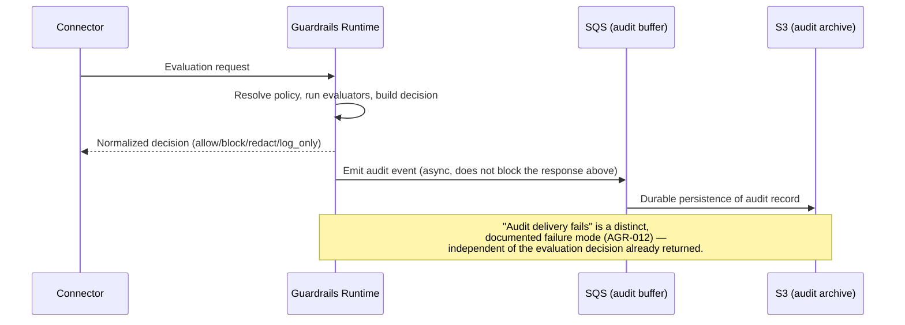

**AI Guardrails — Trade-Offs**

**Authority level:** L3
**Status:** Draft
**Date:** 2026-07-24
**Derived from:** AGREEMENTS.md

---

> This is a derived (L3) technical view. It does not introduce new decisions and must not contradict [`AGREEMENTS.md`](../00-source-of-truth/AGREEMENTS.md) (L1) or [`CONSTRAINTS.md`](../00-source-of-truth/CONSTRAINTS.md) (L1). Where this document and those registers appear to differ, the registers win and this document must be corrected. Figures, dates, and dollar amounts not present in the L1 registers are marked **TBD** rather than invented. This document is referenced from [`ARCHITECTURE-REPORT.md` §21](ARCHITECTURE-REPORT.md#21-trade-offs), which orients the reader to these dimensions but does not repeat the full analysis.

## Table of contents

1. [Purpose and how to read this document](#1-purpose-and-how-to-read-this-document)
2. [Trade-off framework](#2-trade-off-framework)
3. [Hosted runtime vs. customer-managed runtime](#3-hosted-runtime-vs-customer-managed-runtime)
4. [Remote/managed evaluation vs. local deterministic checks](#4-remotemanaged-evaluation-vs-local-deterministic-checks)
5. [Cooperative connector vs. platform-managed / network-IAM-enforced gateway](#5-cooperative-connector-vs-platform-managed--network-iam-enforced-gateway)
6. [DynamoDB vs. versioned S3 for policy storage](#6-dynamodb-vs-versioned-s3-for-policy-storage)
7. [Managed Bedrock Guardrails vs. custom evaluators](#7-managed-bedrock-guardrails-vs-custom-evaluators)
8. [Synchronous vs. asynchronous audit delivery](#8-synchronous-vs-asynchronous-audit-delivery)
9. [Cross-cutting pattern: adapters as the mechanism that avoids re-litigating these trade-offs](#9-cross-cutting-pattern-adapters-as-the-mechanism-that-avoids-re-litigating-these-trade-offs)
10. [Guardrail-coverage breadth vs. contract surface and evaluation latency](#10-guardrail-coverage-breadth-vs-contract-surface-and-evaluation-latency)
11. [Summary table of decisions](#11-summary-table-of-decisions)
12. [Related documents](#12-related-documents)

---

## 1. Purpose and how to read this document

This document records the architecturally significant trade-offs behind the AI Guardrails platform's design, in "Option A vs. Option B" form, together with the decision made and the reasoning behind it. It exists so that a reviewer can see not only *what* was decided (recorded authoritatively in [`AGREEMENTS.md`](../00-source-of-truth/AGREEMENTS.md)) but *what was given up* to get it — every non-trivial architecture decision in this solution has a genuine cost on both sides, and pretending otherwise would misrepresent the design.

Each trade-off below follows the same shape:

| Field | Meaning |
|---|---|
| **Option A / Option B** | The two positions genuinely in tension, stated symmetrically. |
| **Comparison table** | The dimensions on which the options differ. |
| **Decision** | The position the platform actually takes. |
| **Why** | The reasoning, tied to register entries and, where applicable, an `AGR-NNN` agreement, a `CON-NNN` constraint, or an `OQ-NNN` open question. |

Where a trade-off in this set has already been ratified as a formal agreement, this document cites the governing `AGR-NNN` and treats it as settled — it explains *why* the agreement makes sense rather than re-opening it. Where a trade-off is an implementation-level choice not yet elevated to an agreement (see [§6](#6-dynamodb-vs-versioned-s3-for-policy-storage)), this document gives an architecturally reasoned recommendation and says so explicitly, consistent with the rule in [`AGREEMENTS.md`](../00-source-of-truth/AGREEMENTS.md) that a constraint may only be tightened by first amending the corresponding agreement — not by this document quietly asserting one.

Deep, component-level design rationale for a given trade-off — including rejected alternatives and downstream consequences — belongs in an Architecture Decision Record under [`adrs/`](adrs/README.md). For example, [`adrs/ADR-0001-example-decision.md`](adrs/ADR-0001-example-decision.md) is the ADR of record for the standalone-platform-vs-embedded decision behind [AGR-001](../00-source-of-truth/AGREEMENTS.md#agr-001--standalone-platform-not-embedded-in-the-internal-litellm); that decision is the structural precondition for several trade-offs below, because a platform embedded inside one team's LiteLLM instance could never have offered a genuine choice between hosted and customer-managed runtime, or between connector postures, in the first place.

---

## 2. Trade-off framework

Every trade-off in this solution ultimately resolves one of four tensions named in the product vision ([`CHARTER.md`](../10-charter/CHARTER.md)) and formalized across the agreements register:

```text
        Central control  ◄──────────────────────►  Data / operational isolation
        Consistency & reuse ◄────────────────────►  Latency & local autonomy
        Adoption speed  ◄──────────────────────►  Bypass prevention
        Delivery speed (managed) ◄──────────────►  Long-term control & portability
```

None of these tensions is resolved once for the whole platform — the three-mode framework ([AGR-002](../00-source-of-truth/AGREEMENTS.md#agr-002--three-deployment-modes)) exists precisely because different workloads sit at different points on these axes, and the platform is designed to let a workload's *position* change (e.g., Mode A → Mode C) without changing the *contract* it depends on ([AGR-006](../00-source-of-truth/AGREEMENTS.md#agr-006--one-logical-evaluation-contract-across-all-modes)). Each section below identifies which of these four axes it sits on.

---

## 3. Hosted runtime vs. customer-managed runtime

**Axis:** Central control vs. data isolation vs. operational burden.

| | Option A — Hosted runtime (Modes A/B) | Option B — Customer-managed runtime (Mode C) |
|---|---|---|
| Who operates the guardrail runtime | AI Guardrails provider | Consuming team, inside their own AWS account |
| Where content is evaluated | Hosted Evaluation API / provider-managed Guarded Gateway | Inside the customer's AWS account |
| Operational burden on consuming team | Low — provider owns runtime scaling, detection engines, policy execution | Higher — customer owns runtime infrastructure, availability, networking, and upgrades unless managed support is purchased ([AGR-002](../00-source-of-truth/AGREEMENTS.md#agr-002--three-deployment-modes), Mode C) |
| Data exposure | Prompts, responses, and evaluated content reach the hosted service; must never be described as data-local ([AGR-009](../00-source-of-truth/AGREEMENTS.md#agr-009--remote-evaluation-is-not-a-private-data-or-data-local-model)) | Raw content stays inside the customer's account by default; only customer-selected telemetry categories may leave, or none at all ([AGR-016](../00-source-of-truth/AGREEMENTS.md#agr-016--customer-controlled-telemetry-for-the-customer-managed-runtime)) |
| Suitability | Teams without their own gateway, or teams that want centrally managed model access and consolidated operations ([AGR-002](../00-source-of-truth/AGREEMENTS.md#agr-002--three-deployment-modes), Mode B) | Regulated workloads, data residency requirements, high-volume workloads, air-gapped environments, teams that prohibit prompt/response content from leaving their account ([AGR-002](../00-source-of-truth/AGREEMENTS.md#agr-002--three-deployment-modes), Mode C) |
| Control-plane dependency | Full — the hosted control plane and runtime are the same operational boundary | Must execute policies without requiring a synchronous connection to the hosted control plane ([AGR-015](../00-source-of-truth/AGREEMENTS.md#agr-015--customer-managed-runtime-executes-without-a-synchronous-control-plane-connection)) |
| Delivery phase | Phases 1–3 (Integration proof, Internal platform, Guarded Gateway) | Phase 4 (Customer-managed runtime) — [AGR-020](../00-source-of-truth/AGREEMENTS.md#agr-020--five-phase-delivery) |

> **Decision:** The platform supports **both**, as codified in [AGR-002](../00-source-of-truth/AGREEMENTS.md#agr-002--three-deployment-modes) — it does not pick one deployment topology for all workloads. Mode A/B (hosted) ships first because it requires the smallest footprint to prove the reusable-policy hypothesis; Mode C (customer-managed) ships in Phase 4 once the same runtime software has matured enough to be packaged as a container, Helm chart, and ECS deployment template ([AGR-020](../00-source-of-truth/AGREEMENTS.md#agr-020--five-phase-delivery), Phase 4).

**Why:**

- Different consuming teams have genuinely different operational-ownership, data-residency, and gateway-ownership requirements that no single topology satisfies ([`CHARTER.md`](../10-charter/CHARTER.md); [AGR-002](../00-source-of-truth/AGREEMENTS.md#agr-002--three-deployment-modes)).
- The two options are not equivalent with a coat of paint: hosted trades operational burden for data exposure, and customer-managed trades data isolation for operational burden. Marketing or documentation that implies otherwise — e.g., that reduced operational ownership also means reduced data exposure — is explicitly rejected ([AGR-008](../00-source-of-truth/AGREEMENTS.md#agr-008--explicit-content-exposure-model-ownership-vs-exposure-are-separate-concerns)).
- Because Mode C must tolerate control-plane unavailability ([AGR-015](../00-source-of-truth/AGREEMENTS.md#agr-015--customer-managed-runtime-executes-without-a-synchronous-control-plane-connection)), the customer-managed runtime carries a local policy cache and asynchronous policy sync — a structural cost hosted deployments do not pay, since their control plane and runtime share the same trust boundary.
- The enforcement-posture question for external customers ([`OPEN-QUESTIONS.md` OQ-001](../00-source-of-truth/OPEN-QUESTIONS.md#oq-001--enforcement-model-required-for-the-first-external-customers)) and the PrivateLink question ([OQ-002](../00-source-of-truth/OPEN-QUESTIONS.md#oq-002--privatelink--private-connectivity)) both interact with this trade-off: a prospect whose actual requirement is "no tenant content leaves our network" is directed toward Mode C rather than toward private connectivity to a hosted service, because private connectivity does not change the content-exposure model ([AGR-009](../00-source-of-truth/AGREEMENTS.md#agr-009--remote-evaluation-is-not-a-private-data-or-data-local-model)).

```text
                     ┌───────────────────────────┐
                     │ Does the workload require   │
                     │ content to never leave the  │
                     │ customer's AWS account?     │
                     └──────────┬──────────────────┘
                       Yes      │      No
                        ▼                ▼
              Mode C — Customer-      Does the team already
              Managed Runtime         operate a LiteLLM/
              (customer owns infra,   equivalent gateway?
              provider owns runtime         Yes │  No
              software & updates)             ▼        ▼
                                    Mode A —          Mode B —
                                    Remote Evaluation Guarded Gateway
                                    (BYO gateway,     (provider operates
                                    hosted runtime)    gateway + runtime)
```

---

## 4. Remote/managed evaluation vs. local deterministic checks

**Axis:** Consistency and centralization vs. latency.

| | Option A — Remote/managed evaluation | Option B — Local deterministic checks |
|---|---|---|
| Execution location | A network call to the hosted Evaluation API or a managed engine such as Bedrock Guardrails | In-process, no network round trip |
| Detection sophistication | Higher — managed models can express nuanced content-safety judgments ([`CONTAINER-ARCHITECTURE.md`](CONTAINER-ARCHITECTURE.md)) | Lower — rule-based, deterministic organization rules ([`SCOPE.md`](../10-charter/SCOPE.md), [AGR-017](../00-source-of-truth/AGREEMENTS.md#agr-017--core-domain-model)) |
| Latency profile | Adds synchronous network and processing latency on the request path ([`RISK-REGISTER.md`](../70-governance/RISK-REGISTER.md), "Latency" risk) | Minimal added latency; suitable for latency-sensitive workloads |
| Centralization / consistency | Same managed engine version applied identically everywhere it's invoked | Rules are versioned and distributed with the policy, but execute wherever the runtime lives |
| Governing engines ([`CONTAINER-ARCHITECTURE.md`](CONTAINER-ARCHITECTURE.md)) | Bedrock Guardrails, PII evaluators, schema validators | Deterministic organization rules |

> **Decision:** The platform uses **both, selected per policy and per evaluation stage** — it does not force every evaluation through a remote call, nor does it rely on deterministic checks alone. A policy's evaluator configuration determines which evaluators apply to a given stage ([AGR-017](../00-source-of-truth/AGREEMENTS.md#agr-017--core-domain-model), "Evaluator configuration"), and both categories are normalized through the same evaluator-adapter pattern into one decision structure ([AGR-004](../00-source-of-truth/AGREEMENTS.md#agr-004--bedrock-guardrails-as-first-engine-vendor-independent-contract), [AGR-005](../00-source-of-truth/AGREEMENTS.md#agr-005--policy-portability)).

**Why:**

- Latency is a named key risk: "Remote input and output evaluation adds synchronous network and processing latency" ([`RISK-REGISTER.md`](../70-governance/RISK-REGISTER.md)). The charter's own mitigation list for this risk includes "measure per-evaluator latency," "apply only relevant evaluators," "support local deterministic checks," "use customer-managed runtime for latency-sensitive workloads," and "define stage-specific timeouts" ([`RISK-REGISTER.md`](../70-governance/RISK-REGISTER.md)) — none of which is "remove remote evaluation," because the sophistication it provides is worth keeping where the latency budget allows it.
- The MVP explicitly includes both a Bedrock Guardrails adapter *and* a basic deterministic evaluator as separate, additive components ([`SUCCESS-CRITERIA.md`](../10-charter/SUCCESS-CRITERIA.md), items 6–7) — this is a designed-in hybrid, not an oversight.
- Every evaluation stage must enforce an explicit timeout, and behavior on timeout is part of the workload's documented failure policy, not an implicit default ([`CONSTRAINTS.md` CON-016](../00-source-of-truth/CONSTRAINTS.md#con-016--timeout-limits); [AGR-012](../00-source-of-truth/AGREEMENTS.md#agr-012--failure-behavior-is-part-of-policy)). This lets a policy author bound the cost of the "remote" side of the trade-off explicitly rather than accepting unbounded latency risk.
- For workloads where even the hosted runtime's own network hop is unacceptable, Mode C (Customer-Managed Runtime, [§3](#3-hosted-runtime-vs-customer-managed-runtime) above) moves the entire evaluation path — remote and local evaluators alike — inside the customer's own account, which is a structural rather than per-evaluator answer to the same latency concern.

---

## 5. Cooperative connector vs. platform-managed / network-IAM-enforced gateway

**Axis:** Adoption speed vs. bypass prevention.

| | Option A — Cooperative connector | Option B — Platform-managed / network-IAM-enforced gateway |
|---|---|---|
| Topology | `Application → Team LiteLLM with connector → Model` ([AGR-018](../00-source-of-truth/AGREEMENTS.md#agr-018--trust-and-enforcement-model)) | `Application → Platform-managed gateway → Guardrails → Model`, with applications denied direct provider credentials/connectivity in the strongest form ([AGR-018](../00-source-of-truth/AGREEMENTS.md#agr-018--trust-and-enforcement-model)) |
| Who installs/maintains the enforcement point | The consuming team installs and maintains the connector | The platform team manages the gateway/LiteLLM configuration; in the strongest posture, egress policy and IAM prevent any other path to the model provider |
| Bypass resistance | The connector can be disabled, removed, or misconfigured — must never be represented as a hard security boundary ([AGR-018](../00-source-of-truth/AGREEMENTS.md#agr-018--trust-and-enforcement-model)) | Strongest bypass resistance: applications have no direct Bedrock permissions, no provider API credentials, and only the gateway role may invoke approved model services ([AGR-018](../00-source-of-truth/AGREEMENTS.md#agr-018--trust-and-enforcement-model)) |
| Adoption friction | Lowest — no change to who owns gateway infrastructure or credentials | Highest — requires centralizing gateway ownership and/or removing model credentials from application workloads |
| Appropriate when | Teams are trusted; guardrails are an engineering standard; the objective is adoption and evaluation ([AGR-018](../00-source-of-truth/AGREEMENTS.md#agr-018--trust-and-enforcement-model)) | Bypass prevention is a formal requirement; teams are semi-trusted; compliance evidence is required ([AGR-018](../00-source-of-truth/AGREEMENTS.md#agr-018--trust-and-enforcement-model)) |
| MVP status | Required for the first cooperative MVP | Not required for the first cooperative MVP — the strongest posture is explicitly optional at this stage ([AGR-018](../00-source-of-truth/AGREEMENTS.md#agr-018--trust-and-enforcement-model)) |

> **Decision:** The platform adopts **cooperative integration** for the MVP and Phases 1–2, and explicitly reserves platform-managed enforcement and the network/IAM-enforced gateway as **later, optional postures** — not because bypass prevention doesn't matter, but because the first objective is proving policy reuse and adoption, and a cooperative connector must never be marketed or documented as though it already provided bypass-proof enforcement ([AGR-018](../00-source-of-truth/AGREEMENTS.md#agr-018--trust-and-enforcement-model)).

**Why:**

- Different teams and compliance requirements call for different bypass-resistance levels; presenting a voluntary connector as an enforced control would misstate the platform's actual security guarantees ([AGR-018](../00-source-of-truth/AGREEMENTS.md#agr-018--trust-and-enforcement-model)).
- Connector bypass or misconfiguration is a named key risk ([`RISK-REGISTER.md`](../70-governance/RISK-REGISTER.md)), whose mitigation is graduated by trust level: cooperative onboarding for trusted teams, configuration validation, managed gateway deployment, restricted model credentials, and IAM/network enforcement only for mandatory environments ([`RISK-REGISTER.md`](../70-governance/RISK-REGISTER.md)).
- The platform must not rely exclusively on connector telemetry as evidence of mandatory enforcement ([`CONSTRAINTS.md` CON-012](../00-source-of-truth/CONSTRAINTS.md#con-012--no-exclusive-reliance-on-weak-security-proxies)) — a connector reporting healthy does not prove it cannot be removed.
- Which posture the first external customers actually require is not yet decided ([`OPEN-QUESTIONS.md` OQ-001](../00-source-of-truth/OPEN-QUESTIONS.md#oq-001--enforcement-model-required-for-the-first-external-customers)); the working assumption is that cooperative integration holds through Phase 1–2, and stronger postures are pulled forward only when a specific external-customer or compliance driver identifies the need — mirroring the same trigger-based logic already accepted for AWS account separation ([AGR-013](../00-source-of-truth/AGREEMENTS.md#agr-013--aws-as-primary-cloud-minimal-mvp-account-model)).
- Building the network/IAM-enforced posture before any customer or compliance driver justifies it would itself be a form of the "product over-expansion" risk ([`RISK-REGISTER.md`](../70-governance/RISK-REGISTER.md)) and would violate the phased scope discipline in [`../10-charter/SCOPE.md`](../10-charter/SCOPE.md) and [AGR-020](../00-source-of-truth/AGREEMENTS.md#agr-020--five-phase-delivery).

---

## 6. DynamoDB vs. versioned S3 for policy storage

**Axis:** Delivery speed (managed, low-latency key access) vs. long-term control and portability (durable, immutable version history).

> **Status note:** [`DEPLOYMENT-ARCHITECTURE.md`](DEPLOYMENT-ARCHITECTURE.md) lists policy storage as **"DynamoDB or versioned S3"** — the source material itself leaves this specific implementation choice open, and neither [`AGREEMENTS.md`](../00-source-of-truth/AGREEMENTS.md) nor [`CONSTRAINTS.md`](../00-source-of-truth/CONSTRAINTS.md) elevates one option to an accepted agreement. What follows is an architecturally reasoned recommendation, not yet a ratified `AGR-NNN`. If accepted, it should be recorded as a new agreement and captured as its own ADR under [`adrs/`](adrs/README.md), following the pattern set by [`adrs/ADR-0001-example-decision.md`](adrs/ADR-0001-example-decision.md).

| | Option A — DynamoDB | Option B — Versioned S3 |
|---|---|---|
| Access pattern fit | Low-latency key/value lookups — well suited to resolving the *effective* policy for a workload on the hot evaluation path ([AGR-017](../00-source-of-truth/AGREEMENTS.md#agr-017--core-domain-model), "Policy resolver") | Object storage with native version history — well suited to storing large, immutable policy documents and their full version lineage |
| Immutable versioning | Requires the schema to encode immutability (e.g., versioned item keys); not native to the store | Native: S3 object versioning directly matches the "immutable versions" requirement ([`NON-FUNCTIONAL-REQUIREMENTS.md`](NON-FUNCTIONAL-REQUIREMENTS.md)) |
| Fit with adjacent requirement | Same store already required for the **Workload registry** ([`DEPLOYMENT-ARCHITECTURE.md`](DEPLOYMENT-ARCHITECTURE.md)) — a DynamoDB-only design keeps one store for both hot-path lookups | Natural fit for distributing policy artifacts to Customer-Managed Runtime instances for local caching ([AGR-002](../00-source-of-truth/AGREEMENTS.md#agr-002--three-deployment-modes), Mode C: "Policy cache"; [AGR-015](../00-source-of-truth/AGREEMENTS.md#agr-015--customer-managed-runtime-executes-without-a-synchronous-control-plane-connection)) |
| Query/rollback fit | Strong for "give me the current binding for workload X" | Strong for "give me policy version N exactly as published" and for audit/compliance retrieval of historical versions |

> **Decision (recommended, not yet an AGR):** Use **DynamoDB** as the system of record for policy *resolution* — the workload-to-policy-binding lookups that sit on the evaluation hot path, consistent with the workload registry already being DynamoDB ([`DEPLOYMENT-ARCHITECTURE.md`](DEPLOYMENT-ARCHITECTURE.md)) — and use **versioned S3** as the durable archive and distribution artifact for full policy *version* content, particularly for synchronizing policy documents to Customer-Managed Runtime local caches. This is not an either/or choice between the two AWS services named in [`DEPLOYMENT-ARCHITECTURE.md`](DEPLOYMENT-ARCHITECTURE.md); it is a division of responsibility between them.

**Why:**

- Policies must support immutable versions, controlled promotion, workload-scoped rollout, and immediate rollback ([`NON-FUNCTIONAL-REQUIREMENTS.md`](NON-FUNCTIONAL-REQUIREMENTS.md)) — S3's native object versioning is a direct structural match for "immutable version," while DynamoDB is a direct structural match for "which version is this workload currently bound to, right now."
- The Customer-Managed Runtime must keep a local policy cache and execute without a synchronous control-plane connection ([AGR-015](../00-source-of-truth/AGREEMENTS.md#agr-015--customer-managed-runtime-executes-without-a-synchronous-control-plane-connection)); an S3-shaped, versioned artifact is easier to sync, checksum, and cache locally than a live DynamoDB read against the hosted control plane.
- Policy signing and inheritance are still open design questions ([`OPEN-QUESTIONS.md` OQ-012](../00-source-of-truth/OPEN-QUESTIONS.md#oq-012--policy-signing-and-policy-inheritance-design)); a versioned, immutable S3 artifact is a more natural anchor for a future signature than a mutable DynamoDB item, even though signing itself is out of MVP scope ([`SCOPE.md`](../10-charter/SCOPE.md)).
- Both stores are encrypted in transit and at rest via AWS KMS regardless of which is chosen ([`CONSTRAINTS.md` CON-009](../00-source-of-truth/CONSTRAINTS.md#con-009--kms-encryption-in-transit-and-at-rest)), so this trade-off does not affect the encryption posture — only the access-pattern and versioning-semantics fit.

---

## 7. Managed Bedrock Guardrails vs. custom evaluators

**Axis:** Speed and managed-service leverage vs. control and portability.

| | Option A — Managed Bedrock Guardrails | Option B — Custom evaluators |
|---|---|---|
| Time to a working detector | Fast — an existing AWS managed capability, not a build ([AGR-001](../00-source-of-truth/AGREEMENTS.md#agr-001--standalone-platform-not-embedded-in-the-internal-litellm)) | Slower — requires building and maintaining proprietary detection logic |
| Ownership of detection quality | AWS owns the underlying model; the platform owns only the adapter and normalization | The platform fully owns the detection logic, thresholds, and tuning |
| Portability | Native response format is vendor-specific; must be normalized before it reaches policies or connectors ([`CONSTRAINTS.md` CON-004](../00-source-of-truth/CONSTRAINTS.md#con-004--no-coupling-to-bedrock-guardrails-response-formats)) | Fully portable by construction — the platform defines the format |
| MVP role ([`SUCCESS-CRITERIA.md`](../10-charter/SUCCESS-CRITERIA.md)) | "Amazon Bedrock Guardrails adapter" is an explicit MVP component | "Basic deterministic evaluator" is also an explicit MVP component, alongside Bedrock — not instead of it |
| Long-term commitment | Adopted as the **first** managed engine, not a permanent exclusive one ([AGR-004](../00-source-of-truth/AGREEMENTS.md#agr-004--bedrock-guardrails-as-first-engine-vendor-independent-contract)) | Additional custom/deterministic/PII/schema evaluators must be addable behind the same adapter pattern ([`CONTAINER-ARCHITECTURE.md`](CONTAINER-ARCHITECTURE.md)) |

> **Decision:** Adopt **Amazon Bedrock Guardrails as the first managed evaluation engine**, while keeping the public evaluation contract **vendor-independent**, so that custom evaluators (deterministic rules, PII evaluators, schema validators — [`CONTAINER-ARCHITECTURE.md`](CONTAINER-ARCHITECTURE.md)) can be added alongside it without changing policy semantics ([AGR-004](../00-source-of-truth/AGREEMENTS.md#agr-004--bedrock-guardrails-as-first-engine-vendor-independent-contract)).

**Why:**

- Bedrock Guardrails accelerates delivery of a working managed evaluator without requiring the platform to build a proprietary prompt-injection or moderation model in the MVP — both of which are explicitly out of MVP scope ([`SCOPE.md`](../10-charter/SCOPE.md)).
- Permanently coupling the platform's contract to one vendor's response format would undermine policy portability ([`CONSTRAINTS.md` CON-004](../00-source-of-truth/CONSTRAINTS.md#con-004--no-coupling-to-bedrock-guardrails-response-formats), [AGR-005](../00-source-of-truth/AGREEMENTS.md#agr-005--policy-portability)) and block the future addition of other engines behind the same adapter pattern.
- Marketing and technical documentation must not describe Bedrock Guardrails as the product's permanent or exclusive detection engine ([AGR-004](../00-source-of-truth/AGREEMENTS.md#agr-004--bedrock-guardrails-as-first-engine-vendor-independent-contract)) — the "custom evaluators" side of this trade-off is not hypothetical; it already ships in the MVP as the deterministic organization-rule evaluator ([`SUCCESS-CRITERIA.md`](../10-charter/SUCCESS-CRITERIA.md), item 7), and the Customer-Managed Runtime topology names "Custom evaluators" as a first-class runtime component alongside the Bedrock adapter ([AGR-002](../00-source-of-truth/AGREEMENTS.md#agr-002--three-deployment-modes), Mode C).
- Third-party or customer-authored evaluator plugins remain a future-scope item with no defined trust boundary yet ([`OPEN-QUESTIONS.md` OQ-013](../00-source-of-truth/OPEN-QUESTIONS.md#oq-013--customer-specific-evaluator-plugin-governance)); today's "custom evaluators" are first-party only (deterministic rules), which keeps this trade-off's scope bounded to what the MVP actually needs.

---

## 8. Synchronous vs. asynchronous audit delivery

**Axis:** Guaranteed, ordered evidence vs. keeping the evaluation hot path unblocked by the audit pipeline.

| | Option A — Synchronous audit delivery | Option B — Asynchronous audit delivery |
|---|---|---|
| Coupling to the evaluation path | Audit persistence completes before the decision is returned to the caller | Decision is returned to the caller first; the audit record is durably queued and persisted separately |
| Effect of an audit-pipeline slowdown | Directly adds to evaluation latency and can stall production traffic | Does not add to evaluation latency; the evaluation path is decoupled from audit-store health |
| Effect of an audit-pipeline outage | Must either block the response (fail closed) or silently skip auditing (undocumented failure) unless explicitly handled | Failure mode is scoped to the audit path alone and must still be an explicit, documented failure behavior — not silently dropped ([AGR-012](../00-source-of-truth/AGREEMENTS.md#agr-012--failure-behavior-is-part-of-policy)) |
| Fit with named AWS services ([`DEPLOYMENT-ARCHITECTURE.md`](DEPLOYMENT-ARCHITECTURE.md)) | Not the shape implied by the original charter | Matches [`DEPLOYMENT-ARCHITECTURE.md`](DEPLOYMENT-ARCHITECTURE.md) directly: **Audit event buffering → Amazon SQS**, **Audit archive → Amazon S3** — a queue-then-archive pipeline is inherently asynchronous |

> **Decision:** Audit delivery is **asynchronous relative to the evaluation decision path**: the Guardrails Runtime returns the normalized decision to the caller and emits an audit event to a durable buffer (Amazon SQS) for archival persistence (Amazon S3), rather than making decision return wait on audit-store durability ([`DEPLOYMENT-ARCHITECTURE.md`](DEPLOYMENT-ARCHITECTURE.md); [`CONTAINER-ARCHITECTURE.md`](CONTAINER-ARCHITECTURE.md), "Audit producer").

**Why:**

- Seed's own AWS implementation direction names SQS specifically for "audit event buffering" and S3 for "audit archive" ([`DEPLOYMENT-ARCHITECTURE.md`](DEPLOYMENT-ARCHITECTURE.md)) — a buffer-then-archive shape is asynchronous by construction, not synchronous.
- "Audit delivery fails" is explicitly listed among the failure modes a workload's policy must define behavior for ([AGR-012](../00-source-of-truth/AGREEMENTS.md#agr-012--failure-behavior-is-part-of-policy)) — this only makes sense as a named, independent failure mode if audit delivery is decoupled enough from evaluation to fail *without* also failing the evaluation itself. If audit delivery were synchronous and blocking, "audit delivery fails" would collapse into "evaluation fails," and the two would not need separate treatment in the failure-behavior schema.
- Audit-event integrity is still a required security control regardless of the delivery model ([`CONSTRAINTS.md`](../00-source-of-truth/CONSTRAINTS.md)) — "asynchronous" describes *timing relative to the evaluation response*, not "best effort" or "discardable." The queue (SQS) provides durability and retry semantics so that decoupling from the hot path does not mean weakening the audit guarantee.
- "Audit delivery success rate" is tracked as a reliability success metric ([`SUCCESS-CRITERIA.md`](../10-charter/SUCCESS-CRITERIA.md)), which presumes delivery can be measured and can fail independently — again consistent with an asynchronous, observable pipeline rather than a synchronous all-or-nothing write.



---

## 9. Cross-cutting pattern: adapters as the mechanism that avoids re-litigating these trade-offs

Three of the six trade-offs above ([§3](#3-hosted-runtime-vs-customer-managed-runtime), [§4](#4-remotemanaged-evaluation-vs-local-deterministic-checks), [§7](#7-managed-bedrock-guardrails-vs-custom-evaluators)) are resolved the same structural way: **not by choosing one option, but by keeping both available behind a stable contract.** This is only possible because policies are separate from connectors ([AGR-007](../00-source-of-truth/AGREEMENTS.md#agr-007--policies-are-separate-from-connectors)) and vendor-specific behavior sits behind evaluator adapters ([AGR-004](../00-source-of-truth/AGREEMENTS.md#agr-004--bedrock-guardrails-as-first-engine-vendor-independent-contract), [AGR-005](../00-source-of-truth/AGREEMENTS.md#agr-005--policy-portability)). Without that separation — the decision recorded in [`adrs/ADR-0001-example-decision.md`](adrs/ADR-0001-example-decision.md) as the ADR for [AGR-001](../00-source-of-truth/AGREEMENTS.md#agr-001--standalone-platform-not-embedded-in-the-internal-litellm) — each of these trade-offs would have forced a single, permanent, organization-wide choice instead of a per-workload one.

The remaining three trade-offs ([§5](#5-cooperative-connector-vs-platform-managed--network-iam-enforced-gateway), [§6](#6-dynamodb-vs-versioned-s3-for-policy-storage), [§8](#8-synchronous-vs-asynchronous-audit-delivery)) are genuinely sequential or infrastructural rather than "offer both": enforcement posture escalates over time as trust requirements change ([AGR-018](../00-source-of-truth/AGREEMENTS.md#agr-018--trust-and-enforcement-model)), storage responsibility is split by access pattern rather than duplicated, and audit delivery has one designed shape (asynchronous) rather than a per-workload choice.

---

## 10. Guardrail-coverage breadth vs. contract surface and evaluation latency

**Axis:** Consistency & reuse vs. latency; delivery speed vs. long-term control — applied to guardrail *coverage growth* rather than to a single component.

The guardrail-category catalog ([`../20-product/GUARDRAIL-CATALOG.md`](../20-product/GUARDRAIL-CATALOG.md), per [AGR-021](../00-source-of-truth/AGREEMENTS.md#agr-021--guardrail-category-taxonomy-and-extension-model)) names eighteen categories the platform could eventually serve. That breadth creates a standing temptation with two costs:

| | Option A — Grow via contract surface | Option B — Grow via implementations behind stable seams |
|---|---|---|
| How a new guardrail arrives | New request fields, category-specific stages, per-category decision shapes added to the contract | New evaluators behind the adapter (no contract change); reserved stages/actions activated deliberately and rarely |
| Delivery speed per guardrail | Faster for the first team that wants it | Slightly slower — the evaluator must normalize to the standard finding shape |
| Long-term cost | Every added field is carried compatibly, indefinitely, in Modes A/B/C ([AGR-006](../00-source-of-truth/AGREEMENTS.md#agr-006--one-logical-evaluation-contract-across-all-modes)) — the §4.8 over-expansion risk in [`TECHNICAL-RISKS.md`](TECHNICAL-RISKS.md) compounding | Contract stays small; breadth accumulates as a menu of evaluators policies opt into |
| Latency profile | Category-specific paths complicate the per-stage timeout budget (CON-016) | Only policy-configured evaluators run per stage ([`CONTAINER-ARCHITECTURE.md`](CONTAINER-ARCHITECTURE.md) §5, latency mitigation) — breadth does not tax workloads that use little |
| Portability | Per-category fields invite vendor- or framework-specific shapes (violates [AGR-005](../00-source-of-truth/AGREEMENTS.md#agr-005--policy-portability)) | Vendor-neutral by construction |

> **Decision:** Coverage breadth grows through **Option B — implementations behind the four extension seams** defined in [`EXTENSIBILITY-ARCHITECTURE.md`](EXTENSIBILITY-ARCHITECTURE.md): new evaluators are adapter-internal, new connectors are contract clients, and the contract itself changes only through the rare, versioned activation of reserved stages and actions. The catalog absorbs demand pressure at the *classification* level (vision items parked, graduation governed), so the contract never has to absorb it at the *schema* level.

**Why:**

- The one-contract requirement makes contract surface the platform's most expensive real estate: every field is a permanent, three-mode liability ([AGR-006](../00-source-of-truth/AGREEMENTS.md#agr-006--one-logical-evaluation-contract-across-all-modes); [`TECHNICAL-RISKS.md`](TECHNICAL-RISKS.md) §4.8 concentrates the over-expansion risk exactly here).
- The adapter pattern (§9 above) already resolved three trade-offs by "keep both behind a stable contract"; this trade-off is the same resolution generalized — eighteen categories of breadth behind the same seams, per [AGR-004](../00-source-of-truth/AGREEMENTS.md#agr-004--bedrock-guardrails-as-first-engine-vendor-independent-contract)/[AGR-007](../00-source-of-truth/AGREEMENTS.md#agr-007--policies-are-separate-from-connectors).
- The latency budget is per-stage and bounded (CON-015/CON-016); breadth via optional evaluators keeps the budget a per-policy choice, while breadth via contract growth would tax every workload structurally.
- Evaluator sprawl — Option B's own failure mode — is bounded separately by [NFR-MAINT-003](NON-FUNCTIONAL-REQUIREMENTS.md#nfr-maint-003--bounded-evaluator-and-category-sprawl) and tracked as [`TECHNICAL-RISKS.md`](TECHNICAL-RISKS.md) §4.9; choosing Option B does not make growth free, it makes growth *governable*.

---

## 11. Summary table of decisions

| # | Trade-off | Decision | Governing reference |
|---|---|---|---|
| 1 | Hosted runtime vs. customer-managed runtime | Support both; select per workload by residency/operational need | [AGR-002](../00-source-of-truth/AGREEMENTS.md#agr-002--three-deployment-modes), [AGR-009](../00-source-of-truth/AGREEMENTS.md#agr-009--remote-evaluation-is-not-a-private-data-or-data-local-model), [AGR-015](../00-source-of-truth/AGREEMENTS.md#agr-015--customer-managed-runtime-executes-without-a-synchronous-control-plane-connection) |
| 2 | Remote/managed evaluation vs. local deterministic checks | Support both, selected per policy/evaluator configuration; bound by explicit timeouts | [AGR-004](../00-source-of-truth/AGREEMENTS.md#agr-004--bedrock-guardrails-as-first-engine-vendor-independent-contract), [`CONSTRAINTS.md` CON-016](../00-source-of-truth/CONSTRAINTS.md#con-016--timeout-limits) |
| 3 | Cooperative connector vs. platform-managed / network-IAM-enforced gateway | Cooperative for MVP/Phase 1–2; stronger postures deferred until trust requirements demand them | [AGR-018](../00-source-of-truth/AGREEMENTS.md#agr-018--trust-and-enforcement-model), [`OPEN-QUESTIONS.md` OQ-001](../00-source-of-truth/OPEN-QUESTIONS.md#oq-001--enforcement-model-required-for-the-first-external-customers) |
| 4 | DynamoDB vs. versioned S3 for policy storage | Recommended split: DynamoDB for hot-path resolution, versioned S3 for durable version archive/Mode C sync | Not yet an AGR — recommendation only; see [§6](#6-dynamodb-vs-versioned-s3-for-policy-storage) |
| 5 | Managed Bedrock Guardrails vs. custom evaluators | Bedrock Guardrails as first managed engine; custom/deterministic evaluators addable behind the same adapter, vendor-independent contract | [AGR-004](../00-source-of-truth/AGREEMENTS.md#agr-004--bedrock-guardrails-as-first-engine-vendor-independent-contract), [`CONSTRAINTS.md` CON-004](../00-source-of-truth/CONSTRAINTS.md#con-004--no-coupling-to-bedrock-guardrails-response-formats) |
| 6 | Synchronous vs. asynchronous audit delivery | Asynchronous: decision returned first, audit event queued (SQS) then archived (S3); failure is a distinct, documented failure mode | [AGR-012](../00-source-of-truth/AGREEMENTS.md#agr-012--failure-behavior-is-part-of-policy) |
| 7 | Guardrail-coverage breadth vs. contract surface and evaluation latency | Breadth grows via implementations behind the four extension seams; contract changes only through rare, versioned activation of reserved stages/actions | [AGR-021](../00-source-of-truth/AGREEMENTS.md#agr-021--guardrail-category-taxonomy-and-extension-model), [AGR-006](../00-source-of-truth/AGREEMENTS.md#agr-006--one-logical-evaluation-contract-across-all-modes); [`EXTENSIBILITY-ARCHITECTURE.md`](EXTENSIBILITY-ARCHITECTURE.md) |

---

## 12. Related documents

- [`ARCHITECTURE-REPORT.md`](ARCHITECTURE-REPORT.md) — the consolidated technical report; [§21](ARCHITECTURE-REPORT.md#21-trade-offs) points to this document rather than duplicating it.
- [`00-source-of-truth/AGREEMENTS.md`](../00-source-of-truth/AGREEMENTS.md) — the authoritative agreement register (L1); every settled trade-off above traces to an `AGR-NNN` here.
- [`00-source-of-truth/CONSTRAINTS.md`](../00-source-of-truth/CONSTRAINTS.md) — the authoritative constraint register (L1); several trade-offs above operationalize a `CON-NNN` boundary.
- [`00-source-of-truth/OPEN-QUESTIONS.md`](../00-source-of-truth/OPEN-QUESTIONS.md) — tracks decisions this document treats as "not yet resolved" (notably OQ-001, OQ-002, OQ-012, OQ-013).
- [`00-source-of-truth/DECISIONS.md`](../00-source-of-truth/DECISIONS.md) — the chronological product/delivery decision log; several `DEC-NNN` entries there correspond to the trade-offs recorded here at a product level.
- [`adrs/README.md`](adrs/README.md) and [`adrs/ADR-0001-example-decision.md`](adrs/ADR-0001-example-decision.md) — component-level Architecture Decision Records that hold the full option analysis and consequences behind ratified decisions referenced above.
- [`10-charter/CHARTER.md`](../10-charter/CHARTER.md) — the product charter narrative that first introduces the three-mode framework and trust/enforcement model this document analyzes.
