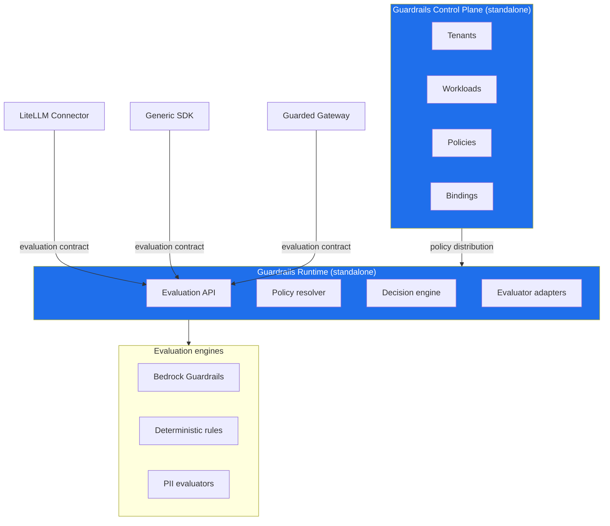

**Title: ADR-0001 — Build AI Guardrails as a Standalone Policy and Enforcement Platform**

**Authority level:** L1
**Status:** Draft
**Date:** 2026-07-24
**Derived from:** seed.md + AGREEMENTS.md

---

# ADR-0001: Build AI Guardrails as a Standalone Policy and Enforcement Platform

## Status

**Accepted**

This decision is recorded as [AGR-001](../../00-source-of-truth/AGREEMENTS.md#agr-001--standalone-platform-not-embedded-in-the-internal-litellm) in the authoritative agreements register and is treated as settled (L1) for all downstream architecture, product, and delivery documents. It must not be re-litigated in derived documents; any proposal that contradicts it requires a new, explicitly approved decision that supersedes this ADR.

## Context

AI Guardrails exists to provide a reusable policy, evaluation, and enforcement layer for applications and agentic workflows that consume large language models. An internal LiteLLM instance is already deployed and available as an integration target, which made "just add guardrails to LiteLLM" the path of least short-term resistance.

The solution charter, however, sets requirements that a LiteLLM-embedded implementation cannot satisfy:

- The product must let an organization **define guardrail policies once and apply the same policies to multiple workloads**, across **different LLM gateways and providers**, not only LiteLLM (seed.md §2, Product vision).
- The product vision explicitly calls out the need to **"avoid coupling policy definitions to LiteLLM or Amazon Bedrock"** (seed.md §2).
- The charter defines three required deployment modes — Remote Evaluation, Guarded Gateway, and Customer-Managed Runtime (seed.md §3) — only one of which (Guarded Gateway) involves the provider operating a gateway at all, and none of which assume the guardrail runtime *is* a fork or extension of one specific team's LiteLLM deployment.
- Product principle 5.1, **Policy portability**, requires that guardrail policies "must not depend directly on LiteLLM configuration structures, Bedrock Guardrails response formats, a specific model provider, a specific programming language, or a specific application framework" (seed.md §5.1).
- Product principle 5.3 requires that **policies remain separate from integrations**: "A policy defines what must be evaluated and how violations should be handled. A connector defines how a specific gateway or application invokes and enforces that policy" (seed.md §5.3).
- Section 12 of the charter states directly: **"LiteLLM is the first supported gateway adapter, not the product boundary,"** and enumerates what the LiteLLM connector is and is not responsible for.
- Section 22, the charter's own decision summary, states: *"The AI Guardrails solution will be built as a standalone policy and enforcement platform rather than as functionality embedded inside the existing internal LiteLLM instance. LiteLLM will serve as the first supported connector and may also be used to provide the managed Guarded Gateway mode."*

The core architectural question this ADR resolves is therefore: **should AI Guardrails be built as functionality embedded inside the existing internal LiteLLM instance, or as an independently deployable platform that treats LiteLLM as one connector among several?**

This question matters because it determines whether the platform can ever satisfy the reuse-across-multiple-gateways requirement, whether policy definitions can remain portable, and whether the product's release cadence and ownership can be decoupled from the internal LiteLLM team's roadmap.

## Decision

AI Guardrails **will be built and delivered as a standalone policy and enforcement platform**, independently deployable, versioned, and operated from any single LiteLLM instance.

LiteLLM will be treated as the **first supported connector** to this platform, and may optionally serve as the substrate used to provide the managed **Guarded Gateway** mode (seed.md §22; §3, Mode B). It will not define the boundary of the product.

Concretely, this means:

- The **Evaluation API**, **policy resolver**, **decision engine**, and **evaluator adapters** are built and operated as a distinct **Guardrails Runtime**, separate from any team's LiteLLM deployment (seed.md §10, Logical architecture).
- A **Guardrails Control Plane** (tenants, workloads, policies, bindings, rollouts) governs policy distribution independently of any gateway (seed.md §10).
- The **LiteLLM connector** is scoped narrowly: it maps LiteLLM requests into the evaluation contract, invokes input/output evaluation, enforces block/redact decisions, and propagates correlation identifiers — it does **not** define organization policy, implement detection models, manage model credentials, or persist audit records (seed.md §12).
- The evaluation contract, policy schema, and decision structures are defined independently of LiteLLM's internal request/response structures, so that additional connectors (a generic HTTP Evaluation API, other gateways) can be added without changing policy semantics (seed.md §5.1, §5.3, §12).

The Control Plane and Runtime are the product. LiteLLM, the Generic SDK, and the Guarded Gateway are three interchangeable ways to reach the same Evaluation API and consume the same policy.

## Alternatives Considered

### Alternative 1 — Embed guardrails inside the existing internal LiteLLM instance

Add policy evaluation, detection calls, and enforcement logic directly into the internal LiteLLM deployment's pre-call/post-call hooks, with no separately deployable runtime.

**Why rejected:**

- Couples guardrail enforcement to **one team's gateway lifecycle** — its release cadence, upgrade schedule, and operational ownership — directly contradicting the requirement to decouple the product roadmap from the internal LiteLLM team's roadmap (AGR-001 rationale).
- Cannot serve teams that use **a different gateway, no gateway, or invoke evaluation directly**, which breaks the "define policies once, apply to multiple workloads across different gateways and providers" vision (seed.md §2).
- Makes it structurally difficult to keep **policy portability** (seed.md §5.1): logic embedded in LiteLLM's own configuration and extension points naturally starts depending on LiteLLM's request/response shapes, defeating the adapter-based isolation the charter requires.
- Forecloses the **Customer-Managed Runtime** mode entirely, since there would be no independently packagable runtime artifact to deploy into a customer's AWS account (seed.md §3, Mode C; §15).
- Provides no basis for the MVP's core validation goal — proving that **one reusable policy can be applied consistently to multiple independent LiteLLM deployments** (seed.md §16) — since an embedded implementation is, by construction, specific to a single instance.

### Alternative 2 — Fork LiteLLM into a guardrails-enabled gateway

Maintain a dedicated fork of LiteLLM with guardrail evaluation and enforcement built into the fork, distributed as the "guardrailed" gateway going forward.

**Why rejected:**

- Effectively turns the product into **a general-purpose LLM gateway replacement**, which is explicitly out of scope for the MVP (seed.md §6.3).
- Still ties the product to LiteLLM's internal architecture and upstream release cadence — the coupling problem is relocated, not solved, and now carries the added cost of tracking and rebasing against upstream LiteLLM changes indefinitely.
- Does not help teams that use a different gateway or no gateway at all; it only produces a second LiteLLM variant, which does not satisfy "avoid coupling policy definitions to LiteLLM" (seed.md §2).
- Undermines the one-logical-contract-across-modes requirement (seed.md §5.2): a fork-based approach naturally encourages embedding policy logic in gateway internals rather than behind a stable, portable evaluation contract.
- Increases long-term maintenance burden without adding capability beyond what a well-scoped connector already provides for Mode A and Mode B.

### Alternative 3 — Build a standalone policy and enforcement platform (chosen)

Build the Guardrails Control Plane and Runtime as an independently deployable product, with LiteLLM implemented as the first of potentially several connectors, and optionally as the substrate for the managed Guarded Gateway.

**Why accepted:**

- Directly satisfies the reuse-across-multiple-gateways requirement and the three-deployment-mode model (seed.md §2, §3; AGR-002).
- Keeps policy definitions portable and vendor-independent, consistent with product principle 5.1 and 5.3 (AGR-005, AGR-007).
- Allows the same evaluation contract to be honored by Remote Evaluation, Guarded Gateway, and Customer-Managed Runtime alike (AGR-006).
- Leaves LiteLLM's own roadmap and operations untouched and independently owned, while still letting LiteLLM serve double duty as the Guarded Gateway substrate when useful (seed.md §22).
- Directly supports the MVP demonstration requirement of proving policy reuse across two independent LiteLLM deployments (seed.md §16; AGR-020).

### Comparison summary

| Dimension | Embed in internal LiteLLM | Fork LiteLLM | Standalone platform (chosen) |
|---|---|---|---|
| Reusable across multiple gateways/providers | No | No (LiteLLM-only) | Yes |
| Decoupled from internal LiteLLM team's roadmap | No | Partially | Yes |
| Policy portability preserved (§5.1) | At risk | At risk | Preserved by design |
| Enables Customer-Managed Runtime (Mode C) | No | No | Yes |
| Risk of becoming a gateway replacement (out of MVP scope, §6.3) | Low (but scope-limited) | High | Low |
| Supports MVP two-instance policy-reuse demonstration (§16) | No | No | Yes |
| Independent versioning and release cadence | No | Partial | Yes |

## Consequences

### Positive

- The same versioned guardrail policy can be bound to multiple, independently operated workloads and gateways, satisfying the core reuse hypothesis of the product (seed.md §2, §16).
- The platform can support all three charter-mandated deployment modes — Remote Evaluation, Guarded Gateway, Customer-Managed Runtime — without redesigning the core evaluation contract for each (seed.md §3; AGR-002, AGR-006).
- Policy definitions stay independent of LiteLLM configuration structures and Bedrock Guardrails response formats, preserving portability and the ability to add evaluation engines or connectors later without breaking existing policies (seed.md §5.1; AGR-004, AGR-005).
- Additional connectors (generic HTTP Evaluation API, future gateways) can be added by implementing the invocation contract only, without changing policy semantics (seed.md §12; AGR-003, AGR-007).
- The Guardrails product's release cadence, ownership, and roadmap are decoupled from the internal LiteLLM team's roadmap (AGR-001 implications).
- The runtime can later be packaged for **Customer-Managed Runtime** deployment (container, Helm chart, ECS template) without changing the connector contract, because the runtime was never architecturally fused to a single gateway (seed.md §16, §18 Phase 4).

### Negative

- Introduces a separately deployed, versioned, and operated service (Control Plane + Runtime) rather than reusing an existing LiteLLM deployment, which is additional upfront engineering and operational investment (seed.md §11, AWS implementation direction; §21, Platform operations ownership).
- Requires designing and maintaining a stable evaluation contract and policy schema up front, rather than iterating directly inside LiteLLM's existing extension points — more design work is needed before any connector can be built (seed.md §5.2, §12).
- The LiteLLM connector itself becomes an additional component to build, version, and support, distinct from both the runtime and from LiteLLM's own codebase (seed.md §12).
- Onboarding a workload now requires an explicit registration and integration step (register workload → select policy → generate integration manifest → install connector → observe → review → enforce) rather than guardrails being automatically present for anything already running on the shared LiteLLM instance (seed.md §4, Conceptual onboarding flow).

### Risks

The following key risks from the charter (seed.md §20) are directly relevant to, or introduced by, this decision and must be tracked:

- **Connector bypass** — because enforcement now depends on a connector being correctly installed and maintained rather than being inseparable from a single shared LiteLLM instance, a consuming team may remove, disable, or misconfigure the LiteLLM connector. Mitigation depends on trust level: cooperative onboarding, configuration validation, managed gateway deployment, and — where required — IAM/network enforcement (seed.md §20, "Connector bypass"; §8, §18 for enforcement posture options).
- **False confidence** — teams may interpret a passing guardrail evaluation as complete AI security, when guardrails are explicitly not authorization and do not cover every risk category (seed.md §20, "False confidence"; AGR-010).
- **Latency** — a standalone runtime reached over the network adds synchronous evaluation latency compared to logic executing in-process inside LiteLLM. This must be measured per evaluator and mitigated with stage-specific timeouts, local deterministic checks, and, where necessary, the Customer-Managed Runtime option (seed.md §20, "Latency").
- **Hosted data exposure** — for Remote Evaluation and Guarded Gateway modes, prompts and responses reach a runtime outside the consuming team's direct operational boundary; this must be explicitly documented per AGR-008 and AGR-009 rather than implied away by "standalone" architecture (seed.md §20, "Hosted data exposure").
- **Policy fragmentation** — as more workloads bind to the platform, workload-specific overrides could erode the consistency that motivated building a standalone platform in the first place; overrides must be limited and tracked (seed.md §20, "Policy fragmentation").
- **Product over-expansion** — a standalone platform creates surface area (control plane, runtime, multiple connectors, multiple deployment modes) that could tempt scope growth into gateway management, full AI governance, or authorization before the core integration is validated. Strict MVP boundaries (AGR-019) are the explicit mitigation (seed.md §20, "Product over-expansion").

## Validation Required

This decision is not considered validated until the MVP demonstration defined in the charter and in [AGR-020](../../00-source-of-truth/AGREEMENTS.md#agr-020--mvp-success-demonstration) has been executed and passed. Specifically, the MVP must show that (seed.md §16, MVP demonstration):

1. **Two separate LiteLLM instances** consume the **same policy**.
2. **Neither instance shares model-provider credentials** with the guardrail platform.
3. **Both receive consistent, normalized decisions** from the same Evaluation API.
4. **One workload runs in observe mode** while **another runs in enforce mode**, using the same policy.
5. A **policy can be upgraded and rolled back** without disrupting either workload.
6. **Raw content persistence can be disabled** for the evaluation path.
7. **Evaluation failures follow a configured failure policy** rather than an undocumented fallback (see AGR-012).
8. The runtime **can later be packaged for customer-managed deployment without changing the connector contract**.

Delivery planning must produce **two genuinely independent LiteLLM deployments** to exercise this demonstration — not the same deployment tested twice (AGR-020 implications). Until all eight conditions are met, this ADR's premise — that a standalone platform is both necessary and sufficient to enable policy reuse across independent gateways — remains unproven in practice, even though it is architecturally accepted.

This demonstration corresponds to **Phase 1 — Integration proof** of the five-phase delivery plan (seed.md §18; AGR-022), whose stated objective is to *"prove that guardrail policy and evaluation can be separated from LiteLLM and reused across multiple gateways."*

## Related Agreements

This ADR is grounded in, and must remain consistent with, the following authoritative agreements from [AGREEMENTS.md](../../00-source-of-truth/AGREEMENTS.md):

| Agreement | Relevance to this ADR |
|---|---|
| [AGR-001](../../00-source-of-truth/AGREEMENTS.md#agr-001--standalone-platform-not-embedded-in-the-internal-litellm) | The primary agreement this ADR documents and elaborates: standalone platform, not embedded in the internal LiteLLM instance. |
| [AGR-002](../../00-source-of-truth/AGREEMENTS.md#agr-002--three-deployment-modes) | The three deployment modes (Remote Evaluation, Guarded Gateway, Customer-Managed Runtime) that a standalone architecture is required to support. |
| [AGR-003](../../00-source-of-truth/AGREEMENTS.md#agr-003--litellm-as-first-connector-not-the-product-boundary) | Defines LiteLLM's scope as first connector, not product boundary — the direct consequence of this decision. |
| [AGR-005](../../00-source-of-truth/AGREEMENTS.md#agr-005--policy-portability) | Policy portability requirement that a standalone architecture is designed to protect. |
| [AGR-006](../../00-source-of-truth/AGREEMENTS.md#agr-006--one-logical-evaluation-contract-across-all-modes) | The single logical evaluation contract that must hold across all deployment modes enabled by this decision. |
| [AGR-007](../../00-source-of-truth/AGREEMENTS.md#agr-007--policies-are-separate-from-connectors) | The mandatory separation between policy and connector that this architecture is built to enforce. |
| [AGR-012](../../00-source-of-truth/AGREEMENTS.md#agr-012--failure-behavior-is-part-of-policy) | Governs the "evaluation failures follow a configured failure policy" condition of the validation demonstration. |
| [AGR-019](../../00-source-of-truth/AGREEMENTS.md#agr-019--mvp-scope-boundaries) | The MVP scope boundary that constrains this architecture against over-expansion. |
| [AGR-020](../../00-source-of-truth/AGREEMENTS.md#agr-020--mvp-success-demonstration) | The concrete, falsifiable success demonstration that validates this decision. |
| [AGR-022](../../00-source-of-truth/AGREEMENTS.md#agr-022--five-phase-delivery) | Places this ADR's validation inside Phase 1 — Integration proof of the five-phase delivery plan. |

## Related Documents

- [Solution Charter](../../10-charter/CHARTER.md)
- [Product Overview](../../20-product/PRODUCT-OVERVIEW.md)
- [Integration Architecture](../INTEGRATION-ARCHITECTURE.md)
- [Architecture Report](../ARCHITECTURE-REPORT.md)
- [Non-Functional Requirements](../NON-FUNCTIONAL-REQUIREMENTS.md)
