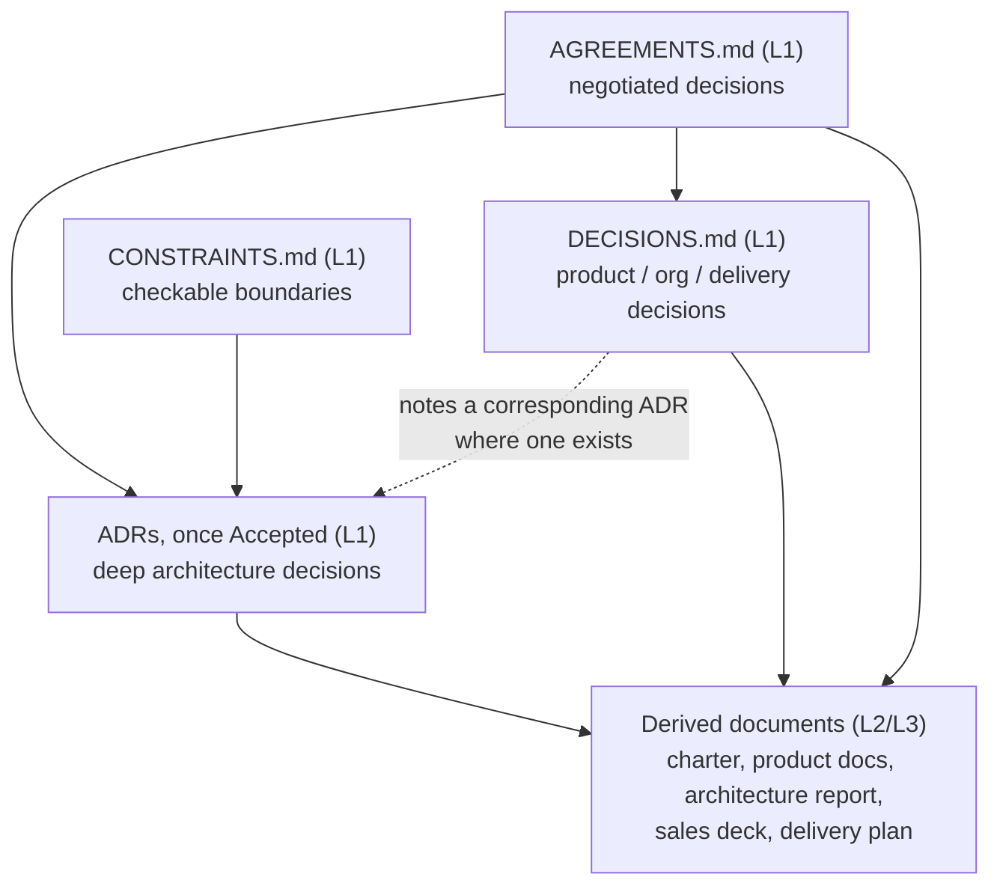

**AI Guardrails — Architecture Decision Records (ADR) Index**

**Authority level:** L1
**Status:** Draft
**Date:** 2026-07-24
**Derived from:** seed.md + AGREEMENTS.md

---

## Purpose and authority

This directory holds the **Architecture Decision Records (ADRs)** for the AI Guardrails platform. An ADR captures a single deep, hard-to-reverse architectural decision — the kind that affects the shape of the system for years, not a product or delivery decision (those belong in [`00-source-of-truth/DECISIONS.md`](../../00-source-of-truth/DECISIONS.md)).

**Authority model — this is the important part:**

* This index document (the file you are reading) is a process document: it explains how ADRs work, provides the template, and lists what exists. It does not itself carry a technical decision.
* An individual ADR is **L1 — Authoritative**, on the same footing as [`AGREEMENTS.md`](../../00-source-of-truth/AGREEMENTS.md) and [`CONSTRAINTS.md`](../../00-source-of-truth/CONSTRAINTS.md), **once and only once its `Status` field reads `Accepted`**. A `Proposed` ADR is a draft under discussion and binds no one. A `Rejected` ADR is a historical record of a path considered and declined; it is not authoritative but must not be deleted. A `Superseded` ADR remains an authoritative historical record of what was decided and why at the time, but the current binding decision is whatever superseded it.
* No ADR — at any status — may contradict [`AGREEMENTS.md`](../../00-source-of-truth/AGREEMENTS.md) or [`CONSTRAINTS.md`](../../00-source-of-truth/CONSTRAINTS.md). Those two registers outrank every ADR. An ADR elaborates *how* an agreement or constraint is implemented at the architecture and component level; it must never relax, reinterpret, or work around one. If an ADR appears to require changing an agreement, the agreement must be amended first, through the same authority path used for `AGREEMENTS.md` itself, before the ADR can be Accepted.
* Where a derived document (architecture report, product materials, sales collateral, delivery plan) describes a design covered by an Accepted ADR, it must match that ADR. If a conflict is found, the ADR wins and the derived document must be corrected.



---

## Table of contents

- [Purpose and authority](#purpose-and-authority)
- [When to write an ADR](#when-to-write-an-adr)
- [Numbering and naming convention](#numbering-and-naming-convention)
- [ADR lifecycle](#adr-lifecycle)
- [ADR template](#adr-template)
- [Current ADRs](#current-adrs)
- [Suggested backlog of future ADRs](#suggested-backlog-of-future-adrs)
- [Related documents](#related-documents)

---

## When to write an ADR

Write an ADR when a decision is architectural rather than product-, organizational-, or delivery-scoped — that is, when it fixes the shape of a component, an integration boundary, a data model, a security control, or a deployment topology in a way that would be expensive to reverse later. Typical triggers, drawn from the seed material:

* A choice between materially different technical approaches to the same requirement (for example, how policies are distributed to a customer-managed runtime that cannot depend on a synchronous control-plane connection — [AGR-015](../../00-source-of-truth/AGREEMENTS.md#agr-015--customer-managed-runtime-executes-without-a-synchronous-control-plane-connection)).
* A decision that touches the [core domain model](../../00-source-of-truth/AGREEMENTS.md#agr-017--core-domain-model) (tenant, workload, policy, binding, evaluation, decision) or the [one logical evaluation contract](../../00-source-of-truth/AGREEMENTS.md#agr-006--one-logical-evaluation-contract-across-all-modes) shared across all three deployment modes.
* A decision with real alternatives, real trade-offs, and consequences that a future reader would otherwise have to reconstruct from memory or a chat log.
* A decision that a component-level design document (for example [`COMPONENT-ARCHITECTURE.md`](../COMPONENT-ARCHITECTURE.md) or [`SECURITY-ARCHITECTURE.md`](../SECURITY-ARCHITECTURE.md), where present) needs to cite as its authority for a specific design choice.

Do **not** write an ADR for:

* Product, scope, or delivery-sequencing decisions — those belong in [`DECISIONS.md`](../../00-source-of-truth/DECISIONS.md).
* Restating an agreement or constraint without adding architectural design content — link to [`AGREEMENTS.md`](../../00-source-of-truth/AGREEMENTS.md) or [`CONSTRAINTS.md`](../../00-source-of-truth/CONSTRAINTS.md) instead.
* Routine implementation detail with no lasting design consequence.

---

## Numbering and naming convention

* Each ADR is a single Markdown file in this directory: `ADR-NNNN-kebab-case-title.md`.
* `NNNN` is a four-digit, zero-padded, strictly sequential integer starting at `0001`. Numbers are assigned in the order an ADR is first proposed (opened as a pull request or draft), not the order it is accepted.
* Numbers are **never reused and never renumbered**, even if the ADR is later rejected or superseded. A gap in the sequence (a rejected or abandoned draft) is expected and acceptable.
* The kebab-case title is a short, stable summary of the decision's subject (for example `ADR-0002-control-plane-data-plane-separation`), not of its outcome — the title should not need to change if the decision is later superseded.
* An ADR file is **immutable in substance** once Accepted. A later change of mind is recorded as a **new** ADR that states in its own front matter that it supersedes the prior number; the prior file's `Status` is then updated to `Superseded` with a pointer forward. Do not rewrite an Accepted ADR's Decision or Consequences sections in place.
* All ADRs live flat in `50-architecture/adrs/`; no subdirectories per phase or component. This index is the single place to browse them by topic.

---

## ADR lifecycle

```mermaid
stateDiagram-v2
    [*] --> Proposed
    Proposed --> Accepted : owners agree; becomes L1
    Proposed --> Rejected : owners decline
    Accepted --> Superseded : a later ADR replaces this decision
    Rejected --> [*]
    Superseded --> [*]
    Accepted --> [*]
```



| Status | Meaning | Authoritative? |
| --- | --- | --- |
| **Proposed** | Under discussion; alternatives and consequences are being evaluated. | No — informative only. |
| **Accepted** | Owners have agreed; the decision is binding on implementation and on every derived document. | **Yes — L1.** |
| **Superseded** | A later ADR (referenced by number) replaces this decision. Retained for historical traceability. | Historically yes, currently no — see the superseding ADR. |
| **Rejected** | Considered and explicitly declined. Retained so the alternative is not silently re-litigated. | No — informative only. |

---

## ADR template

Copy this template into a new file named per the [numbering convention](#numbering-and-naming-convention) above.

```markdown
# ADR-NNNN: <Short, decision-focused title>

**Status:** Proposed | Accepted | Superseded | Rejected
**Date:** <YYYY-MM-DD>
**Owners:** <decision owners — e.g. technical lead, architecture lead>
**Related agreements:** <AGR-NNN, AGR-NNN — link to AGREEMENTS.md anchors>
**Related ADRs:** <Supersedes ADR-NNNN / Superseded by ADR-NNNN, if applicable>

## Context

What forces led to this decision being necessary? What requirement, constraint,
or agreement is in tension, and why can it not be resolved without a deliberate
architectural choice? Cite the relevant seed.md section(s) and AGREEMENTS.md /
CONSTRAINTS.md entries.

## Decision

State the decision as a single, unambiguous position — what will be built,
where it lives, and what contract or interface it exposes. Avoid hedging;
a later ADR can always supersede this one if circumstances change.

## Alternatives considered

For each real alternative that was evaluated:

- **Alternative:** <name>
  **Why not chosen:** <reason — cost, coupling, contradicts an agreement,
  does not generalize across deployment modes, etc.>

## Consequences

### Positive

- <benefit this decision produces>

### Negative

- <cost, limitation, or capability given up>

### Risks

- <what could go wrong, and at what point this ADR should be revisited>

## Validation required

What must be true, measured, or demonstrated before this decision is
considered proven in production (e.g. a proof of concept, a conformance
test, a load test, a specific validation demonstration criterion)?

## Related agreements

- [AGR-NNN](../../00-source-of-truth/AGREEMENTS.md#agr-nnn--slug) — <one-line relevance>
```

---

## Current ADRs

| ID | Title | Status | Related agreements | File |
| --- | --- | --- | --- | --- |
| ADR-0001 | Standalone platform architecture (worked example) | Accepted | [AGR-001](../../00-source-of-truth/AGREEMENTS.md#agr-001--standalone-platform-not-embedded-in-the-internal-litellm) | [`ADR-0001-example-decision.md`](./ADR-0001-example-decision.md) |
| ADR-0002 | Guardrail-category catalog and four-seam extension model | **Proposed** | [AGR-021](../../00-source-of-truth/AGREEMENTS.md#agr-021--guardrail-category-taxonomy-and-extension-model), [AGR-017](../../00-source-of-truth/AGREEMENTS.md#agr-017--core-domain-model) | [`ADR-0002-guardrail-category-catalog-and-extension-model.md`](./ADR-0002-guardrail-category-catalog-and-extension-model.md) |

ADR-0001 records the architecture-level rationale behind the platform's foundational decision — building AI Guardrails as a standalone policy and enforcement platform rather than functionality embedded inside the existing internal LiteLLM instance (see [AGR-001](../../00-source-of-truth/AGREEMENTS.md#agr-001--standalone-platform-not-embedded-in-the-internal-litellm) and [DEC-001](../../00-source-of-truth/DECISIONS.md#dec-001--build-as-a-standalone-platform-not-embedded-in-the-internal-litellm)). It also serves as the **worked example** that new ADR authors should model their own records on — hence its filename — since it is the only ADR filed as an affected document in [`AGREEMENTS.md`](../../00-source-of-truth/AGREEMENTS.md#agr-001--standalone-platform-not-embedded-in-the-internal-litellm) to date.

ADR-0002 records the design behind the guardrail-category catalog ([`20-product/GUARDRAIL-CATALOG.md`](../../20-product/GUARDRAIL-CATALOG.md)) and the four-seam extension model ([`EXTENSIBILITY-ARCHITECTURE.md`](../EXTENSIBILITY-ARCHITECTURE.md)), per [AGR-021](../../00-source-of-truth/AGREEMENTS.md#agr-021--guardrail-category-taxonomy-and-extension-model) and [DEC-009](../../00-source-of-truth/DECISIONS.md#dec-009--adopt-the-guardrail-category-catalog-as-directional-vision). While its status reads Proposed, it binds no one; AGR-021 and DEC-009 remain the L1 authority.

No ADR has yet been Superseded or Rejected.

---

## Suggested backlog of future ADRs

The following are **candidate topics**, not yet-numbered ADRs. They are architectural decisions implied by the seed material and by the deployment-mode agreements that are likely to need a dedicated, deeply-reasoned record before or during the phase noted. A candidate is promoted to a real `ADR-NNNN` file — with a number assigned at the moment it is first proposed — when someone begins the design work; this table itself does not reserve numbers.

| Candidate topic | Why it needs an ADR | Grounding | Related agreements | Likely phase |
| --- | --- | --- | --- | --- |
| **API + SDK integration model** | The platform must support invocation from a generic HTTP Evaluation API and a generic SDK in addition to the LiteLLM connector, without ever letting a connector-specific shape leak into the policy or decision contract. | seed §6.1 (Generic HTTP Evaluation API in MVP scope), §10 (Generic SDK shown as a peer of the LiteLLM Connector and Guarded Gateway in the logical architecture), §12 ("The product must later support additional integrations without changing policy semantics") | [AGR-003](../../00-source-of-truth/AGREEMENTS.md#agr-003--litellm-as-first-connector-not-the-product-boundary), [AGR-006](../../00-source-of-truth/AGREEMENTS.md#agr-006--one-logical-evaluation-contract-across-all-modes), [AGR-007](../../00-source-of-truth/AGREEMENTS.md#agr-007--policies-are-separate-from-connectors) | Phase 1–2 |
| **Separate control plane and data plane** | The logical architecture already draws a Guardrails Control Plane (tenants, workloads, policies, bindings, rollouts) as distinct from the Guardrails Runtime (evaluation API, policy resolver, decision engine) connected only by policy distribution. The boundary, its interface, and its failure-independence need a deliberate record before component design proceeds. | seed §10 (logical architecture diagram), §15 (policy rollout: immutable versions, controlled promotion, rollback) | [AGR-006](../../00-source-of-truth/AGREEMENTS.md#agr-006--one-logical-evaluation-contract-across-all-modes), [AGR-015](../../00-source-of-truth/AGREEMENTS.md#agr-015--customer-managed-runtime-executes-without-a-synchronous-control-plane-connection), [AGR-017](../../00-source-of-truth/AGREEMENTS.md#agr-017--core-domain-model) | Phase 1–2 |
| **Support managed and standalone deployment** | The same runtime software must run as the hosted Guarded Gateway path and as a customer-managed artifact (container, Helm chart, ECS template, infrastructure module) without diverging into two codebases or two contracts. | seed §3 (Mode C — Customer-Managed Runtime), §18 Phase 4 deliverables (runtime container, Helm chart, ECS deployment template, infrastructure module), §16 (the Phase 1–2 validation demonstration requires later customer-managed packaging "without changing the connector contract"; see [`../../60-delivery/VALIDATION-PLAN.md`](../../60-delivery/VALIDATION-PLAN.md)) | [AGR-002](../../00-source-of-truth/AGREEMENTS.md#agr-002--three-deployment-modes), [AGR-015](../../00-source-of-truth/AGREEMENTS.md#agr-015--customer-managed-runtime-executes-without-a-synchronous-control-plane-connection) | Phase 4 |
| **Event-driven policy distribution** | Getting an immutable, versioned policy from the control plane to every runtime — including customer-managed runtimes that must keep evaluating during a control-plane outage — needs an explicit distribution mechanism (push/event vs. pull/poll, caching, staleness handling) rather than an assumed synchronous fetch. | seed §10 ("Policy distribution" as the only arrow between control plane and runtime), §15 (policy-cache hit rate as a measured performance concern; immediate rollback requirement) | [AGR-011](../../00-source-of-truth/AGREEMENTS.md#agr-011--observe-before-enforce-progression), [AGR-012](../../00-source-of-truth/AGREEMENTS.md#agr-012--failure-behavior-is-part-of-policy), [AGR-015](../../00-source-of-truth/AGREEMENTS.md#agr-015--customer-managed-runtime-executes-without-a-synchronous-control-plane-connection) | Phase 2 and 4 |
| **Tenant isolation model** | The tenant entity already carries AWS account information, allowed Regions, and retention configuration, and the MVP deliberately uses a minimal (two-account) topology with named triggers for adding separation later. The concrete isolation boundary (data, compute, keys, blast radius) per deployment mode needs a dedicated record before the Guarded Gateway multiplies tenants onto shared infrastructure. | seed §9 (Tenant domain entity), §11 (AWS account model and its escalation triggers: external customers, compliance, independent security ownership, immutable audit, production scale, dedicated tenant deployments) | [AGR-013](../../00-source-of-truth/AGREEMENTS.md#agr-013--aws-as-primary-cloud-minimal-mvp-account-model), [AGR-017](../../00-source-of-truth/AGREEMENTS.md#agr-017--core-domain-model) | Phase 2–3 |
| **KMS for policy signing** | Policy signing is explicitly named as future scope and explicitly excluded from the MVP, but customer-managed and air-gapped deployments will eventually need integrity guarantees on distributed policy artifacts; the signing mechanism, key ownership, and verification point are architectural, not incidental. | seed §6.2 (Policy signing listed under future scope), §11 (AWS KMS as the encryption service), §14 (KMS encryption; audit-event integrity), §17 (MVP non-goals explicitly exclude "a policy-signing infrastructure") | [CON-009](../../00-source-of-truth/CONSTRAINTS.md#con-009--kms-encryption-in-transit-and-at-rest) | Phase 5 (post-MVP; design groundwork may start earlier for Mode C) |

Each candidate must be re-validated against [`AGREEMENTS.md`](../../00-source-of-truth/AGREEMENTS.md) and [`CONSTRAINTS.md`](../../00-source-of-truth/CONSTRAINTS.md) at the time it is actually proposed, since agreements may be amended between now and then.

---

## Related documents

- [`00-source-of-truth/AGREEMENTS.md`](../../00-source-of-truth/AGREEMENTS.md) — authoritative agreements (L1); no ADR may contradict these.
- [`00-source-of-truth/CONSTRAINTS.md`](../../00-source-of-truth/CONSTRAINTS.md) — authoritative checkable boundaries (L1); no ADR may contradict these.
- [`00-source-of-truth/DECISIONS.md`](../../00-source-of-truth/DECISIONS.md) — the product/organizational/delivery decision log; links to this index for the corresponding architecture-level records.
- [`50-architecture/ARCHITECTURE-REPORT.md`](../ARCHITECTURE-REPORT.md) — the consolidated technical report (L3); cites Accepted ADRs rather than re-deriving their reasoning.
- [`50-architecture/NON-FUNCTIONAL-REQUIREMENTS.md`](../NON-FUNCTIONAL-REQUIREMENTS.md) — non-functional requirements that individual ADRs (availability, performance, tenant isolation) must satisfy.
