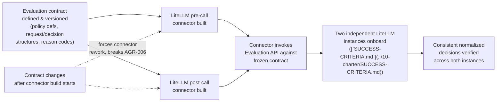
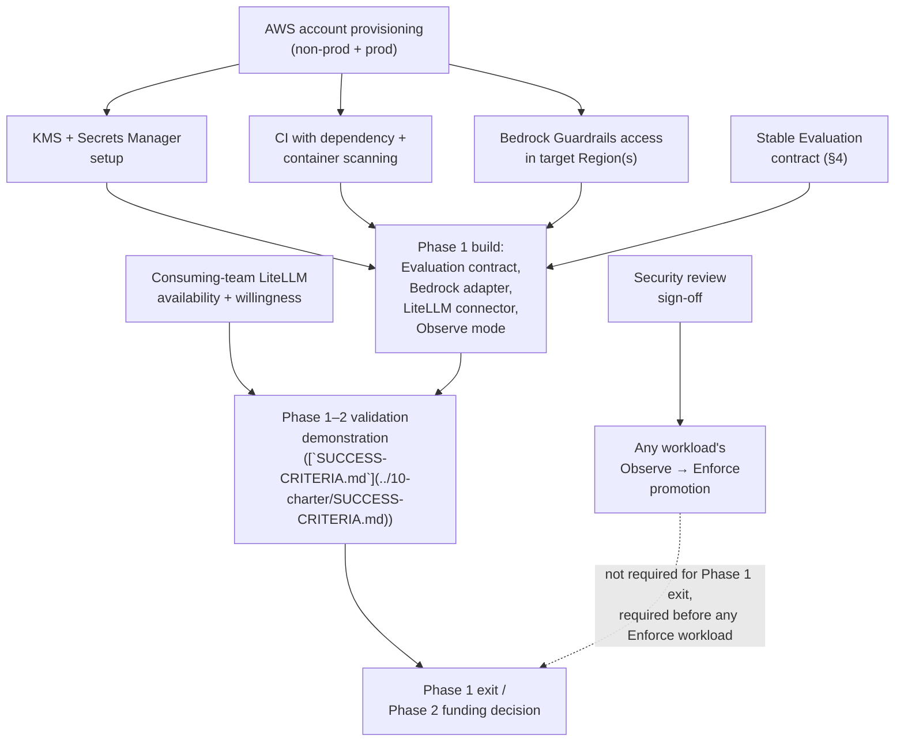

**AI Guardrails — Delivery Dependencies**

**Authority level:** L3
**Status:** Draft
**Date:** 2026-07-24
**Derived from:** AGREEMENTS.md

---

> **Current local release (2026-10-08):** [DEC-022](../00-source-of-truth/DECISIONS.md#dec-022--define-a-separately-accepted-local-technical-proof), grounded in AGR-022 through AGR-024, defines a separately accepted local technical proof for internal application teams, operated through an API and CLI. AWS integration and service exposure to other teams are later milestones. This document retains its programme and hosted-phase obligations; cloud-specific requirements are not local-release exit gates, and local substitutes do not prove those controls. The current boundary and interview status are in [RELEASE-DEFINITION.md](RELEASE-DEFINITION.md).

## Purpose and authority

This document registers the dependencies that gate AI Guardrails delivery — the things that must exist, be granted, or be confirmed before a given phase or milestone can start or complete. It is a **derived (L3)** document: it must not contradict [`AGREEMENTS.md`](../00-source-of-truth/AGREEMENTS.md) or [`CONSTRAINTS.md`](../00-source-of-truth/CONSTRAINTS.md) (both L1 — authoritative), and it operationalizes, for delivery planning, dependencies already named qualitatively in [`../50-architecture/DEPLOYMENT-ARCHITECTURE.md`](../50-architecture/DEPLOYMENT-ARCHITECTURE.md), [`../00-source-of-truth/CONSTRAINTS.md`](../00-source-of-truth/CONSTRAINTS.md), [`../70-governance/RISK-REGISTER.md`](../70-governance/RISK-REGISTER.md) and in [`30-executive/RISKS-AND-DEPENDENCIES.md`](../30-executive/RISKS-AND-DEPENDENCIES.md) §4. Where a figure (a date, a duration, a percentage) would normally accompany a dependency, none exists in the source material, and this document says **TBD** rather than inventing one.

This document differs from [`30-executive/RISKS-AND-DEPENDENCIES.md`](../30-executive/RISKS-AND-DEPENDENCIES.md) in altitude and audience: that document gives leadership a decision-relevant summary of principal risks *and* dependencies; this document gives the delivery team a working register of *only* dependencies, at the granularity needed to sequence build work — including a purely technical/internal sequencing dependency (a stable Evaluation contract before connector work) that is delivery-relevant but not leadership-relevant enough to appear in the executive view.

Related documents:

- [`00-source-of-truth/AGREEMENTS.md`](../00-source-of-truth/AGREEMENTS.md) — authoritative agreements, especially AGR-004 (Bedrock Guardrails as first engine), AGR-006 (one logical evaluation contract), AGR-013 (AWS, minimal account model), AGR-020 (five-phase delivery).
- [`00-source-of-truth/DECISIONS.md`](../00-source-of-truth/DECISIONS.md) — DEC-008, which records the Phase 1–2 validation demonstration this register's consuming-team dependency gates.
- [`00-source-of-truth/CONSTRAINTS.md`](../00-source-of-truth/CONSTRAINTS.md) — CON-002 (minimal account model), CON-008/CON-009 (TLS, KMS), CON-010 (IAM authentication).
- [`00-source-of-truth/ASSUMPTIONS.md`](../00-source-of-truth/ASSUMPTIONS.md) — the unvalidated beliefs (ASM-002, ASM-003, ASM-006, ASM-008, ASM-016) underlying several dependencies below.
- [`30-executive/RISKS-AND-DEPENDENCIES.md`](../30-executive/RISKS-AND-DEPENDENCIES.md) — the executive-facing summary this register expands on.
- [`50-architecture/DEPLOYMENT-ARCHITECTURE.md`](../50-architecture/DEPLOYMENT-ARCHITECTURE.md) — the minimal MVP account model (AGR-013/CON-002) and AWS service mapping these dependencies provision against.
- [`50-architecture/INTEGRATION-ARCHITECTURE.md`](../50-architecture/INTEGRATION-ARCHITECTURE.md) — §3, "The evaluation contract," the artifact the connector-sequencing dependency (§4 below) depends on.
- [`50-architecture/NON-FUNCTIONAL-REQUIREMENTS.md`](../50-architecture/NON-FUNCTIONAL-REQUIREMENTS.md) — NFR-SEC-006 (dependency/container scanning) and the Security section this document's CI dependency operationalizes.
- [`20-product/PRODUCT-ROADMAP.md`](../20-product/PRODUCT-ROADMAP.md) — the five phases referenced throughout the "Needed for" column.
- [`IMPLEMENTATION-STRATEGY.md`](IMPLEMENTATION-STRATEGY.md), [`MILESTONES.md`](MILESTONES.md), [`RELEASE-CRITERIA.md`](RELEASE-CRITERIA.md), [`VALIDATION-PLAN.md`](VALIDATION-PLAN.md) — sibling delivery documents that consume this register for sequencing and phase-gate criteria.

---

## How to read this document

- **Section 2** is the dependency register: one row per dependency, with a **Type**, the phase or milestone it gates, an accountable **Owner**, and its current **Status**.
- **Section 3** gives one short subsection per dependency, with the reasoning and source citation behind each register row.
- **Section 4** expands the one dependency in this set that is a pure delivery-sequencing constraint rather than an external or provisioning dependency — a stable Evaluation contract must exist before LiteLLM connector work is built against it.
- **Section 5** shows how the dependencies in Section 2 gate the Phase 1–2 critical path as a diagram.
- **Section 6** defines the Type and Status conventions used throughout, so the register can be updated consistently as dependencies resolve.

---

## 1. Type conventions

| Type | Meaning |
|---|---|
| **Internal** | Resolved by the organization's own internal functions (IT, cloud governance, security/compliance) that sit outside the AI Guardrails delivery team's direct control, but inside the organization. |
| **External** | Resolved by a party outside the AI Guardrails delivery team's organizational unit — a consuming team acting on its own adoption timeline, or an external cloud vendor (AWS) whose regional service availability the team cannot control. |
| **Technical** | Resolved by the delivery team itself building or configuring something — an engineering sequencing constraint, or infrastructure/tooling setup work. |

---

## 2. Dependency register

| Dependency | Type | Needed for (phase/milestone) | Owner | Status |
|---|---|---|---|---|
| [AWS account provisioning — non-production and production](#31-aws-account-provisioning--non-production-and-production) | Internal | Phase 1 kickoff (all infrastructure work) | Platform operations lead | Unconfirmed |
| [Amazon Bedrock Guardrails access in target Region(s)](#32-amazon-bedrock-guardrails-access-in-target-regions) | External | Phase 1 — Bedrock Guardrails adapter deliverable | Architecture lead | Unconfirmed |
| [Stable Evaluation contract before connector work](#33-stable-evaluation-contract-before-connector-work) | Technical | Phase 1 — LiteLLM connector deliverable | Technical lead | Not started |
| [Consuming-team LiteLLM availability and willingness to install the connector](#34-consuming-team-litellm-availability-and-willingness-to-install-the-connector) | External | Phase 1/2 — validation demonstration ([`SUCCESS-CRITERIA.md`](../10-charter/SUCCESS-CRITERIA.md); DEC-008) | Integration lead / Delivery lead | Unconfirmed |
| [Security review sign-off](#35-security-review-sign-off) | Internal | Any workload's Observe → Enforce promotion; any external-customer onboarding | Security and governance lead | Not yet exercised |
| [KMS and Secrets Manager setup](#36-kms-and-secrets-manager-setup) | Technical | Phase 1 — encryption at rest/in transit, runtime credential storage | Platform operations lead / Technical lead | Not started |
| [CI with dependency and container scanning](#37-ci-with-dependency-and-container-scanning) | Technical | Every build, Phase 1 onward; release-blocking gate | Technical lead | Not started |

---

## 3. Dependency detail

### 3.1 AWS account provisioning — non-production and production

Phases 1–2 require exactly one non-production AWS account and one production AWS account, with IAM, storage, and environment boundaries kept explicit within that two-account model ([`DEPLOYMENT-ARCHITECTURE.md`](../50-architecture/DEPLOYMENT-ARCHITECTURE.md); [`AGREEMENTS.md` AGR-013](../00-source-of-truth/AGREEMENTS.md#agr-013--aws-as-primary-cloud-minimal-mvp-account-model); [`CONSTRAINTS.md` CON-002](../00-source-of-truth/CONSTRAINTS.md#con-002--minimal-mvp-account-model)). No AWS infrastructure work — evaluation runtime, API layer, policy storage, workload registry, audit pipeline — can begin before these two accounts exist and are access-configured.

**Why it gates Phase 1:** every other technical dependency in this register (Bedrock Guardrails access, KMS/Secrets Manager setup, CI deployment targets) is provisioned *into* one of these two accounts. Account provisioning is therefore the first link in the delivery chain, not one dependency among many.

**Status basis:** tracked as unconfirmed in [`ASSUMPTIONS.md` ASM-006](../00-source-of-truth/ASSUMPTIONS.md#b-technical-and-infrastructure-feasibility) — the accounts have not yet been confirmed as provisioned and access-configured within the delivery timeline.

---

### 3.2 Amazon Bedrock Guardrails access in target Region(s)

Amazon Bedrock Guardrails is the first managed evaluation engine the platform adopts, normalized behind a vendor-independent decision structure ([`AGREEMENTS.md` AGR-004](../00-source-of-truth/AGREEMENTS.md#agr-004--bedrock-guardrails-as-first-engine-vendor-independent-contract)). The Bedrock Guardrails adapter — a Phase 1 deliverable per [`PRODUCT-ROADMAP.md`](../20-product/PRODUCT-ROADMAP.md#phase-1--integration-proof) — cannot be built and validated against a real engine until Bedrock Guardrails is confirmed available, at acceptable feature parity, in the AWS Region(s) the Phase 1–2 deployment and initial pilot workloads will run in.

**Why it is External:** regional service availability is controlled by AWS, not by the AI Guardrails delivery team; the team can request or wait for expansion but cannot provision it directly.

**Impact if unmet:** the Phase 1–2 build would fall back to deterministic rules only, weakening detection quality, or would need to deploy into a Region that conflicts with a consuming team's data-residency preference.

**Status basis:** tracked as unconfirmed in [`ASSUMPTIONS.md` ASM-008](../00-source-of-truth/ASSUMPTIONS.md#b-technical-and-infrastructure-feasibility).

---

### 3.3 Stable Evaluation contract before connector work

The evaluation contract — policy definitions, request structures, decision structures, reason codes, enforcement actions, audit metadata, and policy-version semantics — must be identical across every deployment mode and every connector ([`AGREEMENTS.md` AGR-006](../00-source-of-truth/AGREEMENTS.md#agr-006--one-logical-evaluation-contract-across-all-modes); [`INTEGRATION-ARCHITECTURE.md` §3](../50-architecture/INTEGRATION-ARCHITECTURE.md)). The LiteLLM connector is a **client** of that contract, not an extension of it ([`AGREEMENTS.md` AGR-007](../00-source-of-truth/AGREEMENTS.md#agr-007--policies-are-separate-from-connectors)) — it maps LiteLLM's own request/response shapes onto the contract's stage-appropriate evaluation requests, and translates decisions back into LiteLLM-native effects.

This makes contract stability a **hard prerequisite**, not a parallelizable workstream: building the LiteLLM pre-call/post-call connector against a contract that is still changing means every contract revision forces a matching connector revision, and — because the Phase 1–2 validation demonstration requires two independent LiteLLM instances to receive *consistent* normalized decisions ([`SUCCESS-CRITERIA.md`](../10-charter/SUCCESS-CRITERIA.md); [DEC-008](../00-source-of-truth/DECISIONS.md#dec-008--supersede-the-mvp-bounded-scope-define-and-estimate-the-full-feature-set-across-five-phases)) — an unstable contract at onboarding time would make that consistency unverifiable.

**Why it is Technical:** unlike the account-provisioning or Bedrock-access dependencies, this is not something the delivery team is waiting on an external party for — it is an internal design-then-build sequencing rule the team must enforce on itself.

**Practical rule:** the Evaluation contract (a named Phase 1 deliverable) must reach a frozen/versioned state — even if only a v0 — before the LiteLLM connector (also a named Phase 1 deliverable) is built against it. See §4 for the sequencing diagram.

---

### 3.4 Consuming-team LiteLLM availability and willingness to install the connector

Mode A (Remote Evaluation) requires the consuming team to already operate its own LiteLLM instance ([AGR-002](../00-source-of-truth/AGREEMENTS.md#agr-002--three-deployment-modes), Mode A). The Phase 1–2 validation demonstration further requires **two organizationally independent** LiteLLM instances, each consuming the same policy, neither sharing model-provider credentials with the guardrail platform ([`SUCCESS-CRITERIA.md`](../10-charter/SUCCESS-CRITERIA.md); [DEC-008](../00-source-of-truth/DECISIONS.md#dec-008--supersede-the-mvp-bounded-scope-define-and-estimate-the-full-feature-set-across-five-phases)). Both the existence of a LiteLLM deployment and that team's willingness to install and cooperate with the connector are outside the AI Guardrails delivery team's control.

**Why it is External:** these are other teams, operating on their own adoption timeline and trust posture ([AGR-018](../00-source-of-truth/AGREEMENTS.md#agr-018--trust-and-enforcement-model), cooperative integration) — the connector "can be disabled, removed, or misconfigured" by design in the cooperative model, so willingness is a genuine, ongoing dependency, not a one-time approval.

**Impact if unmet:** without at least two independent, cooperating teams, the falsifiable Phase 1–2 validation demonstration cannot be executed as specified, and Phase 1–2 validation would need to be redefined or delayed.

**Status basis:** tracked as unconfirmed in [`ASSUMPTIONS.md` ASM-002](../00-source-of-truth/ASSUMPTIONS.md#a-demand-adoption-and-trust-assumptions) and [ASM-003](../00-source-of-truth/ASSUMPTIONS.md#a-demand-adoption-and-trust-assumptions).

---

### 3.5 Security review sign-off

Security and compliance teams own policy approval, exception criteria, retention requirements, and audit requirements ([`TEAM-AND-OWNERSHIP.md`](TEAM-AND-OWNERSHIP.md)). A workload cannot be promoted from Observe to Enforce, and no external customer can be onboarded, without security and compliance stakeholders having reviewed the policy content, the content-exposure documentation for the workload's deployment mode, and its enforcement posture ([`AGREEMENTS.md` AGR-010](../00-source-of-truth/AGREEMENTS.md#agr-010--guardrails-are-not-authorization), [AGR-018](../00-source-of-truth/AGREEMENTS.md#agr-018--trust-and-enforcement-model)).

**Why it is Internal:** the security and governance function is inside the organization but outside the AI Guardrails delivery team, and its sign-off process is not something the delivery team can accelerate unilaterally.

**Impact if unmet:** workloads stall in Observe mode indefinitely, or — worse — are promoted without the sign-off the program's own trust model requires.

**Status basis:** flagged as "not yet exercised" in [`30-executive/RISKS-AND-DEPENDENCIES.md`](../30-executive/RISKS-AND-DEPENDENCIES.md#4-principal-dependencies) and tracked via [`ASSUMPTIONS.md` ASM-016](../00-source-of-truth/ASSUMPTIONS.md#e-security-compliance-and-policy-governance-assumptions) and [`OPEN-QUESTIONS.md` OQ-014](../00-source-of-truth/OPEN-QUESTIONS.md#g-promotion-governance).

---

### 3.6 KMS and Secrets Manager setup

Data handled by the platform must be encrypted in transit and at rest using AWS KMS-backed encryption, covering policy storage, the workload registry, audit event buffers/archives, and any cached policy data in customer-managed runtimes ([`CONSTRAINTS.md` CON-009](../00-source-of-truth/CONSTRAINTS.md#con-009--kms-encryption-in-transit-and-at-rest); [`DEPLOYMENT-ARCHITECTURE.md`](../50-architecture/DEPLOYMENT-ARCHITECTURE.md), [`DATA-ARCHITECTURE.md`](../50-architecture/DATA-ARCHITECTURE.md), [`CONSTRAINTS.md`](../00-source-of-truth/CONSTRAINTS.md)). AWS Secrets Manager is the designated store for runtime credentials and other secrets ([`DEPLOYMENT-ARCHITECTURE.md`](../50-architecture/DEPLOYMENT-ARCHITECTURE.md)).

**Why it is Technical:** this is infrastructure the delivery team configures itself, inside the accounts from §3.1, rather than something granted by an external party.

**Why it gates Phase 1:** the evaluation runtime, policy storage, and audit pipeline all depend on KMS keys and Secrets Manager entries existing before they can be deployed with encryption and credential handling in place — this is not an optional hardening pass added after Phase 1, it is part of the Phase 1 account/environment setup.

**Status basis:** not yet started; no KMS keys or Secrets Manager configuration have been described as provisioned in the source material.

---

### 3.7 CI with dependency and container scanning

The product must support dependency and container scanning as a security requirement ([`CONSTRAINTS.md`](../00-source-of-truth/CONSTRAINTS.md)). Concretely: 100% of runtime container images and declared dependencies must be scanned for known vulnerabilities before deployment, with unresolved critical findings blocking release pending an explicit exception ([`NON-FUNCTIONAL-REQUIREMENTS.md` NFR-SEC-006](../50-architecture/NON-FUNCTIONAL-REQUIREMENTS.md#nfr-sec-006--dependency-and-container-scanning)).

**Why it is Technical:** this is CI/CD tooling the delivery team builds and operates, not a grant from an external or internal-but-separate function.

**Why it gates every build, not just one phase:** NFR-SEC-006 requires this gate on **every build from Phase 1 onward**, and re-verified for each new deployment artifact added later — including the container, Helm chart, and ECS template that Phase 4's customer-managed packaging introduces. Unlike the other dependencies in this register, this one does not resolve once; it must remain continuously satisfied for the life of the program.

**Status basis:** not yet started; no CI scanning pipeline has been described as configured in the source material.

---

## 4. Sequencing constraint: Evaluation contract before connector work

Unlike the provisioning and cooperation dependencies above, §3.3 is an ordering rule internal to delivery, not a wait on an external party. It is called out separately because getting the order wrong is the one dependency failure mode that is entirely within the delivery team's own power to avoid or create.

If the connector is built against a contract that has not stabilized, every subsequent contract revision forces a matching connector revision — and because the Phase 1–2 validation demonstration requires *consistent* decisions across two independent LiteLLM instances ([`SUCCESS-CRITERIA.md`](../10-charter/SUCCESS-CRITERIA.md); DEC-008), an unstable contract at onboarding time makes that consistency unverifiable. The practical rule: freeze/version the Evaluation contract (even a v0) before starting connector build work, not after.

---

## 5. Dependency-to-phase critical path

Every dependency on the left of this diagram is currently **Unconfirmed** or **Not started** (Section 2). Account provisioning, Bedrock Guardrails regional access, and confirmed consuming-team cooperation sit on the critical path to the Phase 1 build and the Phase 1–2 validation demonstration; KMS/Secrets Manager setup and CI scanning are prerequisites for that same build to be deployable at all; and the Evaluation-contract sequencing rule (§4) determines whether the connector work inside Phase 1 needs to be redone.

---

## 6. Status and Type conventions used in Section 2

| Status | Meaning |
|---|---|
| **Unconfirmed** | An external or internal party's commitment, access grant, or availability has not yet been verified against the delivery timeline. Mirrors the "Unvalidated" state used for related entries in [`ASSUMPTIONS.md`](../00-source-of-truth/ASSUMPTIONS.md). |
| **Not started** | Work the delivery team itself must perform (a Technical-type dependency) has not yet begun. |
| **Not yet exercised** | A defined process (e.g., security review) exists conceptually but has not yet been run against a real workload or policy. |
| **In progress** *(not used above, reserved for future updates)* | Work has begun but is not complete. |
| **Confirmed / Complete** *(not used above, reserved for future updates)* | The dependency is resolved and no longer blocks downstream work. |

No dependency in Section 2 is currently marked Confirmed or Complete — this reflects the pre-delivery state of the program at the time of writing, not a gap in this document. As each dependency resolves, this register should be updated in place rather than superseded, consistent with how [`ASSUMPTIONS.md`](../00-source-of-truth/ASSUMPTIONS.md) tracks its own validation lifecycle.

---

## Related documents

- [`30-executive/RISKS-AND-DEPENDENCIES.md`](../30-executive/RISKS-AND-DEPENDENCIES.md) — the executive-facing summary of principal risks and dependencies this register expands on with delivery-level detail.
- [`00-source-of-truth/AGREEMENTS.md`](../00-source-of-truth/AGREEMENTS.md) — authoritative agreement register (L1); see especially AGR-004, AGR-006, AGR-007, AGR-013, AGR-018, AGR-020.
- [`00-source-of-truth/CONSTRAINTS.md`](../00-source-of-truth/CONSTRAINTS.md) — non-negotiable technical and security boundaries (L1); see especially CON-002, CON-008, CON-009, CON-010.
- [`00-source-of-truth/ASSUMPTIONS.md`](../00-source-of-truth/ASSUMPTIONS.md) — unvalidated beliefs underlying the status of every dependency in Section 2.
- [`00-source-of-truth/OPEN-QUESTIONS.md`](../00-source-of-truth/OPEN-QUESTIONS.md) — open governance questions, including promotion-review process (OQ-014), that affect the security-review dependency.
- [`50-architecture/DEPLOYMENT-ARCHITECTURE.md`](../50-architecture/DEPLOYMENT-ARCHITECTURE.md) — the minimal MVP account model (§8) and AWS service mapping (§7) that the account-provisioning and KMS/Secrets Manager dependencies provision against.
- [`50-architecture/INTEGRATION-ARCHITECTURE.md`](../50-architecture/INTEGRATION-ARCHITECTURE.md) — §3, "The evaluation contract," and the LiteLLM connector responsibilities the §3.3/§4 sequencing dependency applies to.
- [`50-architecture/NON-FUNCTIONAL-REQUIREMENTS.md`](../50-architecture/NON-FUNCTIONAL-REQUIREMENTS.md) — NFR-SEC-006 (dependency/container scanning), the Security section this document's CI dependency operationalizes.
- [`20-product/PRODUCT-ROADMAP.md`](../20-product/PRODUCT-ROADMAP.md) — the five delivery phases referenced in the "Needed for" column of Section 2.
- [`IMPLEMENTATION-STRATEGY.md`](IMPLEMENTATION-STRATEGY.md), [`MILESTONES.md`](MILESTONES.md), [`RELEASE-CRITERIA.md`](RELEASE-CRITERIA.md), [`VALIDATION-PLAN.md`](VALIDATION-PLAN.md) — sibling delivery documents that consume this register for phase-gate criteria and detailed sequencing.
- [`../00-source-of-truth/PROVENANCE.md`](../00-source-of-truth/PROVENANCE.md) — where the original charter material behind this register now lives; the register is derived from.
